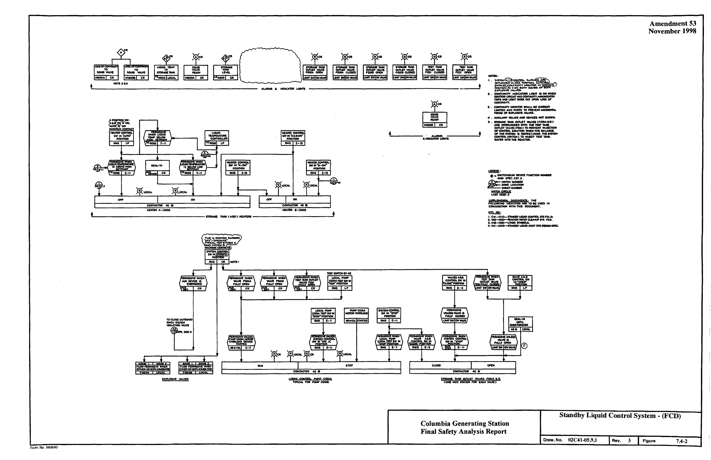
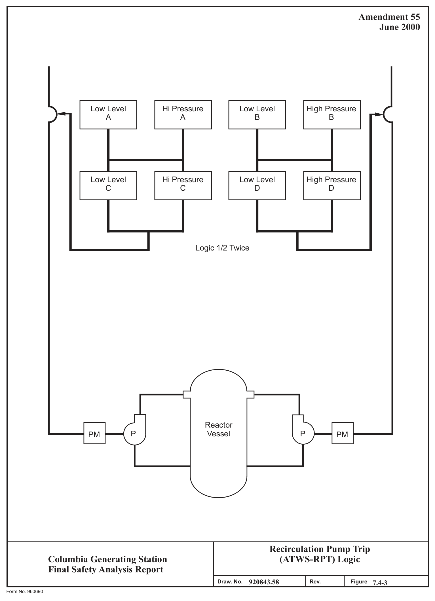
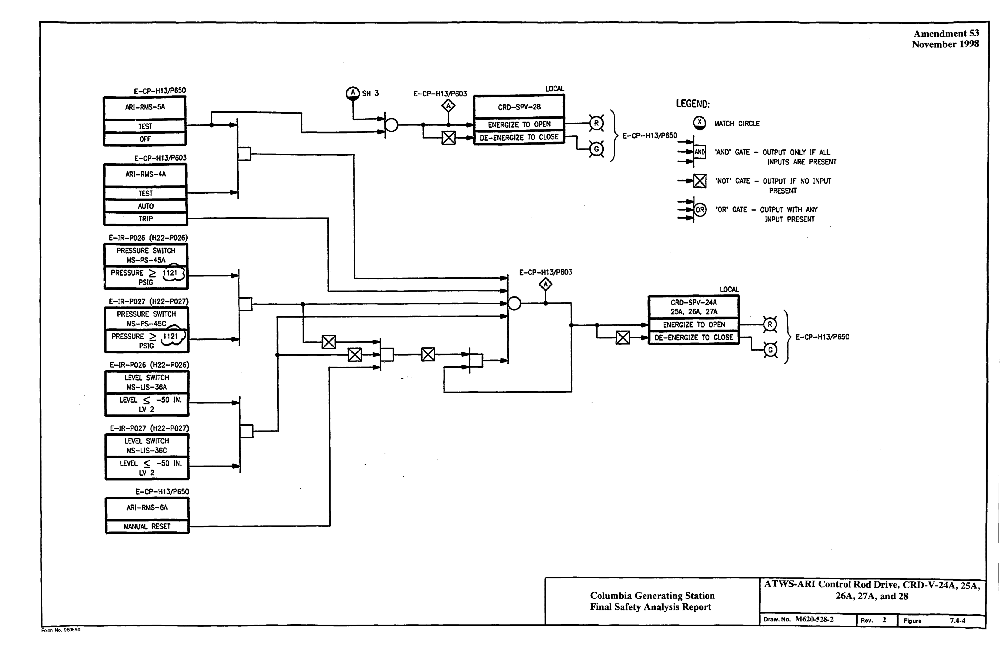
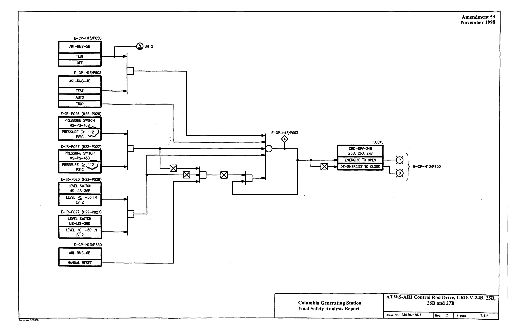

# 7.4 SYSTEMS REQUIRED FOR SAFE SHUTDOWN

> Columbia Generating Station FSAR — Chapter 07: Instrumentation and Control Systems
> Source: `07_chapter-2550-2965.pdf`, PDF pages 197–229 (of 416)
> Amendment 67 compilation (individual pages carry varying amendment dates)

---
<!-- p.197 -->
### 7.4 SYSTEMS REQUIRED FOR SAFE SHUTDOWN
#### 7.4.1 DESCRIPTION
This section discusses the instrumentation and controls of the following systems required for safe plant shutdown:

a. Reactor core isolation cooling (RCIC) system,

b. Standby liquid control (SLC) system,

c. Residual heat removal shutdown cooling mode (RHR-SDC),

d. Remote shutdown system (RSS),

e. Anticipated transient without scram recirculation pump trip system
(ATWS-RPT), and

f. Anticipated transient without scram alternate rod insertion (ATWS-ARI).

The systems discussed in this section are all capable of assisting the operator in achieving a safe plant shutdown. The remote shutdown and SLC systems are manually operated backups to the control room and reactor manual control systems, respectively, and are only required for special event conditions. Their use is not required to achieve a safe shutdown under normal, transient, or accident conditions. The normal shutdown cooling mode of residual heat removal
(RHR) is available to the operator to remove residual heat when the reactor is shut down.
Recirculation pump trip (ATWS-RPT) is used in conjunction with alternate rod insertion (ARI)
and SLC to mitigate an ATWS event. Design of the ATWS-RPT and ARI systems is in accordance with the criteria provided in Reference 7.4-1. Loss of any of the systems will not impede safe shutdown of the plant. As such these systems are not required to be safety-related
(except RCIC and alternate RHR SDC) and have not been designed to meet safety system requirements.

The sources that supply power to the safe shutdown systems originate from onsite ac and/or dc safety-related and non-safety-related buses. See Chapter 8 for a complete discussion of the safety-related and non-safety-related power sources.

##### 7.4.1.1 Reactor Core Isolation Cooling System
###### 7.4.1.1.1 Function
The RCIC system (see Section 5.4.6.2) is designed to maintain or supplement reactor vessel water inventory during the following conditions.

<!-- p.198 -->
a. Normal Operation. When the reactor vessel is isolated from its primary heat sink (main condenser) and accompanied by a loss or unavailability of the reactor feedwater system; and

b. When the plant is being shut down and normal coolant flow from the feedwater system is stopped before the reactor is depressurized to a level where the reactor shutdown cooling mode of the RHR system can be placed into operation.

###### 7.4.1.1.2 Operation
Schematic arrangements of system mechanical equipment are shown in Figure 5.4-11. The RCIC system component control logic is shown in Figure 7.4-1. Instruments are listed in Table 7.4-1. Operator information displays are shown in Figures 5.4-11 and 7.4-1.

The RCIC system can be initiated either manually or automatically. The control room operator can initiate RCIC by operating the manual initiation push button which simulates an automatic initiation or by activating each piece of equipment sequentially as required.

The RCIC system is automatically initiated by four redundant level switches, arranged in a one-out-of-two-twice logic configuration, which sense reactor vessel low water level (trip level 2).

The RCIC steam line isolation and the turbine steam exhaust motor-operated valves are normally open with their control switches key locked in the open position, and the turbine trip and throttle valve is normally open and these valves require no change of position for automatic system initiation. (Note: the key locked control switches do not prevent automatic isolation of these valves.)

The RCIC system responds to an automatic initiation signal as follows (actions are simultaneous unless stated otherwise):

a. The pump suction from the condensate storage tanks valve RCIC-V-10
(MO F010) is signaled open;

b. To ensure pump discharge flow is directed to the reactor vessel only, the test return line to the condensate storage tanks valves RCIC-V-22 (MO F022) and RCIC-V-59 (MO F059) are signaled closed;

c. The turbine steam inlet and the turbine lube oil cooler cooling water supply valves RCIC-V-45 (MO F045) and RCIC-V-46 (MO F046) are signaled to open;

<!-- p.199 -->
d. When the turbine steam inlet valve RCIC-V-45 (MO F045) starts to open, the RCIC pump discharge to reactor vessel valve RCIC-V-13 (MO F013) and the turbine lube oil cooler supply valve RCIC-V-46 (F046) are signaled open.
Valves RCIC-V-13 (MO F013) and RCIC-V-46 (F046) are prohibited from opening or if open, automatically closes when RCIC-V-45 (MO F045) or the turbine trip and throttle valve RCIC-V-1 (MO F001) is closed. A one-out-oftwo-twice limit switch logic trips the main turbine on the opening of RCIC-V-13
(MO F013) and RCIC-V-45 (MO F045) to limit moisture introduction;

e. The barometric condenser vacuum tank vacuum pump is signaled to start; and

f. When valve RCIC-V-45 (MO F045) leaves the closed position the RCIC turbine is accelerated until the automatic flow controller setpoint is reached and the system discharge flow is controlled by the turbine electronic governor mechanism.

RCIC flow may be directed away from the vessel by diverting the pump discharge to the CST.
This is accomplished by closing injection valve RCIC-V-13 and opening the test return valves
(RCIC-V-22 and 59). The system is returned to injection mode by closing RCIC-V-59 and then opening RCIC-V-13. This mode of operation will not be used during events where an unacceptable source term is identified in primary containment. Diverting RCIC flow to the CST is not a safety-related function nor does this mode affect the ability of RCIC to initiate during plant transients. The system automatically switches to injection mode if the water level decreases to the low level initiation point (Level 2).

During system operation if the barometric condenser vacuum tank water level becomes high the condenser condensate discharge pump is automatically started and the condensate returned to the RCIC pump suction. When the system is not operating excess tank water is discharged through isolation valves RCIC-V-4 (AO F004) and RCIC-V-5 (AO F005) to the equipment drain system.

In the event the water level in the condensate storage tanks should become low the RCIC pump suction is automatically transferred from the condensate storage tank(s) to the suppression pool by opening valve RCIC-V-31 (MO F031). Two level switches mounted on a Seismic Category I standpipe in the reactor building are used to detect low water level in the condensate storage tank(s). Either switch can cause automatic suction transfer. Once valve RCIC-V-31 (F031) is fully open the condensate storage tank valve RCIC-V-10 (MO F010) is automatically closed.

The RCIC system includes design features which provide system equipment protection or accomplish primary containment isolation if certain types of abnormal events occur. The RCIC turbine is automatically shut down by closing the turbine trip and throttle valve, RCIC-V-1 (MO F001), if any of the following conditions are detected:

<!-- p.200 -->
a. RCIC isolation signals:
i. Low reactor pressure ii. High steam line flow iii. Instrumentation line break iv. High differential temperature across RCIC area cooler v. RCIC equipment area high temperature vi. High turbine exhaust diaphragm pressure vii. Manual isolation b. Turbine overspeed c. High turbine exhaust pressure d. Low pump suction pressure e. Low pressure in the RCIC discharge header(1)
f. Manual turbine trip actuated by the control room operator.

The steam inlet valve RCIC-V-45 (MO F045) is automatically closed and the turbine is shut down if the reactor vessel high water level (level 8) is reached. The isolation valve for RCIC turbine lube oil cooling water, RCIC-V-46 (MO F046), automatically closes if RCIC-V-45
(MO F045) closes, or if the turbine trip and throttle valve RCIC-V-1 closes. Valves RCIC-V-45 (MO F045) and RCIC-V-46 (MO F046) will reopen automatically and the turbine restarts when the water level is subsequently reduced to the low level initiation (level 2).

To protect the RCIC pump from overheating during low flow conditions the pump discharge flow and pressure are monitored. If the pump discharge pressure switch indicates the pump is running and the pump discharge flow switch indicates low flow, the minimum flow return line valve RCIC-V-19 (MO F019) is automatically opened. The minimum flow valve is automatically closed when flow is normal or when either the turbine trip and throttle valve
(RCIC-V-1) or the steam inlet valve RCIC-V-45 (MO F045) is closed.

Air operated (AO) valves RCIC-V-25, RCIC-V-26, and RCIC-V-54 (AO F025, AO F026, and AO F054) and a condensate drain pot are provided in a drain pipe line arrangement just upstream of the turbine inlet valve. On receipt of an RCIC initiation signal, the drainage path is isolated by closing RCIC-V-25 and RCIC-V-26 (AO F025 and AO F026). The water level in the steam line drain condensate pot is controlled by a level switch and a valve RCIC-V-54
(AO F054) which energizes to allow condensate to flow out of the drain pot by bypassing the steam trap, in the event that the trap fails to adequately remove the condensate.

The RCIC system turbine exhaust line vacuum breaker isolation valves RCIC-V-110
(MO F080) and RCIC-V-113 (MO F086) are normally open but close automatically following system trip when both the low steam line pressure and high drywell pressure setpoint are exceeded.

NOTE: (1) This equipment protection feature has been disabled by placing the RCIC-RMS-PIS1 switch in the OVERRIDE position.

<!-- p.201 -->
The leak detection and other protective signals of RCIC system will automatically signal the steam line warmup valve RCIC-V-76 (MO F076) closed, override the key lock control switch position and signal the steam line inboard isolation valve RCIC-V-63 (MO F063) and the outboard steam line isolation valve RCIC-V-8 (MO F008) closed if any of the following abnormal conditions exist:

a. Redundant temperature switches sense RCIC pump room area ventilation air inlet and outlet high differential temperature or high ambient temperature;

b. Redundant temperature switches sense RCIC pipe routing area high ambient temperature;

c. Redundant differential pressure switches sense RCIC steam line high flow or instrument line break (after an approximate 3 sec delay);

d. Redundant pressure switches sense RCIC turbine exhaust diaphragm high pressure. Both switches in the same division must actuate to cause isolation;
and

e. A pressure switch senses RCIC low steam supply pressure.

For a complete description of the RCIC system leak detection isolation signal, see Section 7.6.1.3.1.

The RCIC system may be isolated after initiation by the control room operator by actuation of a push button which causes the outboard steam line isolation valve to close.

##### 7.4.1.2 Standby Liquid Control System
###### 7.4.1.2.1 Function
The SLC system (see Section 9.3.5) instrumentation is designed to initiate injection of a liquid neutron absorber into the reactor. Other instrumentation is provided to maintain this liquid chemical solution well above saturation temperature in readiness for injection.

The SLC system is a redundant method of manually shutting down the reactor to cold shutdown conditions from normal operation or from anticipated transient conditions when manual control rod insertion capability is lost. For the anticipated transient condition, boron solution can be injected into the reactor pressure vessel by running both SLC pumps simultaneously. The quantity of boron required to shut down the nuclear reaction can be injected in approximately 1 hr (see Section 9.3.5.2).

<!-- p.202 -->
###### 7.4.1.2.2 Operation
Schematic arrangements of system mechanical equipment is shown in Figure 9.3-14. The SLC system component control logic is shown in Figure 7.4-2. Operator information displays are shown in Figures 9.3-14 and 7.4-2.

The SLC system is initiated by the control room operator by turning the SYSTEM A or the SYSTEM B or both key locked switches to the OPERATE positions. When either or both of these switches are activated, both of the explosive-operated valves fire and both tank discharge valves (SLC-V-1A and SLC-V-1B) start to open immediately. The pumps are interlocked so that at least one of the two storage tank discharge valves (or the test tank discharge valve when testing) must be open for either or both pumps to run.

When the SLC system is initiated, the outboard isolation valve of the reactor water cleanup
(RWCU) system is automatically closed. This prevents removal of the injected boron by the RWCU demineralizers.

##### 7.4.1.3 Residual Heat Removal System/Shutdown Cooling Mode
###### 7.4.1.3.1 Function
The normal shutdown cooling mode (see Section 5.4.7.1) of the RHR system is used when the reactor is shutdown and, if available, can be used for long-term cooling after vessel water level has been restored following accident conditions.

The RHR-SDC consists of instrumentation designed to provide decay heat removal capability for the core by accomplishing the following:

a. Reactor cooling during shutdown operation after the vessel pressure is reduced to approximately 48 psig,

b. Cooling the reactor water to a temperature at which reactor refueling and servicing can be accomplished, and

c. Diverting part of the shutdown flow to the reactor vessel head to condense the steam generated from the hot walls of the vessel while it is being flooded.

###### 7.4.1.3.2 Operation
See Section 5.4.7.2.6 for a complete description of the RHR-SDC operation.

<!-- p.203 -->
##### 7.4.1.4 Remote Shutdown Systems
###### 7.4.1.4.1 Function
The RSS are designed to achieve a cold reactor shutdown from outside the main control room following these postulated conditions:

a. The plant is at normal operating conditions and all plant personnel have been evacuated from the main control room and it is inaccessible;

b. The initial event that causes the main control room to become inaccessible is assumed to be such that the reactor operator can manually scram the reactor before leaving the main control room. Though the capability exists to manually scram from outside the control room, plant procedures realistically call for scramming before exiting the control room;

c. The main turbine pressure regulators may be controlling reactor pressure via the bypass valves. However, in the interest of demonstrating that the plant can accommodate even loss of the turbine controls, it is assumed that this turbine generator control panel function is also lost. Therefore, main steam line isolation is assumed to occur at a specified low turbine inlet pressure and reactor pressure is relieved through the relief valves to the suppression pool;

d. The reactor feedwater system which is normally available is also assumed to be inoperable. Reactor vessel water inventory is provided by the RCIC system or automatic depressurization system (ADS) and RHR as described in Section 7.4.1.4.2; and

e. Emergency dc power is assumed to be available.

The RSS are required only during times of main control room inaccessibility when normal plant operating conditions exist, i.e., no transients or accidents are occurring. Following such an event the remote shutdown function is provided by two redundant systems: the RSS and the alternate RSS.

###### 7.4.1.4.2 Operation
Some of the existing systems used for normal reactor shutdown operation are also used in the remote shutdown capability to shut down the reactor from outside the main control room. The functions needed for remote shutdown control are provided with manual transfer switches that override controls from the main control room and transfer the controls to the remote shutdown control panels. Remote shutdown control is not possible without actuation of the transfer

<!-- p.204 -->
devices. Necessary power supplies and control logic are also transferred. Operation of the transfer switches causes an alarm in the main control room.

During a main control room fire it has been postulated that high-to-low pressure interface valves RHR-V-8 and RHR-V-9 (series isolation valves) can simultaneously open. This would result in a loss-of-coolant accident (LOCA) outside the primary containment with no I mitigation; these valves cannot close against a 1000 psi differential. For this reason, during normal plant operation, power is removed from RHR-V-9. This precludes operation via I spurious control circuit energization. Access to the remote shutdown panel is administratively and procedurally controlled. All system equipment controls (for essential valves and pumps)
necessary for proper system lineup and complete system control are located on the remote shutdown panels.
I The remote shutdown function can be effected by one of two redundant systems. The primary
(preferred) system uses the RHR system loop B (RHRB) while the secondary uses RHR loop A and is designated as the alternate RSS. The RCIC system is not required for reactor safe shutdown when using the minimum systems analyzed in GE document NEDO-24708A.
I Consequently, the mode of depressurization used for the alternate RSS is based on a rapid depressurization (ADS) in going from event initiation directly to cold shutdown where the low pressure system (RHR A) is used in the alternate shutdown cooling mode. This flow path uses the suppression pool as a heat sink when the service water system (SW loop A) is needed to bring the reactor to the cold low pressure condition.

When the RCIC system is available, then manual actuation of relief valves and the initiation of the RCIC system will maintain reactor water inventory and bring the reactor to a hot shutdown condition after scram. During this phase of shutdown, the suppression pool will be cooled by operating the RHR system in the suppression pool cooling mode. Reactor pressure will be controlled and core decay and sensible heat rejected to the suppression pool by relieving steam pressure through the relief valves.

Manual operation of the relief valves will cool the reactor and reduce its pressure at a controlled rate until reactor pressure becomes so low that the RCIC system is unable to sustain operation. The RHR system will then be operated in the shutdown cooling mode using the RHR system heat exchanger to cool reactor water and bring the reactor to the cold low pressure condition.

Equipment/functions that have transfer and control switches or indicators located on the remote shutdown and the alternate remote shutdown control panels are shown in the Licensee Controlled Specifications.

<!-- p.205 -->
##### 7.4.1.5 Anticipated Transient Without Scram - Recirculation Pump Trip
###### 7.4.1.5.1 Function
The ATWS-RPT function is to trip the reactor recirculation pumps in the event of an abnormal operating occurrence in conjunction with failure of the reactor protection system (RPS).

###### 7.4.1.5.2 Operation
Schematic arrangement of system mechanical equipment is shown in Figure 5.4-6.

The ATWS-RPT is automatically initiated by reactor vessel low water level (level 2) and/or reactor vessel high pressure. Instruments are listed in Table 7.4-2. The sensor logic configuration is “one-out-of-two-twice” for tripping the reactor recirculating pump feeder breakers. See Figure 7.4-3.

The ATWS-RPT system is an energize-to-operate system. The sensor logic channels and the feeder breaker trip coil circuitry receive power from the 125-V dc batteries from Divisions 1 and 2.

##### 7.4.1.6 Anticipated Transient Without Scram - Alternate Rod Insertion
###### 7.4.1.6.1 Function
The ATWS-ARI function is to actuate valves in the scram air header to reduce the air pressure in the header allowing the scram inlet and discharge valves to open providing an alternate scram. The design is diverse and independent from the RPS.

###### 7.4.1.6.2 Operation
Schematic arrangement of the system mechanical equipment is shown in Figure 4.6-5. Logic arrangement is shown in Figures 7.4-4 and 7.4-5.

The ATWS-ARI is automatically initiated by reactor vessel low water level or reactor vessel high pressure. Instruments are listed in Table 7.4-3. The sensor logic configuration is “twoout-of-two” for either parameter input for energizing the scram air header exhaust solenoid valves to vent the header. The system can also be actuated manually. The ATWS-ARI is an energize-to-operate system. The sensor logic channels and solenoid valves receive power from the 125-V dc batteries from Divisions 1 and 2.

<!-- p.206 -->
##### 7.4.1.7 Design Basis
The safe shutdown systems are designed to provide timely protection against the onset and consequences of conditions that threaten the integrity of the fuel barrier and the reactor coolant pressure boundary (RCPB). Chapter 15 identifies and evaluates events that jeopardize the fuel barrier and RCPB. The methods of assessing barrier damage and radioactive material releases, along with the methods by which abnormal events are identified, are presented in Chapter 15.
No design basis accident shall be considered for the RSS systems (including LOCA).
Therefore, control of engineered safety feature (ESF) systems for protective action outside the main control room is not required.

###### 7.4.1.7.1 Variables Monitored to Provide Protective Actions
All safe shutdown systems are initiated by operator actions, with the exception of ATWS-RPT and ATWS-ARI which are actuated by level and/or pressure sensors and RCIC which is activated by low reactor vessel water level (level 2).

The plant conditions which require protective action involving safe shutdown are described in Chapter 15.

###### 7.4.1.7.2 Location and Minimum Number of Sensors
The Technical Specifications identify the minimum number of sensors required to monitor safety-related variables. There are no sensors in the safe shutdown systems which have a spatial dependence.

###### 7.4.1.7.3 Prudent Operational Limits
Prudent operational limits for each safety-related variable trip setting are selected with sufficient margin so that a spurious safe shutdown system initiation is avoided. It is then verified by analysis that the release of radioactive materials, following postulated gross failures of the fuel or the nuclear system process barrier, is kept within acceptable bounds.

###### 7.4.1.7.4 Margin
The margin between operational limits and the allowable values for safe shutdown systems are addressed for those parameters listed in the Technical Specifications.

###### 7.4.1.7.5 Levels
Levels requiring protective action are established in the Technical Specifications.

<!-- p.207 -->
###### 7.4.1.7.6 Range of Transient, Steady State, and Environmental Conditions
See Section 3.11 for environmental conditions. See Sections 8.2.1 and 8.3.1 for the maximum and minimum range of energy supply to the safe shutdown systems instrumentation and controls. All safety-related instrumentation and controls are specified and purchased to withstand the effects of energy supply extremes.

The ATWS-RPT and ATWS-ARI systems are required to function only during an anticipated operational occurrence, not a design basis accident. Therefore, all the ATWS-RPT and ATWS-ARI equipment is located outside containment and is qualified for the temperature, pressure, humidity, and radiation levels experienced during the anticipated operational occurrence.

###### 7.4.1.7.7 Malfunctions, Accidents, and Other Unusual Events Which Could Cause Damage
to Safety Systems

Chapter 15 describes the following credible accidents and events: floods, storms, tornadoes, earthquakes, fires, LOCA, pipe break outside containment, and feedwater line break. Each of these events is discussed below for the safe shutdown systems.

7.4.1.7.7.1 Floods. The buildings containing safe shutdown system components have been designed to meet the probable maximum flood (PMF) at the site location. See Section 2.4.
For a discussion of internal flooding protection see Sections 3.4 and 3.6.

7.4.1.7.7.2 Storms and Tornadoes. The buildings containing safe shutdown system components have been designed to withstand meteorological events described in Section 3.3.

7.4.1.7.7.3 Earthquakes. The structures containing safe shutdown system components have been seismically qualified (or shown to maintain integrity) as described in Sections 3.7 and 3.8 and will remain functional during and following a safe shutdown earthquake (SSE). Seismic qualification of instrumentation and electrical equipment is discussed in Section 3.10.

7.4.1.7.7.4 Fires. To protect the safe shutdown systems in the event of a postulated fire, the redundant portions of the safe shutdown systems are isolated by electrical separation barriers or physical distance. The use of separation and barriers ensures that even though some portion of the systems may be affected, the safe shutdown systems will continue to provide the required protective action. A fire detection system using heat detectors and product of combustion detectors is provided in power generation control complex (PGCC) floor sections and in panels containing safe shutdown system components mounted on these floor sections.
A Halon fire suppression system is provided in the same areas. See Appendix F for a discussion of Appendix R fire protection.

<!-- p.208 -->
7.4.1.7.7.5 Loss-of-Coolant Accident. The safe shutdown systems components located inside containment which are functionally required following a LOCA have been environmentally qualified to remain functional as discussed in Section 3.11.

7.4.1.7.7.6 Pipe Break Outside Primary Containment. Protection is provided for safe shutdown system components, as required from the effects of breaks outside primary containment. See Section 3.6.

###### 7.4.1.7.7.7 Missiles. Protection for safe shutdown systems is described in Section 3.5.

###### 7.4.1.7.8 Minimum Performance Requirements
Minimum performance requirements for safe shutdown systems instrumentation and controls are provided in the Technical Specifications.

##### 7.4.1.8 Final System Drawings
Functional and architectural design difference between the PSAR and FSAR are listed in Table 1.3-8.

#### 7.4.2 ANALYSIS
The safe shutdown systems are designed such that loss of instrument air, a plant load rejection, or a turbine trip will not prevent the completion of the safety function. No abnormal operation is assumed for the RSS which, by itself, performs no safety-related function.

##### 7.4.2.1 Conformance to 10 CFR 50 Appendix A - General Design Criteria
The following is a discussion of conformance to those general design criteria (GDC) which apply specifically to the safe shutdown systems. See Section 3.1 for a discussion of GDC which apply equally to all safety-related systems.

GDC 19 - Control Room

The RSS consists of equipment located outside the control room which is sufficient to provide and ensure safe shutdown of the reactor.

GDC 34 - Residual Heat Removal

Refer to Section 3.1.2.4.5.

<!-- p.209 -->
##### 7.4.2.2 Conformance to IEEE Standards
The following is a discussion of conformance to IEEE 279-1971 which applies specifically to the safe shutdown systems. See Section 7.1.2.3 for a discussion of IEEE Standards which apply equally to all safety-related systems.

General Functional Requirement (IEEE 279-1971, paragraph 4.1)

Since the RSSs, by themselves, do not perform any safety-related function, they do not fall within the criteria set by IEEE 279. However, since certain RSS components interface with safety-related systems, such as RHR and RCIC, during normal operation, they are part of those systems and meet the design criteria for those systems.

Remote shutdown is provided by two redundant systems: the Division 2 RSS and the Division 1 alternate RSS. Portions of these systems are electrically separated by the physical and spatial requirements described in Section 8.3.1.4. A design basis fire in the main control room that fails all components to their worst operational state is considered an incredible event.
As such only the Division 2 power distribution system for the Division 2 remote shutdown is completely isolated from the effects of a main control room fire. Control room interaction that would result in the loss of power to the alternate RSS as well, is not considered credible per Columbia Generating Station (CGS) SSER commitments (licensing condition 12). The RSSs consist of components that are qualified to Quality Class I and Seismic Category I requirements. Operation of any RSS transfer switch is annunciated in the main control room.

The RCIC is automatically initiated when reactor vessel water level is determined to be below a predetermined limit.

The SLC system is initiated by the control room operator. Display instrumentation in the control room provides the operator with information on reactor vessel water level, pressure, neutron flux level, control rod position, and scram valve status allowing assessment of the need for initiation of the SLC system.

The ATWS-RPT and ATWS-ARI are automatically initiated when reactor vessel low water level and/or reactor vessel high pressure predetermined limits are exceeded. ATWS-RPT and ATWS-ARI do not perform a safety-related function and do not fall within the criteria of IEEE 279. However, applicable paragraphs of IEEE 279 are addressed in the following paragraphs:

Single-Failure Criterion (IEEE 279-1971, paragraph 4.2)

The reactor shutdown cooling function is safety related and required to comply with single failure requirements of IEEE 279 and GDC 34. However, the preferred RHR-SDC suction path uses a single loop of the RRC system through two series, redundant division, isolation

<!-- p.210 -->
valves RHR-V-8 and RHR-V-9 and is, therefore, not single failure proof. To meet the single failure requirements of IEEE 279 and GDC 34, a safety related, single failure proof design for this function is provided by the alternate shutdown cooling mode of RHR. See Section 5.4.7.1.1 and the notes to Figure 15.2-10, Activity C1 or C2 for a complete discussion of the alternate shutdown cooling mode of RHR. The alternate shutdown cooling mode is safety related and single failure proof in that two redundant divisions of equipment are available. Since the normal shutdown cooling mode is the preferred path, Energy Northwest will maintain all the preferred path components as safety related, Quality Class I.

The RCIC system alone is not required to meet the single-failure criterion. The RCIC initiation and isolation initiation sensors and associated logic do, however, meet the single-failure criterion for automatic system initiation or isolation. The single-failure criteria is met through physical and electrical separation of equipment as described in Section 8.3.1.4.

The SLC system serves as backup to the control rod drive (CRD) system for controlling reactivity if the CRD fails and is required for ATWS. It is not necessary for the SLC system to meet the single failure criterion.

The ATWS-RPT and ATWS-ARI are not required to meet the single failure criterion.
However, with the exception of the electrical power and the final actuating equipment the system is designed to the single failure criterion.

Quality of Components and Modules (IEEE 279-1971, paragraph 4.3)

See Section 3.11 for safe shutdown system conformance. The ATWS-ARI components are selected to satisfy the quality requirements in Reference 7.4-1.

Equipment Qualification (IEEE 279-1971, paragraph 4.4)

Vendor certification requires that the safe shutdown system sensors, manual switches, and logic components perform in accordance with the requirements listed on the purchase specification as well as in the intended application. This certification, in conjunction with the existing field experience with these components in this application, will serve to qualify these components.

For a discussion of safe shutdown system equipment qualification see Sections 3.5, 3.6, 3.10, and 3.11.

Channel Integrity (IEEE 279-1971, paragraph 4.5)

For a discussion of RCIC and SLC system Channel Integrity under all extremes of conditions described in Sections 7.4.1.1 and 7.4.1.2, see Section 3.11.

<!-- p.211 -->
Channel Independence (IEEE 279-1971, paragraph 4.6)

Channel independence is maintained through application of the CGS separation criteria as described in Section 8.3.1.4.

Control and Protection Interaction (IEEE 279-1971, paragraph 4.7)

The RCIC, SLC, ATWS-RPT, and ATWS-ARI systems have no interaction with plant control systems.

Derivation of Systems Inputs (IEEE 279-1971, paragraph 4.8)

All inputs to the RCIC system, RSS, RHR-SDC, ATWS-RPT, and ATWS-ARI that are essential to their operation are direct measures of appropriate variables.

The SLC system display instrumentation in the control room provides the operator with directly measured information on reactor vessel water level, pressure, neutron flux level, control rod position and valve status. Based on this information the operator can assess the need for the SLC system.

Capability for Sensor Checks (IEEE 279-1971, paragraph 4.9)

See Section 7.4.2.3, Regulatory Guide 1.22.

Capability for Test and Calibration (IEEE 279-1971, paragraph 4.10)

See Section 7.4.2.3, Regulatory Guide 1.22.

Channel Bypass or Removal from Operation (IEEE 279-1971, paragraph 4.11)

Calibration of a sensor which introduces a single instrument channel trip will not cause a protective action without the coincident trip of a second channel. Removal of a sensor from operation during calibration does not prevent the redundant instrument channel from functioning.

Operating Bypasses (IEEE 279-1971, paragraph 4.12)

There are no operating bypasses within the safe shutdown systems.

Indication of Bypasses (IEEE 279-1971, paragraph 4.13)

For a discussion of bypass and inoperability indication see Section 7.1, with the exception of ATWS-RPT and ATWS-ARI, which are under administrative control.

<!-- p.212 -->
Access to Means for Bypassing (IEEE 279-1971, paragraph 4.14)

Access to means of bypassing any safety action or safety function is under the administrative control of the control room supervisor/shift manager. Other approved methods of controlling access to bypasses are also used. These include key locks with administrative control of the access to keys, procedurally controlled equipment lineups, e.g., locked valve checklists, and the use of mechanical locking devices and annunciators and other indications, e.g., BISI
(Regulatory Guide 1.47, Bypass and Inoperable Status Indication for Nuclear Power Plant Safety Systems, described in Section 7.1.2.4). These additional methods help to prevent inadvertent bypasses or to alert the plant operators to safety function bypasses occurring either from equipment failures or from manually induced bypasses that result as part of testing, maintenance, or equipment repair activities.

Key-locked control switches that provide a means of controlling the access to a safety function bypass are designed to allow key removal only in the “safe” or “accident” positions. Access to the associated keys is procedurally controlled. When not in use, keys are under the administrative control of the control room supervisor/shift manager and stored in a key locker.
The keys are audited once per day by the control room supervisor/shift manager. When operation of a key-locked control switch is required to be immediate, such as in the case of the reactor mode switch, the key may be left in the lock during normal plant operation to ensure timely actuation.

Multiple Set Points (IEEE 279-1971, paragraph 4.15)

There are no multiple setpoints within the safe shutdown systems.

Completion of Protective Action Once it is Initiated (IEEE 279-1971, paragraph 4.16)

The RCIC is automatically stopped on high vessel water level, system malfunction trip signals or if steam supply pressure drops below that necessary to sustain turbine operation.

The SLC system explosive valves remain open once fired. The injection valves will not close, and discharge pump motors will continue to run unless terminated by operator action. The ATWS-ARI system once initiated will actuate valves in the scram air header thus providing an alternate method to scram. This action will continue until the trip logic is cleared and the operator resets the system.

Manual Initiation (IEEE 279,1971, paragraph 4.17)

See Sections 7.4.1.1, 7.4.1.2, 7.4.1.3, 7.4.1.4, 7.4.1.5, and 7.4.1.6 for a discussion of the manual initiation of RCIC, SLC, RHR-SDC, RSS, ATWS-RPT, and ATWS-ARI systems.

<!-- p.213 -->
Access to Set Point Adjustment (IEEE 279-1971, paragraph 4.18)

All access to setpoint adjustments for RHR-SDC, RCIC, ATWS-RPT, and ATWS-ARI are under administrative control of the control room supervisor/shift manager.

The operation of the SLC system is not dependent on or affected by any setpoint adjustment or calibration.

Identification of Protective Actions (IEEE 279-1971, paragraph 4.19)

Automatic initiation of the RCIC system is annunciated in the control room.

The ATWS-RPT breaker trip is annunciated in the control room. The ATWS-ARI system initiation is annunciated in the control room.

The explosive valve status of the SLC system, once fired, is indicated in the control room.

Information Readout (IEEE 279-1971, paragraph 4.20)

The RCIC, ATWS-RPT, and ATWS-ARI systems are designed to provide the operator with accurate and timely information pertinent to their status. They do not give anomalous indications confusing to the operator.

The SLC system discharge pressure of the pumps and storage tank level is indicated in the control room.

System Repair (IEEE 279-1971, paragraph 4.21)

The RCIC, SLC, ATWS-RPT, and ATWS-ARI systems are designed to permit repair or replacement of components during normal plant operation.

Recognition and location of a failed component will be accomplished during periodic testing or by annunciation in the control room.

Identification (IEEE 279-1971, paragraph 4.22)

Controls and instruments for RCIC, SLC, ATWS-RPT, and ATWS-ARI systems are located in the main control room and clearly identified by nameplates. Relays are located in separate panels for RCIC, SLC, ATWS-RPT, and ATWS-ARI systems use only. Relays and panels are identified by nameplates. All wiring and cabling is labeled to indicate its divisional assignment as well as its system assignment (see Section 8.3.1.3).

<!-- p.214 -->
##### 7.4.2.3 Regulatory Guides Conformance
Regulatory Guide conformance for remote shutdown control and instrumentation is provided in this chapter for each system whose instrumentation and controls interface with the RSS.

Conformance to Regulatory Guides for the RHR shutdown cooling mode is discussed in Section 7.3.2.

The following is a discussion of conformance to those Regulatory Guides which apply specifically to the RCIC, SLC, ATWS-RPT, and ATWS-ARI systems. See Section 7.1.2.4 for a discussion of Regulatory Guides which apply equally to all safety-related systems.

Regulatory Guide 1.22 - Periodic Testing of Protection System Actuation Functions

The RCIC system, with the exception of RCIC-V-13 (injection valve), is capable of being completely tested during normal plant operation to verify that each element of the system is capable of performing its intended safety function. RCIC-V-13 is operability tested during plant shutdown.

The explosive valves may be tested during plant shutdown. The explosive valve control circuits are continuously monitored and annunciated in the control room. The remainder of the SLC system may be tested during normal plant operation to verify that each element is capable of performing its intended function.

Testing of RCIC, SLC, ATWS-RPT, and ATWS-ARI systems sensors during normal plant operation is accomplished by valving out each sensor from its process line and applying a test pressure source. This verifies the operability of the sensor, its calibration range, and the operability of associated control room logic components.

Also, the ATWS-RPT trip logic up to the breaker trip can be tested during plant operation.
The ATWS-ARI trip logic can be tested up to the solenoid valves during plant operation.

Regulatory Guide 1.53 - Application of the Single-Failure Criterion to Nuclear Power Plant Protection Systems

See Section 7.4.2.2 and IEEE 279, paragraph 4.2, for the RCIC, SLC, ATWS-RPT, and ATWS-ARI systems.

Regulatory Guide 1.62 - Manual Initiation of Protective Actions

The SLC system is actuated by two key-locked switches on the main control room console.
Operating either switch starts one of the injection pumps, actuates both of the explosive valves,

<!-- p.215 -->
opens both pump suction motor-operated valves, and closes the RWCU system outboard isolation valve.

The ATWS-RPT feeder breakers can be initiated manually from the main control room by actuation of the feeder breaker control switch.

The ATWS-ARI scram air header blowdown valves can be manually initiated from the main control room.

The RCIC system can be manually initiated for vessel water level makeup.

#### 7.4.3 REFERENCES
7.4-1 NEDE-31096-P, Licensing Topical Report, Anticipated Transients Without Scram, response to NRC ATWS RULE 10 CFR 50.62, December 1985.

<!-- p.216 -->
Table 7.4-1

Reactor Core Isolation Cooling System Instrumentation

Instrumenta Function

Reactor vessel high water level (level 8)
Level switch
(B22-N024B, D)

#### MS-LIS-24B, D
Pump low suction pressure Pressure switch
(E51-N006)

#### RCIC-PS-6
Reactor vessel low water level (level 2)
Level switch
(B22-N037A-D)

#### MS-LIS-37A-D
Drywell high pressure Pressure switch
(B22-N048A-D)

#### MS-PS-48A-D
Condensate storage tanks low water level Level switch
(E51-N015A, B)

#### RCIC-LS-15A, B
a Instruments in parentheses are the GE designation.

<!-- p.217 -->
Table 7.4-2

ATWS-Recirculation Pump Trip System Instrumentation

Instrumenta Function

Reactor vessel low water level (level 2)
Level indicating switch

#### MS-LIS-36A-D
(B22-N036)

Reactor vessel high pressure Pressure switch

#### MS-PS-45A-D
(B22-N045)

a Instruments in parentheses are the GE designation.

<!-- p.218 -->
Table 7.4-3

ATWS-Alternate Rod Insertion System Instrumentation

Instrumenta Function

Reactor vessel low water level (level 2)
Level indicating switch

#### MS-LIS-36A-D
(B22-N036)

Reactor vessel high pressure Pressure switch

#### MS-PS-45A-D
(B22-N045)

a Instruments in parentheses are the GE designation.

<!-- p.219 -->
Amendment 59 " 8 6 2 4 9 10 12 December 2007

EE v- i'B~ ~Efo;2/\3ohlt FC.F'. 239X'248AD GI ( E5H030)
RCIC Rl-lR EQUIP A R~ACTOR REACTOR

#### EQUIP AREA
AREA HlGH VESSEL YE'SSEL ~ FUNCTIONS OF HIGH TEMP DIFF TEMP

#### LOW LEVEL LOW LEVEL THESE FUI-.CTIONS
NOTES:
us 821- L!5 521- LP LD-MOfll-le CR LD·M0.I.HB CR
-Mef.J•2B CR LP

#### N03)A N037B
#### I THE RCIC 5'15 15 ARRANGED FOR TEST OF PUMP AT FULL
!=LOW AT AN'iTIME EXCEPT WI-IE.N ll-J1TIATION SIGNAL OR ~ RESET I I AUTO l50l.ATION SIGNAL 15 A::TlVATED, IN EVENT Tl-IE I I lN!TIAT!ON SIGNAL OCCURS Wl-l!L£ TEST 15 UNDERWA'i. Tl-I£

#### S'/5 AUTOMATICA.LL'/ RETURNS TO STARTUP MODE
#### PB CR
I STAR"r 1 REACTOR REACTOR
2. ALL PDWER FOR OPERATION OF D.C. VALVE MOTORS '51-l.l\LL ORIGINATE FROM A PLANT D.C. BL.6. FbWER R.)R N::. OPERATED I

#### YE55EL
LOW LEVEL L~Wt.!7EL 'SEAL-IN VALV'e.S SHALL ORIGINATE FROM AN EMERGENCY AC BUS. B MANUAL INITIA\ION SIG us 621- INITIATION

#### US B21-
#### UNTIL RESET
ALL £QUIPMENT l. INSTRUMENT PREFIXED 6'/ SYS NO, (E5H LP LP

#### N037C NC)370
UNLESS OTHERW!SE NOlED rn AUX ARMED PB LtViCE CR
-- 4 i5ClLATION 'SIGNAL SW ITC.HES SHALL BE OF \HE TYPE THAT CLOSE CONTACTS FOR THE SPECIFIED ISOLATION EVENT: WHERE.
r INITIATION AUXILIARY RELAYS AR£ USED IN "TH£ ISOLATION CHANNEL":;, THEY 5!-lALL BE POWERl:..U FROM STATION &TTER1E5. (REF.10), ,/ SIGNAL (NOTE i)
5. AU)OUARY RELAYS l. DEVICES NOT SHOWN ON l'="UNCTfONAL CONTROL DtAiGRAM5 0.C.EPT WHERE: REQUIRED TO CLARIFY FU!\K:.TION.
(c. ~URN ISHED WITH TURBINE.
/. Tl-IE RCIC S'i5 SHAU. BE. DESIGNED IN ACCOHDAI-JCE. WITH REF.to.

## 4 A2 ~3
8. THE RC!C S'-15 51-!ALL BE DESIGNED l'N ACCORDANCE WITH "PRC.f'O..~D f CRITERIA FOR NUCLEAR POWER PLANT PROTECTiON 5'15, -

#### REK1DR
IEEE-279" INSOFAR A'S PRACTIC;\L.
STEAM UtJE PRESS LOW 9. ROC '.::l'(S F'UMP MOTORS SHALL BE PROV\ DED WITH A TRIP ~ IPS E31-1 HiGH dP OR j (WHICH WILL 5E ANNUNC!ATED) AND AN ALARM ON OvERLOAD.
fNSTRU.MENT U NE BREM<, LP N022B _ DC VALVE CPERAfOR MOTORS SHALL TRIP ON 0\JERLOAD (TI'HPS ~-"' !
l c.:PIS E31- SHALL BE ANNUt,.JCJ/1..TED. ). AC VALVE OPEP.ATOR MOTORS. i,o -- LP ~

#### NOO-TB
'5HAi_L ALARM AND TRIP ON O\IERt..OAD. TRI P SHALL BE SET 1----'-- I- I HIGHER THA'1 ALARM, ---;8':TOR I 4_LB··<.o [_ Tl,RBiNE EXH 5TE".AM L\NE 11.JRB EXH

#### RCIC EQUIP
DIAPHRAGM l~l,AT!_ON HIG~dP OR REACTOR ~E55 LOW

#### DIAPHRAGM
AREA H!GH PRESS HIGH lrl5H BU CTON lN51RUMENT

#### PRE55 LOW
PRES? HIGH

#### DIFF TEMP
#### UNE BREAK
PS E31· LP LP N022D PS \.D MO!,;:~-;rcR - PS £3i-- LP LP N012A tPB CR N0'2.'lA_ REFE'RENCE DCCLJtv'iENTS UNDER THE FDLLOWING !DENTITIE:":, ARE TO BE USED l N CONJUNCTION WITH THiS DRAW INC:,- I. NUC:Lf::AR EDiLER P .t ID 822-IOtO '2, NUCLEAR BotLER 5 '5TEM FCD B22-I030
3. RHR S'lfs-rEM FCD El?.~1030 TURB EXH RCIC Pf.RMl'5S\V£ W~ PERMISSIVE 4. LEAH DETECTION 5\/5TEM Pf. ID E31- IO!O DIAPHRAGM 1N1T1ATION sGt--.N \ EQU\P AREA REACTOR E PRESS HlGH AFTER ==-~:=)
E22-103..0 15 PRE5£NT 5. HPC5 ~H5TEM FCD H!GH TE:V,P PRESS WW flME DELAY Co. RCIC S"i'STEM Pl.ID

#### E51- IOIO
PS 7. LOC:i!C 5'1 MOOLS

#### A4'Z-1030
Ll}-MOf..H.6- CR F5 E31- LP i tJ022.C NOl'2.C LP 8. TUR.Bl NE CONTROL 5'15 .t El£CTR1C WIRING VPF '2757 - 7 i.14

#### I RHR EQUIP
r ----'

#### AREA HIGH
CJ. L£AK. OETEC'f:ON ':::NSTEM 0€5l6N SPEC E3t-·4010 I I ,_ ____ ---< TEMP 10. ELfCTfHCAL EQUtP. SEPARATION FDR AGoZ-4050 SAFEGUARD 5"/STEM5 LD·MOt-.l-U1. CR I 1. LDW PRESSURE CORE 5PRA'/ SYSTEM FCD E'l.!-1030 L __ J
-2.PO~ITION t,W11""Cl'I t'l. INSTRUMEN.T DATA SHEET [5!-3050 KEYLOCKEO .,/tJOl:.:N\AL~ ~l(F.~!;'f ' MAll>JTAH,Jl:.t)
- -_ _ -_ -_ -_ -_ -_ -_ -_ -_ -'_t-~ . (REF 4) ~-----:_-_:_:_:_:_:_:_:_:_:_:_:_:_:_:_:_:_~_':_:_:_:_-_:_-- C.ONTAC1::, KEY RE.M0¥Ablf l/tJ NORMAL P0~1Tlc.>N

#### RMS CR
~.!;GENO:
.:J-,. '5WITC.HGEA.R DEVICE FUNCTION NUMBERS ANSI SPEC C.37. Z

#### SEAL-JN
#### ISOLATION SIG
PE:RMIS~ UNTIL RESET / A.FTE R T!ME D E.LAY AUX. CR I 1· I CT:V!CE CR ~E~l-lM l , _ _____ _ i~OLl\ilON ~ lGi UNTIL 'RE.eH

#### CONTROL 5W
Vh.VE MOm31 CONTROL_ SW IN "CL05E~ FULL'/ OPEN !N "CLOSE• 5EAL-1N Pa'.i,ITION

#### POSITION
0 5H.2.

#### AUX CONT L-11 RMS
#### D-9 RMS -1-5
72« RMS CR
--PERJ551VE CONTROL SW ·F008 Fo,;,3

#### CONTROL 5W
5EAL·IN IN "OPEN~ UNLESS VALY E iN "0P£N~ ONLY ONL'i POSITION CLOSURE SIGNAL P05lT\ON

## 15 PRESENT ►-------'I
L- 10 RMS CR ~CE LP RM$ CR

#### CONTROL SW
#### SEAL-IN AUX
IN "CL05P LP

#### F'OSITION
DE:VI K

#### M-8 PE.RMISSIVE
PERMl5S\\IE. RMS J-1 w~rn ',/ALVE:
lMLES5 \/Al\lE FULLY (lOSftl 0¥ERT0RO.UED ON. MO F0<:.'1

#### WHILE CLOSIN.G
iORQ.UE ON PERMl':61VE P£RM.l551VE S~ITC.~ VALVE UNLESS VALVE UNLESS VAL\/£ PERMISSI\JI:.
FULL,' OPEN f:'.ULL'/ Cl115ED PERM15'51VE \ UNLESS' \JAL.VE UNLESS VAL.VE 0V£RTORQU ED \ LIMIT ON LIMIT W NE.A.P.l.Y MEN WHlL£ Cf'EN1N.G

#### SWITCH 1./ALYE SWITCH VALVE
l!M\T ON TORQUE ON $WITCH VALVE 5'NlTO-! VALVE L

_J OPEN

#### CLOSE 7
PERM15$\\IE PERM!.'55\VE \, UNLESS VALVE UNLESS Vf:,j_VE CC REVER'51 NG CONTK..TOf~ 7'2.# FULLY CLOSED O'VEP,iORQUED

#### WHILE. CLOSING
VALVE MO FOI_Q PUMP SUCTIO~ i:ROM CONDENSATE 5TCRAGE TANK LI M\T ON 9NiTC.H VALVE

#### NOTE 5
ON

#### VALVE
Reactor Core Isolation Cooling System (FCD)
Columbia Generating Station OPEN CLOSE OPEN

#### CLOSE' M
OC REVERSING CONTACTOR 72*

#### DC REVERSING CONTACTOR 721'
Final Safety Analysis Report VALVE MOF008 STEAM '5UPPL'l' LINE l~-OLA.TION VP.LVE (T~R◊rTLlhlG oPEN)
VAL\JE MO F0'2.? TEST 5'l'PAS5 TO CD~TE 5TO~£ TANK (1l-lROTTLlNG TIPE \.JALVE)
CKT R)R MO FOG:>3 15 IDENTICAL EXCEPT NON-TH ROTT LI NG l. AC OPERATED TIP FOR MO FO"-"!,.~§~,Nm.1-THROTTUNG I ($EE >-IOTE 2)
02E51-04,6,1 13 7.4-1.1 Draw. No. Rev. Figure Form No. 960690ai

<!-- p.220 -->
Amendment 53 November 1998

,u._.,...,

..... • •=

~1;::w., __

#### IICIC
u••o 'L'-11 ':1#.TP • • " -~--

#### AND TNQOTILE
¥AA.YI ...
'"UI.Ll' C:I.OSEO ':.:t

#### LIMIT
_,CH $Hll,l•1 ,~,~
-·

er,.•" ·~. ......... ... ___

- ...
..., . COIIITtlOI.S.W / _u, .. ...,\ ,,ov IICIC oo"oPCII" ICIC~ COITIOl.~V 1a'Th, • c?:!mr "'"' ""'" - y • -0$1110N --""" SCAL·N

.,..... . SCAL•IJlf

UAL.•• ... , I c• \ .:i. .. >< .. I 'lo'f.' I •·•

.... •-• ,-a s'c:.1lti I -5:~

•• r-;;e· O•• o-• RIii l>-10 ,1.
l 1 1 I
-

1
•.
(gw.\ I ~i,m;.• \ ocr;ws / u~Jt~~" \ UH-'6./::.i\· otl~M•IIIV& \ i'tJ:d.v" { UN cuu.>' ,...,...c, I U VN..VC c::'Ut..LY ~ ..
Nl{Wi "4»1~ \ ,~:f: ..
NMILV <,,I.O,rtf"11 )
o•

#### • \ Tlffi"I" I v,f:'!,.. / ,~~~~";. •• ' \ LINIT • 01
,~:11." \ ''iio~ I ~vc I v:.."vr / VAi,.¥[

#### SVIICN YALVI
' I OHa I I -- CLO$t I I CLOII I I DC IIC'ltlKIIC COIIT ACTOR 72• I I CIC HYIIIIIIG COJIT&Ctol 12• I YA\.VC. MO ll'Ot'lt MIH1"""'1 Fl.ON 8YPlti~ TO ~UICN CHAMBUI
•0•1 •

#### IICIC IIITII.TIOI
#### SICUL
tMtf 01 t,WU(N ¥M.l'I

o,r.
DC •ousi~ coarac,oa 1u ~· MO 611 PtJNP P•M•HH YM,y(
------------------- NOTI 1l

VAi.iii: IIO FCIJ NIil Ill: IUI CU!StO

t,IUIT ON SIIWITl:N VALVE

\IALVl MO $045 NOT NPRCIJlS£D

#### UAINTII-TRIP
(8'1 AE J

Reactor Core Isolation Cooling System (FCD)
Columbia Generating Station Final Safety Analysis Report Draw. No. 02E51-04,6,2 7 Rev. Figure 7.4-1.2 Form No. 960690

<!-- p.221 -->
:1
• Amendment 58 w• 2 December 2005 I

#### CR CR
c• "

0~~~11\.J~ b~~\A ~ RClC Dl'SC-4 PR'E"5S H-\GH- ~·£SS HIGH P"Rt<z,WR£ LOW O 1 V ,? Sf."~$00,& 01\/ 2'5£:NS~5 ~-- - :.i~ L.!t,f.JT ON \l".l.&-,W3'4'1 LP NDIZD ~i1 $W11'£.H Yill.VE \ l'
 A-Crc PMP E ~IJR'.B-rnt: :'lUPfil\V¼f,(}R'f lttl>l'RUM{JHl'1TJON--- ROOM HVAC A-LAR'M"f; I!. VALvt. 1Nf)tCAT10N5 OUT OF 5£RVICE

RC,:IC-P.-'5 p~- Lb:SS

#### RMS F CR
~14~\o

#### LD-NJQN-2B
c,

H

-~REGO 0~ AO FOOS 2 POSITION S',,1 "CLOSf !"<IA-it,i:fAI-N-i:0 CONT,-.CIS COIHR-OL SW. VACtJ,IJ-M TJHfK IN "OP'tN HIGH LEVEL P◊SITIO#

LStt

C-7

PB ~·\vr~vtz,ME'N P(RMISS,I\IE: 'w''HEN s'r-EAM ~U:P.
VMVE: MO FG4Q \IA,LV£ 1't4)f04·5 Is F-VU y c;1.ost-0 1$ FU:\..L 'J Cl.OS-ED _e> V£WT LIMH SN 4 1 $~11CH 0~2 CO'NTffOL AI-R ~Vf.NT

~---'--~-.-.t-•LGl-l_EO_____ ~-\ C Em'.RG1!ZED $!:H.EN:01£1 SOl;..EROIO PtLOi P£ffM1$&fV£ PKOT WMtN YAL¥E -,,-o-,-~----, Jf1€:'t1&,zro

#### VALV(
~~tfr TL □cAL PlLOT LOCAL

NCTE: L N-OT€· V·ALV€ F"A:ILS C LOSEO VA,1..VE F'Al'L S CLOSflil 01\1 l.O'S-S OF A¼/lt

#### ON LOSS OF AIR
ACTUATQli!

~F00-4 LO<>A.L

V!H.Vf ACTLJA10:P;

VAL.VE Cqtli06#'$4T~ ~\!Mf OiS§J't- ISQl,., VAA..VE A..,"Q- F00'5 Sl''M llNt: 0~-AlN ISO!,.,. V.41,.VE 4G f"0-25 CQ,jlj{;l£~IE MA1ff 11'-Gl 0-flA)N IJAt'-1_~
(1¥11' f'0li: f"0J&) lTV-P FOR H!~•~#J:rrs ttOflAILLY

#### A'O F054
M Reactor Core Isolation Cooling System (FCD)
Colm:nbia Generating Station Fbwal Safety Analysis Repors Draw. No. 021:51-04,6,3 Figli,e 7.4-1.3

<!-- p.222 -->
Amendment 56 ' a

12 II 10

7 9 14 December 2001

~ CJII

IWS Cl\

UIIIT

~~S';tY( \./"'l-[<,,S \ "l•JtO' C~W. 'il(,Jf,I,:.
l'ii ?C!t~,n,,,; ----

RtlC LOGC

IICIC

-AWL 'IUIIBINE ,..,_

'IIM.•91

K:J," L•T 9'1- 4 IIHICt
•wtTCN 0-1
o.c. STAlll'!UI 72 •
-- -
- BARONQRIC COND£NSCR VACUUM PUMP fil.AM SUPPLY VALVE IO IUR.ll!MLJf-'Lf:O~
(TYP F'OR COOLING WATER SUPPLY VALVE MO F0-46)

_,...., -=-=

"""""''°" ~ ... -WW

.......... """ ~ LC•

~--

::.tr ....

..,,,. ..,,,.
P'S [JI- "' PS QI- t#
-- .,..,,,,. .. ""'" ·-~--

#### T&ILI I -

-- ~-
--- .DllrM -J119L MIii""' N 1W
--

,. ... -·"· - " ... lllaatta

u.Rt::t:r=.. :w&·::. Lief.I. '::JZ

- - PS 112:1- ... -...&:::" _ -=- :.:r- ...
I:

... .....

P!,. i;jl1- ., lllW "'. PS au- iur.rr

:.:t:lm. ....

.. --· --

......... -

'"
- I.OW --Lft ·-
- E ... "J:80 ONLY .__rQ&l50.." """""' ,.
-
-·•
- • .,., -

....

,,. .. ,
•-> "' COi

/ ,....:,..__,J

\ ..... .

.....

"""''""' ..
SIGtW. i>l>Uirflf 0 .

C ., .. -· N.•w••"•W \ I

...... ,. ....... ¥1

--j f.t,U..VOIIIM

........ - uu,1' .,:;,. I

\ ... ,TCM

............. ..,. \

........ ~ l g:,_-MffDJ

,~ ::,. 1 l"~..r-\ ' 8

-::i=-

I -
-=.,. I \~~- I

I ........... :.:;~ ............ I

-N I I ... Hve--H• A Reactor Core Isolation Cooling System (FCD)
Columbia Generating Station r.,.1c.t. l'tllll' Vv- •c.:i Final Safety Analysis Report Draw. No. 02ES1-04,6,4 Rev. 10 Figure 7.4-1.4 F on-n No. 96()690

<!-- p.223 -->
Amendment 65 ...

#### IAD 8 7 8 II 10
4 6 12.
2.
•·5 REAC ' CORE !SOL toOl SYS ,_. _,. HANFORO Z.

Z. POSIT-ION 5WITCM ~mrmro~~C,11 " OPEN • CLOK" KliYLOc;KKO MA I NTAINED CONTACTS KCY JIAtMTA.INSiD CONTACT-.
M""°'1"8LI. IN ONN P0517

,...,c"o,..N"'T11=o""L'"'&"w-:--, LOW RCIC GON'rll'OL a, CONTROL SW macll PAEl~URE CONTROL SW IM ,.. RUN" IN'"STOP"' IN" CL.0'6E" IN "OPEN"

#### SEAL-IN POSITION SEAL-IN
#### POSITION
#### POSITION
#### POSITION
AUX.CONT. RMS A-12. AUX.CONT. RMS RMS A-8 RMS CR 7Z * CR

#### C-IZ ,
C-IZ 72 i<

B R,_,., t$ ADJU&TA8U

#### FOR OPTIMIZING
ACC£LERATION TRANSIENT l I \

#### FLOW IMOCATOR
#### CONTROLLER
AUTO-- RAMP!»t6NAL PEAM1'5-51V& \ /P'ERMl~IVE UNLE61io VALVE Pl!AMI"""'" \ IJNt-a&6 VALVE t.NLEfa5 VALV~ c,tNtRATOR $TATION ( e'.fr~J'Of._~'i~r.
P='ULLV OPEN

#### FULLV CLOSED
FIC ' / \ 'i'~f[H J v'l~vs \ LIMIT A"°" \ TO-It ""'' :,w ~~ve / v~~v1:: / / i / ' R CR I I I OPEN

#### CLOSE
#### START
STOP I I OC REVERS:INC CONT.&CTOR 72a CONT ACTOR 42• LIi.ii ON ~WITCH VA.L'IE.

#### VALVE MO-F068, TURBINE EXHAUST
#### WATER LEG PUMP C003
#### TO SUPPRESSION POOL (TYPICAL FOR
VALVE MO f069, VACUUM PUMP DISCHAffGE)

D lhN S16NJ.L 6tLECTCR

G.UTAONlt TURalNt GOVERNCNr COfffilOLL(A .. ,.

#### LOW A/MP
&l,1;llCN PRESSURi.
E RC\C. PUMP !IEf.NOTE.•

#### RGIC TURBINE SPEED CONTROL
ISOLATION 151CiNAL A I J•4

#### PUSHBUTTON HIGH TURBINE HIGH TURBINE
#### SW CLOSE EXHAUST EXHAUST
#### TO TRIP
#### PRESSURE PRESSURE
F Nb5~e Nb~~.

#### PB CR
LOCA< LocAt
--,

#### SH3 ,A-12 SH 3 ,A- 13
#### MECHANICAL 3 POSITION SWITCH VALVE CONTROL ENERGIZE SOL
#### OVERSPEED SPRING RETURN TO SWITCH IN TO TRIP
Hll;H VACUUM TRIP AT 1251 TANK LEVEL "N ORMAL" "FROM" "OPEN" , ____ ,

#### TURBINE OPEN POSITION
#### RATED SPEED
OR "CLOSE" POSITION SEE 'J PO~ITION r AT THE TURBINE v MAY BE RESET REMOTE MANUALLY BY THE VALVE CONTROL SWITCH SEE NOTE 6 ••$TART - AUTO - ~TOP""' NOTE 6 REF 8

#### RMS CR REF 8
ftPll016 RETURN TO '"Aum'"' I <' ~iii~tfiECr'L I

#### VALVE CONTROL
C.()t,JTQOL SW

#### H CONTROL SW
BY RUNNING VALVE MOTOR TO THE FULLY CLOSED POSITION, FOLLOWED IN "'STA'lltT'"' IN "'t.TOP" ev RUNNING THE VALVE TO FULLY OPEN POSITION.

#### SWITCH IN
#### CLOSE PO'SITION POSITION
#### POSITION
--------~

#### I I I
I

#### I RMS CR RMS H-3 RMS
I l :
1--

#### MICRO SWITCH MOUNTED ON & OPERATED BY MECHANICAL OVERSPEED
V

#### TRIP. SWITCH CONTACTS STAY OPEN AFTER MECHANICAL OVERSPEEO 1 I
PERMe&I~ UNllSS I

#### I TRIP UNTIL TRIP IS MANUALLY RESET AT TURBINE.
#### VALVE OVE.RTORQUED
INDEPENDENT~ ' CA ' ,, CR

#### WMU O..OSIN6
#### I LINKAGES I
/ • I I TOflQU'- ON

#### ON LIMIT ON / ' '
fioWITCM VALVE

#### VALVE SI/ VALVE I
#### I J /
SPECIAL NOTE:

#### VALVE MAY BE OPENED OR CLOSED OR POSITIONED AT ANY DESIRED
#### START
STOP

#### CLOSE OPEN
POSITION OF TRAVEL <FOR THROTTLING) BY MEANS Of THE VALVE CONTROL SPRING CLOSING MECHAIUSM 5~1JErcr'ificl.°L~6T~i rnri~l:tr"rn/cL~rPT~ET:l':_9Ec~~:W4llT~~~1&:l OC "TARTER 72 * DC REVERSING CONT ACTOR 72 • f---------------------'

#### THE VALVE CONTROL SWITCH POSITION.
MOTOR OPERATED TURBINE TRIP a THROTTLE VALVE TURBINE AUXILIARY EQUIPMENT --------~l BAROMlTRIC CONDENSER VACUUM TANK CONDENSATE PUMP FURNISHED AS PART OF TURBINE ASSEME!L V (REF 8)

~-------------- TURBINE TRIP CONTROL ---------------' ~-------- K

#### FSAR FIG.
L Reactor Core Isolation Cooling System (FCD)
Columbia Generating Station Final Safety Analysis Report 02E51-04,6,5 11 7.4-1.5 Draw. No. Rev. Figure Form No. 960690ai

<!-- p.224 -->
#### Figure 7.4-2

*Form No. 9&690*

<!-- labels/text on this figure page -->
Amendment 53 November 1998
-·
----- •-~~~-~
--------------------·__j OVPA~~~~~~ ~TO~~eoTN eQI.IIM I , co,1111,urr, LNOCCA,_ L- 1$ OM_,.
,. __ '. ------- ..oa ~ ----on - CClmllffl'T, S. ----LIE_.
LIMITSOANOWIREOto-llAIIO O, DIII..OS1W vat.VIS.
11. ffllMCII! - CMUIT -ll'OOIA68)
An IIIIIIILOCl!SD Wffll TIC,_ - OIITU!TVALWtPO:IU 'IOFRl:YENT IIIJtcnOII 4.._______ OP- SOW~ -THC IIAI.NIC& Ol1 I'll£._ 11 TDTIOI- 'INlllmDO
ALARMS
CIONTIIOl.6Wl1Qtl l0 _.. -- WATCll uttOnc-.
... ---- !,!1!!!!!21 a::r---:r..=. - Cl'CC.Q7,I.
~-liT- ""Ot S!S\I LASf USID,2
~oc~•,;::,,_ '"
OH
-WltllTKIS_,-.
HSAffll l•DOOJ MPI. NO: ._ ________________________ f-lMIOtl __________________ __.
l,C41,IOIO,..•--CONffl01.stsP&ll:1, a.-•1o»-llbCIOll-~M P<O.
S,Ml•I---I.OOIO - 4,C41•40C0--I.OmCONTtnSIIISISNSNC.
-
PIIH'IIIQP" -
-- MflM((lllll(II. I.QCM.I\M' ,__ CGXAlaTSWIII
--II ..__..POSITION.
1DO.OSCO\ll'80IU!O L.Mr$l#ION- - E•7 IICI.A'IIOII-Yli AA
-
-
----
CLOSE
E9!'9F TAMC cunsr ._..m fOOIA & a LIAY!P '9ftl19l- PUMP CGOlA lb:IPLOIIVE VALVIS CONE MCC W.TION FOR EACH VAi.Wi
Standby Liquid Control System - (FCD)
Columbia Generating Station Final Safety Analysis Report Draw. No. 02C41-05,9,1 3 Rev.
Figure 7.4-2 Form No. 9&690

<!-- p.225 -->

*figure on PDF page 225*

[Vector original (SVG, lossless): fig_page-225.svg](../figures/fig_page-225.svg)

<!-- labels/text on this figure page -->
Amendment 55 June 2000
Low Level Hi Pressure Low Level High Pressure A A B B
Low Level Hi Pressure Low Level High Pressure C C D D
Logic 1/2 Twice
Reactor Vessel P PM PM P
Recirculation Pump Trip
(ATWS-RPT) Logic Columbia Generating Station Final Safety Analysis Report 920843.58 Draw. No. Rev. Figure 7.4-3 Form No. 960690

<!-- p.226 -->

*figure on PDF page 226*

<!-- labels/text on this figure page -->
Amendment 53 November 1998
E-CP-H13/P650
E-CP-H13/P603 _______ '-'_o_CAL.._ LEGEND:
ARI-RMS-5A
CRD-SPV-28
~
MATCH CIRCLE ENERGIZE TO OPEN
lEST
DE-ENERGIZE TO CLOSE
E-CP-H13/P650 ~ OFF' 'AND' GATE - OUTPUT ONLY IF ALL
E-CP-H 13/P603
INPUTS ARE PRESENT
ARI-RMS-4A
'NOT' CATE - OUTPUT IF NO INPUT
PRESENT
lEST AUTO 'OR' GATE - OUTPUT WITH MN TRIP
INPUT PRESENT
E-IR-P026 (H22-P026)
PRESSURE SWITCH
MS-PS-45A
PRESSURE > 1121
E-CP-H13/P603
PSIG
LOCAL
CRO-SPV-24A
E-IR-P027 (H22-P027)
25A, 26A, 27A
PRESSURE SWITCH
MS-PS-45C
ENERGIZE TO OPEN
E-CP-H13/P650
DE-ENERGIZE TO CLOSE
E-IR-P026 (H22-P026)
LEVEL SWITCH
MS-US-36A
LEVEL < -50 IN. 11-----1~ LV 2
E-IR-P027 (H22-P027)
LEVEL SWITCH
MS-LIS-36C
LEVEL $; -50 IN. 11----1..- LV 2
E-CP-H13/P650
ARI-RMS-6A
MANUAL RESET
ATWS-ARI Control Rod Drive, CRD-V-24A, 25A, Columbia Generating Station 26A, 27 A, and 28 Final Safety Analysis Report Draw. No. M620-528-2 2 Rev. Figure 7.4-4 Form No. 900690

<!-- p.227 -->

*figure on PDF page 227*

<!-- labels/text on this figure page -->
Amendment 53 November 1998
E-CP-H13/P650
.IA\sH2 I
ARI-RMS-5B
'W"
- - TEST OFF r,
E-CP-H13/P603
~
ARI-RMS-48
-- TEST AUTO TRIP
E-IR-P026 (H22-P026}
PRESSURE SWITCH
MS-PS-45B ~ ·PRESSURE > ~121 PSIG
-
- /
LOCAL
' i-,
E-IR-P027 (H22-P027)
CRD-SPV-24B ---
~
PRESSURE SWITCH
258, 26B, 278
MS-PS-450
ENERGIZE TO OPEN .,___-1 R PRESSURE > ~121 ~ -
DE-ENERGIZE' TO CLOSE
E-CP-H13/P650 -
PSIG i-, G ~ - I ~
E-IR-P026 (H22-P026)
I
-
LEVEL SWITCH
MS-US-36B
LEVEL S -50 IN
LV 2 r,
E-IR-P027 (H22-P027)
LEVEL SWITCH
MS-US-360
LEVEL S -50 IN
LV 2
E-CP-H13/P650
ARI-RMS-6B
MANUAL RESET
ATWS-ARI Control Rod Drive, CRD-V-24B, 25B, Columbia Generating Station 26B and 27B Final Safety Analysis Report Draw. No. M620-528-3 Rev. 2 Figure 7.4-5 Form No. 960690

<!-- p.228 -->
Amendment 53 November 1998
- Cit

#### ICOIII II -- ---

IOOTSIO

--w - ...,__.TIC ISOI.AYION ,r,ufflO,IAnC
-!O SI-
•-10 Cl.OSK - C:11 LOGIC LOGIC CR LOCIC 1:11 1:11 IIOIIO IIOl'll<I

NOYCO

--
- c-. swnc,, - IN~•
-- IYl'ICAL MOIOR -IIA'lm-llnTH HMO'III: -
--· C 1111 n:1.1 FIIJI 1'll'ICAL CONTROL l 112111;

#### IIISIONAYION

1. tN1$FCO_CINl,r ___ ll>_ Ml'I.IO

--·-----10 TNIIDMlff_10 __ _

____ TION YALU

II II

112•- --·•·-•m Pffi° Ill•,-& lllQWIIIO ~ II a.fQICCfAII.IDffi10CLOCIICSft----

fret' .... -·

- -- - II 'M'ICAI. -COdllQL.. SU: -.c, _ a. - I llll_,_ --~YI 8 ..-.u: ... wu. II .. ..

1,a,,ooee 111401111 --.... -- C:12•- --- -IUCIION""LVC llln ···--is~------.,,.

1,a.- .... ,_ --'-·-- ..... t.S,1114

OUYBOAIO - ISOl,A,,_ YllLW

&. ntl Ci0Hlll0I. 1$ U.UCASLS ""' ,..._vr,s WlfN AUlOMAl,C --~

-· ------AC-.

t.S.-.14j
• 112•- ---- " 113•~119 COlff 0.ALl.l'OWlll""'-~oc:---..
•• K1C Ill.OW' 10 SWPAI.MION POOL al.VS

-tr-lUIITDCAQwlJl.~--- -II a • • 1114\

~-----~---- I.Ull41 • 1111•- AMII 11)<,UW,OIICIC VALVO:
llffl~ 1(14'\ II • -="lllOI- Rid •.alC'hON "'1..YI: 118••- II.If\ c;,a.,o.,e ·-=t,.•~~~~IN0UUSQQffcarnDI. HPT ~ SHll.L IIOE IHLST lllM II (I♦/ II ..

•. ~.,:.--"1°"~--~ -

111-F-8 14CAT-~ 111111--'4 I.Ill.II
-.-S MIPPI.. DOC.. ~C.I> "°" CIIICTIIOL -•TC.II lla•FOd -10--

...... _ __

4,111♦ ..-.
---· Ill•- $ff.WUIIIEIIC)LATI~- II IQ - ~ 112•tollOUI: OH

5n.&1 4 lll«rlDCMII Cl00LNl:I - (14} ....

--.-iut!Offlllt-YIS. SWITCH -~ 11. - -•IN Miff - 112•,- NXUIMCC-~YALVE II • • Ii. TU88aC ,_, SOLOIOIO. wNEN oemt<JCZIO,AU'l'CIIMA1ICAUT .. UN&·ISOI.VION _,_, ,,,_ ________ C- TIIPMO- -(IIIIPICl,1,TAILtl),0 CBl•FOIO - tur:1'1011--11: STtlllOI: - II 1111.VS:
111. .. , ... _ QHOD ti, ... RCtC: - GIS- VAi.VS 0
• • • 0111'.N CLOU

.... .-- UJ•,-GIC> --10-- f'OOl,v,ll,1/11 II

- COlfl>CIOfl ,U,172 ♦ 11.n 'IUT-10~--""'LIIC COl-,0,, 0 SffAM10MIINIE-WC ti, Cl • • • • II ..
10.•- q,.,,_ IICIC - COOi.NO -- SUl'l'U' YALV&
--- C&l•FOI& __ 10 ____ SffAM - LINE ISO&A'l'ION VAUll!C-l ... Ill••- ---10-~- UP\CJ:SA MMNT& VHDIR 1ME" f'OU.OWl,O IODtffl'IIS

"'' AR1£ 'IOIII: usco"' -- - __ MIi ____ , 6.11 1111$ -·

112•FQ!lffl __.,..._~_ lltlP TI1ROm.l -
-UI II Ol•FlN"'START'" u tl!:I..IIII,,,

..... l'OSll'Qf

8 I. C61•10N> - • - ,._I!. IHU'fDOWN 1''ft,UM 110.
llll•FOft IIMR--~-- u,.,_ ~I 4 Ctl a. Ul•.ClnO - - - IRUIO"rlt t.Ktl'l'OO'IIWN ,.,.TUA CC.f,,IG,k WI.C.
V-N _,.IIIA IIOI.ATION VAi.Vi ~D) 4,5 !I S. IU•IOIO - • • liK\.U91 OGll,\P 1'ftUWI P4t0.
-~l&II IIOl\.&"&"""lltol rc.o. u s • • •• IU•IOSO- - -
-·- 151•- VACUUM _,,_Kell 1-.t1eN YM.Vl (IIUJOAAD)
&. H,1 •IOIO - - - P.c.lC 'l,vt.T&'M N 10.
l!lt·-• NM, Ml>IIICUlol l'\oo, -M• - Cl4'· •. ,,1-1oso-.., • ftCIC t.ft,li:WI J'CO.
""" 7. C.lt• IOIO • • - IIUIDU~\. NUT RUAOVI.\. '!>'ff.T IUII P4111. ...,. l~1i,IIC1,,\,1t,I.Ol,Qln.l.T•vt t,t-roo ...
8. 1.11.•IO:SO- - - «.l'Mtl\JA.\. MIA.T lltMOV~ •T6.'fl"' FCO, ..,,_ IJ\ll,lfl•if 1,&.IC,,"hON1'1.VE. ~

IS 6 9. "4l·•OJO- • - I.GAie. t.~IIOI.S, • • • •

IO. AW.•40S4- - ~ rUtTRICAL tG.Ull'..,I.NT 'IKPA.U.TIOM f'O"- ..... ~ .....

CON'l"AIIIYIHfV'M."tl'l,DU.1".ol&W"-'-1&.

t.N'lC..UA"-O ...... nNI,

111-.-oNA Tl.111'1Mt\lllllll~.IU,I.
11.aD-IO!IO••• M.(.,,U:. .. '<'!>TIIM RO .

O.•t .... H0ff: 7 ,a, vt>••SOU•I&••- ktt, 'Nil., .. ._ - ._Y$ C C.t.C.c.TRICI.L

<.ONTAINIKMT ..,.." -._YI •·- t,.t•A:t-tfA Vff•ll'aMA•I WUIIW..
-- fbllll"""4ftOM:~W

......

11!.o'DQ'A MIIU I~ 'OM&U.."'o&M.11 •'4 0 ~ 0 ..

.....t DGIIANlliiUi ...,_we,~ ..... ·~

., ........ ---............ , .. --""'" 5,,,

--- (~•- WAL IN ... , MK "11Rnta•1U:~ -.M.WC

0 -·····""""""" ___ ,...""'

......... ---

" 6

lllt•- PUYI?' ~f\CNI e"tP"'-' lll.'41

~------Cl\- ·········"""'-·""'--~"'-C.~1
-••••••---GQln-CIOll'ICM,:,f\Nl~ $Tlollt
-······"-Tg-----

... "······ .. ,-'II\ ___ _

Remote Shutdown System Columbia Generating Station Final Safety Analysis Report 02C61-05,l,1 Draw. No. 6 Rev.
Figure 7.4-6.t Form No. 960690

<!-- p.229 -->
•
• .a 7 4 II November 1998 S~TOOWN SYSTEM
-·

#### -· A _
...
Rec PIIM" PUM• ROC !URIIIIPE _, TU1tBIN£ SICIJttf'£D IIUNMlNl:I ltuNNtf\10 sro•Ho TAlP VALH; L,DGIC:

#### NORMAL
CONT CDO<I SWOR CR 12• MCC MCC

#### L.OCMC
#### SUPPL DOC II
IISMGl"E SJIJ?DOWN REMDTI: SHUl'OOWN Rf.MOT£ SHVTDa.rnt TA.ANs,cA SWITCH TflANSfER SWtTCH '~=-- TAAtiliF'EA swarctt IN•EM[JIGENC'f'"" IN"'N0Jff,,IAL ..

#### POSIJIDN
f'OSITON

#### RSH ASP AST1
#### IISTS RSP
#### ICITE 7
N.>TE 7

ftHA PUM,. 11a-coo211 BAllOMUltlC COttOENSER VAC""-"1 TANK ;-cN)SNSATE ,UPPL ooc; 8 C nPICAL. F'OR e.t.llCM~AIC CONOC:NSEA V..CUU.. ,,_.,..
E~ECTAIC TUAIIJHE TURBINE 5T0P GOYER"~ CCNJIIICILLER SOLENOID,
•u• AUX -k-

#### DEVICE
#### CEVICE
REltil01C SHUTDOWN NUCLEAR BOU.ER SYStEJrw,1 l POSITION SWITCH '\1Alilf•>.1.1T011 " POSITDt s.wrrr: M SfRll<G ltf:TURN ro-- <:DttIROt. SWl1CH AUTOMAlfC

TIJIIBINE SP£ECI CONTROL ruRBINE ra1i- IIES£'T ·,~ ....

II sro• Slao •Of'EN"'clDSE" SUPPL DOC 8&t2 F'RC:M·ST0..-011 -START ..
'SUPPL DOC 81.t2 D POSITION SIGNAL M,AINTAINC D Cat TACT I NOTE 1&12) •
(trfOTE tl

#### CONTROL SWI 'ICH
A[MOTE' SMUTDCIWN

.... IH"c>PEN•

CONTROL swneH ,,
•~• N'" CONTADL SWIT04 .,..·srMr• M.ln:IMATIC POSiltlOH iTART CR RSC:S IISP FD~TION SIBNAI.
'l POl1llON \llil'h'.M ca,r "OPDl""~I.' CR- CR RM$ \JIOIC MAIWTA!UID CDMtAC.T SU"'-DOC 8

#### JU,RNATE
.

A:1"011l ~\llDOWU ~'TtOl,J ....

CC..nROL.~ff(.W II ...
,N•QPa,.·

#### RSTS ...
Rll!p,C)tE 'SHIIOCWN a POS.ITION SWITCH fRAJ,jV'Efl '5WUCN 'SIAR!" STOI'" u-t•£MEROIENCY• """'''°" MANTAIN£D CONTACT I __ _,,...__,,,,.------ ,, NOTI. 7 RIEMOTf" SHUTDOWN ceo,TIIOI. SWITCH 11t• TOP,• ~ A.DI f\lNlTIQN
( IU'llmllllt4 RfMOfE 5Kllt>OwN TRANIFiR SWITCH IN"'NO-.W.1

#### POSITIO
E-1 10401£ SHUTIDNN MOTl.1' TRANSFER swm:K '9AAL"' IN" I

■STS

H mun flERMiSS"'[ s:~=~E•: l---"-T'-=----1 PEAMIS.51Yt WHEN
-EN

#### SOLENOD IS
OC-(NEllGIHD

#### PUMP EIJ-C0028
~UpPL DOC; 8

.....

Pl.l\tt,ll'b-l~I.
.J 60Ll"'01D'-":i Pl.•£.tr.lf.11.QJJUG

itc:IC TUltlltE &PRINl)OII.
ID" ~RlSSIIIE UF'ETY I lill!t.lEF VALYE so1.0010f.),eu-,ou9, TYPICAL fOlt 822-F'OI~ A,N) ua- FOil~ ISUrP\. COC'o1)
,..,_ tED

#### CCIUPUNO K
#### IND IEAAINQ
01L fEMP TFt!PPm
-•- I v.ruv I\E.UEI -.i•wt. "'-ll.&'1«110 A.tua•f'O\~lil
-><- I TS TS LS 'NP"'61,. ro• C':\·FCt~ """ ~U•,.,01\'V

#### SUPPL DOC 8
SUPPi. DOC 6 '""""'- cio<. 41 ..,

L

Remote Shutdown System ,.
Columbia Generating Station Final Safety Analysis Report Draw. No. 02C61-05,2,2 4 7.4-6.2 Rev. Figure Foim No. 960690

