# 7.6 All Other Instrumentation Systems Required For Safety

> Columbia Generating Station FSAR — Chapter 07: Instrumentation and Control Systems
> Source: `07_chapter-2550-2965.pdf`, PDF pages 268–342 (of 416)
> Amendment 67 compilation (individual pages carry varying amendment dates)

---
<!-- p.268 -->
April 2000

### 7.6 ALL OTHER INSTRUMENTATION SYSTEMS REQUIRED FOR SAFETY
#### 7.6.1 DESCRIPTION
The instrumentation and control systems required for safety not discussed in other sections include the following:

a. Process radiation monitoring system, b. High-pressure/low-pressure systems interlocks, c. Leak detection system (LDS), d. Neutron monitoring system (NMS), e. Recirculation pump trip (RPT) system, f. Spent fuel pool cooling and cleanup (FPC) system, and g. Suppression pool temperature monitoring (SPTM) system.

The sources which supply power to the safety-related systems described in this section originate from onsite ac and/or dc safety-related buses or, as in the case of the fail-safe NMS logic and portions of the LDS, from the non-safety-related reactor protection system (RPS)
motor-generator (MG) sets. See Chapter 8 for a complete description of the safety-related systems power sources.

##### 7.6.1.1 Process Radiation Monitoring System
The safety-related portions of the process radiation monitoring system are described in Section 7.3.1.1.2.

##### 7.6.1.2 High-Pressure/Low-Pressure Systems Interlocks and Alarms
###### 7.6.1.2.1 Function
Instrumentation and controls are provided to prevent overpressurization of low-pressure piping which interface with the reactor coolant pressure boundary (RCPB).

###### 7.6.1.2.2 Operation
Flow diagrams for the systems involved are shown in Figures 5.4-11, 5.4-15 and 6.3-4.

Component control logic and alarms for the systems involved are shown in Figures 7.3-7, 7.3-9, 7.3-10 and 7.4-1. Instruments are listed in Table 7.6-1.

<!-- p.269 -->
April 2000

High-pressure/low-pressure interlocks are provided to sense reactor pressure and prevent the following valves from opening until reactor pressure is below system design pressure:

Interlocked Process Line Type Valve

Residual heat removal (RHR) MO RHR-V-9 (F009)
shutdown cooling suction

#### RHR-V-8 (F008)
RHR shutdown cooling return MO RHR-V-53A

#### RHR-V-53B
(F053)

RHR head spray

#### MO RHR-V-23 (F023)
#### MO RHR-V-42A,B,C
LPCI injection
(F042)

LPCS injection

#### MO LPCS-V-5 (F005)
The interlock for RHR-V-9, suction valve inside the primary containment is redundant and diverse from the interlock for RHR-V-8, suction valve outside the primary containment to ensure that at least one of two valves in series will always isolate when required. Diversity is provided by selecting pressure sensors from two different manufacturers.

Each sub-system process line listed below is provided with an overpressure switch. The pressure switch activates an alarm in the control room to alert the operator to an intersystem leakage situation where a leaking shutoff valve may result in the sub-system pressure exceeding design limits.

The associated pressure switches are shown on the respective system flow diagrams.

a. RHR shutdown cooling suction, b. RHR A, B, and C pump discharge, c. Low-pressure core spray system (LPCS) pump discharge, d. High-pressure core spray (HPCS) pump suction, and e. Reactor core isolation cooling (RCIC) pump suction.

##### 7.6.1.3 Leak Detection System
The safety-related portions of the LDS are as follows:

a. Main steam line leak detection, b. RCIC system leak detection,

<!-- p.270 -->
c. RHR system leak detection, d. Reactor water cleanup (RWCU) system leak detection, e. Drywell/reactor building leak detection, f. Auxiliary steam line leak detection, g. ECCS pump room flooding detection.

###### 7.6.1.3.1 Function
The LDS instrumentation and controls are designed to monitor leakage from the RCPB plus other specific leakage within the Reactor Building and initiate alarms and/or isolation when predetermined limits are exceeded. See Sections 5.2.5, 3.6.1.15.3 and 9.3.3.2.2.1.

###### 7.6.1.3.2 Operation
LDS instrument arrangement drawings which contain operator information displays are shown in Figures 7.6-1 and 7.6-2. Instruments are listed in Table 7.6-2.

Systems or parts of systems that are in direct communication with the reactor vessel are provided with leakage detection systems.

The required leakage detection system inside the primary containment is designed with a capability to detect leakage less than established leakage rate limits. See the Technical Specifications for the specific values.

Major components within the primary containment that by nature of their design are sources of leakage (e.g., pump seals, equipment warming drains), are collected ultimately in an equipment drain sump located in the reactor building and thereby identified.

Equipment associated with systems within the primary containment (e.g., vessels, piping, fittings) share a common volume. Steam or water leaks from such equipment are collected ultimately in the floor drain sumps located in the reactor building and identified if possible.

Each of the sumps is protected against overflowing to prevent leaks of an identified source from masking those from unidentified sources.

Outside the primary containment, the piping within each system monitored for leakage is in compartments or rooms separate from other systems as feasible so that leakage may be detected by sump or room level, ambient or differential area temperature, or high process flow.

Sensors, wiring, and associated equipment of the LDS that are associated with the isolation valve logic are designed to withstand the conditions that follow a design-basis loss-of-coolant accident (LOCA) (see Section 3.11).

<!-- p.271 -->
April 2000

The operator is kept aware of the status of the LDS variables through displays or recorders that indicate the measured variables in the control room. If a trip occurs, the condition is annunciated in the control room.

###### 7.6.1.3.3 Main Steam Line Leak Detection
The safety-related portions of the main steam line LDS are described in Section 7.3.1.1.2.

###### 7.6.1.3.4 Reactor Core Isolation Cooling System Leak Detection
The steam lines of the RCIC system are monitored for leaks by the LDS. Leaks from the RCIC will cause a change in at least one of the following monitored parameters.

The RCIC LDS consists of the following:

a. Equipment area and pipe routing area high ambient and equipment area differential temperature, b. High flow rate (differential pressure) through the steam line, c. The turbine exhaust diaphragm high pressure, and d. Low steam line inlet pressure.

If the monitored variables indicate that a leak may exist, the detection system initiates an RCIC isolation signal (after an approximate 3 sec delay for RCIC high flow).

The following sections describe each of the RCIC leak detection methods.

7.6.1.3.4.1 Reactor Core Isolation Cooling Area Temperature Monitoring. The RCIC area ambient and differential temperature monitoring circuits are similar to those described for the main steam line tunnel temperature monitoring system (see Section 7.3.1.1.2).

Two redundant temperature monitoring channels are provided. Each redundant instrument provides input to one of two logic channels (Division 1 or 2).

Using 1 out of 2 logic, any RCIC equipment area or pipe routing area high ambient or equipment area high differential temperature initiates an isolation of the RCIC system.

A bypass/test switch is provided in each logic channel for the purpose of testing the temperature monitor without initiating RCIC system isolation.

Diversity is provided by RCIC steam line flow and pressure monitoring.

<!-- p.272 -->
April 2000

7.6.1.3.4.2 Reactor Core Isolation Cooling Steam Flow Rate Monitoring. The steam line flow rate from the reactor vessel to the RCIC turbine is monitored by redundant differential pressure switches. In the presence of a leak, the flow rate monitor responds by generating the auto-isolation signal. A time delay in each logic division prevents inadvertent system isolations due to pressure spikes. See Section 7.4.1.1.2.

Diversity is provided by ambient temperature, differential temperature, and RCIC steam line pressure monitoring.

###### 7.6.1.3.4.3 Reactor Core Isolation Cooling Turbine Exhaust Diaphragm Pressure Monitoring.
The RCIC turbine exhaust diaphragm pressure is monitored by four redundant pressure switches. In the presence of a leak, the RCIC system responds by generating the isolation signal. See Section 7.4.1.1.2.

Using 2 out of 2 logic high turbine exhaust diaphragm pressure initiates isolation of the RCIC system.

Diversity is provided by ambient temperature and differential temperature.

7.6.1.3.4.4 Reactor Core Isolation Cooling Pressure Monitoring. The steam line pressure from the reactor vessel leading to the RCIC turbine is monitored by four redundant pressure switches. In the presence of a leak, the RCIC system responds by generating the auto-isolation signal. See Section 7.4.1.1.2.

Using 2 out of 2 logic low pressure in the steam line initiates isolation of the RCIC system.

Diversity is provided by ambient temperature, differential temperature, and RCIC steam line flow monitoring.

###### 7.6.1.3.5 Residual Heat Removal System Leak Detection
Leaks from the RHR system are detected by equipment area ambient or differential temperature monitoring and by the shutdown cooling suction flow rate. If the monitored parameters indicate that a leak exists, the LDS initiates an RHR isolation signal.

The RHR LDS consists of the following:

a. Equipment area high ambient or high differential temperature,

b. Shutdown cooling suction line high flow rate.

Outputs from both circuits are used to generate the RHR auto-isolation signal (one for each division) to isolate the inboard and outboard isolation valves.

<!-- p.273 -->
April 2000

The following is a description of each RHR leak detection method.

7.6.1.3.5.1 Residual Heat Removal Area Temperature Monitoring. The RHR area temperature monitoring circuit is similar to the one described for the main steam line tunnel temperature monitoring system (see Section 7.3.1.1.2).

Two redundant temperature monitoring channels are provided. Each redundant instrument provides input to one of two logic channels (Division 1 or 2).

Using 1 out of 2 logic, high RHR area ambient or differential temperature initiates an RHR isolation signal closing the RHR inboard and outboard isolation valves.

A bypass/test switch is provided in each logic channel for the purpose of testing the temperature monitor without initiating RHR system isolation.

7.6.1.3.5.2 Residual Heat Removal Flow Rate Monitoring. Flow rate monitoring is provided on the RHR shutdown cooling suction line by redundant differential pressure switches.

Flow rates in excess of predetermined limits indicate a line leak or break.

Two redundant differential pressure switches monitor flow and each provides an input to one of the two logic channels (Division 1 or 2).

Using 1 out of 2 logic, the high flow rate initiates an isolation of the RHR inboard and outboard isolation valves.

Diversity is provided by ambient and differential temperature monitoring.

###### 7.6.1.3.6 Reactor Water Cleanup System Leak Detection
The RWCU LDS monitors differential flow, blowdown flow, and temperature. Automatic isolation of the RWCU system isolation valves is initiated when high differential flow, high blowdown flow, or high temperature exists.

The RWCU LDS consists of the following:

a. Leakage monitoring by the flow comparison of RWCU system water inlet and outlet flow rate,

b. Ambient and differential temperature monitoring, and

<!-- p.274 -->
April 2000

c. Monitoring the RWCU blow down line to the main condenser for high flow to mitigate a high energy line break.

The following is a description of each RWCU leak detection method:

7.6.1.3.6.1 Reactor Water Cleanup Differential Flow Monitoring. The RWCU system inlet flow is compared to RWCU outlet flow to the feedwater lines or to the main condenser.
A flow element, flow transmitter, and square root converter for each of these three lines provides signals to a common flow summer which trips two differential flow alarm units on a I high differential flow condition. The high differential flow rate initiates a 45-sec time delay which bypasses the isolation signal during the normal operational system surges, i.e., pump I startup or valving changes. If the high differential flow conditions still exists after the time delay, then isolation is initiated. Flow and differential flow indications are provided in the main control room.

Using 1 out of 2 logic in each logic channel (Division 1 or 2), the RWCU flow comparison monitoring initiates RWCU isolation signal. The signal closes the inboard and outboard isolation valves, after a time delay, when the flow rate difference exceeds a preset limit.

Diversity is provided by ambient and differential temperature.

###### 7.6.1.3.6.2 Reactor Water Cleanup Area Temperature Monitoring. See Section 7.3.1.1.2.

7.6.1.3.6.3 Condenser Blowdown Line Flow Monitoring. The RWCU blowdown line to the main condenser is monitored to detect a high energy line break. Two redundant flow transmitters provide flow signals to two flow alarm units in the main control room. The Division 2 signal closes the inboard isolation valve and the Division 1 signal closes the outboard isolation valve when blowdown flow exceeds a preset limit after a specified time delay.

###### 7.6.1.3.7 Drywell Floor Drain Leak Detection
The drywell floor drain sump collects unidentified leakage within the drywell. The leakage is gravity fed to the Reactor Building floor drain sump. The flow is monitored and leakage in excess of the acceptable limit is annunciated in the control room.

###### 7.6.1.3.8 Drywell Equipment Drain Leak Detection
The drywell equipment drain sump collects identified leakage within the drywell. The leakage is gravity fed to the Reactor Building equipment drain sump. The flow is monitored and leakage in excess of the acceptable limit is annunciated in the control room.

<!-- p.275 -->
###### 7.6.1.3.9 Reactor Building Floor Drain and Equipment Drain Sumps Leak Detection
The floor drain sumps leak detection instrumentation is designed to detect leakage from unidentified sources. The equipment drain sump leak detection instrumentation is designed to detect leakage from identified sources.

A level switch is mounted in each sump and controls the associated sump pump. The sump pump starts when the upper sump level is exceeded and turns off when the level in the sump reaches the lower setpoint. A timer is started and stopped by the upper and lower sump level switches respectively. If the timer exceeds a predetermined setpoint, high flow is annunciated.
The timer resets to read when the sump pump stops. A second timer starts timing when the sump pump stops. If the sump pump starts before the second timer reaches a predetermined setpoint, high flow rate is annunciated. The timer is reset to read when the sump pump starts.

A level switch is provided for each sump for high sump water level annunciation purposes.
The alarm setpoint is set above the pump start setpoint and will actuate an alarm in the main control room in the event the sump water level exceeds the switch setpoint.

In addition, the ECCS pump room floor drain sumps are provided with a drain header shutoff valve. This valve will isolate the sump from another connected pump room in the event the sump water level exceeds the valve control level switch setpoint, thus minimizing common mode flooding of more than a single pump room (see Figure 9.3-12). See Section 3.6.1.5.2 for the RCIC/CRD pump rooms.

###### 7.6.1.3.10 Emergency Core Cooling Systems Pump Room Flooding Detection
A Class 1E level switch is provided for each of the RHR-A, RHR-B, RHR-C, RCIC, LPCS, and HPCS pump room area. Each level switch is set 6 in. above the pump room floor and will activate an alarm in the main control room in the event the pump room water level exceeds the level switch setpoint (see Figure 7.6-2). See Section 9.3.3.2.2.1.

###### 7.6.1.3.11 Drywell Atmosphere Radiation Monitoring System
The drywell atmosphere is continuously monitored for gaseous and particulate radioactivity by redundant sampling systems. In each system the sample is drawn into the sample system by its vacuum pump. Flow control is provided to ensure proper sample flow. The sample flow path is from the sample point inside the primary containment, through the inlet isolation valve to the particulate monitor chamber. Here the sample is passed through a fixed filter where the particulate matter is deposited while allowing the noble gases to pass through.

After removal of any particulate matter as described above, the gaseous sample passes into a volume chamber where a second scintillation detector checks for noble gas activity.

<!-- p.276 -->
The sample gas then proceeds through the flow control device, vacuum pump, return line isolation valve, and is discharged back into the primary containment.

###### 7.6.1.3.12 Auxiliary Steam Line Leak Detection
Auxiliary steam line leak detection consists of redundant temperature sensors, temperature monitor with alarm/isolation output function, and the isolation valves (see Section 3.6.1.15.3).

When any one of the four temperature elements detects abnormally high temperature, the logic circuit actuates the closure of auxiliary steam line isolation valves (AS-V-68A or AS-V-68B)
and provides audible alarm in the main control room.

Auxiliary steam line leak detection instrumentation provides testable features for motor-operated valve (MOV) closure tests.

##### 7.6.1.4 Neutron Monitoring System
The safety-related portions of the NMS include the intermediate range monitor (IRM), local power range monitor (LPRM), average power range monitor (APRM), and oscillation power range monitor (OPRM).

The NMS instrumentation and controls are designed to monitor reactor power (neutron flux)
from startup through full power operation.

The NMS uses in-core detectors, either fixed (LPRM) or removable (IRM), to determine neutron flux levels.

The NMS will initiate a scram when predetermined limits are exceeded and provide operator information during and after accident conditions.

The NMS component control logic is shown in Figure 7.6-3.

###### 7.6.1.4.1 Intermediate Range Monitor
7.6.1.4.1.1 Function. The IRM monitors neutron flux from the upper portion of the source range monitor (SRM) to the lower portion of the power range monitor (APRM) as shown in Figure 7.6-4.

7.6.1.4.1.2 Operation. The IRM has eight channels, each of which includes one detector that can be positioned in the core by remote control. See Figures 7.6-5 and 7.6-6. The detectors are inserted into the core for a reactor startup and are withdrawn after the reactor mode selector switch is placed in the RUN position.

<!-- p.277 -->
Each detector assembly consists of a fission chamber attached to a low-loss, quartz-fiberinsulated transmission cable. When coupled to the signal conditioning equipment, the detector produces a reading of full scale on the six most sensitive ranges (8 KHz 16 KHZ flux level bandwidth). The detector cable is connected underneath the vessel to a triple-shielded cable that is connected to the preamplifier.

The preamplifier converts current pulses to voltage pulses, modifies the voltage signal, and provides impedance matching. The preamplifier output signal is then sent to the IRM signal conditioning electronics (see Figure 7.6-7).

Each IRM channel input signal from the preamplifier can be amplified and attenuated. The IRM preamplification is selected by a remote range switch that provides 10 ranges of increasing attenuation (the first six called low range and the last four called high range). As the neutron flux of the reactor core increases the signal from the fission chamber is attenuated to keep the input signal to the inverter in the same range. The output signal, which is proportional to neutron flux at the detector, is amplified and supplied to a locally mounted meter, a remote meter and recorder.

The IRM scram trip functions are discussed in Section 7.2.1.1. The IRM setpoints are listed in the Technical Specifications.

The IRM range switches must be up-ranged or down-ranged to follow increases and decreases in power within the range of the IRM to prevent either a scram or a rod block. The IRM detectors must be inserted into the core whenever these channels are needed and withdrawn from the core, when permitted, to prevent unnecessary burnup.

###### 7.6.1.4.2 Local Power Range Monitor
7.6.1.4.2.1 Function. The LPRMs provide localized neutron flux detection over the full power range for input to the APRM.

7.6.1.4.2.2 Operation. The LPRM includes 43 detector strings having detectors located at different axial heights in the core; each detector string contains four fission chambers.
Figure 7.6-8 shows the LPRM detector radial layout scheme.

The LPRM assembly consists of four neutron detector (ion chambers) permanently installed in a housing (see Figure 7.6-9), each with an associated solid sheath cable. The chambers are vertically spaced in the LPRM detector assemblies in a way that gives adequate axial coverage of the core, complementing the radial coverage given by the horizontal arrangement of the LPRM detector assemblies.

Each chamber consists of two concentric cylinders, that act as electrodes. The inner cylinder
(the collector) is mounted on insulators and is separated from the outer cylinder by a small

<!-- p.278 -->
gap. The gas between the electrodes is ionized by the charged particles produced as a result of neutron fissioning of the uranium-coated outer electrode. The chamber is operated at a polarizing potential of approximately 100-V dc. The negative ions produced in the gas are accelerated to the collector by the potential difference maintained between the electrodes. In a given neutron flux, all the ions produced in the ion chamber can be collected if the polarizing voltage is high enough. When this situation exists, the ion chamber is considered to be saturated. Output current is then independent of operating voltage.

Each assembly also contains a calibration tube for a traversing in-core probe. The enclosing tube around the entire assembly contains holes that allow circulation of the reactor coolant water to cool the ion chambers. Numerous tests have been performed on the chamber assemblies including tests of linearity, lifetime, gamma sensitivity, and cable effects
(Reference 7.6-1). A modified LPRM assembly is used for measurement of electro-chemical corrosion potential (ECP). The modified assembly contains three ECP sensor strings, in addition to the neutron detectors. LPRM operation in the modified assembly is not affected by the ECP electrodes.

The current signals from the LPRM detectors are transmitted through coaxial cable to the LPRM amplifiers in the control room. The amplifier is a linear current amplifier whose voltage output is proportional to the current input and therefore proportional to the magnitude of the neutron flux. Low-level output signals are provided that are suitable as an input to the computer, recorders, etc. The output of each LPRM amplifier is isolated to prevent interference of the signal by inadvertent grounding or application of stray voltage at the signal terminal point.

When a central control rod is selected for movement, the output signals from the amplifiers associated with the nearest 16 LPRM detectors are displayed on reactor control panel meters.
The four LPRM detector signals from each of the four LPRM assemblies are displayed on 16 separate meters. The operator can readily obtain readings of all the LPRM amplifiers by selecting the control rods in order. The trip circuits for the LPRM provide trip signals to activate lights, instrument inoperative signals, and annunciators. See Table 7.6-3. These trip circuits are powered from the 24-V dc power supply and are set to trip on loss of power. They also trip when power is not available for the LPRM amplifiers.

The trip levels can be adjusted from 2% to 100% of full-scale deflection and are accurate to ±1% of full-scale deflection in the normal operating environment.

Each LPRM channel may be individually bypassed. When the maximum number of bypassed LPRMs associated with any APRM channel has been exceeded, an inoperative trip is generated by that APRM.

<!-- p.279 -->
Each individual detector chamber of the assembly is a moisture-proof, pressure-sealed unit.
The detector assemblies are designed to operate up to 600°F and 1250 psig. The wiring, cables, and connectors located within the drywell are designed for continuous duty up to 165°F, 55% relative humidity and a 3-hr single exposure rating of 340°F at 100% relative humidity.

Power for the LPRM system is supplied by the two RPS buses. The PRNM equipment receives power from 120 Vac 50/60 Hz. Each PRNM chassis (LPRM) is powered by redundant Low Voltage Power Supply (LVPS) modules contained with a single Quad Low Voltage Power Supply (QLVPS) chassis. One LVPS module is connected to RPS power bus A and the other LVPS module connected to RPS power bus B. For maximum variation in the input voltage or line frequency, the overextended ranges of temperature and humidity, the output voltage varies no more than 2 V.

###### 7.6.1.4.3 Average Power Range Monitor
7.6.1.4.3.1 Function. The function of the APRM is to average signals from the LPRMs and provide a continuous indication of average reactor power from a few percent to greater than rated reactor power. The APRM also provides signals to the OPRM which are used to detect thermal hydraulic oscillations.

7.6.1.4.3.2 Operation. The APRM has four redundant channels. Each channel uses input signals from a number of LPRM detectors.

The APRM compares corrected LPRM values to high and low trip points and averages the filtered readings to obtain a value for the reactor average instantaneous neutron flux value
(readings from bypassed LPRMs are automatically excluded from the average). Each APRM channel can average the output signals from as many as 43 LPRMs. Assignment of LPRMs to an APRM follows the pattern shown in Figure 7.6-10. Position A is the bottom position, Positions B and C are above Position A, and Position D is the topmost LPRM detector position. The pattern provides LPRM signals from all four core axial LPRM detector positions.

The APRM gain is adjusted using the instrument’s front panel display or accepting the APRM gain calculated from the Percent Core Thermal Power (%CTP) downloaded from the core monitoring system. Each APRM instrument is designed to provide automatic periodic testing of the replaceable hardware modules in an APRM Channel at least every 15 minutes. The APRM firmware (or software) shall continuously cycle through a series of tests when the instrument keylock switch is in the “OPER” position. When the instrument keylock switch is in the “INOP” position, the module tests shall be performed under user control.

See Section 7.2.1.1 for a description of the APRM inputs to the RPS.

<!-- p.280 -->
The APRM system allowable values are listed in the Technical Specifications. The APRM circuit arrangement for RPS trip input is shown in Figure 7.6-11.

APRM may be bypassed at any time. Each APRM provides a rod block output whenever the minimum number of LPRM inputs to it is not met.

The PRNM equipment receives power from 120 Vac 50/60 Hz. Each PRNM chassis (APRM or RBM chassis) is powered by redundant Low Voltage Power Supply (LVPS) modules contained with a single Quad Low Voltage Power Supply (QLVPS) chassis. One LVPS module is connected to RPS power bus A and the other LVPS module connected to RPS power bus B. Thus, APRM Channels 1, 2, 3, and 4 are powered from the bus used for trip system A and B of the RPS. The AC buses that power an APRM channel also supply power to its associated LPRMs.

###### 7.6.1.4.4 Oscillation Power Range Monitor
7.6.1.4.4.1 Function. The digital-based OPRM detects and suppresses reactor core power instabilities using the Option III approach described in NEDO-31960. The OPRM provides independent oscillation trip signals to the RPS when one of the instability algorithms (Period based, Amplitude based, or Growth based) for an operable OPRM cell has detected an instability condition.

7.6.1.4.4.2 Operation. The OPRM upscale function monitors LPRMs combined into “cells” of 4 LPRMs each. The OPRM system consists of four independent channels capable of detecting thermal hydraulic instability by monitoring the neutron flux within the reactor core.
The OPRM function combines the signals from each LPRM in an OPRM cell and evaluates that combined cell signal using the OPRM algorithms to detect thermal-hydraulic instabilities.
An OPRM upscale trip output is generated from an APRM channel when the period based detection algorithm in that channel detects oscillatory changes in the neutron flux, indicated by the combined signals for the LPRM detectors in a cell, with the period confirmations and relative cell amplitude exceeding specific setpoints. One or more cells in a channel exceeding the trip conditions will result in a channel trip. An OPRM upscale trip is also issued from any APRM channel is either the growth rate or amplitude based algorithms detect growing oscillatory changes in the neutron flux from one or more cells in that channel. The OPRM upscale trip output is automatically enabled (not-bypassed) when the APRM Simulated Thermal Power is equal to or above the OPRM auto-enable power setpoint and recirculation flow is equal to or below the OPRM auto-enable flow setpoint. The OPRM upscale trip output is automatically bypassed when Simulated Thermal Power and recirculation flow are not within the OPRM trip enabled region. The OPRM upscale trip is active only when the reactor mode switch is in the RUN position.

At least two unbypassed APRM channels must be in the APRM upscale trip or inoperative trip state to cause an APRM/Inop RPS trip output from the ARPM 2-Out-of-4-Voter channels.
Similarly, at least two unbypassed APRM channels must be in the OPRM upscale trip state or

<!-- p.281 -->
inoperative state to cause an OPRM Upscale RPS trip output from the ARPM 2-Out-of-4-Voter channels. The APRM Upscale/Inop and OPRM Upscale/Inop trips are combined and input to the 2-Out-of-4-Voter channels. All four voter channels will provide RPS trip output, two to each RPS trip system. If only one unbypassed APRM channel is providing a trip output, each the four APRM 2-Out-of-4-Voter channels will have a half-trip, but no trip signals will be sent to the RPS. Removing voltage to a relay coil transmits trip outputs to RPS, so loss of power results in actuating the RPS trips. Loss of a 2-Out-of-4-Voter channel results in an RPS halfscram.

The OPRM protection system provides the following control board annunciator outputs to the control room operator:

 OPRM TRIP ENABLED (reactor has reached the operating region where instability can occur and oscillation trip output has been enabled),

 OPRM ALARM (when one of the instability algorithms (Period based, Amplitude based, or Growth based) for an operable OPRM cell has exceeded user defined setpoints),

 OPRM TRIP (provides trip signal to RPS when one of the instability algorithms (Period based, Amplitude based, or Growth based) for an operable cell has detected an instability condition), and

 OPRM INOP (when the quantity of operable OPRM cells is less than the required 25 out of 30 OPRM cells for each of the four OPRM channels.

<!-- p.282 -->
##### 7.6.1.5 Recirculation Pump Trip System
###### 7.6.1.5.1 Function
The function of the RPT is to mitigate the thermal consequences of the turbine trip and generator trip transients by tripping the recirculation pumps early in the event, producing rapid pump flow coastdown and additional core voiding, which results in a core reactivity reduction.
This system is linked to the RPS such that both a scram and a pump trip occur when the turbine stop valves start to close and when turbine governor valve fast closure occurs. Both scram and RPT are bypassed at low thermal power levels.

The RPT system is required to trip both recirculation pumps from their normal power source within 200 msec after a turbine/generator trip or load rejection event occurs with reactor power level greater than 29.5% of rated thermal power. This trip cannot be prevented or caused by any single component failure in the system.

###### 7.6.1.5.2 Operation
The RPT logic is derived from relays in the RPS which are activated by turbine stop valve limit switches and turbine control valve oil pressure switches. Contacts from these relays are arranged in a logic scheme so that deenergizing various combinations of the relays will energize the RPT trip coil in each of two main power source circuit breakers provided for each recirculation pump (see Figures 7.6-12 and 7.6-13).

<!-- p.283 -->
Each main circuit breaker has two trip coils. One trip coil is activated by an RPT signal only.
The other trip coil is activated by all other breaker trip functions. The dual trip coils serve to separate the breaker safety function from its non-safety functions.

Turbine governor valve fast closure signals to the RPT system from the RPS are derived from oil line pressure switches located on each of the four fast-acting control valve hydraulic mechanisms (see Figure 7.6-14).

Turbine stop valve closure signals to the RPT system from the RPS are derived from valve stem position switches mounted on the four turbine stop valves. The switches open before the valve is more than 10% closed to provide the earliest positive indication of valve closure (see Figure 7.6-15).

Turbine first-stage pressure signals to the RPT system from the RPS are derived from four pressure switches. The pressure switches trip at a pressure setpoint corresponding to 29.5% power to bypass the turbine stop valve and turbine control valve fast closure trips below this value (see Figure 7.6-14).

The RPT, when initiated, completes the recirculation pumps circuit breakers trip. Restarting the pumps for normal power operation requires deliberate operator actions.

Channel and logic relays are fast-response, high-reliability relays from the RPS. The relays are selected so that the continuous load will not exceed 50% of the continuous duty rating.
I The total response time from start of the turbine control valve fast closure signal or the turbine stop valve closure signal to complete suppression of the electric arc between the fully open contacts of the pump motor circuit breaker is less than 200 msec on a 60 Hz basis. With the adjustable speed drive (ASD) installation, this time delay varies from 185 to 200 msec.

The RPT logic is illustrated in Figure 7.6-13. The system is arranged as two separately powered trip systems. Each logic trip system has at least two channels of the monitored variable. Either of the two automatic trip systems will trip both of the two recirculation pump motors.

Table 7.6-4 provides a summary of the recirculation system trip functions and actions.

7.6.1.5.2.1 Bypasses and Interlocks. With the reactor power under 29.5%, the RPT is automatically bypassed by four pressure switches associated with the turbine first stage. Any one of the four channels in a bypass state initiates main control room annunciation. A manual key-locked bypass switch is provided for each of the two RPT systems, located on the relay panels, for logic testing. Placing the manual switch in bypass position initiates a control room annunciator. The RPT is not inhibited, since the redundant system is operable.

<!-- p.284 -->
The RPT system initiation logic is composed of contact from the RPS sensor channel relays.
The interlock is performed using separate relay contacts so that no failure in the RPT system can prevent an RPS scram.

7.6.1.5.2.2 Redundancy. The RPT is divided into two divisions. Each division duplicates the function of the other to the extent that either system performs the pump motor power supply trip regardless of the state of operation or failure of the other trip system. The turbine stop valve closure and turbine governor fast valve closure signals are diverse inputs to the RPT for pump motor trip. Each pump motor is provided with two circuit breakers in series tripped from redundant division logic.

7.6.1.5.2.3 Testability. The RPT system logic can be tested during reactor operation without pumps trip and without inhibiting the pumps trip function by the redundant system.

A key-locked bypass switch for system circuit testing is provided for each system located at the RPS relay cabinets.

Since the RPT system logic consists of relay contacts actuated in the RPS, the RPS surveillance tests will include the testing of the RPT logic system. See Section 7.2 for RPS testing.

7.6.1.5.2.4 Environmental Considerations. The electrical equipment and devices of the RPT system are located in the control building and in the electrical equipment rooms. These areas have a controlled environment isolated from an accident environment ensuring reliable operation. The logic channel sensors located at the turbine-generator are discussed in Section 7.2.

7.6.1.5.2.5 Operational Considerations. The sensor channel logic relays are normally energized with contacts open in the RPT system logic. Loss of both RPS MG buses or sensor variables out of tolerance will cause RPT.

The RPT system has no manual trip feature. The pump motor power supply circuit breakers have their normal manual control switches at the control room panels for normal pump start and stop operation. These controls are isolated from the RPT circuits. Circuit breaker status indications for the operator consist of a green pilot light for breaker open position and one red pilot light for breaker closed.

##### 7.6.1.6 Spent Fuel Pool Cooling and Cleanup System
###### 7.6.1.6.1 Function
The function of the FPC system is to remove decay heat from the spent fuel storage pool to ensure adequate cooling of irradiated stored fuel assemblies. The FPC system also purifies the

<!-- p.285 -->
storage pool water, maintains water clarity for fuel handling operations, and fills and drains the fuel transfer canal. See Section 9.1.3.

###### 7.6.1.6.2 Operation
Schematic arrangement of the FPC system mechanical equipment is shown in Figure 9.1-5.
The FPC system component control logic is shown in Figures 7.6-16 through 7.6-26.
Instruments are listed in Table 7.6-5. Operator information displays are shown in Figure 9.1-5 and Figures 7.6-16 through 7.6-26.

The FPC system consists of two redundant cooling loops. System operation is discussed in Section 8.1.3.

Instrumentation is provided to monitor the pool temperature, pool level, pump discharge pressures, and water conductivity to allow the control room operator to assess system operation. Channels provided versus channels required for protective action completion are listed in Table 7.6-6.

##### 7.6.1.7 Suppression Pool Temperature Monitoring System
###### 7.6.1.7.1 Function
The SPTM system is designed to monitor suppression pool water temperature and alert the plant operator to the potentially hazardous condition of elevated pool water temperature.

The instrumentation for the SPTM system is shown in Figure 5.4-11 and Figure 9.4-8.1.
Instruments are identified in Table 7.6-7.

###### 7.6.1.7.2 Operation
The SPTM system consists of two separate divisions, each with 12 dual element thermocouples and multipoint recorder. The 24 channels are at eight locations evenly spaced around the perimeter of the pool. Sixteen channels are arranged in an upper ring at el. 465 ft 5.75 in.
The remaining eight channels are mounted at el. 447 ft 10.25 in. Each quadrant contains four upper level and two lower level thermocouples. This arrangement was chosen to track stratification. Average suppression pool temperature is recorded in the control room using data from eight channels, one per division per quadrant. Temperature indication from all 24 channels is available at the control room. Additionally, a separate indicator is available for direct readout of suppression pool average temperature (Division 1 only).

The time constant for the thermocouples is no greater than 15 sec. The time from thermocouple signal input to initiation of alarm is no greater than 60 sec.

<!-- p.286 -->
Each division of the SPTM system is provided with a multipen recorder for individual thermocouple temperature recording, a microprocessor for averaging the thermocouple outputs of both divisions and providing an average bulk suppression pool temperature, a recorder for recording the average bulk temperature, and audiovisual annunciators which alarm on abnormally high suppression pool temperature outputs of each division and of the bulk temperature averaging system.

##### 7.6.1.8 Design Basis
The safety-related systems described in this section are designed to provide timely protective action inputs to other safety systems to protect against the onset and consequences of conditions that threaten the integrity of the fuel barrier and the RCPB. Chapter 15 identifies and evaluates events that jeopardize the fuel barrier and RCPB. The methods of assessing barrier damage and radioactive material releases, along with the methods by which abnormal events are identified, are also presented in Chapter 15.

The station conditions which require protective actions are described in Chapter 15.

###### 7.6.1.8.1 Variables Monitored to Provide Protective Actions
The following variables are monitored to provide protective action inputs:

a. High pressure/low pressure system interlocks - reactor pressure;

b. LDS

1. RCIC area temperatures - differential and ambient,

2. RCIC steam line flow rate,

3. RCIC turbine exhaust diaphragm pressure,

4. RCIC steam line pressure,

5. RHR area temperatures - differential and ambient,

6. RHR shutdown cooling suction flow (not credited in the Columbia Generating Station [CGS] accident analysis),

7. RWCU area temperatures - differential and ambient,

8. RWCU differential flow (not credited in the CGS accident analysis),

9. RWCU blowdown line flow,

<!-- p.287 -->
10. Identified and unidentified leakage from the drywell floor and equipment drain sumps,

11. Drywell atmosphere radiation monitor,

12. Main steam pipe tunnel area temperatures - differential and ambient,

13. Auxiliary steam line area temperature,

14. Reactor building floor drain and equipment drain sumps level,

15. Emergency core cooling systems (ECCS) pump room level;

c. NMS

1. IRM neutron flux,
2. APRM neutron flux;

d. RPT system

1. Turbine throttle valve closure,
2. Turbine governor valve fast closure;

e. Spent FPC system; and

f. Suppression pool temperature monitoring system

The plant conditions which require protective action involving the safety-related systems discussed in this section are described in Chapter 15.

###### 7.6.1.8.2 Location and Minimum Number of Sensors
See the Technical Specifications for the minimum number of sensors required to monitor safety-related variables. The IRM and LPRM detectors are the only sensors which have spatial dependence.

###### 7.6.1.8.3 Prudent Operational Limits
Prudent operational limits for each safety-related variable trip setting are selected to be far enough above or below normal operating levels so that a spurious safety system initiation is avoided. It is then verified by analysis that the release of radioactive materials, following

<!-- p.288 -->
postulated gross failures of the fuel or nuclear system process barrier, is kept within acceptable bounds.

###### 7.6.1.8.4 Margin
The margin between operational limits and the limiting conditions of operation of the safety-related systems are addressed in the Technical Specifications.

###### 7.6.1.8.5 Levels
Levels requiring protective action are established in the Technical Specifications.

###### 7.6.1.8.6 Range of Transient, Steady State, and Environmental Conditions
See Section 3.11 for environmental conditions. See Sections 8.2.1 and 8.3.1 for the maximum and minimum range of energy supply to the safety-related instrumentation and controls of the systems described in this section. All safety-related instrumentation and controls are specified and purchased to withstand the effects of energy supply ranges.

Environmental conditions for proper operation of the systems described in this section are discussed in Sections 3.10 and 3.11.

###### 7.6.1.8.7 Malfunctions, Accidents, and Other Unusual Events Which Could Cause Damage
to Safety Systems

Chapters 3, 6, 9, 15, and Appendix F describe the following credible accidents and events:
floods, storms, tornadoes, earthquakes, fires, LOCA, pipe break outside containment, and missiles.

7.6.1.8.7.1 Floods. The buildings containing safety-related components have been designed to meet the probable maximum flood (PMF) at the site location. See Section 2.4. Therefore, none of the functions are affected by external flooding. For a discussion of internal flooding protection see Sections 3.4 and 3.6.

7.6.1.8.7.2 Storms and Tornadoes. The buildings containing safety-related components have been designed to withstand all credible meteorological events and tornadoes as described in Section 3.3.

7.6.1.8.7.3 Earthquakes. The structures containing safety-related system components have been seismically qualified as described in Sections 3.7 and 3.8 and will remain functional during and following a safe shutdown earthquake (SSE).

<!-- p.289 -->
7.6.1.8.7.4 Fires. To protect the safety systems in the event of a postulated fire, the components have been separated by distance, electrical separation barriers, and/or fire barriers. The use of separation and barriers ensures that even though some portion of the system may be affected the safety function will not be prevented.

Within the control room power generation control complex (PGCC) (underfloor cable routing ducts) heat detectors and products of combustion detectors are provided to initiate a Halon fire suppression system.

7.6.1.8.7.5 Loss-of-Coolant Accident. The safety-related systems components described in this section and functionally required during and/or following a LOCA have been environmentally qualified to remain functional as discussed in Section 3.11.

7.6.1.8.7.6 Pipe Break Outside Containment. Protection for these components is described in Section 3.6.

###### 7.6.1.8.7.7 Missiles. Protection for safety-related components is described in Section 3.5.

###### 7.6.1.8.8 Minimum Performance Requirements
Minimum performance requirements for safety-related systems instrumentation and controls are provided in the Technical Specifications and the Licensee Controlled Specifications (LCS).

##### 7.6.1.9 Final System Drawings
Functional and architectural design difference between the PSAR and FSAR are listed in Table 1.3-8.

#### 7.6.2 ANALYSIS
##### 7.6.2.1 Safety-Related Systems - Instrumentation and Controls
Chapter 15 evaluates the individual and combined capabilities of the safety-related systems described in this section.

The safety-related systems described in this section are designed such that a loss of instrument air, a plant load rejection, or a turbine trip will not prevent the completion of the safety function.

<!-- p.290 -->
##### 7.6.2.2 Conformance to 10 CFR 50, Appendix A - General Design Criteria
The following is a discussion of conformance to those General Design Criteria (GDC) which apply specifically to the safety-related systems described in this section. See Section 3.1 for a discussion of GDC which apply equally to all safety-related systems.

The GDC for the NMS and process radiation monitoring system are discussed in Sections 7.2.2.1 and 7.3.2.1.1.

GDC 12 - Suppression of Reactor Power Oscillations

The NMS provides protective actions to the RPS to ensure that fuel design limits are not exceeded.

GDC 13 - Instrumentation and Control

The safety-related instrumentation and controls monitor variables over their anticipated ranges for normal operation, anticipated occurrences, and accident conditions and initiate protective actions to limit or prevent fuel damage and maintain the integrity of the RCPB and the primary containment.

GDC 15 - Reactor Coolant System Design

The safety-related systems provide sufficient margin to ensure that the design conditions of the RCPB are not exceeded during any condition of normal operation, including anticipated operational occurrences. If the monitored variables exceed their predetermined settings, automatic safety actions are provided.

GDC 30, 34, 35, 38, and 40

The LDS provides means for detecting the source of reactor coolant leakage.

GDC 61, 62, and 63

The FPC system provides reliable fuel pool RHR capability.

##### 7.6.2.3 Conformance to IEEE Standards
The following is a discussion of conformance to IEEE 279-1971, Criteria for Protection Systems for Nuclear Power Generating Stations, that applies specifically to the safety-related systems described in this section. See Section 7.1.2.3 for a discussion of IEEE standards which apply equally to all safety-related systems.

<!-- p.291 -->
General Functional Requirement (IEEE 279-1971, paragraph 4.1)

The safety-related systems described in this section automatically initiate protective actions or provide information to the operator when a condition monitored reaches a preset level for all conditions described in Section 7.6.1. For example, the LDS initiates containment isolation by closure of containment isolation valves when area temperatures exceed preset limits.

Single Failure Criterion (IEEE 279-1971, paragraph 4.2)

The safety-related systems described in this section are not required to meet single failure criteria on an individual system basis. However, on a network basis, the single failure criteria does apply to ensure the completion of a protective function. Redundant sensors, wiring, logic, and actuated devices are physically and electrically separated such that a single failure will not prevent the protective function. See Section 8.3.1.4 for a discussion of the CGS separation criteria.

The RPT meets the single failure criterion. Sensors are electrically and physically separated with conduit provided to the RPS cabinets. The RPT signals to recirculation pump motor circuit breaker trip coils are separated into Division 1 and Division 2 and circuit breaker to pump motors are divisionally separated.

Quality of Components and Modules (IEEE 279-1971, paragraph 4.3)

See Section 3.11 for a discussion of safety system component quality.

Equipment Qualification (IEEE 279-1971, paragraph 4.4)

Vendor certification verifies that the sensors associated with each of the systems required for safety trip variables, manual switches, and trip logic components located in mild environments perform in accordance with the requirements listed on the purchase specification as well as in the intended application. This certification, in conjunction with the existing field experience with these components in this application, will serve to qualify these components.

See Sections 3.10 and 3.11 for a discussion of seismic and harsh environment structure, system, and component qualification.

For a complete discussion of equipment qualification for the safety-related systems described in this section, see Sections 3.5, 3.6, 3.10, and 3.11.

<!-- p.292 -->
Channel Integrity (IEEE 279-1971, paragraph 4.5)

For a discussion of channel integrity for the safety-related systems described in this section under all extremes of conditions described in Section 7.6.1.8.6 see Sections 3.10, 3.11, 8.2.1, and 8.3.1.

Channel Independence (IEEE 279-1971, paragraph 4.6)

System channel independence is maintained by application of the CGS separation criteria as described in Section 8.3.1.4.

Control and Protection System Interaction (IEEE 279-1971, paragraph 4.7)

There are no control and protection system interactions for the systems described in this section.

Derivation of System Inputs (IEEE 279-1971, paragraph 4.8)

The variables discussed in this section are direct measures of the desired variables indicating the need for protective action.

Capability for Sensor Checks (IEEE 279-1971, paragraph 4.9)

For a discussion of sensor checks for the safety-related systems described in this section, see Regulatory Guide 1.22 in Section 7.6.2.4.

Capability for Test and Calibration (IEEE 279-1971, paragraph 4.10)

For a discussion of the test and calibration capability of the safety-related systems described in this section, see Regulatory Guide 1.22 in Section 7.6.2.4.

Channel Bypass or Removal from Operation (IEEE 279-1971, paragraph 4.11)

During periodic testing, any one sensor of the safety-related systems described in this section may be valved-out-of-service and returned-to-service under administrative control procedures.
Since only one sensor is valved-out-of-service at any given time during the test interval, protective action capability for the safety-related variables is maintained through the remaining redundant instrument channels.

A sufficient number of IRM channels has been provided to permit any one IRM channel in a given trip system to be manually bypassed and still ensure that the remaining operable IRM channels comply with the single failure criterion.

<!-- p.293 -->
One IRM manual bypass switch has been provided for each RPS trip system. The mechanical characteristics of this switch permit only one of the four IRM channels of that trip system to be bypassed at any time. To accommodate a single failure of this bypass switch, electrical interlocks have also been incorporated into the bypass logic to prevent bypassing of more than one IRM in that trip system at any time. Consequently, with any IRM bypassed in a given trip system, three IRM channels remain in operation to satisfy the protection system requirements.

The APRM system is designed so that only one APRM may be bypassed at any given time.
The bypass switch is a five-position center locking joystick that mechanically switches four fiber optic signals. The bypass switch is optically isolated. When the switch is in one of the four bypass positions, light from only one of the four fiber optic signals (corresponding to the switch position) shall be allowed to pass through the switch. With an APRM bypassed, a trip of two or more APRM channels out of three will result in a trip output from all four-voter channels. The voter channels cannot be bypassed.

The LDS logic is provided with a bypass/test switch for the purpose of testing temperature sensors without initiating associated system isolation. Operation of one switch at a time will not prevent the remaining redundant isolation logic from providing system isolation if required.

The RPT system meets this design requirement as described in Section 7.6.1.5.2.1.

Operating Bypasses (IEEE 279-1971, paragraph 4.12)

There are no operating bypasses for any of the safety-related systems described in this section except for the RPT system.

The recirculation pump motors are not required to trip below 29.5% of rated power. The trip operating bypasses are automatically reinstated above 29.5% power.

Indication of Bypasses (IEEE 279-1971, paragraph 4.13)

For a discussion of automatic bypass indication for the safety-related systems described in this section see Section 7.1.2.4, Regulatory Guide 1.47.

Access to Means for Bypassing (IEEE 279-1971, paragraph 4.14)

Access to means for bypassing any safety action or safety function is under the administrative control of the control room supervisor/shift manager. Other approved methods of controlling access to bypasses are also used. These include key locks with administrative control of the access to keys, procedurally controlled equipment lineups, e.g., locked valve checklists, and the use of mechanical locking devices and annunciators and other indications, e.g., BISI
(Regulatory Guide 1.47, Bypass and Inoperable Status Indication for Nuclear Power Plant Safety Systems, described in Section 7.1.2.4). These additional methods help to prevent inadvertent bypasses or to alert the plant operators to safety function bypasses occurring either

<!-- p.294 -->
from equipment failures or from manually induced bypasses that result as part of testing, maintenance, or equipment repair activities.

Key-locked control switches that provide a means of controlling the access to a safety function bypass are designed to allow key removal only in the “safe” or “accident” positions. Access to the associated keys is procedurally controlled. When not in use, keys are under the administrative control of the control room supervisor/shift manager and stored in a key locker.
The keys are audited once per day by the control room supervisor/shift manager. When operation of a key-locked control switch is required to be immediate, such as in the case of the reactor mode switch, the key may be left in the lock during normal plant operation to ensure timely actuation.

Multiple Set Points (IEEE 279-1971, paragraph 4.15)

There are no multiple setpoints within the safety-related systems described in this section.

Completion of Protective Action Once it is Initiated (IEEE 279-1971, paragraph 4.16)

Initiation control logic for the safety-related systems described in this section seals in electrically and remains energized or deenergized. After initial conditions return to normal deliberate operator action is required to return (reset) the safety system logic to normal.

The FPC system is initiated manually for continuous pool cooling when the pool contains spent fuel.

Manual Initiation (IEEE 279-1971, paragraph 4.17)

For a discussion of the manual initiation capability for the safety-related systems described in this section, see Regulatory Guide 1.62 in Section 7.6.2.4.

Access to Set Point Adjustments, Calibration, and Test Points (IEEE 279-1971, paragraph 4.18)

During reactor operation access to setpoint adjustments, calibration controls, and test points for the safety-related systems variables described in this section is under administrative control of the control room operator.

Identification of Protective Actions (IEEE 2791971, paragraph 4.19)

When a safety-related system protective action sensor described in this section exceeds its predetermined setpoint, a control room annunciator is initiated to identify that variable and a typed record is available from the process computer and transient data acquisition system.

<!-- p.295 -->
Information Readout (IEEE 279-1971, paragraph 4.20)

The safety-related systems described in this section are designed to provide the operator with accurate and timely information pertinent to their status. This information does not give anomalous indications confusing to the operator.

System Repair (IEEE 279-1971, paragraph 4.21)

During periodic testing of the safety-related systems described in this section (except as noted)
the operator can determine defective components and replace them during plant operation.

Replacement of IRM and LPRM detectors must be accomplished during plant shutdown.
Repair of the remaining portions of the NMS may be accomplished during plant operation by appropriate bypassing of the defective instrument channel. The design of the system facilitates rapid diagnosis and repair.

The RPT system components are designed to facilitate maintenance with the exception of the turbine stop valve limit switches. The redundancy of the eight switches permits plant operation with a defective switch until access can be gained to the switches for repair.

Identification of Protection Systems (IEEE 279-1971, paragraph 4.22)

Each cabinet containing safety system components is labeled with the system designation and the particular redundant portion is listed on a distinctively colored marker plate. Cabling outside the cabinets is identified specifically as belonging to a particular safety system. See Section 8.3.1.3. Redundant racks are identified by the identification marker plates.

##### 7.6.2.4 Conformance to Regulatory Guides
The following is a discussion of conformance to those Regulatory Guides which apply specifically to the safety-related systems discussed in this section. See Section 7.1.2.4 for a discussion of Regulatory Guides which apply equally to all safety-related systems.

Regulatory Guide 1.22 (February 1972)

The APRMs are calibrated to reactor power by using reactor heat balance and the traversing in-core probe (TIP) system to establish the relative local flux profile. LPRM gain settings are determined from the local flux profiles measured by the TIP system once the total reactor heat balance has been determined.

The gain-adjustment-factors for the LPRMs are produced as a result of the process computer nuclear calculations involving the reactor heat balance and the TIP flux distributions. These

<!-- p.296 -->
adjustments when incorporated into the LPRMs permit the nuclear calculations to be completed for the next operating interval and establish the APRM calibration relative to reactor power.

The IRMs are calibrated by comparison with the APRMs.

The proper operation of the sensors and the logic associated with the LDS is verified during the LDS surveillance tests that are provided for the various components during plant operation.
Each temperature monitor channel, for both ambient and differential which provide isolation signals, is connected to one element of a dual thermocouple(s).

Each temperature monitor indicates when the temperature exceeds the setpoint. To verify the thermocouple (sensor) input, a comparison of the redundant sensor readings, one from the trip channel, and the recorded channel is made. The recorded channel monitors the second element of the dual thermocouple. The first element is part of the trip channel. To test the temperature trips a simulated trip level signal is inputted to the monitor from an external source. In addition, key lock test switches are provided so that instrument and logic channels can be tested without sending an isolation signal to the system involved. Thus, a complete system check can be confirmed by checking actuation of the trip logic relay associated with each temperature monitor.

The RWCU differential flow leak detection alarm units are tested by inputting an electrical signal to simulate a high differential flow. Alarm and indicator lights monitor the status of the trip circuit.

The RPT system is testable up to but not including actual RPT circuit breaker during periodic testing of the sensor channels and logic systems. The pump trip circuit breaker testing is performed during the refueling outage.

The turbine stop valves are tested individually by closing a stop valve and verifying RPT relay operation before the control room lights indicate the valve is closed. Calibration of the limit switches is possible only during shutdown and by physical observation. The turbine governor valve closure pressure switches may be valved out, tested, and calibrated during periodic testing.

All other system instrumentation is tested and calibrated during normal reactor operation by valving out the instrumentation and supplying a test pressure source.

Regulatory Guide 1.45 (May 1973)

The leakage to the primary reactor containment from identified sources such as recirculation pump seal, fuel storage pool, head seal, etc., is separated so that flow rates are monitored separately from unidentified leakage and total flow rate can be established and monitored. The leakage from the main steam line safety/relief valves (SRVs) is identified leakage because of

<!-- p.297 -->
the location of the sensors which detect this leakage, but the leakage is not completely separated from unidentified sources.

Separation of this leakage is not required since any leak from the main steam line SRVs would not be from a crack or break in the line so there would be no identified leakage from the SRV I lines during plant operation which necessitates separation from unidentified leakage. The leakage to the reactor containment from unidentified sources is collected and this flow rate is monitored with an accuracy of better than 1 gal/minute.

The leak detection methods used to monitor unidentified leakage include sump flow monitoring, airborne particulate radioactivity monitoring, and airborne gaseous radioactivity monitoring.

Provisions are made to monitor systems connected to the RCPB for signs of intersystem leakage, including radioactivity monitoring of process fluids (process radiation system) and reactor vessel water level monitoring [nuclear steam supply system (NSSS)].

The sensitivity and response time of each system for detection of unidentified leakage is 1 gal/minute in less than 1 hr, except for the airborne particulate radioactivity and airborne gaseous activity monitoring channels, which have sensitivities of 1E-9 microcuries/cc and 1E-6 microcuries/cc respectively, which are consistent with the sensitivities suggested for these channels by Regulatory Guide 1.45. Design calculations demonstrate that the particulate monitors are capable of detecting a 1 gpm leak in 1 hour or gaseous monitors are capable of detecting 1 gpm leak in 10 hours against a background of design leakage.

The specific conditions in the design calculations under which the stated capabilities can be met are as follows:

Variable Particulate Monitors Gaseous Monitors

Radioisotope concentration in Table 5 of ANS-18.1, Source Term GE Specification Specification N237, reduced by a 22A2703F Rev. 3 reactor coolant factor of 100

Background leakage rate 2.1 gpm and 5.5 gpm
2.1 gpm

Duration of background leakage 1 day and 100 days 1 day

The leakage detection system instruments listed in Table 7.6-2 have been evaluated and shown to be available for operation following an operating basis earthquake (OBE). The particulate radioactivity monitoring channel is available for operation following an SSE.

#### LDCN-11-005, 11-024
<!-- p.298 -->
The drywell floor drain and equipment drain sumps, piping to the sumps, and the equipment drain cooler are seismically supported such that they will continue to pass leakage flow following an OBE.

The level switches are used to monitor leakage from reactor building drains to the respective sumps.

Indicators and alarms for each leakage detection system are provided in the main control room.
At the site, procedures for converting various indications (e.g., temperature, t, and pressure)
to a flow rate measurement will be provided by means of conversion curves whenever meaningful.

Major components within the drywell that by nature of their design are sources of leakage
(e.g., pump seals) are contained and piped to an equipment drain sump and thereby identified.

Equipment associated with systems within the drywell (e.g., vessels, piping, fittings) share a common free volume, therefore, their leakage detection systems are common. Steam or water leaks from such equipment are collected ultimately in an area drain sump.

Each of the sumps are protected against overflowing leaks from one source masking those from another.

As added backup to the unidentified leakage drain system, the main steam lines within the steam tunnel are monitored by temperature detectors within the tunnel.

Regulatory Guide 1.53 (June 1973)

See Section 7.6.2.3 (IEEE 279-1971, paragraph 4.2).

Regulatory Guide 1.62 (October 1973)

The FPC system is manually initiated from the main control room by actuation of system pump and valve controls.

#### 7.6.3 REFERENCES
7.6-1 Morgan, W. R., “In-Core Neutron Monitoring System for General Electric Boiling Water Reactors,” APED-5706, November 1968 (Rev. April 1969).

<!-- p.299 -->
Table 7.6-1

High to Low Pressure System Interlocks Instrumentation

Instrumenta Function

RHR shutdown cooling valves isolation Pressure switch (B35-N018A, B)

#### RRC-PS-18A, B
LPCI injection valve permissive Pressure switch (B22-N413A, B, D)

#### MS-PS-413A, B, D
LPCS injection valve permissive Pressure switch (B22-N413C)

#### MS-PS-413C
a Instruments in parentheses are the GE designation.

<!-- p.300 -->
Table 7.6-2

Leak Detection System Instrumentation

Instrumenta Function

Reactor core isolation cooling steam Pressure switch supply pressure low
(E31-N022A-D)

#### RCIC-PS-22A-D
Reactor core isolation cooling steam Differential pressure switch supply high flow
(E31-N007B)

#### RCIC-DPIS-7B
(E31-N013A, B)

#### RCIC-DPIS-13A, B
Reactor core isolation cooling turbine Pressure switch exhaust pressure high
(E31-N012A-D)

#### RCIC-PS-12A-D
Reactor core isolation cooling equipment Temperature monitor room high differential temperature

#### LD-MON-1A
#### LD-MON-1B
Reactor core isolation cooling equipment Temperature monitor room high temperature

#### LD-MON-1A
#### LD-MON-1B
Reactor water cleanup/RCIC steam line Temperature monitor routing area temperature high

#### LD-MON-1A
#### LD-MON-1B
Main steam line tunnel temperature high Temperature monitor

#### LD-MON-2A
#### LD-MON-2B
Main steam line tunnel differential Temperature monitor temperature high

#### LD-MON-2A
#### LD-MON-2B
<!-- p.301 -->
Table 7.6-2

Leak Detection System Instrumentation (Continued)

Instrumenta Function

Residual heat removal equipment area Temperature monitor temperature high

#### LD-MON-2A
#### LD-MON-2B
Residual heat removal equipment area Temperature monitor differential temperature high

#### LD-MON-2A
#### LD-MON-2B
Residual heat removal shutdown cooling Differential pressure switch suction flow rate - high
(E31-N012A, B)

#### RHR-DPIS-12A, B
Residual heat removal heat exchanger Temperature monitor

#### LD-MON-2A
area temperature - high

#### LD-MON-2B
Room 606 Room 507 Room 605 Room 505

Main steam line high flow Differential pressure switch
(E31-N008A-D through

#### E31-N011A-D)
#### MS-DPIS-8A-D, 9A-D,
810A-D, 11A-D

Reactor building equipment drain sump Level switch level high
(G11-N014A, B)

#### EDR-LS-14A, B
<!-- p.302 -->
Table 7.6-2

Leak Detection System Instrumentation (Continued)

Instrumenta Function

Reactor building floor drain sumps Level switch level high
(G11-N006A, B)
(G11-N005A, B)

#### FDR-LS-6A, B
#### FDR-LS-5A, B
Drywell floor drain flow high Flow recorder switch Drywell equipment drain flow high

#### EDR-FRS-623
Drywell atmosphere particulate monitor Radiation monitor

#### CMS-RIS-12A, 12B
Drywell atmosphere noble rad gas Radiation monitor monitor

#### CMS-RIS-12A, 12B
Reactor water cleanup  flow - high Flow switch
(E31-N605A, B)

#### LD-FS-605A, B
Reactor water cleanup blowdown line Flow switch flow - high

#### LD-FS-15, 16
Reactor water cleanup heat exchanger Temperature monitor area temperature - high

#### LD-MON-1A
#### LD-MON-1B
Reactor water cleanup heat exchanger Temperature monitor area  temperature high

#### LD-MON-1A
#### LD-MON-1B
Reactor water cleanup pump area Temperature monitor temperature - high LD-MON-1A Pump room A LD-MON-1B Pump room B

<!-- p.303 -->
Table 7.6-2

Leak Detection System Instrumentation (Continued)

Instrumenta Function

Reactor water cleanup pump area Temperature monitor ∆ temperature high

#### LD-MON-1A
Pump room A

#### LD-MON-1B
Pump room B

Reactor water cleanup line routing area Temperature monitor

#### LD-MON-1A
temperature - high

#### LD-MON-1B
Room 509 Room 511 Room 408 Room 409

Auxiliary steam line area temperature – Temperature monitor high

#### LD-MON-1A
#### LD-MON-1B
ECCS pump rooms water level – high
(See Figure 7.6-2 for a table of each room and level switch)

a Instruments in parentheses are the GE designation.

<!-- p.304 -->
Table 7.6-3

LPRM System Trips

Trip Function Trip Action Trip Setpoint Trip Action

LPRM downscale 2% to full scale 3% ODA and annunciator LPRM upscale 2% to full scale 100% ODA and annunciator

LPRM bypass Manual switch ODA and APRM averaging compensation

<!-- p.305 -->
Table 7.6-4

Recirculation System Trip Functions

Action Event A B C D E

1 X 2 X 3 X X 4 X 5 X 6 X 7 X 8 X 9 X 10 X

Events

1. Suction or discharge block valve less than 90% open.
2. Loss of one ASD channel.
3. Turbine control valve fast closure or stop valve <90% open.
4. Trip of one or two operating recirculation pumps.
5. Trip of both operating recirculation pumps.
6. Loss of one feedwater pump plus vessel low level (L4).
7. Temperature difference between the steam dome and the recirculation pump suction temperature less than 10.7°F.
8. Pump motor electrical protection logic is activated.
9. Vessel low level (level 3).
10. Vessel low-low level (level 2) or vessel high pressure (ATWS).

Actions

A. Trip of pump motor 6.9-kV power supply.
B. “Runback” to 15 Hz.
C. “Runback” or limit speed of impacted loop to single channel capability.
D. “Runback” or limit speed to a speed determined within the capability of the remaining feed pump.
E. Trip of RPT breakers (ASD output).

<!-- p.306 -->
Table 7.6-5

Spent Fuel Pool Cooling and Cleanup System Instrumentation Specifications

Instrumenta Instrument Range Function

Fuel pool level alarm high Level switch LS-4, 5 6-1/8 in.

Fuel pool level alarm Level switch LS-4, 5 6-1/8 in.
low/cooling/cleaning isolation 0-225°F Fuel pool temperature indicator Temperature indicator TI-7 and TI-88 Surge tank high level alarm Level indicating switch 0-400 in. H2O

#### LIS-1A, LIS-1B
Surge tank low level alarm Level indicating switch 0-400 in. H2O pump shutoff

#### LIS-3A2, LIS-3B2
Surge tank makeup control Level indicating switch 0-400 in. H2O valve open

#### LIS-3A1, LIS-3B1
Surge tank makeup control Level indicating switch 0-400 in. H2O valve shut

#### LIS-2A, LIS-2B
Pool return flow indicator Flow indicator FI-16, FI-17 0-1200 gpm 0-225°F Pool return water temperature Temperature indicator TI-6 indicator Pump suction pressure low Pressure switch PS-6A, PS-6B 4-75 psig shutoff Pump discharge pressure low Pressure switch PS-9A, PS-9B 20-180 psig alarm/standby pump start Return flow to pool controller Differential pressure indicator 0-100 psid controller DPIC-1 F/D bypass AOV control Differential pressure indicator 0-130 psid controller DPIC-11 F/D bypass MOV control Differential pressure indicating 0-130 psig switch DPIS-12 Fuel pool high temperature Temperature switch TS-7, TS-8 0-225°F alarm

a All instruments prefixed - FPC

<!-- p.307 -->
Table 7.6-6

Channels Required for Protective Action Completion for the Spent Fuel Pool Cooling and Cleanup System

Minimum Channels Instrument Channel Channels Provided Required

Fuel pool level alarm - high 2 1

Fuel pool level alarm - low 2 1

Fuel pool temperature high alarm/indicator 2 1

Surge tank level high 2 1

Surge tank level low 2 1

Fuel pool return flow indicator 2 1

FPC Recirculation pump suction pressure 1 per pump 1 per pump low/pump shut off

FPC Recirculation pump discharge pressure 1 per pump 1 per pump low alarm/standby pump start

<!-- p.308 -->
Table 7.6-7

Suppression Pool Temperature Monitoring Instrumentation

Function Instrument

Monitor suppression pool temperature Thermocouple SPTM-TE-1A, 1B through 8A, 8B; 9 through 16

Temperature recorder Multipen recorder

#### CMS-TR-5, CMS-TR-6
Average temperature indicator

#### SPTM-TI-5
<!-- p.309 -->
• Amendment 58 e 10 II 15 II 4 3 December 2005

#### PRIMARY CONTAINMENT
A

Rl-tff HIGH FLOW LEAK DUECTION B

IStlLATIIHJ R£CIR.L Ll~E ~ I I, i.:_~€,0

2. REMOVGO

3. TYf>t{;AL AQlir~~l Sl!ICll,IN -0(,f ~l'(AM l.1~ 'A", F"O. S-T(AM LINES l~OLA"'tt:8# e.c. 6. O TME -M't5'S Alff( Nt,Mtn:.,.a;o tl;l}$,6,C,0 N-OJD.A,B,C,O A MAIN 'ikUhKS N©114:f8,C,tJ: Af.Sf>CCrtVf.lY.
RE:f 9 ST!EAM ~, FQU,I TOlf"eiAT-I.Jl%: (1..0\t~S $HM.I_ I':!( t0U-4lt.:I' S.f"4tt0 l'i Ti'lt ViOi!ttcAi. !llJRC~rtOll OF 'rwt ~¥Well.
LINE 5. :1~~~1-~/A1.V1K. MUST CoMPl.l' l<ll'fH l-t,l5~1tT PlPl,NG

6. fOR LOOI\HOO A-..«, 1ewnno:ncw Of INS'fRI.JW',jlS SE{ !ff'H'~t.rtT OAH K('U. AH ti ~\.l ALM{MS 5i<l>tlcU,. 8£: lOC4TEiJ fN Ml.flt CONlROl.. ~ 7, ON l[Ml 0£l'CCTION ~.
e. Ol!tE ~rs !'$ <J'SIEO TO M£,45UR( 5,UMf' !"I\.LUP llM( AN-0 lt'1£ Sl:i.C01t0 tl'S I!. t,t0,H11'l:,11"1-lltt, MN'fl' il'V1"J,P-O';tff lfJWE.

0

12. AE SH/Ill FRi)VH)fi .(;l(&JN SUL LooP TlQ. ',,tf'ARATt oA't",,iELL Al'l-t'l$- T~ ~&Ai, O!Stat SH/¾.L ca,.. PH(lit f"/.llt1M ~ACtql'? Ei'.l·ILOhtGS.
SfllEA l~ftgf $l~L. ~LL RR£S$UR( I'll&£, At,/0 no- ,11,IIAL $ 1'.EF. I" LAttt» \/Al.Vt$ RESP&<$[ rtMt.
13. t&tf~,-,t/~ ~~£~1~f JJ! f~~~~ Of" rt£ DflYWCLL t SU:.NAL '3'°'

AREA LEAi<, PETECT!Ol'!l FOR 14. Pru::SSUR-£ ltHCl'iRJlY Cl.}\'SS·\F-"ICATtffi rjf' U:M:-Of"F !.n+f SKOOl.Il C~S¥0N0 TO TH£ CLA'..S'S1ftC-A.T10N OF fttt LEAlsAIFF \tAUIE AND C(J Gill REAf.TOR WATER C~EAl'H/P W:.TEM Wlll--i SIJ:Pf>. 1:lO:t. ,,-3_ E ~a 15. TEMPERATURE ElEMl;!HS SHALL BE f't.ACE!l Ato»G THE HA.tN STEAM !..\N:
APPR-OXlMATEt'f '.IB HICHES A-JOVE THt: srttM LIN.£. TE,'1:fl£RATURE !J[f SHALL $1: L.OCAT.EO f).R SHIELDED SO TM4T TH( OHECT0R IS SENSfTlV ' THE AIR TfMP-ER:11.TIJIU AMO NOT TH£ RAD!Aif'·rn NE:AT FR<!M H.OT EQU!0ta

/h DELETE

F

R£ffRENC£ otllUfl@iJ§:
1. ~Ull;!R B(»L¼fl N<IO •• - - - - - - - - - - - - - su-1-01-0

2. lllUCLEAfl 001 u:JI! FU) - - - - - - - - - - - - - - Sll-100'0 J.. flf:ACTOR R(CIRC SYSTI:M ?&ID - - - - - - - - - - eas-Hlte 4. RtACTO'R \J,HE'R CLEANUP SYS t'.UO - - - - - - - - ~-1-QlO 5. RfAClOO WATe:R Cl.£AWJP 3YS FCD - - - - - - - - &'.1J--102Q H 6. l<'ADW.t>tJTE 5'r'>1'[1>1 i"&l D - - - - - G1 t-HllO

1. RADWA.ii'ff 3Y',f;.,MP1) - - - - - - - - - - - - - li?l-1il"Ul:
8. RttR sYSrEM Pal D - - - - - - - - - - - - - El2..,W:l0 IC.AL 0~ C. 2 S£TS. HJ iA(tt AMM 5,uFrr,·i.eo eY "A't•a" 9. flt!R 5¥:S.'f.01 FCD - - - - - - - - - - - - - 0:12-1&30 u1'=>T1'.uMt:NTS 1N PUMP R.M. , AR:t:
rn~ !N'3TRUM£MTS IN PUMP RM, 2 ARE ~tWf1•oto .e-t'c"l·o" E<Ll C 5¥51'£1'1 PUO - - - - - - - - - - - - - - - E'IH-M!.O "' tl\tS1RVMl.:N1'~ IN W-[AT £X \:l:M-, AR.£ ~UftFI)l..£:D BY "£",.F" "' "' 11. RCIC 5't'Sf£M n;.p - - - - - - - - - - - - - - - [51-1-ffil;O ~ I : i~ U. Hl(lH />RtSS. COi'!£ SPRAY SVSlt:M PUO - - - - - C(Z..-1-0,Hl 13. LUK P('l'£-Cl'l\fi S'1'5l'tM Oi:St-134 ~{;. - - • .. - - EU,..-@10 t4-. LOW f'-Gt:IB. EOIK Sf'RAY S-'r51"(M />"JID - - - - ... - £21-1:010 J l'J, U.11:K 0£TE-CltOfH,TSTEM It/$ - - - - - - ~ - - - f'iJt.-:,050 ii'"' iYffi'WH»l/1 fID§l,M;NlS·
1. OR'A;O.L COOUl'G ST5r£M 0(3.t(J,t Sf't:C - - _. - - - Alil-4200

2. f>RQtQiS: 11'/SfflUK:HT 1"1PIMG & Tl.151~ - - • - - - AJli<'-4-016 D[S1~ SP£€.

[1<~i] L,.j

K 09'/WELL E.fltlJJ!?HENf fiRAtN stJW-

L.

Leak Detection System Colm:nbia Generating Station Fbwal Safety Analysis Repors Figli,e 7.6-1.l Draw. No. 021':31-04,2,1 om· No. (((•;Q6CflFH

<!-- p.310 -->
• Amendment 58 2 I t 8 3 4 8 111 12 9 December 2005 fABlE II TH£ FOLLOWING '#..LVfS LNS.llllE HIE M'f'W(ll ARE Kqi.llPPW EQOIP'MDIT ARU T(/oPERATUft( ~TDRING WITH Vlll'I( Sl'fM LtAX--0,f; 1YPJU'l ~"1H Sf!OWN.
A "' Dfff(RENTIA-~ Tt"4PEAATll AlAA-1'1 ff ff dffi " curu:r 4R(A f'Otl TQREO f'Ol'NT MO. ,..,., GROJPING INUT f!OlNTMO., $TUM F'lf'( TUNN£L N03H, N0.~9A NGSOA "'A'/~-RY UJNlAtNM£.NT NQPA • R600-2 NG19 ;
2 4 C ' 5 !<WR EQtllP. RO~. tt:)latc R{;08-6 N027A 3 N028A 3 R'ltf!Elil\:!lf',~2 NOt&C R"&0&-7 N-Onc N02a-C

## 4 Nl'.l(l5A '"""' 3
PR1MARY C.ONTA>INMi'NT RC.IC lQlllP AiRl;:Ji ND04'A R6:i8-9 NMlE ..,.,. !ilW(iJPURPRMftll NOfl3Ji.
""'" t,j00-1A MQG~A ~P\JW'1'0QM2 NGG~ NOQ;!C ')_ B ~ ~Mfl'OOM t,t,!;t)3'£

' I, ~SEE TA~HI

L_ ---- - - - - FROM TE waii P'U TA6H r ~--

, r------ 8

#### TO TRS R406
Z.OM( o~z ..,.___ - - - - <> I ~t TA!U: U I I ◊ I I I Tl!~ I SH 5EE 1 ~
- - - - - __ - - _J E:WtPltAt\J"I' ~TA61.Eil TM!U II Oi!:4HJ S!UlAP D ~ ~ ' '

EQUIPMEMT AREA LEAK DETELTtDl\1

#### TYl'1{AL ,r i-L rl
FOR RH~ WSTEM AMllfNT TIHf'.

## 2 IN SACH EOIJIP. • E
.. ,... (OlYF. T) I AUA ( AMl!l£NT)
I i~PICAl.OFB)
I 4 IN EACM HUH"

F

TD • c~:,~~~---....-,™M,f''"-A'--e"--1, .... •-.--,#~-,_;..;"'•c..~.zD:,__ _________ --J

~TATISN

!\REA LEAK OETE(TION FOR EQUIPMENT AREA bEAl< DETECTION H P\'-ICYfRC IC PIPE ROUTlt.6 AREA R. ROOM FOR f?C IC SYSTEM

0/'2

#### LEAK DETECTION FOR
DRYWELL SUMPRHt,

I K I L iiRYwELc rLOO"'- OR;.,;,,.;;:,.; - - SAFETY '.,YSTEM FOR RCIC TURBINE EXI-IAU<;T

PltESSUll£ 511PPRES51°"1 CIMMl!l!lt

1 •

Leak Detection System Colm:nbia Generating Station Fbwal Safety Analysis Repors Draw. No. 021':31-04,2,2 Figli,e 7.6-1.2 orm No. ;cc•;Q6cflFH

<!-- p.311 -->
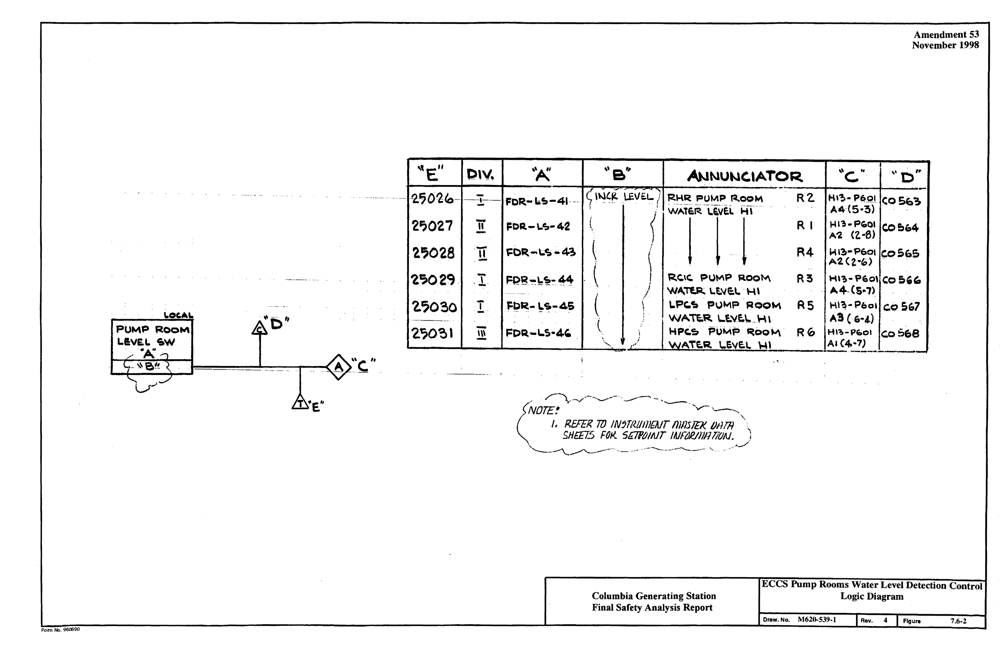

*figure on PDF page 311*

<!-- labels/text on this figure page -->
Amendment 53 November 1998
"c. •.
AIJNU~C.tATOR.
.r • ..,. • . ,
-·---11-------1---- - ------- -- --- -2:'§G'afo- -'T-- FDR- l.;-41----- S \~~~ LEVE.~/ R '2 l<MR PUMP ~OOM H\'?i• p~_OI (0 SE:.?,
- ---·----- --------
A4·(5•5) WATE.r-:t \.6.V~L l-t I 1 l l
i, {' 2r;027 ;
Mll•P'901 CO e,04 RI FDll.-\..,_-42
A'2 (2-6)
1I ~O~ ... t.':i - ~ ~ '2 ?O 28 R4 '-''~•'P601 c.oS6&
( A2 (Z•'1)
-Iiso2~- R.c.,c. PUl-'\P R.00~ R 3 FQ~.~~~~-44 ( } 1-u;- P60\ co=''i-;oso - WA..TE.R.. 1..t'le.\. • H\ A4-CS•'7) l .I A 5 H\~- ?601 c:.o SG7 I.PC.~ PU~P ROOM j _
- I J:~R- ~~-4S \ '2.';O'e>I - ·-
I.OC.AI.
WA"tl.R Ll.VE.\.. __ \-\\ Al (G-4)
( ·-------' \\\ - PUMP ROOM HPc;.S1 • PUMP ~OOV\ R 0 Hr~.;.PE>ot c.o 568 i ·,. • 1/ WATE.R L.!VE.l. \.I\ L&VE.L 'iJW Al (4,•7)
,,,.. -·A...,
----.................... --..-.=. .............. ...:.--.. ----------.-...--·----
----------. ------- -
-- .
,....--..._
·-- \---../ ' NOTE!
'v-'--_
( I, REFEI( TlJ IN7T/J..l/lllfAJT llJJJJIEl( 0111JI '\ SHEETS FOK Sli7PIJ/NT IAJFtJRJJlll ll0/1.1. .,
'--------\..._......,..,,,,_____.-- ·-- --·- - - --------------- '- •. ' -
'-
- . ,.,.A_./
ECCS Pump Rooms Water Level Detection Control Columbia Generating Station Logic Diagram Final Safety Analysis Report I Rev. 4 I Figure Draw. No. M620-539-l 7.6-2 Fonn No. 960690

<!-- p.312 -->
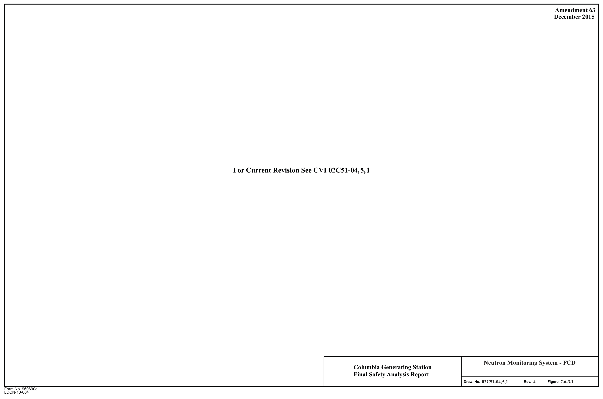

*figure on PDF page 312*

[Vector original (SVG, lossless): fig_page-312.svg](../figures/fig_page-312.svg)

<!-- labels/text on this figure page -->
Amendment 63 December 2015
For Current Revision See CVI 02C51-04,5,1
Neutron Monitoring System - FCD Columbia Generating Station Final Safety Analysis Report I I 02C51-04,5,1 4 7.6-3.1 Draw. No. Rev. Figure Form No. 960690ai
LDCN-10-004

<!-- p.313 -->
~--- , 'II -- • Amendment 53 • 11111111 e nntt11 • 9 :a 10 November 1998 ' ., STR:INT ' , w LCX.._UC,0.-.S , '- (T',,R(P"'7) ----

8 t -- , Rio! CHANHEL!I ,E&G RAt.lGt "f""'1TF RANGEJ OR ,R~ CH"NNE\..S a,o,r ( NC)ICJt,:T, ... , ... - OR R,ACT
• " RAt.it;E s.-.ncw llN
1..IC.f-tT!ii /rQ)e SWITCH _,_.---NOT ?CRMISSl~E RI\NC.C. 30R "SOIIE N RUN ~05111 NH[ .. •UTO SlG~•l tONTSIO\.
OR 11:UtTOI\ MOtlt.
IS P11ESlNT\t,p4 PlO.Cl~) It.QC"' - S~ITCt-1 lf1RUt.lP051TlON.

1Jl"~CA•C. -'LAR,M ,)"" i;:l!,_R.100

-,.,, uPSCA4&,Al,.Ali,MO~

....

t..E\'LDll:~DN D 1N~1'11UW1i.NT INOPfAtr3tva
- NOT !'l.Rt.llSSIVE NHfN RE•tTDR MODE 51'1 IN 'Rui;· PO~ITIOJ.I

....,,..,

~_______,_,I> TO C.<MOl,Tl!<I l !IIEI NOTal
• D ritf D•l ~ ~j
•l:
-•~

dlrilC)A!AATI'Vlil-------:;, ________________ _,---------------------!-,,&=--!
tJlli. l!IAM ~ ~ Of't,,I~ CQ M..~ ON I~ I At ('laR""'OlT •"'L(Lll'lll\llil~.l.)ALAliliM
([ PII\Mtl.Sl'II. w.-e. ..
..
l" a,
-.U'IO S,M'MAL '"' PRURNT

#### I el :m
0{T¥P ~ 1l ~Ill
-t
--0#k""M CJRC.UIT <~DCOR '""'""" ~ I <H.V)
_ -----------7 : • EH rn ~@ {!H~ 1!11!1 :
=..;; _________ . __
-

.....

¥t.lB¥Clla,M5/IM"l'\:M ,-.o, OI.At.111"'""- ~

,...,._..!M""""'-L""•"Po~j'TfON _...,.,..._ t;.•Nttlt.,.e,•"'Q~!T'OI'~ -----i- '«JT ~iS&VII R:lA. ~ .....,...T 116 8':lt,,G ~ • •

~D~

..,. _ _ _ ,,...., .. NlL'·,•PD!.i1"10N _ _

CNIII.MH&l."0"'~1'1'10lt -

----- ----··-----, ~ i!l ElJ i j 1±1 l±H!lgH!l ~

L
-----CHA.tU-lltl.•D" -----

..
Neutron Monitoring System - FCD Columbia Generating Station Final Safety Analysis Report Draw. No. 02CS1-04,S,2 3 7.6-3.2 Rev. Figure

Form No. 960090

<!-- p.314 -->

*figure on PDF page 314*

[Vector original (SVG, lossless): fig_page-314.svg](../figures/fig_page-314.svg)

<!-- labels/text on this figure page -->
Amendment 63 December 2015
For Current Revision See CVI 02C51-04,5,4
Neutron Monitoring System - FCD Columbia Generating Station Final Safety Analysis Report I I 02C51-04,5,4 1 7.6-3.3 Draw. No. Rev. Figure Form No. 960690ai
LDCN-10-004

<!-- p.315 -->
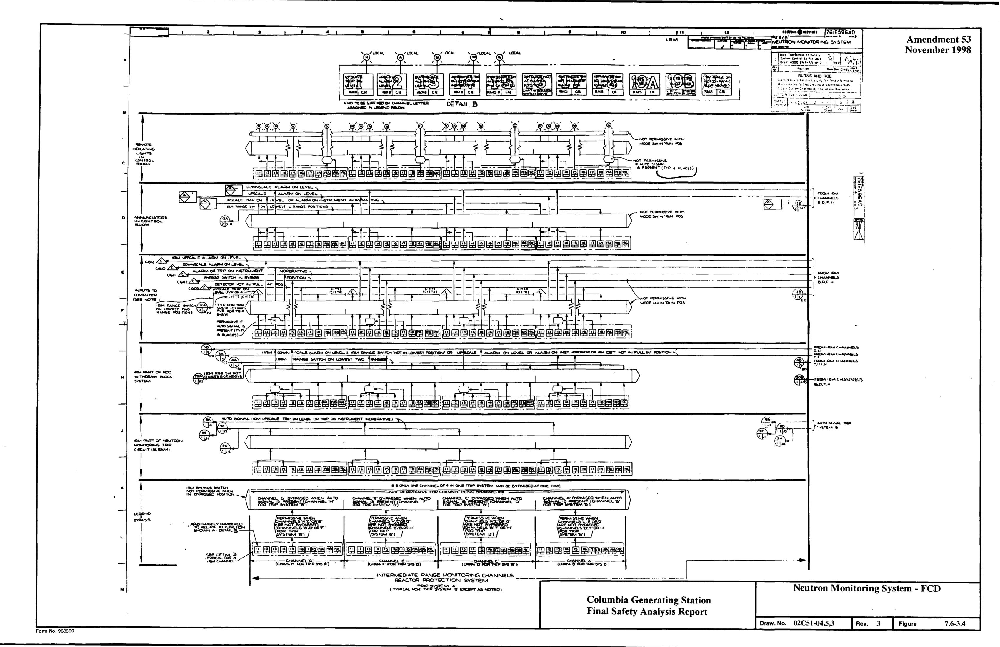

*figure on PDF page 315*

<!-- labels/text on this figure page -->
Amendment 53 November 1998 ..
• ""° 1')15 ~•4Dttt ~
....... "fT£A
... ~-.o,.,:
~ a
h,OT .. QM1~1VI WITM
-..cr,s MOOE:iiWIN'-...,~
,....O(.ATu-..i6
LIC.,..,T!» '"' C ~r:.0"
1 -~-· NOT l=IGAMIW\i'i ..,ITH lf.,J,C,Qi.,Tao~ T
....:x:JefM,./!N'Ql.flt,I .::O!l D
~
I
J•,C)l CIEQ.._.l~VE ,NfTH VOCI& ~w •N 'Q1IN PO~
P.!H--:=------=-,...----.--:--::---:-=-=---=~-=----:----:----=-=::-:---::--,.---:.--::---:-:--::-----::-=-:-:-:==-====---=-=--===:-=-=:-:-=-====-...,---------------------tr~~•~C.......,.,.""-b
H4o-:,,=::----..;;.=+==+-:::=.:.:::::::::=__:_:==.;..;:=.=:,::=---:::::.;:;...:...::=~==;..;;:::.;::.:....=--=:;.,===-+:===-===~=-=="-",'==r====='-'--~c......=-==.:.....;=:......::...:...-.:o. __________________ ----::::::-+~"'"""c~•
~,a,,.,.(.H~"-6 ~.r. ._t,1 I H
F2'!:M IK'r-", , ..... 1i.JN~l.'>
.. D,,-,M
t } wm~,ap
••~l"EM 9
111:t.Ac:a,:::r'Tr:#"-E\JTQON "'°""'lt,A,NG, TAIP C.•ACulT (!SLR.,,l,r,AI j t I( ' I
L
.....
INTEJ:IMEOIATE RANGE MONl,QRIN(, CHANNEi.!:.
l'le.AC:TOR PROTECTION 5VSTEM ,.
Neutron Monitoring System - FCD "T'RIP &V'S'ff:"""' At
(TVP'c.Al. ~ TlltP S"f'!,"19,A't!r E"IICS)TA$N:JT!::0)
Columbia Generating Station Final Safety Analysis Report Draw. No. 02C51-04,5,3 Rev. 3 Figure 7.6-3.4 Fo 1111 No. 960590

<!-- p.316 -->
Amendment 64 December 2017 11 10 8 RBM & APRM/LPRM :~ LPRM RBM CHA~: DJSPLAY )( ){ ' / )( )(

#### DISPLAY
j\ /"'" I

#### LOCAL
GAIN

#### ALARM I TRIP
#### FLOW REF FLOW ALARM
LPRM UPSCALE LPRM DNSC LPRM INPUT INDICATION UPSCALE DOWNSCALE APRM BYPASS SWITCH PERIPHERAL FLOW UPSCALE LPRM BYPASS

#### ALARM
ON ALARM ON ALARM ON TO RBM BELOW ALARM ON ALAR~ ON REFERENCE IN BYPASS POS. ROD ADJUST OFF-NORMAL SWITCH IN

#### ON INSTRUMENT
#### ALARM COMPARATOR
LEVEL LEVEL RESET LEVEL LEVEL LEVEL DOWNSCALE (THIS CHANNEL) SELECTED IN PROGRESS ON LEVEL BYPASS POS.

#### FOR RBM USE 53
#### INOPERATIVE
42 31 ]2 33 34 35 36 37 41 43 51 52 54 ®I I

DETAIL "E" DETAIL "D" DETAIL ''F"

#### PART OF
#### PART OF APRM ODA
#### RBM ODA
(TYPICAL OF 172)

#### REMOTE
#### REMOTE
#### REMOTE INDICATION INDICATION
#### INDICATION IN IN CONTROL
#### IN CONTROL CONTROL ROOM
#### ROOM ROOM

H

(RBM UPSCALE OR ~

#### INOP)
(RBM w

#### DOWNSCALE/ NNUNCIATORS
#### ANNUNCIATORS
#### ANNUNCIATORS
#### IN CONTROL TROUBLE)
#### IN CONTROL
#### IN CONTROL
ROOM

#### ROOM (APRM FLOW ROOM
#### REFERENCE
#### G OFF NORMAL)
#### COMPARATOR
i~ATE~~~ct -+---~---------~------------- VIA { INTERFACE

#### DEVICE
VIA ---+-1>--'-F~LO~W~AL~AR~M~ON~C~OM~P~A~RA~TO~R'--+------------- FROM FLOW FUNCTION DEVICE ill INTERFACE IN RBM CHANNEL B

#### DEVICE
#### INPUTS TO
#### INPUTS TO
#### INPUTS TO
#### COMPUTER
#### COMPUTER
#### COMPUTER
#### FROM OTHER
171 LPRMS

#### PART OF
#### ROD WITHDRAW
#### BLOCK SYSTEM
I

RBM

#### BYPASS PART
#### OF ROD
#### D WITHDRAWAL
#### BLOCKSYSTEM
#### ROD BLOCK MONITORING
#### FLOW FUNCTION IN APRM CHANNELS 1 & 3
#### CHANNEL A ----------------,
>---------------------

#### RANGE MONITORJNG (TYPICAL FOR APRM CHANNELS 2 & 4)
(TYPICAL FOR CHANNEL B)

#### CHANNEL
#### ARBITRARILY NUMBERED
~~~Jr1fi~l?~WD TO RELATE TO FUNCTION ~ SEE DETAIL "D" SHOWN IN DETAIL "E" . .
SEE DETAIL "E" ----~-+@ ~ ~ LEGEND
(TYPICAL FOR 2 1frEp 0f6~L,!;~ l¥l ~ ~I I

#### RBM CHANNELS)
#### LEGEND
LEGEND :~~\'.:!i't~ CHANNELS [ 41 42] (TYP. FOR FLOW FUNCTION IN ~-----~- I ea,'"""'" [q ~

#### LPRM CHANNELS)
#### ROD BLOCK MONITORING
#### LOCAL POWER CHANNEL A ----------------,
#### I & 3
#### RANGE MONITORJNG
c--------------------- 4)
(TYPICAL FOR CHANNEL B)

#### CHANNEL
#### COPYRIGHT 2009
#### GE-HITACHI NUCLEAR ENERGY AMERICAS LLC
Neutron Monitoring System - FCD I. " DENOTES INDICATION AT HEADER AND TRIP MARKERS ABOVE DISPLAY BARGRAPHS Columbia Generating Station
(V ALARM OUTPUT EXISTS IF ANY SELF-TEST FAULT IS DETECTED.
<I) FUNCTION IS NOT SET WHEN LPRM IS BYPASSED.
Final Safety Analysis Report 02C51-04,5,5 2 7.6-3.5 Draw. No. Rev. Figure Form No. 960690ai

<!-- p.317 -->
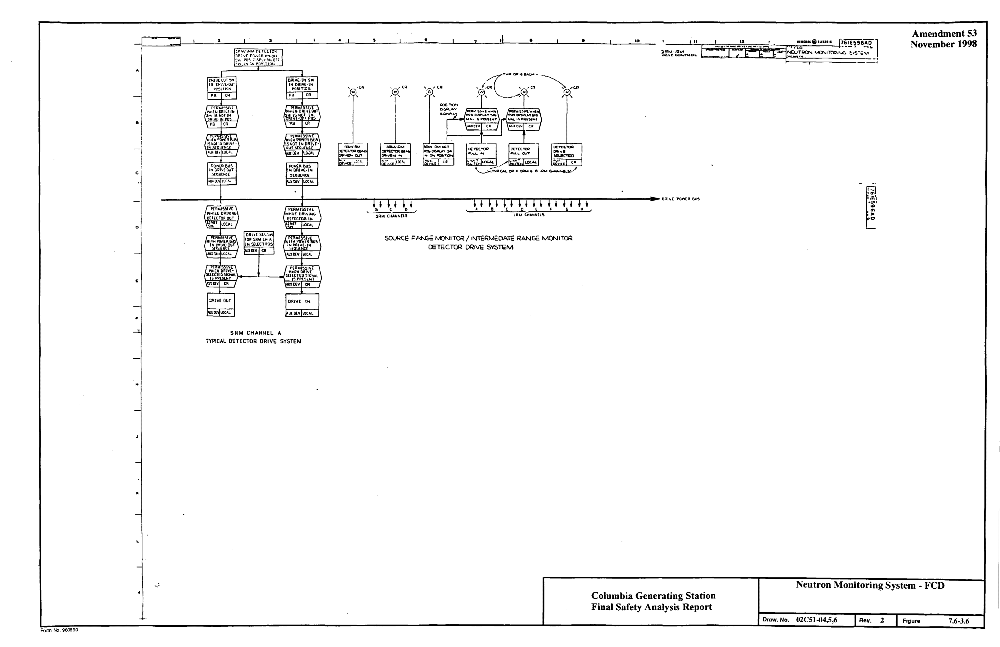

*figure on PDF page 317*

<!-- labels/text on this figure page -->
..
Amendment 53
•
• •
• ' ,a 3 z November 1998 10 I II
.. ...... "''"" 761E:»96A0l
, rc.o •• •--, ... '-' .~uT .. ~ , . .o.n"lt"Q,J't-k ~ .. s ... e,,. -• ~p,1,J lfU<A Ol llC 1~~ 'et,Q...i,.~IJI __ , :21-.e, CD.._.TllOI. :::P!vr ►ti.'<Ul c~i-orr ~.-. tPOS ',)i~PU ~tt OFF ..
::n ·p, ':,, P'll~i. not•
-, . TvDOO'•••at. .. - ~
., ' ... c.o ' "CQ , ' , ' '(;
a
oeTEC.'OA IAvli -= ~:.,, , ..
. QMC.-...e,\)/ C
0 SOJRCE PAN:,!: /..ACNITOR / 1NTERMtDA.TE RANGE MONITOI< CETECTCR D1<1VE S~ll::M
"
SRM CHANNEL A
TYPICAL DETECTOR DRIVE SYSTEM
"
L
Neutron Monitoring System - FCD Columbia Generating Station Final Safety Analysis Report Draw. No. 02C51-04,5,6 2 Rav.
7.6-3.6 Figure Form No. 960090

<!-- p.318 -->
--, Amendment 53 •
• •
•
• a IO f II 1 November 1998 TIP MANlAL "TRAVERSE AUlOIIIATIC TRAVERSE MIGMSR!EO IDNSPE&O

ro"',-..... "-.. -Q ..... -.

A IMCM&M• ■a 'SWll~O

•
- CA co ~ ~W.~---· P"am-tl'!ai'!,1-.,e L ·UAOV _.OIi TIIAWfllU•
•1GNAI..
,. _, ~· "' ... ... -
----
--"' ClfT&C.TCA .KoOO Ul D

_...,.
-------------·-------------- ~~ -----------------•-,.-----►----­

,..,.. .......... .,.,....-,---1 t-:i ........... ---t.,.. ...

-,ULD

.....

.JOOI

_,,,, ...
·--·

------------·-----...... _____ ..,., ____ _

A:l!ITION
-- 1, !~u.1111•'=•= = :.:J'r?t ~~lW. ""TfGII

#### •-c:iur- "
A. tll ....... TIC: ICIDI OhUta .-n.ae flt ·111111:1• ¥la

..,_,..,., 1CDt N1'11, oau, • ...sT ne. • 1STU11KO
---- -----

to C..... tNIN TD_,__ D(f~.

...

UXM. NII( Q1' •n• l'till ....._ wtfUI IN I, IN -

C'CIIK 11111 lll:nl9I t,:,, awaJt 911lU> lO......,..

OU[Utw, J, OC ,. Clm.UGII r6" M Naltlllll: ..._.. • 1U1111 mlt IT I I tolh.fflLI 1111M ~ UMC.HTID CGIVTD, ' --

#### TIP -
10--
----
---- PDlltlCIN
-·
------ INDIC&TIDII\. tllMPIJTEII INPQTS 1V AND FIIOM ll[IJTRllll -~IMG Sl5 _,
• ---
-1::
-.. --... -
- .
~...-1111---

#### MAIi ___ -- ~l&IICT'iQ
L
--- Neutron Monitoring System - FCD II Columbia Generating Station I ♦---,-._ __ ._._, _______ ...,. ___ ~ Final Safety Analysis Report 14---------.w __ 11.a,--------11 Draw. No. 02CS1-04,5,7 l Rev.
Figure 7.6-3.7 Fonn No. 960690

<!-- p.319 -->
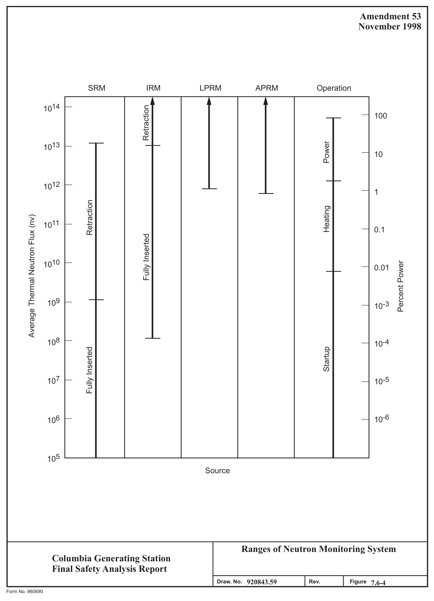

*figure on PDF page 319*

[Vector original (SVG, lossless): fig_page-319.svg](../figures/fig_page-319.svg)

<!-- labels/text on this figure page -->
Amendment 53 November 1998
SRM IRM LPRM APRM Operation
1014 -
-- Retraction
- 100
--
- - 1013 - Power
- 10
- ,._
- 1012
--
--
- 1 Retraction Heating Average Thermal Neutron Flux (nv)
1011 -
- 0.1 Fully Inserted 1010 -
- Percent Power - ---- 0.01
- - 109 -
- 10-3
--
- 108
- 10-4 Startup Fully Inserted 107 - 10-5 -
10-6 - 106 -
105 Source
Ranges of Neutron Monitoring System Columbia Generating Station Final Safety Analysis Report I I 920843.59 Draw. No. Rev. Figure 7.6-4 Form No. 960690

<!-- p.320 -->
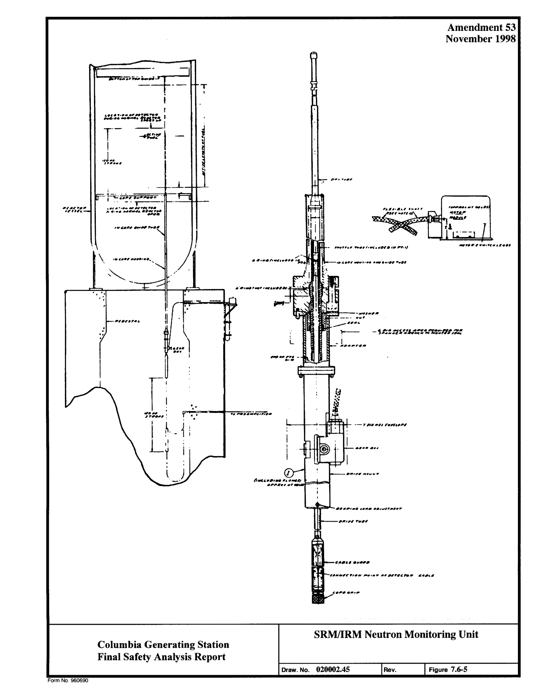

*figure on PDF page 320*

<!-- labels/text on this figure page -->
Amendment 53 November 1998
.,...,....;_,1
I T I r- ~1 I :::,::·:.~~iiili:.s 1 i l ,,,.,. .. ,, .,L I ..
,.,.,,., ...
!!Miil!!'~t---•.-,.,., • .,.,.
:
- i -.. _ ... , .. - 'J,C'!:IS.~lw"'!.c~1.'r#::l'll/1:
~ ... .
i..
6#•~ I fi · .. ..
~t;.,;:..., ~ 1
SRM/IRM Neutron Monitoring Unit Columbia Generating Station Final Safety Analysis Report Draw. No. 020002.45 Rev. Figure 7.6-5 Form No. 960690

<!-- p.321 -->
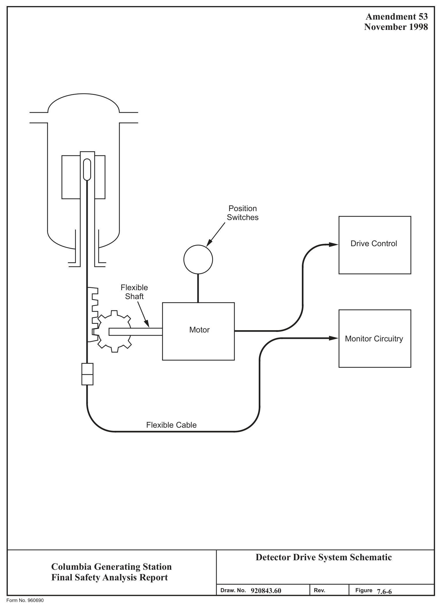

*figure on PDF page 321*

[Vector original (SVG, lossless): fig_page-321.svg](../figures/fig_page-321.svg)

<!-- labels/text on this figure page -->
Amendment 53 November 1998
Position Switches
Drive Control
Flexible Shaft
Motor Monitor Circuitry
Flexible Cable
Detector Drive System Schematic Columbia Generating Station Final Safety Analysis Report 920843.60 Draw. No. Rev. Figure 7.6-6 Form No. 960690

<!-- p.322 -->
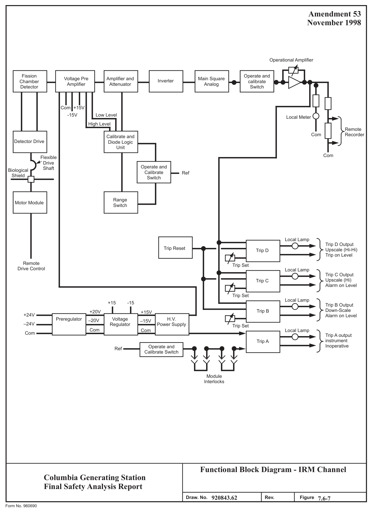

*figure on PDF page 322*

[Vector original (SVG, lossless): fig_page-322.svg](../figures/fig_page-322.svg)

<!-- labels/text on this figure page -->
Amendment 53 November 1998
Operational Amplifier
Fission Operate and Voltage Pre Amplifier and Main Square Inverter Chamber calibrate Amplifier Attenuator Analog Detector Switch
Com +15V
-15V Low Level Local Meter High Level Remote Com Recorder Calibrate and Detector Drive Diode Logic Unit Com Flexible Drive Operate and Shaft Biological Calibrate Ref Shield Switch
Range Motor Module Switch
Local Lamp Trip D Output Trip Reset Upscale (Hi-Hi)
Trip D Trip on Level Remote Trip Set Drive Control Local Lamp Trip C Output Upscale (Hi) Trip C Alarm on Level
Trip Set Local Lamp +15 -15 Trip B Output Down-Scale +20V Trip B +15V +24V Alarm on Level Preregulator Voltage H.V. –20V –15V –24V Regulator Power Supply Trip Set Com Com Local Lamp Com Trip A output instrument Trip A Inoperative Operate and Ref Calibrate Switch
Module Interlocks
Functional Block Diagram - IRM Channel Columbia Generating Station Final Safety Analysis Report 920843.62 Draw. No. Rev. Figure 7.6-7 Form No. 960690

<!-- p.323 -->
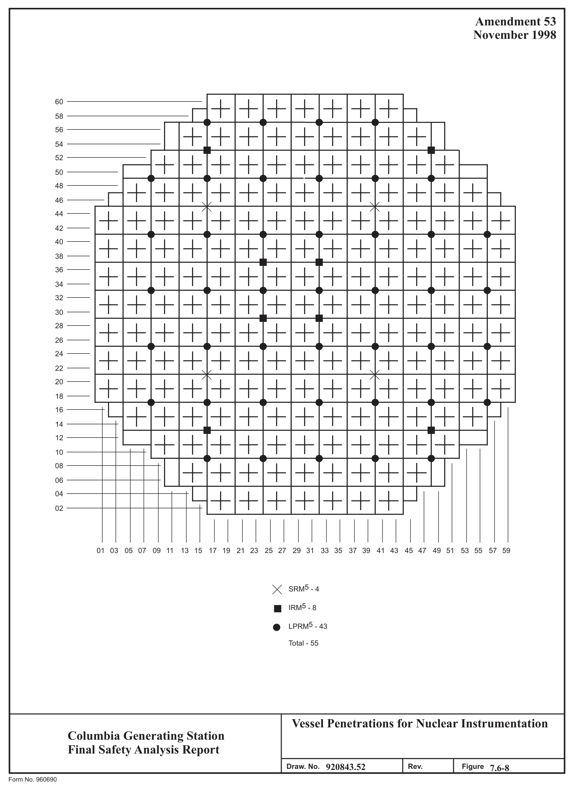

*figure on PDF page 323*

[Vector original (SVG, lossless): fig_page-323.svg](../figures/fig_page-323.svg)

<!-- labels/text on this figure page -->
Amendment 53 November 1998
I. + + + + + + + 7 60
58 I + + + + + + + + + I 56
- + + + + + + + + + + + - 54 52 50 i + + +, I/+ + + + + +, /+ + + + n
- + + + + ~+ + + + + + + + + + + 48 46
- + + + + + + . . + + . . + + + + + + + 44 42
- + + + + + + + + + + + + + + + 40 .
38
- + + + + + + + +. + + + + + + + 36 34
- + + + + + + + + + + + + + + + 32 .
30
- + + + +, + + + + + +, /+ + + + + 28 26
- + + + + + + + + + + + + + + + 24 22 20 L + + + + + + + + + + + + + u 18 16 - + +· ~+ + + + + + + +· ~+ - 14 12 I + + + + + + + + + I 10 08 L + + + + + + + 06 _J 04
02
I I I I I I I I I I I I I I I
01 03 05 07 09 11 13 15 17 19 21 23 25 27 29 31 33 35 37 39 41 43 45 47 49 51 53 55 57 59
X
SRM5 - 4
IRM5 - 8
■ •
LPRM5 - 43
Total - 55
Vessel Penetrations for Nuclear Instrumentation Columbia Generating Station Final Safety Analysis Report 920843.52 Draw. No. Rev. Figure 7.6-8 Form No. 960690

<!-- p.324 -->
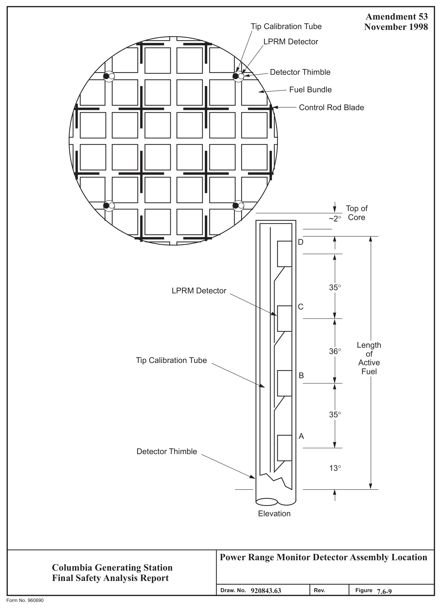

*figure on PDF page 324*

[Vector original (SVG, lossless): fig_page-324.svg](../figures/fig_page-324.svg)

<!-- labels/text on this figure page -->
Amendment 53 November 1998 Tip Calibration Tube LPRM Detector
Detector Thimble
Fuel Bundle
Control Rod Blade
' Top of Core ~2°
D 7 35° LPRM Detector
C
Length 36° of Tip Calibration Tube Active Fuel B
35°
A Detector Thimble
13°
Elevation
Power Range Monitor Detector Assembly Location Columbia Generating Station Final Safety Analysis Report 920843.63 Draw. No. Rev. Figure 7.6-9 Form No. 960690

<!-- p.325 -->
12 15 14 13 3 2 11 10 8 7 6 5 4 Amendment 63 DRY TUB[ 8(~~[),1J, December 2015

#### ABBREYIATIQNS
(A THRU H + CON"fflOL RODS (1~:i) JTHRUIJ}

#### SOURCE RANGE MONITOR
JITTERI.IEDIATE RANCE f.lONITOR

#### ROO BLOCK MONITOR X
LOCAL f'()WER RANGE MONITOR SRM Dfilr;rQRS (+)
K A\/EllAGE POWER RANGE MONITOR

#### TRAVERSING IN-CORE PROBE
RANGE SWITCH ... SRI.I E~ITTING SOIJRCES (7)

#### CHANNEL
fj,_ SRI.I SPARE EMITTING SOURCE POSffiON (7)
IJ0T0~rULE
(TYPOF12)
,-----

#### SPECIAL COAXIAL
#### PENETRATION
(n-P)
□ IR~ □ITECTORS (6)

+++++++
-1-c~+ +o+ +©+ +o+ + 0 ...__ INTERMEDIATE RANGE MONITORS______.
..,___ INTERMEDIATE RANGE MONITORS_____..
~ I ~ □ETA~ I I ~ □ETA~ I + + + + + + + + + +

#### L_ ______ L __ r _
I
• • I • •
• +C::+6+©+•+0+6+~+ +o+ + • (TYP. or-+ SRM"s ~ I! IRl.fS}

#### xA x' • CI-I.E CH.C • • CH.D __t ________ J CH.F •
4'--- + +o+ +o+ +o+ +o+ +o+ +o+ +o+ L __ --- --- _ _J_ ____ T ____ L _________ _J

#### I I I I
I I I I L _________ ...l. ____ -,-- ___ L _________ _j + + +.+ + +@]+ +[El+ + +.+ + + + 6 + + + + + M•~ + + + + + + +o+6+o+ +0+6+0'+- +o+6+o+ +o+ I I L _______ ~ ~-------J + + + + + + + + + + + + H 25-- + F E BYPASSIRM BYPASS SRM BYPASSIRM CH. B, D, r OR H +0+ +©+ +O+ +©+ +O+ +©+ +O+

#### CH. A, 8, CORD
#### CH.A,C,EORG
I + +x~ + + + + +x~ +•+ + +

#### INT RMEDIAT RANGE MON. CHANNELS
#### SOURC RANGE MON. CHANNE
#### INT RM DIA RANGE MON. CHANNE S
+0+6+©+ +0+6+©+ +o+ +© T©T 't-0+ +©+ 't-0+ -fdt- 0.& • @] REACTOR PROTECTION SYSTEM - TRIP SYSTEM 8

#### REACTOR PROTECTION SYSTEM - TRIP SYSTEM A
09 + + + + + + + + + l I l I ! I l I . + + + + + + + I I G '" COG COUlfl SEE REF£RENCE □OCUIJE~+

#### COUNT
HlR FUNCTIONAL USES OF RATE

#### RATER600 RANGE SWITCH
AUXILIAR'fSWITCHESINTl·IIS □EVICE.

.ru..lIB.Ll DETECTOR & CONTROL ELEIJENT ARRANGE~ENT {TOP VIEW OF CORE)

#### INTERMEDIATE RANGE MONITOR
#### SOURCE RANGE MONITOR
#### K601 K600

#### TO RECORDER
(ZONE F/9,10}

uesc,..e UPSCALE

#### UPSCALE UPSCALE
~R~JN UPSCALE ffilPON TRIP ON ""'' Al.ARI.ION """' ""'' Al.ARI.I ON ""''

#### SEE REFERENCE DOCUIJENT 4 FDR FUNCTIONAL USE OF THESE DEVICES
#### SEE REFERENCE DOCUMENT 4 FOR FUNCTIONAL USE OF THESE DEVICES.
(TYP Of 6 IR~"S)
{TYPOF4SRIJ'S)
~

#### START UP RANGE NEUTRON MONITORING
FllOt.l POWER RA.NGE NEUTRON ~ONITOR
(SEE SH. 2 DETAIL D & E)

SH. I, ZONE F/;, RPS BUS ~A"

D

PARTS ARE LOCATED ADJ>,CENT TO DR ON THE SIGNAL CONDffiONING ,,_ ,, __ _ EQUIPMENT PERFDR~ING Tl-ff FUNCTION 2,--- IN□ID\TE□.

,, __ ,,_ _ ,, __ _ POSlllON INFORt.lAllON IS INPUT ~RY 1 INCH. l'"LU)( L£VEL INFORIJATION 15 INPUl EVERY :5 INCHES ON WITHDRAWAL.

~~~~~t.l~~E~- INSTRUt.lENlS ARE PREFIXED Et( NO, C51 UNLESS 11--- FOR LOCATION AND IDENTIFICl.lION Of INSTRUMENTT> SEE INSTRU~ENT DATA SHEET LISTED lN ~PL FOR EACH INSTRUIJENT.
C SH.l,ZONEF/8 RPS BVS "B"

#### FIGURE 2
#### LPRIJ LEVEL GROUP DISPLAY
(REFERENCED TO CORE TOP VIEW)
APRIJ CHANNEL •c• OUTPUT SJGw-t. SHALL GO TO THE REC[RC SYSTE'-4 EXCEPT WHEN CHANNEL "C" IS BYPASSED APRIJ "E" SIGNAL Sl-'ALL AU1Dt.lATIC,',.l.LYG010THERECIRCSYSTEM.

~ REFERENCE DOCUMENTS· {TOP VIEW OF CORE)
~
1. REACTOR ASSE~BLY ARRANGEMENT 813--2010
2. REACTDRRECIRCULATIONSYS.-P&ID 8:55-1010 WHEN A ROD IS SELECTED IN ANY GROUP. TI-IE LPR~ DETECTOR J. CONTROL ROD HYDRAULIC SYS. - FCD C12-1010 ASSEMBLIES ASSIGNED T<l THAT GROUP (SEE FIG. J ) ARE ROUTED 4. NEUTRON MONITORING SYS. - FCD C51-1020 VIA THE LPRM TO TI-IE RBt.rs SUCH THAT THE "A"&: i:" LEVEL 5.
C51-+o10 DETECTOR SIGNALS GO TD RBI.I "A• AND THE "B" l, "D" LEVEL DESIGN SPECIFICATION 6. DETECTOR SIGNALS GO TD RBI.I "B". WHEN A PERIPHERAL ROD ~R~H~u17,~~11~I REACTDRPROTECTIONSYS.IED ~~~~~~D~N rHi ~~~ :I~~H~~~~ ~~B~~~~ p~~:J!r \% ~~Rk~~E \JiW~~ □ING

#### FSAR FI G.
~~~s~~- THE LPR~ LEVEL GROUP DISPLAY Will BE INDICATED

Neutron Monitoring System - IED Columbia Generating Station Final Safety Analysis Report A

#### POWER QISJRIBUTION
02C51-04,7,1 4 7.6-10.1 Draw. No. Rev. Figure Form No. 960690ai

<!-- p.326 -->

*figure on PDF page 326*

[Vector original (SVG, lossless): fig_page-326.svg](../figures/fig_page-326.svg)

<!-- labels/text on this figure page -->
Amendment 63 December 2015
For Current Revision See CVI 02C51-04,7,2
Neutron Monitoring System - IED Columbia Generating Station Final Safety Analysis Report I I 02C51-04,7,2 2 7.6-10.2 Draw. No. Rev. Figure Form No. 960690ai
LDCN-10-004

<!-- p.327 -->
Amendment 63 December 2015

120VAC BUSA 120VAC BUS B :·-----------------------------,
------------------------------, -----------------------------,
-----------------------------, ' ' ' ' ' ' ' ' ' ' ' ' ' ' ' APRM Channel 1 APRM Channel 3 APRM Channel 2 APRM Channel 4 Sensors & Sensors & Sensors & Sensors & Electronics Electronics Electronics Electronics

From Other From Other APRM Channels APRM Channels

2-Out-Of-4 2-Out-Of-4 S3 S3 Voter 1 Voter 3 Voter 2 Voter4

#### S3 S3
Electronics Electronics Electronics Electronics

K1X __l K1Y __l K1X __l K1Y __l K1X__L K1Y__L K1X __L K1Y __L I I

#### K4X I K4Y I
#### K4X I K4Y I K4X I K4Y I
' K4X T K4Y Ti T T

#### T T T T
' '
----------- --- -----------------
---------------- -------------- ' 1 ___ - ---- - - - - - ----- - ------- - - ---

To Reactor To Reactor To Reactor To Reactor Protection System Protection System Protection System Protection System Trip Channel B1 Trip Channel B2 Trip Channel A1 Trip Channel A2

NOTE Relay Contacts shown in tripped position.

#### LEGEND
K1X, K1Y: (APRM Neutron Flux- High or APRM Simulated Thermal Power - High or APRM lnop) and (APRM Not Bypassed)
K4X, K4Y: (OPRM Trip or APRM lnop) and (APRM Not Bypassed)
S3: APRM Bypass Switch

APRM Circuit Arrangement for Reactor Protection System Input Columbia Generating Station Final Safety Analysis Report 920843.64 1 7.6-11 Draw. No. Rev. Figure Form No. 960690

<!-- p.328 -->
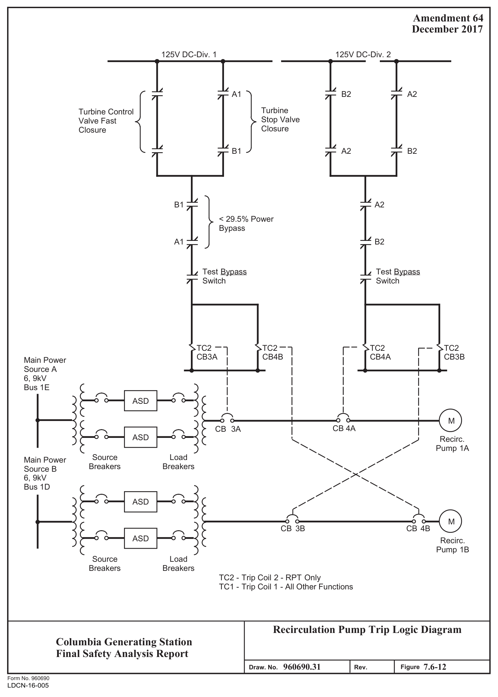

*figure on PDF page 328*

[Vector original (SVG, lossless): fig_page-328.svg](../figures/fig_page-328.svg)

<!-- labels/text on this figure page -->
Amendment 64 December 2017 I I I I 125V DC-Div. 1 125V DC-Div. 2 I I I I A1 B2 A2
Turbine Turbine Control Stop Valve Valve Fast Closure Closure
B1 A2 B2 I}
I I -
B1 A2 < 29.5% Power Bypass I - A1 B2
Test Bypass Test Bypass Switch Switch
TC2 TC2
TC2 TC2
CB3A CB4B
CB4A CB3B
Main Power Source A 6, 9kV Bus 1E ASD
M
CB 4A CB 3A
ASD Recirc.
Pump 1A Source Load Main Power Breakers Breakers Source B 6, 9kV Bus 1D ASD
M
CB 3B
CB 4B
ASD Recirc.
Pump 1B Source Load Breakers Breakers TC2 - Trip Coil 2 - RPT Only TC1 - Trip Coil 1 - All Other Functions
Recirculation Pump Trip Logic Diagram Columbia Generating Station Final Safety Analysis Report 960690.31 7.6-12 D r a w . N o .
R e v . Figure Form No. 960690
LDCN-16-005

<!-- p.329 -->
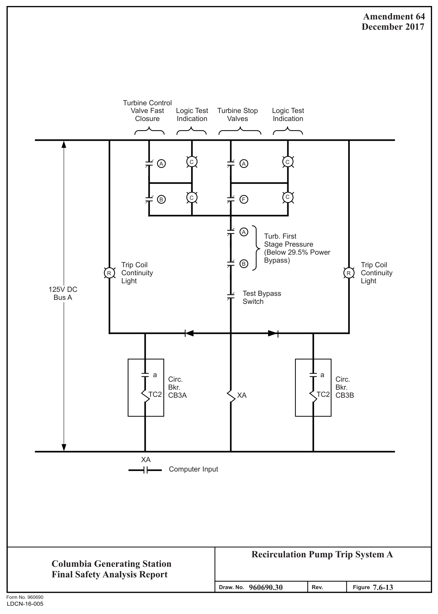

*figure on PDF page 329*

[Vector original (SVG, lossless): fig_page-329.svg](../figures/fig_page-329.svg)

<!-- labels/text on this figure page -->
Amendment 64 December 2017
Turbine Control Valve Fast Logic Test Turbine Stop Logic Test Closure Indication Valves Indication
C
C A A
C C B F Io} A Turb. First Io Stage Pressure
(Below 29.5% Power Bypass)
Trip Coil Trip Coil B Continuity R R Continuity Light Light 125V DC Test Bypass Bus A Switch
a a Circ.
Circ.
Bkr.
Bkr.
TC2 CB3A
TC2 CB3B
XA
XA Computer Input
Recirculation Pump Trip System A Columbia Generating Station Final Safety Analysis Report 960690.30 7.6-13 Draw. No. Rev. Figure Form No. 960690
LDCN-16-005

<!-- p.330 -->
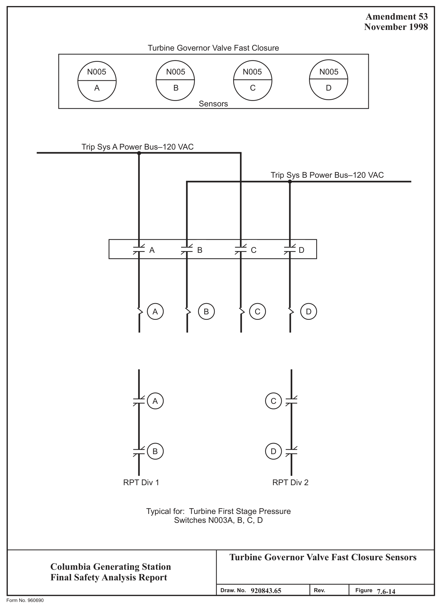

*figure on PDF page 330*

[Vector original (SVG, lossless): fig_page-330.svg](../figures/fig_page-330.svg)

<!-- labels/text on this figure page -->
Amendment 53 November 1998 Turbine Governor Valve Fast Closure 8888 N005 N005 N005 N005
A B C D
Sensors
Trip Sys A Power Bus–120 VAC
Trip Sys B Power Bus–120 VAC
A B C D
A B C D
A C
B D
RPT Div 1 RPT Div 2
Typical for: Turbine First Stage Pressure Switches N003A, B, C, D
Turbine Governor Valve Fast Closure Sensors Columbia Generating Station Final Safety Analysis Report I I 920843.65 Draw. No. Rev. Figure 7.6-14 Form No. 960690

<!-- p.331 -->
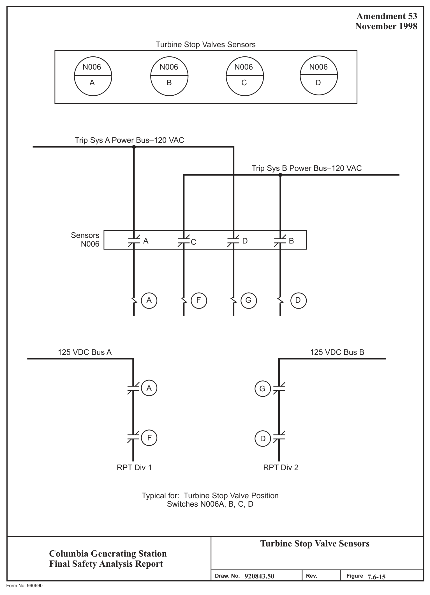

*figure on PDF page 331*

[Vector original (SVG, lossless): fig_page-331.svg](../figures/fig_page-331.svg)

<!-- labels/text on this figure page -->
Amendment 53 November 1998 8888 Turbine Stop Valves Sensors N006 N006 N006 N006
A B C D
Trip Sys A Power Bus–120 VAC
Trip Sys B Power Bus–120 VAC
Sensors A
D B C
N006
•►o o ~ o ·> o
A F G D
125 VDC Bus A 125 VDC Bus B
A G
F D
RPT Div 1 RPT Div 2
Typical for: Turbine Stop Valve Position Switches N006A, B, C, D
Turbine Stop Valve Sensors Columbia Generating Station Final Safety Analysis Report I I 920843.50 Draw. No. Rev. Figure 7.6-15 Form No. 960690

<!-- p.332 -->
Amendment 53 November 1998

G >

#### LOCAL
lR-80

#### IA-80
#### COND-V-462 COND-SPV-462 RMS
, , 9PEN R
---ENERGIZE-~ OPEN - ~ _/ ,I I __ ,r_,___L_ I - I I
- - - - h-•- -•-• DE-ENERGIZE CLOSE

#### CLOSE
iR-80

#### I I I I
-, , r /,

#### SKIMMER
#### SURGE TANK 1A
#### LEVEL
#### FPC-LIS-1
#### SKIMMER
#### SURGE TANK 18
#### LEVEL
FPC-LlS-1

Control Logic Diagram - Fuel Pool Cooling and Columbia Generating Station Cleanup Final Safety Analysis Report 7.6-16 Fig UNI Draw. No. M620-526-5 Rev. 7 Form No. 96CE90

<!-- p.333 -->
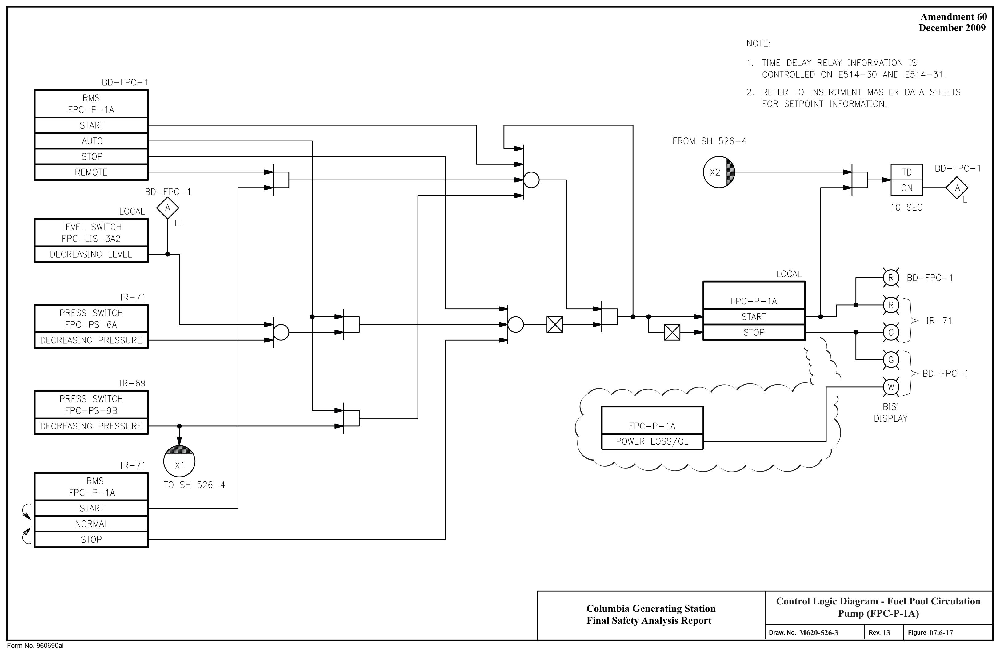

*figure on PDF page 333*

[Vector original (SVG, lossless): fig_page-333.svg](../figures/fig_page-333.svg)

<!-- labels/text on this figure page -->
Amendment 60 December 2009 NOTE:
1. TIME DELAY RELAY INFORMATION IS
CONTROLLED ON E514-30 AND E514-31.
BD-FPC-1
2. REFER TO INSTRUMENT MASTER DATA SHEETS RMS
FOR SETPOINT INFORMATION.
FPC-P-1 A
L
START
E)
AUTO
FROM SH 526-4
STOP
--
-
-1 BD-FPC
-
- TD
REMOTE
h
--
- I I
-
- . - I I ~
- ON A
-- BD-FPC-1 L A
10 SEC
LOCAL
LL
LEVEL SWITCH
FPC-LIS-3A2
DECREASING LEVEL
LOCAL
R BD-FPC-1
IR-71
FPC-P-1A -
- R
- I
-. PRESS SWITCH I D---0 1-@-: -
START -
- I I
} IR-71 h \
FPC-PS-6A
. I -
-- STOP G
-
DECREASING PRESSURE
~
G } BD-FPC-1
IR-69
w
PRESS SWITCH
BISI
FPC-PS-9B
I
DISPLAY
- I
FPC-P-1A
DECREASING PRESSURE i
~ j
IR-71 0
RMS
TO SH 526-4
FPC-P-1A
START
NORMAL
STOP
Control Logic Diagram - Fuel Pool Circulation Columbia Generating Station Pump (FPC-P-1A)
Final Safety Analysis Report M620-526-3 13 07.6-17 Draw. No. Rev. Figure Form No. 960690ai

<!-- p.334 -->
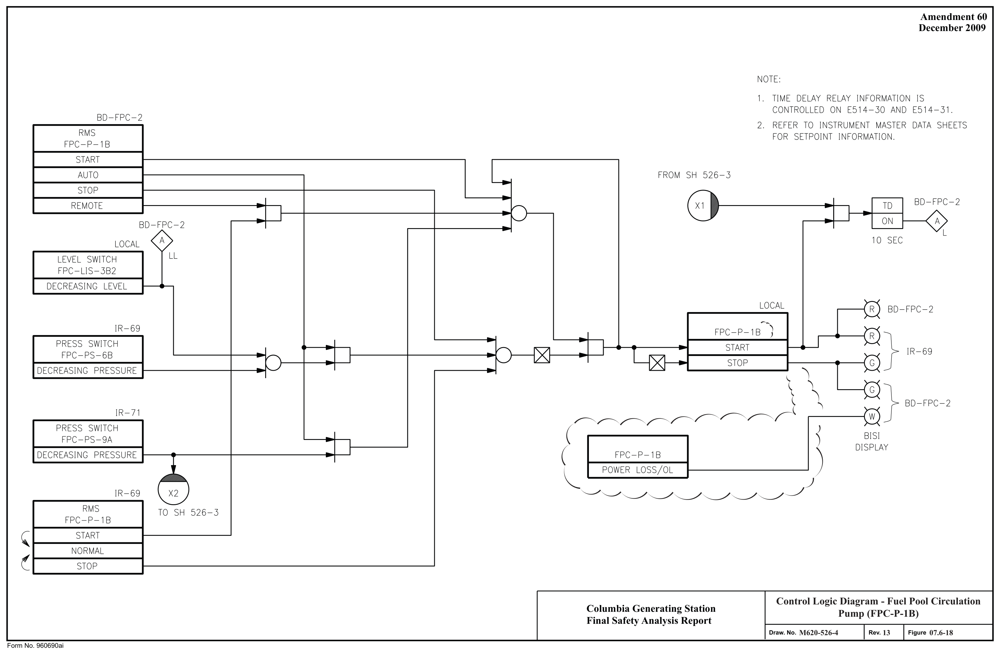

*figure on PDF page 334*

[Vector original (SVG, lossless): fig_page-334.svg](../figures/fig_page-334.svg)

<!-- labels/text on this figure page -->
Amendment 60 December 2009
NOTE:
1. TIME DELAY RELAY INFORMATION IS
CONTROLLED ON E514-30 AND E514-31.
BD-FPC-2
2. REFER TO INSTRUMENT MASTER DATA SH EETS RMS
FOR SETPOINT INFORMATION.
FPC-P-1 B
L
START
AUTO
FROM SH 526-3
~) STOP
--
-
-2 BD-FPC " REMOTE TD
- - v I
I - I -
r
- -
-
- ON A
BD-FPC-2
L A
10 SEC
LOCAL
LL
LEVEL SWITCH
FPC-LIS-3B2
DECREASING LEVEL
LOCAL
R BD-FPC-2
IR-69
FPC-P-18)
R - --
I
PRESS SWITCH
I L@-: -
-
START - h - C)----0
-- I I } IR-69
FPC-PS-6B
\
- - I
-- STOP G - V
DECREASING PRESSURE
G } BO-FPC-2
IR-71
w
PRESS SWITCH
-- BISI
FPC-PS-9A
I
DISPLAY -
- I
i
FPC-P-1 B
DECREASING PRESSURE
POWER LOSS/OL
IR-69 \V RMS
TO SH 526-3
FPC-P-1 B
START
NORMAL
STOP
Control Logic Diagram - Fuel Pool Circulation Columbia Generating Station Pump (FPC-P-1B)
Final Safety Analysis Report M620-526-4 13 07.6-18 Draw. No. Rev. Figure Form No. 960690ai

<!-- p.335 -->
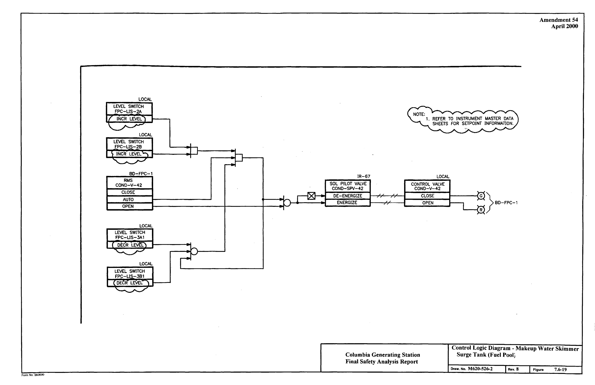

*figure on PDF page 335*

<!-- labels/text on this figure page -->
Amendment 54 April 2000
LOCAL
LEVEL SWITCH
FPC-LIS-2A
LOCAL
LEVEL SWITCH
FPC- S-
80-FPC-1
IR-67
LOCAL
RMS
SOL PILOT VALVE
CONTROL VALVE COND-V-42
CONO-SPV-42
CONO-V-42
CLOSE
G
DE-ENERGIZE
CLOSE
AUTO
ENERGIZE
OPEN }so-FPC-1 OPEN R
LOCAL
LEVEL SWITCH
FPC-US-3A1
LOCAL
LEVEL SWITCH
FPC-LIS-381
Control Logic Diagram - Makeup Water Skimmer Columbia Generating Station Surge Tank (Fuel Pool} Final Safety Analysis Report Draw. No. M620-526-2 Rev. 8 7.6-19 Figure Form No. 960690

<!-- p.336 -->
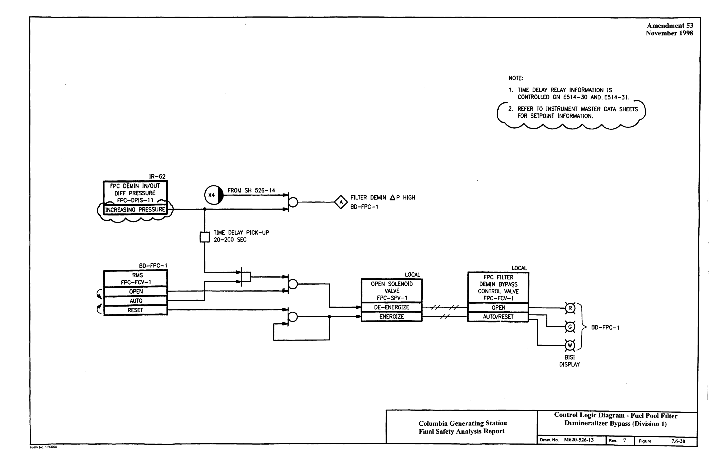

*figure on PDF page 336*

<!-- labels/text on this figure page -->
Amendment 53 November 1998
NOTE:
1. TIME DELAY RELAY INFORMATION IS CONTROLLED ON E514-30 AND £514-31.
REFER TO INSTRUMENT MASTER DATA SHEETS
FOR SETPOINT INFORMATION.
IR-62
FPC CEMIN IN/OUT
FROM SH 526-14
Dlf!'f' PRESSURE FILTER DEMIN AP Hf GH
FPC-DPIS-1
80-FPC-1
-- TIME DELAY PICK-UP 20-200 SEC
BO-FPC-1
LOCAL
LOCAL RMS
FPC FILTER
FPC-FCV-1
OPEN SOLENOID
DEMIN BYPASS
.
- VALVE
CONTROL VALVE OPEN
~
FPC-SPV-1
FPC-FCV-1
AUTO
(_
DE-ENERGIZE
OPEN
RESET
ENERGIZE
AUTO/RESET
G BD-FPC-1
BISI
DISPLAY
Control Logic Diagram - Fuel Pool Filter Columbia Generating Station Demineralizer Bypass (Division 1)
Final Safety Analysis Report Draw. No. M620-526-13 Rev. 7 Figure 7.6-20 Fo,m No. 960690

<!-- p.337 -->
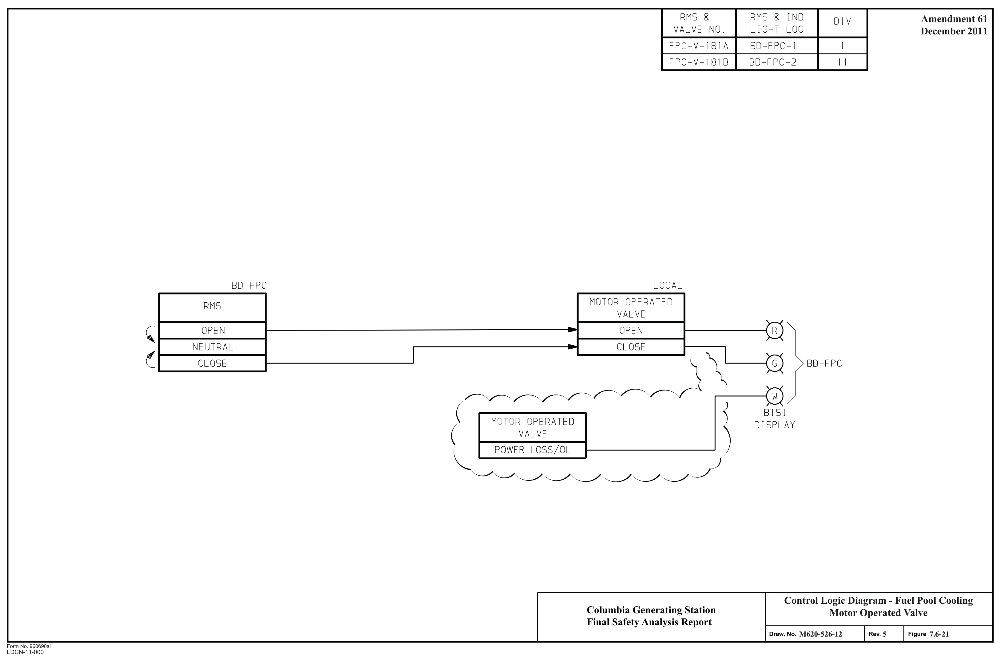

*figure on PDF page 337*

[Vector original (SVG, lossless): fig_page-337.svg](../figures/fig_page-337.svg)

<!-- labels/text on this figure page -->
RMS & RMS & IND
Amendment 61 DIV
VALVE NO. LIGHT LOC
December 2011
FPC-V-181A BD-FPC-1
FPC-V-181B BD-FPC-2
I I
BD-FPC
LOCAL
MOTOR OPERATED
RMS
VALVE
OPEN OPEN R ~
NEUTRAL
CLOSE
(_
CLOSE
BD-FPC
MOTOR OPERATED
DISPLAY
VALVE
POWER LOSS/OL
Control Logic Diagram - Fuel Pool Cooling Columbia Generating Station Motor Operated Valve Final Safety Analysis Report M620-526-12 5 7.6-21 Draw. No. Rev. Figure
Form No. 960690ai
LDCN-11-000

<!-- p.338 -->
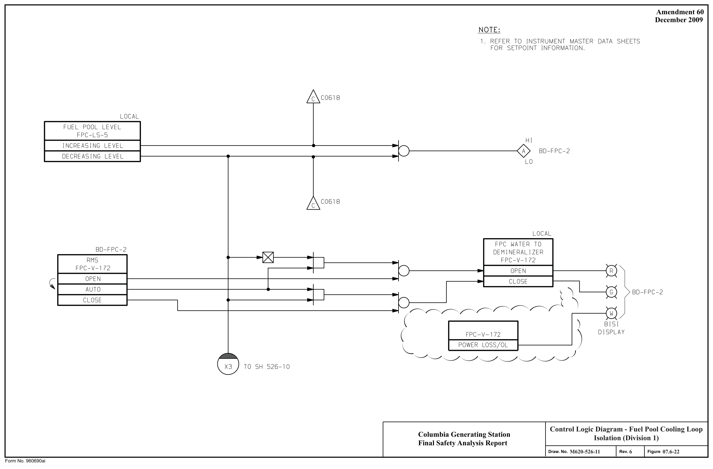

*figure on PDF page 338*

[Vector original (SVG, lossless): fig_page-338_2.svg](../figures/fig_page-338_2.svg)

<!-- labels/text on this figure page -->
Amendment 60 December 2009 NOTE:
1. REFER TO INSTRUMENT MASTER DATA SHEETS
FOR SETPOINT INFORMATION.
C C0618
LOCAL
FUEL POOL LEVEL
...__ _________ _
FPC-LS-5
HI
INCREASING LEVEL
\--------------< A BD-FPC-2
DECREASING LEVEL 1--------------e---------e------------t~'-'
LO
C C0618
LOCAL
FPC WATER TO
BD-FPC-2
DEMINERALIZER
RMS
FPC-V-172
FPC-V-172
OPEN 1-----------i R OPEN
CLOSE
AUTO \ .__ _ __, G BD-FPC-2
CLOSE
BISI ~
DISPLAY
FPC-V-172
....,__P-OW_E_R-LO_S_S/_O_L----11--____ __,)
TO SH 526-10
Control Logic Diagram - Fuel Pool Cooling Loop Columbia Generating Station Isolation (Division 1)
Final Safety Analysis Report M620-526-11 6 07.6-22 Draw. No. Rev. Figure Form No. 960690ai

<!-- p.339 -->
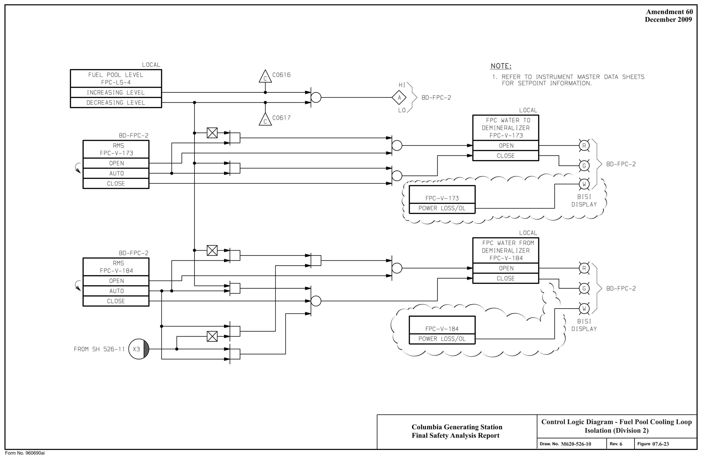

*figure on PDF page 339*

[Vector original (SVG, lossless): fig_page-339.svg](../figures/fig_page-339.svg)

<!-- labels/text on this figure page -->
Amendment 60 December 2009
LOCAL
NOTE:
FUEL POOL LEVEL
1. REFER TO INSTRUMENT MASTER DATA SHEETS
FPC-LS-4
FOR SETPOINT INFORMATION.
INCREASING LEVEL
HI>
A BD-FPC-2
DECREASING LEVEL
LO
LOCAL
FPC WATER TO
DEMINERALIZER
FPC-V-1 73
BD-FPC-2
RMS OPEN i-------< R
FPC-V-1 73
CLOSE
OPEN
BD-FPC-2
AUTO
CLOSE
BISI
FPC-V-173
DISPLAY
POWER LOSS/OL
LOCAL
FPC WATER FROM
DEMINERALIZER
BD-FPC-2
FPC-V-184
RMS OPEN 1-----~ R
FPC-V-184
CLOSE
\ -------1 G OPEN
BD-FPC-2
AUTO
CLOSE
j w BISI
DISPLAY
FPC-V-184
1---P-OW_E_R-LO_S_S_/_O_L---11----------_J
FROM SH 526-11
Control Logic Diagram - Fuel Pool Cooling Loop Columbia Generating Station Isolation (Division 2)
Final Safety Analysis Report M620-526-10 6 07.6-23 Draw. No. Rev. Figure Form No. 960690ai

<!-- p.340 -->
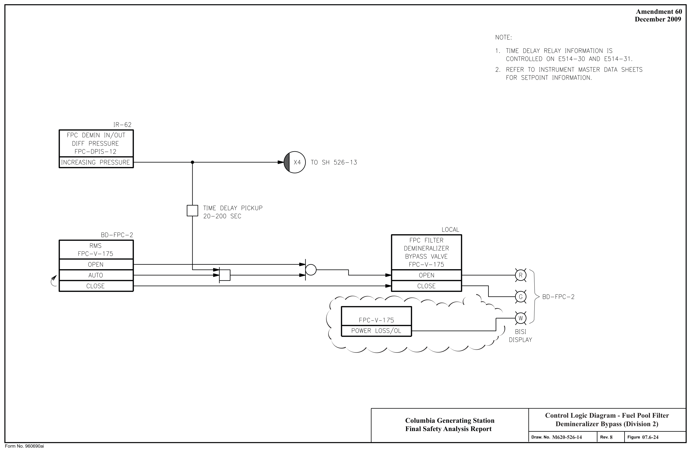

*figure on PDF page 340*

[Vector original (SVG, lossless): fig_page-340.svg](../figures/fig_page-340.svg)

<!-- labels/text on this figure page -->
Amendment 60 December 2009
NOTE:
1. TIME DELAY RELAY INFORMATION IS
CONTROLLED ON ES 14-30 AND ES 14-31.
2. REFER TO INSTRUMENT MASTER DATA SHEETS
FOR SETPOINT INFORMATION.
IR-62
FPC DEMIN IN/OUT
DIFF PRESSURE
FPC-DPIS-12
INCREASING PRESSURE t---------------------~
TO SH 526-13
TIME DELAY PICKUP
20-200 SEC
LOCAL
BD-FPC-2
FPC FILTER
RMS
DEMINERALIZER
FPC-V-175
BYPASS VALVE
FPC-V-175
OPEN AUTO OPEN
CLOSE
CLOSE
BD-FPC-2
~
....--0
FPC-V-175
DISPLAY
Control Logic Diagram - Fuel Pool Filter Columbia Generating Station Demineralizer Bypass (Division 2)
Final Safety Analysis Report M620-526-14 8 07.6-24 Draw. No. Rev. Figure Form No. 960690ai

<!-- p.341 -->
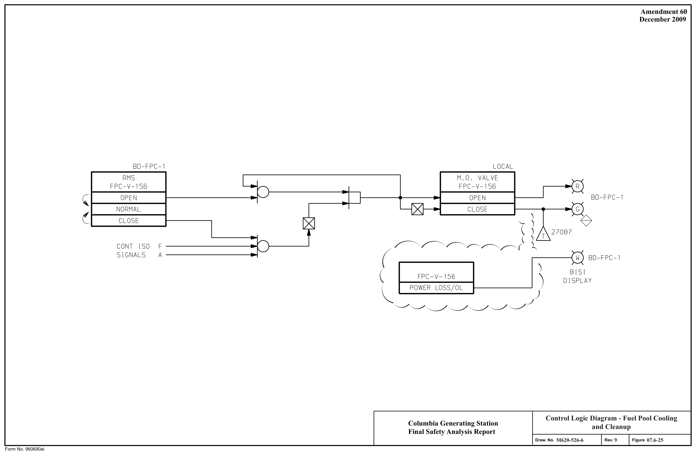

*figure on PDF page 341*

[Vector original (SVG, lossless): fig_page-341.svg](../figures/fig_page-341.svg)

<!-- labels/text on this figure page -->
Amendment 60 December 2009
BD-FPC-1
LOCAL
RM5
M.O. VALVE
FPC-V-1S6
FPC-V-1S6
BD-FPC-1
OPEN OPEN ~
NORMAL
CLOSE
G
(_
CLOSE
~ 2?08?
CONT I 50 F ------------.-.
5 I GNAL5 A -----------...
BD-FPC-1
B151
FPC-V-156
DISPLAY
POWER LOSS/OL
Control Logic Diagram - Fuel Pool Cooling Columbia Generating Station and Cleanup Final Safety Analysis Report M620-526-6 9 07.6-25 Draw. No. Rev. Figure Form No. 960690ai

<!-- p.342 -->
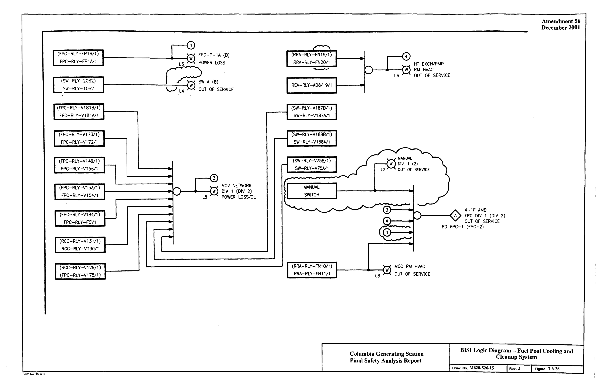

*figure on PDF page 342*

<!-- labels/text on this figure page -->
Amendment 56 December 2001
(FPC-RLY-FPlB/1) 1----------,._ _ _,W
(RRA-RLY-FN19/1)
FPC-P-1A (B)
-----1 4
FPC-RL Y-FP 1A/1
RRA-RLY-FN20/1 L3 POWER LOSS
HT EXCH/PMP
1--------c W RM HVAC I
L6 OUT OF SERVICE
Q.WA(B). CSW-RLY-2052)
1----------,;,..L..J __ L_4_~ OUT OF SERVICE
REA-RLY-A08/19/1
SW-RLY-10S2
(FPC-RLY-V1818/1)
(SW-RLY-V187B/1)
FPC-RLY-V181,V1
----- SW-RLY-V187A/1
(FPC-RLY-1/173/1)
(SW-RLY-V1888/1)
SW-RLY-V188A/1
FPC-RLY-Vl 72/1
MANUAL
(SW-RLY-V758/1) (FPC-RLY-V149/1)
W DIV. 1 (2)
OUT or SERVICE
SW-RLY-V75A/1
FPC-RL Y-Vl 56/1
--3
MOV NETWORK
MANUAL
(FPC-RLY-Vl 53/1)
,----.,-.-1 W DIV 1 (DIV 2)
SWITCH FPC-RL Y-V 154/1
L5 POWER LOSS/OL
4-1F AMS {FPC-RLY-Vl 84/1)
FPC DIV 1 (DIV 2)
OUT OF SERVICE FPC-RLY-FCVl
BO FPC-1 (FPC-2)
(RCC-RLY-Vt 31/1)
RCC-RLY-V130/1
(RRA-RLY-FN10/1)
MCC RM HVAC (RCC-RLY-Vl 29/1) ______ ..,__..., w RRA-RLY-FNl 1/1
L8 OUT OF SERVICE (FPC-RLY-V175/1)
BISI Logic Diagram - Fuel Pool Cooling and Columbia Generating Station Cleanup System Final Safety Analysis Report Draw. No. M620-526-15 Rev. 3 Figure 7.6-26 Form No. 960690

