# 7.7 CONTROL SYSTEMS NOT REQUIRED FOR SAFETY

> Columbia Generating Station FSAR — Chapter 07: Instrumentation and Control Systems
> Source: `07_chapter-2550-2965.pdf`, PDF pages 343–416 (of 416)
> Amendment 67 compilation (individual pages carry varying amendment dates)

---
<!-- p.343 -->
#### Figure 10.3-2

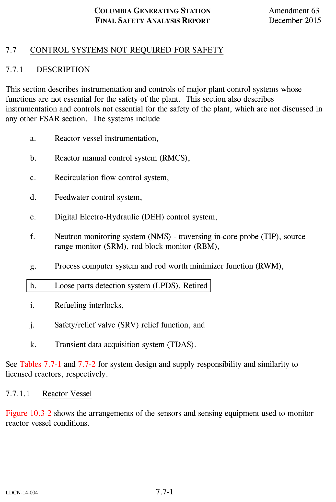

*shows the arrangements of the sensors and sensing equipment used to monitor reactor vessel conditions.*

[Vector original (SVG, lossless): fig_10.3-2.svg](../figures/fig_10.3-2.svg)

<!-- labels/text on this figure page -->
COLUMBIA GENERATING STATION
Amendment 63
FINAL SAFETY ANALYSIS REPORT
December 2015
7.7 CONTROL SYSTEMS NOT REQUIRED FOR SAFETY
7.7.1 DESCRIPTION
This section describes instrumentation and controls of major plant control systems whose functions are not essential for the safety of the plant. This section also describes instrumentation and controls not essential for the safety of the plant, which are not discussed in any other FSAR section. The systems include
a. Reactor vessel instrumentation,
b. Reactor manual control system (RMCS),
c. Recirculation flow control system,
d. Feedwater control system,
e. Digital Electro-Hydraulic (DEH) control system,
f. Neutron monitoring system (NMS) - traversing in-core probe (TIP), source range monitor (SRM), rod block monitor (RBM),
g. Process computer system and rod worth minimizer function (RWM),
h. Loose parts detection system (LPDS), Retired
i. Refueling interlocks,
j. Safety/relief valve (SRV) relief function, and
k. Transient data acquisition system (TDAS).
See Tables 7.7-1 and 7.7-2 for system design and supply responsibility and similarity to licensed reactors, respectively.
7.7.1.1 Reactor Vessel
Figure 10.3-2 shows the arrangements of the sensors and sensing equipment used to monitor reactor vessel conditions.
LDCN-14-004
7.7-1

<!-- p.344 -->
April 2000

###### 7.7.1.1.1 Function
The purpose of the reactor vessel instrumentation is to monitor key reactor vessel variables to provide the operator with information during normal plant operation, startup, and shutdown.

###### 7.7.1.1.2 Operation
The following is a discussion of each reactor vessel variable monitored:

7.7.1.1.2.1 Reactor Vessel Temperature. The reactor vessel temperature is determined on the basis of reactor coolant temperature. Temperatures needed for operation and for compliance with the Technical Specifications operating limits are obtained from one of several sources, depending on the operating condition. During normal operation, either reactor pressure and/or the inlet temperature of the coolant in the recirculation loops can be used to determine the I vessel temperature. The recirculation suction temperature (via thermocouples) is the primary temperature measurement when less than 100 psig. When greater than 100 psig, vessel I pressure converted to saturation temperature is the primary measurement. During normal operation, vessel thermal transients are limited via operational constraints on parameters other than temperature.

7.7.1.1.2.2 Reactor Vessel Water Level. Figure 7.7-1 shows the water level range and the reactor vessel tap location for each water level range. The instruments that sense the water level are differential pressure devices with a condensate reference leg calibrated to be accurate at a specific vessel pressure and liquid temperature condition. During operation, a continuous flow of gas-free water at a flow rate of about 0.12 to 0.48 gal/hr is also maintained through each reference leg to the reference leg condensing chamber to minimize the transport of dissolved noncondensable gases down the reference leg. The following is a description of each water level range shown in Figure 7.7-1:

a. Shutdown water level range: This range is used to monitor the reactor water level during reactor shutdown conditions when the reactor system is flooded for maintenance and head removal. The vessel pressure and temperature conditions that are used for the calibration are 0 psig and 120°F water in the vessel. The two vessel instrument tap elevations used for this water level measurement are located at the top of the reactor vessel head and the instrument tap just below the bottom of the dryer skirt.

b. Upset water level range: This range is used to monitor the reactor water level above the narrow range scale (see item c below). The design and vessel taps are the same as outlined above. The vessel pressure and temperature condition for accurate indication is at the normal power operating point. The upset water level is continuously indicated by a recorder in the control room. The upset range upper limit is higher than the narrow range upper limit. Therefore, when

#### LDCN-98-104, 98-117
<!-- p.345 -->
April 2000

the indication is upscale on the narrow range recorder, water level indication may be read immediately from the upset range recorder. See Section 7.7.1.4.

c. Narrow water level range: This range uses reactor vessel taps at the elevation near the top of the dryer skirt and the taps at an elevation near the bottom of the dryer skirt. The zero of the instrument is the bottom of the dryer skirt and the instruments are calibrated to be accurate at the normal power operating point.
The feedwater control system uses this range for its water level control and indication inputs. See Section 7.7.1.4.

d. Wide water level range: This range uses reactor vessel taps at the elevation near the top of the dryer skirt and the taps at an elevation near the top of the active fuel. The zero of the instrument is the bottom of the dryer skirt
(527.5 in. above the vessel bottom inside) and the instruments are calibrated to be accurate at the normal power operating point. See Section 7.5 for the safety-related features of this range.

e. Fuel zone water level range: This range uses reactor vessel taps at the elevation near the top of the dryer skirt and the taps at the jet pump diffuser skirt. The zero of the instrument is the bottom of the dryer skirt (527.5 in. above the vessel bottom inside) and the instruments are calibrated to be accurate at 0 psig and saturated conditions. See Section 7.5 for the safety-related features of this range.

To decouple the change in measured water level with changes in drywell temperature, the elevation drop from reactor vessel penetration to the drywell penetration remains uniform for the narrow-range and wide-range water level instrument lines.

7.7.1.1.2.3 Reactor Core Hydraulics. A differential pressure transmitter indicates core plate pressure drop by measuring the pressure difference between the core inlet plenum and the space just above the core support assembly. The instrument sensing line used to determine the pressure below the core support assembly attaches to the reactor vessel nozzle N-11. An instrument sensing line is provided for measuring pressure above the core support assembly.
The differential pressure of the core plate is recorded in the main control room.

Another differential pressure device indicates the jet pump developed head by measuring the pressure difference between the pressure above the core and the pressure below the core plate.
This is indicated locally and in the main control room.

7.7.1.1.2.4 Reactor Vessel Pressure. Pressure switches, indicators, and transmitters detect reactor vessel internal pressure from the same instrument lines used for measuring reactor vessel water level.

<!-- p.346 -->
April 2000

##### 7.7.1.2 Reactor Manual Control System
###### 7.7.1.2.1 Function
The RMCS provides the operator with the means to make changes in nuclear reactivity by the operator manipulating control rods so that reactor power level and power distribution can be controlled.

This system includes the interlocks that inhibit rod movement (rod block) under certain conditions. The RMCS does not include any of the circuitry or devices used to automatically or manually scram the reactor; these devices are discussed in Section 7.2. In addition, the mechanical devices of the control rod drives (CRD) and the CRD hydraulic system are not included in the RMCS. The latter mechanical components are described in Section 4.1.3.

###### 7.7.1.2.2 Operation
The RMCS includes the following:

a. Rod drive control system, b. Rod block trip system, c. Rod position probes, and d. Position indication electronics.

Figure 4.6-5 show the layout of the CRD hydraulic system. Figure 7.7-2 shows the functional arrangement of devices for the control of components in the CRD hydraulic system. The logic diagram for the RMCS is shown in Figure 7.7-3. Although the figure also shows the arrangement of scram devices, these devices are not part of the RMCS. Three modes of control rod operation are used: insert, withdraw, and settle. Four solenoid-operated valves are associated with each control rod to accomplish these actions.

7.7.1.2.2.1 Rod Drive Control System. When the operator selects a control rod for motion and operates the rod insert or withdraw control switch, independent messages are formulated in the A and B portions of the rod drive control system (RDCS). A comparison test is made of these two messages, and identical results confirmed; then a serial message in the form of electrical pulses is transmitted to all hydraulic control units (HCU). The message contains two portions: (1) the identity or “address” of the selected HCU and (2) operation data on the action to be executed. Only one HCU responds to this message and it proceeds to execute the rod movement commands.

On receipt of the transmitted signal the responding HCU transmits three portions of a message back to the control room for comparison with the original message:

a. Hard-wire identity “address,”

<!-- p.347 -->
April 2000

b. Operations currently being executed, and

c. Status indications of valve positions, accumulator conditions, and test switch positions.

In either rod motion direction, the A and B messages are formulated and compared each millisecond and, if they agree, the A message is transmitted to the HCU selected by the operator.

Continued rod motion depends on receipt of a train of sequential messages because the HCU insert, withdraw, and settle valve control circuits are ac coupled. The system must operate in a dynamic manner to effect rod motion.

Any disagreement between the A and B formulated messages or the responding echo message will prevent rod motion. Electrical noise disruptions will have only a momentary effect on system operation. Correct operation of the system will resume when the noise source ceases.

In Figure 7.7-4, the three modes of the solid-state RMCS are shown:

a. Operator control mode: This mode (0.0002-sec duration) services the control rod selected by the operator to transmit action commands and receive status indications, i.e., presence of rod blocks.

b. Scan mode: This mode (0.045-sec duration) continuously monitors the other control rods in the reactor, one at a time, to update their status display.

c. Self test mode: This mode (on the order of 20 to 100-sec duration)
automatically exercises one HCU at a time to ensure correct execution of actions commanded. This provides for a continuous, periodic self-test of the entire

#### RMCS.
In the event that any discrepancy is detected in one of these three modes of operation, a rod motion inhibit is applied. This situation is alarmed and annunciated on the reactor control console as an “activity disagree” condition. The CRD control system is also designed to produce a rod motion inhibit condition should any failure of the system occur.

The cause of the discrepancy or failure must be corrected before rod movement can proceed.
Note, however, that this system cannot affect normal shutdown capability via the reactor protection system (RPS).

The rod selection circuitry is arranged so that a rod selection is sustained until either another rod is selected or separate action is taken to revert the selection circuitry to a no-rod selection

<!-- p.348 -->
April 2000

condition. Initiating movement of the selected rod prevents the selection of any other rod until the movement cycle of the selected rod has been completed. Reversion to the no-rod selected condition is not possible (except for loss of control circuit power) until any moving rod has completed the movement cycle.

The direction in which the selected rod moves is determined by the position of four switches located on the reactor control panel. These four switches, “insert,” “withdraw,” “continuous insert,” and “continuous withdraw” are push buttons which return by spring action to an off position.

The following is a description of the operation of the RMCS during an insert cycle. The cycle is described in terms of the insert, withdraw, and settle commands from the RMCS.

With a control rod selected for movement, depressing the “insert” switch and then releasing the switch energizes the insert command for a limited time. Just as the insert command is removed, the settle command is automatically energized and remains energized for a limited time. The insert command time setting and the rate of drive water flow provided by the CRD hydraulic system determine the distance traveled by a rod. The time setting results in a one-notch (6-in.) insertion of the selected rod for each momentary application of a rod-in signal from the rod movement switch. Continuous insertion of a selected control rod is possible by holding the “insert” switch.

A second switch can be used to affect insertion of a selected control rod. This switch is the “continuous insert” switch. By holding this switch “in,” the unit maintains the insert command in a continuous, energized state to cause continuous insertion of the selected control rod. When released, the “insert valves” close immediately and no settle function is available so rod motion stops via leakage past the seals.

The following is a description of the operation of the RMCS during a withdraw cycle. The cycle is described in terms of the insert, withdraw, and settle commands.

With a control rod selected for movement, depressing the “withdrawal” switch energizes the insert valves at the beginning of the withdrawal cycle to allow the collet fingers to disengage the index tube. When the insert valves are deenergized, the withdraw and settle valves are energized for a controlled period of time. The withdraw valve is deenergized before motion is complete;
the drive then settles until the collet fingers engage. The settle valve is then deenergized, completing the withdraw cycle. This withdraw cycle is the same whether the withdraw switch is held continuously or momentarily depressed position. The timers that control the withdraw cycle are set so that the rod travels one notch (6-in.) per cycle. Provisions are included to prevent further control rod motion in the event of timer failure.

<!-- p.349 -->
A selected control rod can be continuously withdrawn if the “withdraw” switch is held in the depressed position at the same time that the “continuous I withdraw” switch is held in the depressed position. With both switches held in these positions, the insert valves energize momentarily and then the withdraw valves are continuously energized. Upon releasing the switches the settle function will start.

7.7.1.2.2.2 Rod Block Trip System. This portion of the RMCS on receipt of input signals from other systems inhibits movement or selection of control rods.

a. Grouping of channels

The same grouping of neutron monitoring equipment [SRM, intermediate range monitor (IRM), average power range monitor (APRM), and RBM] that is used in the RPS is also used in the rod block circuitry.

Half of the total monitors [SRM, IRM, APRM, RBM, reactor recirculation control (RRC) flow units, flow comparator, and scram discharge volume high level] provide inputs to one of the RMCS rod block logic circuits and the remaining half provide inputs to the other RMCS rod block logic circuit.

The rod withdrawal block from the RWM trip affects only one RMCS rod block logic. The rod insert block from the RWM function prevents both notch insertion and continuous insertion.

The APRM and RBM (see Section 7.7.1.8) rod block settings are varied as a function of recirculation flow. Analyses show that the selected settings are sufficient to avoid both RPS action and local fuel damage as a result of a single control rod withdrawal error. Mechanical switches in the SRM and IRM detector drive systems provide the position signals used to indicate that a detector is not fully inserted. Additional discussion of the NMS is in Sections 7.7.1.6, 7.7.1.7, and 7.7.1.8. The rod block from scram discharge volume high water level uses two nonindicating transmitter/level switches installed on the scram discharge volume. These two transmitter/level switches provide a control room annunciation of increasing level below the level at which a rod block occurs.

b. Rod block functions

The following discussion describes the various rod block functions and explains the intent of each function. The instruments used to sense the conditions for which a rod block is provided are discussed in the following sections. The rod

<!-- p.350 -->
April 2015

block functions provided specifically for refueling situations are described in Section 7.7.1.13.

Figures 7.7-3 and 7.6-3 show the rod block interlocks used in the RMCS.
Figure 7.7-3 shows the general functional arrangement of the interlocks, and Figure 7.6-3 shows the rod blocking functions that originate in the NMS.

1. With the mode switch in the SHUTDOWN position, no control rod can be withdrawn. This enforces compliance with the intent of the shutdown mode.

2. The circuitry is arranged to initiate a rod block regardless of the position of the mode switch for the following conditions:

(a) Any APRM upscale rod block alarm. The purpose of this rod block function is to avoid conditions that would require RPS action if allowed to proceed. The APRM upscale rod block alarm setting is selected to initiate a rod block before the APRM high neutron flux scram setting is reached.

(b) Any APRM inoperative alarm. This ensures that no control rod is withdrawn unless the average power range neutron monitoring channels are either in service or correctly bypassed.

(c) Scram discharge volume high water level. This ensures that no control rod is withdrawn unless enough capacity is available in the scram discharge volume to accommodate a scram. The setting is selected to initiate a rod block earlier than the scram that is initiated on scram discharge volume high water level.

(d) Scram discharge volume high water level scram trip bypassed.
This ensures that no control rod is withdrawn while the scram discharge volume high water level scram function is out of service.

(e) The RWM can initiate a rod insert block and a rod withdrawal block. The purpose of these functions is to reinforce procedural controls that limit the reactivity worth of control rods under lower power conditions. The rod block trip settings are based on the allowable control rod worth limits established for the design basis rod drop accident. Adherence to prescribed control rod patterns is the normal method by which this reactivity restriction is observed.

<!-- p.351 -->
April 2015

Additional information on the RWM function is in Section 7.7.1.10.

(f) Rod position information system (RPIS) malfunction. This ensures that no control rod can be withdrawn unless the RPIS is in service.

(g) Either RBM upscale alarm. This function is provided to stop the erroneous withdrawal of a control rod so that local fuel damage does not result. Although local fuel damage poses no significant threat in terms of radioactive material released from the nuclear system, the trip setting is selected so that no local fuel damage results from a single control rod withdrawal error during power range operation.

(h) Either RBM inoperative alarm. This ensures that no control rod is withdrawn unless the RBM channels are in service or correctly bypassed.

3. With the reactor mode switch in the RUN position, any of the following conditions initiates a rod block.

(a) Any APRM downscale alarm. This ensures that no control rod will be withdrawn during power range operation unless the average power range neutron monitoring channels are operating correctly or are correctly bypassed. All unbypassed APRMs must be on scale during reactor operations in the RUN mode.

(b) Either RBM downscale alarm. This ensures that no control rod is withdrawn during power range operation unless the RBM channels are operating correctly or are correctly bypassed.
Unbypassed RBMs must be on scale during reactor operations in the RUN mode.

(c) Any recirculation flow unit upscale, inoperative, or comparator alarm. This ensures that no control rod is withdrawn unless the flow channels are operable, the difference between flow units is within limits, and the flow rate is not unusually high.

4. With the mode switch in the STARTUP or REFUEL position, any of the following conditions initiates a rod block:

<!-- p.352 -->
November 2015

(a) Any SRM detector not fully inserted into the core when the SRM count level is below the retract permit level and any IRM range switch on either of the two lowest ranges. This ensures that no control rod is withdrawn unless all SRM detectors are correctly inserted when they must be relied on to provide the operator with neutron flux level information.

(b) Any SRM upscale level alarm. This ensures that no control rod is withdrawn unless the SRM detectors are correctly retracted during a reactor startup. The rod block setting is selected at the upper end of the range over which the SRM is designed to detect and measure neutron flux.

(c) Any SRM downscale alarm. This ensures that no control rod is withdrawn unless the SRM count rate is above the minimum prescribed for low neutron flux level monitoring.

(d) Any SRM inoperative alarm. This ensures that no control rod is withdrawn during low neutron flux level operations unless neutron monitoring capability is available.

(e) Any IRM detector not fully inserted into the core. This ensures that no control rod is withdrawn during low neutron flux level operations unless proper neutron monitoring capability is available.

(f) Any IRM upscale alarm. This ensures that no control rod is withdrawn unless the intermediate range neutron monitoring equipment is correctly upranged during a reactor startup. This rod block also provided a means to stop rod withdrawal in time to avoid conditions requiring RPS action (scram) in the event that a rod withdrawal error is made during low neutron flux level operations.

(g) Any IRM downscale alarm except when range switch is on the lowest range. This ensures that no control rod is withdrawn during low neutron flux level operations unless the neutron flux is being correctly monitored. This rod block prevents the continuation of a reactor startup if the operator upranges the IRM too far for the existing flux level. Thus, the rod block ensures that the IRM is on scale if control rods are to be withdrawn.

<!-- p.353 -->
November 2015

(h) Any IRM inoperative alarm. This ensures that no control rod is withdrawn during low neutron flux level operations unless neutron monitoring capability is available.

c. Rod block bypasses

To permit continued power operation during repair or calibration of equipment for selected functions that provide rod block interlocks, a limited number of manual bypasses are permitted as follows:

1. One SRM channel,
2. Two IRM channels (1 on either RPS bus A or bus B),
3. One APRM channel, and 4. One RBM channel.

The IRMs are arranged as two groups of equal numbers of channels. One manual bypass is allowed in each group. The groups are chosen so that adequate monitoring of the core is maintained with one channel bypassed in each group.

These bypasses are affected by positioning switches in the control room.
A light in the control room indicates the bypassed condition.

An automatic bypass of the SRM detector position rod block is effected as the neutron flux increases beyond a preset low level on the SRM instrumentation.
The bypass allows the detectors to be partially or completely withdrawn as a reactor startup is continued.

An automatic bypass of the RBM rod block occurs when the power level is below a preselected level (less than 30% power) or when a peripheral control rod is selected. Either condition indicates that local fuel damage is not threatened and that RBM action is not required.

The RWM rod block function is automatically bypassed when reactor power increases above a preselected value in the power range. The RWM can be manually bypassed for maintenance when not required by procedure.

#### LDCN-14-004, 10-004
<!-- p.354 -->
April 2000

7.7.1.2.2.3 Rod Position Probes. The position probe is a long cylindrical assembly that fits inside the CRD. It includes 53 magnetically operated reed switches, located along the length of the probe and operated by a permanent magnet fixed to the moving part of the hydraulic drive mechanism. As the drive, and with it the control rod blade, moves along its length, the magnet causes reed switches to close as it passes over the switch locations. The particular switch closed then indicates where the CRD, and hence the rod itself is positioned.

The switches are located as follows: one at each of 25 notch (even) positions, one at each of 24 mid-notch (odd) positions, one at the fully inserted position (approximately the same location as the “00” notch), one at the fully withdrawn position (approximately the same location as the “48” notch position), one at the overtravel full out (decoupled position), and one at the overtravel full in position.

All of the mid-notch or odd switches are wired in parallel and treated as one switch (for purposes of external connections), and the fully inserted and overtravel full-in switches are wired in parallel and treated as one switch. These and the remaining switches are wired in a 5 x 6 array (the switches short the intersections) and routed out in an 11-wire cable to the processing electronics (the probe also includes a thermocouple which is wired out separate from the 5 x 6 array). See Figure 7.7-5.

7.7.1.2.2.4 Position Indication Electronics. The electronics consist of a set of probe multiplexer cards (one per four-rod group where the four-rod group is the same as the display grouping described later in this section), a set of file control cards (one per 11 multiplexer cards), and one set of master control and processing cards serving the whole system. All probe multiplexer cards are the same except that each has a pair of plug-in daughter cards containing the identity code of one four-rod group (the probes for the corresponding four rods are connected to the probe multiplexer card). The system operates on a continuous scanning basis with a complete cycle every 45 msec.

The control logic generates the identity code of one rod in the set and transmits it using time multiplexing to all of the file control cards. These in turn transmit the identity with timing signals to all of the probe multiplexer cards. The one multiplexer card with the matching rod identity will respond and transmit its identity (locally generated) plus the raw probe data for that rod back through the file control card to the master control and processing logic. The processing logic does several checks on the returning data. First a check is made to verify that an answer was received. Next the identity of the answering data is checked against that which was sent. Finally the format of the data is checked for legitimacy. Only a single even position or, full-in plus position “00,” or full-out plus position “48,” or odd, or overtravel, or blank
(no switch closed) are legitimate. Any other combination of switches is flagged as a fault.

If the data passes all of these tests, it is (a) decoded and transmitted in multiplexed form to the displays in the main control panel and (b) loaded into a memory to be read by the computer as required.

#### LDCN 98-104
<!-- p.355 -->
As soon as data for one rod is processed, the identity for the next rod is generated and processed and so on for all of the rods. When data for all rods has been gathered, the cycle repeats.

A rod information display on the reactor control panel is patterned after a top view of the reactor core. The display allows the operator to acquire information rapidly by scanning.

Colored windows provide an overall indication of rod pattern and allow the operator to quickly identify an abnormal indication. The following information for each control rod is presented in the display:

a. Rod fully inserted (green), b. Rod fully withdrawn (red), c. Selected rod identification (coordinate position, white), d. Accumulator trouble (amber), e. Rod scram (blue), and f. Rod drift (red).

LPRM low flux levels and LPRM high flux levels are displayed on the Operator Display Assemblies (ODA) located below the display.

Another display shows the positions of the control rod selected for movement and the other rods in the rod group. For display purposes the control rods are considered in groups of four adjacent rods (a four-rod group) centered around a common core volume monitored by four LPRM strings. Rod groups at the periphery of the core may have less than four rods.
The four-rod display shows the positions, in digital form, of the rods in the group to which the selected rod belongs. A lighted background on the digital display indicates which of the four rods is selected for movement.

The four-rod display allows the operator to focus attention on the portion of the core where rod motion is occurring. A full core rod position display would tend to be confusing and difficult to read. The ODA’s permit the operator to monitor the core reactivity during rod motion. In addition, on demand by the operator, the process computer will provide a print out of all rod positions.

During startup or shutdown all rods of a given sequence are either fully withdrawn or fully inserted. These patterns are indicated on the full core display with the full-in or full-out lights.

In addition to the whole core display, a drifting rod is indicated by an alarm and red light in the control room. The rod drift condition is also monitored by the process computer.

An indication is also provided for rod trend beyond the limits of normal rod movement. If the rod drive piston moves to the overtravel position, an alarm is sounded in the control room.
The overtravel alarm provides a means to verify that the drive-to-rod coupling is intact because

<!-- p.356 -->
with the coupling in its normal condition the drive cannot be physically withdrawn to the overtravel position. Coupling integrity can be checked by attempting to withdraw the drive to the overtravel position.

For the displays above the selected rod identification, accumulator trouble and rod scram indicators are provided by the RDCS. The ODA LPRM high and low flux level readings are provided by the power range monitor system. The remaining information to the displays and the position information for the process computer (via the RWM) are provided by the rod position information subsystem.

The following main control room lights are provided to allow the operator to know the conditions of the CRD hydraulic system and the control circuitry:

a. Stabilizer valve selector switch position, b. Insert command energized, c. Withdraw command energized, d. Settle command energized, e. Withdrawal not permissive, f. Continuous withdrawal, g. Pressure control valve position, h. Flow control valve position, i. Drive water pump low suction pressure (alarm and pump trip), j. Drive water filter high differential pressure (alarm only), k. Charging water (to accumulator) high pressure (alarm only), l. Scram discharge volume not drained (alarm only), and m. Scram valve pilot air header high/low pressure (alarm only).

##### 7.7.1.3 Recirculation Flow Control System
###### 7.7.1.3.1 Function
The recirculation flow control function is to control reactor power level, over a limited range, by controlling the flow rate of the reactor recirculating water using recirculation pump speed.
The recirculation flow control system is not required for safety purposes, nor required to operate during or after the design-basis accident. The system is required to operate in the normal plant environment for power-generation purposes only.

<!-- p.357 -->
November 1998

###### 7.7.1.3.2 Operation
Reactor circulation flow is varied by controlling the recirculation pump speed. By adjusting recirculation pump speed the change in recirculation flow will automatically change the reactor power level. Each recirculation pump has its individual manual control system as well as the capability of being controlled in unison or ganged by the master setpoint station.

Figure 7.7-6 shows a simplified control scheme for the reactor recirculation flow control system and its relationship to other nuclear steam supply system (NSSS) control schemes.

The reactor power change resulting from change in recirculation flow causes the turbine digital electrohydraulic (DEH) control system to reposition the turbine control valves. The turbine responds to the change in reactor power level by adjusting the control valves, and hence its power output, until the load/speed error signal is reduced to zero.

Operator Information

Indication and alarms are provided to keep the operator informed of the status of the system and equipment and allow the operator to quickly determine the location of malfunctioning equipment.

Instrumentation provides loop flow, pump speed, and controller output and input deviation meters. Alarms are provided to alert the operator of malfunctioning control signals and increasing temperatures of cooling water. In most cases, alarms are supplemented by light indicators to more closely define the problem area.

Indicating lights are provided to indicate the status of the pump/motor control breakers.
Alarms are provided to alert the operator of automatic trips and transfers of the pump/motor, malfunctions, and availability of automatic control circuitry.

The GE-FANUC reactor flow control system (RFCS) provides manual control of the RRC pump speed. The GE-FANUC is a programmable logic controller (PLC) located in panel H13-P634 in the main control room. It consists of digital control design which provides operator manual control for the RRC pump speed demand, permissive logic for starting the RRC pump motor, and runback limiter logic functions.

The operator sets the RRC pump speed from a manual ganged or individual loop control setpoint station located in panel H13-P602 in the main control room. The control station provides an adjustable speed drive (ASD) speed reference demand signal to adjust the supply frequency over the range 15 Hz to 63 Hz, which adjusts the speed of the RRC pump drive motors over the range 25% to 105% and in turn controls the recirculation flow rate.
Figure 7.7-7 shows a simplified version of the control system major functions. The individual

<!-- p.358 -->
November 2015

loop manual setpoint/bias station also has the ability to trim (bias) each loop speed to allow for dissimilarities in performance of the pumps.

The GE-FANUC PLC consists of redundant central processing units (CPU) redundant data communication buses, and redundant genius input/output, (I/O) blocks.

A single video display terminal (VDT) is located on the control benchboard, H13-P602, to provide operating status. Major component group alarms are also provided via the backlit annunciator windows located on the vertical section of H13-P602.

The ASD speed demand reference signal is set by the operator. The GE-FANUC PLC conditions the speed demand signal for each loop for an acceptable ramp rate and for runback limiters, where required. The speed demand reference signal is routed from the control room to the ASD local communication panel via redundant data communication buses. At the ASD local communication panel, redundant genius I/O blocks transmit the speed demand reference signals (2-10-V dc) to the appropriate ASD loop/channel controls. The operator monitors the performance of the RRC using the indicators located on the vertical section of the benchboard

#### H13-P602.
The ASD runs at the lowest speed demand of either the limiter signal or the speed demand setpoint signal. On initiation of a limiter or development of an alarm or fault in the RFCS or ASD channel, a main control room annunciator alarms and the individual loop setpoint bias stations at H13-P602 are transferred from the ganged control to the individual loop control.

Recirculation Pump Flow Measurement

The recirculation loop elbow tap differential pressure is used to provide indirect core flow indication for the flow-biased simulated thermal power scram and to indicate pump performance and jet pump drive flow. In general these functions do not require high measurement accuracy, although repeatability is required. The flow-biased simulated thermal power scram requires a signal that is proportional to pump flow. The signal is used as an indicator of core flow. The proportionality constant (calibration coefficient - pressure drop versus flow) is unimportant as long as that constant does not change; that is, the element is repeatable.

Control Interlocks

Operating conditions have been identified that could result in cavitation of the recirculation pumps and/or jet pumps. Operating procedures require the plant operator to avoid these conditions. In the event that due to operator error these conditions are not avoided, automatic interlocks exist which will prevent operation at these conditions.

<!-- p.359 -->
November 2015

Cavitation Protection

The cavitation characteristics (thermal power level at which cavitation will occur for a given flow) of the jet pumps and recirculation pump are similar to a BWR/3 and BWR/4 except that jet pump cavitation occurs at higher thermal power levels. Protection is provided by measuring the available subcooling and reducing the pumps to 25% speed when there is inadequate subcooling. Temperature elements in the loop suction line and steam dome pressure transmitters measure the amount of subcooling available to the system.

For the pump suction temperature an RTD is used. For the discharge measurement, steam dome pressure is used. With GE-FANUC digital capability a programmed “look up” table converts pressure to temperature and hence a differential temperature interlock is provided for the measurement of subcooling. If the minimum differential temperature becomes less than a predetermined value, the control logic will provide a time delayed command and run its output down to 15 Hz; hence the dual channel ASD output will reduce to 15 Hz and each recirculation pump motor will run back to 25% speed.

Feedwater Pump Trip Runback

The recirculation pump(s) will runback to a specific speed setpoint in response to the combination of a feedwater turbine trip and a low reactor pressure vessel (RPV) water level
(L4). If the recirculation pump(s) were operating at or below the specified speed setpoint, a change in speed will not incur. This runback feature prevents a scram from a low level condition caused by one feedwater pump trip from rated conditions based on testing results.

High Loop Flow Mismatch

Mismatch of the flow in one loop to the other loop of greater than 50% is known to create abnormal conditions in the jet pumps having the lower flow. Such operation is normally precluded by operating procedures. Following a trip of one of two operating pumps, the tripped pump coasts down to zero.

Loop Suction and Discharge Isolation Valve Position

The pump is tripped at less than 90% open position of either valve to prevent pump damage from no flow if isolation valve closure is initiated while the pumps are running.

Trip to 25% Speed

The pumps are tripped to 25% speed in specific cases to avoid scram recovery delays due to vessel bottom head fluid stratification.

<!-- p.360 -->
Startup Interlocks

Interlocks ensure that the following conditions are established before the recirculation pump will start:

a. The ASD is ready for operation,

b. The suction and discharge block valves are greater than 90% open,

c. The electrical protection “lock out” relay is reset,

d. The pump motor breakers, end-of-cycle recirculation pump trip (EOC-RPT)
breakers, and ASD source and load breakers are racked in place and closed,

e. The RPT function is reset, and

f. The operator manual control station is set to minimum pump speed demand.

The flow control system has been designed to limit the maximum demand signal to the ASD at a rate of less than 10% of rated pump speed/sec. This is to ensure that the RPS will not initiate scram. Interlocks are installed to ensure that this limit is not exceeded.

Recirculation Pump Speed Rate of Change

Single failures can result in a recirculation pump speed maximum rate of change in both recirculation pumps of 10% of rated pump speed/sec, which may result in RPS activation.
This value is the average continuous rate used in the transient analysis for the two loop controller failure event. For a one loop controller failure event, a higher than maximum rate of 25%/sec was assumed in the analysis.

The worst single failure would be an ASD control circuit failure which provides a high voltage/frequency power source to the motor.

Scram Avoidance Provisions

One pump trip-pump inertia is greater than 21,500 lbm-ft2 to allow coastdown a.
without an RPS trip,

b. Recirculation pump speed runback if there is a trip of one feedwater pump and vessel low level from rated conditions based on testing results.

<!-- p.361 -->
May 2001

Reliability

The reliability of the ASD system and its GE-FANUC controls have been evaluated in NEDC-32232-P, “WNP-2 Reactor Recirculation Adjustable Speed Drive (ASD) System Reliability Analysis,” August 1993. This reliability evaluation concludes that no credible failure modes were found that could affect safety assumptions for the loss-of-coolant (LOCA), anticipated transient without scram (ATWS), transient, and stability analyses.

##### 7.7.1.4 Feedwater Control System
###### 7.7.1.4.1 Function
The feedwater control system controls the flow of feedwater into the reactor vessel to maintain the vessel water level within predetermined limits during all normal plant operating modes.
The range of water level is based on the requirements of the steam separators. The feedwater control system uses vessel water level, steam flow, and feedwater flow as a three-element control.

Normally, the signal from the feedwater flow is approximately equal to the steam flow signal;
thus, if a change in the steam flow occurs, the feedwater flow follows. The steam flow signal provides anticipation of the change in water level that will result from change in load. The level signal provides a correction for any mismatch between the steam and feedwater flow which causes the level of the water in the reactor vessel to rise or fall accordingly.
Single-element control is also available based on water level only.

###### 7.7.1.4.2 Operation
During normal plant operation, the feedwater control system automatically regulates feedwater flow into the reactor vessel. The system can also be manually operated (see Figure 7.7-8).

The feedwater flow control instrumentation measures the water level in the reactor vessel, the feedwater flow rate into the reactor vessel, and the steam flow rate from the reactor vessel.

The optimum reactor vessel water level is determined by the requirements of the steam separators. The separators limit water carry-over in the steam going to the turbines and limit I steam carry-under in water returning to the core. The water level in the reactor vessel is maintained within ±2 in. of the setpoint value during normal operation and within the high I and low level trip setpoints during normal plant maneuvering transients. This control capability is achieved during plant load changes by balancing the mass flow rate of feedwater to the reactor vessel with the steam flow from the reactor vessel. The feedwater flow is regulated by controlling the speed of the turbine-driven feedwater pumps to deliver the required flow to the reactor vessel.

<!-- p.362 -->
May 2001

The following is a discussion of the variables sensed for system operation.

7.7.1.4.2.1 Reactor Vessel Water Level. Reactor vessel narrow range water level is measured by three identical, independent sensing systems. For each channel, a differential pressure transmitter senses the difference between the pressure caused by a constant reference column of water and the pressure caused by the variable height of water in the reactor vessel.
The differential pressure transmitter is installed on lines that serve other systems (see Section 7.7.1.1). Two of the differential pressure signals are used for indication and control and the third for indication only. The narrow-range level signal from one of the two control channels can be selected by the operator as the signal to be used for feedwater flow control.
A third-narrow range level sensing channel is used in conjunction with the two control channels to provide high water level trips of the main turbine and feed pump turbines. All three narrow-range reactor level signals and reactor pressure are indicated in the main control room. A fourth level sensing system (upset range) provides level information beyond the span of the narrow range devices. The selected narrow-range water level and upset range water level signals are continually recorded in the main control room.

7.7.1.4.2.2 Main Steam Line Steam Flow. Steam flow is sensed at each main steam line flow restrictor by a differential pressure transmitter. A signal proportional to the true mass steam flow rate is linearized and indicated in the main control room. The signals are summed to produce a total steam flow signal for indication and feedwater flow control. The total steam flow signal is recorded in the main control room.

Alarms on steam flow are provided for use in the RWM logic. Interlocks from steam flow and feedwater flow are used to initiate insertion of the RWM block. An alarm on low steam flow indicates that the above RWM insertion interlock setpoint is being approached. Alarms are also provided for (1) high and low water level and (2) reactor high pressure. Interlocks will trip the plant turbine and feedwater pumps in event of reactor high water level.

7.7.1.4.2.3 Feedwater Flow. Feedwater is delivered to the reactor vessel through turbinedriven feedwater pumps, which are arranged in parallel. The feedwater control system sends a flow demand signal to the master level setpoint station and to the turbine governor control system. The turbine governor control system converts the flow demand signal to a turbine speed signal. On either system failure, the turbine speed signal is maintained at the steady value by each turbine operator control station, until the operator takes manual control. Both systems share data via a communications bus, and any transfer of control signal is bumpless.
On reactor SCRAM, level setpoint setdown is performed in the feedwater control system.
This immediately demands a low flow value, thus rapidly reducing feedwater flow and the likelihood of carryover.

Feedwater flow is sensed at a flow element in each feedwater line by differential pressure transmitters. Each feedwater signal is linearized and then summed to provide a total mass flow signal which is sent to the feedwater control system and recorded in the control room.

<!-- p.363 -->
Three modes of feedwater flow control and thus level control are provided.

a. Startup automatic level control, b. Run mode automatic flow control, and c. Manual control.

Four level controllers are provided for startup valve control and automatic feed pump control.
The master level setpoint station and startup valve control station contain, as a minimum, level setpoint digital display, signal output display, manual output control, manual/automatic switching capability, and manual setpoint adjustment. The two feed pump operator control stations contain turbine speed and pump discharge pressure displays, pump speed bias and signal output displays, manual output control, and manual/automatic switching capability.
Each of these manual/automatic stations are software configured for its specific function. In the startup level control mode, measured level is compared to level setpoint within the controller. The resulting signal is conditioned by the proportional plus integral controller circuits and transmitted to the startup level control valves.

During normal operation three element automatic control is provided. The total steam flow/feed flow signal, modified by the conditioned level error signal, provides a flow demand I signal to the feedwater flow control loop. The demanded flow is converted to a speed demand I which is compared to actual speed for each active pump. The resulting speed error signal changes the turbine speed, zeroing the error signal.

Manual control is available by selecting manual on the controller manual/automatic stations.
Flow change is accomplished by depressing the raise button or lower button depending on the desired flow change.

The level control system also provides interlocks and control functions to other systems. If the recirculation pumps are running at a speed greater than the single feed turbine capability setpoint, loss of one of the reactor feed pumps and coincident or subsequent low water level, recirculation flow is reduced to within the power capabilities of the remaining reactor feed pump. This reduction aids in avoiding a low level scram by reducing the steaming rate from rated conditions based on testing results.

##### 7.7.1.5 Digital Electro-Hydraulic Control System
###### 7.7.1.5.1 Function
The function of turbine pressure regulation and control is performed by the DEH system. As a direct cycle boiling water reactor the turbine is slaved to the reactor in that all (except steam to the moisture separator reheaters) steam generated by the reactor is normally accepted by the turbine. The operation of the reactor requires pressure regulation to maintain a constant

<!-- p.364 -->
(within the range of the DEH proportional controller setting) turbine inlet pressure with load following ability accomplished by variation of reactor power.

The DEH control system normally controls the turbine governor valves to maintain this constant turbine inlet pressure. In addition, the DEH control system also operates the steam bypass valves such that a portion of nuclear boiler flow can be bypassed when operating at steam generation levels that exceed the turbine load limits as well as during the startup and shutdown phase.

The overall turbine DEH control system accomplishes the following:

a. Control turbine speed and turbine acceleration,

b. Control the steam bypass system to keep reactor pressure within limits, and avoid large power transients, and

c. Control turbine inlet pressure within the DEH proportional controller range.

###### 7.7.1.5.2 Operation
Pressure control is accomplished by controlling main steam pressure immediately upstream of the main turbine throttle and governor valves through modulation of the turbine-governor or steam bypass valves. Command signals to these valves are generated by the DEH control system which receives input from three redundant turbine inlet pressure sensors, as shown in Figure 7.7-9. For normal operation, the turbine governor valves regulate steam pressure. The plant ability to change turbine generator output is enabled by adjusting reactor power level, by varying reactor recirculation flow and by manually moving control rods. In response to the resulting steam production changes, the DEH control system adjusts the turbine governor valves to accept the steam output change, thereby regulating steam pressure and changing turbine generator power output.

7.7.1.5.2.1 Steam Pressure Control. During normal plant operation, steam pressure is controlled by the main turbine governor valves, positioned in response to the pressure demand signal (see Figure 7.7-9). The steam bypass valves are normally closed.

The DEH control system selects from three redundant pressure transmitters to control steam pressure. Separate pressure taps for each transmitter are provided at the turbine inlet.
A median selector is used by the DEH control system to determine which throttle pressure transmitter is controlling. In addition, if one throttle pressure transmitter fails, the DEH control system will automatically select the higher value of the two remaining transmitters for control.

<!-- p.365 -->
The total steam flow (pressure demand) signal is limited, after passage through the low value gate (as shown in Figure 7.7-9), to that required for full power operation of the turbine (plus a deadband) or the load setpoint. Thus, if the DEH control system senses additional steam flow is needed to control reactor pressure when the governor valves have reached the load setpoint
(plus a deadband) or the governor valve (position) demand limit, the control signal error to the bypass valves will increase and cause bypass valve actuation.

Control for the turbine governor valves is designed so that the valves will close upon loss of control system electric power or loss of hydraulic system pressure.

7.7.1.5.2.2 Steam Bypass System. The steam bypass equipment is designed to control steam pressure when reactor steam generation exceeds turbine requirements such as during startup
(pressure control, speed ramping, and synchronizing), sudden load reduction, and shutdown.

The bypass capacity of the system is approximately 25% of NSSS rated steam flow; sudden load reductions of up to the capacity of the steam bypass can be accommodated without reactor scram.

Normally, the bypass valves are held closed and the DEH control system controls the turbine governor valves, directing all steam flow to the turbine. If the speed/load demand limiter restricts steam flow to the turbine, the DEH controls system pressure by opening the bypass valves. If the capacity of the bypass valves is exceeded while the turbine cannot accept an increase in steam flow, the main steam pressure will rise and RPS action will cause shutdown of the reactor.

The bypass valves are an automatically operated, regulating type which are proportionally controlled by the turbine DEH control system.

The turbine DEH control system provides a signal to the bypass valves corresponding to the error between the turbine governor valve opening required by the pressure demand signal by the output of the low value gate circuit and the turbine governor valve position flow limit (see Figure 7.7-9). A bias signal is provided to maintain the bypass valves closed for momentary differences during normal operational transients.

7.7.1.5.2.3 Turbine Control System Variables. The turbine DEH control system is designed to receive input parameters of turbine throttle inlet pressure, governor and bypass valve position, and turbine speed to process the following signals in turbine modes 3 and 4:

a. The pressure setpoint signal varies the turbine inlet pressure operating point,

b. The pressure demand signal varies governor valve position corresponding to a steam flow from 0% to 100%,

<!-- p.366 -->
c. The combined turbine and bypass valve steam flow limiter signal range adjusts valve position limits to limit steam flow from 90% to 150%; however it is set equal to or less than 130% of 15.013 Mlb/hr steam flow, which is the fuel analysis limit, and

d. The governor valve position (load) demand signal varies to close or open the valves.
The governor valve position limiter limits the governor valve position demand signal so that it does not exceed the value corresponding to valves fully open. The load demand and pressure demand signals are compared and the bypass valves are opened when high steam pressure causes the pressure demand signal to be higher than the load demand signal.

###### 7.7.1.5.2.4 Turbine Speed/Load Control Interfaces.

a. Normal control functions

The DEH control system performs three major functions: a monitoring function
(Tricon 1 module), a control function (Tricon 3 module), and a trip function
(Tricon 2 module). The control function can also initiate a turbine overspeed trip through the Tricon 2 module.

b. Normal modes of operation

The DEH control system (Tricon 3) has five turbine control modes. The modes are based on a system of steps that control the operation of the turbine. These modes are normally automatically entered depending on the current operating conditions. Each mode is tightly interlocked, so the next mode is only entered when the conditions are correct. This ensures an orderly progression through the steps and appropriate actions in the event of malfunctions. The five modes are Reactor Start, Speed Control, Load Control, Turbine Follow Reactor and Overspeed Test (numbered Mode 1 through Mode 5, respectively).

1. Turbine Mode 1: Reactor start

In Mode 1, the turbine throttle and bypass valves are controlled to allow the turbine to be latched and proceed to the speed control mode.
Throttle pressure controller output demand selection only allows for control of the bypass valves to maintain throttle pressure. After a successful latch of the turbine, the sequence automatically enters Speed Control (Mode 2).

<!-- p.367 -->
2. Turbine Mode 2: Speed control

In Mode 2, the turbine speed is ramped up to near synchronous speed by using the turbine throttle valves to control turbine speed and the bypass valves to control reactor pressure. The turbine valve control is transferred from the throttle valves to the governor valves when near synchronous speed. When speed measurement reaches approximately 20 rpm below target, the throttle valve minimum limit is ramped to 100%, opening the valves fully. As the throttle valves open, the governor valve speed controller is enabled to control speed.

Overspeed Protection Controller (OPC) logic is active in this mode. If nominal turbine speed is ≥103% speed, the OPC solenoids are energized which will close the governor and intercept valves. When turbine speed is reduced to less than 101%, the OPC solenoids close and return the DEH control system to Speed Control Mode.

The sequence will proceed to Load Control (Mode 3) if the generator breaker is detected closed or Overspeed Test (Mode 5) if Overspeed Test is selected.

3. Turbine Mode 3: Load (limit) control

Mode 3 is entered from Speed Control (Mode 2) when control is transferred to the governor valves and the generator output breaker is closed upon synchronizing with the grid. Mode 3 is also entered from Turbine Follow Reactor (Mode 4), when the throttle pressure controller output demand is equal to the governor valve load demand signal and when throttle pressure controller output demand is equal to the scaled valve position limit signal. See Figure 7.7-9.

When entering this mode, a load reference is set along with a ramp rate providing an initial electrical load on the generator by ramping the governor valves open increasing measured electrical load. During this initial operating condition, any increase or decrease in throttle pressure results in the bypass valves operating to maintain pressure.

During Mode 3, OPC remains enabled.

4. Turbine Mode 4: Turbine follow reactor

Mode 4 is entered from Load Control (Mode 3) when the throttle pressure controller output demand is lower than the governor valve load

<!-- p.368 -->
demand signal. This is an indication that the throttle pressure controller is controlling pressure by modulating the governor valves. During Mode 4, as in the Load Control Mode, a load reference is set and the throttle pressure controller sets the governor and bypass valve flow demands, provided the demand is not restrained by the flow, load, or valve position limiters.

Sequential and Optimized valve management may also be selected in this Mode. In Sequential valve operation, governor valves two and three are modulated together following the same demand vs. position schedule;
similarly, valves one and four are modulated together following a different schedule. Sequential valve selection is the only available selection during turbine startup and when operating below 95% electrical measured load. Optimized valve selection can only be entered if operating ≥95% electrical load. In Optimized valve operation, governor valves two and three follow the same schedule as if operating in Sequential valve. Valves one and four each have their own schedule.

This mode allows testing the throttle valves, governor valves, reheat/intercept valve pairs, and bypass valves to meet technical specification surveillance requirements. Only one valve may be tested at a time in this mode.

5. Turbine Mode 5: Overspeed/OPC test

The sequence enters Mode 5 from Mode 2, Speed Control, when the Overspeed Test Mode is selected. This Mode allows for the overspeed logic in the Control Tricon, the Trip Tricon, and each of the OPC solenoids to be tested without overspeeding the turbine. This is accomplished by ramping down the trip point to the operating speed range to initiate a trip. When the Overspeed Test select is returned to normal, the trip point automatically returns to its original setting.

c. Turbine shutdown or turbine generator trip

During turbine shutdown or turbine generator trip conditions, the main turbine throttle valves and governor valves are or will be closed. Reactor steam flow will then be passed through the steam bypass valves under steam pressure control, and through the reactor SRVs, as needed. See Section 10.2.2 for a complete description of the turbine generator protective and overspeed trips.

<!-- p.369 -->
d. Steam bypass operation

The main turbine bypass system is designed to control steam pressure when reactor steam generation exceeds turbine requirements during plant startup, sudden load reduction, and cooldown. It allows excess steam flow from the reactor to the condenser without going through the turbine.

The technical specifications require the main turbine bypass system to be operable at greater than or equal to 25% reactor thermal power (RTP). To ensure this limit is met, the bypass valve logic is set to be armed based on generator load when the reactor is approximately 20% RTP during plant startup.
This accounts for any thermal losses from the reactor and the turbine generator.

Fast opening of the steam bypass valves during a turbine trip, a generator load rejection, or an OPC actuation requires coordinated action with the turbine control system. When the turbine governor valves are under pressure control, no bypass steam flow is demanded. During turbine or generator trip events, fast-closure of the turbine throttle or governor valves occurs. The bypass valves fully open until load drops below 20% load, plus a 3-5 sec delay and then modulate under pressure control. The turbine governor valve demand is immediately tripped to zero as an anticipatory response, causing the bypass steam flow demand to equal the pressure regulation demand.

During an OPC actuation, fast closure of the governor and intercept valves occurs. If operating at or above approximately 20% RTP, the bypass valves will fast open.

e. Loss of turbine control system power

Turbine controls and valves are designed so that the turbine throttle and governor valves will close on loss of control system power or hydraulic pressure.

f. Operator information

The control interface and indications for the DEH control system are via soft control on two touch screen monitors mounted on the turbine generator section of the main control board. All controls and indications for the DEH control system during the various turbine generator operational modes (such as reactor start, speed control, load control, turbine follow reactor, or overspeed/OPC test)
are available to the operator from the two Human Machine Interface (HMI)
touch screens.

<!-- p.370 -->
The DEH control system is self-diagnostic, therefore in the event of a component or control malfunction, an alarm will activate to indicate the failure to the operator. Also, the DEH control system is fault tolerant and redundant, so any single failed active component can be replaced on-line without impact to power operations.

The DEH control system (load demand) receives input from three independent pressure transmitters in the main steam line upstream of the main turbine throttle valves. The pressure setpoint can be set by the operator from the HMI stations.

The DEH control system has the following controls and information displayed in the main control room from the HMI stations:

1. Main steam throttle pressure transmitter A,
2. Main steam throttle pressure transmitter B,
3. Main steam throttle pressure transmitter C, 4. Main steam pressure setpoint, 5. Bypass valve position indication and controls, and 6. Main steam throttle, governor, reheat stop, and intercept valve position indication, and controls.

g. Protection system interface

The DEH control system is designed as a fail-safe, fault tolerant, redundant digital electro-hydraulic control system. The control system is designed to fail in a manner that is within the protection system capability for coping. See Section 3.5.1.3 for turbine missile protection and Section 10.2 for overspeed protection features.

##### 7.7.1.6 Neutron Monitoring System - Traversing In-Core Probe
###### 7.7.1.6.1 Function
Flux readings along the axial length of the core are obtained by fully inserting the traversing ion chamber into one of the calibration guide tubes, then taking data as the chamber is withdrawn. The analog data is available for driving a recorder and for use by the process computer. One traversing ion chamber and its associated drive mechanism is provided for each group of seven to nine fixed in-core assemblies.

<!-- p.371 -->
###### 7.7.1.6.2 Operation
The number of TIP machines is indicated in Figure 7.6-10. The TIP machines have the following components:

a. One TIP detector, b. One drive mechanism, c. One indexing mechanism, and d. Up to 10 in-core guide tubes.

The system allows calibration of LPRM signals by correlating TIP signals to LPRM signals as the TIP is positioned in various radial and axial locations in the core. The guide tubes inside the reactor are divided into groups. Each group has its own associated TIP machine.

A TIP drive mechanism uses a fission chamber attached to a flexible drive cable
(Figure 7.7-11). The cable is driven from outside the drywell by a gearbox assembly. The flexible cable is contained by guide tubes that penetrate the reactor core. The guide tubes are a part of the LPRM detector assembly. The indexing mechanism allows the use of a single detector in any one of 10 different tube paths. The tenth tube is used for TIP cross calibration with the other TIP machines. The control system provides for both manual and semiautomatic operation. Electronics of the TIP panel amplify and provide the TIP signal. Core position versus neutron flux may be recorded on the X-Y recorder in the main control room and is provided to the process computer. A block diagram of the drive system is shown in Figure 7.6-10. Actual operating experience has shown the system to reproduce within approximately 1.0% of full scale in a sequence of tests.

A valve system is provided with a valve on each guide tube entering the drywell. A ball valve and a cable shearing valve are mounted in the guide tubing just outside the drywell. The ball valves are closed except when the TIP is in operation. They maintain the leaktightness integrity of the drywell. A valve is also provided for a nitrogen gas purge line to the indexing mechanisms. A guide tube ball valve opens only when the TIP is being inserted. The shear valve is used only if containment isolation is required and the ball valve cannot be isolated.
The shear valve, which is controlled by a manually operated key lock switch, can cut the cable and close off the guide tube. The shear valves are actuated by explosive squibs.

The continuity of the squib circuits is monitored by indicator lights in the main control room.
On receipt of containment isolation command from the NSSS, all detectors which are not withdrawn into the shield are withdrawn at full speed, removing the TIP detector from the containment and allowing the ball valves to close. The purge valve is also closed at this time.

<!-- p.372 -->
##### 7.7.1.7 Neutron Monitoring System - Source Range Monitor
###### 7.7.1.7.1 Function
The SRM provides neutron flux information during reactor startup and low flux level operations.

###### 7.7.1.7.2 Operation
There are four SRM channels. Each includes one detector that can be physically positioned in the core from the control room (see Figures 7.6-8 and 7.7-10).

The detectors are inserted into the core for a reactor startup. They can be withdrawn if the indicated count rate is between preset limits or if the IRM is on the third range or above (see Figure 7.6-10).

During initial fuel load neutron flux was monitored by source range neutron monitoring channels, providing a scram signal when the preset flux level of any channel has been reached.
The logic was removed from the scram circuitry after initial fueling by the installation of “shorting links.”

The “shorting links” may be periodically removed from the RPS circuitry during control rod withdrawal to perform a shutdown margin demonstration. See Section 7.2.1.1 for the verification requirement for “shorting links” removal.

Each detector assembly consists of a miniature fission chamber and a low-noise, quartz-fiberinsulated transmission cable. The sensitivity of the detector is 1.2 x 10-3 cps/nv nominal, I 5.0 x 10-4 cps/nv minimum, and 2.5 x 10-3 cps/nv maximum. The detector cable is connected underneath the reactor vessel to the multiple-shielded coaxial cable. This shielded cable carries the pulses of a pulse current preamplifier located outside the drywell.

The detector and cable are located inside the reactor vessel in a dry tube sealed against reactor vessel pressure. A remote controlled detector drive system moves the detector along the dry tube. Vertical positioning of the chamber is possible from above the centerline of the active length of fuel to 30 in. below the reactor fuel region (see Figures 7.6-6 and 7.6-5). When a detector arrives at a travel end point, detector motion is automatically stopped. The SRM/IRM drive control arrangement and logic are presented in Figures 7.6-6 and 7.6-3. The electronics for the SRMs, their trips, and their bypasses are located in four cabinets. Source range signal conditioning equipment is designed so that it can also be used for open vessel experiments.

A current pulse preamplifier provides amplification and impedance matching for the signal conditioning electronics (Figure 7.7-10).

<!-- p.373 -->
The signal conditioning equipment converts the current pulses to analog dc currents and voltages that correspond to the logarithm of the count rate (LCR). The equipment also derives the period. The output is displayed on front panel meters and is provided to remote meters and recorders. The LCR meter displays the rate of occurrence of the input current pulses.
The period meter displays the time in seconds for the count rate to change by a factor of 2.7.
In addition, the equipment contains integral test and calibration circuits, trip circuits, power supplies, and selector circuits.

The trip outputs of the SRM operate in the fail-safe mode. Loss of power to the SRM causes the associated outputs to become tripped.

The SRM provides signals indicating SRM upscale, downscale, inoperative, and incorrect detector position to the RMCS to block rod withdrawal under certain conditions. Any SRM channel can initiate a rod block. These rod blocking functions are discussed in Section 7.7.1.2.2.

One of the four SRM channels can be bypassed at any one time by the operation of a switch on the operator’s control panel.

Inspection and testing are performed as required on the SRM detector drive mechanism; the mechanism can be checked for full insertion and retraction capability. The various combinations of SRM trips can be introduced to ensure the operability of the rod blocking functions.

##### 7.7.1.8 Neutron Monitoring System - Rod Block Monitor
###### 7.7.1.8.1 Function
The purpose of the RBM is to limit control rod withdrawal if localized neutron flux exceeds a predetermined setpoint during operator control rod manipulations.

###### 7.7.1.8.2 Operation
The RBM has two channels. Each channel uses input signals from a number of LPRM channels. A trip signal from either RBM channel initiates a rod block. One RBM channel can be bypassed at any time without loss of subsystem function. The minimum number of LPRM inputs required for each RBM channel to prevent an instrument inoperative alarm is four when using four LPRM assemblies, three when using three LPRM assemblies, and two when using two LPRM assemblies, see Figures 7.7-12 and 7.6-3.

The RBM signal is generated by averaging a set of LPRM signals. The LPRM signals used depends on the control rod selected. Upon selection of a rod for withdrawal or insertion, the

<!-- p.374 -->
conditioned signals from the LPRMs around that rod will be automatically selected by the two RBM channels. For a typical non-edge rod, each RBM channel averages LPRM inputs from two of the four B-level and D-level detectors, and all four of the C-level detectors. A-level LPRM detectors are not included in the RBM averages, but are displayed to the operator. If a detector has been bypassed in the LPRM system, that detector is automatically deleted from the RBM processing and the averaging logic is adjusted to average only the remaining unbypassed detectors.

After selection of a control rod, each RBM channel calculates the average of the related LPRM detectors and calculates a gain factor that adjusts the average to 100. Thereafter, until another rod is selected, the gain factor is applied to the LPRM average to obtain the RBM signal value.
The RBM signal value is compared to RBM trip setpoints.

When a peripheral rod is selected or the RBMs associated Reference APRM power signal is below the automatic bypass level, the RBM function is automatically bypassed, the rod block outputs are set to “permissive”, and the RBM average is set to zero.

If the Reference APRM is bypassed, the APRM power signal is automatically provided by a second APRM. In the operating range, the RBM signal is accurate to approximately 1% of full-scale.

The RBM has three upscale trip levels and one downscale trip level. Figure 7.7-17 illustrates the trip setpoints. The percent rated power input used to automatically select the applicable RBM trip is provided in the form of simulated thermal power from the RBM channel’s Reference APRM.

With increasing or decreasing power, the RBM setpoint automatically changes to the higher or lower rod block setpoint line based on the APRM simulated thermal power input. No operator action is required.

##### 7.7.1.9 Process Computer System
###### 7.7.1.9.1 Function
The function of the process computer is to provide a real time plant data collection, processing, and output system that is designed to support the following:

a. Input of real time plant data simultaneously from both TDAS and PPCRS multiple sources,

b. Processing of plant input data parameters to produce results in “engineering units,” , ,.

<!-- p.375 -->
c. Compare plant inputs against alarm ranges,

d. Output alarm information and other pertinent information to the real time HMI displays,

e. Historical archiving of monitored plant data to circular files.

###### 7.7.1.9.2 Operation
The process computer is half of an integrated dual processor telemetry processing system that provides redundant PPCRS and TDAS functions. With the exception of the data acquisition hardware, the software and hardware is identical between the PPCRS and TDAS system. This duplication provides manual failover capability in the event of a failure on either system. The configuration of the process computer, since redundant to TDAS, is described in Section 7.7.1.15.3 and shown in Figure 7.7-16.

The Human Machine Interface (HMI) is provided through redundant computer work stations.
These workstations, as shown in Figure 7.7-16, consist of a Data Acquisition Control Module, Calculation Module and Real Time Display Module. The user (Control Room personnel)
accesses these modules by a menu system.

The Data Acquisition Control Module provides the user the capability of stopping and starting the receipt of data from different sources and the transmission of data to other receiving processes. Each source deposits its specific data in the Current Value Table (CVT) for use by other modules. These sources include the RWM, TIP, Alarm, Core Monitoring System Code, and the data acquisition preprocessor. Data can only be sent to PDIS. Sending data to PDIS can be started or stopped by the Data Acquisition Control Module. Screens are provided to monitor the health/status of each function.

The Calculation Module derives information (Plant Data) from the CVT, performs predefined calculations and deposits the results back into the CVT at prescribed frequencies. These calculations include core thermal power, corrected flows, and time averages. The results are then available in the CVT and to the Real Time Display Module.

The Real Time Display Module provides the capability to examine data from all the data sources via the CVT and present them in various formats. These displays are in the form of strip charts, alphanumeric scrolling, and non-scrolling and mimic displays.

The process computer monitors and alarm checks each analog variable at a selectable rate of up to 20 times/sec. Each digital plant input to the process computer can be monitored and alarm checked at up to 250 times/sec. For all analog inputs two types of limit checking and alarming are available: process alarm high/low limits and high/low instrument range limits.
Both printed and historical disk storage are provided for analog and digital system alarms.

<!-- p.376 -->
All alarms logs are printed on the alarm printing device informing the control room personnel of computer system malfunctions, system operation exceeding acceptable limits, and potential unreasonable, off normal, or failed input sensors.

##### 7.7.1.10 Rod Worth Minimizer Function
###### 7.7.1.10.1 Function
The RWM functions to assist and supplement the operator with an effective backup control rod monitoring routine that enforces adherence to established startup, shutdown, and low power level control rod sequences. The RWM computer prevents the operator from establishing control rod patterns that are not consistent with the pre-stored RWM sequence by initiating appropriate rod withdrawal block, and rod insert block interlock signals to the RMCS rod I block circuitry (see Figure 7.7-3). The RWM sequence stored in the computer memory are based on control rod withdrawal procedures designed to limit (and thereby minimize)
individual control rod worths to acceptable levels as determined by the design basis rod drop accident.

###### 7.7.1.10.2 Operation
The RWM function does not interfere with normal reactor operation, and in the event of a failure does not itself cause rod patterns to be established. The RWM will not function on loss of offsite power. The RWM function can be bypassed and its block function can be disabled only by specific procedural control initiated by the operator.

For the operator to bypass the RWM

a. Plant management approval is required,

b. A second operator or technically qualified plant staff member, with no other duties, is required to verify the first operator’s actions while the first operator is performing rod movements,

c. The startup and shutdown sequences with their respective signoff sheets are provided to the second operator for verification of each step rod movement made by the first operator, and

d. The startup and shutdown sequences follow the same control rod patterns that the RWM enforces if it were not bypassed.

<!-- p.377 -->
The following operator and sensor inputs are used by the RWM:

a. Rod test. In selecting this input, the operator is permitted to withdraw and reinsert one control rod at a time while all other control rods are maintained in the fully inserted position;

b. Normal/bypass mode. A key lock switch permits the operator to apply permissives to RWM rod block functions at any time during plant operation;

c. System start/reset. This input is initiated by the operator to start or restart the RWM programs and system at any time during plant operation;

d. Control rod select. Binary coded identification of the control rod selected by the operator;

e. Control rod position. Binary coded identification of the selected control rod position;

f. Control rod drive selected and driving. The RWM program uses this input as a logic diagnostic verification of the integrity of the rod select input data;

g. Control rod drift. The RWM program recognizes a position change of any control rod using the control rod drift signal input;

h. Reactor power level. Flow signals are used to implement two digital inputs to permit program control of the RWM function. These two inputs, the low power setpoint (LPSP) and the low power alarm setpoint, are used to disable/alarm the RWM function at power levels above the intended service range of the RWM function;

i. Permissive echoes. Rod withdraw and rod insert permissive echo inputs are used by the RWM as a verification “echo” feedback to the system hardware to ensure proper response of an RWM output; and

j. Diagnostic inputs. The RWM uses selected diagnostic inputs to verify the integrity and performance of the processor.

Isolated contact outputs to plant instrumentation provide RWM rod block functions to the RMCS to permit or inhibit withdrawal or insertion of a control rod. These actions do not affect any normal instrumentation displays associated with the selection of a control rod.

<!-- p.378 -->
The RWM control panel provides the following indication:

a. Insert error. Control rod coordinate identification for as many as two insert errors;

b. Withdrawal error. Control rod coordinate identification for one withdrawal error;

c. Latch group identification of the RWM sequence group number currently enforced by the computer;

d. Rod test select indicates that the rod test function test selected by the operator was honored by the RWM Program;

e. RWM bypass - indicates that the RWM is manually bypassed;

f. Select error - indicates a control rod selection error;

g. Rod blocks - indication that a withdrawal block or insertion block is in effect for all control rods;

h. Out of sequence indication that the actual rod patterns is out of sequence;

i. Below LPSP. Indication that the reactor core power is below the LPSP;

j. Below low power alarm point (LPAP). Indication that the reactor core power is below the LPAP; and

k. Rod drift. Indication that a rod drift condition is detected.

<!-- p.379 -->
#### DELETED
<!-- p.380 -->
#### DELETED
<!-- p.381 -->
##### 7.7.1.12 Loose Parts Detection System
I The LPDS has been deactivated and spared-in-place (retired). The System mainframe panel
(LPDS-PNL-1) remains installed on the 522 ft. level of the Reactor Building. The accelerometer charge-converters (pre-amps) remain installed inside containment, except those posing interference. All power to the system has been disconnected and the cables “spared.”

##### 7.7.1.13 Refueling Interlocks
###### 7.7.1.13.1 Function
The purpose of the refueling interlocks is to restrict the movement of control rods and the operation of the refueling platform. Refueling interlocks are shown in Table 7.7-3. This reinforces operational procedures that prevent the reactor from becoming critical during refueling operations.

###### 7.7.1.13.2 Operation
The refueling interlocks circuitry senses the condition of the refueling platform and the control rods to prevent the movement of the refueling platform or withdrawal of control rods (rod block). Redundant circuitry is provided to sense the following conditions:

a. All rods inserted,

b. Refueling platform positioned near or over the core,

c. Refueling platform hoists fuel loaded (main - fuel grapple, auxiliary - frame mounted hoist, monorail - trolley mounted hoist), and

d. Reactor mode switch in “refuel” position.

<!-- p.382 -->
The indicated conditions are combined in logic circuits to satisfy all restrictions on refueling equipment operations and control rod movement (Figure 7.7-2). The rod-in condition for each rod is established by the closure of a magnetically operated reed switch in the rod position indicator probe.

The rod-in switch must be closed for each rod before the all-rods-in signal is generated. Loss of “all-rods-in” signal will remove grapple control power, if the refueling platform is over the core.

During refueling operations, no more than one control rod is permitted to be withdrawn; this is enforced by a redundant logic circuit that uses the all-rods-in signal and a rod selection signal from the RMCS to prevent the selection of a second rod for movement. The simultaneous selection of two control rods is prevented by the interconnection arrangement of the select push buttons. With the mode switch in the refuel position, the circuitry prevents the withdrawal of more than one control rod and the movement of the loaded refueling platform over the core with any control rod withdrawn.

Operation of refueling equipment is prevented by interrupting the power supply to the equipment. The refueling platform is provided with two mechanical switches attached to the platform, which are tripped open by a long, stationary ramp mounted adjacent to the platform rail. The switches open before the platform or any of its hoists are physically located over the reactor vessel to indicate the approach of the platform toward its position over the core.

In addition to the non-safety-related rod block interlocks provided by the RMCS, and as a safety-related backup, the IRMs provide a rod scram signal during refueling when neutron flux exceeds a preset flux level. The scram signal will provide a control room alarm and will insert any control rod that is withdrawn. The IRMs are required to be operable anytime a control rod is withdrawn in a fueled cell during refueling operations.

Load cell readout is provided for all hoists. The main hoist load is displayed on the flat panel display on the main trolley. The auxiliary frame hoist and the monorail hoist load displays are on the frame pendant and monorail pendant, respectively. Load sensing is via electronic load cells and strain gauge transmitters. The load for the main hoist and frame hoist are inputs to the PLC in the control center on the main trolley. Associated interlock and load functions for the main hoist and auxiliary frame hoist are performed by the PLC. Setpoint modules provide associated interlock and load functions for the monorail hoist.

The three hoists on the refueling platform are provided with switches that open when the hoists are fuel loaded. The switches open at a load weight that is lighter than that of a single fuel assembly. This indicates when fuel is loaded on any hoist.

<!-- p.383 -->
A bypass plug for the previously installed service platform hoist load interlock is provided which completes the circuit, preventing a false indication that the nonexistent hoist is loaded.
Loaded hoist indication prevents control rod withdrawal with the mode switch in the startup or refuel positions. The bypass plug allows control rod movement in this situation. The bypass plug is physically arranged to prevent the connection of any power plug unless the bypass plug is removed.

The rod block interlocks and refueling platform interlocks provide two independent levels of interlock action. The interlocks which restrict operation of the refueling platform hoist and grapple provide a third level of interlock action since they would be required only after a failure of a rod block and refueling platform interlock.

In the refueling mode, the control room operator has an indicator light for “refueling mode select permissive” whenever all control rods are fully inserted. He can compare this indication with control rod position data from the computer as well as control rod in-out status on the full core status display. Whenever a control rod withdrawal block situation occurs, the operator receives annunciation and computer logs of the rod block. The operator can compare these outputs with the status of the variable providing the rod block condition. Both channels of the control rod withdrawal interlocks must agree that permissive conditions exist to move control rods; otherwise, a control rod withdrawal block occurs. Failure of one channel may initiate a rod withdrawal block, and will not prevent application of a valid control rod withdrawal block from the remaining operable channel (see Figure 7.7-2).

Refueling platform interlock indication and main hoist load are displayed to the operator on the flat panel display mounted on the trolley cable. In addition, the bridge, trolley, and main hoist positions displays are on the flat panel display.

The auxiliary frame hoist load and the monorail hoist load are displayed on digital displays on the frame pendant and monorail pendant, respectively. Individual push button and control switches are provided for local control of the platform and its hoists. The platform operator can immediately determine whether the platform and hoists are responding to his local instructions, and can, in conjunction with the control room operator, verify proper operation of each of the three categories of interlocks listed previously.

##### 7.7.1.14 Safety/Relief Valves - Relief Function
###### 7.7.1.14.1 Function
The relief function of the SRVs is to relieve high pressure conditions in the nuclear system that could lead to the failure of the RCPB. The system activates the SRVs to vent steam to the suppression pool and reduce reactor pressure. See Section 5.2.2. Also, see Section 7.3.1.1.1.2 for the ADS function of selected SRVs.

<!-- p.384 -->
###### 7.7.1.14.2 Operation
Schematic arrangement of system mechanical equipment is shown in Figure 10.3-2. The SRV component control logic is shown in Figure 7.3-8.

The relief function of the SRVs is initiated by pressure switches, one per relief valve. These pressure switches are set to energize the relief valve solenoids in five groups at five respective trip settings. The relief valves will open in groups, the lowest setpoint group first, followed by groups of SRVs at progressively higher setpoints. This feature automatically adjusts the relief capacity to the magnitude of the over pressure condition. The reclose pressure for each SRV is based on the deadband (reset) of the associated pressure switches. Adequate deadband is provided to eliminate rapid open/close operation and minimize system stresses.

To manually open each SRV, remote manual switches are installed in the control room.
Lights on the control room panel indicate when the SRVs are open. This monitoring is in accordance with NUREG-0737, Item II.D.3 (see Section 7.5.1.9).

##### 7.7.1.15 Transient Data Acquisition System
To meet the data acquisition and analysis needs during the operation of Columbia Generating Station, and to support emergency response facility functions, a plant data center, referred to as the Plant Data Information System (PDIS), is installed at Columbia Generating Station. The PDIS configuration is shown in Figure 7.7-16. The TDAS, the front end of PDIS, collects and multiplexes plant analog and digital data to a central location for storage and emergency response facility functions such as the graphic display system (GDS) described in Section 7.5.1.22, and the emergency response data system (ERDS), which provides direct electronic data transmission of the required plant parameters from the TDAS computer to the NRC Operations Center. The plant ERDS computer receives data from the TDAS and the process computer system described in Section 7.7.1.9 and transmits it to the Operations Center via secure Internet-based communication protocol. The ERDS was added in response to Generic Letter 89-15, Emergency Response Data System.

###### 7.7.1.15.1 Function
The purpose of the TDAS is to provide a data control center for the acquisition, monitoring, recording, and transfer of data to a computer for analysis and presentation for plant monitoring, testing and emergency response facility functions for selected plant parameters.

<!-- p.385 -->
###### 7.7.1.15.2 Description
The basis and criteria for the TDAS input signal selection is as follows:

Basis Criteria

Startup testing requirement Regulatory Guide 1.68 SRP Section 3.9.2 FSAR Section 3.9.2

Emergency response facility Regulatory Guide 1.23 requirement Regulatory Guide 1.97 NUREG-0737, Supplement 1 FSAR Section 7.1.1

Signals monitored may be either analog or digital (bilevel). The majority of the signals originate from existing equipment in the control room. Signals are hard-wired from the control room to TDAS remote modules (multiplexers). The remote modules provide the following:

a. Electrical isolation, b. Signal conditioning, c. Analog to digital conversion, d. Multiplexing of the input data, and e. Interface to fiber-optic cables.

The signal output from the remote modules is transmitted through fiber-optic cables to the TDAS central control unit (CCU). The fiber-optic cables provide electrical separation between remote module output signals.

The TDAS CCU controls the monitoring, recording, engineering unit conversion, alarming, and transfer functions. Discs are used for high speed storage of historical data.

Data is transferred from the TDAS CCU to a computer for data reduction, analysis, and display. A system console connected directly to TDAS is provided for operator interface.

###### 7.7.1.15.3 Operation
TDAS automatically records data from all input points on disc. Data is continuously overlaid on the disc such that in excess of three days of data exists at all times.

A secondary file can be created and archived from the history disk to preserve the data. The data contained in the secondary file can subsequently be displayed and printed.

<!-- p.386 -->
Three data transfer interfaces are provided by the TDAS CCU. One link is dedicated for the transfer of data to the computer to support the control room GDS displays. The second link I transfers TDAS real time data to the Process Computer work stations as user interface. The third link transfers data to the corporate network for use in ERDS and other data reporting services. As noted in Section 7.7.1.9.2, the TDAS hardware (excluding signal interface)
software is identical in function and configuration to the Process Computer. This provides total computer redundancy.

###### 7.7.1.15.4 Conformance to NRC Regulatory Guides
###### 7.7.1.15.4.1 Regulatory Guide 1.75, Revision 2, Physical Independence of Electric Systems.
Regulatory Guide 1.75 is not applicable to Columbia Generating Station. However, based on commitment to the NRC the TDAS isolator design used the guidance provided in Regulatory Guide 1.75, Revision 2.

The TDAS is a non-safety-related, non-Class 1E system which interfaces with many safety-related components. To ensure that the safety-related components are protected from TDAS equipment failures, the following was implemented in the TDAS design:

a. All TDAS input circuits within raceways are identified and routed to Class 1E requirements up to a remote isolation device. From the isolation device to the remote multiplexer the circuits are considered to be non-Class 1E;

b. Remote multiplexer outputs are transmitted to the computer via a fiber optic cable which is inherently an isolation device. The fiber optic cable, therefore, can be routed in any raceway without regard to separation criteria; and

c. Transient data acquisition system Class 1E input isolators are supplied from non-Class 1E 24-V dc current limiting power supplies. The power source to these power supplies is Class 1E and is provided with a Class 1E current interrupting device. The circuit to the power supply is routed as prime (see Section 8.3.1.4) for Division 1 and 2 isolators and as Class 1E for the Division 3 isolator. The power supply section of the isolator unit is internally isolated from the Class 1E signal input circuit. Downstream of the power supply, the circuits are treated as non-Class 1E.

All Class 1E components of the TDAS are qualified according to the requirements of Regulatory Guide 1.100 as clarified in Section 1.8.3. All components which interface with Class 1E circuitry (isolation devices) to extract signals are qualified (if applicable) according to the requirements of Regulatory Guide 1.89, Revision 1 as clarified in Section 1.8.3.

<!-- p.387 -->
###### 7.7.1.15.4.2 NUREG-0737, Supplement 1, Clarification of TMI Action Plan Requirements:
Requirements for Emergency Response Capabilities. Parameters identified in Regulatory Guide 1.97, Revision 2, and Regulatory Guide 1.23 are hard-wired to the TDAS. The TDAS components are designed in a modular fashion with spare capacity. The system design allows the capability to expand. Physical separation or isolation devices prevent failures in the TDAS from interfering with safety-related or sensitive control functions. The TDAS components are powered from a highly reliable uninterruptible power source to ensure system availability and that power fluctuations will not result in the loss of software or stored data.

The TDAS provides the equipment needed to gather, store, and transfer data helpful in assessing plant conditions. The system provides in excess of three days of pre-event data and the capability of recording post-event data. Data storage and retrieval functions are performed without interrupting real time data transfer. Data scan rates are more than sufficient to record transient events and determine the sequence of events.

The TDAS has been designed to provide a high degree of reliability and redundancy with the Process Computer. Emergency and preventive maintenance procedures have been established.
Spare parts or redundant processing is provided for critical components. Tests are performed to verify that the hardware and software meet performance requirements. Hardware and software modifications are performed in accordance with applicable procedures.

##### 7.7.1.16 Design Differences
See Table 7.7-2 for a list of system designs and their similarity of designs of other nuclear power plants.

#### 7.7.2 ANALYSIS
See the safety evaluations in Chapter 15. Chapter 15 shows that the systems described in this section are not used to provide any design basis accident safety function. Safety functions are provided by other systems.

Chapter 15 also evaluates all credible control system failure modes, the effects of those failures on plant functions, and the response of various safety-related systems to those failures.

The major plant control systems described above have no direct interface with any safety-related systems and, thus control system failures other than those described in Chapter 15 have no effect on the safety-related systems.

<!-- p.388 -->
Table 7.7-1

Design and Supply Responsibility of Plant Control Systems

GE GE B&R Others System Design Supply Design Supply

Reactor vessel instrumentation X X Reactor manual control X X Recirculation flow control X X Feedwater control X X X Pressure regulator and turbine generator X X Neutron monitoring Source range monitor X X Rod block monitor X X Transversing in-core probe X X Process computer and RWM X Rod sequence control X X Loose parts detection (Retired)
Refueling interlocks X X Safety/relief valve X X Transient data acquisition X X

<!-- p.389 -->
Table 7.7-2

Similarity to Licensed Reactors

Plants Applying for or Having Construction Permit Similarity Instrumentation and Controls System or Operating License of Design

Neutron monitoring (TIP, SRM, RBM) LaSalle Identical Refueling interlocks LaSalle Identical Reactor manual control Zimmer-1 Identical Reactor vessel - instrumentation Zimmer-1 Identical Recirculation flow - control None
-- Feedwater control None
-- None Pressure regulator and turbine-generator None Rod sequence control Zimmer-1 Identical Refueling interlocks Zimmer-1 Identical Process computer and RWM None None Loose parts detection (Retired)
Safety/relief valve - relief function Zimmer-1 Identical Transient data acquisition None
--

<!-- p.390 -->
Cannot withdraw more Cannot withdraw more Platform stopped Platform stopped before over core before over core No restrictions Results No restrictions No restrictions than one rod than one rod Rod block Rod block

Move refueling platform Move refueling platform Move refueling platform Move refueling platform Attempts Withdraw rods Withdraw rods Withdraw rods Withdraw rods Withdraw rods over core over core over core over core

Refueling Interlocks Startup Startup Startup Switch Refuel Refuel Refuel Refuel Refuel Refuel Mode Table 7.7-3 Control Rods All rods in All rods in withdrawn withdrawn All rods in All rods in All rods in All rods in All rods in One rod One rod

Hoist FGa UL UL UL UL

#### UL UL UL
Platform FMHa

#### UL UL UL UL
#### UL UL UL
Any hoist Any hoist Refueling loaded loaded TMHa

#### UL UL UL UL
#### UL UL UL
Refueling Platform Over core Over core Over core Position Not near Not near Not near Not near Not near Not near core core core core core core

<!-- p.391 -->
Refueling Interlocks (Continued)
Table 7.7-3

TMH - Trolley Mounted Hoist (Monorail)
FMH - Frame Mounted Hoist (Auxiliary)
- Fuel Grapple (Main Hoist)
- Fuel Loaded
- Unloaded a Legend

#### FG UL
L

<!-- p.392 -->
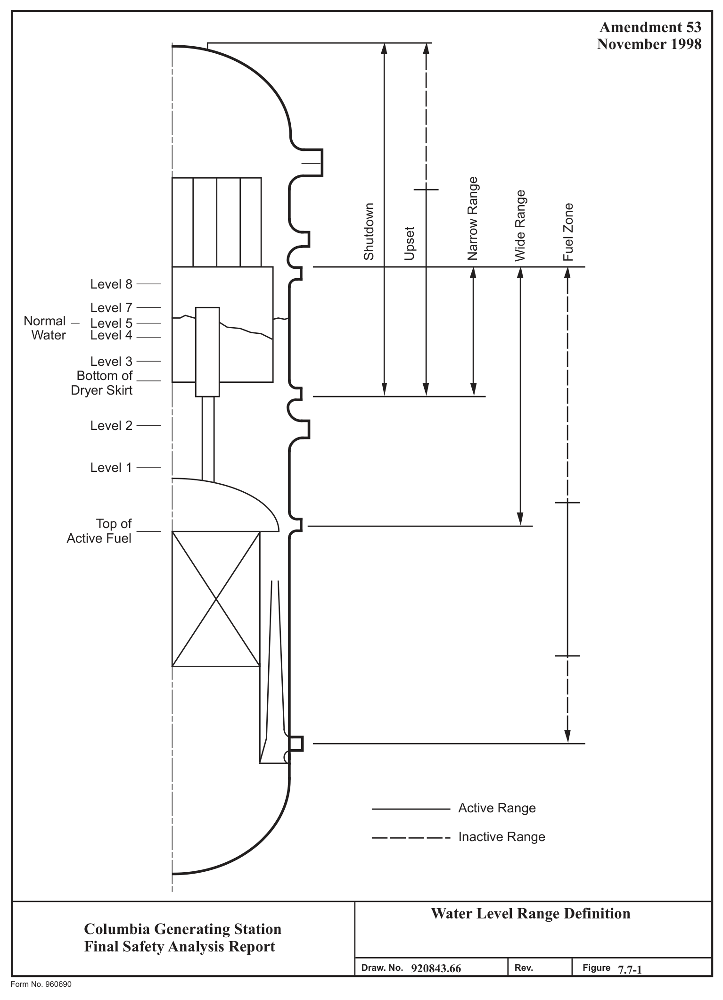

*figure on PDF page 392*

[Vector original (SVG, lossless): fig_page-392_2.svg](../figures/fig_page-392_2.svg)

<!-- labels/text on this figure page -->
Amendment 53 November 1998
Narrow Range Wide Range Shutdown Fuel Zone Upset
Level 8 Level 7 Normal Level 5 Water Level 4
Level 3 Bottom of Dryer Skirt
Level 2
Level 1
Top of Active Fuel
Active Range
Inactive Range
Water Level Range Definition Columbia Generating Station Final Safety Analysis Report 920843.66 Draw. No. Rev. Figure 7.7-1 Form No. 960690

<!-- p.393 -->
Amendment 53 November 1998 IH -

TAILE I

TAILE 2 .... -...

tn,u .UUIIIID ...... Ill . • ,,,., 011~ ... 0IM"I ''"'IIUCo•a.~-•-

,_ ..
ur111,u-.

.... TOI.I•- ... If, T IIWAWt'~u,u11 "· V

I • O.DI ti'-

WI!!!.. .. ,

I o.o, I .. , I

e • IW1fC1151.U DIWICI ,.,.,,, ........ Altll lNC cn.1 . ---

IITU """ ci, 1-f C'fCU ---- ..
Ill

'11 1-..T C'fCI.I &CTIVI ---------- _, _, CYCLI ---- I c ......

~ IIW• • IDO IIIDllflt lill■INUla •tnrl ..,,

.... - •• •n1ttoa IIFOtlUflG■ ,,,u. 1"11 •- _

h-1 ui
•n l,lll
- • .. UT--ITOIIIIIC'HITIN 'II 1!1
- ••olffll•_ .. .,, .. Ill
-
• IDD nae• _, .. ---------- It ,. ,. ,. II I I ... 1, ,. l '·""

Ill 1 a.01 UC, ••n•-•IIOI. -------------

....

.. , • tlLICT 11111 lftClf .. , ..
TUii ::::,

.... • tH;;MOTC tiit&Nu•L. SWITCl1

"'· I,

141 .. , 0.16,

l1 1, ho 10 141 aa.01

., •• },~tr& ~&'111\tn\'11'\l~r Jr:;oc:r.OLLOWSI

.
o.•1 w1J:rt" .. , I, VNII QC IIT• 1,INI OCLI II "°"ANCIH WltN 11111 • 1,ai lll

Vlf .... W CfC:ll l,ICTIH -------- ~~·· a . ., ..... lie • o. '"' C1CLI II IIIIT TO to

~ t. ~:f::.u:~:.a,::: •• •: ::..:::t-,s::1~~"Ji':.'',~OfJO,---."o 111 1.11 I. WIii.i nc Tar ••• THI c,cu lf0,,1. IUT DGII 110• ltlltf.
'·"

.,, ....

PGIIYHJ■ '"jfttlJII ... CA&.UO ·on1,•••fL • MO ftll( 1orra fWD 'DIIT- ":I CAtt:0 •w1t,etawr !HCISUf I lhlCDNICTI, :L"'i:r..:u~,,,~ ... ,. r.r::i,.:~n.i01v::1::: ::t\~1:.
•. ,i .,.
•oc l◄l

Tllf _, fll:11118 or ....... u CYCLI ---

t •.• , Cl µ"'\iii. W llC.

:'::'I,~~• ,.,. oo. o•-·••1 .- a11, ooo 1w1,cM WILL IIIDIC&TI ...... L ,. &CTYATlL .. , nu t>llfCII WILL MOIUTI

·-

Wlf ..... lf ,u,oa o, WtfMDl'AW ---- ·~·

tll roo l, ::a,~f't.=¥c\Wia: Ut{t\l\': :n,r:ut:=:,::.cm•lll C • ~• ~YCI.I .
I I I •• , .

••PAT S•S•L IUTLI ..... 0, vn-•w C.CLl ---

TOI "IIUTCN tOIII'- ------------ i. ~ : L11
•= raat•,~:cl~~.c:,-:.~-:r-.:a.,.1si=t~:.r.~~t:T AU IICll'I, - !
IJl•IJI • KUf UNTIi. ftOO IIIITIOI IISINI I. Wl9111 ,_O■ HCU CIDO SCIA" flit SIIITCN IM tU1 ,OSITIOII •• WITICI&• c•nm. --------
-

--i

lal"III • OlltYI II Tl■I I, ,. ,,
-

•CIII &LL Nt:U't, ------------ 111-111 • llflLl 11111

TIIII

RTnl CO-If-
•• 4. EAC:lt IICCUIIIUt.&TOII '"'-""' WILi,. dltTIATI ... ••t1UIICIATICMI tr m"°S0:•••='1\&."'llrt~,;l■n;itU111 a,,,.,,.,,. I, ~.
l1 1;""'7,o ,o UCIII \ • TIQ Wtlll co•t•IIIUOltl 11111.IT (.All K IIGUltTIO tl'~U: .. ,~c~~l~t'::\A•t:at~,l'l\1,:r.~r,rr ... ,oLLOVI• 10

Ul<tHtl,1 • CfCI.I sra, JIGIIT RI COllfllUOIII .... ,

0 DI Of' TNI •AC:et.aUt.&TQa flOUII.I ACIIIGWLlDlr Ill! ·-•ua• &aD "··-THI

ILL ,., .. TNI ,.,.,T " IIOICATa• f'ION •L••• TO IYIAl'f. CI.IAIIN TNI
1. -■ IOC IOT • I, TIil ,TUI II uY.UCIH WITH fllll, AtOa flOUeLC WILi.. tLIAP Tl!I I.IVIDUIL 1.:IICATlat.
~. scr 1,,. ,,ro• D1r1•1r•o•• o, v1•1At1LH ,,,, .. ,u ot1 tMtt ,co. WITIIOIIAW CIQ.t_

a. WNH toe • II, , .. CJCLI , ....

, TO to,

.. ._ LOOM:...._ '1" INQtCAf°l"S II. l'All,£1) C.0MPA .. IS0N

111•1.&I • Otl.AY UIIII. IDD IIIITIOII KC•• I.. WNllt IOC kn'• 1, TNl CYG.l ITOPS. IUI DOlS ltOT •Ill T.
t11• ■1 • Ill-WI II TINI I.LATCNI

#### IIIYAILIJ

tll•UII • Dll.AY ll'TUI IIIILATCH 111-•• • u,n ou• '"" tn-111 • HTT&.l 111111

TABLE 3

UI( l< 112• l • Tl .. WICI COIITIIUDlll WITHDIIA,_ CAM H IIGUHTIO ,nntt ,..,_.111c1 t71C tc. taa. t • C'¥CL.l STCW fllOINJ FOil COMTIIIUOW lOTKOIAW '::il'tl 11A1 &LLOWlO "1111H&. HLMI T~AIS\MIE UIIIS u' 11 -· Pltmlll.:Z:U 111T£N Ul(CIIOI Dll'TIOtfl Atll, tl0 1CATID If IIUI. f:,Ll !TUI JIU .. 1.11 fe·" 111ut11r.1ct: oocu•11n1, •--T di !EC ll,4Z 11.G••-• ,., ... , ., Cl t. COIIIIOI. WQI Dlt1Vl N1D■&VUC S'f'I ... ID - - ·- - - - - - • Clt/Cte-lOtO ~llflT 2.,a I, ltEUflON •oa1TQl'lt1, 1, •• 1[0 - ia•121 - -- -- • - - C~•tOIO fflf1
1. 'llDW&Tla COIIIIOI. IYS. ,u - - - • - - • - · -· - --- - -cu,, ... ,oio

•~ r:11:owa.n•ca•1ao1. s"s. 0t:11u v-ac. - ~--- - •• •• - ----c,11,eM••OtO IU•ID .... a.a-u

CIIINI

•c • In-Ill 0.10 "" I. COIYIIOL 100 DIIIYI. NYa.AIA.lC SlL"DIIIC• IJflC. Clt,'c.12-1010 ffne &. 'IIOCUI CDIPUTlR sn. IIIIUI./OUIJUT HOU1•E .. tiu - - - - - · c~•OtO "" ~~ •.a-a.1 1 • .UIITIDll t•DIC&TOlt HtOll CG .. C11Qlt Iii.I.. -- - - - - - - - -- 104IIIOI

,,..u, . .... --•-

II. RlACTOR i.ktlW.~ tONl llU.1 lllM,' .. - - __ . ___ . ______ &OTEl58Tt I. IIUfllN IIOIITOl:111191'~ FCO -- -- - --· ------ -- --- - - C.ll•IDIO l~'CII Ill 0.41 0-0.11, RC 10. HACTDIOIOTlCTIH$TI, tlO ---•• .. --------•••--<P\bR•IOIO 11. ~l[D VlAlEA CONT">'f'I 1£0 _____________________ .n2Ell0.t. .IIYI KC .
~~..:ft~----------- -- --- o.a-o.e

,a,COWTROL AOD 0fUAi': 11 N!IICTOR PROUCTION ~ ..... ElEI\I llll'C.. __ . _ ... ___ .. _ . _ en- 1050 CONTR:OL '9aYS CL.CM C1•"'-0------cu,t:1i:-,0!IO

IR•III 0.1D

14 CONT ROD DRIVE HVDAAUllt s,s HU,t lllAC. . - . - - - . _. _ . . Cl1 - ,oi.o

;;..~~•-0- Y] =[Y•I ]+•-•] 15 SEIMC£ 'PL"HIIRNJ tONTADL S>S. ---- __ .•• . ••.••• 7q~B5t Cl w--.. IIJD 0.0-a.11 •c

"''l:tt:.., m,. ..... .......

, ..... ,

.. -[:::t=r ·] ,f·---}[··· -·] I.ID IU llrr ANQ ~ tta-m O.ID 0.0-1.1 SIC

OR~~ •[:=D-,]=[••&•+ [••• .. •] .. , .... ,,

ll'M..
n1-lka I.OIi
--.n{!=C>-f[ .. n }[ .. i,i ]+:::r~o.] .,, ICC
- ~.a{:=r>- ·] =[•·--' }[~·-· i ]+·=:-] ·-··[·~·J·[•··:i•i·'"]=[•··--. J a. • -0 fllZ'f • OIi CIATC ,-~

Control Rod Drive Hydraulic System - FCD Columbia Generating Station Final Safety Analysis Report Draw. No. 02CI2-04,24,1 Rev. 2 Figure 7.7-2.1 Form No. 960090

<!-- p.394 -->
Amendment 53 November 1998

e rut~Tr <LPSP CM I

#### IOI WITNOU.W f'l:llltlHIVI ® ®
■ Cl lGD Wll'IIDllW 111.0C.II ITAH <LP9P CH l TURllfOl II All <LPAP --------+----1 PIISSUH

II Cl .CD INMIIT 11&.0Ca

#### HD IIIHllf PU"lll"I ~~G, 51.0Uttitl: stltCTIOtt "4----i
iili 1ii Tifi RM!!
C Cl847 mo &IAUU" CONTRCI. 5't1Te" LOc>•t ![QUlNCE Stl[CTION -6-.-----, r Ol'IIIITIND PUHllll,51 1 c:DN!IIIJIGUI WITNIHUIW Plll"IUIVt I---® RIAS C!B4B ® I e>UNTID IP C.ONDIT10WS I : S1alll IN lllD N,TTHN I
1...----------___ J 1 CONTIOU.<R "l& MIT I CONTUIUGUS WITHDIIA.'111 PliAf'11as1ve 1 --

#### INIHT
#### c:DNTINUIIUI 11111111T Plll"IMl~I @
ti D.a.tt.TIOlf RLECTIOll- @
(llt!S) ~ CCIITIIIUOUS llrtSIIIT ~IU'IISSIYI I:
WllHDICA.W w ti IOD IM161T -TIO (tfflS)-- SUllSTITIITli POIOTION 011"1."~ (Z l>IG,11')
IDII WllWDfAW REQUHT&D (11'111)- S.MTITUTli l'QITION IEli.C.TEI> IIOI ~

#### IY""IUD IIOW-0 111 UD Lf.1>'5 Ill ® 11111 SlLECTlD AND Dl1VIN6
FUU- IN 110i. ----0 ----0- IIISPl.AY a,u_ ""'

MI.ICUI ROD lllCNTIFICllflOOI Clfttl'O ll'T&)
Al"- IODII W HOIIP~ TO N'IHII LtD"& IN ~ mo ros,nON a,rrw,eo DATA ,uruttAMI KIDS -0 Ol9 PLA'I tOlt.l !"I.AP

ilH,Hlt W ..
,.,L'f,'h l-·-------------------------------<©ci:11au1N« UIIII" =tffl,,o• INIPLA• N-tl
(H,ODl
---r-0(RK~ECT ~ l:.fUl.OA.
USID -~r_o"-"-----!
- AYNmfl~-~-'------1 c~,~•~~:'a'=··::_=.----1 lf/lf'iliiflil.rMtJIOli_~Ws=-----, ·--- .. ,_>
-,IWNlffll• ...
w.,,.• ---<l ~t/f.u•

....

CDNJUTlll/c:lll cr,,~m LI!! t 111.1~,.
-ttn

SHllTDOWN !!IIUTOOIIII MARGI fl tltllllt5T£11

#### MARGIN
#### LATCIIUJ
,.;p, _ .... ~~r,;.,.u

AWAI= PlUITTID _,,i

Control Rod Drive Hydraulic System - FCD Columbia Generating Station Final Safety Analysis Report Draw. No. 02Ct2-04,24,2 Rev. Figure 7.7-2.2 Fonn No. 960690

<!-- p.395 -->
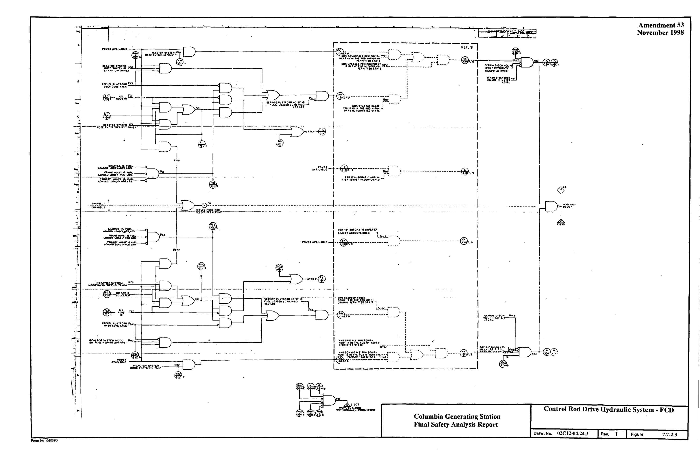

*figure on PDF page 395*

<!-- labels/text on this figure page -->
Amendment 53 November 1998 ..
o·
T I c_ I•
....
.,, ci -
ICF''51
4AA,A..L ~ IJ'u£1..
LOA OED \.Clill.O >-48~ LD•
r ..... MDl!-T ft J'31L
1..QI.DIPl,,QID>400L.O'l- "°"..., t.a.o> •oo •H ,IOU.U ..01'1'T- ,. -~Cl.
,,, I•
UAIPIU I 1
CIIAHtL t _t _____________ --~- .~-- __ _ ;
K1SJ i I H ~[ I
®.- ,. ALL 100,
Control Rod Drive Hydraulic System - FCD Columbia Generating Station Final Safety Analysis Report Draw. No. 02C12-04,24,3 Rev. 1 Figure 7.7-2.3 Fonn No. 960690

<!-- p.396 -->
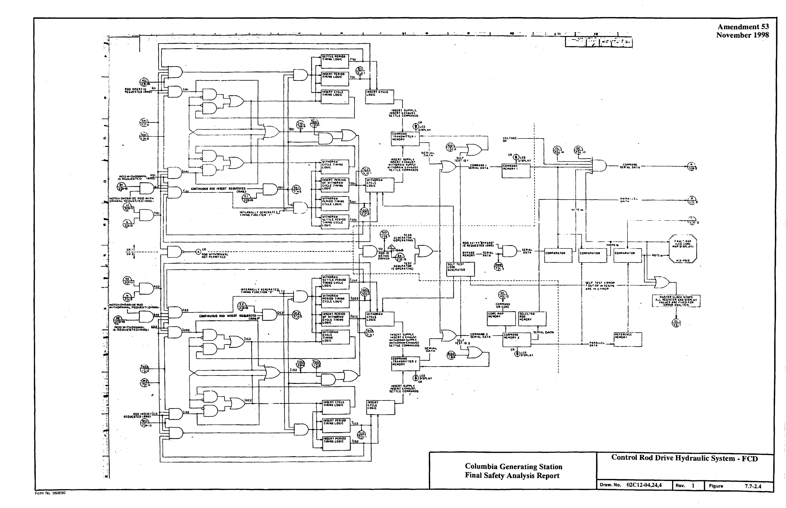

*figure on PDF page 396*

<!-- labels/text on this figure page -->
.. -- Amendment 53 ,,. s- ._..- l
• • November 1998 ti ~ :"'",· !
A,;
I
t•Hllt1 CT,Ll
• i 1, ... 1111• t.OSIC
u l ~ 'DP.
7 ... 1 -i l =t)c_ !C • I
• :,ii
a,L=f=)-_r COMl/llil"tD 1n,1t.l 0Afl
COIITINUOUI IOP 1•1ltT llCIUKfU'II
----, (IN\)
I
• l-t::mc.~
--------------------------------------;,- ' •ca-----------------------------------------------·---~ .. OD 'wlltl'JIUI .. L I llf(lf Pllt"'9Ttt:.D m~ TOO
----------------, 19 OPl, ■&IINC, VllNHA'-" I 1CT FL£ P(RIOD
L..-------
TININ; CYCU.
L051C
WlfllP&'li' flt:1100 TUlll1Ui CTCl.t UHiilC
11$1tRI P[.100 OF wntt0aaw c,nt rn1,1,
LCK-IC
co-. .. , .. ~ Sl ■l.&L 04T&
COJIOfAND IIANSMlf flR ,1 N[NOIIY
INSI.IT PEl&OD
IINIR LOCIC
IIISt■f P'UIOD
T .. 16 L011C
Control Rod Drive Hydraulic System - FCD Columbia Generating Station Final Safety Analysis Report
: .....
Draw. No. 02C12-04,24,4 1 Rev. Figure 7.7-2.4 Fonn No. 960690

<!-- p.397 -->
#### Figure 7.7-2

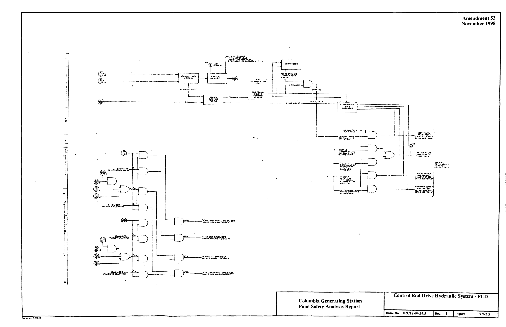

*S Form No. 960690*

<!-- labels/text on this figure page -->
Amendment 53 November 1998
COlrlP&llllfOII
1-ffi_,ar--'--------------------~------ CO~M"-'-'0 ~ &C•ttOWLLD,E WO<tO 'l•UI.ITOI
I ~.,~,,,. i ~L_)_} __ _ I I( I i llt\(4f 'SuOPl.f _ _J &11.t 1.,~au1t 1"'S£'AT O'IIVC:- VAL VU ,01: II.._• lC TlD ltOO ""OPIII ..
COM"-'AN0l"'S ;,
PRC.5CNT
_,oe 'HlfCTCD I
(;)Cl
SLTTLC
I HULi 1'11,.w·t: j t COMMll,.NC Of" :;:i~A~ti'iYJ-fC 103 ·0,111·
":.F:"':'"T:...c ~~~-g..~~L•C5 t-/lc~~~l:R~; co-..MAND Or' rcq CM. ... ... " .. s.,... I :ct,rA~;_ 1\00 i
H a1to 1 ■11av1• 1 ._.,._,,, roa ut-1· 1t.&!i.C:Rf tcno 11100 -oPur PORTION O" w1twOA .. 'H
COMJt.lA. .... 0 I'S
Pr:1C.~£1'1T ! .. :
WltMD.AW luP,1.f IUL\'[$ f"0.11t.• I __ .IIIO[INAUJt I w,,.wDQ•'N -- QRn,c ~OWM&MCI UHO AOD "OP!O~I IS PRF.S.l[. ... T
I _j :,
K i
~
- _ "S' WITHDAAW4,L $TAIILllt" 1----------l__,J-vA'-YC. OPC"'&croo7a-a1 ..
Control Rod Drive Hydraulic System - FCD Columbia Generating Station Final Safety Analysis Report Draw. No. 02Cl2-04,24,5 1 Rev.
Figure 7.7-2.S Form No. 960690

<!-- p.398 -->
Amendment 53 November 1998 .,,c,o• 'ltOTtCTIO• : YI u1•sH ·•· ~

TA.BL& 4

t ·Clllll,•llD
•u.c ,a. PIO 11 C TIO■

'"' n,, "' .....

"" - ,1111,,101111 l■lflHIIII D(VICl Ol •[Nll,ll[D ._! _____ _ A[A IOAll """"(' cu, orr
•au,., 1101 Gl.1.lllflll SCl&N OISCNHH &all. Llf(L. SWlfCN llfOIJ'

ro,o} ....

- l tt,t.1tO,!f,M POW[• • 111n•uM1.1,, ••• rDII D15C1' SOL \j("T lo l,'IIIL•BLl 1125\IDCt AW.&llllll o,,, ~•ns. IIID IV f J?' rt&O DIUIN <•Lvt,(fAllC'-CNDI :~~i.::,r~ili~~I:
CIORG NIM -VE 110oz r--- - - 1Z7 ) SCRAM 015CM VOL VN.s£ r ' l,ICII-UP De; tt ■&N

1$D~l•D•O Ul¥(f110I ----j_ - lNUIClztD .... ,.

IJAIL 0..:111 1u,100 ••OfHT•D~ il!L~i':cu1so•4- ' N1 ■51•i;. 1111ut1 Ml.Iii ,ttst. tMD SW NIOG ICHu•E At:~TOII C!IAO"f&;C,1'10,. I ,;
~ 5.,5 'T~•P!>'f'5'8,

......

DC £r,1E.R:G1ZE.O

......

.....

IIMDH MHU&L SW IND LI.Ml' 'fl

l[MDtl NIIIU&\ 'SW 1'901.,IMD W

~--·

z -lTION sntTCWOPl:N" -~OR ..... -

__ j / "CI.OSI • 5PRINI, RtTIJRN TO NOR\AM.
,, i /
- :f
(OUIOL !'tflfClt •• ~1 '"OP[N" POSITI Ot1

l

" i TIJIIBINHllllTllll. 'IAlVE
-. ·l JA5T CLDJAl 51C.MN." ' :~::o.\~t.l~~t-c"•"'' , .. , COl'v.1'A01.~"" 'ff --~, 1 '!.10P•D()~ IRM!,) .J -·· oq,vc ,._a.TEA ~P. J L. • .,..
•a,; sue T10N \.OW C:ACS,$ 4
-j-- ----r===-===:!._~- 1PSN00111t,.)
1Rcr~ f""OAS,[T POIHU ., :,n:/!t!LAILI 130YU

10D SCl!l.,if T£1J .-.!ITCH '1 , .. , ... &L 1\•~\UOD

•· •t11t P0'51T1O1r IIN'll .;J ,,..,_T,.,, V u,cro• HO rte no• :TC,01QMIJ Sfl JA.IP 1Y'Stf.lll ~1,"' Ol·Ul°'lztO "'-1 mirM..~G:.t"l ;] =~,~r.w.tt--.·••;1 fin fiEAUDll. -"UTO :SCII. .. IA l!U5 11

., &C PILOT "Jt.lN VU-VI Fill Ol• U£•51UO

..;._.· r-~~~T::-:!QN SYS------------------g Ol·tNU&IUO

AIA ID Vll.111,1( ~NT VAL vu ro10. nao ~DIPAI"" 'VAL'V£!t rou., .. , tONUOI. !W1fCN ilt 'NDIIIA~• POSiflGN 1UHt 10Ll10J0 'A' 111e.a1a1no

Control Rod Drive Hydraulic System - FCD Columbia Generating Station Final Safety Analysis Report Draw. No. 02Cl2-04,24,6 1 Rev. Figure 7.7-2.6 Fo m, No. 960690

<!-- p.399 -->
Amendment 53 ,. -f"" l,
• •
• • November 1998 a l" 10 4 ' I
---------------.
'
•• ,, •ot1fttl1I ••tur: uo, ••CH UWft(II. 'DI Et.CM 10D1 ,o,, I,.,.,. I e 11
• I rG.,~,..\-~ I Do1n1~11 ,0,,,1011 P011TIDtl N>slT'IH •011110• ::.0Ji:\~~lllf41 '•OH Ot• ••01cuo• PQ1111G• n,11c,,oa INDICAfOI 1101C&tOII

;:~Jl1a,vt1 •-t----.u:· ... , .... )___,_) sw1tt11111 . PIDII •■DH ODD

••o \ r•!UU[D 1•011,aro■ l..,IICN IFULL :e~rt:n :~':fl:r, D1iCOMICT ■.lV[L 0'11 o,m Utltol l_,ITtM

1
• c•
- 1 IIODOIHJJ.&l,.IIN I ,,., . .,, 11111111 or v-to1,,1.
,ur ''""" '""" COil 015PL•• I l[F . • I lltP ►I N[lf ltOO CLIH'fl

I I <45,. I I I I I ; L------------ Utcaa.tY MQYJITED >--t-----,l-'11011 LAfCMED 100 ~ NQIIT IS LOADtD I , I
-- • ----1 I DllflFT' SU:lf.l,._ f'OII ~ l>400LII•> ~ !Cl'AN TUii[ !
irt~\Wr,\:00 •• -t-::::
NUIUUNEMI :•g■-•netTU t--- ALL MOD'!
fUlLY II ~·------➔ I o
•Olifll.t•• PLUPOIJII
( I • .
tO■TIIDL c1•11 I ROD 011,T I !1 0 •i 01tlf11it :---- 1&11Y aoo, 1 I

#### I I I
#### I I I
I I

#### I ' ' '
I I I I I I I I I I .., IPIS II l,t IS O,(IIU,IL[ ® QP( • .tlL[ ,.6- @4 ,_J 1 ltCID lllLCQ'CO IIOO""'rTIOIO c, ...

#### APIS II OIIIMTSI (781JSI
UtOPUA.8Ll

:

.. :

7 J !
1 !
~
-I
-1
-I I
-l RP1 t•1P 5fSTlNS

.. ,_. a .... DE.-lllrdl,tZU

I I

St•&.N 1UU IECOltOU L

·•., •~ Tts.-..,.,,..,,.j--l_._.; •no SUAN TCl,f '"1~ J ~O~~;,rTT~\~l.':.s't I Control Rod Drive Hydraulic System - FCD Columbia Generating Station Final Safety Analysis Report " !

Draw. No. 02C12-04,24,7 2 7.7-2.7 Rev. Figure Form No. 960690

<!-- p.400 -->
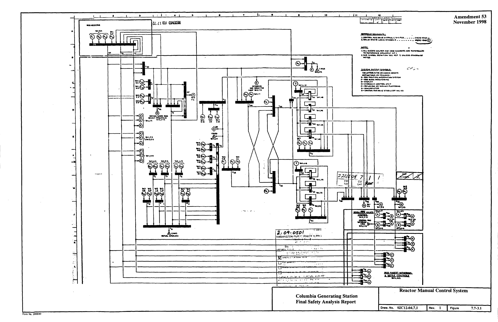

*figure on PDF page 400*

<!-- labels/text on this figure page -->
• • • J ' J a Amendment 53 ··-' .a • I 7 10 I November 1998 ll, l 1 !DJ QlAl33lll
A 'IPPfll" 0ow•m,ru
-I I.~ IMllft i!IUM_. A-IID ?ONI' JIIUUN"I, NII •t-lllllllillC.m TO lliFlll&NCI :>O<UMOOT N• I t. saa ~1'111o.. ov .. ,1',0W 'loU, .. ,,. 1. UkLC.•\, OTklatw~
•
---1----·~~;:... ______________ ------------1------------------u.~~~ filCl;'fU-
6)-..__....__..s...__.,
.......
..nlm. .. OU'TPU~~
•11.H, 11114..l'ffUI.N'1'MI IIIIA,00..'l ... 01'1 NfllilaTOil.li A'lt JOU.Ow,,:
·• _,. IJOl,t,t10N IM~•-,tON .. ,.-\TUI , • .. &Gell MOIIIT"O••~ O•Dl~'f
....
ti• M"fDaAl,IL•: (.OiltT .... IIJ1,0T
F• ...-uua.c. OIi 'll.llhfKl l'\.A.1~ ...
A.•AfitNUNCl&TOI\
-a-. C,,t»ffAOLIIOP°"'~I TtTMt\UI• ~-,1s
~o ... ~ t,;
- II :. ~- ""' ...
- .. Q Cit &--~ ~
... ... 'WI .,
____ ,_
c:,,
•
- - - ---------.. , ..
..
-
.....
"r. •• 'Cl .. , .. , __ , ..
- -
----------■ ij(ij 1ij
-- - - - - ----------- [.1
- II I~ l'l.
., ~
- - _______ ......
0 " ,oi;i1 .. ,. · . .,
- - - -
---------■ ,I
--
-· - ' L.
BQDIWl!-l'tfDll'Mtfl ' lllJJlCo CCWINU.
.,11,Mt,
Reactor Manual Control System Columbia Generating Station Final Safety Analysis Report 1 I Figure I Rev.
Draw. No. 02C12-04,7,1 7.7-3.1
Form No. 960690

<!-- p.401 -->
• ·• ., Amendment 53
•.
-- I I - • I November 1998

's,-•~~- -~.----oiilltilMtt'ill.'O: t'.<Jit.•DINll.flOIO'$ ",$· --- -

• 11(1> ...... twtJ. WPuTt-

.. _
---•-

#### -~ •--!,~•lrt1t·•10•-..J •c.-•-~- ~- -~~-:-~~--_ --L -~~=ictt;,t,~•-·-,_
..... ""' .. ..,

MIID ... tGll-"J'l ■MlfllO. ~:, ~ ~~1,e - .. - ···- -
-. - ,i-l,;;;;.,i.;~6-;;;_-~-~--~--;:_::_::;;;;;';:CK;::;:-;;;;·:;;"';;:l'l;;O;;;te;,:!°!:~'-;;; .. ;;,-~_.-..,-.· ---1 !.~ ~ ... 9-A m..., ... ~

:....-2....:. ~z.....:_ __ .:.....:.....:. .......... i ! • •o i ~ ... ;_,;:f .. ,-,,.;;,~,.o

""!'G.....,. (>oole.11 -•""I. 'o • •oo 'o.-O"'w•oo•

-· . .:.

.. ...
~()OJl•'M::)Qilrft\ ~ tl{1i,\ol1fll'.(I
•n 1..-:.,0~,UJ,t,t;·•o-•'-t.,, <.-~•.,..i

-• ,---

j.
. ~1111 II NULLE(\, dlNl·I
--~-co.,,._, ,. =-i-~~~~~-

Is- l!ffllll.i.all.CM, __________ - ------ ~ . -- i:~ ~-~-~-=~ l i-----..-r~-.. u-....... , ~~

: : ..:..:.._ ~--• __ :.:..:. . ....!~l.n!..~'------ -:■------1-.,--t-.g- -~·•---.... .-----OfQiY.,f-ta00--...... 1.-----

-~---- .. ~,,lr toi..'"°"• 1,. •ctr;o•;•••n1 •n)
( ~W.t oulPul to _,. .. l

-·

-I .... _-·-•·

... __ .,...__,_,. ....... i ... ,iq, ......... Q.CXll

lea ·Otat.o"oO.
ti& GUK,_ c•mr foe • '6a f1,11 !'1 rri:. • •ae ,. l'fo.
Sq ollCll"""I .,..a,_ '"' ••i• ... -.o.
I!' •foal11111t'f<,e.•ticc!i1f«. I~ l"•CcCX.,. actrd!

·--~:·-------•I··_·~~- fll'U ..... ,flnN .. ~--IAIOflG-i,.. ...

-

,- ........ CIO ..... ftft ..... 'IPltaill.DUP'•IIW'Jft

f •

I I ~. -..-..c ~.,..,. GIi! ~~~' MIM...,e,i.alUD....,._O.C4-..:.tDfA•"""'t I

~ ,uu. 1.IIMMl:D :f - . ~. ~:~=:""':;~~ ~ ,_-:~-:

--------- ----- --~ • _._ CIIIIGl. ...... ~11'1,11.CL-l~O-~C•

- --- ••·••• GIIIIAOU.l•·..,_11--.M~-OQIIU..·-"•···
•· fJVC,. tAAOIIJ•___,.. I
-- flii. -; iiiiiii - --1------11--1-- -~ ---•-----~--"C.--Ulll t---11------------------ ----- -------- - •• ,, • oc.iui,. ~. -r-- -,~-.-... --... --.-,.,----.. -,-,---- --------------
-! ·••----- :-- :-T:-.· '.'IIIWITl~IIUI-.:-"·--····· i ..

#### i--..------------------------1
;J-~~~~~~~==~~====~---~--·------------- ""::.

·--1~~~-,.~~~~

M.Ot...ll"MIH• ..... 'Oli.lfGD.dt

••• , V.ITll~lf# ·-·-·-··· --- ••• llj·•-lj ♦Uj~ t •e .._,.._c __ _

I ~--1--"-"'..; __ ,_"_'o_, ______ ...;.'•....;;'._-,..;-;..;"u...;;;,.,.; __ ~_...,--'•-· ,_1_11.:_•_.:0..,;.· '-----1

~1 lr.1, ...,..,,,.._,, 11

~., i(IIC ,;,....., ro•e•~t

I Reactor Manual Control System Columbia Generating Station Final Safety Analysis Report

#### I Rev. 1 I Figure
Drav,. No. 02Cl2-04,7,2 7.7-3.2 Fonn No. 960690

<!-- p.402 -->
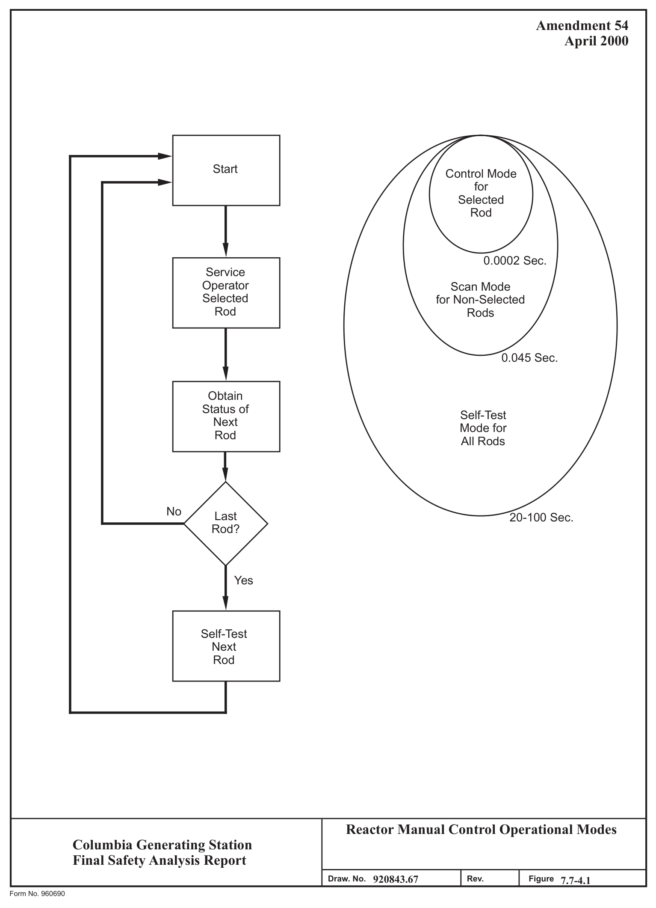

*figure on PDF page 402*

[Vector original (SVG, lossless): fig_page-402_2.svg](../figures/fig_page-402_2.svg)

<!-- labels/text on this figure page -->
Amendment 54 April 2000
Start Control Mode for Selected Rod
0.0002 Sec.
Service Operator Scan Mode Selected for Non-Selected Rod Rods
0.045 Sec.
Obtain Status of Self-Test Next Mode for Rod All Rods
No Last 20-100 Sec.
Rod?
Yes
Self-Test Next Rod
Reactor Manual Control Operational Modes Columbia Generating Station Final Safety Analysis Report 920843.67 Draw. No. Rev. Figure 7.7-4.1 Form No. 960690

<!-- p.403 -->
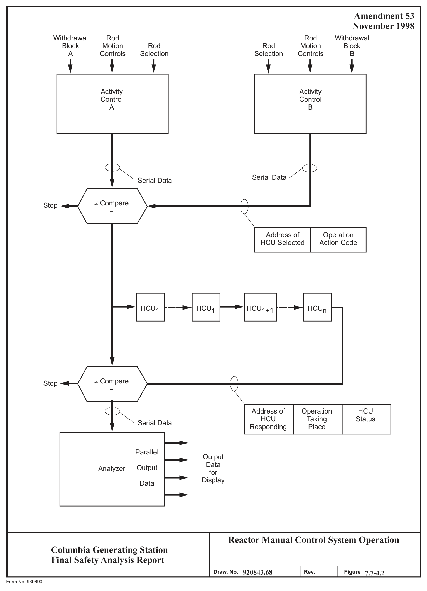

*figure on PDF page 403*

[Vector original (SVG, lossless): fig_page-403_2.svg](../figures/fig_page-403_2.svg)

<!-- labels/text on this figure page -->
Amendment 53 November 1998 Withdrawal Rod Rod Withdrawal Block Motion Rod Rod Motion Block A Controls Selection Selection Controls B
Activity Activity Control Control A B
Serial Data Serial Data
≠ Compare Stop =
Address of Operation HCU Selected Action Code
HCU1 HCU1 HCU1+1 HCUn
≠ Compare Stop =
Address of Operation HCU HCU Taking Status Serial Data Responding Place
Parallel Output Data Analyzer Output for Display Data
Reactor Manual Control System Operation Columbia Generating Station Final Safety Analysis Report 920843.68 Draw. No. Rev. Figure 7.7-4.2 Form No. 960690

<!-- p.404 -->
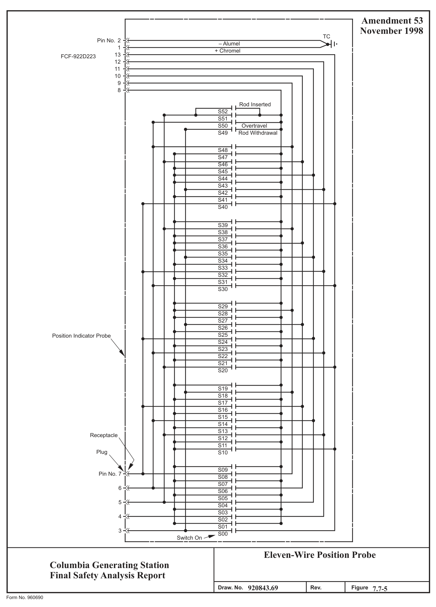

*figure on PDF page 404*

[Vector original (SVG, lossless): fig_page-404_2.svg](../figures/fig_page-404_2.svg)

<!-- labels/text on this figure page -->
:7 Amendment 53 F November 1998 TC Pin No. 2 – Alumel 1 I + Chromel
13 FCF-922D223
12 11 t 10 9 I 8
Rod Inserted I I
S52 I I
I S51
I S50 Overtravel S49 Rod Withdrawal
S48 I S47 I S46 S45 S44 S43 I I S42 S41 S40
I S39 I S38 S37 S36 S35 I I S34 S33 S32 S31
I S30
I
S29 S28 S27 I I S26 ~ S25 Position Indicator Probe S24 S23 I S22 I S21 S20
S19 I I S18 S17 S16 S15 I S14 I S13 Receptacle ~ S12 S11 Plug S10 I
S09 l ! Pin No. 7 S08 S07 6 S06 I S05
5 I r
S04 S03 4 S02 I f S01 3 ~ S00 Switch On ~
Eleven-Wire Position Probe Columbia Generating Station Final Safety Analysis Report I I 920843.69 Draw. No. Rev. Figure 7.7-5 Form No. 960690

<!-- p.405 -->
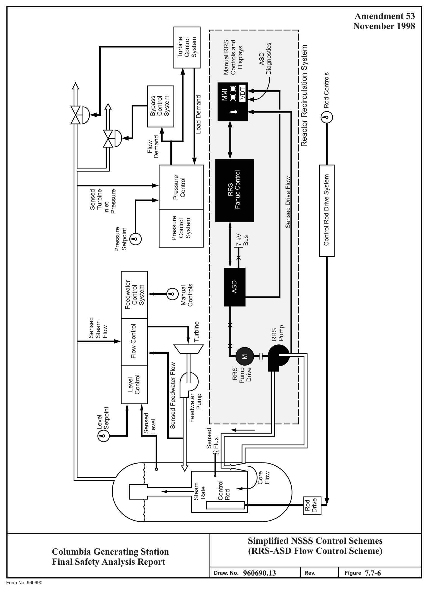

*figure on PDF page 405*

[Vector original (SVG, lossless): fig_page-405_2.svg](../figures/fig_page-405_2.svg)

<!-- labels/text on this figure page -->
Amendment 53 ~-----------, November 1998
Turbine Control System Manual RRS Controls and Diagnostics Reactor Recirculation System Displays ASD
Rod Controls
VDT MMI
System Load Demand Bypass Control Demand Flow
Fanuc Control Control Rod Drive System Pressure Sensed Drive Flow Control RRS Sensed Turbine Pressure Inlet Pressure System Control Pressure Setpoint 7 kV Bus
Feedwater ASD System Controls Control Manual
Sensed Steam Turbine Flow Control Pump Flow RRS
M I Sensed Feedwater Flow I RRS Pump Drive I Control Level I I Feedwater Pump I I Setpoint __ _J Sensed Level Level Sensed Flux
Core Flow Control Steam Rate Rod Drive Rod
Simplified NSSS Control Schemes
(RRS-ASD Flow Control Scheme)
Columbia Generating Station Final Safety Analysis Report 960690.13 7.7-6 Draw. No. Rev. Figure Form No. 960690

<!-- p.406 -->
Amendment 53 November 1998

Manual Ganged Manual Master Setpoint Station (MMI)
Setpoint Station

Manual/Auto Manual/Auto with Bias with Bias Loop A Loop B Individual Loop Setpoint/ Bias Station (MMI)

Rate/Frequency Rate/Frequency Limiter Limiter

One Feedwater Pump One Feedwater Pump Trip Plus Trip Plus Level 4 Limiter Level 4 Limiter

Low Level 3 Low Level 3 Limiter Limiter

∆T Cavitation ∆T Cavitation Limiter Limiter

Loss of One Loss of One ASD Channel ASD Channel Limiter Limiter

--------,
--------, I I
------, r------ -----,
------, ------, I I I I I I I I I I I ASD Max ASD Max ASD Max ASD Max I I I Frequency Limiter Frequency Limiter Frequency Limiter Frequency Limiter I I I I I

#### I L...------------..1 I I L..------------..1 I I
#### I L...------------...1 I I L...------------..1 I I
r------------, r------------, I r------------, r------------, I I I I I I I I I I I Control Signal Fail Control Signal Fail Control Signal Fail Control Signal Fail I I I

#### I I I
I I I

#### I I I
I Lockup Unit I I Lockup Unit I Lockup Unit I I Lockup Unit I I I I I I I

#### I L...------------...1 L..------------...1 I L..------------...1 L...------------..1 I
I I Loop A Channel 1 Loop A Channel 2 Loop B Channel 1 Loop B Channel 2

RRS ASD Loop A RRS ASD Loop B

RFCS Simplified Control Columbia Generating Station Logic Block Diagram Final Safety Analysis Report 960690.28 7.7-7 Draw. No. Rev. Figure Form No. 960690

<!-- p.407 -->
Amendment 65 10 7 4 8 6 3 5 2 December 2019 Jill I· I· DEVICES K624A, B. AND C TRIP CONTACTS TO BE WIRED so THAT 2 OUT or J DEVICES LML

#### FEED FLOW
REACTOR\IESSELLEVEL STEAM fl.OW H SF" STE,1,U FLOW · I MUST TRIP TO !NITIME MAIN A.ND AUXILIARY TURBINE STEAM STOP YALVE: TRIP.

#### FW FHD FLOW
THE POWER SOURCE FOR THE FEEOWATER INSTRUMENTATION ANO CONlROL SYSTEM Stw.l

#### MISMATCH GAIN
#### HAVE AT LEAST THE SAME DEGREE OF RELIABILITY AS THE POWER SOURCE FOR THE
#### REACTOR/FEED/BOOSTER/CONDENSATE PUMPS.
#### LEADLAG GAIN
L£V£L SETPOINT CUSTOIAER TO PROVlDE A CIRCUIT BREAKER AUXILIARY CONTACT FROM EACH REACTOR FEEDPUMP CIRCUIT BREAK£R. GE 10 PRO\IIDE AUXILIARY RELAY LOGIC FROIA PROPOR110N.Al GAIN

#### CUSTOMER (AE C.B.) AJJXILIARY CONTACTS AND CONTACTS FROM CR/K626 (E4) TO
INITIATE INDEPENDENT RUNBACK OF" EACH ROCTOR RECIRC PUMP, IN THE EVENT OF" A 1 our or 2 Rf PUIAP TRIP.

MS-LT-HB MS-lT-44A SWITCHES SHALL BE "SNAP ACTION" SWITCHES CONTACT OPERATION BEING l~EP£NOCNT or SPEED or CONTROL ROOM OPERATOR ACTION TO A\QID CONTROL SYSTEM TRANSIENTS DURING SWllCHING.

lNDEPENOCNT AL.ARl.4 UNIT RELAYS OR INTERPOSING RELAYS TO BE PRCMDEO TO ENSURE

#### SEPARATION OF RECIRC LOOP A CONTROL CIRCUIT FROM LOOP 8.
G FOR INDICATING INSTRUMENTS ANO TRAN~ITTER RANGES SEE INSTRUMENT DATA

#### SHEET(REF 10)
RffER(NCEO DOCUIAENTS 5 ANO 6 AR[ TO 8E SUBMITITO TOG[ (BWRSO) 8V TH[

#### CUSTOIAER/AE FOR (BWRSD) DESIGN COMPI..ETION
#### MS- PT- 51A MS- PT- 518
6. LEVEL SETPOINT SHALL BE STEPPED DOWN TO A VALUE SPECIFIED IN (REf 1) WHEN

#### TH(REACTORRECIEVESASCRAMSIGNAL.
"GENIUS BUS" AND "LCCNET" ARE TH[ \/ENDER NAMES roR THE)R RESP£CTIVE DATA lrilS- Ll - 612 MS - LR - 615

#### COMMUNICATION NETWORKS.
## 10 THESE INPUTS f"ORM THE ~IS f"OR THE 1.41Nfl 0W RECIRC CONTROL .-\LGORllHM
RESIDENT IN 90- 70 CPU sorTWARE.

#### SCRAM SIGNAL
(1RX/1RY)
(NOTEB)

#### I VALIDATED I
:_F_!:~Q f!.~J

#### WIOERANGE .
#### NARROW RANGE
#### LEVEL
rw PUMP TRIP INT(RLOCK/RECIRC

#### MS-LR-608
----- ~ LOOP "A" AND "B" FLOW RFW- RLY-138 ·----t

#### SH. 2. C- 10 REDUCTION (NOTE 5) 3 ELEMENT
RFW- E/S - PlOOA SINGLE POWER SUPPLY RFW-E/S-PlOOB ELEMENT RfW- E/S- POO\ RF"W-E/5-PlOOC RfW- RLY-14A ·----•

#### RFW-E/S- P1000
RF"W- E/S- PlOOE
(NOTES 3 AND 5) RF"W- E/S- PlOOF" : OPER.-\TOR LEVEL SETPOI NT :
i SETPOINT AO LEVEL i

#### STEAM FLOW .
:MODIFICATION + SETPOINT :
RFW- RLY-16 t--- I Rt.iCS E

#### FEED FLOW
D ,m, TURB FIRST STAGE PRESSURE AND TOAS 12036

#### AUTO DEMAND
: ___________ SETPOINT ________ ,

#### SIGNAL
= Allli FEEOWA1ER INLET •a• FLOW FEEOWATER INLET "B" FLOW A1lli FEEOWAlER INLET "A" FLOW Alllli FEEOWAlER INLET "A" FLOW Ailll REACTOR WATER LEVEL

#### POS IND POS IND
Alill REACTOR PRESSURE

#### P840 P840
Allli TOTAL STE,\M FLOW = LOW POWER AL.ARM POINT ~ REF DWG RfW-UC-620

#### LOW POWER SET POINT 1. CJ4 - 4010
RfW-LIC-600
2.822-1010 TOAS 12012 "A" STEAMFLOW REACTOR PRESS. . RfW-PT RfW-FT RfW-FT 3.835- 1020 MASTER LEVEL CONTROi.ER -18 -2A -28 ,_ ________ GENIUS BUS (NOTE 9)
4.Cl2-1050 TOAS 12014 "B"STEAMFLOW 5. BY OTHERS (NOR 7) C RFW-Fl- RfW-FI- RFW-FI- RFW-fl- 6. BY OTHERS (NOTE 7) TOAS 12015 "c" STEAMFLOW 603, 6038 603C 6030 7.A42- 1020 WIDE RANGE 8.A42- 1010 REACTOR PRESSURE TOAS 12016 ·o· STEAMFLOW 9.A13-342 1 TURB STEAl.4 rt.OW 10. C34-3050 TOAS 12017 "A" FECOf"LOW 11. EWD-72E-D21 RFW-fCV-1 0A/10B 12. EW0-72E-024 TOAS 12016 °B" FECOFLOW 13. EW0-72[-032 Rf'N-Pl - 605 ~S -PR- 609

#### DESCRIPTION
fHDWAfER CONTROL SYS DESIGN SPEC .Qlli LOW POWER M.ARM NUCLEAR BOILER SYSTDJ P&IO REACTORRECIRCSYSTEMfCO LOW POWER SET POINT ~ REACTOR IAANUAL CONT SYS ELEM DWG(C I 2A)

#### FEEOWATER SYSTEIJ P&ID
#### MAIN TURB G(NERATOR TRIP LOGI ELEM
INSTRUMENT SYl.4B0LS

#### PIPING AND INSTRUMENT SYMBOLS
PREOP. TESlSPEC B

#### INSTRUMENT DATA SHEET
RFT- CP - COl.42

RFT-CP-COM3 11 ii ii )!
l.L=,,= RFT-CP-28 Rf"T-CP-SV/82
-- ------------ ----------------- ----------- ,='.J

Feedwater Control System - IED A Columbia Generating Station Final Safety Analysis Report 02C34-04,3,1 15 7.7-8 Draw. No. Rev. Figure Form No. 960690ai

<!-- p.408 -->
Amendment 59 December 2007 Throttle Valves Dual Coil

LVDT Valve Gov Demand Xfer Limit

#### Ltti11 t-----r---91
> 11 52 Hi h Sel Demand TV PID Controller Low Sel Demand < VPL Speed Droop Bias Valve Management Speed Dual SP Target Coil & TVIGV PV Xfer Speed LVDT Ramp TVIGV Xfer

..... .....,,,----,G-o-ve_rn_o_r__,

GV PID Controller Speed Scale VPL into flow 0-82% Valves VPL scales 0-100% flow

#### TV/GV SP
Scale flow into GV demand. 0-100%
(0-100%)
Xfer Speed 1 flow scales to O • 82% GV demand.
& PV Speed2 Output is forced to 0% when GV 52 closes.
Speed PID Speed 3

Before TV/GV Xfer GV Speed PID Is Load (MWe)
forced to 100% Load 52 Target Auto set to 100 Mwe when 52 closes.
(0-150%) <t1 Flow Limit Low Sel
(0-1200Mwe is scaled 0-100% Summing Bypass Valves Load throttle pressure flow demand)
Ramp Flow Dual Limit Coil (0-150%) +
3.33% per 1psi delta Throttle Pressure Gain• 1 Notch Filter LVDT Pressure

#### Lead
Target Flow Biaa

#### Lag
## 4 Pressure
Ramp Gov Position Demand vs. Position Feedback Throttle Pressure for flow correction Pressure 1 Preuure 2

Presaure 3
• Throttle Presaure flow demand 0-100% is equivalent to 0-82% Governor Valve Demand.
Enable/
• Load Target Input 0-1200Mwe is equivalent to 0-82% GovemorValve Demand.
Disable 1.2.3
- VPL of 82% is equivalent to 100% flow limit on the Governor Valves. A 100% limit is equivalent to 122% flow limit.

&, Turbine Speed Input Selector &. Flow Limit Selector &. MSR Controller & Speed Reference Generator 11 Speed/Load High Select Demand Modules 21 - 32 Include the TV. GV. and BV & TV Speed PIO Controller & Controller Demand Low Select Servo Control deocnptlons Modules 21-24: TV1-TV4 Servo Control & GV Speed PID ControHer & Governing Vallie Demand Limit Selector Modules 25-28 GV1-GV4 Servo Control Modulaa 29-32: BV1-BV4 Servo Control b Load Demand (limit) Control & Speed Droop Bias Modules 33 - Bypass Valve Solenoid Outputs Modules 34 - OPC Solenoid Outputs &. Throttle Pressure Input Selector & Throttle Valve Management Modulea 35 - Temperature Permlsslva fo, Drain Valve Auto Control &. Throttle Pressure Reference Generator &. Governing Valve Management Modulea 36 • Control Tricon Trip Module Modulaa 37 - Common System Alarm 8 Throttle Pressure Controller & Bypass Valva Management Trouble Outputs Modules 38 - Generator Breaker Voter &. Lead Lag Filler &. MSR Controller Modules 39 - Condenaer Vacuum Inhibit Bypass Valve Voter & Steam Line Compensator Module• 40 • Valve Position Stetus Module Modules 41 - Load Demand to Trip TricOn

Simplified Diagram - Turbine Pressure and Columbia Generating Station Speed/Load Control Final Safety Analysis Report 920843.70 7.7-9 Draw. No. Rev. Figure

Form No. 960690ai

<!-- p.409 -->
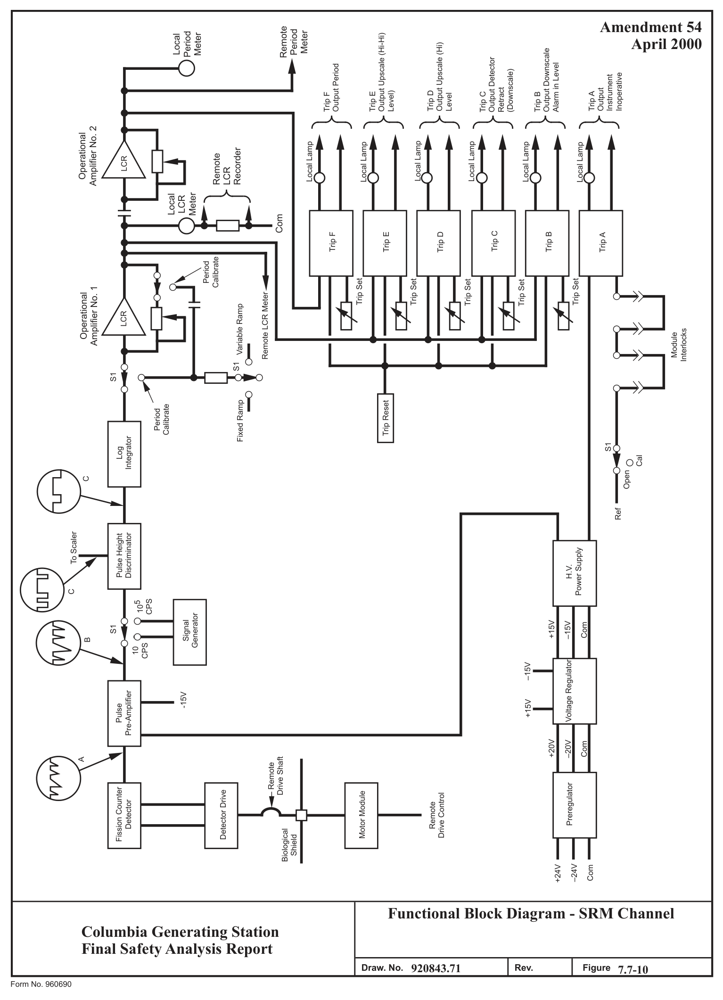

*figure on PDF page 409*

[Vector original (SVG, lossless): fig_page-409_2.svg](../figures/fig_page-409_2.svg)

<!-- labels/text on this figure page -->
Amendment 54 Remote Period Meter Period Meter Output Upscale (Hi-Hi)
April 2000 Local Output Upscale (Hi)
Output Downscale Output Detector Alarm in Level Output Period
(Downscale)
Inoperative Instrument Retract Output Level) Trip D Trip F Trip E Level Trip C Trip B Trip A
Amplifier No. 2 Operational Local Lamp Local Lamp Local Lamp Local Lamp Local Lamp Local Lamp Recorder Remote LCR LCR
Meter Local LCR Com Trip F Trip E Trip D Trip C Trip B Trip A Calibrate Period Trip Set Trip Set Trip Set Trip Set Trip Set Amplifier No. 1 Remote LCR Meter Operational Variable Ramp LCR Interlocks Module S1 S1
Fixed Ramp Trip Reset Calibrate Period
Integrator S1 Log Cal 0 Open C
Ref
To Scaler Pulse Height Discriminator Power Supply H.V.
C
CPS 105
Generator Signal +15V –15V Com S1 B CPS 10
Voltage Regulator –15V Pre-Amplifier -15V +15V Pulse
+20V –20V Com Drive Shaft A Remote Preregulator Fission Counter Detector Drive Motor Module Drive Control Detector Remote Biological Shield
+24V –24V Com
Functional Block Diagram - SRM Channel Columbia Generating Station Final Safety Analysis Report 920843.71 Draw. No. Rev. Figure 7.7-10 Form No. 960690

<!-- p.410 -->
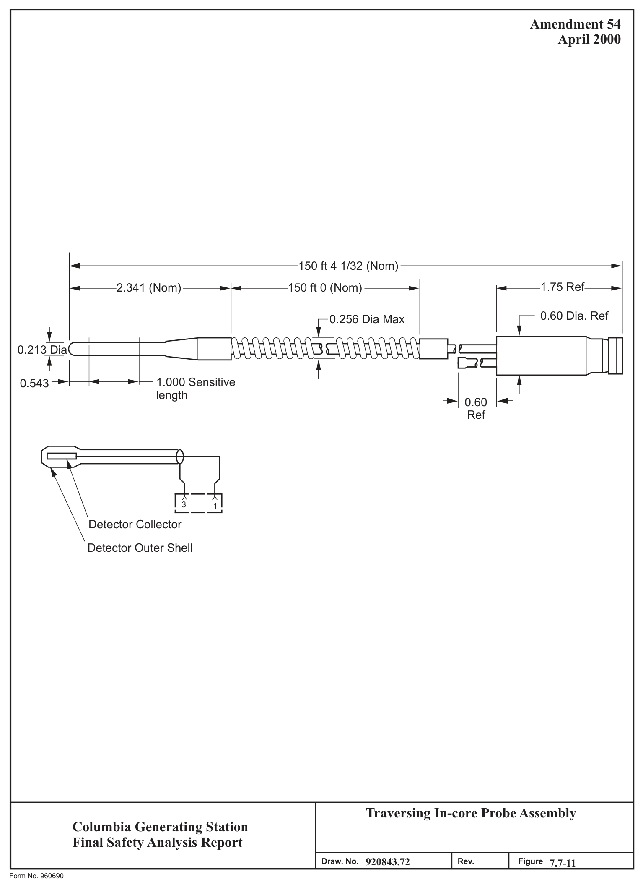

*figure on PDF page 410*

[Vector original (SVG, lossless): fig_page-410_2.svg](../figures/fig_page-410_2.svg)

<!-- labels/text on this figure page -->
Amendment 54 April 2000
150 ft 4 1/32 (Nom)
1.75 Ref 2.341 (Nom) 150 ft 0 (Nom)
0.60 Dia. Ref
0.256 Dia Max
0.213 Dia
1.000 Sensitive 0.543
length 0.60 Ref
3 1 Detector Collector
Detector Outer Shell
Traversing In-core Probe Assembly Columbia Generating Station Final Safety Analysis Report 920843.72 Draw. No. Rev. Figure 7.7-11 Form No. 960690

<!-- p.411 -->
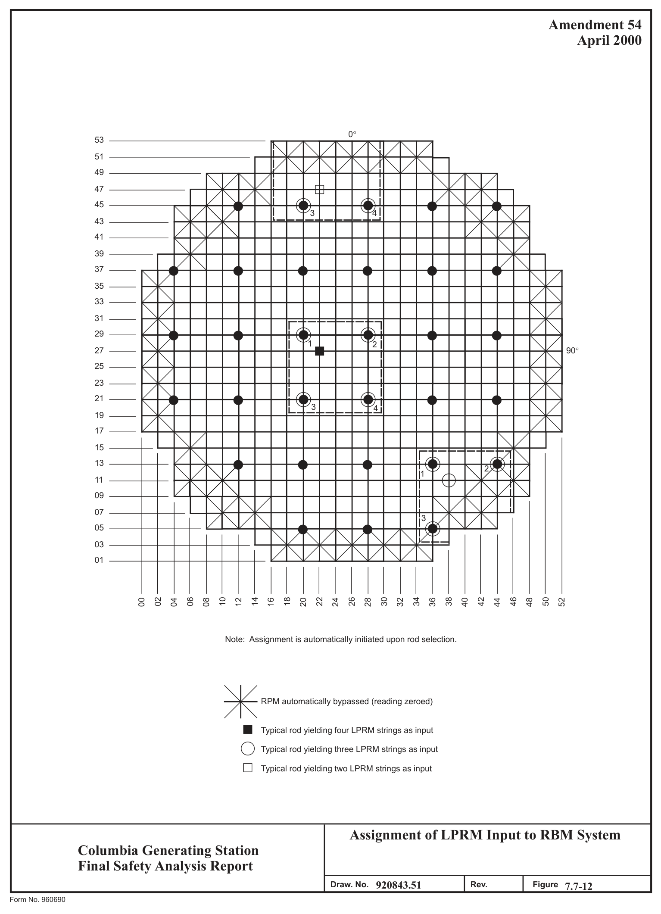

*figure on PDF page 411*

[Vector original (SVG, lossless): fig_page-411_2.svg](../figures/fig_page-411_2.svg)

<!-- labels/text on this figure page -->
Amendment 54 April 2000
0° / " 53 / 1"'- / 1""- / 1"'- / ~ " / " " I/ " 51 V I/ / I"- "' / "' I"-. / "' 49 /
/1
I "- / "' ./ " / "" / 47 L i-J /.::--I /. ::-- I"-. / " " 45 " ;., /' /' ~ / I ",, I 3 4 "' / "' I/ " / "
-' L 43 / "' " 41 / / / "' / "' "' 39
- 37 1"'-I/ / / "' - V "' 35 "'
- 33 1"'-I/ /
- 31 .. r;::-- .. / " V '\ /. ';..7 "' - 29 I"-. I/ " ;., ' ,, I " / I " 1 2
- I/ "' 27 / " 90° ■■ "' - 25 I"-. I/ / 1!
! - / " .. ..
23 / '\ ,:: ::-- I I/.::-- "' "' - 21 " / II,..;;., / " 3 '- ;., I ,-, ~- 4
L- ...J
/ "' - 19 I/ I"- "' - 17 I"' / / I/ "'
r/. ,-, -- ·- ;;;; "' 15
I"' / "' 11 ' ;., ,, "' ::-- /. 13 "" /' / '\ / "" 2 1 "' / "' I/ " \.../ / " '\ 11 I / / "' I "' " / " 09 / I / / "' " / "' L ✓ " "' 07 / 3 I/ ~ / "' V ~ / "' 05 !)<;., "' / "' "' / " V " 03 / / 01
I I I I I I I I I I I
00 02 04 06 08 10 12 14 16 18 20 22 24 26 28 30 32 34 36 38 40 42 44 46 48 50 52
Note: Assignment is automatically initiated upon rod selection.
* RPM automatically bypassed (reading zeroed)
Typical rod yielding four LPRM strings as input ■ 0 Typical rod yielding three LPRM strings as input
Typical rod yielding two LPRM strings as input □
Assignment of LPRM Input to RBM System Columbia Generating Station Final Safety Analysis Report 920843.51 Draw. No. Rev. Figure 7.7-12 Form No. 960690

<!-- p.412 -->
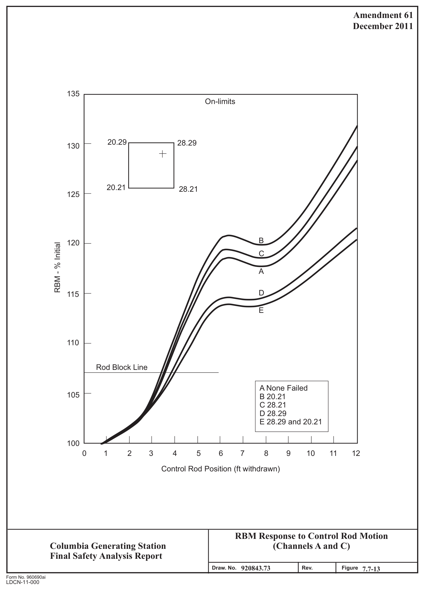

*figure on PDF page 412*

[Vector original (SVG, lossless): fig_page-412_2.svg](../figures/fig_page-412_2.svg)

<!-- labels/text on this figure page -->
Amendment 61 December 2011
135 On-limits
20.29 28.29 130
20.21 28.21 125
B 120 RBM - % Initial C
A
D 115
E
110
Rod Block Line
A None Failed 105
B 20.21
C 28.21
D 28.29
E 28.29 and 20.21
100 0 1 2 3 4 5 6 7 8 9 10 11 12
Control Rod Position (ft withdrawn)
RBM Response to Control Rod Motion
(Channels A and C)
Columbia Generating Station Final Safety Analysis Report 920843.73 Draw. No. Rev. Figure 7.7-13 Form No. 960690ai
LDCN-11-000

<!-- p.413 -->
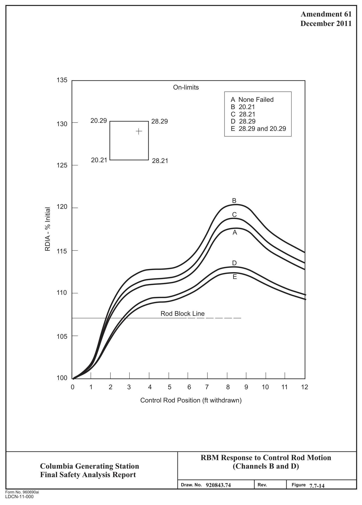

*figure on PDF page 413*

[Vector original (SVG, lossless): fig_page-413_2.svg](../figures/fig_page-413_2.svg)

<!-- labels/text on this figure page -->
Amendment 61 December 2011
135 On-limits A None Failed
B 20.21
C 28.21 CJ
20.29 28.29
D 28.29
130 E 28.29 and 20.29
20.21 28.21 125
B 120 RDIA - % Initial C
A
115 D
E
110
Rod Block Line
105
100 0 1 2 3 4 5 6 7 8 9 10 11 12
Control Rod Position (ft withdrawn)
RBM Response to Control Rod Motion
(Channels B and D)
Columbia Generating Station Final Safety Analysis Report 920843.74 Draw. No. Rev. Figure 7.7-14 Form No. 960690ai
LDCN-11-000

<!-- p.414 -->

*figure on PDF page 414*

[Vector original (SVG, lossless): fig_page-414_2.svg](../figures/fig_page-414_2.svg)

<!-- labels/text on this figure page -->
Amendment 57 December 2003
DELETED
Columbia Generating Station Final Safety Analysis Report I I 920843.75 Draw. No. Rev. Figure 7.7-15 Form No. 960690
LDCN-02-018

<!-- p.415 -->
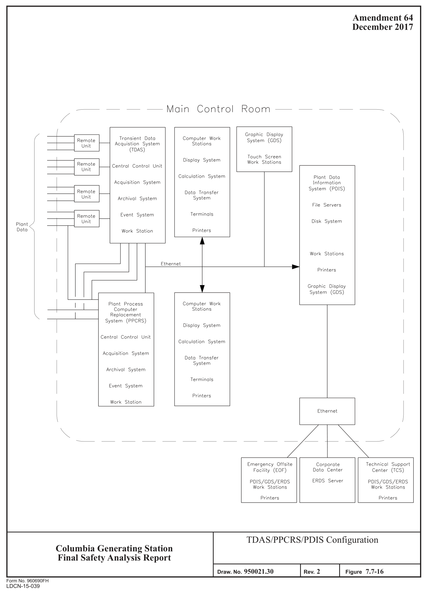

*figure on PDF page 415*

[Vector original (SVG, lossless): fig_page-415.svg](../figures/fig_page-415.svg)

<!-- labels/text on this figure page -->
Amendment 64 December 2017
-Main Control Room- / I Remote L Graphic Display
I Unit I Transient Data Computer Work
System (GDS)
Acquistion System Stations I ----<
(TDAS)
Touch Screen I Remote L Display System Work Stations I
Unit I
Central Control Unit I ----<
----\_ _ __J Calculation System Plant Dato I Acquisition System Information ... Remote L System (PDIS) I __ Unit I Dato Transfer System Archival System I File Servers I
----lRemote L Event System Terminals Unit I I Disk System Plant I Data Printers Work Station
I Work Stations I Ethernet I Printers , ' Graphic Display I I System (GDS)
Computer Work I Plant Process I I Stations Computer I I Replacement System (PPCRS)
Display System I Central Control Unit Calculation System I Acquisition System Dato Transfer System I Archival System Terminals Event System I l Printers Work Station Ethernet
Emergency Offsite Corporate Technical Support F ocility (EOF) Doto Center Center (TCS)
ERDS Server PDIS/GDS/ERDS PDIS/GDS/ERDS Work Stations Work Stations
Printers Printers
TDAS/PPCRS/PDIS Configuration Columbia Generating Station Final Safety Analysis Report I 950021.30 2 7.7-16 Draw. No. Rev. Figure Form No. 960690FH
LDCN-15-039

<!-- p.416 -->
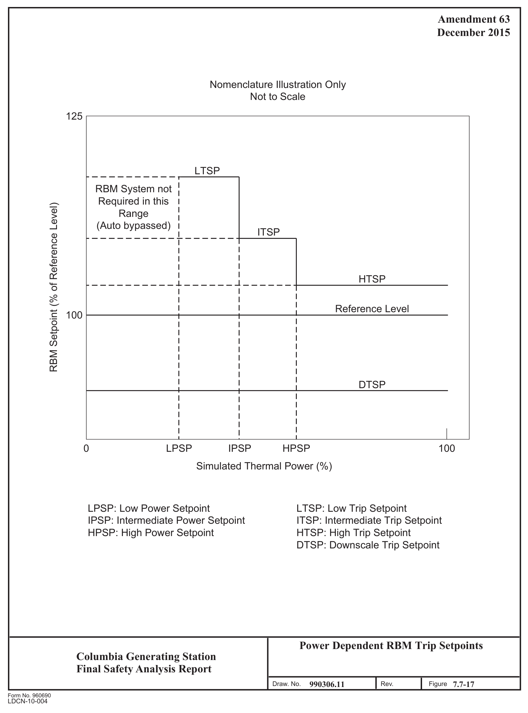

*figure on PDF page 416*

[Vector original (SVG, lossless): fig_page-416.svg](../figures/fig_page-416.svg)

<!-- labels/text on this figure page -->
Amendment 63 December 2015
Nomenclature Illustration Only Not to Scale
125
---------- I LTSP RBM System not I Required in this I RBM Setpoint (% of Reference Level)
I Range I
(Auto bypassed)
I __________ I ______ ITSP I I I I I I I I ----------~------~------ I HTSP I I I I I I Reference Level I I I 100 I I I I I I I I I I I I I I I I I I I I I I I I I I DTSP I I I I I I I I I I I I I I I I I I I 0
LPSP IPSP HPSP
100 Simulated Thermal Power (%)
LPSP: Low Power Setpoint LTSP: Low Trip Setpoint IPSP: Intermediate Power Setpoint ITSP: Intermediate Trip Setpoint HPSP: High Power Setpoint HTSP: High Trip Setpoint DTSP: Downscale Trip Setpoint
Power Dependent RBM Trip Setpoints Columbia Generating Station Final Safety Analysis Report l l 990306.11 7.7-17 Draw. No. Rev. Figure Form No. 960690
LDCN-10-004

