# 8.3 ONSITE POWER SYSTEMS

> Columbia Generating Station FSAR — Chapter 08: Electric Power
> Source: `08_chapter-2966-3151.pdf`, PDF pages 37–186 (of 186)
> Amendment 67 compilation (individual pages carry varying amendment dates)

---
<!-- p.37 -->
### 8.3 ONSITE POWER SYSTEMS
#### 8.3.1 ALTERNATING CURRENT POWER SYSTEMS
##### 8.3.1.1 Description
Principal elements of the Columbia Generating Station (CGS) auxiliary ac electrical systems are illustrated in Figure 8.1-2. Four auxiliary transformers are provided.

Normal auxiliary power is provided by two normal auxiliary transformer fed from the main generator 25-kV isolated phase bus. The startup transformer is connected to the Bonneville Power Administration (BPA) 230-kV H. J. Ashe Switchyard. These auxiliary systems each have the capacity to carry the full plant auxiliary load. A backup transformer is provided to supply all Divisions 1 and 2 plant engineered safety feature (ESF) loads. This transformer is supplied from the BPA Benton Switchyard via a 115-kV line to the plant. The transformer steps down the 115-kV supply to 4.16-kV and is connected by cables through circuit breakers to the 4.16-kV Class 1E switchgear buses SM-7 and SM-8.

8.3.1.1.1 4.16-kV and 6.9-kV Distribution System

The auxiliary transformers step down the available voltage as required to supply the 4.16-kV and 6.9-kV auxiliary switchgear buses. During normal operation, all load is carried by the normal auxiliary transformers. The startup transformer is used while the 25-kV main generator is being started and synchronized with the system. When this is accomplished, all auxiliary load is transferred (live load transfer) to the normal auxiliary transformers. The startup transformer remains energized from the 230-kV offsite power line to permit the auxiliary load to be automatically transferred back to it if power from either normal auxiliary transformer is lost. It is possible to operate the plant with auxiliary loads carried by the startup transformer.

The 4.16-kV non-Class 1E switchgear buses SM-1, SM-2, and SM-3 are fed from the secondary windings of the dual secondary winding normal auxiliary transformer (TR-N1) or from the 4.16-kV “Y” winding of the dual secondary winding startup transformer (TR-S).
These buses supply the large non-Class 1E auxiliary motors and substations, and the Class 1E switchgear buses SM-4, SM-7, and SM-8. Permanently installed, locked open electrical cross connects between SM-2 and SM-1 and SM-3 allow for powering Division 1 or 2 equipment from SM-4 when plant conditions allow (see Section 8.3.1.1.7.2.1). The cross connect breakers are not installed in the switchgear. They must be installed and racked in prior to use.
Use of the cross connect feature is controlled per plant procedures by administratively maintaining the source breakers open to prevent inadvertent paralleling of standby sources.

The 6.9-kV non-Class 1E switchgear buses are fed from the single secondary winding normal auxiliary transformer (TR-N2) or from the 6.9-kV “X” winding of the dual secondary winding

<!-- p.38 -->
startup transformer (TR-S). These buses supply the non-Class 1E reactor recirculation pump adjustable speed drives (ASDs), cooling tower substations, and auxiliary substations.

The 6.9-kV and 4.16-kV auxiliary switchgear buses are arranged for distribution of power through a switchgear assembly of circuit breakers. The switchgear is of metal-clad, indoor design and has three-pole circuit breakers (draw-out type) with stored energy mechanisms fed from the plant dc systems.

Normal source power failure is detected by relays in the unit trip protective system and by undervoltage relays. Automatic transfer facilities are provided so that failure of normal supply causes immediate tripping of the normal supply circuit breakers and simultaneous closing of the startup transformer supply circuit breakers. This provides virtually continuous feed to the Class 1E and non-Class 1E switchgear buses of all divisions.

On loss of both normal and startup sources, or if the startup source is lost when the main generator is out of service, the tie breakers between the 4.16-kV Class 1E and the 4.16-kV non-Class 1E switchgear buses are automatically opened, thereby shedding all loads supplied via the 4.16-kV non-Class 1E buses. The 4.16-kV Class 1E bus undervoltage signals cause trips of all 4.16-kV feeder breakers except those breakers supplying 480-V substations.
The Divisions 1 and 2 4.16-kV Class 1E buses (SM-7, 8) are then automatically transferred to the 115/4.16-kV backup transformer for supply of load. In the event this source is also unavailable, these buses would be automatically transferred to the onsite standby sources
(Divisions 1 and 2 diesel generators). Reapplication of load is on a time priority basis. The loading sequence for buses SM-7 and SM-8, as shown in Tables 8.3-1 and 8.3-2 and Figures 8.3-1 and 8.3-2, is accomplished through the use of electromechanical time delay relays. The Division 3 [high-pressure core spray (HPCS)] 4.16-kV Class 1E bus (SM-4)
cannot be connected to the backup source; loss of the normal/startup sources causes automatic transfer of this load, as shown in Table 8.3-3, to the Division 3 onsite standby source
(Division 3 diesel generator). Load shedding and load sequencing are not required in this division. Permanently installed, electrical cross connect cables between SM-2 and SM-1 and SM-3 allow cross connecting Division 3 to Divisions 1 or 2 under conditions described in Section 8.3.1.1.7.2.1. This allows Division 3 to power selected Division 1 or 2 loads.

The 4.16-kV Class 1E buses SM-7 and SM-8 provide power to the 4.16-kV emergency core cooling system (ECCS) loads, control rod drive pumps, and (via stepdown transformers) the 480-V Class 1E buses SL-71, SL-73, SL-81, and SL-83. The 4.16-kV Class 1E bus SM-4 provides power to the 4.16-kV HPCS pump and (via stepdown transformer) the 480-V Class 1E motor control center (MCC) MC-4A (HPCS auxiliaries). Buses SM-7 and SM-8 can be fed from any of three sources, namely (1) normal auxiliary switchgear which receives power from either the normal auxiliary transformers or the startup transformer,
(2) the backup transformer, or (3) standby diesel generators. Bus SM-4 can be fed from either of two sources, namely, (1) normal auxiliary switchgear which receives power from either the normal auxiliary transformers or the startup transformer, or (2) a standby diesel generator.

<!-- p.39 -->
As shown in Figure 8.1-2.2, bus SM-7 supplies 4.16-kV Division 1 ESF loads and non-ESF control rod drive pump (CRD-P-1A). Subbus SM-75 supplies other 4.16-kV non-ESF loads, including the plant service water pump (TSW-P-1A). Class 1E breaker CRD-CB-P1A (SM-7 supply to CRD-P-1A) is automatically tripped on loss of offsite power (LOOP), and Class 1E breaker E-CB-7/75/1 (SM-7 supply to SM-75) is automatically tripped on a loss-of-coolant accident (LOCA) with LOOP to prevent overloading of DG1. This arrangement allows the plant service water pump to be supplied from Division 1 bus SM-7 during a LOCA when an offsite source is available. Division 2 loads are treated in a similar manner on buses SM-8 and

#### SM-85.
Time delays are provided with timers to extend the intervals between auto starts of ECCS pumps on LOCA initiation with the TR-S supply. This prevents second level undervoltage relay operation due to excessive voltage drops and longer starting time resulting from simultaneous or overlapping starts of large motors. To improve bus voltages during LOCA (1)
buses SM-72 and SM-82 are shed automatically on LOCA initiation, and (2) an electrical interlock prevents starting the second plant service water (TSW) pump during a LOCA.

The combined ECCS and TSW loads in Divisions 1 and 2 exceed the rated capacity of their respective diesels. Hence, feeder breakers 7-75/land 8-85/1 supplying buses SM-75 and SM-85, respectively, are tripped automatically on a LOCA with LOOP. Breakers 7-75/1 and 8-85/1 remain closed on LOOP without a LOCA, and the TSW pumps are started automatically to provide water for drywell cooling to ensure a controlled shutdown.

Two circulating water pumps, CW-P-1B and CW-P-1C, are tripped automatically on LOCA initiation leaving the third circulating water pump, CW-P-1A, operating during a LOCA.
Starting of CW-P-1A under minimum grid voltage (230-kV) and maximum loading conditions during a LOCA is avoided by administrative procedure.

Manual live transfer of power between normal auxiliary and startup sources is possible either way by the main control room operator on the 4.16-kV non-Class 1E switchgear buses SM-1, 2, and 3. Likewise, manual live transfer of power between normal/startup and backup transformer sources is possible on the 4.16-kV Class 1E switchgear buses SM-7 or 8, although the startup source is the preferred offsite power source. Manual live transfer of power between the normal/start or the backup power source and the Division 1 or 2 standby power source is possible. This facilitates diesel generator testing without dropping loads or the return of loads from the diesel generator to the offsite power source on recovery of the offsite source following a total loss. However, synchronizing of any diesel generator with the normal auxiliary transformer is avoided by administrative procedures.

The primary undervoltage sensing scheme for the 4.16-kV Class 1E distribution system utilizes instantaneous undervoltage relays to start the Divisions 1 and 2 standby diesel generators immediately on loss of voltage at their associated 4.16-kV Class 1E switchgear buses. These

<!-- p.40 -->
relays also energize timers which allow the system to attempt to establish supply from the startup source (if the plant is operating from the normal source at the time) or verify that voltage loss is maintained (if the plant is operating from the startup source initially).

In the event that voltage loss is maintained for 3.5 sec, the Division 1 and/or 2 timers trip the Class 1E bus normal/startup source breakers, institute load shedding, and energize additional 2-sec and 4-sec timers. The 2-sec timer is utilized to attempt closing of the backup source breakers; backup transformer undervoltage relays will inhibit breaker closure in the event of backup source undervoltage. The 4-sec timers are used to inhibit closure of the diesel generator breakers until the system has had time to attempt reestablishment of supply via the backup source.

When 4.16-kV Class 1E Division 1 and/or 2 buses are supplied from 115-kV backup source, a loss of the backup source initiates a timer. The timer trips the backup source breaker B-7
(B-8) after a 3.5-sec delay. This allows coordination of the backup source undervoltage relay with the associated incoming line and branch circuit overcurrent protection.

The primary undervoltage scheme for the 4.16-kV Division 3 Class 1E bus utilizes instantaneous undervoltage relays which energize a 2-sec timer. In the event that voltage loss is maintained for 2 sec, this timer trips the preferred source breaker and energize an additional 1-sec timer. The second timer, after timing out, starts the HPCS diesel generator and annunciates the loss of voltage in the control room. The diesel generator supply breaker will then close after the diesel has reached rated frequency.

See Sections 8.3.1.1.7.1.7 and 8.3.1.1.7.2.7 for additional discussion of the standby diesel generator starting and loading systems.

A second level of undervoltage protection is provided to protect against the effects of prolonged degraded voltage which could adversely affect the operation of Class 1E electric motors requiring at least 90% of the nameplate voltage for continuous operation (see Table 8.3-4). For this reason, Class 1E bus SM-4, SM-7, and SM-8 voltages are monitored by an additional set of Class 1E undervoltage relays. Three static type undervoltage relays are provided for Divisions 1, 2 and 3 and are connected to monitor all three line voltages (i.e., phases AB, BC, and CA). The arrangement utilizes a two-out-of-three logic to preclude the possibility of spurious voltage loss signal and facilitate testing.

In the event of sustained bus undervoltage (approximately 89.4% of nominal bus voltage lasting more than approximately 8 sec), the second level of undervoltage protection automatically trips the feeder breaker connecting the normal/startup sources to their respective I 4.16-kV Class 1E buses. For Divisions 1 and 2, this action results in loss of bus voltage, thereby starting the diesel generators, initiating load shedding and energizing two of the

<!-- p.41 -->
I three bus transfer timers mentioned in the primary undervoltage scheme above. In this case the first 3.5-sec timer is bypassed. The 2-sec timer permits closing of the backup source breaker and the 4-sec timer permits closing of the diesel generator breaker assuming a failure I of the backup source breaker to close. Closure of the backup source and diesel generator breakers is permitted if the source voltage is at least 94% of normal.

Should the degraded voltage condition exist on the backup power source while the source is supplying the load, the second level undervoltage relays would then isolate that source, again initiating the sequence of events described for the secondary undervoltage sensing scheme above. However, closing of backup feeder breakers, as part of that sequence of events, is blocked.

For Division 3, the second level undervoltage protection trips the normal/startup source breaker, thereby causing a loss of bus voltage. This energizes the second timer which results in diesel start and subsequent supply to Division 3 from the diesel generator.

The setpoints and allowable values for the 4.16-kV emergency bus loss of power instrumentation are as follows:

Type Setpoint (Volts) Allowable Value (Volts)
Loss of Voltage
(Divisions 1, 2, and 3)
4160 V basis 2782.5-2957.5 2450-3135 120 V basis 79.5-84.5 70.0-89.57

Undervoltage
(Divisions 1, 2, and 3)
4160 V basis 3711.8-3729.2 3685-3755 105.29-107.28 120 V basis 106.05-106.55

A blown P.T. fuse on the bus SM-7 or SM-8 would result in a spurious voltage loss signal for the primary and second level undervoltage relays. The primary undervoltage relays will trip the normal/startup source breaker and initiate auto transfer to the backup source. The second level undervoltage protection for the backup source is blocked in this event, in order to prevent cycling of the backup source breaker. The primary undervoltage protection for the backup source will be unaffected since the back-up source primary undervoltage relay is connected to a separate P.T. as shown in Figures 8.3-1 and 8.3-2. In this event, the ESF load breakers of the affected bus will trip and will not be available until the blown P.T. fuse is replaced.
However, the ESF loads on the other two unaffected Class 1E buses will be available during this time for safe shutdown, if required.

<!-- p.42 -->
When the Class 1E buses SM-7 and SM-8 are being fed from the turbine generator, the possibility of sustained undervoltage is not considered credible due to response characteristics of the voltage regulator and protection equipment for the unit.

The scheme described ensures a power source within the acceptable voltage limits for the Class 1E loads at all times. Circuit design allows for testing of the individual relays, one at a time, without disrupting the protective function. There are no bypasses of the protective action for this system.

The load shedding of these emergency buses, SM-7 and SM-8, due to under voltage during motor starting will not occur once the diesel generator is supplying power to the emergency bus. The minimum voltage on the emergency buses SM-7 and SM-8 as a result of motor starting when the associated diesel generator is supplying the bus is 80% or greater of the rated bus voltage. Since the Class 1E bus primary undervoltage relays are set at 69% of nominal bus voltage, reinstitution of load shedding as a result of voltage dip due to motor starting will not occur.

Technical Specifications for CGS include a test requirement to verify that on interruption of offsite power the loads are shed from the emergency buses and the loading of the onsite sources is sequenced by time delay relays in the motor start controls.

8.3.1.1.2 480-Volt Distribution System

Power for 480-V auxiliaries is supplied from unit substations consisting of 6.9-kV/480-V or 4.16-kV/480-V transformers and associated metal clad switchgear. Non-Class 1E 4.16-kV buses SM-1, 2 and 3, supply separate 480-V substations, each with its own power transformer and switchgear.

Class 1E 480-V substations supplying ESF loads are arranged as independent radial systems with each 480-V bus fed by its own power transformer. Each 480-V Class 1E bus is independent of the other 480-V buses; there are no cross ties. The 480-V auxiliaries required during emergency conditions are supplied from 480-V Class 1E buses SL-71 and SL-73
(Division 1) and SL-81 and SL-83 (Division 2). The HPCS 480-V auxiliaries are supplied from an independent transformer and Class 1E bus MC-4A (Division 3). Power supplies to all Class 1E auxiliary systems are arranged so that alternate or redundant auxiliary systems are supplied from 4.16-kV switchgear buses of separate Class 1E divisions.

The 480-V substations, in general, supply 460-V motor loads larger than 100 hp and all MCC loads. Switchgear for 480-V substations is of the indoor metal clad type with draw-out circuit breakers operated from the plant dc system, with the exception of SL-54 which is equipped with molded case circuit breakers. Phase to ground fault currents are limited to a maximum of 10 amp by use of neutral ground resistors in all substation transformer neutral ground

<!-- p.43 -->
connections. All substation transformer neutral ground connections and switchgear branch feeder circuits are equipped with ground detection devices and alarms.

The 480-V MCCs feed motors 100 hp and less (in general), control power transformers, heaters, motor-operated valves (MOVs), all other small electrically operated auxiliaries, and all lighting. Control centers are isolated in separate load groups corresponding to divisions established by the 480-V substation units. Branch circuit protection for all loads is provided by fused disconnect switches equipped with current limiting fuses or molded-case circuit breakers.
The fuses for the MC-8BA subfeed also provide backup overcurrent protection for containment penetration circuits in accordance with Regulatory Guide 1.63.

Class 1E MCCs are shown on the auxiliary one-line diagram (Figure 8.3-4).

8.3.1.1.3 120/240-Volt (Non-Class 1E) Plant Uninterruptible Power System

The non-Class 1E plant uninterruptible power system supplies 120/240-V ac to station services where uninterruptible power is required, such as for plant computer and plant instrumentation [e.g., digital electrohydraulic control system (DEH) cabinet]. This source of power is necessary for plant operational loads, but does not supply ESF loads. Power is distributed via a single phase, three-wire, grounded neutral system.

Failure of the non-Class 1E uninterruptible power system has no adverse effect on station safety since no ESF loads are supplied from this system.

The plant uninterruptible power system receives its power from a static inverter-static switch arrangement fed both from a 250-V dc station battery (float source) and from a 480-V ac Class 1E MCC (preferred source) as shown in Figure 8.3-5.1. During faults on the uninterruptible power system the static switch will automatically transfer loads to a regulated alternate source, which supplies sufficient fault current to blow the circuit fuse and clear the fault.

Manual bypass switches are also provided to bypass the plants uninterruptible power systems and transfer load to a regulated bypass source. This will allow for maintenance and inspection of the system.

8.3.1.1.4 120/208-Volt Non-Class 1E Instrumentation Power System

Power is supplied to non-Class 1E plant instrumentation at 120/208-V ac via a three-phase, four-wire, grounded neutral distribution system. This distribution system supplies power to the 115-V ac transversing in-core probe (TIP) of the neutron monitoring system and other non-Class 1E instrumentation loads.

<!-- p.44 -->
Failure of the noncritical instrumentation power system has no adverse effect on station safety since no ESF loads are supplied from this system.

Alarm and fault detection equipment is provided to alert the operator of possible trouble. All equipment associated with the 120/208-V non-Class 1E instrumentation power system is readily accessible for inspection and maintenance on a routine basis in accordance with the manufacturer’s recommendation.

###### 8.3.1.1.5 Divisions 1 and 2 120/240-Volt Critical (Class 1E) Instrumentation Power System
Power is supplied to critical plant instrumentation at 120/240-V ac via two single-phase, three-wire, grounded neutral distribution systems as shown in Figure 8.3-5.1. The ac power is normally fed into the systems from 15-kVA static inverter-static switch arrangements supplied from both the 125-V dc battery systems (primary sources) and the critical ac distribution panels
(alternate sources). The static switches immediately transfer from the inverter sources to separate ac sources on loss of inverter output or when the inverter output sensing circuit detects a 120% overload is present. The critical instrumentation power system is divided into Divisions 1 and 2 redundant circuits with separate inverters and static switches feeding into separate distribution panels (E-P-7AA and E-PP-8AA) in the main control room for service to ESF circuits in the nuclear steam supply system (NSSS). This system maintains the 120/240 Volt critical instrumentation, control and protection system power sources available from the associated inverter backed 125 VDC station battery even during the short interval when offsite power has been lost and standby power has not yet been applied to the Class 1E 4.16kV and 480 V AC buses (including the alternate AC power sources to each of the divisional inverterstatic switch arrangements shown on Figure 8.3-5.1). Each 120/240 Volt Class 1E instrumentation power system division has two, full capacity, 15-kVA static inverters (E-IN- 3A and E-IN-3B for Division 1 and E-IN-2A and E-IN-2B for Division 2). One inverter in each division will be the on-line unit supplying power to their associated vital instrument bus and the other will normally be available as an installed spare unit for use if the on-line inverter fails or has to be removed from service.

###### 8.3.1.1.6 Reactor Protection System Power System
The reactor protection system (RPS) power system is designed to provide 120-V ac power to the logic and/or system components that are part of the RPS, the containment isolation system, the neutron monitoring system, and the process radiation monitoring system. It is designed to prevent inadvertent reactor trip or isolation due to a transient loss of power to the trip logic.
See also Section 7.2.1.1.

The principal elements of the RPS power system are shown in Figure 8.3-5.2. The system consists of two high inertia, ac, motor generator (MG) sets.

Each of these high inertia MG sets has a voltage regulator which is designed to respond to a step load change of 50% of rated load with an output voltage change of not more than 15% and

<!-- p.45 -->
keep the normal voltage limits to within ±10% of rated. The MG sets do not require manual operation or adjustment during coastdown or acceleration.

High inertia is provided by a flywheel. The inertia is sufficient to maintain the voltage and frequency of generated voltage within -5% of the rated values for at least 1 sec following a loss I of power to the drive motor. However, prototype tests show that an RPS trip does not occur until approximately 4 to 5 sec after the loss of MG set power supply.

The 120-V ac power is supplied from two sources. The primary source of power is the MG sets previously described. The alternate source is from a non-Class 1E distribution panel which is powered from the main generator or the startup transformer. The MG sets themselves are supplied from separate Class 1E 480-V (Divisions 1 and 2) MCCs. Indicating lights are provided in the main control room to monitor the status of both the MG sets and the alternate feed.

To protect the RPS trip system from the unacceptable effects of sustained over/under voltage or under frequency from the non-Class 1E power sources, two series redundant Class 1E circuit breakers are provided between the RPS distribution panel and each of the non-Class 1E power sources, namely, the two RPS MG sets and the common alternate source. Each circuit breaker is provided with an independent set of Class 1E over/under voltage and underfrequency sensing relays. See Figure 8.3-5.2.

During operation, the RPS buses are energized by their respective MG sets. Either MG set can be taken out of service by manually operating the RPS transfer contactor which takes one MG set out and connects that RPS bus to the alternate power source. Provision is made to prevent connection of both RPS buses to the alternate source at the same time. A loss of power to either MG set is monitored in the main control room where the operator on detecting such a condition can switch to the alternate source. A complete, sustained loss of electrical power to both buses is required to cause a scram and containment isolation.

Equipment associated with the RPS power system is located in separate rooms where routine maintenance can be conducted. Motor generator sets can be inspected, serviced, and tested individually while using the alternate feed from the aforementioned distribution panel.

The electrical protective assembly (EPA) consisting of Class 1E protective circuitry is installed between the RPS and each of the power sources. The EPA provides redundant protection to the RPS and other systems which receive power from the RPS buses by acting to disconnect the RPS from the power source circuits.

The EPA consists of a circuit breaker with a trip coil driven by logic circuitry which senses line voltage and frequency and trips the circuit breaker open on the conditions of overvoltage, undervoltage, and underfrequency. Provision is made for setpoint verification, calibration, and adjustment under administrative control. After tripping, the circuit breaker must be reset manually. Trip setpoints are based on providing 115-V ac, 60-Hz power at the RPS logic

<!-- p.46 -->
cabinets. The protective circuit functional range is ±10% of nominal ac voltage and -5% of nominal frequency.

The EPA assemblies are packaged in an enclosure designed to be wall mounted. The enclosures are mounted on a Seismic Category I structure separately from the MG sets and separate from each other. Two EPAs are installed in series between each of the two RPS MG sets and the RPS buses, and between the auxiliary power source and the RPS buses. The block diagram in Figure 7.2-11 provides an overview of the EPA units and their connections between I the power sources and the RPS buses. The EPA is designed as a Class 1E electrical component to meet the environmental qualification requirements of IEEE 323-1974 (see Section 3.11) and the seismic qualifications requirements of IEEE 344-1975 (see Section 3.10).
It is designed and fabricated to meet the quality assurance requirements of 10 CFR 50, Appendix B.

The enclosure dimensions are approximately 16 x 24 x 8 in. and accommodate power cable sizes from 6 AWG to 250 MCM.

###### 8.3.1.1.7 Standby Alternating Current Power System
The standby ac power source for the plant consists of three diesel generator sets, each one serving ESF loads in its associated division (1, 2, 3), their attendant air starting and fuel supply systems, and automatic control circuitry. The diesel generator sets supply power to those electrical loads which are required to achieve safe cold shutdown of the plant and/or mitigate the consequences of a design basis event coincident with a loss of all offsite ac power.
Tables 8.3-1, 8.3-2, and 8.3-3 list the equipment and loads supplied by each generator for both cases.

Each diesel generator (with its auxiliaries) is housed in a separate room as shown in Figure 1.2-22. The separating walls are designed as 3-hr fire barriers and will provide missile protection in the event of explosion or failure of rotating equipment. Each room is provided with its own ventilation and lighting systems. Design provisions ensure that flooding in one diesel generator room does not jeopardize the operation of the other diesel generators. The power, instrumentation, and control cabling associated with the diesel generators is contained in cable trays and conduits which meet the separation criteria detailed in Section 8.3.1.4. All equipment for these systems is identified as indicated in Section 8.3.1.3.

###### 8.3.1.1.7.1 Redundant (Division 1 and Division 2) Standby Alternating Current Power Supplies.

8.3.1.1.7.1.1 General. The dual drive diesel generators comprising the Divisions 1 and 2 standby ac power supplies are designed to quickly restore onsite power to their respective Class 1E distribution system divisions in the event of coincident loss of all offsite ac power.
Figure 8.1-2 shows the interconnections between the preferred power system and the Divisions 1 and 2 standby diesel generating units.

<!-- p.47 -->
The dual drive engines utilized are medium weight, fabricated, main frame engines capable of rapid starting and quick acceptance of the electrical loads. Selection of the type of diesel engine utilized is based upon the advantages offered by the class of unit: the ability to start and accept rated load rapidly and repeatedly with enough dead load pickup capability to assume substantial incremental motor load additions.
I 8.3.1.1.7.1.2 Unit Ratings and Capability. The diesel generator sets for Divisions 1 and 2 each have a continuous service rating of 4400 kW. Diesel generator set short-term ratings are 4650 kW for 2000 hr, 4900 kW for 7 days, and 5150 kW for 30 minutes. The continuous rating of each diesel generator is based on an accident condition load which is larger than that required for a safe plant shutdown. The generators are rated 5812-kVA at 0.8 pf, which is I sufficient to carry the 4650 kW short-term ratings at 0.8 pf. At higher kW outputs, the diesel generator sets would have to operate at a higher power factor.

The size of each of the diesel generators serving Divisions 1 and 2 satisfies the requirements of Regulatory Guide 1.9, Revision 0, and conforms to the following criteria:

a. The continuous (8000 hr/year) nameplate rating of each set exceeds the maximum required load indicated in Tables 8.3-1 and 8.3-2 under rated conditions. Engine brake horsepower required to supply calculated steady state load is also within each diesel engine’s 8000 hr/year rated capability with an air inlet temperature of 115°F;

b. Each diesel generator is capable of starting, accelerating, and supplying its loads in the sequence shown on Tables 8.3-1 and 8.3-2 without exceeding 5% frequency drop (maximum). The units are capable of recovery to 98% of normal frequency in less than 2 sec;

c. Each diesel generator is capable of starting, accelerating, and supplying its load D in their proper sequence without exceeding 20% voltage drop at its terminals
(maximum). The units are capable of recovery to 90% of normal voltage is less than 2 sec;

d. Each diesel generator is capable of starting, accelerating, and running its largest motor at any time after the automatic loading sequence is completed, assuming that the motor had failed to start immediately;

e. Each diesel generator is capable of reaching full speed and voltage within 15 sec after receiving a signal to start, and can be fully loaded within 30 sec following the start signal; and

f. The speed of each diesel generator does not exceed 75% of the difference between nominal speed and the overspeed trip setpoint, or 115% of nominal

<!-- p.48 -->
December 2009 l l speed, whichever is lower, during recovery from transients caused by disconnection of the largest single load.

Each governor control system includes manual engine idle capability. Manually operating engines at a reduced speed for “warm up” or a “cool down” run prior to shutdown is I recommended by manufacturer to minimize mechanical stress and wear. If a 4.16-kV Class 1E bus (SM-7, 8) primary undervoltage relay signal is received when operating engines at reduced rpm (idle speed), manual control is automatically bypassed. The engines are accelerated to rated speed and generator excitation (field flash) is initiated. The diesel generator is automatically brought to rated frequency and voltage attaining a ready-to-load condition within 15 sec.

8.3.1.1.7.1.3 Cooling Water Systems. Each engine in each diesel generator set has a closed cooling system consisting of a forced circulation cooling water system which cools the engine directly and a heat exchanger connected to the respective standby service water system. The cooling water pumps are driven directly from the engine crankshaft. The engine cooling water system incorporates provision for heat to maintain the engine jacket at a steady temperature when the engine is not running to ensure quick starts. The diesel generator cooling water systems are discussed in Section 9.5.5.

8.3.1.1.7.1.4 Lubrication Systems. The engines of each diesel generator set have self-contained lubrication oil systems consisting of lubrication sumps located at the base of each engine, lubrication oil pumps, piping, and heat exchangers. The lube oil heat exchanger is served by the diesel generator cooling water system. When the engine is not running, the temperature of the lube oil is maintained at a steady level with heaters and temperature controls to ensure quick starts. The diesel generator lubrication systems are discussed in Section 9.5.7.

8.3.1.1.7.1.5 Air Starting Systems. Diesel generators 1 and 2 have independent redundant air starting systems as discussed in Section 9.5.6; diesel generator 3 has redundant equipment, but not redundant independent systems.

8.3.1.1.7.1.6 Fuel Oil Systems. The diesel generator fuel oil storage and transfer systems are discussed in Section 9.5.4.

8.3.1.1.7.1.7 Automatic Starting and Loading Systems. In the event of loss of offsite sources of power to the onsite power bus, each diesel generator set is automatically started and loaded by independent control and circuitry. The starting circuitry and control power is provided by separate 125-V dc station batteries for Divisions 1 and 2 (see Section 8.3.2.1.1). The diesel generator starting logic and starting signals (shown in Figures 8.3-1, 8.3-2, and 8.3-7 through 8.3-10) are described as follows:

<!-- p.49 -->
a. Each diesel generator starts immediately upon receipt of a 4.16-kV Class 1E bus (SM-7, 8) primary undervoltage relay signal or LOCA signals (reactor low water level and/or high drywell pressure);

b. On sustained loss of 4.16-kV Class 1E bus voltage, the bus is automatically isolated from the upstream non-Class 1E system. All loads on the bus are tripped, except for those small loads shown in Tables 8.3-1 and 8.3-2 as part of the initial load block fed by the 480-V unit substation;

c. After each diesel generator has attained approximately normal frequency and voltage, its breaker closes (if 4.16-kV Class 1E bus voltage has not been reestablished via the offsite system sources) thus immediately starting all loads belonging to the first block for which “starting required” signals are available for ESF actuation signals;

d. The starting of subsequent load blocks are delayed by time relays in accordance with Tables 8.3-1 and 8.3-2. Diesel generator capacity is such that units are capable of maintaining all required loads established by the loading schedules;

e. Limitation of diesel generator loading is maintained during the entire period the units are operate, since the Class 1E loads capable of being connected to the units exceed unit capability. However, as indicated in the loading schedules Tables 8.3-1 and 8.3-2, the maximum loads automatically connected to the Divisions 1 and 2 diesel generating units do not exceed individual diesel generator unit ratings (4400 kW each). Loading beyond the automatically applied load would require positive operator action to manually apply loads;

f. The minimum voltage projected to occur on the Class 1E buses (SM-7, 8) as a result of motor starting during periods when emergency plant load is being C ~I - - - - - - - - supplied by the diesel generators is greater than 80% of nominal bus voltage.
The duration of voltage dip is expected to be very short lived in the order of 2 to 5 sec. Since the Class 1E bus primary undervoltage relays are set at approximately 69% of nominal bus voltage, initiation of load shedding as a result of voltage dip due to motor starting will not occur. Since the Class 1E bus secondary undervoltage relays are set at approximately 89.4% of nominal bus voltage (approximately 93% of motor nominal voltage) with a definite time delay of approximately 8 sec, they will not initiate any undesirable tripping action. If bus voltage were to dip below approximately 89.4% of nominal for more than approximately 8 sec, load shedding would be initiated;

g. If offsite power is still present, and the diesel generator is started by a LOCA signal, the diesel generator breaker will not close. However, the unit will continue to run at rated frequency and voltage until manually shut down; and

<!-- p.50 -->
h. Means are provided for periodic exercising of each diesel generator under load.
To accomplish this, supply of the 4.16-kV Class 1E bus associated with the diesel generator to be tested is transferred to the startup source. Under this condition the diesel generator to be tested is synchronized to the 230-kV startup source and loaded via manual adjustment of the unit speed controls. During periodic testing of a diesel generator, if a safety-injection actuation signal occurs, the diesel generator in test mode is disconnected from parallel operation with the offsite power system and maintained in the emergency standby mode.
The diesel generator can automatically provide acceptable voltage and frequency for subsequent unit operation within requirements set by Regulatory Guide 1.9, Revision 0. See unit ratings and capability discussion in 8.3.1.1.7.1.2. In the event of a loss of voltage to the critical medium voltage bus, the associated diesel generator would be ready to accept load. Administrative procedures are used to prevent paralleling of the diesel generator with the normal auxiliary transformer so that the switchgear short circuit capability is not exceeded.

The control circuits for automatic start are provided with means for manual testing during normal plant operation and conform to criteria detailed in IEEE 279-1971. Means are provided to permit applying selected non-ESF loads in the plant to the diesel generator sets within their capabilities. However, this is a manual operation under the operator’s full control.
Under LOCA conditions, application of the non-ESF loads can only be accomplished after the LOCA parameters have been reduced below LOCA sensing instrumentation setpoints.

8.3.1.1.7.1.8 Protective Trips. The diesel generator protection system is designed such that on accident signal (low reactor water level, high drywell pressure) only the following diesel generator trips are effective:

a. Engine overspeed, b. Generator differential relay action, c. Incomplete sequence, and d. Emergency stop push button.

During nonemergency operation of the diesel generator sets (such as testing) the engine is shut down and the generator breaker tripped under the following conditions:

a. Engine overspeed, b. Generator differential relay action, c. Incomplete sequence, d. Emergency stop push button, e. Generator loss of excitation, f. Reverse current, g. Generator overcurrent,

<!-- p.51 -->
h. Generator overvoltage, i. High jacket water temperature, and j. Low lube oil pressure.

During a synchronizing test, the diesel generator is protected from overcurrent resulting from the non-Class 1E loads connected to the upstream buses, in the event of a loss of startup transformer power. The overcurrent protection results in isolation of the diesel generator emergency bus from the upstream non-Class 1E loads without disconnecting the diesel generator from the emergency bus.

The Divisions 1 and 2 standby diesel generator control circuits are shown in Figure 8.3-11 through 8.3-22.

The diesel generator incomplete sequence (fail to start) relay (K4) indicated in Figures 8.3-15 and 8.3-21 is designed to shut the generating unit down and lock it out in the event the normal I starting cycle is not completed within a predetermined time. The relay is actuated if speed sensing instrumentation indicates that the unit requires in excess of 10 sec to accelerate to 150 rpm (regardless of the cause), or on failure of the cranking motors to disconnect when the unit is running.

8.3.1.1.7.1.9 Surveillance. Surveillance instrumentation is provided to monitor the status of the standby diesel generating system. Provisions for surveillance are an essential requirement in the design, manufacturing, installation, testing, operation, and maintenance of the diesel generators. Such surveillance not only provides continuous monitoring of the status of the standby diesel generating system, so as to indicate readiness to perform intended functions, but also serves to facilitate testing and maintenance of the equipment. Periodic surveillance procedures are also implemented to check setpoints of protective relays to ensure a reliable operation. Annunciation is provided both locally (diesel generator control panels) and in the main control room. Table 8.3-5 indicates the annunciation furnished for the Divisions 1 and 2 diesel generating systems.

When operating in the standby mode, conditions rendering the diesel generating units incapable of responding to emergency start signals are intentionally limited, as indicated in Section 8.3.1.1.7.1.8. Table 8.3-5, items 1 through 7 (inclusive), indicates all conditions which render the units incapable of responding, including both diesel generating unit and distribution system problems. Local, disabling diesel generator incomplete sequence and differential current conditions are annunciated indirectly (and distinctly from any nondisabling alarms) via the unit lockout (item 6) and fail to start (item 9) alarms. Item 21 indicates that the unit has been started automatically on receipt of emergency start signals. The remaining items indicate nondisabling diesel generator problems which do not cause unit trip.

During test mode operation, an expanded set of disabling conditions are permitted to prevent unit start or initiate unit trip as indicated in Section 8.3.1.1.7.1.8. However, in the event of

<!-- p.52 -->
receipt of emergency start signals while the units are in the test mode, those signals not permitted to disable the unit in the standby mode are eliminated from the trip circuitry. In the event of receipt of a LOCA signal when a diesel is parallel to an offsite source, the diesel generator breaker will trip. With the diesel generator disconnected from parallel operation with the offsite power system during test mode operation, the diesel generator can automatically provide acceptable voltage and frequency for subsequent unit operation within requirements set by Regulatory Guide 1.9, Revision 0 if called upon. The diesel will keep I running until shutdown by operator action. The maintenance lockout key lock switch and the emergency stop lockout features are verified to prevent the diesel generator from starting only when required no less than once every 30 months.

Main control room annunciation is designed to permit the control room operator to accurately monitor the status of the standby diesel generating system at all times and during all modes of operation. Any condition which renders the diesel generators incapable of operation is annunciated via Table 8.3-5, Items 1 through 9. The difference between the standby mode and all other modes is that the number of unit tripping signals permitted to actually operate (via the unit lockout relay) is limited in the standby mode.

Diesel generating unit controls reset automatically (time delayed) following nonemergency manual stops initiated at the local control stations.

8.3.1.1.7.1.10 Instrumentation and Control Systems. Power supply source for the instrumentation and control systems for each diesel generator is independent in accordance with the divisional separation criteria detailed in Sections 8.3.1.4 and 8.3.2.4. Each diesel generator set includes the following instrumentation:

a. Voltmeter, b. Ammeter, c. Wattmeter, d. Varmeter, e. Field ammeter, f. Annunciator panel, g. Synchroscope, synchronizing switches and lights, h. Frequency meter, i. Elapsed time meter, j. Generator breaker status lights, and k. Bus-tie breaker status lights.

The diesel generator sets are capable of being started or stopped manually from the main control room or from local control panels, and all Class 1E instrumentation is capable of being monitored both in the main control room and locally.

<!-- p.53 -->
I 8.3.1.1.7.1.11 Light or No Load Operation. Light loading of the diesel generators for extended periods may lead to accumulation of oil in the exhaust system and create a potential I for fire which could damage the turbo-charger and exhaust system. The HPCS diesel generator (3) when started will be loaded, except when offsite power is available as described in Section 8.3.1.1.7.2.7. The diesel generators (units 1 and 2) start when offsite power is not available to the Class 1E 4.16-kV switchgear buses or when LOCA signal is received. Partial LOOP does not cause connection of a diesel generator onto its 4.16-kV switchgear bus. Once offsite power to the bus is reestablished via transfer to a remaining offsite source, closure of the diesel generator breaker is blocked. In such a case, the units run unloaded. Also, during testing and maintenance/repairs, periods of unloaded operation are also expected to occur.

The Divisions 1 and 2 diesel generating units are capable of running for 4 hr in the unloaded or lightly loaded condition at rated speed. Operating restrictions are employed to avoid the potential for fire if the diesels are run for more than 4 hr at less than 50% loading at rated speed. After 4 hr of loading at less than 50% the engines are run for a minimum of 30 minutes at greater than 50% loading before being shut down. The engines may be run unloaded at idle speed for extended periods.

###### 8.3.1.1.7.2 High-Pressure Core Spray (Division 3) Standby Alternating Current Power Supply.

8.3.1.1.7.2.1 General. The single drive HPCS standby diesel generator is used to supply power to the HPCS system in the absence of the normal/startup power sources. Figure 8.1-2 shows the interconnections between the preferred power system, the HPCS diesel generator unit, and the HPCS pump and 225-kVA auxiliary transformer. The HPCS auxiliary loads appear in Figure 8.3-4.

The HPCS system is self-contained except for connection to LOCA start signals and for access to the preferred source of offsite power through the plant ac power distribution system. It is operable as an isolated system independent of electrical connection to any other system through its use of the dedicated HPCS diesel generator. The standby auxiliary equipment such as heaters, air compressor, and battery charger are supplied from the same power source as the HPCS motor when the diesel generator is not running.

The HPCS diesel generator has the capability to quickly restore onsite power to the HPCS pump motor in the event offsite power is unavailable and to provide all required power for the startup and operation of the HPCS pump motor in a manner compatible with safe shutdown of the plant. The HPCS diesel generator starts automatically on a signal from the plant protection system; the unit is both started and connected to the bus automatically upon receipt of a bus undervoltage signal. The failure of this unit does not negate the capability of other power sources.

<!-- p.54 -->
The HPCS diesel generator may also be cross connected to either Division 1 or to Division 2.
These cross connects are only allowed under the following two scenarios:

(1) Extended Station Blackout (ESBO): A station blackout that may extend beyond the analyzed 4 hour coping time in which adequate core cooling can be assured without continuous HPCS system operation. (Reference 8.3-6).

(2) Non-Design Basis Accident (DBA) LOOP: A LOOP in which adequate core cooling can be assured without continuous HPCS system operation.

Under these conditions, the HPCS diesel generator may be used to energize selected Division 1 or Division 2 equipment by back-feeding from the HPCS bus to the Division 1 or Division 2 buses. The HPCS diesel generator does not have sufficient capacity to assume all the Division 1 or 2 ESBO or non-DBA LOOP loads. However, the HPCS diesel generator can energize selected loads during an ESBO or non-DBA LOOP. The cross connect breakers are not normally installed in their associated switchgear cubicle.

8.3.1.1.7.2.2 Unit Rating and Capability. The diesel generator set for Division 3 (HPCS) has a continuous service rating of 2600 kW. Diesel generator set short-term ratings are 2850 kW for 2000 hr and 3026 kW for 30 minutes. The generator is rated 3560 kVA at 0.8 pf, which is sufficient to carry the 2850 kW short-term rating at 0.8 pf. At higher kW outputs, the diesel generator set would have to operate at a higher power factor.

The generator is rated to have sufficient capacity to start and supply the HPCS induction motor for the HPCS pump and (via stepdown auxiliary transformer) 460-V induction motors which drive the engine cooling water pump, valve operator motors, and miscellaneous HPCS auxiliaries. The valve motors operate for short times and do not impose a significant load on the generator. The HPCS pump motor has a nameplate rating of 3000 hp at 4000-V.
Table 8.3-3 lists the principal loads on Division 3 (HPCS). The diesel generator unit has the capacity to start and supply the loads required by the HPCS system within the time requirements described in Chapter 6. Table 8.3-3 lists the sequence of starting loads for the HPCS system.

The size of the diesel generator serving Division 3 (HPCS) satisfies the requirements of Regulatory Guide 1.9, Revision 0, except for voltage and frequency limitations, and conforms to the following criteria:

a. The (2000 hr/year) nameplate rating of the unit exceeds the maximum required load indicated in Table 8.3-3 under rated conditions. Engine brake horsepower

<!-- p.55 -->
required to supply calculated steady state load is within the diesel engine’s 2000-hr/year rated capability with an air inlet temperature of 115°F;

b. The unit is capable of starting, accelerating, and running its largest motor at any time;

c. The unit is capable of reaching full speed and voltage within 15 sec after receiving a signal to start, and can be fully loaded within 30 sec following the start signal; and

d. The unit demonstrates a torque margin in excess of the starting period requirements.

See Section 8.3.1.2.1.4 for a discussion of the nonconformance to Regulatory Guide 1.9, Revision 0, voltage and frequency limitations.

The governor control system includes manual engine idle capability. Manually operating the engine at a reduced speed for a “warm up” or a “cool down” run prior to shutdown is recommended by the manufacturer to minimize mechanical stress and wear. If a HPCS auto initiation or E-SM-4 undervoltage signal is received when operating the engine at reduced rpm
(idle speed), manual control is automatically bypassed and the engine is accelerated to rated speed.

The HPCS power system electrical apparatus is sized on the basis of the most severe conditions it will be subject to in either a continuous or intermittent basis in any mode of operation.
Intermittent loads are factored in on the basis of heating (e.g., short time peaks are not added directly to determine total continuous load imposed). Adverse environmental conditions have been taken into consideration (e.g., derating of cable for temperatures higher than the basic rated values and use of multipliers on actual service hours for motors operated at higher than normal rated temperatures).

8.3.1.1.7.2.3 Cooling Water System. The HPCS diesel engine is provided with a closed cooling system containing immersion heaters to maintain the engine coolant temperature, an expansion tank, a temperature regulating valve, and a lube oil cooler. The immersion heater is thermostatically controlled and, in conjunction with the temperature regulating valve, will maintain the jacket water at a steady temperature. During engine shutdown condition, jacket water heated by the immersion heater will circulate through the lube oil cooler by thermosyphon action to warm the lubricating oil circulated by an ac motor-driven pump. This “keep warm” feature will provide the engine with the capability of quick start and load acceptance after a shut down. The engine low temperature condition will be annunciated in the main control room. See Section 9.5.5 for additional details of the cooling water system.

8.3.1.1.7.2.4 Lubrication System. The lubricating oil system schematic is shown in Figure 9.5-6. The lube oil system is provided with a suction-strainer full-flow filter with bypass relief valves, a lube oil cooler/heater, and a lube oil sump pan of sufficient capacity to

#### LDCN 12-005
<!-- p.56 -->
hold usable lube oil for 7 days operating without adding makeup lube oil. High crankcase pressure is annunciated for operator action. See Section 9.5.7 for additional details of the lubrication system.

8.3.1.1.7.2.5 Air Starting System. The air starting system is shown in Figure 9.5-1. To ensure positive starting, both solenoids are energized simultaneously and both banks of dual starting motors crank the engine. The air supply system contains two receivers. One of the air compressors is electric-motor driven and the other is diesel-engine driven. The motordriven air compressor is powered from MCC MC-6B. Running either air compressor will charge both receivers.

The volume of the receiver allows sufficient time for moisture and oil to precipitate in the bottom of the tank. The connection to the engine start system is located far enough above the bottom so that the moisture in the bottom will not get carried in the air being supplied to the air start motors. Blowdown valves are provided in the bottom of the air receivers to drain any moisture that might have collected in the bottom. The blowdown valves are opened periodically on a maintenance schedule to blow moisture out of the tank.

Wye strainers are provided in the air start system piping to filter any particulate carryover.
Inspection and cleaning of the system components were made after the initial trail runs during installation. After the initial trial runs, all loose particles were either collected or blown out.
As an extra precaution against moisture carryover, a dryer was added between the air compressors and air receivers.

See Section 9.5.6 for additional details of the air starting system.

8.3.1.1.7.2.6 Fuel Oil System. The fuel oil system consists of two fuel oil systems external to the engine fuel manifolds, either of which is capable of supplying fuel oil to the engine. One of the fuel oil pumps is mechanically driven by the engine, and the other by a 120-V dc motor.
The systems contain the following components from the day tank: fuel supply lines, strainers, fuel oil pumps, duplex filters, relief and check valves. The two systems join together at the manifold for the duplex filter of the engine driven fuel oil pump and share that duplex filter, a pressure gage, fuel lines and manifolds to the injectors, injectors, and a return line to the day tank.

See Section 9.5.4 for additional details of the fuel oil system.

8.3.1.1.7.2.7 Automatic Starting and Loading System. In the event of loss of offsite sources of power to the onsite power system, the HPCS diesel generator set is automatically started and loaded by controls and circuitry which are independent of those used to start and load the Divisions 1 and 2 units. Control power for the diesel generator unit is supplied from its own 125-V dc system which consists of a battery with its own battery charger (see Section 8.3.2.1.2).

<!-- p.57 -->
The diesel generator starting logic and starting signals (shown in Figures 8.3-23 and 8.3-24)
are described as follows:

a. The diesel generator starts immediately upon receipt of LOCA signals (reactor low water level and/or high drywell pressure);

b. Upon sustained loss of bus SM-4 voltage the bus is automatically isolated from the upstream non-Class 1E system, and the diesel generator started;

c. After the diesel generator has attained approximately normal frequency, its breaker automatically closes (if unit start was initiated by bus SM-4 undervoltage), picking up loads as indicated in Table 8.3-3. LOCA signals do not initiate automatic breaker closure;

d. Diesel generator capacity (2850 kW) is such that the unit is capable of supplying the entire Division 3 load per the load schedule shown in Table 8.3-3 on a 2000-hr/year basis. There is no load shedding in Division 3;

e. If offsite power is still present and the unit is started by a LOCA signal, the diesel generator breaker will not close. However, the unit will continue to run at rated frequency and voltage until manually shut down; and

f. Means are provided for periodic exercising of the diesel generator under load.
To accomplish this, supply of 4.16-kV Class 1E bus SM-4 is transferred to the startup source. Under this condition, the diesel generator is synchronized to the 230-kV startup source and loaded via manual adjustment of the unit speed I controls. Administrative procedures are used to prevent paralleling of the diesel generator with the normal auxiliary transformer so that the short circuit capability of the switchgear is not exceeded.

Means are also provided to periodically test the entire chain of HPCS system elements from sensing devices through driven equipment to ensure that equipment is functioning in accordance with design requirements. The drawout feature of protective relays allows a replacement relay to be installed while the relay that was removed can be bench tested and calibrated. Startup of the diesel generator can be effected by simulation of signals for LOCA or bus SM-4 undervoltage.

8.3.1.1.7.2.8 Protective Trips. The HPCS diesel generator protection system is designed such that on accident signal (low reactor water level, high drywell pressure) only the following diesel generator trips are effective:

a. Engine overspeed, b. Generator differential relay action,

<!-- p.58 -->
c. Incomplete sequence, and d. Emergency stop push button.

The trips are annunciated in the main control room. Other normal protective relays and devices such as loss of excitation, antimotoring (reverse power), overcurrent (with voltage restraint), high jacket water temperature, high crankcase pressure, and low lube oil pressures are used to protect the machine when it is operating during periodic tests. These relays are automatically blocked from the tripping circuits under accident conditions.

In addition to these protective relays, a normal time delay overcurrent relay senses a generator overload and causes an alarm in the main control room. The generator differential relays and overspeed trip device are retained under emergency conditions to protect against what could be major faults which would cause immediate system failure and major damage. All the necessary bypassed trip devices alarm in the control room and provide the operator with sufficient information to take the necessary corrective action. Since the diesel generator is performing a safety-related core cooling function during accident conditions, these trip devices cannot be permitted to interrupt the diesel generator’s operation. The capability of the diesel to operate under these abnormal conditions is left to the operator.

During a synchronizing test, the diesel generator is protected from overcurrent resulting from non-Class 1E loads connected to the upstream buses, in the event of a loss of startup transformer power. The overcurrent protection results in the tripping of the offsite source breaker without tripping the generator breaker.

8.3.1.1.7.2.9 Surveillance. Surveillance instrumentation is provided to monitor the status of the standby diesel generating system. Provisions for surveillance are an essential requirement in the design, manufacture, installation, testing, and maintenance of the diesel generator. Such surveillance not only provides continuous monitoring of the status of the standby diesel generating system, so as to indicate readiness to perform intended functions, but also serves to facilitate testing and maintenance of the equipment. Protective surveillance procedures are also implemented to check setpoints of protective relays to ensure a reliable operation.
Annunciation is provided both locally (diesel generator panel) and in the main control room.

An alarm “HPCS not ready for auto start,” which operates during one of the following conditions, is provided in the control room.

a. Voltage regulator not in auto position, b. Engine generator lockout operated, c. Engine in maintenance position, d. Diesel generator breaker racked out, and e. HPCS pump motor breaker racked out.

<!-- p.59 -->
In addition, the following alarms in the control room pertaining to the diesel generator aid the operator in determining the status of the unit.

a. Diesel engine in maintenance or test position, b. Generator trip lockout, c. 125-V dc power failure, d. Diesel engine overspeed, e. Diesel engine running, and f. Diesel generator local panel alarm.

The diesel generator local panel alarm indicated above is actuated by any one of the following alarms (which are annunciated locally in the diesel generator panel).

a. Low lube oil pressure, b. High lube oil temperature, c. Low air pressure, d. Overspeed trip, e. Low jacket water temperature, f. High jacket water temperature, g. Low water pressure, h. Unit lockout, i. Blown fuse, j. Lube oil relief valve open (lube oil system fault), k. Fuel system fault, l. Fail to start, m. Fail to run, n. Not ready for auto start, o. Engine running, p. Charger input power failure, q. Generator RTD high temperature, r. Low lube oil temperature, s. Low circulating lube oil pressure, t. High crankcase pressure, u. Low water level, and v. Low lube oil sump level.

When the engine selector switch is in the “local manual” position, the air compressor switch is in the “not in auto” position, or the voltage regulator switch is in the “off” position, the engine will not be prevented from starting automatically.

A manual stop signal does not prevent the engine from starting in the automatic mode;
however, the emergency manual stop signal prevents the engine from starting unless reset. In this case, it is annunciated in the control room as “HPCS not ready for automatic start.”

<!-- p.60 -->
8.3.1.1.7.2.10 Instrumentation and Control System. The power supply source for Division 3 controls and instrumentation is independent of the power sources for controls and instrumentation of other divisions, in accordance with the separation criteria described in Sections 8.3.1.4 and 8.3.2.4.

The diesel generator set includes the following instrumentation:

a. Voltmeter, b. Ammeter, c. Wattmeter, d. Watthour meter, e. Varmeter, f. Field voltmeter, g. Field ammeter, h. Synchroscope, synchronizing switches and lights, i. Frequency meter, and j. Generator breaker status lights.

See Figure 8.1-2 for protection and surveillance devices for the HPCS power system. Some control and monitoring instruments are located on the diesel generator skid and have been qualified for engine vibration.

Additional information is provided in Section 7.3.1.1.1.1.

###### 8.3.1.1.7.2.11 Light Load Operation. Light load operating capability of the HPCS
(Division 3) diesel generating unit, and administratively controlled operating procedures for this operating mode, are identical to those described for the Divisions 1 and 2 diesel generating units. See Section 8.3.1.1.7.1.11.

###### 8.3.1.1.8 Electrical Equipment Tests
Components of the onsite ac power system are factory tested in accordance with industry and manufacturer’s standards. For Seismic Category I components, the manufacturer submits dynamic tests, analysis, or combination of both which substantiate the ability of the equipment to function under safe shutdown earthquake (SSE) loads (see Section 3.10). Tests and inspection of the onsite ac power system are discussed further in Section 8.3.1.2.2.

The standby diesel generators for Divisions 1 and 2 are of a type not previously used nor qualified for standby power service at a nuclear plant. Therefore, the diesel generators were shop tested to demonstrate starting reliability. The starting test requirements included the following:

<!-- p.61 -->
a. Shop tests which confirmed a starting reliability of 0.99 with a confidence level of 0.95. One of the diesel generators was started 300 times with a failure rate not in excess of one per 100 starts;

b. Bringing the set to full speed and voltage automatically within 15 sec;

c. Loading of the generator to at least 95% of continuous rating in four steps at 5 sec intervals immediately after each successful start and maintaining this load until thermal equilibrium is attained;

d. 90% “cold” starts and 10% “hot” starts; and

e. Monitoring of operating conditions throughout the duration of test with significant parameters such as voltage frequency, operating temperature, acceleration times, and other pertinent functions being recorded.

Failures considered were limited to those caused by malfunctions of the diesel generator set only. Failures caused by malfunctions in the test equipment, external circuitry, or loads were not considered attributable to the reliability of the diesel generator set. Provisions were made in the testing procedure to determine the cause of any malfunction or excess wear and to classify it as a valid failure of the equipment being tested or an external nonvalid failure. Such determination of cause and classification of failure or excess wear was fully supported by documentation. At the completion of the tests, a thorough inspection was performed on the diesel generator unit.

A prototype test was made for the standby diesel generator selected for Division 3 (HPCS) to establish the adequacy of the diesel generator unit to successfully accelerate the bulk HPCS pump loads. The test consisted of starting the actual HPCS pump motor depicting as closely as possible the actual HPCS pump loop (HPCS system in condensate to condensate test mode)
and auxiliary loads. A topical report on HPCS power system unit (NEDO-10905-3) describes and shows theoretical and experimental evidence as to the adequacy of the design.

###### 8.3.1.1.9 Equipment Criteria
8.3.1.1.9.1 Motor Size. The criterion for Class 1E motor size is that the safety-related motor develop sufficient horsepower to drive the mechanical load under runout or maximum expected flow and pressure, whichever is greater. Class 1E motors are sized in accordance with NEMA standards and manufacturers ratings to be at least large enough to produce the starting, pull-up, and breakdown torque calculated to be needed for the particular application, and to permit the driven equipment to develop its specified capacity without exceeding the temperature rise rating of the motor when operated at the duty cycle of the driven equipment.

Motors are initially tested in accordance with NEMA-MG-1.

<!-- p.62 -->
The motor and the associated driven equipment are preoperationally tested to verify that the system requirements are met.

8.3.1.1.9.2 Motor Thermal Overloads. Motor thermal overloads for miscellaneous Class 1E motors having a 1.0 or 1.15 service factor are selected from manufacturer’s table for
1.15 service factor motors. Overloads so selected give 125% of motor full load current protection.

Motor thermal overloads for Class 1E MOVs are selected two sizes larger than the normally selected thermal overload (this approximates 140% of motor FLA). Selection of overloads in this range permits Class 1E MOVs to operate for extended periods of time at moderate overloads; tripping occurs just prior to motor damage. Class 1E MCCs are located in environmentally controlled rooms such that overload ambient temperature variation is not a significant factor. Periodic surveillance procedures are provided to check setpoint drift of the thermal overload devices.

8.3.1.1.9.3 Minimum Voltage. In general, Class 1E motors are designed to start and run at I full load with a minimum 80% of rated voltage at the motor terminals. Deviation from the 80% voltage requirement is permitted provided an analysis is performed and documented to demonstrate that the motor can perform its safety function with the minimum voltage supplied.

The HPCS pump motor is designed to accelerate its load with only 75% voltage applied to the motor terminals.

8.3.1.1.9.4 Motor Starting Torque. Class 1E motors are designed for full voltage starting and to be capable of accelerating the driven equipment to its required speed without exceeding the thermal capability of the motor under all expected conditions of ambient temperature, voltage, and frequency.

8.3.1.1.9.5 Minimum Torque. The minimum motor torque through the accelerating period, for Class 1E motors, is based on the following criteria:

a. The brake horsepower does not exceed the guaranteed motor rating over the entire range of the driven equipment, and

b. The driven equipment is capable of attaining required speed under normal voltage conditions within 5 sec and under degraded voltage conditions within 8 sec.

In general, motors are sized such that no portion of a motor’s service factor above 1.0 is used in continuous operation of the motor. Specified minimum values of motor torque over equipment torque are, therefore, not required.

<!-- p.63 -->
For the HPCS pump motor, the minimum difference between the motor torque and the pump torque at any given speed during acceleration is 10% of motor rated torque.

8.3.1.1.9.6 Motor Insulation. The criteria for determining insulation for Class 1E motors are as follows:

a. The insulation for continuous rated motors has a 40-year life expectancy for the duty cycle and the ambient conditions of temperature and radiation at which they are required to operate. Intermittent duty motors are similarly rated for the number of duty cycles expected over the 40-year life of the plant; and

b. For Class 1E motors, which are required to operate during or subsequent to accidents, insulation is provided to withstand the expected environmental conditions of ambient pressure, temperature, and radiation dosage.

All motors are provided with either class B, F, or H insulation. The insulation temperature ratings are greater than the sum of the motor temperature rise, the ambient temperature at the motor location, and the hot spot temperature allowance.

During the license renewal review, the service life of the HPCS system components that provide an intended function for license renewal were evaluated for 60 years.

8.3.1.1.9.7 Temperature Monitoring Devices. Motors 300 hp in size and larger are provided with one or more copper-constantan thermocouples in each bearing.

The HPCS, low-pressure core spray (LPCS), residual heat removal (RHR), and standby service water pump motors are provided with six single element copper-constantan thermocouples imbedded in stator windings, two per phase, where the highest operating temperatures are expected.

The output from the thermocouples is wired to the station computer for scanning and alarm in the main control room.

8.3.1.1.9.8 Interrupting Capacity. Class 1E switchgear, load centers, control centers, and distribution panels are sized for interrupting capacity based on maximum short circuit availability at their location. Switchgear is applied within its interrupting close and latch ratings in accordance with ANSI C37.010-1972, Application Guide for Alternating Current High Voltage Circuit Breakers.

The calculations to document this application take into account the fault contributions of all rotating machines and source transformers and make proper allowance for system X/R ratio at the point of fault. Transformer impedance is selected to limit short circuit currents at 4.16-kV switchgear. Low voltage metal enclosed breakers at load centers and molded-case breakers at MCCs are adequately sized for the maximum available short circuit currents.

<!-- p.64 -->
8.3.1.1.9.9 Electric Circuit Protection. Equipment and settings are provided to carry out relaying as listed below. The basic coordination for the 4.16-kV and 480-V systems for Class 1E buses is as follows:

a. A faulted piece of equipment is cleared by isolating the smallest possible portion of the system;

b. A faulted piece of equipment is cleared as quickly as possible to minimize damage to that equipment and the effects on the remainder of the system; and

c. In the event that the primary protective device fails to clear the fault, a backup device operates to clear it after a suitable coordination interval. Operation of a backup device usually results in deenergizing a larger portion of this system than the operation of a primary device.

The one line diagrams, Figure 8.1-2 shows the relay protection schemes.

The incoming supply feeders are included in the differential zone of the normal auxiliary, startup, and backup transformers; hence the primary protection for these feeders consists of harmonically restrained differential relays. The overcurrent relays on the incoming supply breaker are coordinated with the maximum feeder setting on the bus.

The 6.9-kV and 4.16-kV systems are high resistance grounded to minimize damages by limiting ground fault currents to 12.5 amps (maximum). An overcurrent relay is connected to a current transformer in the neutral of the resistance grounded, wye-connected secondary of the supply transformer for ground indication, and each feeder is equipped with a ground sensor.

The 480-V system is also high resistance grounded to limit ground fault currents to 10 amps
(maximum). Ground faults are detected at all diesel generator neutrals, transformer secondary neutrals, or 480-V switchgear feeders.

Circuit protection of the NSSS vendor supplied HPCS bus is coordinated with the design of the overall protection system for the plant auxiliary system. Simplicity in load grouping is employed to achieve simplicity in conventional protective relaying practice for isolation of fault. There is no load shedding or sequencing in the HPCS power system. Emphasis is given in preserving function and limiting loss of Class 1E equipment function in situations of power loss and equipment failure. Normal overload relays for HPCS pump motor and diesel generator give alarm indication only. Faults are isolated by instantaneous relaying.

8.3.1.1.9.10 4.16-kV Motor Feeder. Each Class 1E 4.16-kV motor feeder is protected by two relays, each having a long time overcurrent unit, a high dropout instantaneous unit, and an ! l indicating instantaneous trip unit. The relays are set to provide: (1) an overload alarm at

<!-- p.65 -->
114% to 160% of the motor nameplate full load current, (2) a breaker trip on locked rotor current within the safe stall time of the motor, and (3) an instantaneous trip of the breaker for short circuit currents above the motor locked rotor current including adjustments for DC offset and voltage variation. The motor relays are coordinated with the three sets of incoming bus breaker time overcurrent relays. Ground fault indication is provided by a ground sensor relay activated by a doughnut current transformer. The 4.16-kV HPCS pump motor feeder is also tripped on motor feeder over frequency.

8.3.1.1.9.11 Transformer Feeders. Each 480-V load center unit substation or MCC transformer feeder on the 4.16-kV buses has two time overcurrent relays with instantaneous overcurrent elements or high speed transformer differential protection for fault protection.
These relays are coordinated with the maximum protective device settings on the 480-V Class 1E equipment buses fed by the transformers. Ground fault indication is provided by the ground sensor system.

8.3.1.1.9.12 Diesel Generator. The primary protection for the diesel generator connected to each 4.16-kV Class 1E bus consists of differential relaying and overspeed trip (see Sections 8.3.1.1.7.1.8 and 8.3.1.1.7.2.8).

8.3.1.1.9.13 480-Volt Motor Feeder Fed From Switchgear Bus. The overcurrent fault protection on each 480-V motor feeder is a low-voltage power circuit breaker, containing a solid state trip device with adjustable long time delay and instantaneous trips. Ground sensors provide ground fault detection.

8.3.1.1.9.14 Motor Control Center Feeder Fed From 480-Volt Switchgear Bus. The overcurrent fault protection for each 480-V MCC feeder (except HPCS MCC MC-4A) is a low voltage power circuit breaker with a solid state trip device having both adjustable long time and adjustable short time trips. The long time device is coordinated with the maximum overload device setting in the MCC. The short time device is coordinated with the maximum instantaneous device setting in the MCC. Motor control center MC-4A is protected by the 4.16-kV feeder circuit breaker. Ground sensors provide ground fault detection.

8.3.1.1.9.15 Feeders From 480-Volt Motor Control Centers. Motors fed from the 480-V MCCs are generally 100 hp or less. Circuit protection, which includes molded-case circuit breakers or dual element time delay fuses, is provided for high interrupting capacity and short circuit protection. Motor running overcurrent protection is provided by overload relays in each motor starter. Non motor MCC loads are generally provided short circuit and overload protection by dual element time delay fuses. Subfeeders to other MCCs are provided short circuit and overload protection by molded-case circuit breakers or dual element time delay fuses.

8.3.1.1.9.16 Electrical Penetration Assemblies in Containment Structures. CGS design is in compliance with Regulatory Guide 1.63, Revision 0. All circuits which enter penetrations and

<!-- p.66 -->
are subject to I2T heating due to fault currents are provided with two protective devices
(primary and backup). In the event the primary protective devices fail to clear faults, the backup protective devices are designed to limit the I2T levels experienced by the penetration conductors to values below the conductor I2T ratings.

Electrical Calculation E/I-02-93-04 presents an analysis of overcurrent protection of primary containment electrical penetrations.

8.3.1.1.9.17 Raceway Systems. The cable tray system utilizes open ladder type trays, with the exception of RPS and instrumentation trays which are totally enclosed type (see Figures 8.3-25 through 8.3-30 and Figures 8.3-33 through 8.3-38). Cable trays are constructed of galvanized steel, except for aluminum cable trays installed in and adjacent to the building for the non-Class 1E reactor recirculation pump ASD.

All conduit, except for conduits for lighting, communication, security, and fire detection systems which may utilize EMT thinwall, are full weight rigid galvanized steel. Sleeves also utilize full weight conduit.

Conduit and sleeve fill is generally in accordance with National Electric Code criteria.

Flexible metallic conduit is utilized for final connections to vibrating or rotating equipment, cabling within the area below the reactor pressure vessel, cabling within the power generation control room complex (PGCC) periphery, cabling for fail safe, fire protection, and control/utility power circuits within the PGCC, short extensions of rigid conduit which require numerous direction changes, short connections between cable tray and panels or devices, and between different structures or buildings which experience differential movement.

###### 8.3.1.1.9.18 Grounding Requirements. The design criteria for grounding are

a. Equipment hardware, exposed surfaces, and potential induced voltage hazards are adequately grounded to ensure that no danger exists for plant personnel;

b. A high resistance ground return path is provided to facilitate the operation of ground fault detection devices in the event of ground fault or insulation failure on any electrical load or current. Ground fault currents are thereby limited to 12.5 amps (maximum) in the 6.9-kV and 4.16-kV systems, and to 10 amps
(maximum) in the 480-V system. The 120/208-V system is solidly grounded;
and

c. A separate and independent grounding system for instruments and instrument wire shield is provided.

<!-- p.67 -->
The design basis for grounding requirements is

a. All major electrical equipment is connected directly to the grounding grid by cable ties. A fault current return path is provided for 6.9-kV and 4.16-kV switchgear, 480-V switchgear, MCCs, and other equipment. This fault return path consists of bare #4/0 copper cables installed on all power cable trays, in duct banks and in loops along the building walls. Motors and electrical equipment operating at 150 V (to ground) and above, or carrying currents of 60 amps or more, have direct cable or strap connections to the ground grid.
Alternately, the #4/0 AWG grounding cable alongside the trays may be tapped for grounding motors, panels and other equipment, if the distance is not greater than from the grounding loop indicated on contract drawings, and the equipment does not require larger cable than #4/0. Motors and electrical equipment operating at less than 150 V (to ground) or carrying currents less than 60 amps are grounded via the connecting conduit system and the ground cable in trays;

b. The cable trays are solidly grounded to the station grounding grid or building steel work. Electrical connections between individual tray sections are made by mechanical connector plates. In addition, a bare ground cable is attached to trays supporting power cables and to flexible conduits external to the PGCC.
All flexible conduits containing fail-safe circuits which are routed in the PGCC modular floor are grounded;

c. The station ground grid is routed into primary containment via two penetrations suitable for the purpose; and

d. The station grounding grid is designed to maintain the station area at an effective ground potential during a worst-case ground fault of any installed electrical equipment, including transmission facilities and unit main generator, as well as lightning effects. An effective ground is considered to be the maintenance of voltage potentials below “safe touch-and-step potential” levels for plant personnel.

###### 8.3.1.1.9.19 Vital Inverter Instrumentation Power System Protection Requirements.

The design of the 120/240VAC Class 1E inverter, static switch and alternate power supply to the vital instrument buses E-PP-7AA and E-PP-8AA as shown in Figure 8.3-5.1 is in compliance with IEEE 308-1974.

###### 8.3.1.1.10 Class 1E Electrical Equipment Arrangement
The Class 1E electrical equipment arrangement for major components of the three separate power divisions is shown in Figures 1.2-14 and 1.2-22.

<!-- p.68 -->
##### 8.3.1.2 Analysis
###### 8.3.1.2.1 Compliance to Criteria
8.3.1.2.1.1 General. Compliance with General Design Criterion (GDC) 17 is ensured for the onsite power systems by having sufficient independence, redundancy, and testability to perform the required safety functions assuming a single failure. Independence is discussed in Section 8.3.1.4 and testability is covered in Section 8.3.1.2.2. Redundancy in the onsite auxiliary ac power system is provided via the formation of redundant safety-related (Class 1E)
electrical load groups (Divisions 1 and 2) in conformance with GDC 17, IEEE308-1974, and Regulatory Guide 1.6, Revision 0. This redundancy extends from the onsite standby power sources through 4.16-kV buses, station service transformers, 480-V buses, MCCs, distribution cables, switchgear, and protective devices.

The Division 3 power system is a separate and independent safety-related (Class 1E) power system serving the HPCS system. The Division 3 power system may be connected to either Division 1 or Division 2 in conformance with GDC 17, IEEE 308-1974, and Regulatory Guide 1.6, Revision 0 as described in Section 8.3.1.1.7.2.1.

The DG3 cross connect is in compliance with GDC 17 in that no single failure can inhibit the design independence, redundancy, and testing features. This is ensured by the multiple breakers that separate the divisions within the non-safety related switchgear. The DG3 cross connect decreases the probability of losing power to plant power systems due to the defense in depth features that it provides.

The DG3 cross connect is in compliance with IEEE 308-1974 since the cross connect is performed manually and the breaker positions are administratively controlled.

The DG3 cross connect is in compliance with Regulatory Guide 1.6, Revision 0 as explained in Section 8.3.1.2.1.4.

No essential electrical component of one Class 1E electrical division is dependent for its emergency power supply on electrical equipment or devices which are common to the power supply of another division. The onsite auxiliary ac power system standby sources consist of three diesel generator sets. Each of the diesel generators feeds one of the Class 1E divisions.
The onsite auxiliary power system redundancy is based on the capability of either of the two redundant (Divisions 1 and 2) onsite power sources and their associated load groups, in conjunction with the Division 3 onsite power source and associated load group, to bring the reactor to a safe cold shutdown condition and/or to mitigate the consequences of a DBA.

The electrical separation and independence of redundant (Divisions 1 and 2) portions of the safety-related auxiliary power systems conform to IEEE 308-1974, GDC 17 and Regulatory Guide 1.6, Revision 0, except that these diesel generators have tandem diesel engines.

<!-- p.69 -->
Reliability equivalent to a single diesel engine generator set is achieved, as shown by prototype testing (see Section 8.3.1.1.8).

The 4.16-kV Class 1E buses (SM-7, 8, and 4 respectively) for Divisions 1, 2, and 3 are normally supplied from separate 4.16-kV non-Class 1E buses (SM-1, 3, and 2 respectively) as indicated in Figure 8.1-2. Class 1E circuit breakers which automatically open on a LOOP are provided on the 4.16-kV tie lines between the Class 1E and non-Class 1E buses.

As protection against failures of the redundant standby ac power sources due to a single event, there are no electrical interconnections between the circuits needed to start, load, and maintain operation of each standby diesel generator.

All principal power circuits have both overload and short circuit protection provided by protective relays circuit breakers or by fuses.

Physical separation is provided between the independent electrical divisions as described in Section 8.3.1.4.

Design of the onsite power systems is not in strict accordance with Regulatory Guide 1.75, Revision 0, since the CGS Construction Permit issue date precedes the regulatory guide issue date. However, CGS design does provide independence between equipment and circuits of redundant Class 1E electrical divisions and between Class 1E and non-Class 1E equipment and circuits where practicable in satisfaction of 10 CFR 50 requirements.

Non-Class 1E loads required to operate during a LOOP are connected to the Class 1E power supplies. These connections do not degrade the Class 1E power supplies, based on the following:

a. Connection of non-Class 1E loads to Class 1E power supplies is via Class 1E isolation devices. These devices are either a circuit breaker shunt tripped on LOCA or one or two overcurrent devices in series such as fuses or circuit breakers. The overcurrent devices trip on overload currents (except for 4-kV motor circuits), line-to-line and three-phase faults and line-to-ground faults for solidly grounded systems. All overcurrent devices trip on overloads with the exception of those used in 4-kV motor circuits;

The power source shall supply the necessary fault current to ensure proper coordination of the circuit’s Class 1E isolation device without loss of function of Class 1E loads;

b. Wiring to the non-Class 1E loads from the Class 1E power supplies are designated as prime circuits and are routed in accordance with the separation criteria of Section 8.3.1.4;

<!-- p.70 -->
c. Periodic surveillance of isolation devices ensure maintenance of the trip setpoints within the limits for proper coordination with the main supply circuit protective devices; and

d. The Class 1E power supplies are adequately sized to handle all the Class 1E and non-Class 1E loads.

See Sections 8.3.1.3 and 8.3.2.3 for specific details of equipment and circuit identification for plant ac and dc systems respectively.

See Sections 8.3.1.4 and 8.3.2.4 for specific details of equipment and circuit separation for plant ac and dc systems respectively.

8.3.1.2.1.2 Reactor Protection System Power System. The RPS power system is not an ESF, component, or system. The system itself fails in a fail-safe mode. That is, it deenergizes and thus causes a shutdown action. In addition, redundant electrical protection devices are utilized for isolation as indicated in Section 8.3.1.1.6. However, design considerations are taken to ensure power supply availability commensurate with the needs of the equipment serviced by it.
Redundancy of equipment ensures a high degree of availability.

8.3.1.2.1.3 Redundant (Division 1 and Division 2) Standby Alternating Current Power Supplies. On loss of normal and offsite sources of power to the 4.16-kV switchgear buses, the 4.16-kV Class 1E portion of the auxiliary ac power system is automatically isolated. All 4.0-kV motor and selected 460-V motor loads are automatically shed from their respective buses to allow for the sequential loading of the standby diesel generators (see Section 8.3.1.1.1).

The diesel generators start automatically and are automatically connected to the Class 1E 4.16-kV buses. Electrical loads necessary for an emergency reactor shutdown or shutdown in the event of a LOCA are automatically and sequentially reconnected to these safety-related buses. The automatic diesel starting and loading sequence is designed to provide power to ESF components required in the event of a DBA within the time period specified for their operation in Chapter 15.

The two diesel generators supplying power to Divisions 1 and 2 ESF components are sized and designed in accordance with Regulatory Guide 1.9, Revision 0. Their ratings are based on the 2000 hr/year load rating greater than the sum of the loads requiring power at any one time.

The sequencing of large loads at 5 sec (or more) intervals ensures that diesel generator voltage D and frequency limits (80% and 95%, respectively) are maintained. Also, engine overspeed settings and other design parameters remain in accordance with Regulatory Guide 1.9, Revision 0, as discussed in Section 8.3.1.1.7.1.

<!-- p.71 -->
The Divisions 1 and 2 portions of the onsite ac power system also satisfy Regulatory Guide 1.32, Revision 2, not only in their adherence to IEEE 308-1974, but also as follows:

a. Offsite power is available from either offsite source within a few seconds if the plant main generator source is lost,

b. Electrical and physical independence of standby power sources is in accordance with Regulatory Guide 1.6 as described in Section 8.3.1.1.7.1, and

c. The selection of the diesel generator capacities has been made in accordance with Regulatory Guide 1.9 as further described in Section 8.3.1.1.7.1.

###### 8.3.1.2.1.4 High-Pressure Core Spray (Division 3) Standby Alternating Current Power Supply.

Compliance With GDC 17

The HPCS ac power supply is Class 1E and is designed with sufficient capacity and independence to ensure that core cooling, containment integrity, and other vital functions are maintained in the event of a postulated accident. The design of the onsite and offsite electrical power systems provides compatible independence and redundancy to ensure high availability of power supply to the ECCS, even assuming a single failure.

Electrical power from the transmission network to the HPCS bus SM-4 is provided via the 230-kV startup auxiliary transformer. A loss of normal voltage at 4.16-kV bus SM-4 results in automatic starting of the HPCS diesel generator, tripping of the normal supply breaker and closing of the generator breaker as described in Section 8.3.1.1.7.2.7.

Compliance With GDC 18

The auxiliary electrical system is designed to permit inspection and testing of all important areas and features, especially those that have a safety function and whose operation is not normally required. As described in the Technical Specifications, periodic component tests will be supplemented by extensive functional tests during the refueling outage, the latter based on simulation of actual accident conditions. These tests demonstrate the operability of diesel generator, battery system components, and logic systems and thereby verify the continuity of the systems and the operation of the components.

Because the diesel generator is a standby unit, readiness is of prime importance. Readiness is demonstrated by periodic testing. The testing program is designed to test the ability to start the HPCS loads as well as to run under load long enough to bring all components of the system into equilibrium conditions. This ensures that cooling and lubrication are adequate for

<!-- p.72 -->
December 2009 l l extended periods of operation. Full functional tests of the automatic control circuitry will be conducted on a periodic basis to demonstrate correct operation.

Conformance With Regulatory Guide 1.6, Revision 0

The HPCS diesel generator unit supplies power for the HPCS pump and its auxiliaries; failure of any single component of the HPCS diesel generator does not prevent the startup and operation of any other standby power supply and thus meets the requirements of Regulatory Guide 1.6, Revision 0.

The system conforms to Position 1 of the guide in that each Class 1E load is assigned to a division of the load groups. The assignment is determined by the nuclear safety functional redundancy of the load such that the loss of any one division of the load group does not prevent the minimum safety functions from being performed.

The system conforms to Position 2 of the guide in that the HPCS ac loads have a supply from the startup auxiliary transformer as the preferred (offsite) power source, as well as from the HPCS diesel generator as the standby (onsite) power source (see Figure 8.1-2).

The HPCS diesel generator breaker will close automatically if the normal source breaker to HPCS bus SM-4 is open and the diesel generator has reached rated frequency.

The system conforms to Position 3 of the guide in that there is no automatic connection of the HPCS system to any other load group.

The system conforms to Position 4 of the guide as follows:

a. The diesel generator connected to any division of a load group cannot be automatically paralleled with a diesel generator that is connected to another division of the load group;

b. Each of the diesel generators is connected to one independent division of load group. No means exist for automatically connecting different load groups with each other;

c. No means are provided for automatically transferring loads between the diesel generators; and

d. An exception is taken to Regulatory Guide 1.6, Position 4d as follows. As described in Section 8.3.1.1.7.2.1, the HPCS diesel generator may be manually cross connected to either Division 1 or Division 2. This is performed without an interlock as specified by Position 4, Item d. However, Generic Letter 91-11:
Resolution of Generic Issues 48 clarifies this requirement by stating that “the

<!-- p.73 -->
staff concludes that if proper administrative controls that provide assurance that these breakers are normally open are placed on the operation of the tie breakers, then the addition of interlocks need not be pursued.”

To comply with the requirements of Position 5 of the guide, the following start and load reliability test as described in NEDO-10905-3 (Reference 8.3-1) was successfully performed.

a. A series of tests were conducted to establish the capability of a prototype HPCS diesel generator unit to consistently start and load within the required time;

b. The prototype diesel generator is of the same model as the unit used for CGS except for the generator. Comparative data shown in Table 8.3-6 indicates that the CGS generator is at least equivalent to the prototype unit;

c. The start and load reliability test satisfied the following requirements: A total of 69 valid start and loading tests with no failure or 128 valid start and loading tests with a single failure have been performed. The start and load test was conducted as follows:

1. Engine cranking was started on receipt of the start signal, and the diesel generator set accelerated to specified frequency and voltage within the required time interval;

2. Immediately following, the diesel generator set accepted a single step load consisting of the main HPCS pump motor load (fully loaded) or larger motor load (fully loaded) and additional loads (inductive and/or resistive) as required to total at least 100% of the continuous rating of the diesel generator unit;

3. At least 90% of these tests were performed with the diesel generator set initially at “warm standby,” based on jacket water and lube oil temperatures at or below values recommended by the engine manufacturer. After load was applied, the diesel generator set continued to operate until jacket water and lube oil temperatures were within ±10°F (5.5°C) of the normal engine operating temperatures for the corresponding load; and

4. The other 10% of these tests were performed with the engine initially at normal operating temperature equilibrium (defined as jacket water and lube oil temperature within ±10°F (5.5°C) of normal operating temperatures as established by the engine manufacturer for the corresponding load).

<!-- p.74 -->
If the cause for failure to start or accept load in accordance with the preceding sequence fell under any of the categories listed below, that particular test was disregarded, and the test sequence resumed without penalty following identification of the cause for the unsuccessful attempt.

1. Unsuccessful start attempts which can definitely be attributed to operator error including setting of alignment control switches, rheostats, potentiometers, or other adjustments that may have been changed inadvertently prior to that particular start test;

2. A starting and/or loading test performed for verification of a schedule maintenance procedure required during this series of tests. This maintenance procedure was defined prior to conducting the start and load acceptance qualification tests and then became part of the normal maintenance schedule after installation;

3. Failure of any of the temporary service systems such as dc power source, output circuit breaker, load, interconnecting piping, and any other temporary setup which was not part of the permanent installation;
and

4. Failure to carry load which was definitely attributed to loadings in excess of required loading.

Conformance With Regulatory Guide 1.9, Revision 0

The HPCS system diesel generating unit conforms to the requirements of Regulatory Guide 1.9, Revision 0, with the exception of voltage and frequency limits, as described below.

The unit conforms to Position 2 of the guide in that the 2000-hr (2850-kW) and 90% of the 30-minute (2727-kW) ratings both exceed the maximum coincidental load indicated in Table 8.3-3. Intermittent loads such as MOVs are not considered for long-term loads.

The unit conforms to Position 3 of the guide in that the load requirements will be verified by preoperational tests. The HPCS diesel generator unit is considered as a justifiable departure from strict conformance to Position 4 of the guide regarding voltage and frequency limits during the initial loading transient. The HPCS system consists of one large pump and motor combination which represents more than 90% of the total load; consequently, limiting the momentary voltage drop to 25% and the momentary frequency drop to 5% would not significantly enhance the reliability of HPCS operation. To meet these regulatory guide requirements, a diesel generator unit approximately two to three times as large as that required to carry the continuous rated load would be necessary. However, the frequency and voltage overshoot requirements of Regulatory Guide 1.9, Revision 0, are met. A prototype testing

<!-- p.75 -->
program on an installed unit, as described in Section 8.3.1.2.1.4, has verified the following functions:

a. System fast-start capabilities,

b. Load carrying capability,

c. Load rejection capability,

d. Ability of the system to accept and carry the required loads, and

e. The mechanical integrity of the diesel engine generator unit and all of the major system auxiliaries.

The design of the HPCS diesel generator conforms with the applicable sections of IEEE criteria for Class 1E Electrical Systems for Nuclear Power Generation Station,

#### IEEE 308-1971.
The generator has the capability of providing power to start the required loads with operationally acceptable voltage and frequency recovery characteristics. A partial or complete load rejection will not cause the diesel engine to trip on overspeed.

Reference 8.3-1 describes the prototype and reliability test requirements.

The calculated HPCS diesel generator transient response is indicated in Figure 8.3-31.
Reference 8.3-1 provides an analysis showing the conservatism of calculated response compared to that obtained from actual tests.

Conformance With Regulatory Guide 1.29

The HPCS power supply system is capable of performing its function when subjected to the effects of design bases natural phenomena at its location. In particular, it is designed in accordance with the Seismic Category I criteria and housed in a safety class structure.

Conformance With Regulatory Guide 1.32

The design of the HPCS diesel generator conforms with the applicable sections of IEEE criteria for Class 1E, Electrical Systems for Nuclear Power Generation Stations,

#### IEEE 308-1971.
<!-- p.76 -->
Conformance With Regulatory Guide 1.47

See Section 7.1.

Conformance With Regulatory Guide 1.62

Manual controls are provided to permit the operator to select the most suitable distribution path from the power supply to the load. An automatic start signal will override the test mode.
Provision is made for control of the system from the control room as well as from an external location.

Conformance With IEEE 279-1971

See Section 7.3.2.1.2 for a discussion of compliance of the HPCS with IEEE 279-1971.

Conformance With IEEE 308-1971

The HPCS electrical system components supplying power to the Class 1E electrical equipment are designed to meet their functional requirements under the conditions produced by the design basis events. Equipment of different divisions is physically separated to maintain independence and to minimize the possibility of a common-mode failure. The HPCS Class 1E equipment is located in Seismic Category I structures.

Surveillance of the HPCS Class 1E electrical system is in compliance with the standard.

Conformance With IEEE 344-1971 and 1975

The HPCS power supply unit components are seismically qualified to IEEE 344-1971 or 1975 as applicable. See Section 3.10.1.2.

Conformance to IEEE 387-1972

The HPCS power supply unit is completely independent from other standby power supply units and meets the applicable requirements of IEEE 387-1972.

The HPCS diesel generator unit is designed to

a. Operate in its service environment during and after any design basis event without support from the preferred power supply;

<!-- p.77 -->
b. Start, accelerate, and be loaded with the design load within an acceptable time:

1. From the normal standby condition,

2. With no cooling available, for a time equivalent to that required to bring the cooling equipment into service with energy from the diesel generator unit, and

3. On a restart with an initial engine temperature equal to the continuous rating, full load engine temperature;

c. Carry the design load for 2000 hr;

d. Maintain voltage and frequency within limits that will not degrade the performance of any of the loads composing the design load below their minimum requirements, including the duration of transients caused by load application or load removal; and

e. Withstand any anticipated vibration and overspeed conditions. There is no flywheel coupled with the HPCS diesel generator. The generator and exciter are designed to withstand 25% overspeed without damage.

The HPCS diesel generator has continuous and short-term ratings consistent with the requirements of Section 5.1 of IEEE 387-1972.

Mechanical and electrical system interactions between the HPCS diesel generator unit and other units of the standby power supply, the nuclear plant, the conventional plant, and the Class 1E electrical systems are coordinated so that the HPCS diesel generator units’ design function and capability are realized for any design basis event except failure of the HPCS diesel generator unit.

Environmental qualification of the HPCS diesel generator is not required since it is located in a mild environment.

###### 8.3.1.2.2 Tests and Inspection
The auxiliary ac power system is designed to permit periodic testing and inspection of the system as a whole and of the operability and functional performance of the components in accordance with GDC 18. Preoperational testing, as described in Section 14.2, was performed to verify that all components, automatic and manual controls, and sequences of operation of the standby power system function as required. Preoperational testing of redundant portions of the onsite electrical power system to verify proper load group assignments was performed in accordance with Regulatory Guide 1.41, Revision 0. Voltage values at Class 1E high and low

<!-- p.78 -->
voltage buses were measured and compared to the design values, to demonstrate correct transformer tap settings, during the preoperational testing phase of the plant.

Description of Division 3 Test:

To accomplish this test, supply of 4.16-kV Class 1E bus SM-4 was transferred to the startup source. Under this condition, the diesel generator was synchronized to the 230-kV startup source and loaded via manual adjustment of the unit speed controls to at least 50% of continuous rating and operated to this level for at least 1 hr. Sixty-nine such tests have been accomplished with no failures. In addition, five tests have involved loading the diesel with the existing bus loads including the HPCS pump motor.

Significant parameters such as voltage, frequency, operating temperature, acceleration times, and other pertinent functions were monitored throughout the duration of the test and recorded.

At periodic intervals when the reactor is not at power operation, tests simulating Class 1E bus undervoltage, LOCA, undervoltage and LOCA simultaneously, or manual start signals will be performed to demonstrate the capability of the power sources to meet the starting and loading sequencing requirements. Periodic testing will verify the diesel generator being tested is aligned to provide standby power to the associated emergency buses. Testing procedures during these times are described in the Technical Specifications.

Periodically during plant operation, each diesel generator is manually started and loaded.
Each (Divisions 1, 2, and 3) unit is separately synchronized to the 230-kV startup offsite power source and loaded.

During diesel generator test mode, a LOCA signal received when a diesel is parallel to an offsite source will cause the diesel generator breaker to trip. The diesel will then remain running in standby mode until shutdown by operator action.

Prior to operation of the standby diesel generators, there are checks to ensure correct valve lineup as well as switch position confirmation as identified in the diesel generator operating procedure. Among these are the normal prestart checks including expansion tank water level, diesel starting air compressor oil level, air start motor in line lubricator oil level, engine crank case oil level, using both the gauge and the dipstick, generator bearing oil level, and the woodward governor oil level. Periodic inspections of the diesel generators will be conducted

#### LDCN-16-056, 19-007
<!-- p.79 -->
in accordance with plant procedures prepared in conjunction with the manufacturer’s recommendations.

The testing program is designed to test the ability of each diesel generator to start as well as to run under load long enough to bring all components of the system into equilibrium condition.
During the start and load run surveillance, the generator voltage and frequency is verified to be 4160 V (+240, -250) and 60 (+1.2, -1.2) Hz for DG-1, DG-2, and DG-3. The steady-state generator voltage and frequency is verified to be maintained within the above voltage and frequency limits during this test. This ensures that cooling and lubrication are adequate for extended periods of operation. Functional testing of the automatic control circuitry is conducted on a periodic basis to demonstrate proper operation.

Sufficient testability, alarms, and fault detection equipment are provided to comply with the criteria indicated above. Thus assurance is given that the standby power sources are capable of performing their safety functions with adequate reliability at all times.

For periodic testing, the surveillance requirements for demonstrating the operability of the diesel generators are consistent with the recommendations of Regulatory Guide 1.9 Revision 3 as described in the Bases for Technical Specification B 3.8.1. Additionally, periodic testing of all diesel generators is accomplished at intervals specified in the Technical Specifications (TS)
which are controlled under the Surveillance Frequency Control Program (SFCP).

###### 8.3.1.2.3 Service Environment
In addition to the effects of operation in normal service environment, all components of the emergency portion of the auxiliary ac power system essential to limiting the consequences of a LOCA are designed to operate in the postaccident environment expected in the area in which they are located. See Section 3.11 for discussion of environmental design and analysis of safety-related (Class 1E) electrical components for postaccident conditions. Section 3.11 also identifies safety-related equipment that must operate in a harsh environment and provides information on the conditions under which the equipment must operate. Section 3.10 identifies Seismic Category I electrical equipment and describes the criteria, design and testing of electrical equipment in compliance with IEEE 344-1971 for seismic qualification.

All cables for Class 1E systems and associated circuits are moisture and radiation resistant, are highly flame retardant and emit negligible amounts of corrosive gas when subject to heat or flame. Certified proof tests are performed on cable samples by thermal aging, to prove radiation resistance by exposure of aged specimen to integrated dosage of 5 x 107 rads, mechanical/electrical tests of previously exposed cable to 340°F and 45 psig steam, to prove flame resistance by the vertical tray, 70,000-Btu/hr flame test for 8 minutes, minimum, and finally, to show acceptable levels of gas by an acid gas generation test. See Section 8.3.3.1.

#### LDCN-21-031, 21-042
<!-- p.80 -->
###### 8.3.1.2.4 Offsite Power System Degradation
8.3.1.2.4.1 General. The CGS auxiliary ac power system is normally supplied by the 25-kV plant main generator (via the normal auxiliary transformers TR-N1 and TR-N2). During this time, the main generating unit is generally synchronized with and furnishes power to the 500-kV BPA grid via the plant main transformer.

During plant startup, shutdown, or sudden loss of the main generating unit, the 230-kV startup offsite power source is capable of supplying all required, steady state, plant auxiliary ac power system loads via the startup auxiliary transformer TR-S.

In the event that both the 25-kV normal source and the 230-kV startup source are unavailable, the 115-kV backup offsite power source supplies (via the backup auxiliary transformer TR-B)
the Divisions 1 and 2 Class 1E loads required for safe shutdown.

See Section 8.2 for a detailed description of the CGS offsite power sources. See Section 8.3.1 for a detailed description of the auxiliary ac power system.

Based on previous industry operating experience with BWRs of a similar type, it is estimated that CGS plant availability will be approximately 0.75. When the plant is shut down, auxiliary ac power system loads are supplied by either the 230-kV startup offsite power source, the 115-kV offsite power source, or the 500-kV backfeed with the generator links removed.

###### 8.3.1.2.4.2 Class 1E Auxiliary Alternating Current Distribution System Voltages.

8.3.1.2.4.2.1 Voltage Criteria. The auxiliary ac distribution system is designed to maintain system voltages within acceptable ranges at all levels of the plant distribution system, whether incoming supply is from the plant main generator or from the BPA grid system. Table 8.3-7 indicates the acceptable voltage ranges for the major Class 1E portions of the system, based upon consideration of motor-operating voltage ranges as determining system voltage acceptability. Table 8.3-4 indicates the voltage range over which Class 1E and non-Class 1E motors and motor starters are capable of operating.

Load tap changing capability is not provided on the power transformers utilized at CGS. All power transformers are furnished with no-load type tap changers on the primary side only.
I 8.3.1.2.4.2.2 Expected Voltages - 25-kV Main Generating Unit Supply. Main generating unit output voltage range is 23.8 kV to 26.3 kV, corresponding to an output voltage variation of 5% of generator nameplate voltage. This range is based upon the use of a unit automatic voltage regulator designed to maintain generator output voltage between 0.95 pu and 1.05 pu.

<!-- p.81 -->
The expected voltages in the Class 1E portions of the auxiliary ac distribution system, when supplied from the 25-kV plant main generating unit, are within the acceptable ranges of Tables 8.3-7 and 8.3-4.

Higher bus voltages are expected during shutdown light load conditions when ac distribution system is supplied from the 230-kV grid system.

8.3.1.2.4.2.3 Expected Voltages - 230-kV Grid Supply. The preferred offsite power source grid system voltage has a nominal rating of 230 kV. Minimum and maximum loaded values of grid voltage are 230 kV and 242 kV, respectively.

The expected voltages in the Class 1E portions of the auxiliary ac distribution system, when supplied from the 230-kV grid system, are within the acceptable ranges of Tables 8.3-7 and 8.3-4.

8.3.1.2.4.2.4 Expected Voltages - 115 kV Grid Supply. The backup offsite power source grid voltage has a nominal rating of 115 kV. Minimum and maximum loaded values of grid voltage are 115 kV and 121 kV, respectively.

The expected voltages in the Class 1E portions of the auxiliary ac distribution system, when supplied from 115-kV grid system, are within the acceptable ranges of Tables 8.3-7 and 8.3-4.

###### 8.3.1.2.4.3 Class 1E Auxiliary Alternating Current Distribution System Voltage Sensing.

8.3.1.2.4.3.1 Primary Undervoltage Sensing. High speed, instantaneous undervoltage relays located in each of the 4.16-kV Class 1E switchgear units are utilized for detection of undervoltage at the switchgear buses.

The trip setpoint of each relay is set at 2870 V, corresponding to 69% of nominal bus voltage.
Trip setpoint selection is based upon overriding minimum bus voltage during motor starting, with an allowance (10% below minimum motor starting voltage) to compensate for relay setting tolerances.

8.3.1.2.4.3.2 Secondary Undervoltage Sensing. Static Class 1E undervoltage relays with definite time delay located in each of the redundant 4.16-kV Class 1E Divisions 1 and 2 switchgear units are utilized for detection of sustained degraded voltage in the offsite power system. This protection scheme is designed to compliment the primary undervoltage scheme described above, by ensuring ESF motors fed from critical 480-V and 4160-V buses do not operate continuously connected to a degraded voltage source exceeding the motor
(NEMA MG-1) design tolerance of ±10% of nameplate, unless a deviation has been analyzed and documented (see Table 8.3-4).

<!-- p.82 -->
The trip setpoint selection is normally based upon ensuring 90% of motor nominal voltage at the motor terminals, including allowance for feeder (and branch circuit) voltage drop and relay error tolerances. Any deviations are analyzed and documented (see Table 8.3-4). The relay automatically resets when the bus voltage exceeds the 1% differential between dropout (trip)
and pickup (reset) settings.

The approximately 8-sec time delay will override the voltage dips associated with motor starting loads under normal operating practice and under normal source voltage.

The relays operate to isolate the degraded source and initiate the sequence of events to select the next available source. Circuit design precludes spurious voltage loss signal and allows for testing of the individual relay, one at a time, without disrupting the protective function.

During a LOCA, the output breaker close permissive for Divisions 1 and 2 diesel generators is satisfied 12 sec after the sustained degraded grid voltage condition is sensed at the emergency bus. This time delay is derived from the approximately 8-sec delay prior to the offsite breaker I trip plus an approximately 4-sec delay. The above time delay is acceptable since, during a concurrent LOCA, the ECCS coolant injection time requirements as specified in Table 6.3-2c are met.

See Figures 8.3-1 and 8.3-2 for the logic diagrams of Divisions 1 and 2 secondary undervoltage protection and nominal time delay setpoints.

Similar voltage trip and time delay setpoints are used for the Division 3 secondary undervoltage relays. For Division 3, however, the diesel generator output breaker close permissive is satisfied approximately 9 sec after a coincident occurrence of a LOCA and a degraded grid condition. This time delay is equal to the approximately 8-sec delay prior to the offsite breaker trip plus an approximately 1-sec delay.

See Figure 8.3-32 for the Division 3 secondary undervoltage protection logic diagram and nominal time delay setpoints. The HPCS injection time requirement of Table 6.3-2c are also met.

Assume that during an accident when the emergency motor loads are running a subsequent degradation of offsite grid voltage occurs assuming further that the degraded voltage is anywhere between 69% and approximately 90% of the bus nominal voltage. The following analysis shows that the motor loads remain adequately protected and ready for a restart as soon as the power supply has been restored to normal. Under the above condition the emergency motors would be exposed to terminal voltage between 72% and 90% (approximately) of nameplate value. For terminal voltages between 80% (or 75% for the HPCS pump motor) and 90%, the motor will continue to run overloaded up to 125% (133% for the HPCS pump motor)
of full load current. The motors can safely carry this overload for 8 sec. For voltages less

<!-- p.83 -->
than 80% (75% for the HPCS pump motor), the motor torque could be less than the load torque, thus resulting in deceleration and eventual stalling.

At rated voltage and cold start conditions the motors are protected against locked rotor currents by a relay which trips and locks out within 15 sec. However, for a degraded voltage condition which could cause motor stalling, the secondary undervoltage relaying is set to trip the offsite source breaker approximately 8 sec after the undervoltage condition develops and the locked rotor protective relay will not trip. Load shedding after 8 sec trips the motors without locking them out. A subsequent motor restart when power supply is restored will expose the motor to locked rotor currents for another 5 sec as a maximum (based on maximum motor starting time of 5 sec at rated voltage). The total stall time is therefore equal to approximately 13 sec. This is less than the designed motor safe stall time of 14 sec at 80°C winding temperature. Since the voltage at the motor is assumed to be less than 90% of the rated value, resulting in lower locked rotor currents it follows that there is sufficient margin between the motor stall time under the above worst case conditions and the designed motor safe stall time.

It should be noted that critical (Class 1E) plant controls and vital instrumentation are supplied by redundant (Divisions 1 and 2) divisions of the 120/240-V ac Class 1E uninterruptible power supply (UPS) system. This system supplies loads via inverters with static transfer to an alternate AC supply in case of circuit faults or loss of inverter voltage. The on-line static inverter provides regulated output voltage within ±2% of nominal to the vital instrument bus loads. From rated output to overcurrent overloads up to approximately 125% of the continuous rating the inverter will continue to maintain a nominal voltage. When the ferroresonant inverter experiences higher overloads it will go into current limit mode at which time output voltage from the inverter will begin to collapse. At 120% current overload the inverter will engage the static transfer feature from the inverter to the alternate AC supply before the inverter goes into final current limit and before voltage supply drops off so the voltage supply to the vital instrument bus load remains unaffected. This automatic transfer sensed as an inverter overload is inhibited when the alternate AC supply to the vital instrument bus is not available.

The alternate supply line voltage is regulated within ±10% of normal in accordance with the NSSS vendor’s requirements. A manual bypass switch is provided for maintenance of the inverter or static switch.

Table 8.3-8 indicates the various monitors and alarms (annunciators/computer) provided to monitor system voltages.

##### 8.3.1.3 Physical Identification of Safety-Related (Class 1E) Equipment
Each safety-related electrical component or cable is tagged with an identification number. In addition, a color-coded separation marker is provided along with the identification number which indicates the assignment to one of seven divisions (Division 1, 2, 3, 4, 5, 6, or 7). This division marker is inscribed with color-coded characters on a color-coded background as

<!-- p.84 -->
described in Reference 8.3-2, which was submitted to the NRC. Assignment of equipment to the seven divisions is given in Reference 8.3-2.

Cable routing information is provided in Reference 8.3-2. This illustrates the computer program used for identification and routing of cables in trays. Routing information for cables in conduits is provided in raceway layout drawings. Reference 8.3-2 also contains sample cable routing schedules. Actual cable tray drawings for the diesel generator, reactor and radwaste/control buildings are shown in Figures 8.3-6, 8.3-25 through 8.3-30, and 8.3-33 through 8.3-38.

A list of Class 1E components and equipment is provided to facilitate identification of safety-related components and their circuits.

###### 8.3.1.3.1 Class 1E Raceways, Cables, Equipment (Panels and Racks), and Enclosures
See Reference 8.3-2.

In addition to the discussion provided in Reference 8.3-2, circuits that have been upgraded from non-Class 1E to Class 1E and are already installed in raceways are identified with a Class 1E color coded marker at terminations, pull boxes, and entrances and exits to raceways.
Upgraded cables are routed in Class 1E raceways. Cable installation records are reviewed to provide assurance that these cables are routed in Class 1E raceways and installed to Class 1E requirements (cable installation parameters). Otherwise, megger and continuity tests shall be performed, termination and routing reinspected to Class 1E requirements, and documentation prepared verifying the upgrade.

###### 8.3.1.3.2 Prime and Associated by Proximity Circuit Raceways, Cables, Equipment, and
Enclosures

See Reference 8.3-2.

###### 8.3.1.3.3 Non-Class 1E Raceways, Cables, Equipment, and Enclosures
See Reference 8.3-2.

##### 8.3.1.4 Independence of Redundant Systems
The physical independence of electrical systems complies with the requirements of IEEE 279-1971, IEEE 308-1974 (IEEE 308-1971 for the HPCS system), GDC 3 and 17, and Regulatory Guide 1.6, Revision 0. See Table 7.1-3 for a matrix of the applicability of codes and standards to the various safety-related systems. The physical separation of mechanical equipment including piping and instrumentation tubing is not included in this section.
However, sufficient separation between redundant plant protection system equipment is provided such that the capability of the protection systems to mitigate the consequences of any DBA and bring the reactor to a cold shutdown condition is ensured. See Section 3.1.

<!-- p.85 -->
###### 8.3.1.4.1 Definitions
See Reference 8.3-2.

###### 8.3.1.4.2 General Separation Criteria
The criteria in this section provides sufficient physical independence of Class 1E electrical systems so safety-related systems can perform their engineered safety function during any DBA and bring the reactor to a cold shutdown condition.

8.3.1.4.2.1 Cable Separation. Cable separation is achieved by segregating electrical circuits by voltage level and service it performs (such as power, control, or signal) by engineered system designations, by power supply and divisional separation categories, and by routing as described in Reference 8.3-2.

Power cables of different voltage ratings are routed in different cable trays except as follows:
(1) common tray is permitted for 480 V, 120/208 V ac, 125 V and 250 V dc of compatible divisions, and (2) common tray is permitted for 4160-V and 6900-V power cables of compatible divisions; 480-V, 4160-V, and 6900-V power cables are not to be installed in cable trays in the spreading area beneath the control room. If a run through this area is unavoidable, the power cable is installed in conduit.

Power cables are installed in raceways separate from control cables and low level signal cables and where vertically stacked, the power cables are placed in the tray with the highest position in the tray tier. Stacking of multiple power trays are such that the voltage levels decrease sequentially from the top of the bottom tray in the stack.

In addition to the discussion provided in Reference 8.3-2, control circuits are low energy circuits for the following reasons: the largest protective devices for control circuit fuses
(35 amp) are found only in 4-kV switchgear breaker trip circuits; the majority of the control circuits are intermittent with circuit protective device having 5- to 20-amp ratings; the circuit protective device ratings are chosen to accept initial momentary in-rush currents; and the actual circuit normal operating current is generally in the 0.1 to 2 amp range.

In addition to the discussion provided in Reference 8.3-2, associated cables are procured to the same requirements as Class 1E. When not bulk pulled with Class 1E cables they are installed to the same installation parameters as Class 1E cables except that verification documentation for sidewall pressure, pull tension, and minimum bend radius may not be available.
Associated cables comply with at least one of the following requirements:

a. Where installed in cable trays, raceways, and PGCC floor ducts,

1. They are uniquely identified as associated or as Class 1E circuits and remain with, or are physically separated the same as, those Class 1E circuits with which they are associated;

<!-- p.86 -->
2. They are identified in accordance with item 1 above from the Class 1E equipment up to and including an isolation device. Beyond the isolation device, such a circuit is not considered an associated circuit and does not conform to item 1 above, provided it does not again become associated with a Class 1E system; or

3. They are analyzed or tested to demonstrate that Class 1E circuits are not degraded below an acceptable level.

b. Where installed in enclosures and equipment, external to trays, raceways, and PGCC floor ducts (item a above), associated circuits which become associated due to sharing of enclosures with Class 1E circuits are not separated; they are analyzed to show that the Class 1E circuits are not degraded below an acceptable level.

In addition to the discussion provided in Reference 8.3-2, non-Class 1E (non-associated) cable numbers are prefixed by “A” or “B” and are routed in non-Class 1E raceways. They are procured to the same requirements and installed to the same installation parameters as Class 1E cables, except for a few vendor supplied cables designated in the computerized cable schedule as Type Z.

The isolation of non-Class 1E circuits from Class 1E circuits or associated circuits is achieved by complying with at least one of the following requirements:

a. Non-Class 1E circuits are physically separated from Class 1E circuits and associated circuits by the minimum separation requirements specified for redundant Class 1E divisions or they become associated circuits; or

b. Non-Class 1E circuits are electrically isolated from Class 1E circuits and associated circuits by the use of isolation devices, shielding and wiring techniques, physical separation, or an appropriate combination, or they become associated circuits; or

c. The effects of lesser separation or the absence of isolation between the non-Class 1E circuits and the Class 1E circuits or associated circuits are analyzed to demonstrate that Class 1E circuits are not degraded below an acceptable level or they become associated circuits; or

d. Non-Class 1E low energy (instrumentation and control) circuits are not required to be physically separated or isolated from associated circuits provided: (1) the non-Class 1E circuits are not routed with associated cables of a redundant division; or (2) they are analyzed to demonstrate that Class 1E circuits are not

<!-- p.87 -->
degraded below an acceptable level. As part of the analysis, consideration is given to potential energy and identification of the circuits involved.

Since power circuits are not considered to be low energy, the analysis applied to non-Class 1E-to-Class 1E/associated separation described above does not totally apply.
Non-Class 1E power cables routed in open raceways (trays) dedicated to non-Class 1E power cables are physically separated from all Class 1E/associated cable trays with the same requirements specified for physical separation of redundant Class 1E cable trays. For other than open raceways, additional information is provided in Section 8.3.1.4.4.

8.3.1.4.2.2 Cable Routing. In addition to the discussion provided in Reference 8.3-2, the routing of cables in raceways is in accordance with the following:

a. Cable splices are not normally designed into the cable system (except for cables entering containment at electrical penetrations). If required, they are not permitted in cable trays, but are made in conduit fittings or metallic electrical boxes;

b. All cabling for use in Class 1E systems, and for associated circuits, is designed to resist combustion as described in Section 8.3.3. Cable flame retardance characteristics and routing arrangement eliminate (insofar as practical) the potential for fire damage to cables and the spread of fire between redundant divisions;

c. Power cable ampacities are based on NEMA publication number WC51-1975 for cables routed in trays and ICEA publications P46-426 for cables routed in conduit including underground conduits (ducts). Additional cable ampacity derating factors have been used for fire rated barrier material on raceways, covered trays, conduit clusters, and ambient air temperatures above 40°C.
Power trays can be filled to 40% of the cross-sectional area, which is based on a 4-in. deep tray. The cable ampacity is determined from the calculated cable depth;

d. In general, hazardous areas are avoided to limit circuit failures to failures or faults internal to the electric equipment or cables. Where hazardous areas cannot be avoided an analysis is provided;

e. In the cable spreading and main control room areas, 120-V ac (or below) and 125-V dc (or below) branch circuits from distribution panels to the control boards and terminal cabinets are routed in conduit. The only power cables in these areas are the 460-V ac feeders to the control room emergency lighting panel step-down transformers; these cables are routed in conduit; and

<!-- p.88 -->
f. In addition to the discussion provided in Reference 8.3-2, underground cables for Class 1E systems comply with GDC 1, 2, 3, 4, and 17, as well as IEEE 308-1974 and the following:

1. Underground cables between manholes are run in concrete encased plastic ducts for non-Class 1E systems and in reinforced concrete encased steel ducts for Class 1E systems; and

2. Underground ducts for Class 1E cables are Quality Class I and Seismic Category I. Cables are fire retardant type, and where splices are necessary in manholes because of the length of pull, waterproofing is used.

8.3.1.4.2.3 Physical Separation Criteria. Physical separation as a protection against single failures of redundant Class 1E power, control, and instrumentation systems (Divisions 1 to 7)
is provided. Where the use of separate safety class structures is not feasible, spatial separation is the preferred method of achieving separation. Methods of maintaining physical separation are as follows:

a. Non-safety-related equipment, components, or piping are not installed above safety equipment. Where installation above safety equipment cannot be avoided, the supports are installed to Seismic Category I requirements or analysis is made to demonstrate that failure will not impair the overall function of the safety system;

b. Where Class 1E equipment or cabling is located or routed in areas where there is a potential for internally generated missiles, pipe whip, or flood, a protective barrier is provided or an analysis is performed to ensure that a loss of plant capability to mitigate the consequences of an accident and/or to bring it to a safe shutdown condition cannot occur;

c. Fire-rated fire stops, fire barriers, and/or electrical separation barriers are provided between redundant electrical equipment including raceways whenever the physical separation distances required in Reference 8.3-2, are not met.
Acceptable barriers are noted in the above referenced document.

Raceways penetrating fire-rated walls, floors, or ceilings are sealed with a fire-rated fire stop; and

d. Raceways penetrating pressure boundaries are sealed to maintain the pressure rating. See Appendix F for compliance with 10 CFR 50 Appendix R.

<!-- p.89 -->
8.3.1.4.2.4 Administrative Controls for Ensuring Separation Criteria. The quality assurance procedures described in IEEE 336-1971 are employed during the design and installation of the cable system to ensure compliance with the design criteria. Design drawings and cable lists are prepared, reviewed, and approved for installations. Each cable and raceway is identified in the computer program, and the identification includes the applicable separation classification. Cable routing programs ensure that cables or particular separation groups are routed through the appropriate raceways. Cables are installed in accordance with written procedures which specify quality requirements, inspection, and documentation requirements for all cable pulls.

In some cases it has been necessary to upgrade certain cables from a non-Class 1E status to either a Class 1E or prime cable status. Postinstallation procedures exist to upgrade such cables. These cables are evaluated on an individual basis and allowed to deviate from the normal installation procedures.

The following briefly describes the upgrading procedure for various categories of cables:

a. Non-Class 1E cables upgraded to Class 1E

1. Cable identification tags are revised at all terminations, pullpoints, entrance, and exits to raceways; and

2. Cable installation records are reviewed to provide assurance that these cables are routed in Class 1E raceways and installed to Class 1E requirements. Otherwise, megger and continuity tests are performed, termination and routing is reinspected to Class 1E requirements, and documentation is prepared verifying the upgrade;

b. Non-Class 1E cables upgraded to prime cables

1. Same upgrade as a.1 above; and

2. Routing and termination is reinspected to Class 1E requirements and documentation is prepared verifying the upgrade.

###### 8.3.1.4.2.5 Separation For Fail-Safe Systems. See Reference 8.3-2.

8.3.1.4.2.6 Equipment and Circuits Requiring Separation. Equipment and circuits requiring separation are identified on documents and drawings in a distinctive manner.

8.3.1.4.2.7 Compliance to Regulatory Guide 1.75, Revision 1. This regulatory guide is not applicable to CGS since the CGS Construction Permit date precedes the regulatory guide issue date. However, the actual plant design does provide a technically acceptable alternative to the

<!-- p.90 -->
requirements of the guide. Independence between equipment and circuits of redundant Class 1E electrical divisions is provided to satisfy 10 CFR 50 requirements.

Deviations to the guide are listed below:

a. Paragraph C.1 of Regulatory Guide 1.75, Revision 1, excludes the use of fault current actuated circuit interrupting devices as an isolation device;

CGS uses overcurrent actuated circuit breakers and fuses. Justification for this deviation is provided in Sections 8.3.1.2.1.1 and 8.3.2.2.1.1;

b. Paragraph 4.5 of IEEE 384, as endorsed by Regulatory Guide 1.75, Revision 1, Paragraph C.4, states that associated circuits should meet all the same requirements as those placed on Class 1E circuits. Some CGS cables, which are associated by the IEEE 384 definitions may be partially routed in non-Class 1E raceways as well as Class 1E raceways. These cables, when routed in the non-Class 1E trays, are not considered associated based on analysis. They meet all the pull/termination documentation requirements placed on Class 1E cables when they are bulk pulled with Class 1E cables. When they are not bulk pulled with Class 1E cables, they are installed to the same installation parameters as Class 1E by procedure, except that verification documentation for sidewall pressure, pulling tension, and minimum bend radius may not be available;

c. Paragraphs 4.6.1 and 4.6.2 of IEEE 384 as endorsed by Regulatory Guide 1.75, Revision 1, require that non-Class 1E circuits be separated from Class 1E/ associated circuits by the same minimum separation required between redundant Class 1E circuits, unless the non-Class 1E circuits are classified as associated.
As discussed in (b) above, some circuits that would be classified as “associated” by the IEEE 384 definition are partially routed in non-Class 1E raceways and, therefore, are not separated from non-Class 1E circuits. Class 1E physical separation is not necessarily maintained between the non-Class 1E and Class 1E raceways, except for power trays as noted in Section 8.3.1.4.2.1.

Inside enclosures, non-Class 1E circuits are not separated from Class 1E circuits and thus would be termed “associated” by Regulatory Guide 1.75. These circuits are Category 1C and treated as non-Class 1E, except for prime circuits which do meet Class 1E separation requirements. Justification for this deviation is described in Section 8.3.1.4.4.1.3;

d. Paragraphs 5.1.3 and 5.1.4 of IEEE 384 as endorsed by Regulatory Guide 1.75, Revision 1, required a minimum separation of 1-in. between enclosed raceways of redundant divisions. This requirement is not met in CGS though the raceways are not physically touching. Justification for this deviation is based on

<!-- p.91 -->
Wyle Lab tests No. 56719 and No. 56669 for the Susquehanna Steam Electric Station. These tests demonstrate that rigid steel conduits and some specific heat-resistant sleeving materials qualify as barriers against potential damage due to an electrical fault in one of the circuits requiring separation; and

e. Paragraph 5.6.3 of IEEE 384 as endorsed by Regulatory Guide 1.75, Revision 1, requires identification of internal wiring to distinguish between redundant Class 1E wiring and between Class 1E and non-Class 1E wiring. At CGS the panel or enclosure is assigned to a given Class 1E division if the majority of the contained wiring belongs to this division. Circuits compatible with this division and non-Class 1E wiring in the panel are not identified.
However, if Class 1E wiring for a redundant division or wiring associated by connection to the redundant division are also present in the same panel, then these wires are identified by color coded tags as shown in Reference 8.3-2.

###### 8.3.1.4.3 Physical And Spatial Separation Details
See Reference 8.3-2.

Structures are designed to provide protection from the effects of wind loadings, tornadoes, external missiles, flooding, and earthquakes. All Class 1E equipment, components, and raceways, and their supports, are designed to Seismic Category I requirements (see Section 3.10 for discussion of seismic capability).

8.3.1.4.3.1 Standby Generating Units and Auxiliaries. The standby diesel generator sets are located in separate equipment rooms in the diesel generator building. Auxiliaries and local controls for each diesel generator set, separated the same as the units themselves, are also located in this building. Each unit is provided with an independent air supply.

8.3.1.4.3.2 Direct Current Power Systems. The Class 1E dc power systems include batteries, chargers, and associated equipment. Equipment for redundant systems is located in separate rooms. For further description see Section 8.3.2.

8.3.1.4.3.3 Switchgear. Separate electrical equipment rooms are provided in the radwaste/ control building for redundant 4.16-kV and 480-V Class 1E Divisions 1 and 2 switchgear as shown in Figure 1.2-14. The Division 3 4.16-kV Class 1E switchgear and 480-V Class 1E MCCs are located in the diesel generator building.

8.3.1.4.3.4 Motor Control Centers and Distribution Panels. The MCCs, distribution panels, and miscellaneous electrical equipment of redundant divisions are either spatially separated or are located in separate rooms of safety class structures.

<!-- p.92 -->
8.3.1.4.3.5 Containment Electrical Penetrations. There are 24 electrical penetrations which provide electrical power to equipment inside the primary containment as described in Section 3.8.6.1.4. Redundant Class 1E circuits for loads located inside primary containment are routed through separate penetrations with the exception of HPCS cabling. HPCS
(Division 3) cabling is routed through a Division 2 penetration in a separate sleeve.

###### 8.3.1.4.3.6 Power Generation Control Complex. The PGCC is defined in Reference 8.3-2.
PGCC is a modular design concept which allows the fabrication, installation, and testing in a quality controlled environment in accordance with the requirements of 10 CFR 50, Appendix B
(see Figures 8.3-39 and 8.3-40). The PGCC forms an interface between the field cables and the control panels and consists of three different subassemblies: termination cabinets (T/C), modular floor sections, and cable assemblies.

8.3.1.4.3.6.1 Termination Cabinets. Termination cabinets provide the interface with the field cables (see Figures 8.3-41 and 8.3-42) and consists of three different subassemblies:
termination modules, connector plates (including connectors), and junction boxes for flexible conduit terminations (see Figure 8.3-43). The T/C enclosures are constructed of 3/16-in. steel plate welded to 3/8-in. steel corner angles and use swing and stationary steel barriers for fire separation between redundant system cables. Seismic and fire tests have been conducted on these units as reported in the licensing report NEDO-10466A (Reference 8.3-3). The fire tests demonstrated the adequacy of the stationary steel barriers. In addition to the overall structural fire protection design of the PGCC (see Figure 8.3-44), products of combustion detectors are located at the top of each termination cabinet. These detectors are monitored on each module fire control panel and on the main control room fire control panel. Additional defense in depth measures include the installation of fire stops and penetration seals at all cable entrances to the cabinet, and the use of fire retardant materials, and the use of unlocked cabinet doors to allow rapid use of hand-held extinguishers (see Figure 8.3-45).

8.3.1.4.3.6.2 Modular Floor Sections. The modular floor section is a latticed floor constructed of steel “I” beams and rectangular steel tubes forming longitudinal and lateral ducts. These ducts interconnect the control panel modules (which are bolted on the modular floor section) and the termination cabinet (see Figures 8.3-40 and 8.3-46). The network, including transition and extension ducts, provides divisional separation with the use of vertical and/or horizontal barriers and fire stops. Miniducts (Figure 8.3-47) are for divisional separation within the longitudinal ducts. Cables in the miniducts are routed in flexible metallic conduit or wrapped in Haveg Siltemp tape.

When it is necessary to route cables between PGCC sections which are not directly connected by floor ducts, it is permissible to route these cables through the cable spreading room; see Reference 8.3-2.

Fire protection is provided in accordance with the PGCC Licensing Topical Report, NEDO-10466A (Reference 8.3-3) and Appendix F. Products of combustion and thermal

<!-- p.93 -->
detectors are provided in the floor section longitudinal ducts. These detectors are monitored on the respective PGCC module fire control panel and on the main control room fire control panel where zoned alarms are grouped by floor section. Products of combustion detectors will prealarm to allow a manual response through quickly removable floor plates. Thermal detectors will automatically release Halon 1301 through a distribution system into each of the floor sections longitudinal cable ducts. Fire stops and penetration seals are located in the ducts that access the termination cabling and in the ducts that access the control panels (see Figure 8.3-48). Floor plates consist of an aluminum honeycomb core, 1-1/16 in. thick.

8.3.1.4.3.6.3 Power Generation Control Complex Cable Assembly and Routing. The cable assembly within the PGCC is designed around the following variables: engineered system designation, circuit signal classification, PGCC separation classification based on power supply, and finally, the origination/destination which provides the routing and length (see Figure 8.3-49). (See Reference 8.3-2.) Each PGCC cable is precut, assembled (with lugs and connectors at either end as required), and installed in the panel/floor module shipping section.
I Special cable and routing requirements are identified in Reference 8.3-2. The cable jacket and conductor insulation for the cables within the PGCC is either Raychem Flamtrol, General I Electric Vulkene/Geoprene, Teflon, or Tefzel. The fire suppression system has been provided to limit a cable fire and resulting offgasing/smoke.

Cable routing consists of two categories: field interface terminations (FITS) and system interface terminations (SITS). FITS cables are routed between termination cabinets and PGCC control panels, while SITS cables are routed between PGCC control panels and do not interface with balance-of-plant (BOP) field cable (see Figure 8.3-39).

###### 8.3.1.4.3.7 Separation Within Enclosures and Equipment. See Reference 8.3-2.

Within equipment and enclosures it may be necessary for a single device such as a relay to be connected to wiring from redundant safety divisions. In such cases the intruding division wiring is routed immediately away from the device to attain the required 6-in. separation or to the extent where a barrier can be installed.

Where relays are used for isolation coil-to-contact separation is provided except as described below for fail-safe circuits. General Electric types HMA, HFA, and CR105, and Agastat type GP relays are used. The relays are used for 125-V dc or less applications. The justification for this type configuration is the following:

Contact-to-contact separation between redundant divisions within relay isolation devices is acceptable when utilized within fail-safe system (RPS and containment isolation) logic.
Justification is as follows:

a. Logic circuits are fail-safe, i.e., loss of power from faults results in safety system actuation;

<!-- p.94 -->
b. Logic is arranged in a one-out-of-two twice network such that contacts utilized in redundant logics are reversed in order in each logic. This arrangement allows the logic to always function in a fail-safe manner irrespective of hot shorts or ground fault combinations;

c. Intruder circuits to the relay contacts are separated from residing wiring by 6 in.
or an approved barrier which is installed, as practicable, between redundant division wiring as near to the device as possible;

d. The circuits are all control circuits which are low energy;

e. Wire insulation is fire retardant complying with the requirements of IEEE 383-1974 or equivalent;

f. Each circuit is provided with Class 1E overcurrent protective devices to isolate faults;

g. These circuits are not allowed to bridge directly between redundant Class 1E raceways;

h. Fire loading inside panels is a minimum; and

i. Wire insulation within these relays is rated at 600-V minimum Type Class A or H while the control circuit voltage carried by this wiring is 125-V dc maximum.

As described in Reference 8.3-2, within enclosures/equipment it is acceptable to have secondary bridging between redundant division wiring by non-Class 1E control and instrumentation (low energy). Wiring secondary bridging is not allowed by non-Class 1E I power cables unless supported by analysis. The following analysis is provided to justify the power cable secondary bridge(s) which exist within the CGS design:

a. Power cables upstream of the Class 1E 4160-V ac buses are part of the offsite power source scheme and are exempted from the bridging requirement; and

b. A single 6900-V ac circuit from the ASD providing power to the reactor recirculation pump(s) is routed between a Division 1 and a Division 2 circuit breaker enclosure and comes in proximity to both Divisions 1 and 2 breaker control 125-V dc circuits. These breakers are provided to ensure that the reactor recirculation pump(s) will trip when a main turbine generator trip occurs. This ensures adequate reactivity shutdown margin at control rod end of cycle. These breakers are Class 1E but not required to respond to a LOCA or a high-energy line break (HELB). Each control circuit is located in a separate and

<!-- p.95 -->
independent cabinet and protected by Class 1E protective devices (fuses). Any faults occurring in the 6900-V ac circuits will be cleared by the overcurrent trips provided with these Class 1E circuit breakers.

###### 8.3.1.4.3.8 Spatial Separation Between Raceways. See Reference 8.3-2.

###### 8.3.1.4.3.9 Spatial Separation of 120/240 VAC Critical (Class 1E) Instrument Power System.

Redundant Division 1 and Division 2 instrument power systems, with separate inverters and static switches are located in separate rooms in the Radwaste/Control building vital island
(seismic category 1 structure) supplying power to separate distribution panels E-PP-7AA (and E-PP-8AA) located on opposite sides of the Main Control Room.

###### 8.3.1.4.4 Associated Circuit Analysis
Non-Class 1E control and instrumentation cables as discussed in Reference 8.3-2 illustrates the various circuit configurations that result in associated circuits within the designed cable and raceway systems. These non-Class 1E cables which become associated by connection or proximity to a Class 1E circuit are representative of the definition of associated circuits in Reference 8.3-2. Associated cables described in Reference 8.3-2 are routed in compatible divisional trays. These cables are uniquely identified and while routed with Class 1E cables are physically separated the same as those Class 1E circuits with which they are associated except inside enclosures.

8.3.1.4.4.1 Categories of Associated Circuits Treated as Non-Class 1E. The following categories of circuits are treated as non-Class 1E circuits. Justification is provided in Sections 8.3.1.4.4.1.1 to 8.3.1.4.4.1.8.

Category 1A: Non-Class 1E instrumentation and control cables/wires that are not supplied Class 1E power and are routed in non-Class 1E raceways, but have a continuing section in Class 1E raceways or enclosures. See Figure 8.3-50.

Category 1B: Non-Class 1E instrumentation and control cables/wires that are supplied Class 1E power and are routed in non-Class 1E raceways, but have a continuing section in Class 1E raceways or enclosures. See Figure 8.3-50.

Category 1C: Non-Class 1E instrumentation and control cables/wires that are not supplied Class 1E power, but are associated by proximity inside an enclosure. See Figure 8.3-50.

Category 2A: Non-Class 1E power cables/wires that are not supplied Class 1E power and are routed in non-Class 1E raceways, but have a continuing section in Class 1E raceways or enclosures. See Figure 8.3-50.

<!-- p.96 -->
Category 2B: Non-Class 1E power cables/wires that are connected to Class 1E power and are routed in non-Class 1E raceways, but have a continuing section in Class 1E raceways or enclosures. See Figure 8.3-50.

Category 3A: Non-Class 1E instrumentation circuits that are connected to Class 1E circuits and utilize current limiting isolation devices. See Figure 8.3-50.

Category 3B: Non-Class 1E power cables/wires that are connected to Class 1E power through a series of two Class 1E circuit breakers or fuses.

Category 3C: Non-Class 1E power cables/wires that are supplied Class 1E power through other than two Class 1E isolation devices.

8.3.1.4.4.1.1 Analysis for Category 1A Non-Class 1E Circuits. The postulated events for this category of non-Class 1E instrumentation and control cables (non-Class 1E powered, but a continuing section associated by proximity with Class 1E cables/wires) are mechanical, structural, or electrical failures in the non-Class 1E raceway or equipment during seismic or other degrading events, e.g., missiles. Failure of non-Class 1E raceways and equipment may result in short circuits manifesting as overcurrents in the non-Class 1E cable section routed with Class 1E cables. Class 1E cables can only be effected by these failures if circuit protective devices in the non-Class 1E circuits fail to clear the short circuit and sufficient electrical energy exists to cause localized fires or cable insulation failures of Class 1E cables in the Class 1E raceway sections. This condition must occur simultaneously in two redundant division raceways and involve cables having redundant safety functions before plant safety is degraded. The following design features are provided to demonstrate that even with the unlikely events listed above, the effects on safety-related systems are minimized:

a. Overcurrent protective devices (including current limiting) are provided to isolate the cables or wires carrying abnormal currents and limit the effects on the Class 1E cables. In many cases non-Class 1E circuits routed with Class 1E circuits are protected by Class 1E overcurrent circuit protective devices. Those devices which are not Class 1E are highly reliable industrial grade equipment and, in general, are the same models as those which are qualified to Class 1E requirements;

b. The cable insulation and jacketing are fire retardant per IEEE 383-1974 or equivalent (see Section 8.3.3). Cable types are selected and routed according to their voltage level and application;

c. Fire stops are provided at or near the penetration of all fire-rated barriers, seismic gaps, and entrances to PGCC panels (including termination cabinets).
Penetrations of pressure boundaries are sealed to maintain the pressure rating;

d. The cables routed in instrumentation and control raceways are low energy circuits and, as such localized fires or insulation failures are not expected;

<!-- p.97 -->
e. Non-Class 1E cables are not allowed to bridge directly between redundant Class 1E raceways (except as allowed by Reference 8.3-2), thus preventing single cable faults from affecting two redundant Class 1E divisions; and

f. Pipe whip/jet impingement and missile studies provide structural barriers and/or restraints where required to prevent impact on redundant ESF required to mitigate the consequences of these events and safely shutdown the plant.

8.3.1.4.4.1.2 Analysis for Category 1B Non-Class 1E Circuits. This category of non-Class 1E circuits are instrumentation and control cables/wires that are supplied Class 1E power and have continuing sections routed in Class 1E raceways. The postulated failures and results are the same as those of Category 1A.

The following design features are provided to minimize the occurrence of this hazard.

a. Those listed under Category 1A-b, c, d, e, and f;

b. Class 1E coordinated overcurrent protective devices have been provided for all Category 1B non-Class 1E circuits to protect Class 1E buses from failures in non-Class 1E loads. These devices may be current-limiting fuses or circuit breakers. See Sections 8.3.1.2.1.1 and 8.3.2.2.1.1;

c. These circuits have been designated “prime” downstream of the circuit isolation device and adhere to the same physical separation requirements imposed on Class 1E circuits. Barriers used to comply with Class 1E separation requirements are provided between Division A and Division B raceways that contain redundant prime cables where design constraints prevent adequate physical separation of these raceways; and

d. Prime cables are separated the same as Class 1E cables within enclosures. An A prime 1 (A’1) cable is treated like a Division 1 cable and a B’2 cable is treated like a Division 2 cable.

8.3.1.4.4.1.3 Analysis for Category 1C Non-Class 1E Circuits. This category of non-Class 1E circuits are non-Class 1E powered instrumentation and control circuits that become associated by proximity to Class 1E cables inside enclosures. The analysis for Category 1C is similar to Category 1A. See Section 8.3.1.4.4.1.1.

8.3.1.4.4.1.4 Analysis for Category 2A Non-Class 1E Circuits. This category of non-Class 1E cables consists of power cables that are not supplied power from a Class 1E source and are routed in non-Class 1E raceways, but have a continuing section in Class 1E raceways or enclosures. The analysis for this category is identical to Category 1A except that these circuits are not low energy circuits and under short circuit conditions may provide

<!-- p.98 -->
sufficient energy to cause localized cable failures in the Class 1E raceway sections. See Section 8.3.1.4.4.1.1. The justifications for these circuits are as follows:

a. Those as listed under Category 1A-a, b, c, e, and f;

b. A safe shutdown analysis was performed for this category of cables with the following assumptions, guidelines, and results:

1. Non-Class 1E power cables analyzed were those which had a portion of their route with Class 1E power cables;

2. A single non-Class 1E power cable was assumed to fault. A worst case single failure was assumed in addition to the failures of the Class 1E cables routed with the faulted non-Class 1E cable. Circuit overcurrent interrupting devices (fuses/breakers) were assumed to clear the fault without damage if the devices were Class 1E;

3. Those non-Class 1E power cables whose failure resulted in the loss of ability to safely shutdown the plant were identified; and

4. The identified cables were either rerouted or provided with Class 1E circuit protective devices.

c. The 480-V system is high resistance grounded to limit ground fault currents to 10 amps maximum (see Section 8.3.1.1.9). Phase-to-phase faults are not limited;

d. The 6.9-kV and 4.16-kV systems are high resistance grounded to limit ground fault currents to 12.5 amps maximum. Phase-to-phase faults are not limited;

e. For cable loading in power trays see Section 8.3.1.4.2.2;

f. Non-Class 1E 480-V combination motor starters in MCCs are provided current limiting fuses and thermal overload relays which are designed to operate at
1.25 times full load current;

g. Since power circuits are not considered to be low energy non-Class 1E power cables routed in open raceways (trays) dedicated to non-Class 1E power cables are physically separated from all Class 1E associated cable trays with the same requirements specified for physical separation of redundant Class 1E cable trays; and

<!-- p.99 -->
h. Certain non-Class 1E loads which are normally supplied from a Class 1E source but have no useful postaccident function are shunt tripped from the Class 1E bus by providing a LOCA trip signal to a Class 1E breaker in the non-Class 1E circuit. Those loads that are not tripped are assumed to be energized and included in the appropriate bus loading calculation. See Section 8.3.1.4.4.1.7.
This removes the potential for Class 1E circuit damage from failures in these non-Class 1E loads during and following these accidents.

8.3.1.4.4.1.5 Analysis for Category 2B Non-Class 1E Circuits. These circuits are non-Class 1E power cables that are supplied power from a Class 1E source, are routed in non-Class 1E raceways, and have a continuing section in Class 1E raceways or enclosures.
Justification for these circuits are as follows:

a. Those listed under Category 2A, and b. Those listed under Category 1B-b, c, and d.

8.3.1.4.4.1.6 Analysis for Category 3A Non-Class 1E Circuits. The cables in this category consist of data logging and display type instrumentation circuits such as inputs to the analog process computer. These circuits are low energy circuits that are connected to Class 1E signal circuits through current limiting resistance units or current limiting power supplies such that a fault in the non-Class 1E portion of the circuit does not affect operation of the Class 1E circuit.
These circuits are not identified or separated as prime circuits downstream of the current limiting units. Downstream of the current limiting units these circuits are reviewed to ensure that direct bridging between redundant division raceways does not occur except as allowed by Reference 8.3-2. Additionally, the justifications for Category 1A apply.

8.3.1.4.4.1.7 Analysis for Category 3B Non-Class 1E Circuits. The non-Class 1E cables in this category are connected to Class 1E power supplies and supply power to important non-Class 1E loads such as: emergency lighting, obstruction lighting, main control room normal lighting, synchronization circuits, portions of the standby liquid control system, portions of the source range monitor (SRM) and intermediate range monitor (IRM) systems, TIP system feeders, meteorological tower supervisory, fire protection circuits, diesel generator building welding outlets, power panel E-PP-7AZ, power panel E-PP-8AZ, the UPS inverters
(IN-1 and IN-4) breaker control circuits for accident tripped breakers RCC-CB-P/1A,

#### RCC-CB-P/1B, RCC-CB-P/1C, ROA-CB-FN/1A, ROA-CB-FN/1B, REA-CB-FN/1A,
REA-CB-FN/1B, and welding receptacles. To prevent failures in the non-Class 1E loads from effecting the Class 1E power supplies, two-series Class 1E circuit protective devices are provided for these circuits. Downstream of the circuit protective devices the circuits need not be identified or separated as Prime, but may be identified as non-Class 1E. As in Category 3A above, these circuits are reviewed to ensure that direct bridging between redundant division raceways does not occur. Additionally, justifications a, b, c, and f, of Category 1A apply.

<!-- p.100 -->
8.3.1.4.4.1.8 Analysis for Category 3C Non-Class 1E Circuits. The non-Class 1E cables in this category connect to non-Class 1E loads to Class 1E power supplies by means other than two-series Class 1E isolation devices. Description and justification are as follows:

a. The TDAS UPS Inverter (IN-5) which supplies power to the non-Class 1E TDAS loads (computer, remote multiplexers, etc.) is connected to the Class 1E power supply through a single Class 1E circuit breaker and a cable which is identified and routed as Prime to the input of the non-Class 1E inverter.
Downstream of the inverter these TDAS circuits are routed as non-Class 1E and not Prime. This design is justifiable since the TDAS Inverter has inherent design features which limit inverter output current. Current limiting is provided by multiple, inverter internal series circuit protective devices and an overcurrent sensing network which limits the unit output current to 125% of rated with a downstream fault;

b. The following normally open manual transfer switches connect alternate Class 1E power supplies to non-Class 1E buses whose downstream circuits are non-Class 1E.

1. Inverter IN-1 alternate supply is identified and routed as Prime to the transfer switch and as non-Class 1E downstream of the switch;

2. 480-V ac bus MC-8A-2C alternate power supply is identified and routed as Prime to the transfer switch; downstream circuits are routed is non-Class 1E; and

3. 480-V ac alternate supply from MC-7AA to the backup transformer for the cooling water cooling fan is identified and routed as Prime to the transfer switch; downstream the circuit is identified and routed as non-Class 1E.

Since the above described Prime circuits are isolated by manual transfer switches which are, by procedure normally open and thus assumed to be open during an accident, it is justifiable to allow downstream circuits to be identified and routed as non-Class 1E, and not Prime; and

c. The security system's critical power comes from a Class 1E source for reliability. The power supply is routed as Prime from a Class 1E circuit protective device at the Class 1E bus to a non-Class 1E bus, E-DP-SS/SL81 with two non-Class 1E breakers. Downstream of E-DP-SS/SL81, the cables are all non-Class 1E security circuits routed in security raceways that contain no Class 1E circuits. Similarly the Technical Support Center (TSC) receives its power supply from a Class 1E source for reliability. The power supply circuit

<!-- p.101 -->
is routed as Prime from a Class 1E circuit protective device at the Class 1E bus to a non-Class 1E incoming breaker at the TSC MCC. Downstream of the TSC incoming breaker the circuits are identified and routed as non-Class 1E. In that the TSC received its power from a single Class 1E supply, the design serves, by itself, as a means of separation of TSC circuits from redundant division circuits.
The routing and identification of the circuits downstream of the TSC incoming breaker need only comply with non-Class 1E separation criteria, i.e., no redundant division circuits are within the TSC. As in 3A above, these circuits are reviewed to ensure that direct bridging between redundant division raceways does not occur. Additionally, justifications a, b, c, and f of Category 1A apply.

8.3.1.4.4.2 Categories of Associated Circuits Treated as Class 1E. The following categories of associated circuits exist and are illustrated in Figure 8.3-51.

Category 4A: Associated instrumentation and control circuits that are connected to non-Class 1E power and routed in Class 1E raceways and/or enclosures and may have a continuing section in a non-Class 1E raceway
(Category 1A).

Category 4B: Associated power circuits that are connected to non-Class 1E power and routed in Class 1E raceways and/or enclosures and may have a continuing section in a non-Class 1E raceway (Category 2A).

Category 4C: Associated instrumentation and control circuits that are supplied Class 1E power are routed in Class 1E raceways, are not isolated on accident signal, and may have a continuing section in a non-Class 1E raceway (Category 1B).

Category 4D: Associated power circuits that are connected to Class 1E power, are routed in Class 1E raceways, are not isolated on accident signal and may have a continuing section in a non-Class 1E raceway (Category 2B).

The design features of all associated circuits are in accordance with Section 8.3.1.4.2.1. The non-associated circuit portions of the cable routes are analyzed in Section 8.3.1.4.4.1.

8.3.1.4.4.3 Specific Deviations to Separation Criteria - Reactor Protection System Power Supply. See Reference 8.3-2.

<!-- p.102 -->
#### 8.3.2 DIRECT CURRENT POWER SYSTEMS
##### 8.3.2.1 Description
The principal elements of the Class 1E dc power systems are shown in Figure 8.3-52. The systems consist of three electrically independent and separate 125-V batteries (Divisions 1, 2, and 3), two ±24-V batteries (Divisions 1 and 2), one 250-V battery (Division 1) and associated auxiliary equipment.

One non-Class 1E 125-V dc power supply system is provided in the radwaste building to supply non-Class 1E power, control, and instrumentation loads.

Two non-Class 1E 125-V dc (Divisions A and B) power supply systems are located at the makeup water pump house to provide local control power.

One non-Class 1E 405-V dc power supply system is provided in building 62 for the security system.

All non-Class 1E loads supplied by the Class 1E dc power systems are connected to Class 1E dc power supplies through Class 1E isolation devices. Any overcurrent conditions that could occur in the non-Class 1E portions of the system are isolated by the Class 1E devices without affecting the availability of the power supply. These Class 1E protective devices are discussed further in Section 8.3.2.2.1.1. Wiring to the non-Class 1E loads from the Class 1E power supplies are designated as prime circuits and are routed in accordance with separation criteria defined in Section 8.3.1.4.

An analysis of the consequences of a total loss of dc buses (Class 1E) S1-1, S1-2, or S2-1 for operating and shutdown modes is addressed in Chapter 15 accident analyses. The conclusion of this analysis is that previously reported limits of minimum critical power ratio (MCPR), peak vessel and main steam line pressures, and peak fuel cladding temperature for the expected operational occurrence category of events would not be exceeded as a result of common power source failures. Furthermore no situation exists where a single bus power failure would prevent plant personnel from achieving a reactor cold shutdown condition. This conclusion is based primarily on the analysis results which delineate that no single bus supplies power to all three shutdown paths. In most cases, single buses are active in only one shutdown path.

Table 8.3-9 indicates the switchgear and MCCs which are supplied with dc control power by the various dc power systems.

The battery chargers for the Divisions 1 and 2 (Class 1E) dc power systems will remain stable while supplying the load even if the batteries are disconnected. The load on the charger has to be more than 10% of its rating under this condition. When the battery is disconnected from the charger, there is a possibility that the ripple in the charger output is more than 100 mV.

<!-- p.103 -->
There are no normal modes of plant operation where the battery will be disconnected from the charger and load. The charger and the battery will be connected for applying equalizing charges.

During service and performance tests of the batteries which are normally performed during refueling outage, the batteries for 250-V and 125-V systems are disconnected from the charger and load. For the 24-V system, the charger is shut down for service and performance tests of the batteries. During this period, the 24-V battery carries the load.

Plant maintenance procedures require that the chargers be disconnected from their respective batteries and loads during maintenance checks of the charger low and high voltage level alarms and the high level shunt trip. The chargers for 250-V and 125-V Divisions 1 and 2 dc systems remain stable under this condition but additional capacitive load is connected to the output of the 24-V charger to stabilize the output.

The design of the battery chargers provides assurance that safety-related equipment will be protected from damaging overvoltages as a result of faulty charger voltage regulation or operator error by alarms and a high voltage shutdown feature. Normal system float voltage is

### 2.25 V per cell. Should the voltage increase approximately 5 to 8%, a high voltage alarm is
sounded. At approximately 10-12% above float voltage, the high voltage shutdown relay trips the charger output breaker, disconnecting the charger from its respective bus, thus protecting the equipment from further voltage increase. The controls for these alarm/trips are located inside the respective battery charger cabinet precluding inadvertent operator error.

Table 8.3-10 is a summary of the Class 1E battery duty cycles based on anticipated operations required during LOOP with coincident LOCA conditions.

8.3.2.1.1 125-Volt Direct Current Divisions 1 and 2 Systems

8.3.2.1.1.1 General. Two separate and independent Class 1E, 125-V dc systems are provided to power the safety-related (ESF) load groups of Divisions 1 and 2. Each of the batteries has two, full capacity, battery chargers sized to carry normal and postaccident steady dc loads, while simultaneously recharging the battery from its discharged state (1.81-V per cell) to its fully charged state (charging current has stabilized) within 24 hr. The battery chargers receive 480-V ac input power from their respective Divisions 1 and 2 480-V MCCs. For each division, one charger will be on line while the other will normally be available for service if the on-line charger fails or has to be removed from service.

8.3.2.1.1.2 Batteries. In the event of a loss or interruption of charger 125-V dc output, the station batteries will maintain power to their respective dc systems. The ampere-hour capacity and short time rating of all batteries are in accordance with IEEE 308-1974. They are capable

<!-- p.104 -->
of supplying, (based on duty cycle calculations for a simultaneous LOOP and LOCA), dc power required to safely shut down the plant. The battery is conservatively sized based on the charger not being available for 2 hr even though this condition is not a requirement for any analyzed DBE at CGS.

The capability of the 125-V Divisions 1 and 2 batteries to supply SBO loads for a 4-hr coping period is discussed in Appendix 8A.

The 125-V dc, station batteries E-B1-1 (Division 1) and E-B1-2 (Division 2) each consist of 58 cells.

The capacity of batteries E-B1-1 and E-B1-2 is 1190 ampere-hours (based on an 8-hr discharge to 1.81 V per cell) which is equivalent to a battery terminal voltage of 105 V dc.

The nominal “float-voltage” for these batteries is 2.25 V per cell, and the “end-of-discharge” voltage is 1.81 V per cell.

8.3.2.1.1.3 Chargers. The chargers for each Divisions 1 and 2 125-V dc load group are supplied from separate 480-V ac MCCs associated with each division. Each charger is capable of carrying the largest combined demand of the various steady state dc loads for its division while simultaneously recharging the battery from its discharged state (1.81 V per cell) to its fully charged state (charging current has stabilized) in 24 hr. The charger size and instrumentation conform to the requirements of IEEE 308-1974 and Regulatory Guide 1.32, Revision 2. The chargers are capable of supplying the 125-V dc power requirements during all modes of plant operation. The Divisions 1 and 2 battery chargers (chargers C1-1A and 1B and C1-2A and 2B, respectively) are rated 200 amps dc output. The old 125 V dc charger E-C1-1, (formally Division 1) is disconnected and spared in place for use as temporary power.

###### 8.3.2.1.2 High-Pressure Core Spray (Division 3) 125-Volt Direct Current System
8.3.2.1.2.1 General. The objective of the HPCS 125-V dc (Division 3) system is to provide a reliable, continuous, and independent 125-V dc power source of control and motive power as required for the HPCS system logic, HPCS diesel generator set control and protection, and all Division 3 related control. Figure 8.3-52 shows the 125-V dc one-line diagram. The system is classified as Class 1E. The Division 3 125-V dc system is independent of all other divisional batteries and there is no manual or automatic connection to any other battery. The battery is not shared with any other unit. The 125-V dc power is required for HPCS diesel generator field flashing, control logic, control, and switching functions of 4.16-kV breakers.

<!-- p.105 -->
8.3.2.1.2.2 Battery and Charger. The 125-V dc system for the HPCS power supply has a 58-cell 125-V dc battery, one battery charger, and a distribution panel.

The 125-V dc system is designed as Class 1E equipment in accordance with applicable clauses of IEEE 308-1974. It is designed so that no single failure in the 125-V dc system will result in conditions that prevent safe shutdown of the plant. The plant design and circuit layout from these dc systems provide physical separation of the equipment, cabling, and instrumentation essential to plant safety.

The 125-V dc battery and its charger and distribution panel are shown in Figure 8.3-52. All components of the system are located in the HPCS diesel generating area of the diesel generator building.

8.3.2.1.2.3 Battery Capacity. The ampere-hour capacity (96 AH at 8 hr) and short time rating of the battery are in accordance with criteria given in IEEE 308-1974 and are adequate to supply all electrical loads required until ac power is restored for the operation of the battery chargers. The battery is conservatively sized based on the charger not being available for 2 hr even though this condition is not a requirement for any analyzed DBE at CGS. See SBO discussion in Appendix 8A. Capacity is large enough to cope with LOCA conditions or any other emergency shutdown. Each distribution circuit is capable of transmitting sufficient energy to start and operate all required loads in that circuit. The 125-V battery is sized in accordance with the principles set out in IEEE 308-1974.

8.3.2.1.2.4 Charger. The charger for the 125-V dc system is supplied by the 480-V HPCS MCC (via the engine generator control panel). It is rated 50 amp dc and is capable of carrying the largest combined demand of the various direct current system loads while simultaneously recharging the battery from its discharged state (1.81 V per cell which is equivalent to a battery terminal voltage of 105 V dc) to a fully charged state (charging current has stabilized)
within 24 hr.

During an ESBO scenario that extends beyond the 4 hour coping time of a SBO or during a non-DBA LOOP scenario, the Class 1E 125-V Division 1 and Division 2 battery chargers may be supplied by alternative sources. 1) The Division 3 HPCS diesel generator may be cross connected from SM-2 to either Division 1 through SM-1 or Division 2 through SM-3. 2) The opposite division may be connected to a 400 kW diesel generator connected to either the Division 1 or the Division 2 480V safety bus.

8.3.2.1.3 ±24-Volt Direct Current (Divisions 1 and 2) Systems

8.3.2.1.3.1 General. Two separate and independent Class 1E, ±24-V dc systems are provided to power the Divisions 1 and 2 main control room equipment as indicated in Figure 8.3-52. Each ±24-V battery has two 12-cell 24-V banks connected in series with

<!-- p.106 -->
common point grounded. Each bank is provided with a solid-state battery charger which receives 120-V ac input power from its respective Division 1 or 2 120-V ac vital power panel.

###### 8.3.2.1.3.2 Batteries. In the event of a loss or interruption of charger 24-V dc (plus or minus)
output, the batteries will maintain power to their respective dc systems for at least 2 hr. The ampere-hour capacity of each battery is 150 AH at 8 hr. This exceeds the NSSS vendor’s requirements for units sized 60 AH at 4 hr. Circuit loads are indicated in Figure 8.3-52, dc one line diagram.

8.3.2.1.3.3 Chargers. The chargers for each ±24-V dc load group (four chargers total) are supplied from 120-V ac vital power panels associated with each division. Each charger is capable of carrying the largest combined demand of the various steady state dc loads while simultaneously restoring the battery from its discharged state (1.75 V per cell which is equivalent to a battery terminal voltage of 21 V dc) to its fully charged state (charging current has stability) in 24 hr. The charger size and instrumentation conform to the requirements of IEEE 308-1974 and Regulatory Guide 1.32, Revision 2. The ±24-V dc Division 1 (CO-1A, CO-1B) and Division 2 (CO-2A, CO-2B) chargers are rated 25 amps dc output.

8.3.2.1.4 250-Volt Direct Current (Division 1) System

8.3.2.1.4.1 General. One Class 1E 250-V dc system is provided to supply 120/240-V ac power on an uninterruptible basis to plant controls, instrumentation, computer and communication equipment via a solid state inverter. It also supplies 250-V dc power directly to reactor core isolation cooling (RCIC), selected RHR and reactor water cleanup (RWCU)
system MOVs and the main and feedwater turbines auxiliary oil pumps. See Figures 8.3-5 and 8.3-52.

The cabling to the main 250-V dc distribution panel, the panel, battery, charger, and incoming 480-V ac normal source are Class 1E (Division 1).

8.3.2.1.4.2 Battery. In the event of a loss or interruption of charger 250-V dc output, the battery will maintain power to its dc system loads. The amp rating and short time rating of the battery is in accordance with IEEE 308-1974. The battery is capable of supplying (based on duty cycle calculations for a simultaneous LOOP and LOCA) dc power required to safely shut down the plant. The battery is conservatively sized based on the charger not being available for 2 hr even though this condition is not a requirement for any analyzed DBE at CGS.

The battery consists of two parallel strings of 116 cells (total of 232 cells) and has a capacity of 2380 AH (based on an 8 hr discharge to 1.81 V per cell which is equivalent to a battery terminal voltage of 210 V dc).

<!-- p.107 -->
8.3.2.1.4.3 Charger. The charger for the 250-V dc system is supplied from a Class 1E 480-V ac MCC and is capable of carrying the largest combined demand of the various steadystate loads while simultaneously restoring the battery from its discharged state (1.81 V per cell)
to its fully charged state in 24 hr. The charger size and instrumentation conform to the requirements of IEEE 308-1974 and Regulatory Guide 1.32, Revision 2. The active charger
(C2-1) is rated at 400 amps output.

During an ESBO scenario that extends beyond the 4 hour coping time of a SBO or during a non-DBA LOOP scenario, the Class 1E 250-V Division 1 battery charger may be supplied by alternative sources. The Division 3 HPCS diesel generator may be cross connected from SM-2 to Division 1 through SM-1 or a 400 kW diesel generator connected to the Division 1 480V safety bus.

###### 8.3.2.1.5 Non-Class 1E Direct Current Systems
###### 8.3.2.1.5.1 Main Plant 125-Volt Direct Current (Non-Class 1E) System.

8.3.2.1.5.1.1 General. The main plant non-Class 1E 125-V dc system is designed to supply the majority of the plant non-Class 1E 125-V dc loads. Selected 125-V dc non-Class 1E loads are supplied by one or the other of two Class 1E 125-V dc batteries through isolation devices.
The battery is provided a solid-state battery charger which is fed from a non-Class 1E 480-V ac source. During an ESBO or a non-DBA LOOP, its source power may be transferred from its normal power source to a Division 2 power source.

###### 8.3.2.1.5.1.1.1 Battery (B1-7). The battery has 58 cells which are floated to 2.25 V per cell.
It is rated at 1190 amp hr at an 8-hr discharge rate down to 1.81 V per cell.

8.3.2.1.5.1.1.2 Charger (C1-7). The battery charger is a three phase, thyristor controlled, constant potential battery charger. It is unique in that it has two separate power supply sources. It is normally powered from MC-6B. However, during an ESBO or a non-DBA LOOP, its source power may be transferred from MC-6B to MC-8A. This transfer is accomplished by repositioning two locked, manual transfer switches located near the battery charger. The keys for the locked manual transfer switches are administratively controlled.

###### 8.3.2.1.5.2 Makeup Pump House 125-Volt Direct Current (Non-Class 1E) System.

8.3.2.1.5.2.1 General. The Divisions A and B 125-V dc non-Class 1E loads of the makeup water pump house are fed from two non-Class 1E batteries.

B1-3 and B1-4. Each battery is provided with a charger which is fed from a 480/120-V transformer connected to an MCC of a compatible division.

<!-- p.108 -->
8.3.2.1.5.2.2 Batteries (B1-3 and B1-4). The batteries are rated for 94 amp-hr based on an 8-hr discharge rate of 1.81 V per cell.

###### 8.3.2.1.5.2.3 Chargers (C1-3 and C1-4). The battery chargers are each sized 25 amps at 125 V dc.

8.3.2.1.5.3 405-Volt Direct Current (Non-Class 1E) System.

8.3.2.1.5.3.1 General. The 405-V dc system is located in building 62. It is provided with an inverter/charger (IN-4) which is supplied from a Class 1E 480-V ac source.

###### 8.3.2.1.5.3.2 Battery (B1-6). The battery is made up of 180 cells in series and floated at

### 2.25 V per cell. Its 1-hr discharge rate is 601.3 amps down to a minimum voltage of 1.75 V
per cell. This discharge rate supports the 1-hr emergency load cycle for this battery.

8.3.2.1.5.3.3 Charger. The battery charger portion of the security system inverter (IN-4) is sized to supply the emergency and normal loads and at the same time charge the battery from its minimum charge of 1.75 V per cell to its fully charged state in 24 hr.

###### 8.3.2.1.6 Ventilation
Batteries for Divisions 1 and 2 are located in separate rooms within the radwaste/control building. The battery for Division 3 is located in the diesel generator building. Each room is ventilated by separate exhaust fans to remove gases produced during the battery charging cycle. Battery rooms have no common ventilation ducts. Failure of the HVAC system of each battery room is annunciated. A portable exhaust fan is provided to service a battery room with a failed ventilation system.

###### 8.3.2.1.7 Testing and Maintenance
8.3.2.1.7.1 Periodic Maintenance Testing. Periodic maintenance tests will be performed in accordance with IEEE 308-1974, 450-2002, with the exception noted in Section 8.3.2.1.7.2, 8.3.2.1.7.3, and Regulatory Guide 1.32, Revision 2, on all components of the dc systems to determine the condition of each individual subsystem. Battery and battery chargers will be tested and inspected in accordance with Technical Specifications requirements. The following tests/inspections shall be made:

a. Visual inspection of system and electrical connections;

b. Liquid level of each cell;

c. Voltage and temperature of the pilot cell of each battery;

<!-- p.109 -->
d. The voltage and specific gravity of each cell, and the temperature of selected cells; and

e. Performance discharge and service tests will be performed in accordance with IEEE 450-2002. The voltage of each cell will be taken and logged after discharge.

For Class 1E dc system components, the manufacturer has either performed operational tests or calculated data which substantiate the capability of the equipment to carry their dc postaccident (worst case) loads. Seismic and environmental qualification is discussed in Sections 3.10 and 3.11.

Preoperational testing, as described in Section 14.2, was performed to verify that all components, automatic and manual controls, and functions of the dc power systems perform as required.

8.3.2.1.7.2 Exceptions to Institute of Electrical and Electronics Engineers Standards. The following exceptions are taken to the requirements listed in Table 2 of IEEE 308-1974:

a. Battery float charging current will be measured in lieu of pilot cell specific gravity. Charging current and pilot cell voltage will be measured quarterly versus every week as recommended in the standard;

b. The cell voltage of all the cells will be measured quarterly versus every month as recommended in the standard;

c. Specific gravity of all cells will be measured annually versus every month as recommended in the standard;

d. A visual inspection will be performed quarterly versus every week as recommended in the standard;

e. A performance test will be performed at least once every 5 years versus every 3 years as recommended in the standard; and

f. Battery float charging current and voltage will be measured and logged on a monthly basis versus every week as recommended in the standard.

<!-- p.110 -->
###### 8.3.2.1.7.3 The following exceptions are taken to the requirements listed in IEEE 450-2002.

a. When any cell electrolyte reaches the low-level line, water will be added to bring the cells to the middle of high-low mark versus to bring the cells to the high-level line as recommended by Section 5.3.1.a of IEEE 450-2002; and

b. Section 5.2.1 of IEEE 450-2002 – Monthly inspections of the battery on a regularly scheduled basis will be performed quarterly versus monthly as recommended in the standard for the following:

1) Float voltage measured at battery terminals 2) General appearance and cleanliness of the battery 3) Charger output current and voltage 4) Electrolyte levels 5) Cracks in cells or evidence of electrolyte leakage 6) Any evidence of corrosion at terminals, connectors, racks, or cabinets 7) Ambient temperature and ventilation 8) Pilot-cells (if used) voltage and electrolyte temperature 9) Battery float charging current or pilot cell specific gravity.

##### 8.3.2.2 Analysis
###### 8.3.2.2.1 Compliance to Criteria
8.3.2.2.1.1 General. In accordance with GDC 17, IEEE 308-1974, and Regulatory Guide 1.6, Revision 0, redundancy and independence of dc power sources and distribution equipment are provided by the separate Divisions 1 and 2 (Class 1E) battery systems. Each dc system has sufficient capacity to supply the dc power requirements of the redundant
(Divisions 1 and 2) load groups for at least 2 hr following loss of power to the charger coincident with a DBA. This redundancy extends from the batteries and battery chargers through distribution panels, cabling, switchgear, and protective devices.

The HPCS dc power system is a separate and independent safety-related (Class 1E) system comprising Division 3. The Division 3 dc loads serve a separate safety function not provided by Division 1 or 2 directly. However, the automatic depressurization system (ADS), working with the LPCS, or low-pressure coolant injection (LPCI) systems supplied via Divisions 1 and 2, can compensate for the loss of the entire Division 3 system.

There are no electrical connections between the dc buses for Division 1, 2, and 3, and there is no automatic or manual transfer of load between divisions. The elimination of ties between dc systems prevents a single failure from affecting more than one division.

Selected non-Class 1E loads are connected to the Class 1E power supplies. This does not degrade the Class 1E power supplies based on the following:

<!-- p.111 -->
a. All non-Class 1E loads are connected to Class 1E power supplies through Class 1E isolation devices. Any overcurrent condition that could occur in the non-Class 1E portions of the system are isolated by these Class 1E devices without affecting the availability of the power supply. These Class 1E protective devices are either a circuit breaker shunt, tripped on a LOCA signal, or one or two series overcurrent devices such as fuses or circuit breakers. The overcurrent devices trip on overloads, line-to-line and double line-to-ground faults on all dc systems. They also trip on single line, line-to-line ground faults on solidly grounded systems;

The power source shall supply the necessary fault current to ensure proper coordination of the circuit’s Class 1E isolation device without loss of function of Class 1E loads;

b. Periodic surveillance procedures ensure protective device trip setpoints to be within acceptable limits for proper coordination with the main circuit protective device;

c. Wiring to the non-Class 1E loads from the Class 1E power supplies is designated as prime circuits, and is routed in accordance with separation criteria defined in Section 8.3.1.4; and

d. The Class 1E power supplies are sized adequately to supply all Class 1E and non-Class 1E loads connected to them.

###### 8.3.2.2.1.2 Divisions 1 and 2 125-Volt, ±24-Volt, and 250-Volt Direct Current Systems.
The Divisions 1 and 2 dc power systems have been designed in compliance with IEEE 308-1974. Components of the systems are located in the radwaste/control building, a Seismic Category I structure. This ensures that any design basis event as listed in IEEE 308-1974, Table I, will not cause loss of dc power and jeopardize the safety of the reactor or cause damage to the reactor coolant system. The dc buses and the associated equipment are located such that redundant counterparts are physically separated from each other. There are no dc ties between redundant ESF equipment such as switchgear or motors.
Therefore, no single failure of any dc component can adversely affect the operation of the redundant dc systems.

The chargers are on diesel generator supplied buses so that during LOOP, with diesel generators operating, the batteries will be required to carry their loads for short periods only.
Alarms are provided in the main control room for low dc bus voltage on the 125-V and 250-V buses.

Low ±24-V dc alarms are communicated via the main control room computer.

<!-- p.112 -->
The Divisions 1 and 2 dc power systems satisfy the requirements of Regulatory Guide 1.32, Revision 2, not only in their adherence to IEEE 308-1974 but also as follows:

a. The battery chargers are sized as described in Section 8.3.2.1 to meet load and recharging requirements, and

b. Battery performance discharge tests and battery service tests are scheduled in accordance with IEEE 450-2002.

The dc power systems are designed to permit periodic inspection and test of important areas such as wiring, insulation, connections, and switchboards, and thus comply with GDC 18.

Control room instrumentation and alarms are provided for each battery and battery charger to monitor the status of each power supply in accordance with IEEE 308-1974 and Regulatory Guide 1.47. This instrumentation includes indication of the main bus voltage, battery current
(charge and discharge), and battery charger current. Alarms through the control room annunciator and computer are provided for the following abnormal conditions: bus undervoltage, dc system ground fault (for ungrounded systems), battery fuse blown, battery charger over/undervoltage, and battery charger ac failure. Charger and battery disconnect switches are provided with position indication and group alarm in the control room.

Battery high discharge rate is not separately alarmed. In the absence of an electrical fault and with battery charger available, all normal and emergency steady state loads are carried by the battery charger. For the 125-Volt and 250-Volt Direct Current Systems, the battery charger operates in a current-limiting mode of 115% of its full load rating and any overcurrent in excess is supplied by the battery. For the 24-Volt Direct Current Systems, the battery charger operates in a current-limiting mode between 110% to 125% of its full load rating and any overcurrent in excess is supplied by the battery. However, the feeder circuit fuses are sized to trip on overcurrents of this magnitude, thereby preventing battery high discharge current to continue to the point of degrading the system. Annunciation of the isolated Class 1E circuit is made for each connected load. Failure of the battery charger also causes a battery high discharge as discussed above.

8.3.2.2.1.3 High-Pressure Core Spray (Division 3) 125-Volt Direct Current System. The 480-V ac feed to the HPCS battery charger is from the HPCS MCC via the engine generator control panel. Separation between Division 3 and other independent systems is maintained and the power provided to the chargers can be from either offsite or onsite sources. The HPCS dc system is arranged so that the probability of a system failure resulting in loss of dc power is extremely low. Important system components are either self-alarming on failure or capable of being tested during service to detect faults. All abnormal conditions of selected system parameters important to surveillance of the system annunciate in the main control room. Cross connections with other independent 125-V dc systems do not exist.

<!-- p.113 -->
Control room instrumentation and alarms for the HPCS are similar to those of the Divisions 1 and 2 dc systems as discussed in Section 8.3.2.2.1.2.

Components of the system are located in the diesel generator building, a Seismic Category I structure.

The dc power supply to switchgear circuit breakers in the Division 3 load group is from the Division 3 battery. There are no connections between dc systems of different divisions, thereby ensuring that no single failure in one dc system can affect power systems of other divisions.

8.3.2.2.1.4 Non-Class 1E Direct Current Systems. There are no specific safety design requirements for the non-Class 1E dc systems other than those required for a reliable operation and for good system operability and maintainability.

###### 8.3.2.2.2 Service Environment
All components of Class 1E dc systems, with the exception of some distribution and control cables and control devices, are located outside of primary containment.

Components located in normally air conditioned areas are either designed to continue operating in the event of loss of air conditioning or a Class 1E air conditioning system is provided (see Section 3.11.4).

See Section 3.11 for discussion of environmental design and analysis of Class 1E electrical components for postaccident conditions and to Section 3.10 for seismic conditions.

##### 8.3.2.3 Physical Identification of Safety-Related (Class 1E) Equipment
The safety-related equipment for each division of the Class 1E dc power system is discussed in Section 8.3.1.3.

##### 8.3.2.4 Independence of Electrical Divisions
Spatial separation and/or placement of physical barriers between different divisions of the dc power system is used as a protection against loss of the redundant dc load groups from a single event. Electrical separation is provided as described in Section 8.3.1.4.

The Class 1E batteries and battery chargers of redundant divisions are located separately from one another in Seismic Category I rooms with no common ventilation connections. Redundant dc distribution panels and 480-V MCCs are located at sufficient distance apart to prevent any single credible event from causing the loss of more than one panel or MCC. Cable trays,

<!-- p.114 -->
cables, and control circuitry for the three divisions (1, 2, and 3) are also separated as described in Section 8.3.1.4.

#### 8.3.3 FIRE PROTECTION FOR CABLE SYSTEMS
##### 8.3.3.1 Resistance of Cables to Combustion
See Section F.3.

##### 8.3.3.2 Localization of Fires
See Section F.3.

##### 8.3.3.3 Detection and Protection Systems
See Section F.3.

#### 8.3.4 REFERENCES
8.3-1 NEDO-10905-3, HPCS Power Supply Topical Report.

8.3-2 WNP-2 Electrical Separation Design Requirements (Design Specification for Division 200, Section 201).

8.3-3 NEDO-10466A, PGCC Licensing Topical Report.

8.3-4 “AC Electrical Distribution System,” Design Basis Document, Section 317-AC.

8.3-5 “DC Electrical Distribution System,” Design Basis Document, Section 317-DC.

8.3-6 Letter, GO2-07-139, D.W. Coleman to NRC, “Clarification on the Role of Reactor Core Isolation Cooling During a Station Blackout for Columbia Generating Station,” dated September 13, 2007.

<!-- p.115 -->
NOTE: The italicized information below is historical and is no longer updated in the FSAR. For the Division 1 Diesel Generator Loading refer to 1164.4 1317.2 113.7 150.2 644.1 kW 27.2 35.8 40.3 85.4 27.8 32.5 47.5 45.5 20.2 8.4 5.6
---
--- --- --- --- --- LOCA With Loss of Offsite Power Time to Cont Stop (e,f)
(c) (e) (e) (e) --- (f) (e) --- (e) (e) (e) --- --- --- (e) (e) (e) (e) (f) (e)

Time to Starta 0 sece,f 30 sec 20 sec (e) 0 sece 0 secf 0 secf 0 sec 0 sec 0 sec 0 sec 5 sec 0 sec 0 sec 0 sec 0 sec
--- --- (g) --- --- ---

calculation E/I-02-91-03 and its outstanding Calculation Modification Records (CMRs)
No. Req'd Part of Set P/O Set Set Set Set --- Set --- --- --- --- 1 1 1 1 1 2 1 1 1 1 2 1

Automatic Loading of Engineered Safety Systems Busj
(644.1) (640.2) (203.5) 1176.7 1317.2 157.1 kW 120.9 150.2 35.8 27.2 40.0 85.4 27.8 32.5 20.2 8.4 5.6 Shutdown With Loss of Offsite Power
--- ---
---
--- --- Division 1 Diesel Generator Loading Time to Cont Stop (e,f)
(c) (e) (e) (e) (e) (e) (e) (e) (e) (e) (e) (e) (e) (e) (e) --- (f) --- --- ---

Time to Starta 10 mine 0 sece,f 10 sec 0 sece Table 8.3-1 0 sec 0 sec 0 sec 0 secf 0 secf 0 sec 0 sec 0 sec 0 sec 0 sec 0 sec (e,h)
(g) (e) --- ---
--- ---

No. Req'd Set P/O Part of Set Set Set Set --- Set ---
--- --- 1 1 1 1 1 1 1 1 2 1 1 1 1

1500/1176.7 kW 1500/1164.4 kW 1750/1317.2 kW 1600/1280.3 kW Total hp/kW Connected 900/644.1 kW 250/203.5 kW 200/157.1 kW 57.5/47.5 kW to Bus 25/20.2 kW 40/29.1 kW 55/35.8 kW 10/8.4 kW 15/5.6 kW 200.0 kW 120.9 kW 150.2 kW 27.2 kW 40.3 kW 85.4 kW 27.8 kW 32.5 kW 45.5 kW

No. Bus on Set Set Set Set Set Set Set 1 1 1 2 1 1 1 1 1 1 1 1 1 1 2

Load center transformer losses TR-7/71 and –7/73 Reactor protection system motor-generator setd Reactor core isolation cooling water leg pump Low pressure core spray water leg pump Emergency lighting and power panelsd Uninterruptible power supplyd E-IN-1 Cooling tower makeup water pumpd Item Description Standby gas treatment fans and Low-pressure core spray pump Residual heat removal pump A Reactor closed cooling pumpd Diesel auxiliaries and HVAC Fuel pool recirculation pump Standby liquid control pump Plant service water pump Ad Standby service water pump Control rod drive pumpd Motor operated valvesb 250-V battery charger 125-V battery charger Power panels (1E)
heater coils

1) 2) 3) 4) 5) 6) 7) 8) 9) 10) 11) 12) 13) 14) 15) 16) 17) 18) 19) 20) 21)

<!-- p.116 -->
NOTE: The italicized information below is historical and is no longer updated in the FSAR. For the Division 1 Diesel Generator Loading refer to 109.4 132.4 139.1 kW 32.3 81.8 21.4 38.6 52.5 8.3
--- Total automatically applied 4381.4 LOCA With Loss of Offsite Power Time to Stop (e) (e) (e) (e)
--- (e) (f) (e) (f) (e)

Time to Starta 0 sece,f 0 secf 0 sec 0 sec 0 sec 0 sec 0 sec 0 sec 0 sec
---

calculation E/I-02-91-03 and its outstanding Calculation Modification Records (CMRs)
No. Req'd a Time to start after bus voltage frequency have been established. Maximum time after signal to start generator for voltage to be established is 15 sec. Part of Set P/O P/O Set Automatic Loading of Engineered Safety Systems Busj (Continued)
Set Set --- Set Set Set Set Set 1 g SW start time (after bus energization) is the sum of SW start timer (20 sec) and SW return valve open time to actuate the limit switch permissive.
kW 110.4 132.4 149.1 32.3 81.8 13.5 (80) 38.6 52.5 8.3 Shutdown With Loss of Offsite Power Total automatically applied 3823.7 Division 1 Diesel Generator Loading Time to Stop
(e) (e) (e) (e) (e) (e) (e) (e) (e) (f)

Time to Starta 0 sece,f Table 8.3-1 0 sec 0 sec 0 secf 0 sec 0 sec 0 sec 0 sec 0 sec ( ) kW figures in parenthesis are for manually applied loads not added to total automatically applied loads. (e,h)
f Start and/or stop automatically with associated pump or diesel, pressure, temperature switch, or flow.
No. Req'd h Load can be manually applied after the operator determines there is sufficient generator capacity. Set P/O P/O Set Part of Set Set Set Set Set Set Set --- 1

242.5/199.0 kW Total hp/kW Connected 100/81.8 kW to Bus 335.6 kW 252.4 kW 132.4 kW 149.1 kW 38.6 kW 52.5 kW 8.3 kW 80 kW

No. Bus on Set Set Set Set Set Set Set Set --- 1

c Motors stop automatically when valve action is completed.
Makeup water pump house electrical equipment b Intermittent loads not included as long-term loading.
Reactor building electrical equipment HVAC Control building electrical equipment HVAC Standby service water pump house electrical TSC building electric equipment and heaters i Operates automatically on chilled water demand.
Control room emergency chilleri Item Description Security system power panelsd Miscellaneous auxiliaries Drywell cooling and fans Control air compressord e Start and/or stop manually.
d Items are non-Class 1E. equipment HVAC HVACd

22) 23) 24) 25) 26) 27) 28) 29) 30) 31)

<!-- p.117 -->
NOTE: The italicized information below is historical and is no longer updated in the FSAR. For the Division 1 Diesel Generator Loading refer to 1286.8 643.8 131.4 183.3 kW 33.7 10.0 35.8 38.0 26.1 47.5 45.5 20.2 41.1 8.4
---
--- --- --- --- --- LOCA With Loss of Offsite Power Time to Cont Stop (e,f)
(c) (e) --- (f) (e) --- --- --- --- (f) (e) (e) (e) (e) (e) (e) (e) (e)

Time to Starta 0 sece,f 30 sec 20 sec 0 secf 0 secf 0 sec 0 sec 0 sec 0 sec 0 sec 0 sec 0 sec 0 sec
(g)
(e) --- --- --- --- ---

calculation E/I-02-91-03 and its outstanding Calculation Modification Records (CMRs)
No. Req'd Set P/O Part of P/O set P/O set Set Set Set Set --- --- --- --- --- 1 1 1 1 2 1 1 2 1

Automatic Loading of Engineered Safety Systems Busj
(643.8) (640.2) (203.5) 1176.7 1286.8 138.6 183.3 161.3 kW 33.7 10.0 35.8 39.1 26.1 20.2 41.1 8.4 Shutdown With Loss of Offsite Power
---
--- ---
---

Division 2 Diesel Generator Loading Time to Cont Stop
(e) (e) (e) (e) (e) (f) --- (f) --- --- (e) (e) (e) (e) (e) (e) (e)
(c) (e)

Time to 0 sece,f Starta 10 sec 0 secf 0 secf 0 sec 0 sec 0 sec 0 sec
(e,h) 0 sec 0 sec 0 sec 0 sec 0 sec
(e,f) (g) (e)
--- --- Table 8.3-2
---

No. Req'd Set P/O Part of P/O set P/O set Set Set Set Set ---
--- --- 1 1 1 1 1 1 1 1 2 1 1

1500/1176.7 kW 1750/1286.8 kW 1600/1280.3 kW Total hp/kW 393.5/285.3 kW Connected 800/643.8 kW 250/203.5 kW 400/322.6 kW 57.5/47.5 kW to Bus 40/29.1 kW 55/35.8 kW 25/20.2 kW 10/8.4 kW 200.0 kW 138.6 kW 183.3 kW 33.7 kW 39.1 kW 26.1 kW 45.5 kW 50 kW

No. Bus Set Set Set Set Set Set Set Set on 1 1 2 1 1 1 2 1 2 2 1 1

15) Load Center Transformer Losses TR-8/81 and -8/83d 18) Reactor protection system motor-generator set 2) Emergency lighting and power panelsd 5) Residual heat removal water leg pump 8) Fuel pool cooling and cleanup system 12) Cooling tower makeup water pumpd 7) Standby liquid control tank heaters Item Description 10) Residual heat removal pump C 14) Reactor closed cooling pumpd 4) Diesel auxiliaries and HVAC 6) Standby liquid control pump 9) Plant service water pump Bd 11) Standby service water pump 17) Standby gas treatment fans 19) Drywell cooling and fans 13) Control rod drive pumpd 1) Motor operated valvesb 16) 125-V battery charger 3) Power panels (1E)
and heater coils

<!-- p.118 -->
NOTE: The italicized information below is historical and is no longer updated in the FSAR. For the Division 1 Diesel Generator Loading refer to 134.8 195.9 717.3 kW 78.8 97.6 40.9 52.1 7.4 17 --- LOCA With Loss of Offsite Power Time to Stop Total automatically applied 3893.5 (e) (e) (e) --- (e) (f) (e) (e) (e) (e)
Time to Starta 0 sece 0 secf 0 sec 0 sec 0 sec 0 sec 0 sec 0 sec 5 sec
--calculation E/I-02-91-03 and its outstanding Calculation Modification Records (CMRs)
a Time to start after bus voltage frequency have been established. Maximum time after signal to start generator for voltage to be established is 15 sec. No. Req'd Automatic Loading of Engineered Safety Systems Busj (Continued) Set P/O Part of g SW start time (after bus energization) is the sum of SW start timer (20 sec) and SW return valve open time to actuate the limit switch permissive. Set Set --- Set Set Set --- 1 1 1

134.8 195.9 kW 78.8 11.3 97.6
(80) 40.9 52.1 7.4 Shutdown With Loss of Offsite Power
--- Division 2 Diesel Generator Loading Total automatically applied 3779.9 Time to Stop
(e) (e) (e) (e) (f) --- (e) (e) (e) (e)

Time to Starta
( ) kW Figures in parenthesis are for manual applied loads not added to the total automatically applied loads. 0 secf 0 secf 0 sec (e,h) 0 sec 0 sec 0 sec 0 sec 0 sec Table 8.3-2
--f Start and/or stop automatically with associated pump or diesel, pressure, temperature switch, or flow.
No. Req'd h Load can be manually applied after the operator determines there is sufficient generator capacity. Set P/O Part of Set Set Set Set Set Set --- --- 1 1

Total hp/kW Connected 900/717.3 kW 100/78.8 kW to Bus 134.8 kW 195.9 kW 333.2 kW 40.9 kW 52.1 kW 193 kW 7.4 kW 80 kW

No. Bus Set Set Set Set Set Set on --- 1 1 1

c Motors stop automatically when valve action is completed.
Makeup water pump house electrical equipment b Intermittent loads not included as long-term loading.
Reactor building electrical equipment, HVAC Control building electrical equipment, HVAC iOperates automatically on chilled water demand.
Uninterruptible power supplyd E-IN-5 20) Control air compressor and dryersd Standby service water pump house Control room emergency chilleri Item Description Residual heat removal pump B Security system power panelsd Miscellaneous auxiliaries eStart and/or stop manually.
dItems are non-Class 1E.
HVACd

21) 22) 23) 24) 25) 26) 27) 28) 29)

<!-- p.119 -->
Hence, DMA-EHC-32 and DRA-EUH-31 are switched off within a few minutes. Therefore, these heaters are short-term load. However, for a conservative approach, these heater loads are included NOTE: The italicized information below is historical and is no longer updated in the FSAR. For the Division 1 Diesel Generator Loading refer to e Due to heat dissipation from the diesel, the room temperature exceeds 70F (thermostat settings for DMA-EHC-32 and DRA-EUH-31 are 70F and 50F, respectively) within a few minutes.
2306.7 35.0e kW 11.8 7.5e 47.6 40.8 22.7 8.4 2.8 8.4 2.4 9.3 3.9 6.5 0.5
--- LOCA With Loss of Offsite Power Time to Stop (b) (b) (b) (b) (d) (d) (d) (d) (b) (b) (b)
--- (d) (b) (b) (d)

Time to Starta Total 2514.3 kW
(b) (d) (d) 0 sec 0 sec 0 sec 0 sec 0 sec 0 sec 0 sec 0 sec 0 sec 0 sec 0 sec 0 sec
(b)

calculation E/I-02-91-03 and its outstanding Calculation Modification Records (CMRs)
No. Req'd Set P/O Part of a Time to start after bus voltage frequency have been established. Maximum time after signal to start generator for voltage to be established is 15 sec.
Pnl Pnl Set Set 1 1 1 1 1 2 1 1 1 1 1 1

Automatic Loading of Engineered Safety Systems Bus g kW Shutdown With Loss of Offsite Power 35.0 11.8 47.6 40.8 22.7 8.4 2.8 2.4 9.3 2.2 6.0 0.5 7.5
---
--- ---

Time to Stop Division 3 Diesel Generator Loading
--- --- (b) (b) (d) (d) (d) --- (b) (b) (b) --- (d) (b) (b) (d)

Time to Starta 0 sec 0 sec 0 sec 0 sec 0 sec 0 sec 0 sec 0 sec 0 sec Total 197.0 kW
(d) (d)
(b) --- --- --- --- Table 8.3-3 No. Req'd Set P/O Part of d Start and/or stop automatically with associated pump or diesel, pressure, temperature switch, or flow.
Pnl Pnl Set --- --- --- 1 1 1 1 1 1 1 1 1 1

3000/2306.7 kW Total hp/kW Connected to Bus 60/47.6 kW 50/40.8 kW 30/22.7 kW 10/8.4 kW 10/8.4 kW 77/62 kW 11.8 kW
2.8 kW 2.4 kW 9.3 kW 3.9 kW 6.5 kW 0.5 kW 7.5 kW 35 kW

No. Bus Set Pnl Pnl Set on 1 1 1 1 1 2 1 1 1 1 1 1

4) High-pressure core spray service water pump (HPCS-P-2)
3) High-pressure core spray water leg pump (HPCS-P-3)
6) Diesel generator room exhaust fan (DEA-FN-31)
16) High-pressure core spray oil pump room heater c Intermittent loads not included as long-term loading.
11) Miscellaneous auxiliary (DO-P-2, DLO-P-12, 12) Load center, transformer losses (E-TR-4/41) 13) High-pressure core spray diesel room heater 1) High-pressure core spray pump (HPCS-P-1)
15) Day tank room exhaust fan (DEA-FN-32) 9) Instrument and control power (E-PP-4A)
Item Description 5) Auxiliary panel (E-CP-DG/CP3)
14) DMA supply fan (DMA-FN-32)
10) Lighting panel (E-ELP-4A)f 7) Supply fans (DMA-FN-31) 8) Fan coil unit (RRA-FN-4)
2) Motor operated valvesc b Start and/or stop manually.
(DMA-EHC-32) (DRA-EUH-31)
in the diesel loading.

#### POA-FN-2A)
f Non-Class 1E.

<!-- p.120 -->
Table 8.3-4

Motor and Motor Starter Voltage Requirements

Minimum Requirement Maximum Capability Nameplate Equipment Voltage Voltage % NPV Voltage % NPV

6.9-kV motors 6600 V 5940 90 7260 110
(continuous operation)

4.16-kV motors 4000 V 3600 90 4400 110
(continuous operation)

480-V motors 460 V 414 90 506 110
(continuous operation)

480-V starters 480 V 341-408a 71-85 528 110
(pickup)

480-V starters 480 V 264 55 --- ---
(holding)

a Minimum pickup voltage varies between different manufacturers and model types.

Notes:

1. NPV indicates nameplate voltage of motors or starters for the particular voltage level.

2. Deviation from the minimum voltage requirements is permitted for Class 1E motors provided an analysis is performed and documented, to demonstrate that the motors can perform their safety function with the voltage supplied.

<!-- p.121 -->
Table 8.3-5

Divisions 1 and 2 Standby Diesel Generator Annunciators

Location Annunciationa MCRb Local
1. Diesel generator breaker 7-DG1 (8-DG2) trip
--- X
2. Diesel generator breaker 7-DG1 (8-DG2) overcurrent lockoutc --- X
--- X
3. Diesel generator breaker DG1-7 (DG2-8) close circuit undervoltage/testc 4. Diesel generator breaker DG1-7 (DG2-8) trip
--- X 5. Diesel generator No. 1 (No. 2) overspeed trip X X 6. Diesel generator No. 1 (No. 2) lockoutd
--- X

7. Diesel generator No. 1 (No. 2) not in auto start
--- X 8. Diesel generator breaker DG1-7 (DG2-8) switch in local or --- X remote 9. Diesel generator No. 1 (No. 2) failed to start X X 10. Diesel generator 7-DG1 (8-DG2) ground
--- X 11. Diesel generator No. 1 (No. 2) generator ground
--- X 12. Diesel generator No. 1 (No. 2) generator field ground
--- X 13. Diesel generator No. 1 (No. 2) local dc control power failure --- X 14. Diesel generator No. 1 (No. 2) vibration high X X 15. Diesel generator No. 1 (No. 2) stator bearing temperature high --- X 16. Diesel generator No. 1 (No. 2) day tank oil level high X X 17. Diesel generator No. 1 (No. 2) day tank oil level low X X 18. Diesel generator No. 1 (No. 2) storage tank oil level high
--- X 19. Diesel generator No. 1 (No. 2) storage tank oil level low
--- X 20. Diesel generator No. 1 (No. 2) cable cooling flow low
--- X 21. Diesel generator No. 1 (No. 2) auto start
--- X 22. Diesel generator No. 1 (No. 2) local panel alarme X

<!-- p.122 -->
Table 8.3-5

Divisions 1 and 2 Standby Diesel Generator Annunciators (Continued)

Location Annunciationa MCRb Local

23. Diesel generator breaker 7-DG1 (8-DG 2) close circuit
--- X undervoltage/testc 24. Engines for diesel generator No. 1 (DG 2) - cooling water low --- X flow 25. Diesel generator No. 1 (DG 2) room - cooling flow low
--- X 26. Diesel generator No. 1 (No. 2) solenoid valve failure

#### X ---
27. Diesel generator No. 1 (No. 2) lube oil pressure low

#### X ---
28. Diesel generator No. 1 (No. 2) oil temperature high

#### X ---
29. Diesel generator No. 1 (No. 2) crankcase press high

#### X ---
30. Diesel generator No. 1 (No. 2) engine water level low

#### X ---
31. Diesel generator No. 1 (No. 2) lube oil level low

#### X ---
32. Diesel generator No. 1 (No. 2) oil temperature low

#### X ---
33. Diesel generator No. 1 (No. 2) differential fuel pressure high X --- 34. Diesel generator No. 1 (No. 2) jacket water temperature high X --- 35. Diesel generator No. 1 (No. 2) jacket water temperature low X --- 36. Diesel generator No. 1 (No. 2) fuel oil pressure low

#### X ---
37. Diesel generator No. 1 (No. 2) starting air receivers No. 1 and X --- No. 2 pressure low 38. Diesel generator No. 1 (No. 2) improper paralleling
--- X

a Independent drops are provided for Division 1 and Division 2 annunciators. Drop titles for the Division 2 annunciators are indicated by parentheses.
b Main control room - Board "C" (Panel P800).
c This function inputs into a BISI alarm that indicates the breaker is out of service.
d Diesel generating unit incomplete sequence and differential current signals trip the units via the unit lockout relays (item 6).
e All abnormal signals detected at the local diesel generator control panels provide input to the general (item 22) alarm.

<!-- p.123 -->
Table 8.3-6

The italicized information is historical and was provided to support the application for an operating license.
Comparison of High-Pressure Core Spray Diesel Generators Data Component LaSalle Columbia Generating Station

Engine:
Model

#### EMD-20-645E4
#### EMD-20-645E4
hp 3600 3600 Speed (rpm)
900 900 Generator:
Model Ideal Electric-CO-SAB GE - 264 x 730 kVA 3560 3560 Volts 3400/4160Y 2400/4160Y Hertz 60 60 Insulation Class B Class B Moment of inertia (#-ft2)
32,450a 36,000 Reactance (%)
10.9b 7.1 Subtransient (X”d)
Transient (X’d)
14.3 16.5 Synchronous (Xd)
112.0 82.0 Time const (sec)
Td” (S-C)
0.021 0.01 T’d+(O-C)
3.5
2.87 Regulator type Solid state Solid state Exciter type Brushless rotary Static with field flashing Governor Model Woodward UG-8 Woodward EGB-10 Electronicc Speed sensor Mechanical 1% 0.25% Error Loads HPCS pump 3000 hp 3000 hp 1800 rpm 1800 rpm 373 FLA 373 FLA Auxiliary loads 220 kW 220 kW

a Columbia Generating Station overall diesel generator moment of inertia is lower than LaSalle.
Hence, diesel generator starting time may be less for Columbia Generating Station than for LaSalle.

b The higher transient and subtransient reactance for Columbia Generating Station is compensated by the use of a static exciter which provides faster voltage recovery during voltage dips.

c Electronic sensing together with hydraulic actuation result in faster and more accurate response.

<!-- p.124 -->
Table 8.3-7

Class 1E Auxiliary Alternating Current Distribution System - Acceptable Voltage Range

Voltages Voltage Ranges System Motor Normal Operationa Startingb System Level Nominal Nameplate

4.16-kV switchgear 4.16 kV 4.0 kV 3.6-4.4 kV 3.2-4.4 kV

480-V switchgear 480 V 460 V 414-506 V 368-506 V

480-V MCC 480 V 460 V 414-506 V 368-506 V

a Minimum and maximum voltages indicated correspond to 90% and 110% (respectively) of motor nameplate voltage for the particular voltage level.
b Minimum and maximum voltages indicated correspond to 80% and 110% (respectively) of motor nameplate voltage for the particular voltage level.

Note:

Deviation from the minimum voltage requirements is permitted for Class 1E motors provided an analysis is performed, and documented to demonstrate that the motors can perform their safety function with the voltage supplied.

<!-- p.125 -->
Table 8.3-8

System Bus Voltage Monitoring Alarms

Undervoltage Alarmsa

System Level Monitoring Device Location Annunciator Computer

500-kV grid Voltmeter Main control room --- ---

230-kV grid Voltmeter Main control room --- ---

115-kV grid Voltmeter Main control room X
---

4.16-kV switchgear Voltmeter Main control room X X

480-V switchgear Voltmeter Main control room --- ---

480-V MCC
---
---
--- ---

a Located in main control room.

<!-- p.126 -->
Table 8.3-9

Plant Switchgear and Motor Control Center Direct Current Control Power Summary

Switchgear/MCC Source

Voltagea Panelb Designation Division Division SH-5 6.9 kV

#### A DP-S1-1C
A

SH-6 6.9 kV

#### B DP-S1-2C
B

SH-9 6.9 kV

## 1 DP-S1-1F
1

#### SH-10
6.9 kV

## 2 DP-S1-2D
2

#### SH-11
6.9 kV

## 2 DP-S1-2D
2

#### SH-12
6.9 kV

## 1 DP-S1-1F
1

SM-1 4.16 kV

#### A DP-S1-1C
A

SM-2 4.16 kV

#### B DP-S1-2C
B

SM-3 4.16 kV

#### A DP-S1-1C
A

SM-4 4.16 kV

## 3 DP-HPCS
3

SM-7 4.16 kV

## 1 DP-S1-1D
1

SM-8 4.16 kV

## 2 DP-S1-2D
2

#### SM-72
4.16 kV

#### A DP-S1-3
A

#### SM-75
4.16 kV

#### A DP-S1-1C
A

#### SM-82
4.16 kV

#### B DP-S1-4
B

#### SM-85
4.16 kV

#### B DP-S1-2C
B

#### DG1-7
4.16 kV

## 1 DP-S1-1E
1

#### DG2-8
4.16 kV

## 2 DP-S1-2E
2

#### SL-11
480 V

#### A DP-S1-1C
A

#### SL-21
480 V

#### B DP-S1-2C
B

#### SL-31
480 V

#### A DP-S1-1C
A

#### SL-51
480 V A Note 4

#### SL-52
480 V A Note 4

<!-- p.127 -->
Table 8.3-9

Plant Switchgear and Motor Control Center Direct Current Control Power Summary (Continued)

Switchgear/MCC Source

Voltagea Panelb Designation Division Division

#### SL-53
480 V

#### A DP-S1-1C-2 A
#### SL-54
480 V

#### A DP-S1-1C
A

#### SL-61
480 V B c

#### SL-62
480 V B c

#### SL-63
480 V

#### B DP-S1-2C
B

#### SL-71
480 V

## 1 DP-S1-1F
1

#### SL-73
480 V

## 1 DP-S1-1F
1

#### SL-81
480 V

## 2 DP-S1-2D
2

#### SL-83
480 V

## 2 DP-S1-2D
2

MC-S1-1D 125-V dc

## 1 DP-S1-1
1

MC-S1-2D 125-V dc

## 2 DP-S1-2
2

MC-S2-1A 250-V dc

## 1 DP-S1-1D
1

MC-S2-1B 250-V dc

#### A DP-S1-1C-1 A
a Voltage is ac, unless otherwise noted.
b See Figure 8.3-52.
c Switchgear contains manually operated breakers. All indication is remote powered via the non-Class 1E supervisory system.

Note:
Control power for 480-V-ac motor control centers is obtained from control power transformers located in the units.

<!-- p.128 -->
119≤t<120 NOTE: The italicized information below is historical and is no longer updated in the FSAR. For Division 1 and 2 duty cycles refer to calculation 2.05.01 and its outstanding Calculation Modification Records (CMRs). For the Division 3 duty cycles refer to calculation E/I-02-85-02 and its outstanding CMRs.
214.29 21.96 15.33 204.9 349.7 60≤t<120 12.19

60≤t<119 156.29 21.96 15.33 146.9 349.7 Minutes 1≤t<60

### 11.99 Minutes
2≤t<60 156.29 21.96 15.33 146.9 357.1

12≤t<60 11.99 1≤t<2 164.29 21.96 15.33 146.9 452.8

Battery Design Duty Cycles (Amperes vs. Time)
30≤t<60 167.61 21.96 15.33 146.9 373.2 Division 1 and 2 Battery Duty Cycles 8≤t<12 22.79 Division 3 Battery Duty Cycle 18≤t<30 184.93 21.96 15.33 159.1 390.6 Table 8.3-10 4≤t<8 44.89 12≤ t<18 Seconds 185.02 21.96 15.33 159.1 367.9 Seconds 6≤t<12 293.34 21.96 15.33 237.1 354.3 2≤t<4 31.49 1≤t<6 327.84 21.96 15.33 279.0 591.4

0≤t<2 31.49 0≤t<1 370.12 21.96 15.33 252.3 894.5

#### E-B0-1A/-1B E-B0-2A/-2B
#### E-B1-HPCS
Battery1 Battery2

#### E-B1-1 E-B1-2 E-B2-1
Notes:

<!-- p.129 -->
Table 8.3-11*

Division 1 125-Volt Direct Current Battery Design Duty Cycle

*The italicized information is historical and was provided to support the application for an operating license. It is no longer updated in the FSAR.

Seconds Minutes

Equipment 0-6 6-18 18-60 1-2 2-60 60-119 119-120

#### MC-S1-1D
138 77 40 26 18 18 18

Switchgear controla
--- --- --- --- --- --- ---

Inverter IN-3A or 3B (PP-7A-A) 85 85 85 85 85 85 85

Distribution panels 137 131 55 53 53 53 111
(DP-S1-1A)
(DP-S1-1D)
(DP-S1-1E)
(DP-S1-1F)

Contingency (future)
10 10 5 5 5 5 5

Total amperesb 370 303 182 169 161 161 219

a The switchgear control power loads are included in the distribution panels.

b The total values include margin and are rounded up from the maximum amps occurring at any second within the above time intervals. Not all loads listed within the 0-60 second interval are concurrent.

Notes:

1 This duty cycle is based on calculation 2.05.01.

2. The duty cycle is based on loss of offsite power (LOOP) with a coincident loss-ofcoolant accident (LOCA) at time = 0.

3. The load increase during the last minute (time = 120 minutes) is the result of adding momentary loads that occur while returning safety systems to their standby mode. The most limiting condition is for these operator controlled loads to occur at the end of the duty cycle.

<!-- p.130 -->
Table 8.3-12*

Division 2 125-Volt Direct Current Battery Design Duty Cycle

*The italicized information is historical and was provided to support the application for an operating license. It is no longer updated in the FSAR.

Seconds Minutes

Equipment 0-6 6-18 18-60 1-2 2-60 60-119 119-120

#### MC-S1-2D
76 40 36 22 22 22 22

Switchgear controla
--- --- --- --- --- --- ---

Inverter IN-2A or 2B (PP-8A-A) 70 70 70 70 70 70 70

Distribution panels 153 141 63 63 63 63 121
(DP-S1-2A)
(DP-S1-2D)
(DP-S1-2E)

Contingency (future)
5 5 5 5 5 5 5

Total amperesb 304 255 174 160 160 160 218

a The switchgear control power loads are included in the distribution panels.

b The total values include margin and are rounded up from the maximum amps occurring at any second within the above time intervals. Not all loads listed within the 0-60 second intervals are concurrent.

Notes:

1. This battery duty cycle is based on calculation 2.05.01.

2. The load profile is based on loss of offsite power (LOOP) with a coincident loss of coolant accident (LOCA) at time = 0.

3. The load increase during the last minute (time = 120 minutes) is the result of adding momentary loads that occur while returning safety systems to their standby mode. The most limiting condition is for these operator controlled loads to occur at the end of the 2-hr duty cycle.

<!-- p.131 -->
Table 8.3-13*

Division 3 (HPCS) 125-Volt Direct Current Battery Design Duty Cycle HPCS-B1-DG3a

*The italicized information is historical and was provided to support the application for an operating license. It is no longer updated in the FSAR.

Seconds Minutes

Description 0-13 13-20 20-60 1-60 60-120

HPCS system controlb 6.5 6.5 6.5 6.5 6.5

Field flashing 22 --- --- --- ---

Two air-start solenoid valves 2.0 --- --- --- ---

Switchgear (one breaker trip) 6.0 --- --- --- ---

Switchgear (two breakers close) 6.0 6.0 --- --- ---

Diesel generator standby fuel 16.7 5.2 5.2 5.2 5.4 pump (DO-P-6)

Diesel generator lube oil pump 10.9 4.8 --- --- ---
(DLO-P-10)

Total amperesc 50.0 50.0 15.0 15.0 15.0

a Battery duty cycle is based on loss of ac power with a coincident HPCS system actuation.

b High-pressure core spray system control components consist of DG protective and auxiliary relays, DG control relays, time delay relays, a local annuciator panel, HPCS valve position indicators, control relays for HPCS process control logic, etc.

c The total values include margin and are rounded up from the maximum amps occurring at any second within the above time intervals. Not all loads listed within the 0-13 second interval are concurrent.

<!-- p.132 -->
Table 8.3-14*

Division 1 250-Volt Direct Current Battery Design Duty Cycle

*The italicized information is historical and was provided to support the application for an operating license. It is no longer updated in the FSAR.

Seconds Minutes

Equipment 0-6 6-18 18-60 1-2 2-60 60-119 119-120

#### MC-S2-1A
150 36 40 133 37 30 30

#### MC-S2-1B
617 188 188 188 188 188 188

Inverter IN-1 122 122 122 122 122 122 122
(Panel US-PP)

Contingency (future) 10 10 10 5 5 5 5

Total amperesa 899 356 360 448 352 345 345

a The total values include margin and are rounded up from the maximum amps occurring at any second within the above time intervals. Not all loads listed within the 0-60 second intervals are concurrent.

Notes:

1. Duty cycle based on calculation 2.05.01.

2. The duty cycle is based on loss of offsite power (LOOP) with a coincident loss of coolant accident (LOCA) at time = 0.

3. The load increase during the last minute (time = 120 minutes) is the result of adding momentary loads that occur while returning safety systems to their standby mode. The most limiting condition is for these operator controlled loads to occur at the end of the 2-hr duty cycle.

<!-- p.133 -->

*figure on PDF page 133*

[Vector original (SVG, lossless): fig_page-133.svg](../figures/fig_page-133.svg)

<!-- labels/text on this figure page -->
Amendment 57 December 2003
DELETED
Columbia Generating Station Final Safety Analysis Report I I Draw. No. 950021.24 Rev. Figure 8.3-3 Form No. 960690
LDCN-03-013

<!-- p.134 -->
Amendment 65 10 9 8 7 6 5 4 3 2 December 2019
(- - -- - -- - --- -- - ------ -- --- --- - --- -- - -- - -- - -- - --- --- --- ----- --- - -- --- - -- - -- - -- -7

#### ELEMENTARY
I--- (+) - -- - -- - -- - -- - 125VOCAf [-CP-OG/REP \ ([-DP-Sl/1ECKTJ) --- --- - -- - -- - I NOTES, DG1-4l60V AC .ltl t 00-RMS-OGI/S.FJI AT E-CP-OG/REP\ r]2_t;J H OG- Rt.Y- OG l/ Fr f·r,- -;6~ DG-RLY-64-F/OGl FOR GENERfJ. NOTtS SCE EWD- 47E- OOO. OG- RlY- OGl/Fr AUTO MANUAL COWTROL At()
-------------

#### I O OG- RES- DG1/FFR INST GND BUS
..,EID BRIDGE OPWTOR CONfROt. 11C 1118 1111.
2. THE !NfORMAT!ON CONTAINED ON THIS EWO SUPERSEDES THE ._------------!L-_" 5~--~3_J I DG-Rt.Y-DC1/K20 " 973-00,l28A
- EWD- 47[-042 r-------------, INFORWIT!ON OBTAINED FROM THE INDICATED REFERD+CE DRAWING .
EWD-~~E:042A =ON fJ F2 fl OG- OI0- DG1/CR7 FOR RELAY AND SWITCH DEVEI.Of>MENTS SEE EW0-47E-OJ2A. 0.5" 0.5A 0.5A
(+)
125V DC AT E--CP-OG/EPI (E-DP-S1/1E CKT 2)
(-

#### DG-OI0-001/CRB
CURROIT BOOST TRAHSFORMERS S£CONDAR'Y WIND!~ ARE PART OF ' OG-CT-DG1/SCPT/A, 8 AND C. (REfEROICE EW0-47E-OJZB FOR !

#### COMPLITE TRANSFORMER CONRGURATION.)
OG-RES-DG1 SHlJNT(OCS) G~[RATOR nru i DG- RlY- DG1/K6 OG- RLY- DG \/K I J 5. TO AVOID SUP R!~ PITT!~ ON CABLE 1DG\- 1J, ITS LEADS TO THE
• J GENERATOR flElD EXCITATION AT TERMIIW..S TBZ1-1 AND TBZ1-2 ARE 200A n PERJOOICALlY RE'YtRSED {IN ACCORDANCE WITH PPM 7.4.8.1.1.2.16)
{F"OR AMMETER)
"" offi- OGI/LR ~~~042A EW0~4w~042A ) : : S££ EW0-47E-OJ28 (ZONE G/8). r---------
-OG1/K77 OG-RLY-OG1/K14B A '-,----,--1.-<-,-----------__., I KJ ~ 02X I

#### I I EWD-47E-046 EW0-47E-0-46
#### LEGEND, I I G
#### I I OG-RLY-OG1/K10 OG-RLY-OG1/K14B
SHUTDOWN ww @ SC, \ 11 B C K l R£SET TEJ!Ml~TION LOCATEO ON CIRCUIT BOAAO
(1) EWD- 47E- 0-46

.LW....2: 330 OtO,IS Jg a-IMS

#### EWD- 47E- 046
c, .. w~gw"'' OJ .LEll...1 JJO OtO.IS Jg OHMS l/2W LED 1/ Z# [TI ROAY CONTACTS SHOWN IN n£ SHUTDOWN POSffiON r---------------, OG-RI.Y-001/SDR/KI LED ~O ,rw n6 LED '--------+---l------+---1----++.-----------+-: Cl w 14-,c=,~--+---+-,,-+--<dTI'""' ___ ~14-,c"""';a'-+---'=--=--=--=-t--=--=i-=--=--=--=--=--=--=-t--=--=i'=-~+------l----+-o!
! I I OG- RLY- DG1/LR >-.,--.;-'----------------------- FlElD

#### IN426
SHlllllOWN 81 ) CIRCUIT CD-1033 ) g~ITOR SCR CRJ DIODE OR SCR

#### DG-RLY-DG1/LR
CR• OO-Rl.Y-DGl /vR2 OG-RLY-OG1/VR1

[TIOG-RLY-001/Ff OG- Rl.Y-OG I/VR2 DG-RLY-001/VRI DG- RLY-001/SOR/Kl DG-RLY- DGI/K59f

11~-+-1-+-------4-+--+--l----......a f1

FlElD

J90t!MS .LED....! 3300ttMS

.l.ED.....J JJO OttMS

161 162 AB F\ASHIIIG 39 OHMS EW0-47E-046 ~ 1/2WLEO F ~D 2~W nlED ~-+--+--+--+--+--t--+-----+I -0 DI TI~ TI~

#### J CIRCUIT
#### J CIRCUIT
#### CR6 C0-1033
#### C0-1033 DIODE OR SCR DIODE OR SCR
r-----z-o~7 _________ _ ®~LEO "lL

#### ®f,-9~0
I S1A SJA 1 I AllTOhlATIC VOLTM;E REGULATOR I I 72- 0.5000- \00 '''"

#### L -- -- ...J
'" o--1+----+--f---+----+--c 1---+-----lf-+--+--+-f-+------lf----+::-O:: '"' o--1+---f---+----+--c 52 >"'-'Ufl. l SJ "' UNIT A\A Al Bl ,- B1A
- ) CIRCUIT
- ) CIRCUIT TlA Tl OG-POT~~~JR/NJTO OG- RlY- DG1/K76 C0-10.ll 0!00£ OR SCR CD-1033 DIODE OR SCR E \, -------------------------- - -- -- - -- --~ T2A T2 --- J., ----------------------- \, \, 12 1J I 2 \GA 1G OG-RLY-~]/SDfl./¥.1 OG-POTR-DG1/VR/NJTO ENERGIZE I le.A 1C '_: __ , I I {MOf'-1) AT VOLTAGE otm'lJT ""°"-'TIC OG-Rl.Y-OG1/K1J $; 4100V YDI.T""' >-- 2GA 2G I I :
SETTING J'. ,,. I 2<:A 2C L M

#### DG-CT-001/SCPT/A
(2) OG-POTR-001/1/R/MO

#### RUNB,A,CK
"

#### E'M>-47E-042A {MOf'-1) (NOTI 4) l I DG-~-DG1/~PT/B OG-RlY-OG1/K75
#### JG BRIDGE
"" ! 2 JCA I JC \ 2 1 Cl SWlTCH

#### I C1A
#### ENERGIZE
" I I

#### DG- CT- DG1/SCPT/C
AT VClTN;E OUTPUT I ~4220V 2 1 I I I I I I I

#### L-----
I I I I I DG-RLY-001/¥.76 DG-RLY-001/¥.75 D I I " DE I OC-POffl-OCI/VR/AJJfO r---------------, I {MOf'-1)
I T2 ~ I I I I I I

#### MJTO I
I

#### REGULATOR
C0"1ROt I 82 '°''Jl~--+--+--+----+-------+-0 I : C2 J.ElL2 JJO OHMS J9 OHMS DG-RlY-OG1/K75 DG-RLY-001/¥.76 B f-c,----------H---+-------~, f-a,--------.. l/2Wl£0 ~1/2WLL.ED
-~ \~J_ 25W $,!; I= OC-RMS-OC1/S4L OG-RMS-OG1/S4L C

#### IN4726
'--_,__.__---', >--I, --~

#### CIRCUIT
C0- 1033 0!~00 SCR CR11 DG- R:s-... :-,•l_"_____. _____ CR\2 ~ ~ i ..__ oc _ -_ .. _,s-001/S4 7C ._ _____ oc_-_" ...,;1~1/K1J " ~ ~ EW0- 4\2~- 042A ~OT£ I

#### T6 1'1-------4
I

## 8 OG-RMS-OG1/54 OG- RMS-DG 1/S4 8
I 'ec,~,--+-------~,,~ f-a2~ ---+-----__, SC,5 I l1 I I "v'i'::"' ,,~~'''!;~' "v~w'" LIDilll..11~'''!;~"' E2 5K LID I

#### SK LID
02 25W 25W

#### IN4726
( IN4726 f Rff OWG DESCRIPTION CIRCUIT ) CIRC\JIT l C0-10J3 OIOOE al SCR CD- \OJ3 DIODE al SCR E5022 MAIN ONE LINE OIAGfW,j CR \ 4 CRIJ B E507J MAIN TtflEE U~ DIAGRAM ESJ7 158 COON WIR!~ D!AG E- CP- H\J P802 " E543 IA COON WIRING DIM; 0G NR 001 T71iE"l-------+------+------t--o I E543- 2 COON WIRING D!M; E- CP- OG RP I

#### C2M 1
(l+OTE2 ) E543-M-8 El.EMEHTARY DIAGRAM DGl ANO 002 '°'' I 1~---------+------+-0
(l+OTE2 ) E543M-12 El.tMENTARY DIAGRAM DG I AND 002 I E543- J COON WIRING D!M; E- CP- OG REP1 I l' _ _J J9 OHMS J..Ell..li JJO OttMS J9 OHMS .l...EIL.UJJO OttMS E543- -4 COON WIRI~ D!M; CT TERM BOX G2 ~D ?~~ nlfD ~ I I " rr,~ rr,~ L------------- 1/ 2W LED S>.FUYRELATtD L _ ----- I gJ§fil!ITOR SCR _ --- -- ------ _ -- --- --- _ -- _ -- _ -- --- _ -- _ --- --- -- --- --- _ -- --- _ -- _ -- _ -- _ --- --- -- _ -------- --- _J gJ~wrOR SCR -- _ -- ___ cD-1033 CD-10J3 _ _

A DGI Excitation System Columbia Generating Station Final Safety Analysis Report EWD-47E-032 14 8.3-11 Draw. No. Rev. Figure Form No. 960690ai

<!-- p.135 -->
Amendment 65 8 7 4 3 6 5 December 2019
- -- - --- - -- - -- - -- - -- - -- - -- - -- - -- - -- - -- - -- - -- - -- - -- - -- - -- - -- - -- - 7
-~
-~

#### ELEMENTARY
NOTES:
~ ) -- - -- - -- - -- - -- - -- - -- 125V OC AT E-a>-OG/RPl (E-DP-S1/lE CKT 2) - -- - -- - -- - -- - -- - -- - N(-)
FOR GENERAL NOTES SEE EWO-47[-000.

#### CONT FROM
CONT fl!OM I
2. nt: INFORMATION CONTAINED ON THIS EWO SUPfRSEOES Tt£ INFORMATION OBTAINED FROM THE !NOICAlEO REfERENCE OAAWING H OG- RMS- OG 1/S5" OG-RlY-DG1/K19
-------------------,. 1---,,,1~,----------------< DG-RLY-86/DG\ DG-RLY- OG\/1<21 DG- RLY- OGl/1(19 .__1oc=-"'-10--+--,=,----,,, '-,------------------+---------------< J, FOR REI.AYS H¥:J SWITCH Or-tUOPMEt<rS SEE EWtl-47E-042A ENGINEMNIUAI...START IDLE UNL£SS OTIIERW!SE NOTED. EWtl-47E-OWI (2)
EWD-47E--046 OG-Rt.CS-OC1/SH

#### '""} (OSJJ)
~-----,, '-,-----------4

#### FOR RELAYS AND SWITCH OEVEI.OPUOOS SCE EWD- 47E- 042A OO- RLY-OG1/K59
----------------------<, '"',-------------------< UNL.ESScmERWlSENOTED. DEPRESSED 1T
(LOCAi.START) START OG- Rl.tS- DG1

#### ENGINE
(1)

#### RUNNING
OG-RLY-OG1/K59 ----------------------,;, "',-------------------<

#### REUOTE
(1)

#### '""} LEGEND: (DSJ4)
0G- RLY-OG1/1<59 OJ NON- SAiUY RELATED H J
(1)

#### ENGINE OG- R..,- OG1/:20 STOP T ,._,..,_,.1 OG-RLY- OG1/K9
[I] STOP INDICATES "TRANsmotED"SIUPL£CIRCUJTTHAl REQUlR£S "TOP TIER"

#### OO- RLY-OG1/K59
J DRAWING CONTROL STATUS ~UAI... STOP/R£SET

#### REUOTE C B
G [TI ~ TIUE DELAY RELAY SETPOINT IS l'KIU!tw.. FOR TIUE OEI.AY REI.AY OG-RMS-OG1/5" ,r
(1)
SCTTINGS, SE£ E514- JO.
,Ir------<,! J 5 ~6 DG--RLY-OG1/K16 ----------------------<, r.,-------------------< [TI ENGINE CRANKING DG- RlY- 86/0G I CONTACT 10/IOC !S DUPLICATED ON EWD- 47E--04J LOCAL.!.i..> DEPRESSED LOCAL R£MOTE AND EWD- 47£- 047 (SHOWN ON £WD- 47E- 047 FOR CIRCUIT CONT!~JlY lC 00- RMS- (LOCAL STOP) OG-Rl.tS-DG1/S14 DG-RLY- OG1/l<9 (2)
---------+ OGI/S20 1 2 J 5 OJ REMOTE2T~ ____ COHTROL SWITCH DG-RMS-DG1/VRS HAS BEEN DISABLED. li-lE DGI GENERATOR 00- RlY-OG1/K59 DG- Rl.«S- 001/533 OO-RLY-B6/DG1 ~ ,._--aaRlds-oc1 21"'"~-- ------------ -~,=,--- --; NORw.t. roo oc-Rt.v-oc1/1<1s ENGINE L.001/RDIOTE 'JOLTAGE REGUlATOR "MANUAL MODE" FUNCTION WAS REMO'-IED BY PLACING 6 6C SWITCH IN "AUTO" AND REMOIJJNG SWITCH ~Dt..E. PLANT ALSO LABELED A.S IAANLW. STOP EW0-◄7E--048A ru

#### SUCH PER EC 16405.
(OS26)

#### OC-RLY-OG1/K15
(OS25)

#### LOOP START
ENGINESTANCffl'
(0)
(OS) DG-Rt.'1'-DG1/Kl !IA DG-RlY-86/001 DG-RM - 1,NRS DG-RMS-001/S20 OG-RLY-OGI/K1 3 ENGINE STOPPED 24 r.,,~--------~ "'""""'"" I I 11C 10 9C B C """" NJTO START EW0- 47E--048A (•)
R~-RI..Y-K98A.
DG-RUS-001/S44 +-------al "2---<---+---+-----------------,,1
(0512) LOCASTM!
E--<:P-OG/EP\ (CUB 4) ,,5A2 lOCA !NlERIOR LIGHT 1' H EWD-9[-094 DG-RLY-DGl/1{15" (I) DG-RLY-OGI/K15 14 C DC-RlY- DG1/K16 DG-RLY-0Gl/l(19 OG-RlY-OG1/K2\ DG-RLY-OCl/1<10 DG-RLY-OG\/SSX1

#### ENGINEAIRSTART
EW0-47E-OJ2 £W0-- ◄7E--032 M/XIUN!Y B C HJ EWD- ◄7E~ EWO-47[-044
(1)
(2)
EW0-47[-00 EWD- 47£-046 EWD-47£-046

#### EW0-47E-048
£.W0--47E--050

#### OC- DIO- OC1/CRJ
EW0-47[-050 EWD- ◄7E-«i2 EW0-47[--051 I EW0-47E-052 - -- - _j I --- --- --- --- --- --- --- --- --- ------ --- --- --- --- - 00-RLY-001/KlJ

#### ENGINE RI.INNING
#### ENGINE RI.INNING
Slew.t.Al.lXII..LV!Y

OG-RLY-OG1/K5i OG-RLY-OG1/SSX1
-------=< Tl '-w-1---------------------------~- SPEED SENSING - -< M/XIUN!Y 1~ RPM EWD-47£-00!

#### OO-OIO-001/CR2
OG-RLY-OG1/K20 ENGINE SPEED DG-RlY-DG1/SSXJ 1"1ER1.00(- -------"""Tl '-w-1---------------------------~---< flELD~O 8~ RPM

#### DETECTION D
#### EWD- 47E- 046
00-D!O-OGl/~4

#### DG-RLY-DC1/K14
GOVERNOR COflTROl
(Et.CINE RUN)

--------ca, '-,----------------------------....----< DG-RLY-DG\/K 1J

~ M/XIUN!Y

D lt-c,----------....- --------,;: (I)

#### DG-RLV-OG1/K6
#### DG-RLY-OG1/K1J
#### OG-RLY-OG1/K22
s,,msrOP

#### L1 L2 SO UP
15SECTOOO [D C
(l)
OG- RL~-~1/K59

#### OG- RLY- 001/K22
#### ENGINE RI.INNING
~--------c-<, D EWD-47£--044 NJXILIAR"1' ENABt..£
(1)
EWtl-47£-046

"""'''"" REF DWG DESCRIPTION 50S£CTOPU [D

#### E529-14
#### ESJ7- 7C
#### OG- RLY- 001/KX
[537-158 00-RLY-OGl/KlJ fUEl OIL .----------------c1, >c.,---------------------------------c1

#### E54J-2
a-.cK- l.lPPUt.lP
(NOTE 2) ES-43- M - 1 (2) NJTO START
(NOTE 2) [54.J- M - 2
(NOTE 2) E54J-2VB-J ~Zs ______ __________________ _________ _________ _________ _ =~JJ ___ _J B
(NOTE 2) ES-43- M - 4 £54.J- M - 6 (NOTE 2)
(r«llE2) E54J-2VB-7 [543- 5

DG1 Engine Start/Stop Controls Columbia Generating Station Final Safety Analysis Report EWD-47E-042 15 8.3-12 Draw. No. Rev. Figure Form No. 960690ai

<!-- p.136 -->
Amendment 53 2 7 4 J 5 6 8 November 1998 ' .
.

r=;,.-:; .. ------ --------------------·--;;;"-::;-·-· 1 QDIOITOIIY

llll1tS:
t~ Ci[l(Q -.:r.n 'SD: rwD-•Jt-OCO ~f•ll:f,4:lf . ' Pl•t •:,W IIC &1 t'~--«.'(•~ t[.-OJ-5.1"[ ('I.I t)

,. ,..c: ..... ~

I(•• CQll'f'-'C) (111,c\ (II!> \ISi(~\. f-( IJll(IIIIIIU10III tet~ Fll'OII 1"( 1'".,tCl'l[D ~ H ~ I I

,.....,

aasrm-UIGIC bG ~"' 5'QIII <JI v.c,m..t ll01 fOI r.ti.ff ~tw.2t~J.'la&.1.~r0111..:u~r-,;i:"\

.......

....... I I ~:a

{ °"'"ll'•[lli.lJ'U ~ ' ) ""'

.........

I I ' .

I [

(IC-«:i,,-~IAIJI ~·-1-DGtJall ,....,

.. ,,... -- L£CDOc '---------- ~ a <21 ) C'IQ-.•Jt-0.i!A Cu Dt-"1-V-{1'1111,b

DDAr IQA, ~.ram, m c,,. •• ,,.......,"'_.,:p....,11l!'IOlir'IIILrc1111t11«

- ""'
- C

,......,

Cll;•IIL'f.,Def.tilt MIi S1¥1 I.DI.a:
...
,ijitJ.
DG-RLY-IIG 111<111 DG-RLY-IXI- "" v ~~· ~1/KJI ,,.._

~H ~= v - ~ a a

v a-o-~ - ~i--8

UU•M-t ,...., WO!

"'"' 0$,ll,-5"1'-~tn

--- .1111 SUM cioa lHH ,....

OG-DIC•••I v

......

DC•·tlCHIIUJOlll Aa!llll'S!'.&'11$ 6{)-.\ a a

OC-.-..«'-dt1 ...... -- ~......: t'IO-trt-Olt :.....i~ ~--•

F' v v , ... LAt1l1)
, " a

~.....:

l'l

lH~ -..It .... u C!:J .... Jt...QQA

v CID-,fll'◄nl

tC..._,-GCilJl91

~ a

a I SIC fllPU 1111 flM'1 WlffllT IOlll1lt ID.lJ

....... .._ nit LOI£ .,._,...,.,,, ~-H-._: ~=-:

. Li-I ~•Jt..a11 ...... T-Olt~M,

OG-RI.T-ocilMN 11.0IAI
oi;;-oc-,u co (♦J

Q - ........

DO--ID-Da1M11 DCrA.Y-CCl,IIW '"" E ~

........ D0-40-0G1,.q

D - _,

~---H----4 D
(U>ll "'--

l,,....,,J,

CM,,5"11 .. S.111
-- _,

.............

oi;;..oc-1AI

#### IJC-AI.T-IIGIM5' -

......

IIC-IID-Ol.l.cJIIIJ . .
...

....... - 0

''""' --- "'

,.......;.;.;;;;.,.;.;.;;..;.. .... _..,.,... ~

D .......

NH1l~ll ~LatM .WSMJS'flrt,TUS 1 r-oG~B .l-fi-J 15ecni,v ~WIIIQIIIIJIIIDma'llllAJ s-111-a:.~ ~r-c:ct,dl II l,-u-~

II '---..J\---..... ::,::""

'='
--
- -- -

... L--------------·-·-----------·-·J DG-IILY-IIGI/IC14 ...

DG-111.Y-OOIJKlill DO-flLT--001/l<n

D -

C

..... a a

a -- D -

.....

e

A

DGl Air Start System Control Columbia Generating Station Final Safety Analysis Report EWD-47E-0044 Draw. No. Rev.
Figure 8.3-13 Form No. 960690

<!-- p.137 -->
2 5 7 4 8 6 Amendment 64 3
- -- - I December 2017 ELEMENTARY ~?E-0.42 - -- - -- - -- - -- - -- - -- - -- - -- - -- - -- - -- - -- - -- - -- - -- - -- -EWD-47E-042 NOTES;
0 ~ P(t) l+------------------~'="~v~oc~•~1~E-~C~P-~D2G/~RP~1~(E~-~DP_-S~1/~1~E ~"~'~')~-----------------' N(-)

#### DG-RMS-DG1/S5/L
DG-RL:1 THE INFORMATION CONTAINED ON THIS EWD stn='ERSEDES THE ~ ~.__1/_<1_s ____________________________ DG--R-ILY-DG,1/_K_H_A _________ ___.,

#### POSITION
#### INFORMATION OBTAINED FROM THE INDICATED REFERENCE DRAWING. H LOOP INTERLOCKS TO I I CONTACTS
DWG DECK GOVERNOR CONTROL NDRM HANll..EEND LOWER NORM RAISE LOW~:,vAl5E 2
(2)
1 t.lOV-1, -2 AND -3 ARE f.4ETAL OXIDE VARISHRS INSTALLED FOR Ef.4C.
i:1--if-----lri:'l ' USE CID 23582, LITTLEFUSE MODEL V151BA60. EWD-47E-042A □ DG-SC-GOV/DG1/A14 ELECTRONIC GOVERNOR SPEED CONTROLLER, ESCUTCHEON ~ f-----i ~ X 1~,d TERl.41NALS 12, 22 &: 27 ARE INTERNALLY CONNECTED TO CHASSIS □

#### DG- RLY-DG1/K 1-4B
GROUND (CG). DG-RLY-DG1/K1 4A DG-RLY-DG1/K14 l I i:l-, f-----i f-i:i DG-RLY-DG1/K1D ~ GOVERNOR CONTROL X

#### SPARE L '
I 2
(SPEED SELECT)

#### EWD-47E-042A
l:l-, f-----i ~ X DG-R:,

#### OO-DI0-DG1/CR18
#### SPARE
~H,, □

#### DG-RLY-DG1/K59X RATED
#### SPARE
,_ __________ ___., GOVERNOR CONTROL FIELD FLASH INTERRUPT 1~\Ec TD~ [TI

#### EWD-47E-032
l"'V~'I DG-RLY-DGl/'14B I LEGEND: DG-RLY-DC1/K59F DG-RMS-DG1/S5A

#### SPARE I
#### DG-RLY-DG1/SSX1 DG-RLY-DG1/K59X
" \--------------4, GOVERNOR CONTROL G ~ □ SHOWN ON THIS DRAWH-IG A B ,. 5 CONTACTS ~~ DWG

#### DECK 1 2 FIELD FLASH HANDLE END
#### SPARE RATED IDLE
[I] 150RPf,I rn □ DG-RLY-86/DGl CONTKT 10/lOC IS DUPLICATED ON EWD-47E-043 [X;-DI0-DG1/CR17 i:1--i f-----i ~ X AND EWD-47E-047 (SHOWN ON EW0-47E-047 FOR CIRCUIT CONTINUITY) □

#### SPARE
I [TI DG-RLY-DC1/K77 TIME DELAY RELAY SETPOINT IS NOMINAL. FOR TIME DELAY DG-RLY-DG1/K1 4B DG-RL'f-DG1/K14 OG-RLY-DG1/SSX3 l ESCUTCI-EON l:l-, f-----i ~ ' EWD-47 E - □42 1------------0 GOVERNOR CONTROL RELAY SETTINGS, SEE E514-3{].
F G " R2., M2 E 1 2

#### YR SHUTDOWN FOR IDLE
l:!-i f-----i H5

#### SPARE
#### EWD-47E-042A 850RPM
X OO-DI0-DG1/CR19 □ 2 l~ EWD-47E-030 8, f-----irl:l

#### X SPARE
#### MAINTAINED CONTACT DG-RLY-DG1/K19 DG-RLY-DG1/K1-4A
#### SPARE I
EWD-47E-042A " " L " 11 L~! □G-RLY-DG1/K59F
-----.,.<, 1-,----~ '- 10

#### DG-RMS--DG1/S5 DG-POTR-DG1/A9
#### SPARE DG-RMS-DG1/S5
#### I NORM I
#### GOVERNOR
POSITION I ""-"'"'- CONTACTS F DWG REMor?.l l I , l DG-RMS- HANDLE END

#### ADJUSTER
LOWER NORf.l RAISE L1WE~T (DIGITAL REFERENCE LOW('.J?SE 1 1T 2T 211 X DG-RLY-OG1/K6 • ~-DGl/55 UNIT) 0-H--o i:>-11-612 □ SPARE ~001-1,-----◄111J~~~i-042A X ~AISEl-,-,----- □ LOCAl.1 ,r 6--H-.l;; ~--H-_,; ' ' ~ , SPARE

#### ESCUTCHEON
#### EWD-47E-042A
DG-Rf.4S-DG1/S5/L

## 4 X SPARE
,,H" r1~~~~~~~~~~~~Z-.. J------,_----<--i~ ;:~ > '

#### LOWER
S-DG1/S5/L l 125v oc M1v __ -, ] '--'-'~----' 11 t1E 18 ~V;l

#### DG-RLY--DG1/K14A DG--RLY-DG1/K14B DG--RLY--DG1/K59F DG-RLY--DG1/K59X
#### CONTACTS DWG CONTACTS DWG CONTIGTS DWG CONTACTS DWC
~

#### EWD-47E-042
□ □ □ □ E \----------------1---1---_. ISOCHRONOUS TO

#### DG-RMS-DG1/PS
#### SPARE
□ □ EWD-47E-032 2C 2

#### DROOP SWITCHDVE
~ UNIT □

#### DG-RLY-DG1/KTB
#### EWD-47E-0.32A
#### SPARE
#### SPARE
SPARE ....,_

□

#### DG-E/S-DG1/A7
#### SPARE
SPARE □

#### SPARE
#### VOLTAGE CONVERTER
~ GOVERNOR POWER SUPPLY

#### DG-SE-DG1/MPU1
#### SPARE
#### SPARE
□ ~~l 125V DC 24V DC 'NT'
•PU C7'

#### SPARE
#### SPARE
#### SPARE
#### SIGNAL 0 0 0 0
#### SELECTOR --------'I
#### SPARE EWD-47E-0.32 SPARE
#### MOIII.JLE I
(A15)
EWD-47E-032 SP.a.RE □ DG-SS-DG1/MPUSIG t,;;:,=,,,...------1:
D DG-5£-DG1/MPU2 ENGINE NO DG-ENG-1 A2 ~ ,---------------++---------~---,!~ ~ ~ u N I 12 ",a _J .L~ ~---------------+-+---------1-+---------~

#### DG-RLY--DG1/K77 DG--RLY-DG1/SSX1 DG--RLY--DG1/SSX3 DG-RLY--DGI KTB
#### CONTACTS DWG CONTACTS DWG CONTICS DWG CONTACTS DWO
DG-RLY-DG1/K14A □G-RLY-DG1/SSXJ b:Q}O~~;-ROL---H-------~ □ □ □ □ NOTE 4 ~ ___J I . ,--------,;ire-- ~ EWD-47E-0.32 EWD-47E-042 EWD-47E-<J42 SPARE I- DG-Rt.4S-DG1/S5A +-------i,l H ~ ~ I- GCM:ROOR ACTUATOR SPEED SWITCH AUX {,2 DG-~H0-1A2 DG-EH0-1 A1 !~

#### RATED 850 RPM
v A] B v A El [-POS-5~S/DG1/7

#### SPARE
#### SPARE
#### SPARE
#### SPARE DG-RLY-DG1/SSX1
N ~~ h0'-,-,----+-.1-------- SPARE EWD-47E-042 □ □ ~

EW0-47E-003A cl-1-===============DG:::-R~LY'='o"'c1;:,;K"l4,:....:.::.:._----1

#### GOVERNOR CONTROL
C

#### SPARE
#### SPARE
SPARE A~,~---~ SPEED SWITCH AUX □ C 150RPf.l L~~~~~~~~=~

#### EWD-47E-042A
#### SPARE
#### SPARE
SPARE ~1------------,,. ~,~---~ ~ □G-RLY-DG1/KT8

#### SPARE
#### SPARE
SPARE .._1_c
-r-~

#### DG-SS-DG1/A12
#### REF DWG DESCRIPTION
#### SPEED SWITCH
CG~

#### E537 15B CONN WIRING DIAG (E CP-H13 P802
NOTE 4 ~ e-9_ ls-----~ DG-~ c.-'_l-J+------_J

#### CONN WIRING DIAG DG1 (E-CP-DG/RP1. E5-43-2
DG-SE-DG1/MPU1 AND DG-SE-DG1/r.lPU2)
[543 J CONN WIRING DIAC OG1 E TB D1012 AN □ E TB 01013

#### E543 5 CONN WIRING DIAG DG1 E CP DG EP1
~, DG-~
(NOTE 2) E543-2VB-1 ELEtJENTARY DIAGRAr.l DG1 AND DG2 : J
(NOTE 2) E543-2YB-2 ELEMENTARY DIAGRAr.l DG1 AND DG2 DG-SC-GOV/DG1/A14 DG-CT-DG,/CTI 8
(NOTE 2) E543 2VB 5 ELEMENTARY DIAGRAf.l DG1 AND DG2 ELECTRONIC ' t------~_(y"\__ GOVERNOR c--'--t-------,----------+--- X2 } 120V AC SPEED L- ~:~~~;~O~~ X1 /X2 CONTROLLER ~ I ')
~~ f xi '---' PT CIRCUITS DG-SI-DG1/tJ2 ~

#### SPEED INDICATOR
ISOLATE - Al R START LOGIC L _________________________________________ _J AND SHUlOOWN RESET

DG1 Governor Speed Control Columbia Generating Station Final Safety Analysis Report EWD-47E-046 12 8.3-14 Draw. No. Rev. Figure Form No. 960690ai

<!-- p.138 -->
• Amendment 58 7 2 6 8 5 3 4 December 2005 NOTES: ELEMENTARY ~47E-042 - -- - -- - -- - -- - -- - -- - -- - -- - -- - -- - -- - -- - -- EWD-4;E-042-- - -- - -- - -- - -- - -- - -- - CONTINUED FROM ZONE B/7-10 - -- - -- - -- - -- - -- - -- - 7

#### FOR GENERAL NOTES SEE EWD-47E-OOO
THE INFORMATION CONTAINED ON THIS EWD SUPERSEDES THE (+) 125V DC AT E-CP-DG/RP1 (E-DP-S1/1E CKT 2) (-)

#### INFORMATION OBTAINED FROM THE INDICATED REFERENCE DRAWING.
#### DG-SS-2A1
OG-RLY-DG1/K4 (sg)

#### DG-RLY-DG1/K26 H
#### DG-RLY-DG1/K3
#### ENGINE FAILURE SW-B
#### ENGINE
#### TO START AUXILIARY
#### OVERSPEED
2 '

#### THIS CONDUCTOR IS SHOWN ON MULTIPLE EWDS FOR CIRCUIT CONTINUITY. TDC
~

#### EWD-47E-044
#### SEE APPROPRIATE CABLE SCHEDULE FOR ADDITIONAL EWDS
#### DG-RLY-94/DG1
1035 RPM

#### DG-RLY-DG1/K4
#### ENGINE FAILURE
#### TO START AUXILIARY DG-SS-2A2
(S9A)

#### SHUTDOWN TRIP
SW-B

#### OVERSPEED
#### SHUTDOWN AUXILIARY
DG-RES-DG1/R5 ~ LEGEND:
1035RPM [I] DG-RLY-DG1/K60 DG-RLY-DG1/K15A CONTACT 16/17 IS DUPLICATED ON EWD-47E-049 DG-RLY-DG1/K3 DG-RLY-DG1/K3 OVERSPEED

#### AND EW0-47E-051 (SHOWN ON EWD-47E-051 FOR CIRCUIT CONTINUITY) SHUTDOWN DG-DIO-DG1/CR5
#### B A L K
[TI

#### TIME DELAY
(2) (1)
5SECTDPU

#### TIME DELAY RELAY SETPOINT IS NOMINAL. FOR TIME DELAY
DJ

#### RELAY SETTINGS, SEE E514-30
DG-RLY-30/1/DGl

#### DG-RLY-OC1/K60A DG-RLY-DG1/K60A DG-DIO-DG1/CR23
#### DG-RLY-DG1/K60A DG-RLY-DG1/K60A
#### DG-SV-1A1 (L05) OVERSPEED
G

#### OVERSPEED
SHUTDOW~ SOLENOID 14 13 12 11 10 9 7 8 DG-E~G-1A1 SHUTDOWN TARGET

#### DCW-TS-11A2
(S2~A)

#### DG-SV-1A2 (LOSA) SW-18 OVERSPEED
#### DG-RLY-DG1/K60A DG-RLY-DG1/K60A
#### SHUTDOWN SOLENOID
2 1

#### DG-ENG-1A2 ' 4
#### DG-D10-DG1/CR6
#### DCW-TS-11A1
(S25)

#### DG-RLY-30/2/DG1
s.'-18 DG-D10-DG7/Cpg COO~T HIGH

#### DG-RES-DG1/R6 TDAPERATURE
#### SHUTDOWN
#### DG-RLY-270C/DGI
#### DC POWER LOSS
#### ALARM F C2
#### ENGINE SHUTDOWN
#### LOCKOUT
#### DLO-PS-3A1
(S19) DG-RLY-30/2/DG1

#### DC POWER ON SW-2B DG-DIO-DG1/CRIO
DG-RLY-51V/[IG1/1

#### LUBE OIL LOW EWD-47E-040
#### PRESSURE SHUTDOWN
#### E-CB-7/1
#### OVERCURRENT
#### E-P0S-52S/DG1/7
#### DG-RLY-DG1/K15A
#### AUXILIARY -
#### ENGINE SHUTDOWN
#### EWD-47E-052
27 26

#### S27 0 S27T
B4

#### NORMAL POWER
#### DG-RLY-30/1/DG1 EWD-47E-042A
#### DG-RLY-DG1/K15A DG-RLY-62/DG1
#### EWD-4 7E-OOJA
#### OVERCURRENT
#### INTERLOCK
#### SHUTDOWN TARGET
17 16 1 5

#### EWD-47E-042A TDC
#### DG-RLY-30/2/DG1
#### DG-RLY-67/DG1
#### REVERSE POWER
#### SHUTDOWN TARGET
1 2

#### EWD-47E-040
#### DG-RLY-30/2/DG1
E DG-RLY-2759/DGl

#### DG-RLY-62/DG1 UNDER/OVER VOLTAGE
#### DG-RLY-51VX/DG1
#### OVERCURRENT
#### SHUTDOWN TARGET 1 11 10
#### AUXILIARY -
#### EWD-47E-040
#### ENGINE SHUTDOWN
#### DG-RLY-40/DG1
#### EWD-47E-040
#### FIELD FAILURE
#### SHUTDOWN TARGET
#### E-P0S-52S/DG1/7
#### S35T 0 S35
#### EWD-47E-003A
#### FIELD GROUND
D

#### DETECTION
#### C1 AUXILIARY
#### EWD-47E-042
#### EWD-47E-051
(DS24)

#### LOCKOUT
#### CIRCUIT
#### AVAILABLE
#### DG-RLY-94/DG1 DG-RLY-94/DG1
C ' '

#### DEPRESSED
(EUERGENCY STOP)

#### DG-RUS-OC1/S18L
#### DG-RLY-30/1/DG1
(5113)

#### EMERGENCY STOP
' '
(MANUAL)

#### REF DWG DESCRIPTION DEPRESSED
(LOCAL EUERGE~CY STOP)

#### E537-15B CONN WIRING DIAG (E-CP-H13/P802
#### DG-RLY-87/DG1
#### CONN WIRING DIAG OG1 E-CP-OG/RP1)
#### EWD-47E-001
(NOTE 2) E543-2V8-2 ELEMENTARY DIAG DG1 AND DG2 ,----- -- ------- -- ----- ---------7 DG-RLY-30/1/DG1
(NOTE 2) E543-2VB-3 ELEMENTARY DIAG (DG1 AND DG2)
I 1 10 I
(NOTE 2) E543-2V8-6 ELEMENTARY DIAG DG1 AND DG2
-------,,---0
(NOTE 2) E543-2V8-7 ELEMENTARY DIAG DG1 AND DG2

#### GENERATOR
I

#### E543-3 CONN WIRING DIAG DG1 E-TB-D1012 AND E-TB-D1013) I DIFFERENTIAL
CONN WIRING DIAG DG1 (E-CP-OG1/EP1) ~-----------------------------0 _-o+------------------------cuRRENT

#### SHUTDOWN TARGET
B
- -- - -- - -- - -- - -- - -- - -- - -- - -- - -- - -- - -- - -- - -- - -- - -- - -- - -- - -- - -- - -- - -- - -- - J

#### L - -- - -- - -- - -- - -- - -- CONTINUED TO ZONE H/4-7
DG 1 Unit Protection Circuits Columbia Generating Station Final Safety Analysis Report Draw. No. EWD-47E-048 Rev. 14 Figure 8.3-15 Form No. 960690FH

<!-- p.139 -->
Amendment 53 1 3 8 4 8 2 November 1998 NIia
•--IIIIGWltlD-fJl..._

- ..... aMalD a Ml- IUUSUD IC & ...... camo,_nc: ..... 1111RJD11-

-- H

oa CIIIU:IOt ll ,_.. «. U.1111.[ nn ,a ca:111 --

.1.
I -

.....,.. m:....-..itOIMSCIIIJ:IW:FQl.ml'DIIII.IIOt.

llllEIII:
a ,_ .. ne1--.

_ID....,

~-~

........ w -_

- G
- - .. -·-
-
- • .

....... .. , - ....

OG-111.T-oGIJW» DIHILT-IIGl/11311 CIIIJ
-·-

.......... • , oi;.wn-lAI

....... _. ...

CI] u u I .

~ Q

D ....... .... ---- Ii:~

Q
-·- _,.,.

a __ .. -- D

D .

... - --
f

....... .... ---

DG-RI.T•DOIJIGI • I ...

c,,i, -a --- ' .
-14 - Q

#### Q -------

#### IICIMS-11.Q -

- _,_,
-------

.......... -

~ E .. -a Dc:W-1'S-12A1 -
-1[- ,._ ..
-------..
...
DIDI D --- __ ... "err,> -

#### DIH,95-IAI IICMIIS-IA2

Q ---

(1111 [JJ :c~ a a
• 0 uaa~ttat 0

...-...
D -·- _ LURm.~- _,.
___ ..
--

uaaftWIIIIDlaua ..

-w

DG-IILT•OCIIAC4J ..-,,, -

111.0-1'1-:W.1 ""

....

• olo -

II O 0 Q

....

__ .........

___ ,,.
-. ...
-WA•
-;r

-· .JIOll.f ......

C

.....

ca-11-1211 _,.. _.., ----_

-;r ....

-·-·
--

.so O• -

mr-&-•1

.., ...... ICN -;r

__ ,._..., ... _,.
-- -;r

____ ... ---- ........

B _,..,
(111111 ,_ ..
"' _, ___ ..., """ ~•w

-. .......... ._ L ___ _: __ • ______________ ::___=._-=- ___ J

A DG 1 Engine Alarms Columbia Generating Station Final Safety Analysis Report Draw. No. EWD-47E-O0SO Rev. 11 Agure 8.3-16.l Form No. 960690

<!-- p.140 -->
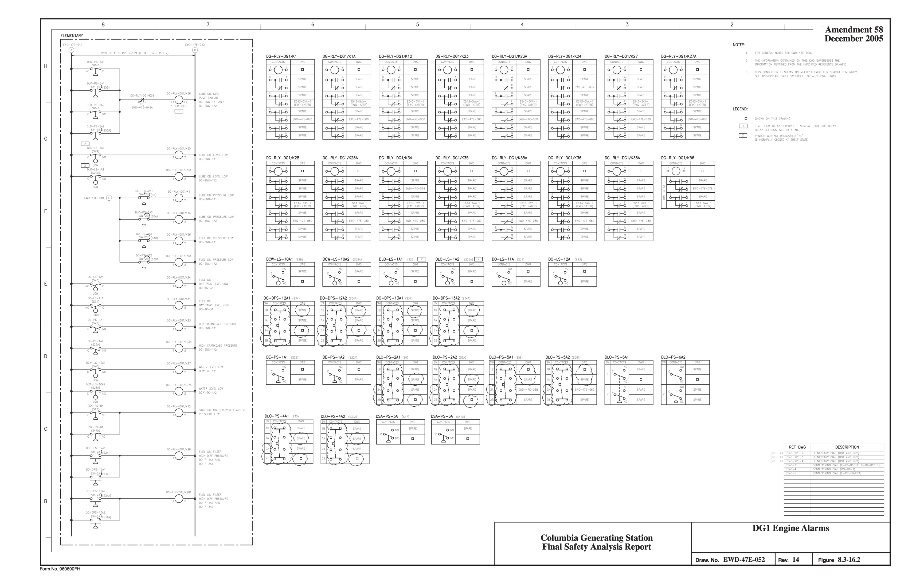

*figure on PDF page 140*

<!-- labels/text on this figure page -->
2 7 8 6 3 5 4
• Amendment 58 December 2005
ELEMENTARY
7 NOTES: ~ F-147
2:
DG-RLY-DG1/K1 DG-RLY-DG1/K1A DG-RLY-DG1/K12 DG-RLY-DG1/K23 DG-RLY-DG1/K23A DG-RLY-DG1/K24 DG-RLY-DG1/K27 DG-RLY-DG1/K27A
H
LEGEND:
□ D D G
DG-RLY-DG1/K28 DG-RLY-DG1/K28A DG-RLY-DG1/K34 DG-RLY-DG1/K35 DG-RLY-DG1/K35A DG-RLY-DG1/K36 DG-RLY-DG1/K36A DG-RL Y-DG 1/K56
F
E
D
C
REF DWG DESCRIPTION
B
--,- DG 1 Engine Alarms Cl L _____________________ _J Columbia Generating Station Final Safety Analysis Report Draw. No. EWD-47E-052 Rev. 14 Figure 8.3-16.2 Form No. 960690FH

<!-- p.141 -->
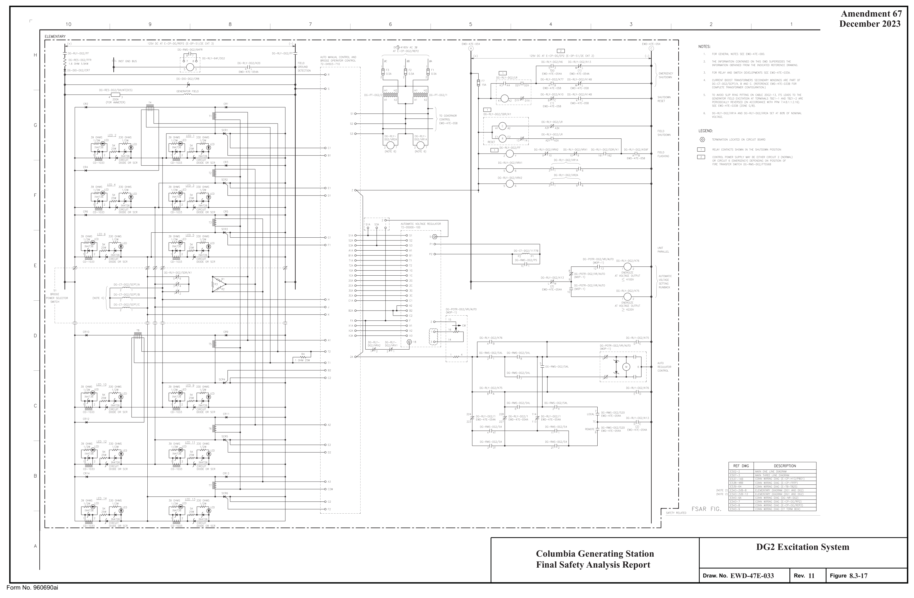

*figure on PDF page 141*

[Vector original (SVG, lossless): fig_page-141.svg](../figures/fig_page-141.svg)

<!-- labels/text on this figure page -->
Amendment 67 December 2023
DG2 Excitation System Columbia Generating Station Final Safety Analysis Report EWD-47E-033 11 8.3-17 Draw. No. Rev. Figure Form No. 960690ai

<!-- p.142 -->
Amendment 65 2 8 6 5 3 7 4 I -------------------E~;~sr:';2E E-1i~s1/2£ - -- - -- - -- - -- - -- - -- - -- - -- - -- - -- --- - -- - -- - -- --- --- - -- - -- --- - -- - -- --- - -- - -- --- --- - -- -7

#### ELEMENTARY
December 2019 - -- - -- --- - -- - NOTES:
FOR GENERAL NOTES SEE EWD-47[-000. i~; [TI ~; [TI I THE INFORMATION CONTAINED ON THIS EWD SUPERSEDES THE EW0-50E-015A EWtl-ll-015A INFORMATION 06TAINEO FROt.4 THE INDICAT£D REFERENCE DRAWING.
J_(-)
l<•>
(+) (-)

#### FOR REU,Y ANO SWITCH DEVELOPMENTS SEE EWD-47E-054A
H

#### UNLESS OTHERWISE NOTED. EMERG 2 EMERG 1
4 CONT FROl.4 NORM OG-RMS-OG2/FTS568 NORM OG-RWS-oo2/FTS568 DG-RMS-OG2/FTS568 DG-Rt.'5-0G2/FTS568 CONT"°"

#### ZONE A/6
#### ZONE A/10
1C

#### OG-RMS-OG2/','RS MANUAL CONTACT HAS BEEN DEACTIVATED 3C 4C 2C
#### BY REMOVING THE SWITCH HMIDLC.
.----------------------eel,. f-------1 r.,~,------~,,c~r.,~,----< DC-Rt.lS-002/SS.4. E-Rlr.lS-FRTS7 IDLE lDLE NORl.4Al.

#### EWD-47E-058
(DSJ.3)
,._ ___________________ OO-RLY-DG2/K59 H G LEGEND: LOC.11.}

#### DG-0I0-OG2/CR22
CCNTROl POWER
(1)
ENGINE OJ ,._ ___ _,_ ___ -+---------------------------------------------. TRANSIENT VOlTN.E

#### CONTROL POWER SUPPLY MAY BE EITHER CIRCUIT 2 (NORMAL) RUNNING
..._---------------------,, ' OG-RLY-DG2/K59 E-Rlr.lS-FRTS7 OR CIRCUIT 6 (EMERGENCY) OEPENOING ON POSmON OF f"IRE DAMPING

#### TRANSFER SWITCH DG-RMS-DG2/FTS568
#### REMOTE
#### OG-RES-DG2/R7
17C 17

#### NORMAL
(1)
OG-Rl.Y-86/0G2 CONTACT 10/lOC IS DUPLICATED ON EY,0-47E-055
(DS34)
'""'-}

#### DG-RLY-DG2/K59
ANO EW0-47£-059 (SHOWN ON EWD-47E-059 FOR CIRCUIT CONTlNUllY) DG-RLY-DG2/1

#### OO-RMS-002/S20
UNIT CONTROl H J G ,._ _____ ---=<13 13C

#### OJ I..OCAI../REMOTE
(1)
ENGINE TIME OB.AY RELAY SETPOINT IS NOMINAL. FOR Til.4E DELAY 121 211 .AUXILIARY LOC,C STOP RELAY SETTINGS SEE £514-30.
E-Rlr.lS-FRTS7 DG-RLY-DG2/2 >-1-3------------__.:;:CY CONTROL DG-RLY-DG2/K59

#### E-RMS-FRT'S7
#### ARE REMOTE TRANSFER
#### REMOTE C B 19C 19
#### E-RMS-FRlS7 2C . 2 (1) NORMAL
OJ

#### EMERG
2J 23C DC-RLY-DC2/1<19 OG-RLY-OG2/Kl6 E-RMS-FRTS7

NORt.W. ..._~,~oc*1~,-....--~,Yb,----,c1 ' - ------------------------< w

#### OG-RLY-86/DGZ DG-RLY-DG2/K21 DG-RLY-DG2/K19
ENGINE CRANKING w.NLW.. ENGINE START 21C 21
--f-

#### H(2)G
#### NORMAL EWD-47E-060A (2)
#### DEPRESSED DG-RMS-OGZ/S14
E-RMS-FRTS7 3 OG-RMS-DGZ/S20 5Cb DC-RLY-OG2/K59 DG-RMS-OG2/S33 DG-RLY-86/0G2 REMOTE} ENGINE 9C OJ 9 NORMAL EWD-47£-0~ '<•>_' __ .A -~~~C[ ' 6C

#### LOC.'1. 3
#### LOC,C 5
} NORMAL5C E-RMS-fRTS7 {

#### OG-RLY-DC2/K9
(DS26) WJNT£NANCE C:XH~MS-DC2/SJJ liWILW.. STOP/RESET JC LOC,C 1C 2 DG-RMS-DGZ/S20 ,:
I ~ AUTO if NORMAi.if DG-RIAS-002/S14 4T 3C} OO-~S-002/~ REMOTE START OG-Rt.1S- OG2 REMOTE 1 E-RMS-FRTS7 DG-RI.IS-DCZ E-Rt.lS-fRTS7 O ~---.,~,tJft,,,------------,-1~~ ~
(DS25) N~ DG- RLY- OGZ/1<9 E ~----------------------------< TOO

#### ENGINE STANDBY
OO-RLY-002/1<21 LOCAl.tl_r-}------,--,-<E~ESS""3_EO ______ ....-__ .__~f-y(1""

#### OG-RWS-OG2/S15
#### DG-RLY-OG2/K15 ENGINE I..OCAI../REMOTE
(OS) )E ______ ---{ 2/VRS OG- RLY- OG2/1 w.NUALSTOP DG-RLY- 86/DG2 DG-RI.I - OG- RLY- OG2/K13 ENGINE STOPPED w 8UT READY FOR 11 11C 115 116 B 3C ~ • C AUTO START
(1)
EWD-47£-0~ .WTO EW0-47[8 ----------------- lC DG-Rl.4S-DG2/S20 OC-RWS-OC2/S44
(DS12)
REl.40TE 2[ OG-RLY-OG2/K15 ~---10,-1),>-f- E-RMS-FRTS7 1 ----,-<,1,-,,r~--,~,~,x~-~ OG-R~-DG2 E-RMS-FRTS7 NORt.W. STOP NORr.w..

#### EW0-47E-OOJ
E'w0-47[-0JJ

#### DG-RLY-OG2/K15 EWD-47E-056
00-47[-056 00-47£-058

#### LOOP STAAT EWD-47E-060
E\ID-47E-060

#### EWD-47E-062
EWD-47£-064 E¥/0-47E-062 E¥1D-47E-06J - -- - J

#### I --- --- --- --- --- --- --- --- --- --- --- --- --- --- --- -EW0-47E-064
DC-RLY-OG2/K15"

#### LOCA START
24 25

E-RMS-FRTS7 RHR-RLY-Ki88 E-Rl.4S-FRTS7 H
(1) DG-RLY-DG2/K15 25C 25 1 2 27 27C G NORMAL LOCA '°"""- "

#### ENGINE AIR START EW0-9E-098
.AUXILIARY DG-Rl.Y-OG2/K15A.
14

DC-RI..Y-OG2/1<10 DC-RLY-OG2/SSX1

#### R2 M2
150 RPM

#### EWD-47E-058 OC-RLY-OG2/K13
#### OG-RLY-DG2/K19 DG-RLY-OG2/K21
D ENGINE RUNNING [ 0 B C
(2)

#### ENGINE RUNNING
#### SIGNALAUXIL.IAA'Y
#### OG-RLY-OG2/K59 OG-RLY-OG2/SSX1
#### SPEED SENSING
--------=<Tl Ml .AUXILIARY l!IORPl.4

#### EW0-47E-058
#### OG-OIO-OG2/CR2
#### OG-OIO-OG2/CR4
DG-RLY-DG2/K20 ENGINE SPEED DG-Rl.Y-OG2/SSXJ
-------------< C

#### INTERLOCK
Tl Ml

#### AELO GRWNO
850 RPM 0£TEC110fj

#### EW0-47E-058
GO'Y£RNOR CONTROL
(ENGINE RUN)

OG- RLY- 002/KlJ REF DWG DESCRIPTION H;r•, .. ~~

#### ENGINE COOLANT
----------,-iG H

#### AUXILIARY (1)
#### E5J7-6A CONN WIRING OIAG E-CP-H1 3 P683
E537-148 CONN WIRING OIAG E-CP-HlJ P801

#### OG-RLY-OG2/K6
E5J7-15C CONN WIRING OIAG E-CP-HlJ P802 E537-18C CONN WIRING OIAG E-CP-HlJ P805 m,;1SEC~

#### SAFETY STOP
## 00 I ANO 002 (NOTE 2) E54J-2VB-1 El.fl.4ENTARY OIAG SET'-"
(NOTE 2) E543-2VB-2 El.fl.4ENTARY OIAG 001 NjQ 002
(NOTE 2) E54J-2VB-J El.fl.4ENTARYOIAG

#### OG-RLY-002/K.22 B
(NOTE 2) E54J-2VB-4 EI.IMENTARY DIAG

#### OG-RLY-002/K59
[ f,0-----------------------------.--,{
(NOTE 2) E54J-2VB-6 ENGINE RUNNING EI.IMENTARY DIAG ;ux 008..E
(NOTE 2) E54J-2VB-7 El.fl.4ENTARY OIAG (1)

#### E54J-7
[543-10

#### EWD-47E-056
#### EWD-47E-Q58
DG- RLY- OG2/KX OG-RLY-DG2/KlJ

#### AJEL OIL
~K-UP PUMP L K LE'

#### M.JTO/START (2)
' __ __ ______ __ ______ ______ __ ________ ________ ___ _J TO CONT TO

#### E H/ 6
#### ZONE H/3
DG2 Engine Start/Stop Controls Columbia Generating Station Final Safety Analysis Report EWD-47E-054 10 8.3-18 Draw. No. Rev. Figure Form No. 960690ai

<!-- p.143 -->
Amendment 53 6 8 2 4

r:-------------------------------7

November 1998 D.OIDl!NII' NOl[S:

t. roll COCJIIL IIIOU ut lllOo-•ll-<OO I I • l'I0-41(-0M, l."ID-◄116'$ h-< llt'ui.tlDI Wlfl&llllf:D EN fHl1 f.:, S4,,1P('l'Wll(1 IIC" I C cataC& ,_ M naum:i arTTallet -..C ~

.. .....,...., l•J •t-J

H J.. nt'S coo.c10I IS ~ OI ltrAfJIU ncni fCII Cl90.ll C(ollTI'IWIA1Y.
tOI a«rm,w,. lell SIi oWlltlM&lt cal ~ I I

....... -

IMUW!
I I LfGOIO:
a SM'.-Glll'IC1~

....... I

I CD ~POCI ~Yw., Bt:DTIOCDIC\II l{tl:IRtilil)Cla mcutllrwt1ICIJo01"t:OOalCC16iVV1DIMra ftllilrrsnl! Slrn:H Dli-«111-~ ,.,...
I I CD """"" -- fllC' lltW llll.flr ~rs~ roa me ;(l,tl1I' 00-RI.Y--f11121KS2 - 11111., trnblCS,. m ci1•-:m.
-- -• G
-- D - "' - ...
v CC--T-Dtt,li:11
-· wh,lc------1-------------------,,( Mt 5blT toCIC ~ l-0-tlC~ .. ,, --

_, ........ a -

-"" a <Hl-o a ~-II:-~

._ _______ .... __

o-1i--,.\ HH a .....

"" ... al:ISTWJITATUS F
- - ""'""' - -
-
- ...
...
...
IIC,-11.Y~

- IJG-II.Y-oG2/IC6ll 0.--AI.T-oGZIKIII DG-fll.T•DGZIXIIII OG•III.Y•IIG2JICII -

D0-ll.Y--DC2M74 a - DCMII.Y-0Gi/k7Z

- ....... _ ''"'"m

v a

a v - a ~ - a ,_,, .. ,.

~ D
-- ... K-111.Y--aclAdl ~-n-~ - DIH!l0-DG2.0ll ... ffMTflll.M ~i--ll c,,u.,..., ~t-3 ~~ -

D -- ' ~e l'DN ~.....: - ,_.,...,.

CD
(.., WIii)
l'OllDU1 .,._.,.,__, LI t\OIAI D
-· ~111
-0-&

,.,. ..... --

a E ~ D

........ _ ~c...:: 00-1'-0lf ~t-3 e., .. ,-.1

(CID••- ~ D ~ a

,,.. .....

....

o-u--.3 l.--4i--.l;
l'IID-4:Jl'-G11 PD- ♦1t-011' ~i-: ~--· ,. 1fMI CmDl1 MWrol mt, oo-.-,~ ~'~ ~ ~ a 'ltnMTSTAI\& - D OU.-W.-Slllt L!i-l; [ID.,fJl-011 DG-Plli ... llR 10
(NI l.t.1D'J

..,.,_l!IG:l;CtlJ

IOI LOl
(JI -- D m-•1u• .. ~M L M

,_....,SUM DG-DD-DGVC:llt•

,-------➔-- """""

AIISlo9IICI.JIIOrfllllOIISf'ORID"1' }-,:::.--.... ,_ __ ..,.. __ ..,.:.::1~ ~

bHII.Y-~11 OG-fll.Y-tlCVIN ~.,,.,,,,..,..

, ......

L _______________________________ J C

.
teCAIPIION

Ullll.l(IAll'I iaa,; De.I i1C1 m:.n ...
1n• oi.. Im.I AMI [Jl;l'l

.... OIIGH•ll•OIOH

B

A DG2 Air Start System Control Columbia Generating Station Final Safety Analysis Report Draw. No. EWD-47E-O0S6 8.3-19 Rgure Rev. 13 Form No. 960690

<!-- p.144 -->
Amendment 65 2 8 5

#### December 2019 - -- - 7
F 7E-:.~ -------------------------------------------------EWD- 47(-054

#### ELEMENTARY
#### NOTES,
c)
' LOWER -""" 125V DC AT E-CP-OG/RP2 (E-OP-S1/2[) IT] l"~(p·~1 N(-)
P(•)
0G-RMS-DG2/ S5/l
2. DG- RlY- DG2/K\4A lHE H+FOR1U,TION CONTAINED ON lH!S EW!) SUPERSEDES THE

#### DG- RLY- OG2/K1S
'""""" H LOOP INTERI.OC KSTO POSITIOff INFORMATION OBTAINED FROM lttE lNDICATID REFERENCE DRAWING. t-----------;:- DECK OWG ' G<MR""" co tw<>l£00 """' K 2 J. DG-SC-GCN/DG2/Al-4 ELECTRONIC GCMRNOR SPEED CONTROU£R,
(2)
:!--H--H-~ X TERMINALS 12, 22 &: 27 ARE INTERNALLY CONNECTED TO CHASSIS EW0- 47E- M-4A □

#### GROUND (CG).
ESCUTCttEON ~f-------1~ X 4. t.0-/-1, - 2 AND -J AAE METAi. OXIDE V>.RISTORS INSTALLED FOO EMC.
□ ' ~ r------l~ H~':'/"'

#### OG--RLY- OG2/K148
USECID2J582,UTTL.EFUSEMDD£LV151BA60. G<MR""" co """'

#### X DG-RLY- DG2/ K10 ' SPARE
2
(SPEEO sruCT)
i CONTACTS JJWG E.WD-47E-05<4A ~r----,r..!X

#### DG-DIO-DG2/ CR18 OG- RWS- DG2,/S5A
#### X SPARE
~H,, □ SPRING RET\JRH TO NORW.I. DG-RLY-DG2/K59X "m> G<MR""" co

#### SPARE
LEGENO:
FlEI.D F\ASH ! 1~1SECTD~[TI £WD-47E--OJJ SHOWN ON ltt!S ORAWH+G □ DG- RLY- DG2/KS!W OMLY-002/m, 1 ~ OG- RLY- DG2/SSX1 DG- RLY-;~ / K59X DG-RMS-OG2/S5A [TI

#### SPARE
OC- RI..Y- 86/0G2 CONT.-.c:T 10/l OC IS DUPLICATED ON EWD-47E- 055 G<MR""" co ~ G A ' ' s "'" CONT,C,S ~~ OWG AND E.W0-47E-059 (SHOWN ON E.W0-47E--059 fOR CIRCUIT CONTINUllY) MJ 2 FlaD F\ASH ' SPARE 1~ RPM TOO tw-l>L.EEND RATED !DI.£ [TI OG-OIO-DG2/CR17 CONTROL POW[R SUPPLY MAY BE £ITHER CIRCUIT 2 (~ MAL) OR ~f-------1~ X SPARE □ CIRCUIT 6 (EMERGE~ 0Er£NDING ON POSITION OF nRE TIWGER I SWITCH OG-RMS- DG2/FTS568 OG- RLY- OG2/Kn EWD- 47£- 054 '1l SIH/TIJOWN """' OG- Rl.Y- OG2/K14B OG- RLY- OG2/ K14 DG- Rl.Y--;~2/SSX3 ESGUltHEOH ~r------l~ X

#### EWD-47E-054
G<MR""" co IT] ' TIME DEI.AY REI.AY SEll'OINT IS NOMINAL FOR TIME DELAY SPARE E F G H """"' R2 M2 2 R>R IOLE REI.A'!' SETTINGS, SE£ £514-JO. DG- 0IO-OG2/ CR19 □ £W0-47[-054A ~f-------1~ X

#### L . I
2 EWD-47E-OJ\ ~r------l~ X SPARE 1~ SPARE DG-RLY-DG2/K19 OC-Rl.Y-DG2/ K1 4A

#### MAINTAINED CONTACT
HJ (W0- 47[- os.A SPARE ~ - OG-RLY-DG2/K!i9f ,tl_ 1 [;; ~'

#### SPARE
G H

#### DG-RMS-DG2/ S5
SPARE L oc-RLYf'/" REMOTE I 00_,.,_ ::,_oc,;s, l'ow(r~"I OC- R~- OC2/S5 OG- RLY--0C2/ I ~ OG- POTR- OG2/A9 COHT""'5 POSITIOff OWG 1-WiotfEN0 LOWER I NORM I RAISE SPARE ..l/!mcJJ,.
...!.. """5TER oc-••s.-!"''I"" ~>-H--2" ~-H~ 1 ~ X I I □ G

SPARE ....:... X

(DIGITALREF'ER£NCE ~ □ 4 9C OG2/S20 2 2T \ 1C 12

....:.. UNIT) 11

~~ g_-H-~ 1! X SPARE TOO LOCAi. EWD-47E-054A AAISE E'M)- ♦7[~ ESCUT0£0N SPARE 9[

....:..

I IX SPARE EW0- 47E-05-4A DG-RMS-DG2/ SS/l @-

#### SPARE ,,I H ,,
SPRING RrnJRN TO NORWAL ~ ~ ' =I.IS- OG2/SS~R ...!... t~}12sv DC 11H 1s

, I .,,.....

' IWSE l '°"-' UOV- J

#### DG-RLY-OG2/ K14A 0G-RLY-OG2/K14B 0G- RLY-0G2/K59F OG-RLY-OG2/K59X
NOTE~(m)l ~ ~ owe J owe DWG

#### MOV-2
□ □

SPARE EWD- 47£- 054 EWD-♦7E-OJ3 A

#### SPARE
□ DG--RlY- DG2/KTB OG- Rt.CS- DG2/ PS

#### SPARE
SPAR£
•

#### ISOCHRONOUS TO
7 2G 2 DffOOP SWITC

#### SPARE
#### SPARE
#### UNIT - -
EW0- 47E- 03l'.
□
- ~

#### SPARE V
#### OG-E/S-OG2/ A7
VOl..f-'GE CONVERTER

#### GOVERNOR POWER SUPPLY
OG- SE-OG2/ l.f>U2 . 125V OC ENGINE NO OC-ENG-182

#### SPARE 24VOC I
H ? ?
• I D I I I I '---n ~ l i

#### OG-RLY-OG2/SSX1 OG-RLY- DG2/SSX3 OG-RLY-OG2 KTB
owe DWG CONTACTS ) .
I □ □ '- ~_J ,._,.J

#### • .A A +
#### SPAAE I
.E_ ~ )
SPAR[ ~ OC- RLY-DG2/ SSXJ \ a; 0G- RLY-OC2/ K1<1A NOTE J ~

#### SPARE
A ' hCe1 ~ OC- RMS- DG2/SSA G<MR""" COHTIWI. < □ 23 +--,-;-i~f,-,- Sr£EDSWITCH AUX 2 """"" GMRNOfl .-.cTUATOR C SPAR£ ~ 00-E_!:10--182 OC- EH0-181

....:'. ' ' B V Al E- POS- 52S/OG2/8 hCe,

00-RLY-OC2/ SSX1 ~ J ~ ~ SPARE ~ 0~ ~ EW0-47E- 007A G<MRNOR CONTRO..
~ OC- RLY- OC2 K14 Sp£EDSWJTCHAUX ...!!.

#### I A ' 150RPM
~ EW0- 47E- 05<1A ~1~,1~al~ilil~~~lreililalil I/ ~ OC- RlY-OG2/KTB • ' ' ~ " ' + >- 8 -2.!.

#### DG-SS-DC2/A12
\ < ~ >-'-'a;

#### SPEED SWITCH
/--._

#### DG- CT-OG2/ CT3
i::c NOTE J --'-"- ..!..
\ +I+ ·I· -1·1· e =I~ ~1,1,1~1

#### REF DWG DESCRIPTION B
...!.
[537- 1-48 CONN W!R!HG 01AG E- CP- H1J PSOl OG-CT~ 7 CONN W!Rltfe DIN:: OG2 E CP 0G RP2 J>1 ~ ES4'7 I:] CONN W!R!tfe wt DG2 E TB-0101♦, E TB-D1015 DG-CT-OG2/CT1 E54'8

## 4 ~:~c
[543- 10 CONN W!R!HG 01AG OC2 E- CP- OG £P2 ~ J
(NOTE 2) E54J- 2VA- 5 El£MOOAR'l'OIAG OC1ANODG2 OC-SC-GO"I/OG2/A1 4
(NOTE 2) £54J-2VB--1 lliMOOAR'I' OW3 DGl ANO DG2 El£C"""'1C ..:.. i >- ,~~
(NOTE 2) E543- 2VB--5 ruMOOAR'I' ow; OC1 ANO DG2 X2 } G<MR""" Xl/);'.l CONTJNUEO ON SPW, EWD- 47E- OJ3 CONTilOUIR Xl PTCJRCUITS I 2'VDC 0 ~ OG- SE-002/MP\J1 OO-SI- OG2/1,12 NE NO OG-ENG-181 SPE£D INDICATOR 2 !SOI.ATE- AIR START LOC!C ANO SHUTOOWN RESET A L _________________________________________ _J DG2 Governor Speed Control Columbia Generating Station Final Safety Analysis Report EWD-47E-058 15 8.3-20 Draw. No. Rev. Figure Form No. 960690ai

<!-- p.145 -->
7 6 2 8 5 3 4
• Amendment 58
- -- - -- - -- - -- - -- - -- - -- - -- - -- - -- - -- - -- - -- EWD-47E-054-- - -- - -- - -- - -- - -- - -- - -- - -- - -- - -- - -- - -- - -- - -- - -- - ---7 NOTES:

#### ELEMENTARY
~ -HE-054

#### FOR GENERAL NOTES SEE EWD-47E-OOO
c A

#### CONTINUED FROM ZONE B/7-10
#### THE INFORMATION CONTAINED ON THIS EWD SUPERSEDES THE
_E-_C_P-_DG~/R_P_2 ~(E_-D_P-_S~l/_2E~) _DJ_ 2 ___________ INFORMATION OBTAINED FROM THE INDICATED REFERENCE DRAWING (>)14------------------12_5V_DC_A_T ___,(-)
(sgA)
H

#### DG-SS-282
#### DG-RLY-DG2/K4
#### DG-RLY-DG2/K26
SW-8

#### ENGINE FAILURE
#### THIS CONDUCTOR IS SHOWN ON MULTIPLE EWD'S FOR CIRCUIT
-:=i:-

#### TO START AUXILIARY
#### CONTINUITY. SEE APPROPRIATE CABLE SCHEDULE FOR ADDITIONAL EWD'S 2 '
TDC EJt'D-47E-0~6 1035RPM OG-RLY-94/[)G2 DG-RLY-DG2/K4

#### ENGINE FAILURE (59)
#### TO START AUXILIARY DG-RLY-DG2/KJ
#### DG-SS-281
5"-8

#### SHUTDOWN TRIP ENGINE
#### OVERSPEED
#### DG-RES-DG2/R5
DJ 1035RPM LEGEND:

#### DG-RLY-DG2/K60
#### DG-RLY-DG2/K3 DG-RLY-DG2/KJ
#### OVERSPEED
._ ___ ---c,B 1-,A------,ci f-cK~-----------------.----------,{ [JJ SHUTDOWN 0C-DIO-DG2/CR5 OC-RLY-DG1/K15A CO!,TACT 16/17 IS DUPLICATED ON EWD-47E-061 (2) (1) TIME DELAY

#### AND EWD-47E-063 (SHOWN ON EWD-47E-063 FOR CIRCUIT CONTINUITY)
[TI CONTROL PO\IIIER SUPPLY MAY BE EITHER CIRCUIT 2 (~ORl,jAL) OR G

#### DG-RLY-DG2/K60A DG-RLY-DG2/K60A
#### OG-SV-1B1 (L05)
CIRCUIT 6 (Ei,jERGEi,Cl') DEPENDING ON POSITION OF FIRE TRA!,SFER SWITCH Ot;:-RWS-01;:2/FTS~i,B

#### OVERSPEED
#### DJ SHUTDOWN AUXILIARY
#### TIMEDELAYRELAYSETPOINTISNOMINAL.FORTIMEDELAYRELAY
#### SETTINGS, SEE E514-30
#### DG-RLY-DG2/K60A DG-RLY-DG2/K60A
#### DG-SV-1B2(L05A) OVERSPEED
#### DG-RLY-30/1/DG2
SHUTDOW!,SOLE!,010 DG-RLY-DG2/K60A DG-RLY-DG2/K60A DG-DIO-DG2/CR23 2 1 3 4 DG-Ei,0-182 -----------< OVERSPEED 14 13 12 11

#### SHUTDOWN TARGET
(S25A)

#### DG-DIO-DG2/CR6
DCtl-TS-1182

#### SW-1B
#### OG-RES-DG2/R6
(S25)
OCW-TS-1 Hl1 DG-RLY-30/2/DG2

#### DG-RLY-27DC/DG2 COOLANT HIGH
S'!ll'-1B DG-DIO-C<;2/CR9 F

#### DC POWER LOSS TEMPERATURE
#### ALARM SHUTDOWN C2
DC POWER ON [X;-RLY-51V/DG2/1

#### EWD-47E-041
DG-RLY-86/LlGZ 0C-RLY-86/IX2

#### ENGINE SHUTOOWN
#### E-POS-52S/DG2/8 E-CB-8/3 OG-RLY-51VX/OG2
17 18 LOCKOUT 520 (519)

#### OVERCURRENT
#### AUXILIARY DLO-PS-JB1 DG-RLY-.30/2/DG2 S27 S27T S29T S29
#### ENGINE SHUTDOWN
SW-28 [X;-0I0-DG2/CR10

#### EWD-47E-007A EWD-46E-084
#### LUBE OIL LOW
#### NORMAL POWER
#### PRESSURE SHUTDOWN
#### INTERLOCK
#### DG-RLY-DG2/K15A
#### EWD-47E-064
27 26

#### DG-RLY-30/1/DG2 EWD-47E-054A DG-RLY-DG2/K15A DG-RLY-62/DG2
#### OVERCURRENT
E

#### DJ 17 16 1 5
#### SHUTDOWN TARGET
#### EWD-47E-054A 1DC
#### DG-RLY-62/DG2
#### DG-RLY-51VX/OG2 DG-RLY-30/2/DG2
#### DG-RLY-67/DG2
REVERSE POWER +-------c1 1 r2~------c{

#### SHUTDOWN TARGET
#### EWD-47E-041
#### DG-RLY-30/2/DG2
#### DG-RLY-2759/DG2
#### UNDER/OVER VOLTAGE
#### SHUTDOWN TARGET
1 11

#### EWD-47E-041
[X;-RLY-40/DGZ

#### EWD-47E-041
#### FIELD FAILURE
#### SHUTDOWN TARGET
#### E-POS-52S/DG2/8 D
#### S35 S35T
#### EWD-47E-007A
#### DG-RLY-64F/OG2
#### FIELD GROUND
#### DETECTION 1 2
#### AUXILIARY EWD-47E-033A
#### EWD-47E-054
#### EWD-47E-063
(DS24)

C C<;-RLY-94/C<;2 DG-RLY-9MJG2

3 '
(518,4,)
DG-Rl,jS-DG2/S1e

93 91 95 97 3 '

#### EWD-47E-DD7A DEPRESSED EWD-47E-007A
(S18)

#### DG-RLY-30/1/DGZ
#### REF OWG DESCRIPTION
#### DG-RMS-DG2/S18L
#### EMERGENCY STOP
(MANUAL)

#### E537-148 CONN WIRING DIAG E-CP-H13/P801
3 ' DEPRESSED E537-18B CONN WIRING DIAG (E-CP-H13/P~05

#### E543-7 CONN WIRING DIAG DG2 E-CP-DG/RP2
#### DG-RLY-87/DGZ
(NOTE 2) E543-2V8-3 ELEMENTARY DIAG DG1 AND OG2

#### EWD-47E-OOS
(NOTE 2) E543-2V8-6 ELEMENTARY DIAG DG1 AND DG2 B r- ----------- ------------- -- ---7 DG-RLY-30/1/DGZ
(NOTE 2) E543-2V8-7 ELEMENTARY DIAG AND DG2 I 1 10 I

#### E543-8 CONN WIRING E-TB-D1014, E-TB-D1015) -------,.,---0
#### CONN WIRING DIAG DG2 E-CP-DG/EP2
I

#### GENERATOR
I

#### DIFFERENTIAL
o _-0+---------------------- CURRENT ~- ____________________________

#### SHUTDOWN TARGET
#### L ------------------ CONTINUED TO ZONE H/4-7
- -- - -- - -- - -- - -- - -- - -- - -- - -- - -- - -- - -- - -- - -- - -- - -- - -- - -- - -- - -- - -- - -- - -- - _J DG2 Unit Protection Circuits Columbia Generating Station Final Safety Analysis Report Draw. No. EWD-47E-060 Rev. 4 Figure 8.3-21 Form No. 960690FH

<!-- p.146 -->
Amendment 53 II 1 II 5 4 3 2
- L-----------------------------7 November 1998 8.0ENTMl'r ~

• , .... ".. (IIMJI .....

a - --

• ~ ==-a)"'-"C!J"""'--------ol• (-1 H .. •,_C_•l _______

............ l:,:l>r:.:OC:,;ll::..:;l:,:"'='"'e,O'lo..:..,.,; .......

a

....... --

Ml,,..,., ...

.._.,..

00-lll.T-ag/UI
-- C _,., ---

OCHl.~t .....,-caAltO

•,.t

...........

DG-&Y•OCVIM I !,.----.------
-
- C0-11.Y-tJC:ZIIQl 1111-RLY-oaztc,JI
-- IOI CDalL. 1101tS SU h0-4Jr-c:m. -
z. M~Cllilt.cDCIII.MSMwiusaa"C F
- " D PRIIIITD CIIWJO fllJIJ nt: IVCCID ~ DU111C.
11G coaam .. .,... °' ~ -_ n:,-., ra- aDotn" ~. 1 a

m ......aa aal" IOCI.U J'0II emu nn.

- ...,__, -- m-m-111 a
-
---- ... - LDlENI:
--

.......... -

- [I] CIWtlGI.....-Qlllfl,.-r ■UDUCIIDO a (tiiOllllll.)~ .... ,--,u1

.... T-GGIIQ1

....

CDCUl!1cammx:Y)IIJl[:mtm1RPD51DCaDfFJa r~~.::.:- ~ ~-:~

......,,_,...,..

#### CD .......... ,.

~ Cll.G~ E

--··

LlllCIL....,.._tDI

...............

••• Ciu),,,ft•J:m:
D ... ---o o"'"'---------------,<

----
• - - .. - - .. - -
• - - .. ,.
,o:p'-,PJPII' ... ---- o.i::~--------------,< T

IIDf-'IS-lllllM .. a-rv - lltll-lll--llllZ- DCW-'l!l-12111!all --11-1291- m;;..m-111

C ,,

• 0 ......

• a O a

D 0 D • + - q 0 0 0 Q Q ai:a-11--1•

I -~,
-
•
• 1,1

REF DIIC - ·- ClealPRCil

----·-

....

.. - - ... ONllltNG ·- __ ,, I

t-----=--------------

0 -

"" ?
CIJlflfl'IIIIGlall f

0 -

-- I DL0-11-le81 1111 B a --- Def-4S.1t■ t----:::<:r,-O,l,?''1..---------------J\,---I am,.u.-111 .-- I m:uc... I IC a o II O W O 11 I 11"'1 I ocw-+111 o:M8III ._

1---~,0--""",_ _______________ ~ __ _. .......... L _____________________________ j

IC
-- INI.-

A

DG2 Engine Alarms Columbia Generating Station Final Safety Analysis Report Draw. No. EWD-47E-0062 1 8.3-22.l Rev. Figure Form No. 960690

<!-- p.147 -->
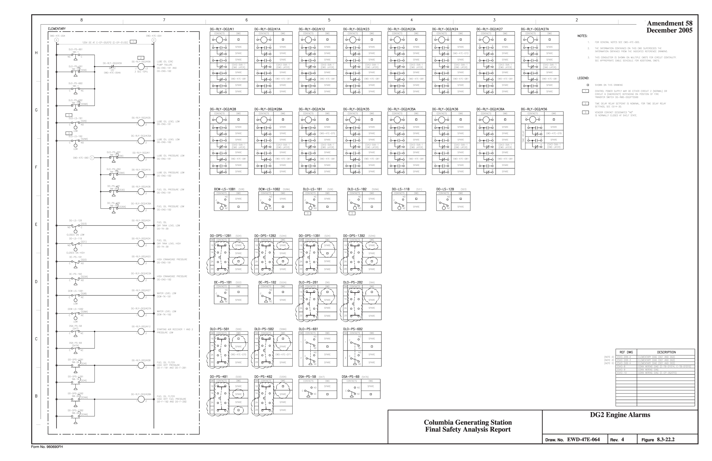

*figure on PDF page 147*

<!-- labels/text on this figure page -->
8 6 5 3 4 2 7
• Amendment 58 December 2005 DG-RLY-DG2/K1 DG-RLY-DG2/K1A DG-RLY-DG2/K12 DG-RLY-DG2/K23 DG- RL Y-DG2/K23A DG-RLY-DG2/K24 DG-RLY-DG2/K27 DG-RLY-DG2/K27A NOTES:
H
LEGEND:
□ QJ
[TI G DJ
F
DLO-LS-1 B1
\C 0 0 □
□ ~c □ □ ~c DJ DJ
E
D
DLO-PS-6B1 DLO-PS-6B2
C
REF DWG DESCRIPTION
fee' .\- . ,1 )IA'.: /: Md; l)Ci FCC3-NF- • k A-.;Y -)IA::: (X Af,J; r)C;'.:
ecq- · ·.,1- "- """ JIA::: -:,::: .~u; CC/ o,. - c-,., IC IS', ~,p,C .r-1--;- 'J'L cm,J .• _.,1 1 •1-;; ~,1~.c 1:·,L_\ 9 .-.-., ''1(( - DSA-PS-5B r•4, ~ B
DG2 Engine Alarms T Columbia Generating Station L_ _____________________ _J Final Safety Analysis Report Draw. No. EWD-47E-064 Rev. 4 Figure 8.3-22.2 Form No. 960690FH

<!-- p.148 -->
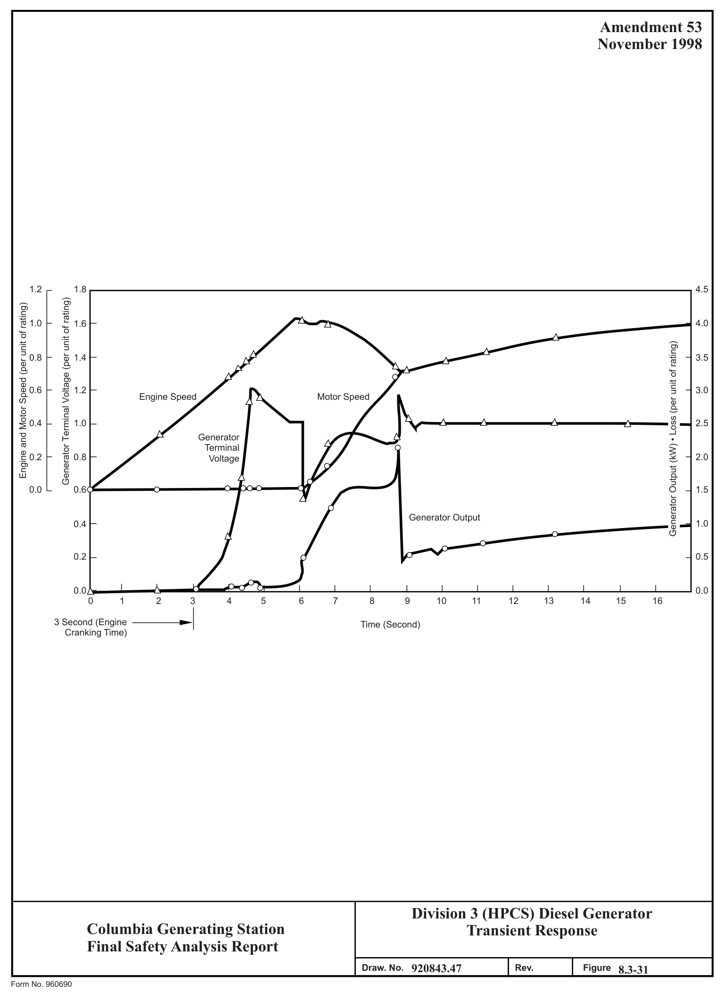

*figure on PDF page 148*

[Vector original (SVG, lossless): fig_page-148.svg](../figures/fig_page-148.svg)

<!-- labels/text on this figure page -->
Amendment 53 November 1998
4.5
1.2 1.8 Generator Terminal Voltage (per unit of rating)
Engine and Motor Speed (per unit of rating)
4.0
1.0 1.6
Generator Output (kW) • Loss (per unit of rating)
3.5 0.8 1.4
3.0 0.6 1.2 Motor Speed Engine Speed
2.5 0.4 1.0 Generator Terminal
2.0 0.2 0.8 Voltage
1.5 0.0 0.6
Generator Output
1.0 0.4
0.5 0.2
0.0 0.0 0 1 2 3 4 5 6 7 8 9 10 11 12 13 14 15 16 ------1
3 Second (Engine
Time (Second)
Cranking Time)
Division 3 (HPCS) Diesel Generator Columbia Generating Station Transient Response Final Safety Analysis Report 920843.47 Draw. No. Rev. Figure 8.3-31 Form No. 960690

<!-- p.149 -->
Amendment 53 November 1998 I/Ii :; 'I;~::: :1::: ~~!: I il ! ; i'..' I "' : I I I

..
; ' ! t.:'.:
I I• 1 I I : .,. I I ID I I I I

I It I 'I I' ~" t ..... 1

t,.'-;
I I t I r ' r 0 C) f

I 'I' ' I I I ,. I I ~-; ' I I I i.-,-- !-:'."'--;,,..-•' •l!""'!"'!'l';,;· ~--"'!•!"1'"'1..,.1 .,1_..J .'....;"'~•,.• •'--'-•'-r-' ....,-:--,.....,.._-~: .. '--IU+,..;,.' ..,.,' ,-••-••~;,..-,;.' _,..,.'...,...,,._,i.f~!"••!"', ......

C) ' - - " 1-~ 11 .,.11.e• l-::l ' .... .,... I I ......... 1

•1"'P1'"!"i +•'-! -- I I • ,.J ~. lol I ;iiLii: .: gJ_'!l! : ~ 1 ! ~ ·..._, I~ ~ ~ I i:
I i: ) I I,- ~: ., I jf : I . 1 !f. it,\ I • I I """ f"I I I ' I I I I ; it,G. :::, • :, -a.a, 1 I : l : I I I c , r LI' 1 1 1 , 1 1 :\: 1 1 • • 1 1 • 1 , __,_.

-....... , 1 1 i "''J 1 •

l,"-1 , v,
• 1 1 • 1 ,, , • , IV • < M I ~ t J

C I I l ' I ........ \ I I I I I

I I i I . I I ~),~ I I f ' [, .... I I • I C

• r , 1 ,, ! , 1 1 e, 1 ,~.. • 1 , , 1 ..
~ I i II I ,[~};' - H~ I ~ ... ':flll I I . , . ' I I

I :,....,

I I t I 1 I I ~"' I , . I I ·~ I I 1 1 1 • .1,1,. 1 I 1 1 E • i g

I I I ' ~ • ,lfs::i ~ I I I I I I I I I .<~Pl _....,.~::cl 1-, I ' ~ I ~-a,- ... ... ...

I ~I ;;; I ;;;
I ,: lf ID I ' I I ~r a;
I 1 I ' I I I • ,, ' • '- • I ' • C. • ~ I U ' I t t '- ' t•t,, I , 1:: 1 :-,...'I I 1 I I 'IN I' i i11 ;s'! 1 ,,,,,: ~ ; 1 1 1 I ~ :'I ' ... ~ I I r "" I t I I l I I I ... , I I I I I 4 I I I I : I I I i
• I I • I I I I I ' ..
"' '. I I I :,.: I I ! I:~ I I' I I' ... I I ~ I 1 1 1 1 1 '" I I l ; I l ~ I I I t 1 a, :
I I'~ I ~ 1 ... ~II i I I I' 1• 11.,11 :"'I I 1: '-"- I 111• ~ .:::-;: : lc;,L.1 :cJ~ ;ul 101-! :S LI i r t ji 1 ' 1 ! l l i : ! i r;: l•:at:+i ~ k !cl~ :

• ft' , .. I ra::t-'i .. .

IDC.
I : :=1 1 1,1; :-.,11, 1 ;1, ~

~ t\.' 1 h'.·: • 1 1 --.... I l11i I ~ I ,

1 , t; 1 l r ~:- I I I SI t.._, C I I I I j I I I i If'\...~ ! I • I I I I I I] l i "" t ~ I : ' I I l•'i I I I • I
- ~ !- ~ : lcJ : ::: , ._,,. ,11111,tllri1111ll1 t..~ 1 1 11 t : I ;:; 1 ~ 1 ~-,:::i • , : , • ~ , 14 I f ! I :fl 1 , f t i!!',i ;. i-..-..:t! me. 1 1 1 I 1 1111 1 111 ~1i1II ,,_..,,,__ 111 ,1 I C ; I ;"I I I I I • I I l I ' I I I : • I "" 1 I : 1 I "II I! I I I 1 1 1 1 t

I I 1

I I I I !
I

---

Power Generation Control Complex Plan - Cable Columbia Generating Station Routing Detail Final Safety Analysis Report Draw. No. 020361.52 Figure 8.3-39 Rev.

Form No. 960690

<!-- p.150 -->
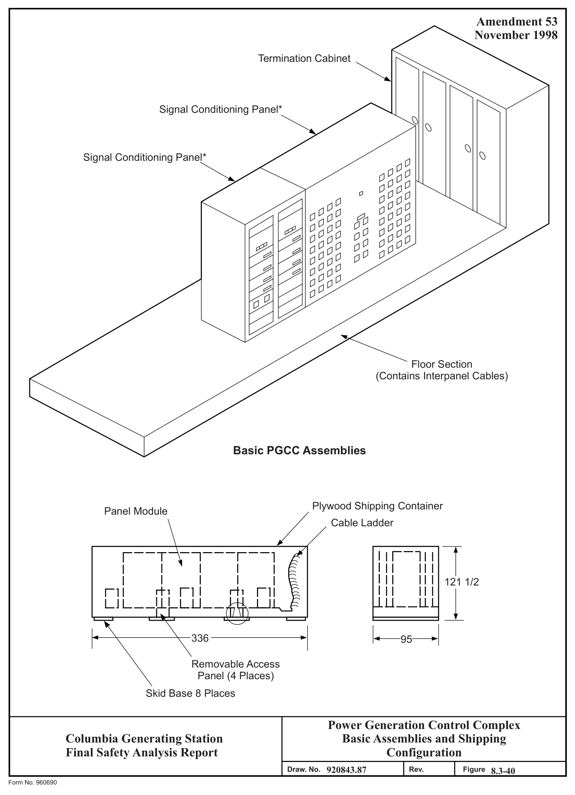

*figure on PDF page 150*

[Vector original (SVG, lossless): fig_page-150.svg](../figures/fig_page-150.svg)

<!-- labels/text on this figure page -->
Amendment 53 November 1998
Termination Cabinet
Signal Conditioning Panel*
Signal Conditioning Panel*
Floor Section
(Contains Interpanel Cables)
Basic PGCC Assemblies
Plywood Shipping Container Panel Module Cable Ladder I 1,-711 l ,--T 111 I I 11 I 111 I I 111 121 1/2 111 _! r1 I rt1 111 ll __ U LJL __ I I ~ ~ 336 95
Removable Access Panel (4 Places)
Skid Base 8 Places
Power Generation Control Complex Basic Assemblies and Shipping Columbia Generating Station Configuration Final Safety Analysis Report 920843.87 Draw. No. Rev. Figure 8.3-40 Form No. 960690

<!-- p.151 -->
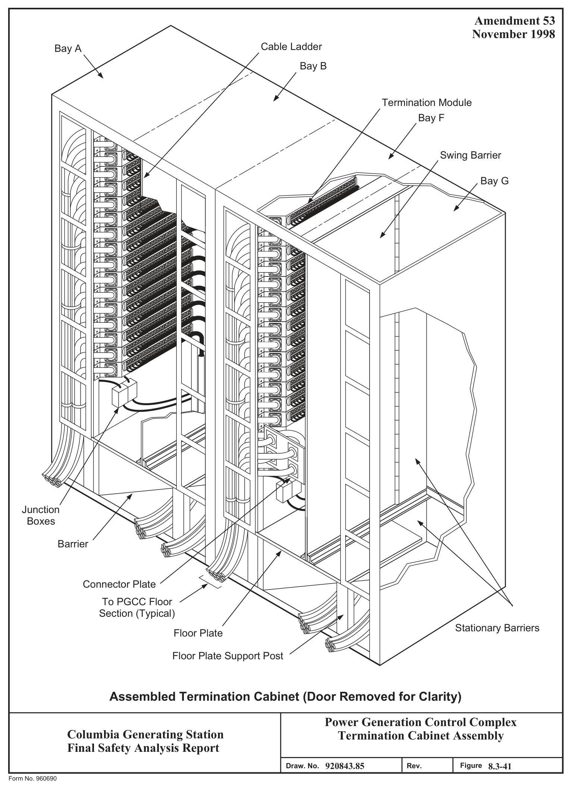

*figure on PDF page 151*

[Vector original (SVG, lossless): fig_page-151.svg](../figures/fig_page-151.svg)

<!-- labels/text on this figure page -->
Amendment 53 November 1998 Cable Ladder Bay A Bay B
Termination Module Bay F
Swing Barrier
Bay G
Junction Boxes
Barrier
Connector Plate To PGCC Floor Section (Typical)
Stationary Barriers Floor Plate
Floor Plate Support Post
Assembled Termination Cabinet (Door Removed for Clarity)
Power Generation Control Complex Columbia Generating Station Termination Cabinet Assembly Final Safety Analysis Report D r a w . N o . 920843.85 R e v . Figure 8.3-41 Form No. 960690

<!-- p.152 -->
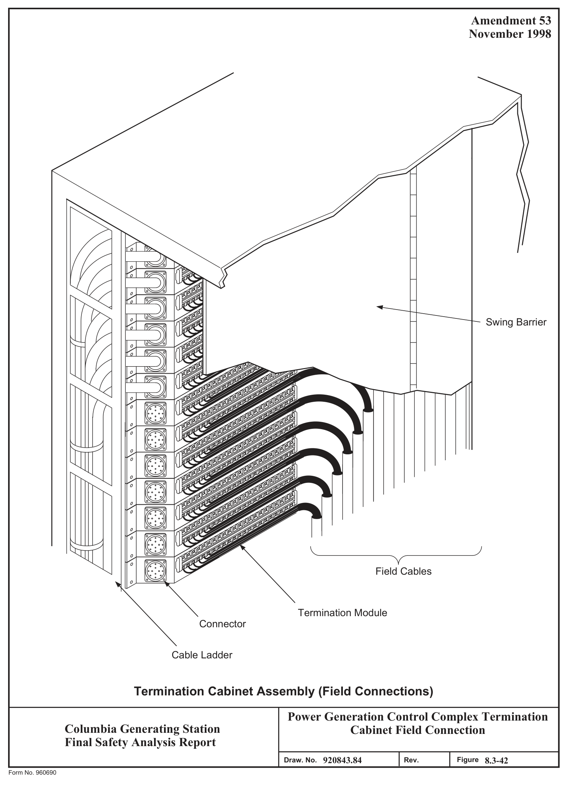

*figure on PDF page 152*

[Vector original (SVG, lossless): fig_page-152_2.svg](../figures/fig_page-152_2.svg)

<!-- labels/text on this figure page -->
Amendment 53 November 1998
Swing Barrier
Field Cables
Termination Module Connector
Cable Ladder
Termination Cabinet Assembly (Field Connections)
Power Generation Control Complex Termination Columbia Generating Station Cabinet Field Connection Final Safety Analysis Report D r a w . N o . 920843.84 R e v . Figure 8.3-42 Form No. 960690

<!-- p.153 -->
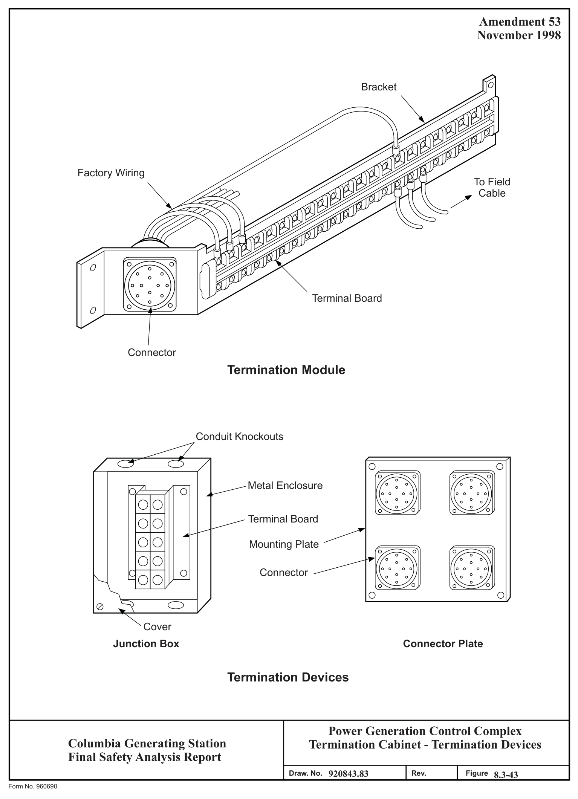

*figure on PDF page 153*

[Vector original (SVG, lossless): fig_page-153_2.svg](../figures/fig_page-153_2.svg)

<!-- labels/text on this figure page -->
Amendment 53 November 1998
Bracket
Factory Wiring To Field Cable
Terminal Board
Connector Termination Module
Conduit Knockouts
Metal Enclosure
Terminal Board
Mounting Plate 00 Connector 0 00 0 C)
Cover Junction Box Connector Plate
Termination Devices
Power Generation Control Complex Columbia Generating Station Termination Cabinet - Termination Devices Final Safety Analysis Report 920843.83 Draw. No. Rev. Figure 8.3-43 Form No. 960690

<!-- p.154 -->
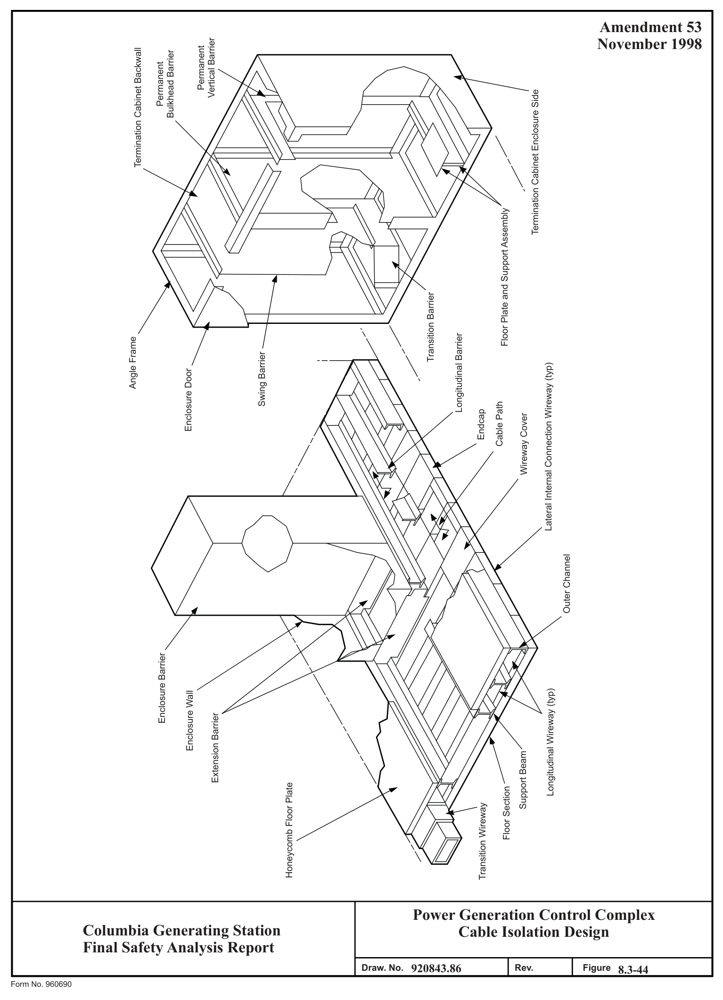

*figure on PDF page 154*

[Vector original (SVG, lossless): fig_page-154.svg](../figures/fig_page-154.svg)

<!-- labels/text on this figure page -->
Amendment 53 November 1998 Vertical Barrier Permanent Termination Cabinet Backwall Bulkhead Barrier Permanent Termination Cabinet Enclosure Side Floor Plate and Support Assembly Transition Barrier Longitudinal Barrier Angle Frame Swing Barrier Lateral Internal Connection Wireway (typ)
Enclosure Door Cable Path Endcap Wireway Cover
Outer Channel
Enclosure Barrier Longitudinal Wireway (typ)
Enclosure Wall Extension Barrier Support Beam Honeycomb Floor Plate Floor Section Transition Wireway
Power Generation Control Complex Columbia Generating Station Cable Isolation Design Final Safety Analysis Report 920843.86 Draw. No. Rev. Figure 8.3-44 Form No. 960690

<!-- p.155 -->
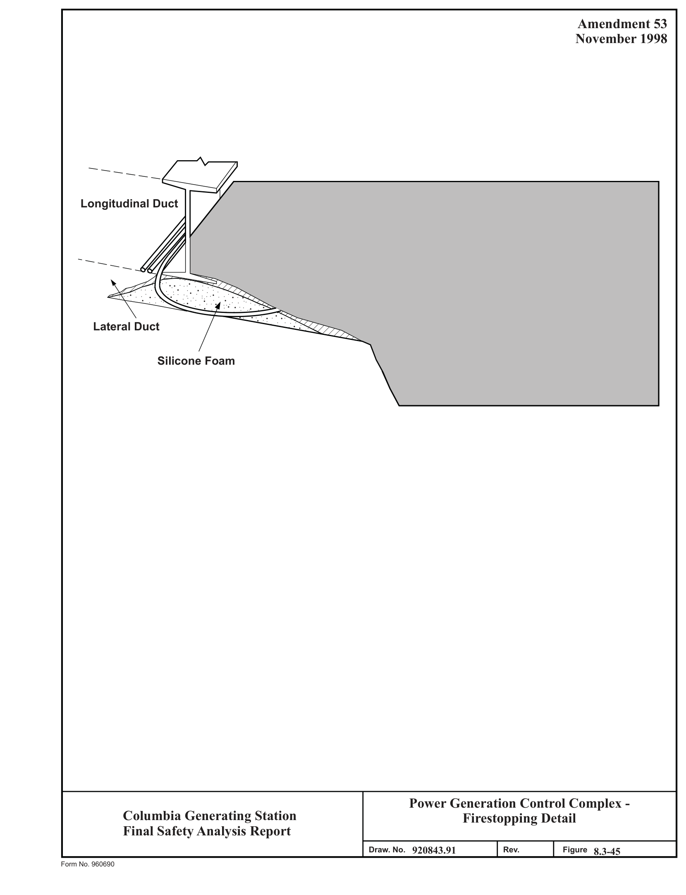

*figure on PDF page 155*

[Vector original (SVG, lossless): fig_page-155.svg](../figures/fig_page-155.svg)

<!-- labels/text on this figure page -->
Amendment 53 November 1998
Longitudinal Duct
Lateral Duct
Silicone Foam
Power Generation Control Complex - Columbia Generating Station Firestopping Detail Final Safety Analysis Report 920843.91 Draw. No. Rev. Figure 8.3-45 Form No. 960690

<!-- p.156 -->
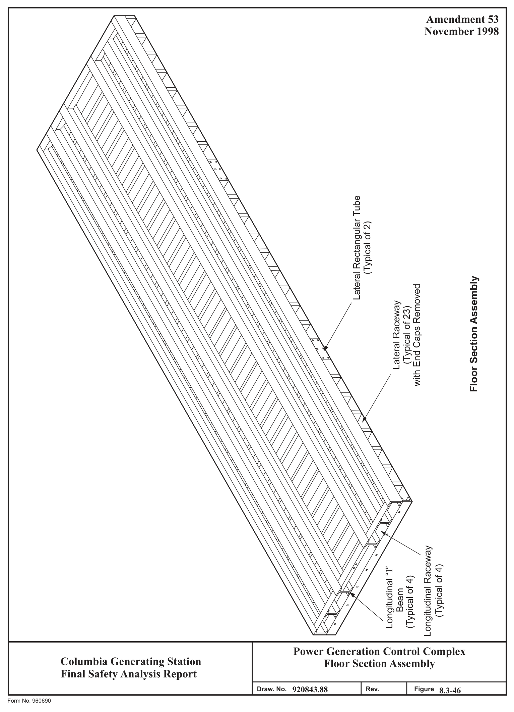

*figure on PDF page 156*

[Vector original (SVG, lossless): fig_page-156_2.svg](../figures/fig_page-156_2.svg)

<!-- labels/text on this figure page -->
Amendment 53 November 1998
Lateral Rectangular Tube
(Typical of 2)
Floor Section Assembly with End Caps Removed Lateral Raceway
(Typical of 23)
Longitudinal Raceway
(Typical of 4) Longitudinal “I”
(Typical of 4)
Beam
Power Generation Control Complex Columbia Generating Station Floor Section Assembly Final Safety Analysis Report 920843.88 Draw. No. Rev. Figure 8.3-46 Form No. 960690

<!-- p.157 -->
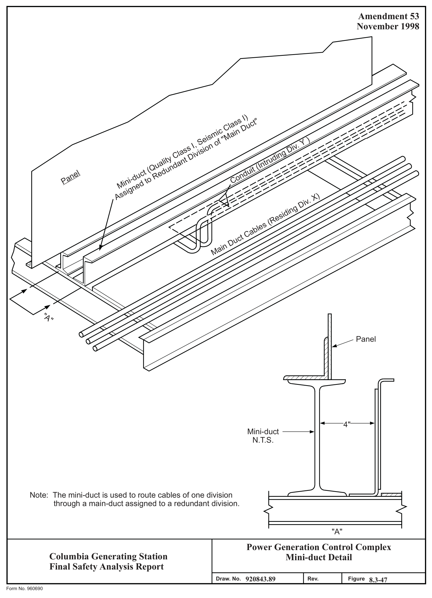

*figure on PDF page 157*

[Vector original (SVG, lossless): fig_page-157_2.svg](../figures/fig_page-157_2.svg)

<!-- labels/text on this figure page -->
Amendment 53 November 1998
Mini-duct (Quality Class I, Seismic Class I)
Assigned to Redundant Division of "Main Duct" Conduit (Intruding Div. Y )
Panel Main Duct Cables (Residing Div. X)
"A"
Panel
4" Mini-duct
N.T.S.
Note: The mini-duct is used to route cables of one division through a main-duct assigned to a redundant division.
"A" Power Generation Control Complex Columbia Generating Station Mini-duct Detail Final Safety Analysis Report 920843.89 Draw. No. Rev. Figure 8.3-47 Form No. 960690

<!-- p.158 -->
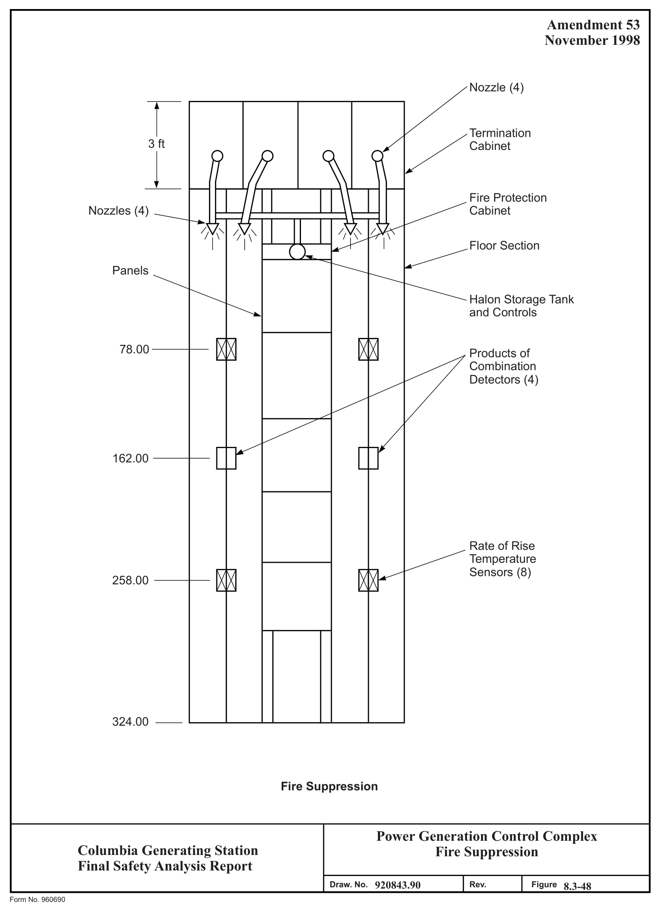

*figure on PDF page 158*

[Vector original (SVG, lossless): fig_page-158_2.svg](../figures/fig_page-158_2.svg)

<!-- labels/text on this figure page -->
Amendment 53 November 1998
Nozzle (4)
I Termination 3 ft Cabinet _L Fire Protection Nozzles (4)
Cabinet
Floor Section
Panels
Halon Storage Tank and Controls
78.00 Products of Combination Detectors (4)
162.00
Rate of Rise Temperature Sensors (8)
258.00
324.00
Fire Suppression
Power Generation Control Complex Columbia Generating Station Fire Suppression Final Safety Analysis Report 920843.90 Draw. No. Rev. Figure 8.3-48 Form No. 960690

<!-- p.159 -->
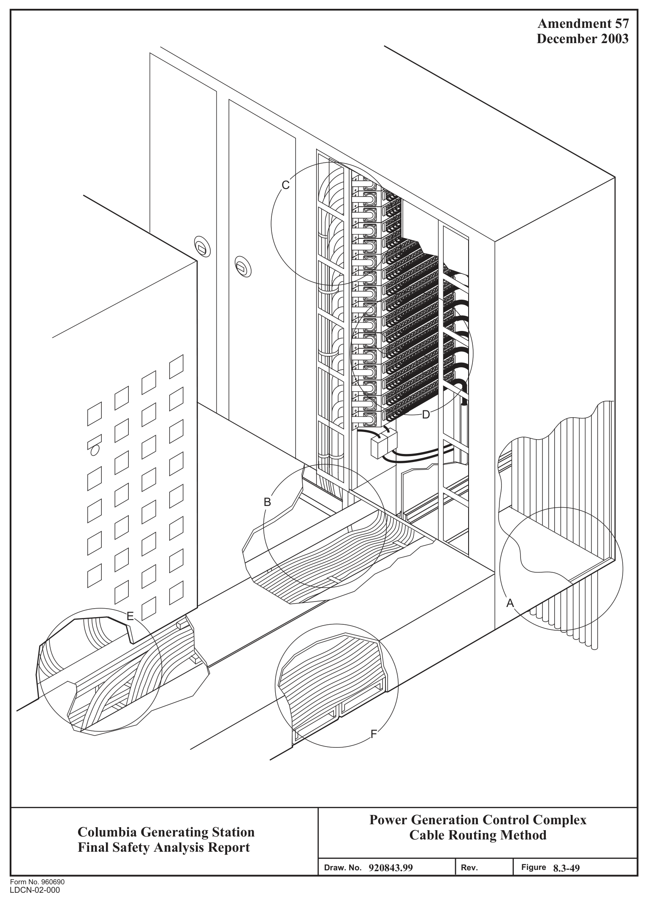

*figure on PDF page 159*

[Vector original (SVG, lossless): fig_page-159.svg](../figures/fig_page-159.svg)

<!-- labels/text on this figure page -->
Amendment 57 December 2003
C
[)
() () ()
D
() () () [)
() () () 8
() () () [)
B
() () () [)
() () () [)
() () () [)
[) -- A E
F
Power Generation Control Complex Columbia Generating Station Cable Routing Method Final Safety Analysis Report D r a w . N o . 920843.99 R e v . Figure 8.3-49 Form No. 960690
LDCN-02-000

<!-- p.160 -->
Amendment 57 December 2003

Non-Class 1E Associated Cables
(See Category 4A)
Cables Cable Category 1A Non-Class 1E Cables Non-Class 1E Powered Building Wall Non-Class 1E Circuit Cable Transition Point (One Cable Length with Two

#### AANN-9000 (C1)
Compatabilities A&1 or B&2)
(Typical Cable No.)
Class 1E

#### AANN-9001 (CA)
Cable
(Typical Cable No.)
6" Less Than

Equipment Enclosure Remote Compo- Non-Class 1E Class 1E Raceway nent Enclosure Raceway

Non-Class 1E (Non-Class 1E Powered) Instrumentation and Control Cables Cable Category 1A (Raceways)

Non-Class 1E Cables with Class 1E Separation (Prime) Associated Cables

#### i-------------i...------------•r--------------------
(See Category 4B)
Cable Category 1B Non-Class 1E Cables with Class 1E Class 1E Powered Building Wall Separation (Prime)
Non-Class 1E Circuit Cable Transition Point (One Cable Length with Two AANN-9000 (C1)
Compatabilities A&1 or B&2) (Typical Cable No.)

#### AANN-9001 (CA)
(Typical Cable No.)
E----~

I Equipment Enclosure Remote Compo- Non-Class 1E Class 1E Raceway nent Enclosure Raceway

Non-Class 1E (Class 1E Powered) Instrumentation & Control Cables Cable Category 1B (Raceways)

Device/Equipment Enclosure Div.
Non-Class 1E Cables (Non-Class 1E Powered)
Associated cable per RG.1.75 rev 1.
However, since cable category 1C has been analyzed to be Less than 6" Non-Class 1E, this group of Non-Class 1E cables is not Less than 6" associated.

Class 1E Cables Cable Category 1C Non-Class "Enclosure Division Compatible Cables" 1E Cables
(Divisional and Prime)
Non-Class 1E (Non-Class 1E Powered) Instrumentation & Control Circuits Cable Category 1C (Enclosures)

Non-Class 1E Circuit Categories Requiring Analysis Columbia Generating Station Final Safety Analysis Report 920843.93 Draw. No. Rev. Figure 8.3-50.1 Form No. 960690

<!-- p.161 -->
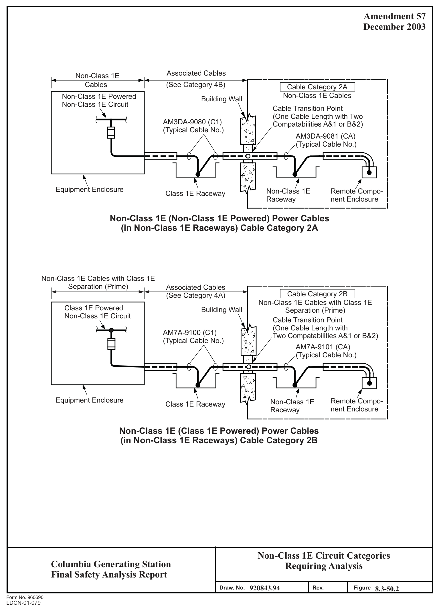

*figure on PDF page 161*

[Vector original (SVG, lossless): fig_page-161_2.svg](../figures/fig_page-161_2.svg)

<!-- labels/text on this figure page -->
Amendment 57 December 2003
14---------------1-111----------------..--------------------------- Associated Cables Non-Class 1E Cables
(See Category 4B)
Cable Category 2A Non-Class 1E Cables Non-Class 1E Powered Building Wall Non-Class 1E Circuit Cable Transition Point
(One Cable Length with Two
AM3DA-9080 (C1)
Compatabilities A&1 or B&2)
(Typical Cable No.)
AM3DA-9081 (CA)
(Typical Cable No.)
Equipment Enclosure Non-Class 1E Remote Compo- Class 1E Raceway Raceway nent Enclosure
Non-Class 1E (Non-Class 1E Powered) Power Cables
(in Non-Class 1E Raceways) Cable Category 2A
Non-Class 1E Cables with Class 1E Separation (Prime) Associated Cables Cable Category 2B (See Category 4A)
Non-Class 1E Cables with Class 1E Class 1E Powered Building Wall Separation (Prime)
Non-Class 1E Circuit Cable Transition Point
(One Cable Length with
AM7A-9100 (C1)
Two Compatabilities A&1 or B&2)
(Typical Cable No.)
AM7A-9101 (CA)
(Typical Cable No.)
Equipment Enclosure Non-Class 1E Remote Compo- Class 1E Raceway Raceway nent Enclosure
Non-Class 1E (Class 1E Powered) Power Cables
(in Non-Class 1E Raceways) Cable Category 2B
Non-Class 1E Circuit Categories Columbia Generating Station Requiring Analysis Final Safety Analysis Report 920843.94 Draw. No. Rev. Figure 8.3-50.2 Form No. 960690
LDCN-01-079

<!-- p.162 -->
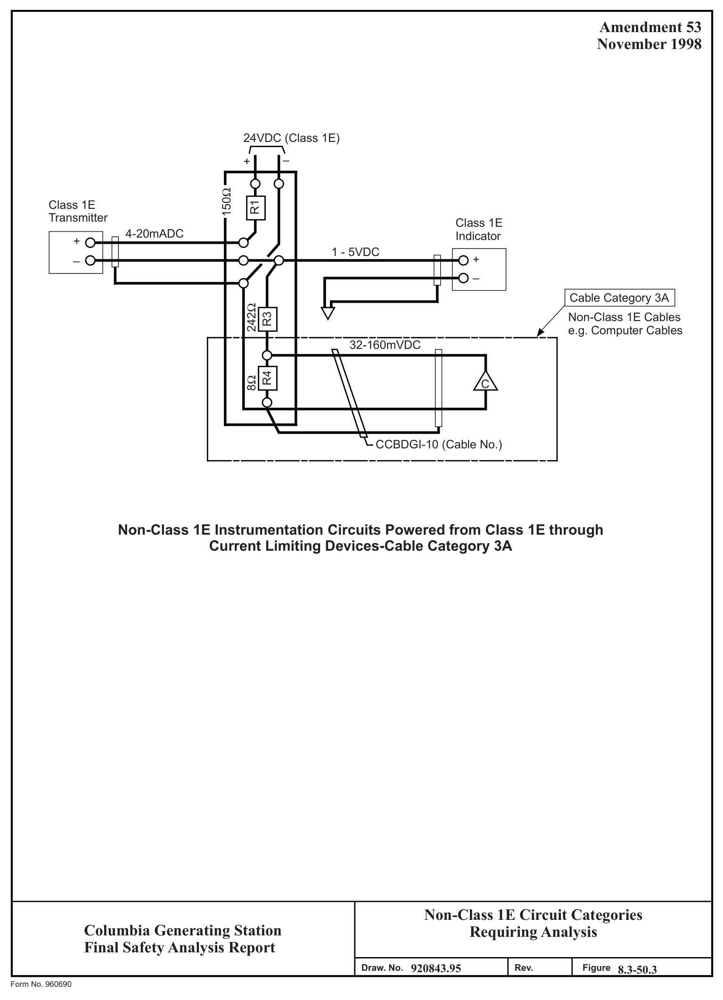

*figure on PDF page 162*

[Vector original (SVG, lossless): fig_page-162_3.svg](../figures/fig_page-162_3.svg)

<!-- labels/text on this figure page -->
Amendment 53 November 1998
24VDC (Class 1E)
+ –
150Ω Class 1E R1 Transmitter Class 1E 4-20mADC Indicator + 1 - 5VDC + – – Cable Category 3A 242Ω Non-Class 1E Cables R3 e.g. Computer Cables 32-160mVDC
R4 8Ω C
CCBDGI-10 (Cable No.)
Non-Class 1E Instrumentation Circuits Powered from Class 1E through Current Limiting Devices-Cable Category 3A
Non-Class 1E Circuit Categories Columbia Generating Station Requiring Analysis Final Safety Analysis Report 920843.95 Draw. No. Rev. Figure 8.3-50.3 Form No. 960690

<!-- p.163 -->
Amendment 57 December 2003

--------- Cable Category 4A Non-Class 1E Non-Class 1E Cables
(See Category 1A & 1C)
Cables Associated Cables Non-Class 1E Powered Building Wall Non-Class 1E Circuit Cable Transition Point
(One Cable Length with Two AANN-9000 (C1)
Compatabilities A&1 or B&2) (Typical Cable No.)
Class 1E

#### AANN-9001 (CA)
Cable
(Typical Cable No.)

Less Than 6"

Equipment Enclosure Class 1E Raceway Non-Class 1E _________ )
Remote Component Raceway AANN-9002 (C1)
Remote Component Enclosure I (Typical Cable No.)
Enclosure

Associated (Non-Class 1E Powered) Instrumentation & Control Cables Cable Category 4A (Raceway)

--------- Non-Class 1E Cables Cable Category 4B Non-Class 1E Cables Associated Cables
(See Category 1B or 2A)
Non-Class 1E Powered Building Wall Non-Class 1E Circuit Cable Transition Point
(One Cable Length with Two AM3DA-9080 (C1)
Compatabilities A&1 or B&2) (Typical Cable No.)

#### AM3DA-9081 (CA)
(Typical Cable No.)

Equipment Enclosure Class 1E Raceway Non-Class 1E Remote Component Raceway AM3DA-9070 (C1)
Enclosure Remote Component
(Typical Cable No.) Enclosure

Associated (Non-Class 1E Powered) Power Cables (In Class 1E Raceways)
Cable Category 4B

Associated Circuit Categories Columbia Generating Station Final Safety Analysis Report 920843.96 Draw. No. Rev. Figure 8.3-51.1 Form No. 960690

<!-- p.164 -->
Amendment 57 December 2003
---------1 ____ _ Non-Class 1E Cables with Non-Class 1E Cables with Class 1E Separation (Prime) Cable Category 4C Class 1E Separation (Prime)
Associated Cables
(See Category 3A)
I I Class 1E Powered \I Building Wall Non-Class 1E Circuit Cable Transition Point
(One Cable Length with Two AANN-9000 (C1)
Compatabilities A&1 or B&2) (Typical Cable No.)

#### AANN-9001 (CA)
(Typical Cable No.)

Equipment Enclosure Class 1E Raceway Non-Class Remote Component 1E AANN-9002 (C1)
Remote Component Enclosure Raceway (Typical Cable No.) _________ I I Enclosure

Associated (Class 1E Powered) Instrumentation & Control Cables Cable Category 4C (Raceways)

--------- Non-Class 1E Cables with Non-Class 1E Cables Class 1E Separation (Prime) Cable Category 4D
(See Category 2B, 3B, 3C)
Associated Cables Class 1E Powered Building Wall Non-Class 1E Circuit Cable Transition Point
(One Cable Length with Two AM7A-9100 (C1)
Compatabilities A&1 or B&2) (Typical Cable No.)

#### AM7A-9101 (CA)
(Typical Cable No.)

Equipment Enclosure Class 1E Raceway Non-Class 1E Remote Component Raceway AM7A-9200 (C1)
Remote Component Enclosure I _________ J
(Typical Cable No.) Enclosure

Associated (Class 1E Powered) Power Cables (In Class 1E Raceways)
Cable Category 4D

Associated Circuit Categories Columbia Generating Station Final Safety Analysis Report 920843.97 Draw. No. Rev. Figure 8.3-51.2 Form No. 960690

<!-- p.165 -->

November 1998

Appendix 8A

#### STATION BLACKOUT

#### TABLE OF CONTENTS

Section Page

8A.1 INTRODUCTION ....................................................................... 8A-1

8A.2 EVALUATION TO NUMARC 87-00 ............................................... 8A-4

8A.2.1 REQUIRED COPING DURATION ............................................... 8A-4

8A.2.2 RESPONSE PROCEDURES........................................................ 8A-4

8A.2.3 COLD STARTS ....................................................................... 8A-5

8A.2.4 EMERGENCY ALTERNATING CURRENT POWER

AVAILABILITY ...................................................................... 8A-5

8A.2.5 COPING WITH A STATION BLACKOUT EVENT .......................... 8A-6

8A.2.5.1 Condensate Inventory............................................................... 8A-6

8A.2.5.2 Class 1E Battery Capacity ......................................................... 8A-6

8A.2.5.3 Compressed Air ..................................................................... 8A-7

8A.2.5.4 Effects of Loss of Ventilation..................................................... 8A-7

8A.2.5.5 Containment Isolation .............................................................. 8A-8

8A.2.6 QUALITY ASSURANCE CONSIDERATIONS ................................ 8A-10

8A.2.7 TECHNICAL SPECIFICATIONS CONSIDERATIONS ...................... 8A-10

8A.2.8 VERIFICATION OF NUMARC 87-00 BASELINE ASSUMPTIONS...... 8A-10

8A.2.9 REFERENCES......................................................................... 8A-11

8A-i

<!-- p.166 -->
November 1998

Appendix 8A

#### STATION BLACKOUT
#### LIST OF TABLES
Section Title Page

8A-1 Station Blackout Coping Determination..................................... 8A-13

8A-2 Validation of NUMARC 87-00 Assumptions .............................. 8A-16

8A-ii

<!-- p.167 -->
April 2000

Appendix 8A

#### STATION BLACKOUT
8A.1 INTRODUCTION

The complete loss of ac electrical power to the essential and nonessential switchgear buses is referred to as “station blackout” (SBO). It does not include the loss of ac power as supplied by the station batteries through inverter or the loss of ac power that is available from an “alternate ac” source as defined below. Station blackout also does not assume a concurrent single failure or a design basis accident (10 CFR 50.2 and Reference 8A-1, Appendix A).

NUREG-0933 states that SBO was resolved on a generic basis by publication of the station blackout rule (10 CFR 50.63) and Regulatory Guide 1.155. The regulatory guide provides guidance acceptable to the Staff for use of NUMARC 87-00 to satisfy the requirements of 50.63 (Reference 8A-1, Appendix K). The regulatory guide shows that NUMARC 87-00 provides guidance for meeting all aspects of the rule with the exception of the quality assurance requirements to be applied to SBO response equipment that is not safety-related and the potential need for changes to the Technical Specifications (Reference 8A-1, Appendix I,

#### Q/A 1).
Contained within NUMARC 87-00 are five initiatives approved by the NUMARC Board of Directors to address the more important contributors to SBO risk. The initiatives are

a. Initiative 1A - Risk Reduction

Each utility will review their site(s) against the criteria specified in the revised draft SBO Regulatory Guide, and if the site(s) fall into the category of an 8-hr or 16-hr site after utilizing all power sources available, the utility will take actions to reduce the site(s) contribution to the overall risk of station blackout.
Nonhardware changes will be made within 1 year. Hardware changes will be made within a reasonable time thereafter.

b. Initiative 2 - Procedures

Each utility will implement procedures at each of its site(s) for

1. Coping with a station blackout,

2. Restoration of ac power following a station blackout event, and

8A-1

<!-- p.168 -->
November 1998

3. Preparing the plant for severe weather conditions (e.g., hurricanes) to reduce the likelihood and consequences of a loss of offsite power and to reduce the overall risk of a station blackout event.

c. Initiative 3 - Cold Starts

Each utility will, if applicable, reduce or eliminate cold fast-starts of emergency diesel generators for testing through changes to technical specifications or other appropriate means.

d. Initiative 4 - Alternating Current Power Availability

Each utility will monitor emergency ac power unavailability, utilizing data provided to INPO on a regular basis.

e. Initiative 5A - Coping Assessment/Emergency Diesel Generator (EDG)
Performance

Each utility will assess the ability of its plant(s) to cope with a station blackout.
Plants utilizing alternate ac power for station blackout response which can be shown by test to be available to power the shutdown buses within 10 minutes of the onset of station blackout do not need to perform any coping assessment.
Remaining alternate ac plants will assess their ability to cope for 1 hr. Plants not utilizing an alternate ac source will assess their ability to cope for 4 hr.
Factors identified which prevent demonstrating the capability to cope for the appropriate duration will be addressed through hardware and/or procedural changes so that successful demonstration is possible.

As part of the coping assessment, utilities are required to choose an EDG target reliability (0.95 or 0.975) and are required to maintain that chosen reliability.
Accordingly, each utility will employ the following exceedance trigger values
(on a plant unit basis) as the mechanism for monitoring EDG target reliability and to support closure of Generic Issues B-56.

Selected EDG Failures in Failures in Failures in Target Reliability 20 Demands 50 Demands 100 Demands 0.95 3 5 8 0.975 3 4 5

Additionally, each utility, in response to an individual EDG experiencing four or more failures in the last 25 demands, will demonstrate restored EDG performance by conducting seven consecutive failure free start and load-run tests. This form of accelerated testing shall be conducted at a frequency of no

8A-2

<!-- p.169 -->
less than 24 hr and of no more than 7 days between each demand. Each utility will, if applicable, address this reduction in accelerated testing through changes to Technical Specifications or other appropriate means.

Columbia Generating Station implementation of these initiatives is discussed in Section 8A.2.

The SBO rule requires that a SBO coping period be established through appropriate coping analysis. It is required that during the established SBO coping period core cooling and containment integrity are maintained [10 CFR 50.63(a)(2)].

The discussion in Section 8A.2 shows Columbia Generating Station to be in compliance to the SBO rule by comparison with the requirements of NUMARC 87-00. Additional discussions relative to station blackout quality assurance and Technical Specifications are provided in Sections 8A.2.6 and 8A.2.7.

Two approaches are available to licensees for compliance to the SBO rule. They are use of

Alternate ac. This is a power source that is (1) connectable to but not normally connected to the offsite or onsite emergency ac power systems, (2) has minimum potential for common-mode failure with offsite power or the onsite emergency ac power sources, (3) is available in a timely manner after the onset of SBO, and (4) has sufficient capacity and reliability for operation of all systems required for coping with SBO and for the time required to bring and maintain the plant in safe shutdown (nondesign-basis accident) (10 CFR 50.2 and Reference 8A-1, Appendix A).

Columbia Generating Station, along with some other BWRs, proposed the use of the high-pressure core spray (HPCS) diesel generator as alternate ac (Reference 8A-2) as this third diesel generator is in excess of the number required to meet the minimum redundancy requirements (i.e., single failure for safe shutdown) (Reference 8A-1, Appendix I, Q/A 105). While HPCS could provide decay heat removal during an SBO, it could not provide power to an emergency bus. Therefore, it was proposed that coping analyses would also be performed to address instrumentation, battery capacities, air supply, and loss of heating, ventilating, and air conditioning (HVAC). This approach has been found to be acceptable to the NRC although they disagreed that the HPCS diesel generator should be classified as alternate ac (Reference 8A-3).

ac-Independent. For this approach the plant relies on available process steam, dc power, and compressed air to operate equipment necessary to achieve safe shutdown conditions until offsite or emergency ac power is restored (Reference 8A-1).

The RCIC system is considered the backup to HPCS during SBO. Columbia Generating Station's coping analysis includes battery voltage profiles for both the 125 V dc and 250 V dc batteries that provide power to RCIC system equipment. These

8A-3

<!-- p.170 -->
battery profiles assume that RCIC is providing sole mitigation for the SBO event.
Although the RCIC system is not credited for SBO event mitigation, it is the preferred SBO mitigation system and will be maintained available to respond to an SBO event.
(Reference 8A-16).

RCIC uses reactor steam and dc power to operate during SBO. The system's keepfill pump, RCIC-P-3, is ac powered and assumed unavailable. Upon loss of keepfill, the system experiences a gradual decay in pressure while in the standby mode. The RCIC system remains available for use until the low pressure alarm of RCIC-PIS-34, which alerts the operator to the loss of margin to void formation in the discharge header.

8A.2 EVALUATION TO NUMARC 87-00

Chapters 3 through 7 of NUMARC 87-00 contain guidance which, if implemented, would serve to satisfy the five NUMARC SBO initiatives and obtain compliance with the SBO rule, with the exception of quality assurance and Technical Specifications considerations. The following sections address the content of these chapters.

8A.2.1 REQUIRED COPING DURATION

Using the data listed in Table 8A-1 and the methodology provided in Chapter 3 of NUMARC 87-00, the coping period for Columbia Generating Station was determined to be 4 hr.

8A.2.2 RESPONSE PROCEDURES

NUMARC 87-00 required procedure changes to deal with

a. SBO response. Changes in this category included; requiring priority efforts to restore ac power with site specific instructions on how this is to be accomplished, providing for core cooling and containment isolation, dealing with the loss of HVAC (e.g., the opening of control room cabinet doors), and the need to strip battery loads if necessary to conserve dc power.

b. Alternating current power restoration. These changes provided guidance to operations and the load dispatcher concerning the course of actions to be taken to restore ac power.

c. Severe weather guidelines. These changes provided guidance for operators to determine the proper course of action due to the onset of severe weather; in particular hurricanes.

The Columbia Generating Station SBO emergency response procedure provides guidance for responding to an SBO including specific instructions for (1) providing for core cooling if HPCS and/or reactor core isolation cooling (RCIC) are available, (2) dealing with the loss of

8A-4

<!-- p.171 -->
HVAC (e.g., the opening of control room cabinet doors and actions to prevent RCIC isolation on high temperature), (3) notifying BPA to give priority to restoration of power to Columbia Generating Station, and (4) checking closed containment isolation valves that might have been I open prior to the onset of the SBO. For Columbia Generating Station response to the SBO rule, only the B1-1 and B1-2 batteries are required. As there is no need to provide for load I stripping of these batteries, this is not provided for in the SBO procedure (Reference 8A-1, Appendix I, Q/A 77).

In addition to the instructions in the SBO response procedure for giving priority to restoration of power to Columbia Generating Station, the loss of all offsite power procedure was revised I to provide this guidance and the BPA System Restoration Plan was revised to identify the need for prompt restoration of offsite power to Columbia Generating Station and the actions to be taken to achieve this.

As Columbia Generating Station was not evaluated for a hurricane during initial plant licensing and as no credit was taken for hurricane procedures in the coping analysis, no procedure changes were required to deal with the threat of hurricanes (Reference 8A-1, Appendix I, Q/As 12 and 52). In Reference 8A-4 Energy Northwest proposed to the NRC that with the Columbia Generating Station site having a very low risk for tornadoes, no special site inspections for potential missiles were necessary. Also, it was explained that restoration of important plant systems and components did not require special procedures with the exception of tornado damage to the ultimate heat sink spray ponds which was covered by existing procedures.

8A.2.3 COLD STARTS

This requires that each plant ensure that emergency diesel generator tests are performed in a prewarmed and prelubed condition except during the Technical Specifications demand test required approximately once each scheduled refueling outage unless the emergency diesel generator is normally prewarmed and prelubed.

No action was required for this item as the Columbia Generating Station diesels have prewarm
(see Section 9.5.5.2) and prelube (see Section 9.5.7.2) systems that are normally in operation.

8A.2.4 EMERGENCY ALTERNATING CURRENT POWER AVAILABILITY

This item implements NUMARC SBO Initiative 4 which requires monitoring of plant emergency generator unavailability. Appendix D of the NUMARC document provides a suggested diesel generator reliability program.

In Reference 8A-5 Energy Northwest stated that procedures had been revised to implement Appendix D of NUMARC 87-00 and the five elements listed in Regulatory Guide 1.155, Position 2.

8A-5

<!-- p.172 -->
8A.2.5 COPING WITH A STATION BLACKOUT EVENT

Chapter 7 of NUMARC 87-00 provides a simplified assessment procedure for establishing the ability to cope with an SBO. There are five steps to the procedure, addressing the following topics:

a. Condensate inventory for decay heat removal, b. Assessing the Class 1E battery capacity, c. Compressed air, d. Effects of loss of ventilation, and e. Containment isolation.

8A.2.5.1 Condensate Inventory

The required condensate is to be determined from

B = A*(X gal/MWt) + C + RCS leakage

Where:

A = licensed output - MWt,

X = 22.12 for a 4-hr coping period, and

C = amount of water to support cooldown if cooldown is required to limit pump seal leakage or to maintain decay heat removal - gallons.

The reactor coolant system (RCS) leakage term is the coping period inventory loss due to
(1) an assumed pump seal failure leakage term of 25 gpm/pump (later changed by the NRC to 18 gpm/pump for BWRs, Reference 8A-1, Appendix J, Q/A 2.1), and (2) the maximum allowable Technical Specifications RCS leakage. For Columbia Generating Station, A is 3544 MWt and C is 31,568 gal resulting in a required inventory of 109,962 gal.
Reference 8A-6 discusses the administrative controls and plant feature that proved assurance that this quantity of water will be available in the condensate storage tanks (CST) (the Technical Specifications do not control CST quantity while in Mode 1).

8A.2.5.2 Class 1E Battery Capacity

The B1-1 and B1-2 125-V batteries have adequate capacity for a 4-hr SBO coping period without load shedding (Reference 8A-4 through 8A-7). The battery load calculations assume I an electrolyte temperature of 74°F. This was found to be acceptable to the NRC by Reference 8A-8 provided that administrative controls are in place to ensure that this value

8A-6

<!-- p.173 -->
would be the lowest temperature anticipated during normal operating conditions as required by Reference 8A-1, Section 7.2.2. The supplemental SER (SSER) (Reference 8A-8) did require the revisions to the calculations to account for changes to inverter efficiency and load currents.
The calculations have been revised.

The B2-1 battery is not required for compliance to the SBO rule (Reference 8A-5).

8A.2.5.3 Compressed Air

Compressed air is addressed to ensure that air operated valves required for decay heat removal have sufficient reserve air or can be manually operated under station blackout conditions for the established coping duration.

In Reference 8A-4 Energy Northwest stated that (1) no air-operated valves are relied on to cope with an SBO of 4 hr, and (2) the safety/relief valves (SRVs), which together with the HPCS provide for decay heat transfer to the suppression pool, have an adequate nitrogen supply for 4 hr of SRV operation.

8A.2.5.4 Effects of Loss of Ventilation

To address the impact of a loss of ventilation during the SBO, the 4-hr (final) steady-state temperatures are determined for dominant areas of concern (DAC). Dominant areas of concern are those that (1) contain equipment that is needed to function early in an SBO (within 1 hr) to remove decay heat, (2) have significant heat generation sources after ac power is lost, relative to the free air volume of the room, and (3) unless the operator takes action, the capability to remove heat is lost during an SBO (Reference 8A-1, Appendix I, Q/A 4).

With the SBO temperatures determined, reasonable assurance of operability (RAO) of SBO coping equipment located in the areas is then established per the requirements of NUMARC 87-00, Appendix F.

For the Columbia Generating Station SBO response, the dominant areas of concern are (1) the control room, and (2) primary containment.

The SBO temperature for switchgear room 2 was determined as it contains breakers required for the restoration of ac power; its major heat source is inverter IN-5 which is not required for compliance to the SBO rule. A primary containment thermal hydraulic analysis was performed to determine the SBO drywell and wetwell temperatures.

The steam tunnel was also analyzed for SBO although it was found to not contain SBO coping equipment (References 8A-5, 8A-9, and 8A-10). The following rooms contain SBO coping equipment but maintain ventilation during a SBO and thus do not need to be evaluated as dominant areas of concern (Reference 8A-1, Section 7.1.2): (1) HPCS pump room, (2) HPCS

8A-7

<!-- p.174 -->
diesel/electrical equipment room, and (3) service water pump house A. The HVAC calculations for these rooms were reviewed to confirm RAO of SBO equipment located in these areas although this is not a requirement of the SBO rule (Reference 8A-1, Appendix I,

#### Q/A 137).
The SBO final temperatures for the rooms listed below were derived from calculations based on selected initial temperatures as appropriate:

Final Initial Room
(°F) (°F) Doors SW pump house A 113 N/A Closed HPCS diesel/equipment room 104 N/A Closed HPCS pump room 123 N/A Closed RPS-1 room (IN-3A and 3B) 127 104 Closed RPS-2 room (IN-2A and 2B) 119 104 Closed Switchgear room 2 113 104 Closed Control room 119.7

## 78 Closed
Steam tunnel 193 140 Closed Drywell 229 135 N/A Wetwell air 179 150 N/A Wetwell water 209

## 90 N/A
In Reference 8A-5 the use of the initial temperatures of 78°F for the control room was justified based on the addition of administrative controls to ensure that the room temperature would not be exceeded or corrective action would be taken to restore them. This was accepted by the NRC in Reference 8A-8.

The HPCS diesel/equipment and HPCS pump rooms and SW pump house A are not considered as dominant areas of concern as ventilation is maintained during an SBO. For the remaining areas RAO has been established for the SBO coping equipment located in these rooms. For those areas with a temperature of less than or equal to 120°F, RAO can be assumed without further analysis (Reference 8A-1, Appendix J, Q/A 2.2). The SBO coping equipment located in other areas was previously designated as safety-related for non-SBO considerations for which the environmental qualification requirements of 50.49 establish RAO.

8A.2.5.5 Containment Isolation

Containment isolation valves must be reviewed to ensure that appropriate containment integrity can be provided during an SBO should core damage become imminent (Reference 8A-1, Appendix I, Q/A 102).

8A-8

<!-- p.175 -->
Valves that do not need to be considered for SBO closure considerations are those that meet one of the following criteria:

a. Valves normally locked closed during operation,

b. Valves that fail closed on loss of ac power or air,

c. Valve is a check valve,

d. Valves in nonradioactive closed loop systems not expected to be breached in a SBO (with the exception of lines that communicate directly with the containment atmosphere), or

e. All valves less than 3 in. nominal diameter.

In addition, as the objective is to protect the penetration and additional single failures do not need to be applied for SBO coping, valves that have an in-series valve that satisfies one of the above criteria can also be excluded (Reference 8A-1, Appendix I, Q/A 101).

In References 8A-5 and 8A-9 Energy Northwest proposed to add the following exclusion criteria:

a. Valves for which interlocks exist that prevent opening of one or both in-series valves during power operation;

b. Valves that are associated with containment penetrations that use single isolation valves and satisfy General Design Criterion 56 by taking credit for the closed loop system outside containment as a second isolation barrier. This is often the case for those lines for which the suppression pool serves as a loop seal; and

c. Valves that are procedurally controlled to be closed during normal power operation. It is acceptable for such valves to be opened to support surveillance testing. However, exclusion of valves associated with more frequent operation, e.g., suppression pool cooling, is not appropriate.

These exclusion criteria were found acceptable by the Staff in Reference 8A-8.

The result of this evaluation is provided in Table 6.2-16. The SBO emergency response procedure has been revised to provide guidance for closure of those valves that were not excluded by this evaluation. For these valves it has been confirmed that (1) position indication is provided (by means other than observation of the stem position), (2) local manual closure capability exists, and (3) access would be available during an SBO. This confirmation was also made for those valves that were excluded by the fact that they are procedurally controlled to be closed during normal operation.

8A-9

<!-- p.176 -->
8A.2.6 QUALITY ASSURANCE CONSIDERATIONS

Regulatory Guide 1.155, Section 3.5, requires that the quality assurance requirements of Appendixes A and B of the guide be applied to that non-safety-related equipment used to meet the requirements of the SBO rule that are not already covered by existing quality assurance requirements of 10 CFR 50 Appendixes B or R.

In Reference 8A-5 Energy Northwest stated that SBO instrumentation coping equipment that is identified as QC II+ and is also required by Regulatory Guide 1.97 conforms to the quality assurance requirements of Regulatory Guide 1.97 for Category 2 equipment. As such, any additional quality assurance requirements of Regulatory Guide 1.155 are not applied to the equipment. Also, the reference explains that with the exception of the CST, SBO quality assurance is not applied to passive equipment (e.g., piping and structural supports). Other SBO coping equipment will conform to the requirements of Appendix R or Regulatory Guide 1.155.

These positions were accepted by the NRC in the SSER (Reference 8A-8); however Reference 8A-10 was submitted to the NRC to correct the words in the SSER relative to the quality assurance provided for passive equipment.

Reference 8A-5 also explained that SBO coping equipment has been identified as that equipment required to cope with an SBO and that failure of other equipment during an SBO was not postulated simply because it had not been assigned safety-related or SBO quality assurance requirements.

In Reference 8A-7 Energy Northwest stated that with regard to SBO recovery (not coping)
equipment, SBO quality assurance requirements would only apply to SBO recovery equipment that is not in service during normal operation

8A.2.7 TECHNICAL SPECIFICATIONS CONSIDERATIONS

The basis for the Columbia Generating Station response to the SBO rule is use of HPCS which is safety related and already adequately covered in the Technical Specifications. No SBO Technical Specifications changes are required for Columbia Generating Station. Use of HPCS for SBO coping does not place any additional design or operating considerations on the HPCS system.

8A.2.8 VERIFICATION OF NUMARC 87-00 BASELINE ASSUMPTIONS

Section 1.3 of NUMARC 87-00 states that utilities are expected to ensure that the baseline assumptions of the document are applicable to their plants. Utilities are, however, not expected to perform rigorous analyses or evaluations in verifying these assumptions
(Reference 8A-1, Appendix I, Q.A 3). The analyses are to be available for NRC review.

8A-10

<!-- p.177 -->
Table 8A-2 documents the evaluation of the baseline assumptions as applied to Columbia Generating Station. The table shows that where the assumptions were found to be invalid, alternative methods confirmed Columbia Generating Station compliance to the SBO rule. In all cases where a baseline assumption was found to be invalid, it was not because of a Columbia Generating Station unique feature, but rather because the assumption was not applicable to a large class of plants.

8A.2.9 REFERENCES

8A-1 NUMARC 87-00, Revision 1, “Guidelines and Technical Bases for NUMARC Initiatives Addressing Station Blackout at Light Water Reactors,” Nuclear Management and Resources Council, Inc., dated August 1991.

8A-2 Meeting Summary by P. S. Tam, “BWR Alternate AC Approach to Satisfy Station Blackout Rule (TAC Nos. 68529, 68549, 68550, 68584, 68626, 40577),” dated March 2, 1989.

8A-3 Letter, GI2-92-012, P. L. Eng to G. C. Sorensen, “Safety Evaluation of the Washington Public Power Supply System Nuclear Project Number 2 Station Blackout Analysis (TAC No. M68626),” dated December 30, 1991.

8A-4 Letter, GO2-89-062, G. C. Sorensen to NRC, “Response to Station Blackout Rule Using HPCS Division III as Alternate AC Power,” dated April 17, 1989.

8A-5 Letter, GO2-92-057, G. C. Sorensen to NRC, “Safety Evaluation of the Washington Public Power Supply System Nuclear Project Number 2 Station Blackout Analysis,” dated March 6, 1992.

8A-6 Letter, GO2-91-091, G. C. Sorensen to NRC, “Additional Information Regarding SBO (TAC Nos. 68626),” dated May 7, 1992.

8A-7 Letter, GO2-90-064, G. C. Sorensen to NRC, “Station Blackout Implementation, Additional Information (TAC 68626),” dated March 30, 1990.

8A-8 Letter, GI2-92-180, R. R. Assa to G. C. Sorensen, Supplemental Safety Evaluation (SSE) of the Washington Public Power Supply System Nuclear Project No. 2 (WNP-2) Station Blackout Analysis (TAC M68626),” dated June 26, 1992.

8A-9 Letter, GO2-92-121, G. C. Sorensen to NRC, “Safety Evaluation of the Washington Public Power Supply System Nuclear Project Number 2 Station Blackout Analysis (TAC No. M68626),” dated May 14, 1992.

8A-11

<!-- p.178 -->
8A-10 Letter, GO2-92-183, G. C. Sorensen to NRC, “Station Blackout Supplemental SER and Implementation Schedule, 10 CFR 50.63(c)(4), TAC NO. M68626,” dated July 31, 1992.

8A-11 Letter, GO2-94-002, J. V. Parrish to NRC, “Updating Information Regarding Station Blackout Resolution (TAC No. N68626),” dated January 6, 1994.

8A-12 “Storage Batteries, A General Treatise on the Physics and Chemistry of Secondary Batteries and their Engineering Applications,” fourth edition by G. W. Vinal, and J. Wiley & Sons.

8A-13 Letter, GO2-88-025, D. W. Mazur to NRC, “NRC Inspection Report 87-19,” dated January 29, 1988.

8A-14 Letter, GO2-92-099, G. C. Sorensen to NRC, “Safety Evaluation of the Washington Public Power Supply System Nuclear Project Number 2 Station Blackout Analysis (TAC No. M68626),” dated April 15, 1992.

8A-15 Calculation ME-02-89-21.

8A-16 Letter, GO2-07-139, D.W. Coleman to NRC, “Clarification on the Role of Reactor Core Isolation Cooling During a Station Blackout for Columbia Generating Station,” dated September 13, 2007.

8A-12

<!-- p.179 -->
November 1998

Table 8A-1

Station Blackout Coping Determination

NUMARC 87-00, Rev. 1 Station Blackout Consideration Reference

1. Determine the Offsite Power Design Characteristic Group

A. Site susceptibility to grid related loss of App I, Q/A 10 offsite power (LOOP) events

with < one event/20 yrs;
then, not a P3 site

Table 3-2 B. Frequency of a LOOP due to extremely severe weather

with an annual expectation of 0.0001;
then, ESW Group 1

p 3-6 C. Frequency of a LOOP due to severe weather

f = (1.3x10-4)*h1 + b*h2 + (1.2x10-2) *h3 + c*h4

with

h1 = annual snowfall expectation, 14 in. App I, Q/A 14
(FSAR Table 2.3-1)
Reference 8A-5

h2 = annual expectation for a tornado of Table 3-3 severity <f2, 2x10-7

h3 = annual expectation for wind of 75 to Table 3-3 124 mph, 0.03

h4 = annual expectation of a storm w/salt Table 3-3 spray, 0.0

8A-13

<!-- p.180 -->
November 1998

Table 8A-1

Station Blackout Coping Determination (Continued)

NUMARC 87-00, Rev. 1 Station Blackout Consideration Reference

C. Frequency of a LOOP due to severe weather (continued)
p 3-6 b = 12.5 for sites w/multiple rights away p 3-6 c = 0.0 for sites w/o salt spray vulnerability

then Table 3-4 f = 2.2x10-3; therefore SW Group 1 D. Independence of offsite power system

with two switch yards and with automatic p 3-10 transfers provided upon loss of the main generator and the preferred source

then, I Group 1/2

Table 3-5a E. Determine offsite power design group

with ESW 1, SW 1, and I 1/2

then, Group P1

Table 3-7
2. Classify Emergency Alternating Current Power Supply System Configuration

with

EDGs normally available = 2 EDGs required for safe shutdown = 1;

then, EAC Group C

8A-14

<!-- p.181 -->
November 1998

Table 8A-1

Station Blackout Coping Determination (Continued)

NUMARC 87-00, Rev. 1 Station Blackout Consideration Reference

3. Determine Allowed EDG Target Reliability Section 3.2.4

with

0 failures last 20 demands being >90% 1 failure in last 50 demands being >94% 1 failure in last 100 demands being >95%

and with EAC Group C,

then, a target reliability of 95%

Table 3-8 4. Determining Coping Duration Requirement

with

Offsite Power Group P1 EAC Group C EDG target reliability of 95%

then, the required coping duration is 4 hr

8A-15

<!-- p.182 -->
Table 8A-2

Validation of NUMARC 87-00 Assumptions

#### NUMARC
Assumption Comment

NUMARC 87-00, Rev. 1, Appendix J.9 Considerations

2.4.1(1) Confirm dc power for EDG field These considerations are included flashing and breaker closure. in the battery capacity calculations
(Reference 8A-7).

### 2.5.2 BWRs should consider RRC pump Seal leakage is included in the seal leakage.
required inventory calculation (see Section 8A.2.5.1).

2.7.1 LOCA and HELB temperatures A plant specific SBO primary may not be conservative for SBO. containment heatup calculation has been performed for Columbia Generating Station, and the SBO temperatures are bounded by the LOCA analysis temperatures. The DAC area outside containment is not susceptible to HELB conditions.
(see Section 8A.2.5.4).

2.7.1(2)(a) Confirm control room This assumption was confirmed for temperatures do not exceed Columbia Generating Station by a 120°F.
plant-specific control room heatup calculation (Reference 8A-7).

The use of 104°F for RPS rooms
2.7.1(2)(a)1 Initial and average wall
2.7.1(2)(a)2 temperatures assumptions should and switchgear room 2 is valid as be verified by plant data.
these rooms are controlled to below this temperature per the Licensee Controlled Specifications.

#### LDCN-02-002, 02-025
8A-16

<!-- p.183 -->
November 1998

Table 8A-2

Validation of NUMARC 87-00 Assumptions (Continued)

#### NUMARC
Assumption Comment

The heatup calculations for the control room used an alternate methodology for which the temperature of adjacent rooms was properly accounted for. The temperatures of the rooms adjacent to the control room were conservatively assumed to be 104°F with the exception of the communication room which may have SBO heat loads and was assumed to be at 120°F. The control room model does not use the basic NUMARC 87-00 assumption that wall temperature remains basically constant during the SBO. Rather it models the wall as several nodes (typically 10) for which time dependent heat conduction and convection are accounted for.
The primary containment model used the maximum temperature allowed by the Technical Specifications for the drywell and suppression pool as the initial temperatures for the appropriate portions of the containment shell and internal structures. These temperatures are higher than those that would be expected for the adjacent areas outside primary containment (i.e., within the Reactor Building).

8A-17

<!-- p.184 -->
Table 8A-2

Validation of NUMARC 87-00 Assumptions (Continued)

#### NUMARC
Assumption Comment

2.7.1(2)(a)(3) Drop ceilings and walls that are The control room has a drop ceiling
2.7.1(2)(a)(4) not poured concrete cannot be and walls that have facia board modeled by NUMARC 87-00 paneling. The drop ceiling was methodology. If either are to be modeled by a method identified to modeled, an alternate the NRC in Reference 8A-7. The methodology must be used and control room model has two this should be identified to the volumes; the main portion of the NRC.
room and the volume above the drop ceiling. Walls with facia board panel were not credited as heat sinks.

2.7.1(2)(a)(5) In order to take credit for opening The opening of doors is not doors, the adjacent room must be required for SBO Rule compliance.
large relative to the DAC and at a lower temperature.

2.7.1.(2)(b) Loss of heating in the battery The battery rooms have no walls room is assumed not to affect that are exterior walls of the battery capacity. Provided battery building and some of the adjacent capacity calculations used the rooms will have SBO heat loads.
lowest electrolyte temperature As such, there will not be significant cooling of the rooms anticipated under normal operating conditions, further during the coping period. Also, as consideration of loss of battery the I2R heat generation within the batteries will be greater than the capacity is not required.
heat loss due to the endothermic discharge reaction (Reference 8A-12), it is likely that the electrolyte temperature will increase even with a slight decrease in room temperature.

8A-18

<!-- p.185 -->
Table 8A-2

Validation of NUMARC 87-00 Assumptions (Continued)

#### NUMARC
Assumption Comment

Other Considerations

2.3.1 Specific consideration was not The eruptions of Mt. St. Helens in given in NUMARC 87-00 for a 1980 did not result in significant grid related LOOP due to volcanic disturbance to the BPA system.
activity.
Also, the probability of volcanic activity that could significantly impact the BPA system is low relative to severe weather events that could do the same. Columbia Generating Station has made procedure and design provisions to ensure continuous EDG operations during volcanic activity (see Section 9.2.5.3 and Reference 8A-13).

2.7.1.(2)(a) RAO only needs to be established RAO was confirmed for those for areas that lose normal areas that contain SBO coping ventilation.
equipment for which ventilation is maintained (Section 8A.2.5.4).

2.7.1.(2)(a) For a temperature ≤ 120°F, it is Analysis has confirmed that all equipment important to station likely no specific actions to ensure blackout is capable of functioning RAO are required.
at temperatures ≤ 120°F (≤ 129°F for the RPS-1 room) with no specific action required to ensure RAO.

2.7.1.(2)(a) The DACs for BWRs are the For Columbia Generating Station, HPCI/HPCS and RCIC rooms and the control room and primary the main steam tunnel.
containment are considered as DACs.

#### LDCN-02-002, 02-025
8A-19

<!-- p.186 -->
Table 8A-2

Validation of NUMARC 87-00 Assumptions (Continued)

#### NUMARC
Assumption Comment

Appendix I, Plants that relied on GE HELB This assumption was validated for Q/A 95 analysis or a plant specific Columbia Generating Station using analysis which bounds the GE a plant-specific primary analysis, need not address the containment heatup analysis that drywell temperature.
modeled the drywell, wetwell air space, and suppression pool.
--------------========' I

8A-20

