# 9.1 FUEL STORAGE AND HANDLING

> Columbia Generating Station FSAR — Chapter 09: Auxiliary Systems
> Source: `09_chapter-3152-3521.pdf`, PDF pages 19–110 (of 370)
> Amendment 67 compilation (individual pages carry varying amendment dates)

---
<!-- p.19 -->
Chapter 9

#### AUXILIARY SYSTEMS
### 9.1 FUEL STORAGE AND HANDLING
#### 9.1.1 NEW FUEL STORAGE
##### 9.1.1.1 Design Bases
###### 9.1.1.1.1 Safety Design Bases
###### 9.1.1.1.1.1 Safety Design Bases - Structural.

a. The new fuel storage racks containing a full complement of fuel assemblies are designed to withstand all credible static and dynamic loadings, to prevent damage to the structure of the racks and the contained fuel, and to minimize distortion of the rack arrangement [see Table 3.9-2(s)],

b. The racks are designed to protect the fuel assemblies from excessive physical damage so as to prevent the release of radioactive materials in excess of

## 10 CFR 20 limits under normal or abnormal conditions,
c. The racks are constructed in accordance with the Quality Assurance Requirements of 10 CFR Part 50, Appendix B,

d. The new fuel storage racks are categorized as Safety Class 2 and Seismic Category I, and

e. The new fuel storage vault is located within secondary containment in the reactor building and therefore complies with the objectives set forth in Regulatory Guide 1.13, and General Design Criteria (GDC) 2, 3, 4, 5, 61, 62 and 63 of 10 CFR Part 50, Appendix A.

###### 9.1.1.1.1.2 Safety Design Bases - Nuclear.

a. The new fuel storage racks are designed and maintained with sufficient spacing between the new fuel assemblies to ensure that the array shall be subcritical by at least 5% Δk, including allowance for calculation biases and uncertainties.
l Calculations were performed to ensure that keff ≤0.95 for all water mist densities up to I
1.0 gm/cm3 in and around the fuel. The new fuel storage vault was modeled using the KENO

<!-- p.20 -->
computer code (Reference 9.1-1). GE14 and GNF2 fuel bundles were modeled using the MCNP01A (GEH’s version of MCNP4A) computer code (Reference 9.1-10).

The biases between the calculated results and experimental results, as well as the uncertainty involved in the calculations, are taken into account as part of the calculation procedure to ensure that the specified Keff limits are met.

b. Columbia has chosen to comply with 10 CFR 50.68, “Criticality Accident Requirements”.

###### 9.1.1.1.2 Power Generation Design Bases
a. New fuel storage racks provide for approximately 8% of the full core fuel load, and

b. New fuel storage racks are designed and arranged so that the fuel assemblies can be handled efficiently during refueling operations.

##### 9.1.1.2 Facilities Description
The new fuel storage vault containing the new fuel storage racks is a concrete structure adjacent to the spent fuel pool at the refueling floor level of the reactor building (see Figure 1.2-10). The reactor building is built to Seismic Category I requirements and is further discussed in Section 3.2. The new fuel rack design features are as follows:

a. The new fuel storage vault contains 24 sets of castings, with each casting containing 10 possible storage locations. A maximum of 60 fuel storage I positions will be used. The remaining storage locations will be blocked with a positive physical barrier, such that no fuel can be placed in the blocked positions. Figure 9.1-1 shows the locations where fuel will be stored;

b. There are three tiers of castings positioned by fixed box beams. The castings hold the fuel assemblies in a vertical position; the fuel assemblies are supported at the lower tie plate, with additional lateral support;

c. The lower casting is designed to support the weight of the fuel assembly and restrict lateral movement when used in the as-built configuration. To facilitate the assembly of ABB type fuel, a stub tube rests in the bottom casting to raise the fuel approximately 30 in. The center and top castings restrict only lateral movement of the fuel assembly;

d. The new fuel storage racks are made from aluminum. Materials used for construction are specified in accordance with the latest issue of applicable ASTM specifications. The material choice is based on a consideration of the susceptibility of various metal combinations to electrochemical reaction. When

<!-- p.21 -->
considering the susceptibility of metals to galvanic corrosion, aluminum and stainless steel are similar insofar as their coupled potential is concerned. The use of stainless steel fasteners in aluminum to avoid detrimental galvanic corrosion is a recommended practice and has been used successfully for many years by the aluminum industry. The stub tubes are used when assembling Westinghouse type fuel, are made of stainless steel and are not directly fastened to lower casting;

e. Lead-in and lead-out of the casting provide guidance of the fuel assembly during insertion or withdrawal; and

f. The nominal center-to-center spacing with rows is 7 in. and between rows is 12 in. However, as shown in Figure 9.1-1, face adjacent locations are not used.
The fuel assembly center-to-center spacing is a multiple of the above dimensions.

The fuel assemblies are loaded into the rack through the top. Each hole for a fuel assembly has adequate clearance for inserting or withdrawing the assembly channeled or unchanneled.
Sufficient guidance is provided to preclude damage to the fuel assemblies. The design of the racks and the blocking devices prevent accidental insertion of the fuel assembly into a position not intended for the fuel. The only spaces in the racks are those into which it is intended to insert fuel. The weight of the fuel assembly is supported by the lower tie plate which is seated in a chamfered hole or stub tube in the base casting.

The floor of the new fuel storage vault is sloped towards a drain located at the low point. This removes any water that may be accidentally and unknowingly introduced into the vault. The drain is part of the floor drain subsystem of the liquid radwaste system.

The radiation monitoring equipment for the new fuel storage area is described in Section 12.3.4.

##### 9.1.1.3 Safety Evaluation
###### 9.1.1.3.1 Criticality Control
The calculations of keff are based on the geometrical arrangements of the fuel array, and that subcriticality does not depend on the presence of neutron absorbing materials. To meet the requirements of GDC 62, geometrically safe configurations of fuel stored in the new fuel array are used to ensure that keff will not exceed 0.95 if fuel is stored in the dry condition or in an abnormal mist condition with water densities up to 1.0 g/cm3.

The new fuel storage vault has concrete covers with rubber seals.

<!-- p.22 -->
The fuel storage rack is designed using noncombustible materials. New fuel storage vault covers prevent optimum moderation in the new fuel vault (water density between 0 and 1 g/cc).

The GE14 fuel assembly is a 10 x 10 fuel rod array with 2 internal water channels offset in the center of the assembly (displacing 8 fuel rod locations). The GE14 nominal design parameters are listed in Reference 9.1-14, Table 2-1. The GE14 new fuel storage vault model makes several key assumptions:

a. New fuel assemblies are assumed to contain the highest enriched unexposed lattice for the entire length of the assembly and are associated with a beginningof-life reactivity of 1.31 with benchmark uncertainties included.

b. The GE14 analysis assumes infinite fuel in the axial direction (no axial reflector)
for normal dry storage conditions and fully flooded abnormal conditions.
Neutron absorption in fuel structural components is neglected.

c. The GE14 analysis assumes a finite geometry for a single new fuel vault loaded in accordance with the loading pattern shown in Figure 9.1-1. Neutron leakage is assumed on all sides, top, and bottom for optimally moderated abnormal conditions. Neutron absorption in fuel structural components is neglected with the exception of the concrete walls of the new fuel storage vault.

d. Up to 3 GE14 bundles can be safely handled in the spent fuel pool, outside of the spent fuel rack, in any configuration.

e. The results of the analysis include a statistical rollup of all significant manufacturing and calculational uncertainties and abnormal storage condition biases.

f. An infinitely long fuel bundle is modeled to lie horizontally at 1 cm above the active fuel region of the rack.

g. An abnormal condition that evaluates a misplaced fuel bundle that is loaded in addition to the fully loaded fuel loading pattern, shown in Figure 9.1-1, in a position that yields the optimum reactivity for the scenario.

The GNF2 fuel assembly is a 10 x 10 fuel rod array with 2 internal water channels offset in the center of the assembly. The GNF2 nominal parameters are listed in Reference 9.1-14, Table 2-1. The GNF2 new fuel storage vault model is consistent with the model described for GE14
(Reference 9.1-13).

###### 9.1.1.3.2 New Fuel Rack Structural Design
The new fuel storage racks are designed to meet Seismic Category I requirements.

The maximum stress in the fully load rack in a faulted condition is 16.5 kips. This is significantly lower than the allowable stress.

<!-- p.23 -->
The storage rack is designed to withstand horizontal combined loads up to 222,000 lb, well in excess of expected loads.

The storage rack is designed to withstand the pull-up force of 4000 lb and a horizontal force of 1000 lb. There are no readily available forces in excess of 1000 lb. The racks are designed with lead outs to prevent sticking. However, in the event of a stuck fuel bundle, the upward force on the racks is limited to the 1000 lb load limit of the jib crane (MT-CRA-9A or 9B)
used to handle new fuel.

The storage rack structure (Figure 9.1-2) is designed to withstand the impact resulting from a falling weight. Tests using a simulated fuel bundle have been conducted to verify that the rack casting can withstand the impact from a bundle dropped from above the array. During testing the lowest drop to cause the rack casting to exceed ultimate stress was a drop of 6.17 ft
(4314 ft/lb) made at mid span.

Therefore, procedural requirements dictate that no more than one bundle at a time can be handled over the storage array. These requirements ensure that the racks cannot be displaced in a manner causing critical spacing as a result of impact from a dropped fuel assembly. Since the 125-ton reactor building crane can traverse the full length of the refueling floor, administrative controls will prohibit carrying loads over the new fuel.

###### 9.1.1.3.3 New Fuel Handling
New fuel is carried to the new fuel vault and placed in the storage rack with jib crane MT-CRA-9A or 9B or the reactor building crane auxiliary hoist. To handle the new fuel, rigging controlled by plant procedures is used, which interfaces with the lifting device at the upper end and the fuel bundle bail at the lower end.

During the positioning of a new fuel assembly into the new fuel rack, the rigging is always above the upper fuel rack casting. The rigging interfaces only with the fuel bundle bail, thus precluding engagement of the fuel rack. The transfer devices used for new fuel handling to the new fuel vault, therefore, cannot impose uplift loads on the rack castings. See Section 9.1.4.2.10.1 for further discussion of new fuel handling.

###### 9.1.1.3.4 Other New Fuel Storage Design Factors
The new fuel racks are designed to be restrained by holddown bolts to ensure that rack spacing does not vary during the safe shutdown earthquake (SSE).

The storage rack structure is so designed that the height of the rack is less than the length of the fuel bundle. Therefore, the upper tie plate of the bundle cannot pass below the top cross member of the rack. Also, the fuel bundle insertion spaces in the top casting of the rack have

<!-- p.24 -->
a lead in chamfer on the upper and lower surfaces. These design features prevent any tendency of the fuel bundle to jam during insertion into or removal from the rack.

The new fuel storage rack castings are made from aluminum and are secured by stainless steel fasteners. Materials used for construction are specified in accordance with ASTM Specifications B108, B179, B209, B211, and B221 dated January 1971.

The new fuel storage racks do not require any periodic special testing or inspection for nuclear safety purposes.

#### 9.1.2 SPENT FUEL STORAGE
##### 9.1.2.1 Design Bases
###### 9.1.2.1.1 Safety Design Bases
###### 9.1.2.1.1.1 Safety Design Bases - Structural.

a. The spent fuel storage racks are designed to withstand the affects of the SSE and remain functional and maintain subcriticality. The racks are also designed to withstand the impact of a dropped fuel assembly or the upward force of a stuck assembly without loss of function. The racks are designed and fabricated to meet seismic and quality class requirements per 10 CFR 50, Appendix B;

b. The spent fuel storage facility is located so that no missiles can enter the fuel pool with the necessary energy to cause any damage to the fuel; and

c. The reactor building containing the spent fuel storage facility provides the capability for limiting the potential offsite exposures in accordance with

## 10 CFR Part 100 in the event of significant release of radioactivity from the
stored fuel.

###### 9.1.2.1.1.2 Safety Design Bases - Nuclear.

a. The center-to-center spacing between stored fuel assemblies in a fully loaded rack is sufficient to maintain a keff less than 0.95 at a conservative water temperature.

b. The spent fuel storage rack design precludes storage of a fuel assembly other than where intended at a nominal 6.5 in. center to center distance between fuel assembly placed in the storage rack.

<!-- p.25 -->
c. The spent fuel storage racks are designed to allow adequate cooling of the stored spent fuel assemblies; and

d. Shielding for the spent fuel storage arrangement is sufficient to protect plant personnel from exposure to radiation in excess of 10 CFR Part 20 limits.

e. Columbia has chosen to comply with 10 CFR 50.68, “Criticality Accident Requirements”.

###### 9.1.2.1.2 Power Generation Design Bases
a. Spent fuel storage space in the fuel storage pool is for 2658 fuel assemblies, and

b. Spent fuel storage racks are designed and arranged so that fuel assemblies can be handled efficiently during refueling operations.

##### 9.1.2.2 Facilities Description
###### 9.1.2.2.1 Spent Fuel Storage Racks
Spent fuel storage racks provide a place in the fuel pool for storing the spent fuel discharged from the reactor vessel. They are top entry racks, designed to maintain the spent fuel in a space geometry that precludes the possibility of criticality under both normal and abnormal conditions. This is accomplished with the aid of neutron absorbing plates. The location of the spent fuel pool within the plant is shown in Figures 1.2-10 and 1.2-11.

The spent fuel storage rack design, shown in Figure 9.1-3, consists of fuel storage cells which are square stainless steel tubes with neutron absorbing B4C plates between them. A stainless steel plate grid at the top and the bottom of the tubes, to which the tubes are welded, form the tubes into racks and maintain center-to-center spacing between the tubes at 6.5 in. The racks are welded together into modules which are held firmly in place by seismic restraints attached between the rack modules and the pool wall. The storage racks are made of stainless steel.
The square tube storage cells are 1/8 in. thick.

The neutron absorber plates have nominal dimensions of 19 in. long, 5.88 in. wide, and 0.2 in. thick. They are composed of B4C granular material bonded together to form a plate of uniform properties. They have a nominal B-10 loading of 0.0959 g/cm2 of plate and a plate I density of 0.05 lb/in3. The plate has been shown by tests to have negligible corrosion in water and thermally stable over the range of pool water temperatures that can occur. The plates are seal welded in a stainless steel cavity to prevent water intrusion and are vented at the pool curb through sampling valves.

There are no load bearing requirements for the plates. Based on the results of the Modulus of Rupture tests, the plates will withstand approximately two times the calculated stresses caused by a postulated seismic event. Plate integrity and mechanical properties have been verified by

<!-- p.26 -->
comprehensive tests. These tests included Modulus of Rupture and Modulus of Elasticity tests.
The Modulus of Rupture testing was performed using a three point support method and was done on specimens at temperatures varying from ambient to 300°F, specimens soaked in water, and irradiated specimens. The modulus of elasticity was performed using a resonance procedure and was done at varying temperatures and after the plate had been immersed in water. The tests showed no swelling, cracking, or dimensional changes and provided verification of the plate mechanical properties required for the rack design.

To prevent distortion of the spent fuel rack cavities and binding of spent fuel assemblies due to pressure buildup, the enclosures are vented through an arrangement of tubing and sampling valves to above the storage pool water surface at the pool curb. Monitoring for offgas pressure, sampling of offgas, and venting to relieve pressure are provided for.

Different rack sizes are used (12 x 16, 12 x 13, 8 x 13, 7 x 18, and 11 x 16 arrays) to take full advantage of the fuel storage space in the pool (see Figure 9.1-4). The upper rack structures are welded to an elevated base plate which, in turn, is supported by a system of welded beams and stiffeners. The base serves to support the weight of the fuel assemblies and to distribute the load to the pool floor. The base plate contains an opening at each fuel assembly storage location which accommodates the fuel assembly lower nozzle. Natural circulation of pool water flows upward through the lower nozzle and the fuel assembly to remove decay heat.
The storage cells are designed to provide lateral support for the storage assemblies

The minimum edge-to-edge distance of the assembly array from adjacent concrete walls is 16.75 in. between the edge of the C-14 storage rack and the shipping cask storage area wall.

The seismic restraints are stainless steel turnbuckles located between the pool walls and the racks around the periphery of the pool (Figure 9.1-4). They are located at both the top and bottom of the rack and will transmit the seismic forces of the operating basis earthquake (OBE)
and the SSE between the racks and the walls and remain functional. The turnbuckles are connected at the wall to stainless steel bands which are embedded in the concrete wall and seal welded to the pool liner.

###### 9.1.2.2.2 Spent Fuel Storage Pool
The spent fuel storage pool is designed to withstand earthquake loadings as a Seismic Category I structure. It is a reinforced-concrete structure completely lined with stainless steel, which provides a leakproof membrane that is resistant to abrasion and damage during normal and refueling operations. The stainless steel liner plates are seamwelded together and are anchored to the surrounding concrete by concrete anchors in the walls and structural members in the floor welded to the liner plates. Each liner weld seam is backed up by a drainage monitoring channel. These channels form a series of interconnecting systems designed to provide the following:

<!-- p.27 -->
a. Detection, measurement, and location of any liner leakage,

b. Prevention of pressure buildup behind the liner plates due to leakage, and

c. Prevention of uncontrolled loss of contaminated pool water to other relatively clean locations within the secondary containment.

This network of drainage monitoring channels is embedded in the concrete behind the liners and is designed to permit free gravity drainage to the radioactive drain system, the flow of which is monitored.

The refueling canal connecting the spent fuel storage pool to the reactor well is provided with two gates in series, with a monitor drain between them. This arrangement permits monitoring for any leaks and facilitates repair of a gate or seal, if required.

A gamma scan collimator port is located 15 ft 11 in. from the bottom of the fuel pool and extends through the side of the pool. Through this port, gamma scanning of radioactive reactor components and spent fuel assemblies can be performed. This nondestructive method of analysis by the measurement of the gamma radiation being emitted by a material can indicate fuel enrichment, reactor power distribution, or fission product content of the component being analyzed.

The water supply to the spent fuel pool is provided and level maintained as described in Section 9.1.3.

##### 9.1.2.3 Safety Evaluation
###### 9.1.2.3.1 Criticality Control
9.1.2.3.1.1 8 x 8 Fuel. The design of the spent fuel storage racks provides for a subcritical multiplication factor (keff) of <0.95 for both normal and abnormal storage conditions. Normal conditions exist when the fuel storage racks are covered with a normal depth of water (about 23 ft above the active fuel) for radiation shielding, and with the maximum number of fuel assemblies or bundles in their design storage position. An abnormal condition may result from damage caused by accidental drop of a fuel assembly or stuck fuel assembly during attempted withdrawal.

The criticality analyses of the normal condition included several conservative assumptions as well as the effect of uncertainties in calculation method and geometric and material variations of the fuel storage rack. The following conservative assumptions were used in the calculation:

a. Fresh fuel of 3.25 wt % 235U enrichment.

<!-- p.28 -->
Initially the maximum enrichment will be much lower than this, but could approach this value if an 18-month fuel cycle is used. The enrichment selected is higher than the average enrichment of any fuel expected to be stored in the spent fuel pool. It was chosen because the fully loaded rack of fuel with this enrichment gives a more reactive condition than any presently foreseen;

b. Uniform planar array of 3.25 wt % enrichment fuel. Calculations have shown that this is conservative compared to the realistic, planar distributed enrichments within an assembly;

c. Spent fuel pool bulk water temperature 68°F. This is considerably lower than expected. Nevertheless, a calculation was done to determine the increase in reactivity due to a decrease in pool temperature to 32°F. The results showed the effect to be negligible;

d. Fuel racks are infinite in three dimensions; and

e. Fixed neutron poisons in the fuel assembly are neglected.

The majority of the calculations were performed with methods commonly used in light water reactor design; i.e., four-group diffusion theory cell calculations using PDQ-7
(Reference 9.1-2). Cross sections for these calculations are generated with NUMICE-2
(Reference 9.1-3), the NUS Corporation version of the Westinghouse LEOPARD code. This code uses the same cross section library tape and calculational techniques as LEOPARD.
Selected cases were checked and the final design multiplication factors were verified with Monte Carlo calculations using KENO-IV (Reference 9.1-4), with a 123-group cross section library generated from a basic GAM-THERMOS library using two subroutines, NITAWL and XSDRNPM, in the AMPX1 (Reference 9.1-5) code package. Both the PDQ-7 and the KENO-IV calculation methods, as described above, have been benchmarked. These calculation methods, as described, were used for the Columbia Generating Station (CGS)
calculation and do not contain any significant modifications.

Under normal conditions, for a center-to-center spacing of 6.5 in. between fuel assemblies with B4C plates surrounding each stored fuel assembly, the keff, as determined using KENO, is 0.851. With the void space between the B4C plates and the stainless steel box flooded with water, the KENO calculation yielded a lower keff. Calculation uncertainties were determined from comparison between calculation and experiments using KENO and a statistical evaluation of Monte Carlo runs. The results indicated a calculational uncertainty for the former of 0.013 Δk and for the latter 0.010 Δk at a 95% confidence level; this represents a total calculation uncertainty of 0.023 Δk. Mechanical spacing and tolerances acting in a direction close to the water gaps between adjacent racks result in a slight reactivity increase of 0.002 Δk.
Production tolerances of B4C plates result in a reactivity increase of 0.003 Δk.

<!-- p.29 -->
December 2015 ..
, .
To determine the effect of reduced or missing neutron absorbing material, it was assumed that one out of every 25 neutron absorber plates was missing. This case is extremely unlikely but shows poison variation sensitivity. The results of the calculation was an increase in reactivity of 0.015 k. A temperature decrease in pool water temperature of 32°F was included, i.e., 0.004 k. Adding the total calculational uncertainties of 0.023 k and the total geometric and material uncertainties of 0.024 k to the nominal keff results in a keff of 0.897 with a confidence level of 95%. This is well below the design basis of <0.95% for the normal wet condition.
-

Two abnormal conditions were also considered. They are (a) a dropped assembly assumed to lay across the top of a fuel rack and (b) a fuel assembly in transport in a vertical position, accidentally dropped into the water channels between racks. Of these two, the second condition is more severe. For the first condition, the end fittings on the top of the BWR assembly prohibits a spacing between the dropped assembly and the active fuel in the storage racks of less than 11.6 in. Using the same techniques, assumptions, and uncertainties previously discussed, the second case resulted in a keff of 0.903. This is only slightly different from the conservative normal condition and within the design basis keff of <0.95.
-

9.1.2.3.1.2 9 x 9 and 10 x 10 Fuel. The criticality safety of the spent fuel storage rack with 9 x 9-9X, SVEA-96 (10 x 10), ATRIUM-10 (10 x 10), GE14 (10 x 10) and GNF2 (10 x 10)
fuel is assessed in accordance with NUREG 0800 and ANSI/ANS 57.2 (References 9.1-7, 9.1- 8, 9.1-9, 9.1-11 and 9.1-13). The spent fuel storage rack meets the applicable criticality safety criteria subject to the conditions given below:

a. Fuel design - As specified below with a maximum enrichment of 4.0 wt % 235U for 9 x 9-9X fuel.

For SVEA-96 fuel - Enrichment above 3.77 wt % 235U is allowed in the spent b.
fuel pool by determining the reactivity equivalency. Reactivity equivalency is predicated on the reduction in reactivity associated with the combination of fuel depletion and gadolinia burnable absorbers (Reference 9.1-8). The reactivity equivalency is checked for each SVEA assembly design for each reload. Any significant deviation from the fuel assembly geometry specified by this design will require additional analysis as specified in Westinghouse methodology
(CE NPSD-786-P, Revision 1).

For ATRIUM-10 fuel, the maximum enriched lattice zone is 4.6 wt % 235U c.
with 10 gadolinia rods at 2.0 wt % Gd2O3. Any significant deviation from the fuel assembly geometry specified by this design will require additional analysis as specified in AREVA NP methodology (Reference 9.1-9).

d. The CGS spent fuel fuel storage racks were analyzed for the storage of GE14 fuel bundles. The analyses were performed with the MCNP01A (GEH’s version of MCNP4A) Monte Carlo neutron transport program (Reference 9.1- ,.
,.

<!-- p.30 -->
10). The GE14 spent fuel design basis bundle was analyzed in rack with an infinite lattice geometry and uniform 4.9w% U-235 enrichment, using both full and part length fuel rods with initial distributed fissile inventories, burnable absorber, and evaluated at its respective cold, uncontrolled, exposure-dependent reactivity statepoints. Representative placement and numbers of Gadolinium rods were used to model a peak in-core eigenvalue (k) of 1.33 using the TGBLA06A production lattice physics code with benchmark uncertainties included. Any fuel meeting a k of 1.33 and the established in-core calculated benchmark uncertainties of the GE14 analysis are also bounded by the results of the GE14 analysis. No further evaluation is required.

e. The CGS spent fuel storage racks were analyzed for the storage of GNF2 fuel bundles. The GNF2 spent fuel storage rack model is consistent with the model described for GE14. Reference 9.1-13 provides additional details about the GNF2 fuel storage analysis.

f. When stored, the fuel assemblies must be inserted into the fuel storage boxes such that no fully enriched fuel protrudes above the B4C absorber plates to a maximum fuel assembly protrusion of less than six in. (i.e., no more than 11.4 in. from the top of the bail handle to the top of the storage rack).

g. B4C content in the absorber plates is constant over time; and

h. The B4C plates contain no significant gaps.

The key assembly design parameters used in these calculations are listed in Table 9.1-1. The 9 x 9 assembly has 72 enriched uranium fuel rods. An internal water channel is located in the central portion of the assembly.

The SVEA-96 assembly has 96 fuel rods in a 10 x 10 array with four central rods missing. An internal cruciform water channel separates the 96 rods into four subassemblies of 24 rods each.

a. The neutron multiplication factors were calculated using KENO V.a,

b. Specular reflection was used with all models which means that no credit is taken for neutron leakage. In other words, k∞ and keff are identical for the models used in this analysis, and

c. All codes and cross sections have been benchmarked against critical experiment data.

The major assumptions made in this analysis are as follows:

a. Fuel enrichment is the bundle average in all rod locations,

<!-- p.31 -->
b. Fuel contains no burnable poisons,

c. No soluble poisons are present in the water,

d. Spent fuel pool bulk water temperature 68°F including a temperature decrease to 32°F,

e. B4C content in the absorber plates is constant over time, and

f. The B4C plates contain no significant gaps.

The first four assumptions make the analysis conservative. The last two are limiting conditions.

The ATRIUM-10 fuel assembly is a 10 x 10 fuel rod array with an internal water channel offset in the center of the assembly (displacing nine fuel rod locations). The assembly contains part length fuel rods constituting a “top” lattice (above the part length fuel rods) and a “bottom” lattice (below the part length fuel rods). The ATRIUM-10 nominal design parameters are listed in Table 9.1-1.

The following conservative assumptions are made:

a. The results are based on a moderator temperature of 4°C (39°F), which gives the highest reactivity for the fuel pool racks;

Fuel assemblies are assumed to contain the highest enriched lattice (highest b.
reactive lattice) for the entire length of the assembly;

c. Each fuel assembly in the array is assumed to be at the peak reactivity of its lifetime;

d. Analyses assumes infinite fuel in the axial direction (no axial reflector);

e. Neutron absorption in fuel structural components is neglected; and

f. The maximum reactivity values include all significant manufacturing and calculational uncertainties.

The GNF2 and GE14 fuel assemblies are a 10 x 10 fuel rod array with 2 internal water rods offset in the center of the assembly (displacing 8 fuel rod locations). The GNF2 and GE14 nominal design parameters are listed in Table 2-1 of Reference 9.1-14.

<!-- p.32 -->
The GNF2 and GE14 analysis 12 x 16 spent fuel storage rack model assumes several key assumptions:

a. Fuel assemblies are assumed to contain the highest enriched lattice for the entire length of the assembly and are associated with a peak in-core reactivity of 1.33 with benchmark uncertainties included.

b. The analysis assumes infinite fuel in the axial direction (no axial reflector).

c. Neutron absorption in fuel structural components is neglected.

d. The outer sides of the 12 x 16 storage rack array (Figures 9.1-3 and 9.1-4)
contain no boron carbide absorber plates. Boron carbide absorber plates are only located along the inner walls of the spent fuel rack lattice structure. The 12 x 16 infinite array model is bounding for the actual spacing and rack configurations in the spent fuel pool with mixed adjacent 12 x 16 and 12 x 11 fuel arrays.

e. Up to three GNF2 and GE14 bundles can be safely handled in the spent fuel pool, outside of the spent fuel rack, in any configuration.

f. The results of the analysis include a statistical rollup of all significant manufacturing and calculation uncertainties and abnormal storage condition biases.

g. The following abnormal conditions have been evaluated as part of this analysis and have been accounted for within the bias of the maximum k-effective result:

i. Four damaged fuel bundles surround the non-borated intersection of the four 12 x 16 array spent fuel storage racks. This model approximates the damage to the bundles by optimizing the fuel rod pitch of the design basis bundle within the fuel box without consideration of the bundle channel. The fuel rod arrays in each of the four fuel boxes are placed as close to the intersection of the four 12 x 16 arrays as possible. This model does not consider damage to the storage rack.

<!-- p.33 -->
,. ,.
ii. Misplaced/dropped fuel bundle in between storage rack modules.

iii. An infinitely long fuel bundle is modeled to lie horizontally at 1 cm above the active fuel region of the rack.

iv. A single bundle protruding from the top of the borated region of the spent fuel rack by a maximum distance of 6 in.

All normal and credible abnormal conditions are found to have an acceptable reactivity, (keff)
of <0.95 after adding the calculational uncertainty. The assumption that the entire fuel storage rack contains 9 x 9-9X fuel with up to 4.0 wt % 235U, SVEA-96 fuel with up to
3.77 wt % 235U, ATRIUM-10 fuel with each lattice zone 4.6 wt % 235U with 10 gadolinia rods at 2 wt % Gd2O3 and GE14 and GNF2 fuel with ≤ 4.9 wt% 235U and a Gd2O3 loading that corresponds to an in-core reactivity of 1.33 conservatively accounts for the presence and potential intermixing of older and lower enriched 8 x 8 fuel bundles.

###### 9.1.2.3.2 Spent Fuel Storage Rack Structural Design
In accordance with Regulatory Guide 1.13, Revision 1, the spent fuel storage racks are designed to Seismic Category I requirements. Structural integrity of the racks when subject to normal and abnormal loads, as well as seismic loads, is demonstrated in accordance with the load requirements and acceptance criteria of Standard Review Plan Section 3.8.4. The loads considered are

a. Dead loads which are the dead weight of the rack and fuel assemblies and hydrostatic loads,

b. Live loads, i.e., the effect of lifting empty racks during installation,

c. Thermal loads, which include the uniform thermal expansion of the racks due to increases in average pool temperature, and a thermal gradient between adjacent storage locations, " 1

<!-- p.34 -->
d. The seismic forces of the OBE and SSE,

e. Accidental drop of a fuel assembly from the maximum possible height consistent with fuel handling operations, which is 4 ft above the top of fuel rack, and

f. Postulated stuck fuel assembly causing an upward force of 1200 lb, equal to the fuel grapple load limit to be exerted on the assembly upon attempted withdrawal.

The spent fuel storage racks were analyzed for six combinations of these loads using elastic working stress design methods. The combinations are

a. Dead loads plus live loads, b. Dead loads plus OBE, c. Dead loads plus thermal loads plus OBE, d. Dead loads plus thermal loads plus SSE, e. Dead loads plus thermal loads plus fuel assembly drop, and f. Dead loads plus thermal loads plus stuck fuel assembly.

Live loads are not included in load combinations b through f. The only live load on the rack is that due to lifting of the racks which is performed with the racks empty. In all cases the loads were below the strength limits, which were determined from Part I of the AISC “Specification for the Design, Fabrication and Reaction of Structural Steel for Buildings,” February 12, 1969, and Supplements 1, 2, and 3. (Supplement 3 was effective June 12, 1974.)

Individual fuel racks are welded into either 1 x 2 or 2 x 2 rack arrays or “super modules.” These super modules are then attached to the fuel pool walls at two elevations by adjustable seismic restraints which are essentially large turnbuckles. These restraints are designed and positioned to eliminate any significant thermal growth loads on the walls.

The fundamental frequency of lateral vibration of the welded rack array yielding the lowest frequency was determined using the STARDYNE3 (Reference 9.1-6) computer program. The model, consisting of beam and plate elements and lumped masses, represents a three-dimensional 2 x 2 rack array. The model has an array of beams, representing fuel storage cans, connecting the upper and lower grids, and resting on a base grid which is held off the pool floor by support feet. The rack is restrained laterally by two levels springs, representing the seismic restraints. The stiffnesses of the fuel assemblies and B4C neutron absorber plates conservatively were neglected. However, the mass of the fuel assemblies, as well as the mass of the B4C plates and an effective mass of water was considered to be uniformly distributed over the height of the fuel boxes. The results of the STARDYNE analysis showed a lateral natural frequency of 14.7 Hz. A dynamic analysis was performed using the horizontal floor response spectra (damping 0.5% of critical).

<!-- p.35 -->
The fundamental frequency of vertical vibration of the rack was also determined using the STARDYNE computer program. The same model replacing lateral mass with vertical mass was utilized. In this case, since the fuel rests on the base frame, the entire mass of the fuel was lumped at the base grid. Since the calculated frequency was 50.9 Hz and the vertical floor response spectra (damping 0.5% of critical) showed constant acceleration at frequencies in excess of 18 Hz, the effects of the vertical accelerations were considered using the zero-period acceleration in a static analysis. The lateral and vertical loads were considered to be acting simultaneously.

In the general seismic/structural analysis of the fuel racks, the mass of a fuel assembly is assumed to be uniformly distributed along the length of each of the fuel storage cans. Since a maximum gap on the order of 3/8 in. exists between the side of a fuel assembly and the can
(when the fuel is not encased in a channel), the fuel will actually move within the can during a seismic event and cause impact loads to be transmitted to the fuel rack restraints. The effects of this fuel can interaction are determined using a simplified finite element model of the rack and fuel. A nonlinear dynamic analysis is performed using the ANSYS computer program.
Details of this analysis are given in NUS Corporation Technical Report 2060, entitled “Fuel-Can Interaction Analysis,” October 1977.

Using the given loads, load combinations, and analytical methods, stresses were calculated at critical sections of the rack and compared to the structural acceptance criteria. In all cases, the calculated stress did not exceed the allowable stress.

To ensure the integrity of the spent fuel storage racks in the event that water has leaked into the racks, specially designed control samples, consisting of B4C plates in vented (to pool water)
canisters, are placed in a readily accessible position in the spent fuel pool. These samples are subjected to periodic examinations to check for possible deterioration and they are also analyzed to ensure that the boron has not leached from the plates.

Section 15.7.4 presents an analysis (for radiological considerations) of fuel handling accidents.

The high density fuel rack designer, NUS Corporation, analyzed the fuel racks from both a structural and criticality standpoint concerning a 1510-lb object dropped from the surface of the fuel pool. The results indicated that none of the fuel rack damage that might occur in this situation would lead to a criticality problem. Details of these analyses are given in NUS Corporation Technical Reports 5326-FA-01 and G-RA-17 entitled, “Structural Analysis of the CGS Rack and Fuel Assemblies for an Accidental Object Drop Loading Condition,” and “Criticality Analysis of Dropped Object Accident for WNP-2 Spent Fuel Storage Racks,” respectively.

Similarly, independent analysis of GNF2 and GE14 fuel indicates that none of the fuel rack damage that might occur would result in increased reactivity that could exceed the 0.95 safety limit. This evaluation is based the guidance of NUREG-0612 and includes damage to the four

<!-- p.36 -->
fuel bundles that surround the non-borated intersection of the four 12 x 16 array spent fuel storage racks (Figures 9.1-3 and 9.1-4). The 12 x 16 infinite array model is bounding for the actual spacing and rack configurations in the spent fuel pool with mixed adjacent 12 x 16 and 12 x 11 fuel arrays. This model approximates the damage to the bundles by optimizing the fuel rod pitch of the design basis bundle within the fuel box without consideration of the bundle channel. The fuel rod arrays in each of the four fuel boxes are placed as close to the intersection of the four 12 x 16 arrays as possible. The model does not consider damage to the storage rack.

During shutdown, crane operations over the spent fuel storage pool (when fuel assemblies are stored within) are suspended when operability of less than the required number of onsite and offsite power sources occurs, as defined in the Technical Specifications.

###### 9.1.2.3.3 Spent Fuel and Cask Handling
The 125-ton reactor building crane traverses the full length of the refueling floor level of the reactor building. The design of the refueling floor provides aisles on both sides of the fuel pool for moving components past (and not over) the fuel storage pool. Interlocks on the reactor building crane prevent travel over the spent fuel racks. The interlock-controlled I restricted area for crane travel is shown in Figure 9.1-5. The interlocks are bypassed only when it is necessary to operate the crane in the fuel pool area in conjunction with activities associated with fuel handling and storage. During these rare occasions when the interlocks are bypassed, administrative controls are used to prevent the crane from carrying loads that are not necessary for fuel handling or storage and which are in excess of the rack design drop load
(one fuel assembly at 4 ft above the top of the fuel rack). See Section 9.1.2.3.2.

Transfer of fuel assemblies between the reactor well and the spent fuel pool is performed with the refueling platform (see Section 9.1.4.2.10.2). The fuel grapple or the auxiliary fuel hoist may be used, depending on the transfer operation.

The grapple and hoists are provided with load sensing and limiting devices designed to the following limits:

#### NF-500
Fuel Grapple Auxiliary Hoists
(lb)
(lb)

Load limiting switch NF500 1700 1000 Load sensing switch Auxiliary Hoist 535 Load sensing switch NF500 750 Stall torque for hoist system 3000 3000

The load limiting features of the refueling platform grapple and auxiliary fuel hoist will prevent damage to the fuel racks if a fuel assembly accidentally engages a rack while being lifted.

<!-- p.37 -->
These load limits provide a redundant safety feature since the fuel handling grapple is not lowered below the upper fuel rack and is designed to interface only with the fuel bail. Thus, the possibility of inadvertent direct lifting of the racks with the grapple is precluded.

Guard rails around the spent fuel pool prevent the falling of fuel handling area machinery into the pool. Other objects that could conceivably fall into the pool will not transfer energy amounts exceeding the specified limits of the fuel racks.

The preclusion of accidental dropping of the spent fuel cask on the spent fuel racks is accomplished by incorporating a separate cask storage area in the spent fuel pool, by interlocks on the reactor building crane, and by designing the path of the spent fuel cask to avoid passing over the spent fuel racks. The pool cask storage area is separated from the spent fuel racks by a wall over which the spent fuel is transferred.

For removal of spent fuel from the plant, a spent fuel cask is lowered into the cask area.
Transfer of fuel to the cask is made over the wall between the spent fuel racks and the cask storage area. When the main hook of the reactor building crane removes the cask from the cask area, it follows the travel path shown in Figure 9.1-5. In addition, sufficient redundancy is provided in the reactor building crane such that no credible postulated failure of any crane component will result in the dropping of the fuel cask. See Section 9.1.4.2.2.

Failure of the gates between the reactor well and the spent fuel storage pool is improbable.
However, in the event of this failure, the loss of water from the storage pool into the reactor well would not uncover the stored spent fuel due to the elevation of the weir wall under the gates. This elevation ensures that sufficient water is retained in the pool to cover the spent fuel.

To avoid unintentional draining of the spent fuel storage pool to levels below that required for adequate shielding of the spent fuel, no inlets, outlets, or drains that would normally permit the pool to be drained are provided. Discharge lines extending below the pool water level are designed to prevent any siphon back flow. Two skimmer surge tanks are provided and are sized to accommodate water displacement due to large items being placed into or removed from the spent fuel storage pool.

See Section 9.1.3 for additional evaluation of continuous cooling capabilities of the spent fuel pool cooling and cleanup (FPC) system.

###### 9.1.2.3.4 Spent Fuel Rack Design Features
The rack, rack modules, and restraints are all stainless steel, as is the spent fuel pool liner, to minimize the potential for galvanic corrosion. Stainless steel has also been shown to be compatible with spent fuel pool water and the stored assemblies.

<!-- p.38 -->
The fuel rack base is elevated above the floor to ensure adequate flow under the rack in each I fuel assembly. Analyses have been performed and show that sufficient flow is induced by natural convection to preclude local boiling in the hottest storage location.

The analyses were based on the following assumptions:

a. The fuel element inlet temperature is the mixed hot design temperature of the pool,

b. A hot assembly peaking factor of 1.74 is applied to the core average assembly energy release rate of 5.3 x 104 Btu/hr,

c. The maximum local peaking factor is 2.49, giving a maximum local heat flux of 1334 Btu/hr-ft2,

d. A film coefficient of 31 Btu/hr-ft2-°F is based on pure conduction through a stagnant boundary layer at the fuel rod surface,

e. The downcomer region feeds 12 assemblies in a row, each assumed to be generating the maximum heat rate defined in assumption b, and

f. One dimensional fluid flow analysis applies.

During full core offload with the bulk pool temperature at a design value of 150°F, the mixed temperature of the water exiting from the hottest storage location is less than 181°F. This is 58°F below the local saturation temperature of 239°F, indicating that adequate margin to bulk boiling exists. Under normal operating conditions, the fuel rod surface temperature calculated on the basis of the heat flux and film coefficient defined above is more than 14°F below the local saturation temperature. Local boiling is thus precluded.

The fuel racks are designed, constructed, and fabricated with a high degree of reliability and integrity. A list of the industry design codes and standards used for the spent fuel storage racks is given below.

Design Codes

a. AISC Manual of Steel Construction, 7th Edition, 1970,

b. ASME Boiler and Pressure Vessel Code Section III-1971, Nuclear Power Plant Components. (Tables I-2.2, I-5.0, and I-6.0 are used for yield strength values, coefficients of thermal expansion, and moduli of elasticity),

<!-- p.39 -->
c. AISC Specification for the Design, Fabrication, and Erection of Structural Steel for Buildings, February 12, 1969 and Supplements 1, 2, and 3 (Supplement 3 effective 6/12/74),

d. ASTM Specification A 240-75a, Specification for Heat-Resisting Chromium and Chromium-Nickel Stainless Steel Plate Sheet and Strip for Fusion-Welded Unfired Pressure Vessels,

e. ASTM Specification A 320-74, Specification for Alloy Steel Bolting Materials for Low-Temperature Service,

f. AWS A 5.9, Corrosion Resisting Chromium and Chromium-Nickel Steel Welding Rods and Bare Electrodes, and

g. ASME Boiler and Pressure Vessel Code Section IX-1974, Welding and Brazing Qualification.

###### 9.1.2.3.5 Spent Fuel Storage Facilities Design
The spent fuel storage pool is designed to Seismic Category I requirements to prevent earthquake damage to the stored fuel. The exterior walls and roof of the reactor building are designed as low-leakage barriers to confine potential airborne radiation (contamination) within the reactor building and the exhaust air treatment systems.

Release of radioactive products from damaged or failed fuel in the spent fuel pool will be detected by a high level gamma radiation monitor located in the fuel pool vicinity. This instrument has a range of 100 to 106 mrem/hr with remote readout and alarm in the main I control room. Backup detection provided by high radioactivity monitors in the reactor building ventilation system exhaust plenum (see Section 9.4.2) will initiate reactor building ventilation system isolation and operation of the standby gas treatment system (see Section 6.5.1) to block potential leakage of contaminated air to the environment. See Chapter 15 for radiological considerations.

The spent fuel storage pool contains a minimum water depth of 22 ft above the top of the I irradiated fuel assemblies seated in the spent fuel storage racks. A low water level alarm is provided in the control room in the event of loss of pool water. As a backup, flow alarms are provided in the drain lines to detect leakage in the reactor vessel to drywell seal, drywell to I concrete seal, and fuel pool gate. An adequate fuel pool water level can be maintained, even in the unlikely event of a pipe break between the skimmer surge tanks and the FPC system pumps, since fuel pool discharge to the skimmer surge tanks is by overflow only. A pipe l break would drain the skimmer surge tank but would not reduce the spent fuel storage level.
I A check valve in each supply pipe from the FPC system prevents siphon back flow to the cleanup system. Provision is also made so that standby service water (SW) can be used as

<!-- p.40 -->
,.
,.
backup for fuel pool makeup upon failure of the normal makeup system. This connection is capable of supplying enough water to prevent the uncovering of the spent fuel. By use of the I standby SW as makeup, the fuel pool will be cooled by evaporation of the pool water. The residual heat removal (RHR) system can be operated in parallel with the fuel pool cooling system, to remove abnormal heat loads in the fuel pool. See Section 9.1.3 for details.

The reactor building below the refueling floor is designed to be tornado proof. Tornado missiles below this elevation cannot impair the structural integrity of the pool. Missiles which could reach the pool from above are small enough that they could not impair the structural integrity of the pool. Metal siding above the refueling floor blows out during a tornado. All large objects on the refueling floor are secured so that they cannot be carried into the fuel pool.
See Section 3.3 and GE Topical Report, APED-5696, Tornado Protection for the Spent Fuel Storage Pool.

Leak detection channels are provided on the concrete sides of the spent fuel storage pool liner.
Surveillance of flow indications from these leak channels permits early determination and localization of any leakage.

###### 9.1.2.3.6 Radiological Considerations
9.1.2.3.6.1 Normal Operation. Three sources of exposure to personnel in the area of the spent fuel storage pool are considered:

a. Direct dose from the stored fuel, b. Dose from the radionuclides in the spent fuel pool water, and c. Dose from airborne tritium.

Direct dose from the stored fuel is negligible due to the height of water above the storage positions. Calculations indicate a direct dose from stored fuel of less than 1 x 10-5 mrem/hr.

Most of the personnel exposure in the area of the spent fuel storage pool comes from the radionuclide inventory in the water. Estimates of the dose from this source were calculated to be 3.5 mrem/hr during the first refueling, increasing to 6.9 mrem/hr during the eleventh refueling. These calculated values are given in Table 9.1-2.

The dose from airborne tritium is limited by spent fuel storage pool water temperature limitations as described in Section 9.1.3 and by the fuel pool exhaust ventilation described in Section 9.4.2.

###### 9.1.2.3.6.2 Radiological Consequences of Accidents. See Chapter 15.

The storage racks, storage pool and associated equipment, and the reactor building in which the pool is located, are designed to remain functional through and after an SSE.

<!-- p.41 -->
The impact of heavy objects on the racks has been considered in the design. The reactor building below the refueling floor is tornado proof and tornado missiles that could reach the pool from above this level are small enough that the structural integrity of the pool (and racks therein) could not be impaired. The drop of a spent fuel shipping cask is precluded by redundancy features of the crane and other design features discussed in Section 9.1.2.3.3.

###### 9.1.2.3.7 Conclusions
From the foregoing analyses, it is concluded that the spent fuel storage arrangement and design comply with the objectives in Regulatory Guide 1.13, Revision 1.

#### 9.1.3 SPENT FUEL POOL COOLING AND CLEANUP SYSTEM
##### 9.1.3.1 Design Bases
The FPC system has been designed to comply with the objectives in Regulatory Guides 1.13, Revision 1, and 1.26, Revision 3, to the extent specified in the following subsections. The system and equipment are designed to the classifications given in Tables 3.2-1 and 9.1-3.

During normal reactor operation the system is designed to remove decay heat released from the stored spent fuel elements and maintain a specified fuel pool water temperature, water clarity, and water level by accomplishing the following:

a. Minimizing corrosion product buildup and controlling fuel pool water clarity so that fuel assemblies can be efficiently handled underwater,

b. Minimizing fission product concentration in the fuel pool water thereby minimizing the release of fission products from the pool to the reactor building environment,

c. Monitoring surge tank water level to thereby maintain a pool water level above the fuel sufficient to provide shielding for normal building occupancy and to control makeup flow rate from the condensate transfer system, and

d. Maintaining the fuel pool water temperature below 125°F under normal
(nonrefueling) operating conditions. The maximum heat load in the fuel pool occurs during refueling. The magnitude of this heat load will vary for each refueling based on the number of irradiated fuel assemblies moved from the reactor core to the fuel pool, the burnup of each fuel assembly, and the decay time of each fuel assembly.

<!-- p.42 -->
Additionally, the system also provides cleanup for purity and clarity control to the reactor well, dryer-separator pool, and the suppression pool.

During shutdown conditions, the RHR system may be operated to remove the decay heat load.
However, the RHR assist mode may only be credited for spent fuel pool cooling during a full core offload.

In Section 1.3.2 it was indicated that a significant change was made in the fuel pool cooling system between the time of the PSAR and FSAR. The design basis originally relied on fuel pool boiling following a severe seismic event and provided for safety grade makeup from the standby SW system. In the final design, the design basis of the fuel pool cooling portion of the system was changed to Seismic Category I. Following a seismic event or major plant disturbance, the system is designed to prevent fuel pool boiling and maintain adequate water level in the spent fuel pool by means of the following:

a. Automatic isolation on low fuel pool water level of the Seismic Category I cooling portion of the system from the Seismic Category II cleanup portion of the system,

b. Remote-manual startup from the control room of redundant, active components of the fuel pool cooling portion of the system, and initiation of safety grade cooling water from the standby SW system, to the fuel pool cooling heat exchangers,

c. Remote valve operation, from the control room, to initiate SW cooling to the FPC heat exchangers, and I I d. Redundant SW system makeup to the fuel pool (see Section 3.1.2.6.2) and fuel pool level monitoring from the control room.

##### 9.1.3.2 System Description
The FPC system must operate in a variety of conditions. During normal reactor operations the FPC provides for cooling and cleaning of the spent fuel pool containing discharged fuel assemblies. During refueling outages, the FPC system may be required to provide additional decay heat removal. The spent fuel pool cooling function can be provided by operating both trains of FPC. The RHR B loop may only be credited for FPC assist during a full core offload. The RHR B loop may be operated, but not credited, to provide supplemental cooling I as required. The RHR B loop can be cross connected to the FPC system. In addition, with the reactor cavity flooded and fuel pool gates removed, RHR A or B may be lined up to take suction from the surge tanks and discharge to the RPV.

The FPC system flow diagram is shown in Figures 9.1-6.1 and 9.1-6.2.

<!-- p.43 -->
System performance data are summarized in Table 9.1-5. Major components of the system are summarized in Table 9.1-3. The system is designed to dissipate the fuel pool heat load during normal operation and refueling conditions.

The FPC system consists of two separate trains, each containing a circulating pump and a heat exchanger. The system also contains two filter demineralizers and two skimmer surge tanks, as well as the required piping, valves, and instrumentation. Except for the pumps, heat I exchangers and filter demineralizers, common piping headers are used. The FPC pumps normally circulate the pool water in a closed loop, taking suction from the surge tanks, circulating the water through a heat exchanger and a filter demineralizer, and discharging it through the diffusers at the bottom of the fuel pool. During refueling, pool water is discharged through the fuel pool diffusers or through diffusers in the reactor well. The water flows from the pool surface through skimmer weirs to the surge tanks. Makeup water for the system is normally transferred from the condensate storage tank to a skimmer surge tank to make up pool water losses. The fuel pool pumps and heat exchangers are located in an enclosed room on the 548-ft level of the reactor building beneath the fuel pool.

Instrumentation is provided for both automatic and remote manual operation. Indication is I provided in the control room. Surge tank high and low water level switches are provided.
I Control of flow to or from the reactor well can be accomplished during refueling. A fuel pool high/low water level switch sounds an alarm in the control room whenever the level is either I too high or too low. The alarm points are fixed at the bottom of the weirs (low) and 1-1/8 in.
above the normal water level (high).

The pumps are controlled from instrument racks on the 522 ft el. and the control room. Pump low suction pressure automatically shuts down the operating pump(s). A pump low discharge pressure alarm annunciates in the control room and starts the standby pump.

A high rate of leakage through the reactor drywell refueling bellows assembly, drywell to reactor well seal, or the fuel pool gates is indicated locally and is alarmed in the control room.

Failure of the reactor closed cooling water system (RCC), RHR, or a loss of inventory, are addressed in procedures. The FPC system operation and RHR/FPC assist modes of operation are each discussed in the following sections in more detail.

###### 9.1.3.2.1 System Operation
###### 9.1.3.2.1.1 FPC System Cooling Function

The system normally cools the fuel pool by transferring the spent fuel decay heat from the tube side of the two fuel pool cooling heat exchangers to the RCC. Standby SW can be manually aligned as the alternate heat sink for the heat exchangers (see Section 9.1.3.2.3 for additional

<!-- p.44 -->
details). The fuel pool is maintained at or below 125°F during normal plant operations. The fuel pool temperature may rise above this value during refueling activities or during an anticipated operational transient of the loss of one train of the FPC system. The RHR system can also be manually aligned into several configurations to provide supplemental cooling of the fuel pool. One of these RHR configurations is the RHR/FPC assist mode of RHR (see Section 9.1.3.2.2 for additional details).

The maximum heat load is present in the spent fuel pool during refueling activities when recently irradiated fuel bundles are discharged from the reactor core to the fuel pool. The magnitude of this heat load is contingent upon the cycle-specific refueling activities, i.e., the number of the bundles discharged, the burnup of the discharged bundles, and the decay time of each bundle when it is placed in the fuel pool. The heat load associated with a planned discharge can be calculated with the ORIGEN-ARP computer code assuming a .34% thermal power uncertainty or other acceptable means to account for code bias and uncertainties.
During refueling activities, the fuel pool temperature is managed by controlling the number and schedule of fuel assemblies discharged, controlling the number of heat removal systems in service, and controlling the temperatures of the systems (RCC or SW) used to remove the heat from the FPC heat exchangers.

The fuel pool cooling system was originally designed to maintain the pool at a temperature of less than or equal to 125°F during refueling activities with both trains of fuel pool cooling in operation and RCC cooling water at 95°F. The decay heat load assumed for the original design basis (normal offload) was based on the original licensed power of 3323 MW-thermal, a one-year fuel cycle, and a quarter core offload with a 20-day decay period.

Since the original design, the licensed power was increased to 3544 MW-thermal and the operating cycle was revised from a one-year cycle to a two-year cycle. These changes resulted in an increased heat load in the fuel pool, particularly during refueling outages. For the current design (3544 MW-thermal and a two-year cycle), a 150°F fuel pool temperature limit
(see Table 9.1-6) applies to normal refueling activities for the scenario of both trains of fuel pool cooling in operation.

The FPC system is also designed to provide sufficient cooling for an anticipated operational transient of the loss of one train of the FPC system. For this transient, the maximum bulk fuel pool water temperature is limited to 175°F. This limit applies to both normal operation and normal refueling activities (i.e., excluding a full core offload).

The system’s ability to satisfy these temperature limits could be challenged based on outagespecific plans or activities. Outage-specific calculations are performed, as needed, to ensure acceptance criteria limits are maintained and adequate decay heat removal capability exists.
Management of the rate and magnitude of the heat load added to the fuel pool during refueling activities and the temperature of the credited heat sink (i.e., RCC or SW) are considered.

<!-- p.45 -->
Energy Northwest does not routinely perform full core offloads at Columbia and as such, a full core offload is considered a non-routine evolution. If performing a full core offload, supplemental RHR cooling (RHR/FPC assist mode) is required to maintain fuel pool temperatures below 145°F. The limit for this scenario is 175°F. A single failure scenario involving the loss of one train of the FPC is not postulated for a full core offload. This exemption from a single failure is reasonable based on the expected infrequent performance of a full core offload.

During normal plant operations, the heat load in the fuel pool will be less than the heat load experienced during refueling activities. There are three fundamental operational scenarios considered in the design and licensing basis of the FPC. These scenarios are: 1) normal operations with both FPC trains available; 2) normal operations with an anticipated operational transient of the loss of one train of the FPC system; and 3) a design basis LOCA condition.
The fuel pool temperature limits for each of these scenarios are presented in Table 9.1-6.

The FPC system is not credited for mitigating the consequences of a design basis event. For a postulated LOOP/LOCA event, RCC will be lost (automatically load sheds in response to an F or A signal) and one train of the FPC system is lost as the result of an assumed single failure.
Standby SW can be manually aligned from the control room to replace the lost RCC. Prior to the postulated LOCA, the SW is maintained at a temperature of less than or equal to 77°F in accordance with the Technical Specifications. During the mitigation of the design basis LOCA, the SW will rise to approximately 90°F. The heat up of the fuel pool following a design basis LOCA has been evaluated using a heat load of approximately 10.1 MBTUs/hr and the peak temperature is within the acceptance criteria of 175°F. This temperature is consistent with the design limits of the FPC system.

###### 9.1.3.2.1.2 FPC System Clean-Up Functions

Water purity and clarity in the storage pool, reactor well, and dryer-separator pool are maintained by filtering and demineralizing the pool water through the FPC system filter demineralizers. In addition to fuel pool water demineralization, the system may be used to mix and demineralize the suppression pool water. The suppression pool cleanup portion of the FPC may also be used to periodically let down suppression pool water inventory.

To establish a circulating pattern of flow in the reactor well and fuel storage pool, the diffusers and skimmer drains are placed to sweep particles dislodged during refueling operations away from the work area and out of the pool.

Particulate material is removed from the water by the pressure precoat filter demineralizer units. The finely divided disposable filter medium is replaced when the pressure drop is excessive or the ion exchange resin is depleted. The spent filter medium is backwashed to the waste sludge phase separator tank for processing in the solid radwaste handling system. New filter medium is mixed in a precoat tank and is transferred as a slurry by a precoat pump where

<!-- p.46 -->
the solids deposit on the filter elements. The holding pump connected to each filter demineralizer maintains circulation through the filter in the interval between the precoating operation and the return to normal system operation. A strainer is provided in the effluent stream of the filter demineralizers to limit the migration of the filter material.

The two filter demineralizer units are located separately in shielded cells in the radwaste building. Sufficient clearance is provided in the cells to permit removal of the filter elements from the vessels. Each cell contains only the filter demineralizer and its associated piping. All valves are located on the outside of one shielding wall of the cell, together with necessary piping and headers, instrument elements, and controls. The FPC cleaning portion of the system is controlled from the radwaste control room.

The flow rate through the filter demineralizers is given by a flow indicator in the radwaste control room located on the demineralizer control panel.

Differential pressure and conductivity instrumentation is provided for each unit to indicate when backwash is required. Suitable alarms, differential pressure indicators, and flow indicators are provided to monitor the condition of the filter demineralizers.

There are two sampling points: SP-25A&B, at the effluent from the fuel pool filter demineralizers, FPC-DM-1A&B. There are also sample points: SP-69, at the fuel pool return I line, and SP-24, at common inlet header to the demineralizers. All four sample points are piped to the sample room. All four sample points continuously transmit conductivity measurements to a 4-point recorder and also provide grab samples at the nearby associated fume hood.

Weekly fuel pool analyses is performed to ensure that the water quality specifications for the fuel pool are maintained. The water quality parameters are as follows:

Conductivity 3 μS/cm at 25°C Chloride 0.5 ppm pH 5.3-7.5 at 25°C Total insolubles 1 ppm Heavy metals 0.1 ppm

Weekly gamma analyses are performed following fuel load or when irradiated fuel is stored in the pool. Special tests on iodine or other significant radionuclide removal by the fuel pool filter demineralizers will be performed when gross gamma activity levels in the fuel pool exceed 10-3 mCi/cm3 during normal power operation.

Continuous influent and effluent conductivity for the fuel pool demineralizers are monitored and recorded. A high conductivity effluent alarm setpoint of 1.5 μS/cm is chosen to reflect marginal performance of the demineralizer since they will eventually saturate with air saturated

<!-- p.47 -->
water at an equilibrium level of about 1.1 S/cm. Differential pressure drop is continuously monitored across the filter demineralizers and at a pressure alarm setpoint of 10.5 psid, the units are removed from service and re-precoated with a combined filtration/ion exchange media.

###### 9.1.3.2.2 Residual Heat Removal/Fuel Pool Cooling Cleanup Assist Mode Operation
As discussed in Section 9.1.3.2.1, the RHR loop B may be operated to assist the FPC system, however, the RHR system may only be credited for the decay heat removal function during a full core offload.

The cross connect between RHR and FPC is provided by two flanged spool pieces. The installation and removal of the spool pieces is administratively controlled. However, design evaluation of the system found it acceptable to leave them permanently installed. Procedures direct initiation and operation of the RHR/FPC assist mode and provide guidance to mitigate the consequences in the event of the loss of this mode.

The supplementary cooling provided by RHR/FPC assist is not required the majority of the time. The separation of the two systems is maintained by system operating procedures and administrative controls on the valves needed to isolate the spool pieces. The two valves on the discharge side of RHR-P-2B (RHR-V-104 and FPC-V-119) are maintained as locked closed valves. The suction side isolation is provided by the locked closed FPC-V-141 and RHR-V- 261 and locked open FPC-V-101 and the check valve, RHR-V-105. The initiation of the RHR/FPC assist mode is not a routine evolution. The installation, testing, and operation of this mode will require an evaluation of plant conditions and requirements. While operating in RHR/FPC assist mode, the RHR B loop will not be able to provide the low-pressure coolant injection (LPCI), shutdown cooling (SDC), or containment spray functions without local manual operations.

While in RHR/FPC assist, RHR and FPC take a suction on the skimmer surge tanks. Water directed to RHR B loop is cooled by SW and the FPC system provides for cleaning of the fuel pool water. As in normal FPC operation, the water is directed to the surge tank by skimmers near the top of the spent fuel pool. The cooled and cleaned water is returned to the pool through the 8-in. diffusers normally used by the FPC system. To limit RHR flow rates while operating in FPC assist, two restricting orifices are installed in the FPC system. While in the FPC assist mode, an optional, additional return path for the RHR B discharge is into the reactor cavity through the line normally providing RPV head spray (Section 5.4.7.2.1).
During refueling outage conditions the head spray line is disconnected at a flange in the cavity and removed with the reactor head insulation package. Normally this flange is then blanked off. However, for the additional cooling, the blank can be left off providing the additional flow path of RHR to the cavity, with a rate of up to 1000 gpm.

<!-- p.48 -->
###### 9.1.3.2.3 Fuel Pool Cooling System Operation Following a Seismic Event or Major Plant
Disturbance

The portion of the FPC system that is required for cooling the fuel pool is located within the reactor building and is designed to Seismic Category I criteria. The portion of the FPC system which is used for fuel pool cleanup is located within the radwaste building and is isolable from the reactor building by means of two Seismic Category I isolation valves per line located within the reactor building. The isolation valves are either check valves or motor-operated gate valves. The motor-operated valves close automatically on a fuel pool low water level condition.

The redundant, active components required for fuel pool cooling are powered from Division 1 and 2 power sources. Following a loss of offsite power, these components can be energized I from onsite emergency power. On a loss of RCC to the fuel pool heat exchangers, the RCC supply lines to the heat exchangers can be isolated by redundant Seismic Category I motoroperated gate and check valves and the return lines by redundant Seismic Category I motor- I operated gate valves. Standby SW can be supplied to the heat exchangers through motor- I operated valves which are normally key locked closed. Radiation detectors are located on the I SW return lines. The SW system can also be used to mitigate inventory reduction.

To preclude leakage of service water into the spent fuel pool during operation of the SW system or leakage of fuel pool cooling water into the SW system when the SW system is not operating, the manual valves (SW-V-75AA and SW-V-75BB) and the motor-operated valves
(SW-V-75A and SW-V-75B) are kept normally closed when spent fuel pool temperatures are below 138°F. If during normal plant operations the spent fuel pool temperature rises above I 138°F, the manual valves will be maintained open. The manual valves are located on the west side of the 522-ft el. of the reactor building and are accessible and can be opened if necessary following a LOCA prior to spent fuel pool temperatures exceeding 175°F. The access route to □ these manual valves is shown in Appendix J. Once the manual valve(s) are opened, spent fuel pool level can be maintained using the remote-manual valves from the main control room.

Operation and monitoring of fuel pool cooling portion of the FPC system can be done entirely from the control room.

All components required for fuel pool cooling are qualified to the reactor building accident environment. The fuel pool equipment room located on the 548 ft el. is provided with redundant Seismic Category I room coolers with one each on Division 1 and 2 power sources.

##### 9.1.3.3 Safety Evaluation
The maximum heat load is the decay heat of one full core load of the fuel plus the remaining decay heat of previously discharged fuel assemblies. The RHR B loop is operated in parallel with the FPC system during this condition or other events which require supplemental cooling.

<!-- p.49 -->
December 2013 I J To permit this use of the RHR system, normally locked closed valves interconnecting the RHR system to the FPC system are opened after verification of the installation of the flanged spool pieces. A full core offload is a non-routine evolution. A single failure is not postulated to occur during this evolution and credit for RHR/FPC assist is allowed. During this evolution, sufficient cooling should be provided to maintain the fuel pool temperature at less than 145°F.
The licensing basis limit is 175°F.

The fuel pool heat exchangers are normally cooled by the RCC system to contain released I radioactivity in the event of a fuel pool heat exchanger tube failure. During normal operations, the system maintains the fuel pool water temperature below 125°F when removing the nominal I heat load from the fuel pool. During normal refueling outage conditions, the system is evaluated to ensure it has the capability to maintain the fuel pool water temperature below 150°F. This limit applies to core offloads up to, but not including a full core offload, and is based on the assumption of 2 FPC trains in service. The system maintains fuel pool water temperature below 175°F in the event that only one pump and one heat exchanger are available. Depending on the heat load in the pool during refueling activities, RCC or SW temperature is controlled to ensure the FPC system can perform its design functions within the acceptance criteria shown in Table 9.1-6.

Following a seismic event or major plant disturbance the SW system is available to cool the fuel pool (by means of FPC or RHR-B heat exchangers) to preclude boiling of the fuel pool water. The SW pressure is higher than the fuel pool pressure; thus, any leakage will be into the fuel pool system. In addition, radiation monitors of the SW return line detect any gross failure in the heat exchangers.

The fuel pool design precludes any condition which could allow the fuel pool to be drained below the pool gate between the reactor well and the fuel pool. Two diffusers are placed in both the reactor well and the fuel pool to distribute cooled return water efficiently. Diffusers are placed to minimize stratification of either temperature or contamination. Valving is I provided to prevent water from being siphoned out of the pool. All piping connected to the fuel pool and reactor well, except for drains and liner drains, are Seismic Category I, including any normally closed manual or normally open automatic valves that provide isolation from the Seismic Category II portion of the system. Drain and liner drain piping connected to the fuel pool, reactor well, and dryer separator pool are Seismic Category II supported to Seismic I Category I requirements. Since the fuel pool system is at low temperature and pressure
(moderate energy system) postulated breaks in the Seismic Category I portion are limited to cracks.

Fuel pool cooling can be established and monitored from the control room following a design basis LOCA. One of the two FPC trains is adequate to prevent fuel pool boiling by a large margin. However, during normal plant operation, one or both trains operate to maintain 125°F pool water. Should one of the trains be unavailable, the second train operates to maintain pool water temperature below 175°F. The 175°F value is applicable for an

<!-- p.50 -->
anticipated operational transient involving the loss of one FPC loop. If the fuel pool heat load is such that the resulting temperature transient exceeds 125°F, procedural guidance is in place to restore the fuel pool temperature to < 125°F. Due to the large thermal capacity of the fuel pool sufficient operator time is available for the operator to take necessary corrective action to supplement cooling.

A makeup water valve controlled by skimmer surge tank level switches supplies water from the condensate transfer system to the fuel pool to replace losses. The backup source of makeup water is from the Seismic Category I, safety class 3 SW system. This source supplies makeup for long-term pool water losses.

Each filter demineralizer is capable of continuous operation at a normal fuel pool water flow rate of 575 gpm or a maximum fuel pool water flow rate of 1100 gpm and will maintain water conditions as specified in Section 9.1.3.2.

A radiological evaluation of the cleanup system is presented in Chapter 12.

From the foregoing analysis, it is concluded that the FPC system meets its design basis and satisfies the requirements of Regulatory Guide 1.13, Revision 1.

##### 9.1.3.4 Testing and Inspection Requirements
Special testing is not required for the system except as noted below because, when fuel is stored in the pool, at least one pump, heat exchanger, and filter demineralizer are routinely in operation.

Routine, periodic visual inspection of system components, instrumentation, and alarms are adequate to verify system operability. Likewise, the interconnecting valves between the FPC system and the RCC, SW, and RHR systems are periodically inspected to verify their operability.

#### 9.1.4 FUEL HANDLING SYSTEM
##### 9.1.4.1 Design Bases
The fuel handling system is designed to provide a safe and effective means for transporting and handling fuel from the time it reaches the plant until it leaves the plant after postirradiation cooling. Safe handling of fuel includes design considerations for maintaining occupational radiation exposures as low as reasonably achievable during transportation and handling.

<!-- p.51 -->
Design classification criteria for major fuel handling system equipment is provided in Table 3.2-1 which lists the safety class, quality class, quality group, and seismic category for the equipment.

The cask storage area in the spent fuel pool and the cask handling facilities are designed to accommodate a spent fuel cask of 125 tons. The reactor building crane is designed to transport the spent fuel cask between the cask receiving area, the cask storage area in the spent fuel pool, and the cask washdown area without inducing a permanent deformation of any crane element. Adequate safety features are designed into the reactor building crane system and controls to ensure that no credible postulated failure of any crane component will result in the dropping of the fuel cask.

The transfer of new fuel assemblies between the uncrating area and the new fuel inspection stand and/or the new fuel storage vault is accomplished using the jib crane or the reactor building crane auxiliary hoist.

The refueling floor jib cranes are used to transfer new fuel from the new fuel vault to the fuel storage pool. From this point on, the fuel will be handled by the telescoping grapple on the refueling platform.

The refueling platform is General Class G and Seismic Category 1M from a structural standpoint in accordance with 10 CFR Part 50, Appendixes A and B. Allowable stress due to SSE loading is 120% of yield or 70% of ultimate, whichever is less. A dynamic analysis is performed on the structures using the response spectrum method with load contributions resulting from each of three components earthquake motion being combined by the RMS procedure.

Working loads of the platform structures are in accordance with the AISC Manual of Steel Construction. All parts of the hoist systems are designed to have a safety factor of five, based on the ultimate strength of the material. A redundant load path is incorporated in the fuel hoists so that no single component failure could result in a fuel bundle drop. Maximum deflection limitations are imposed on the main structures to maintain relative stiffness of the platform. Welding of the platform is in accordance with AWS D14-1. Gears and bearings meet AGMA Gear Classification Manual and ANSI B3.5. Materials used in construction of load bearing members are to ASTM specifications. For personnel safety, OSHA Part 1910-179 is applied. Electrical equipment and controls meet ANSI-ANS C1, National Electric Code, and NEMA Publications No. IC1 and MG1.

The general purpose grapples and the main telescoping fuel grapples have redundant hooks.
The main telescoping fuel grapple has an indicator which confirms positive grapple engagement.

<!-- p.52 -->
The fuel grapple is used for lifting and transporting fuel bundles. It is designed as a telescoping grapple that can extend to the proper work level and in its fully retracted state still maintains adequate water shielding over fuel.

In addition to redundant electrical interlocks to preclude the possibility of raising radioactive material out of the water, the cables on the auxiliary hoists incorporate an adjustable, removal stop that will jam the hoist cable against the platform structure to prevent hoisting when the free end of the cable is at a preset distance below water level.

Sufficient redundancy is provided in the reactor building crane such that no credible postulated failure of any crane component will result in dropping of the fuel cask and rupturing the fuel storage pool. Furthermore, limitation of the travel of the crane handling the cask will preclude transporting the cask over any fuel storage rack. See Chapter 15 for accident considerations.

##### 9.1.4.2 System Description
Table 9.1-7 is a listing of typical tools and servicing equipment supplied with the nuclear system. The following paragraphs describe the use of some of the major tools and servicing equipment and address safety aspects of the design, where applicable.

###### 9.1.4.2.1 Spent Fuel Cask
The designs of cask storage and dry cask handling facilities are based on a design cask weighing approximately 125 tons and being approximately 17 ft long by 8 ft in diameter.

The following description of the spent fuel cask is based on the licensed Holtec HI-STORM 100 System. That system includes a canister that contains the fuel and a transfer cask that contains the canister. The canister confines the fuel. The transfer cask provides shielding and structural protection of the canister during canister loading or movement.

Overland offsite transportation of the cask will conform to transportation rules and regulations, 49 CFR Part 173.

###### 9.1.4.2.2 Reactor Building Crane
9.1.4.2.2.1 Description. The main purpose of the reactor building crane is to handle the spent fuel cask between the cask receiving area, the cask loading area in the spent fuel pool, and the cask decontamination washdown area. Secondary purposes of the crane include servicing and refueling the reactor pressure vessel, and handling of equipment or parts thereof received or shipped through the loading facility in the reactor building.

The reactor building crane is a single-trolley top-running electric overhead traveling crane with a 125-ton capacity main hoist, and a span of approximately 126 ft. The general arrangement

<!-- p.53 -->
I of the crane in the reactor building is shown in Figures 1.2-11 and 1.2-12. The crane is Class A1 as defined for nuclear fuel handling by the Crane Manufacturers Association of America Specification No. 70 for Electric Overhead Traveling Cranes, (CMAA No. 70). The reactor building crane is designed, fabricated, installed, and tested in accordance with ANSI Standard B30.2, Safety Code for Cranes, Derricks and Hoists, and CMAA Specification I No. 70. The crane is Seismic Category I.
I Operation of the reactor building crane is from the cab or from the floor by radio control. The crane radio control system uses crystals highly tuned to a narrow frequency band, thereby I precluding interferences from other signaling systems. Control at any one time is from one point only.

The structure of the crane bridge consists of welded box type girders with truck saddles and truck frames of welded-steel construction. The trolley side frames, sheave frames, and truck frames are of structural steel-welded construction.

The rated full-load capacities, lifts, and full-load speeds are as follows:

Main Hook

Rated full-load capacity, tons 125 Hook travel, ft 190 ft 0 in.
Hoisting speed, fpm at full load 5.5

Auxiliary Hook

Rated full-load capacity, tons 15 Hook travel, ft 199 ft 8 in.
Hoisting speed, fpm at full load 20

Travel Speeds

Trolley, fpm at full load 40 Bridge, fpm at full load 50

The crane is capable of raising, lowering, holding, and transporting a test work load at 125% of rated load without damage to any parts and without inducing a permanent deformation of any crane element.

Structural members not covered by the CMAA Specification No. 70 are designed in accordance with the AISC Specification for the Design, Fabrication, and Erection of Structural Steel for Buildings (September 1972).

<!-- p.54 -->
All parts of the crane are designed to resist the maximum stresses caused by loading combinations called for in the CMAA Specification No. 70 and for the following loading combinations:

a. Dead load + trolley weight and rated load + SSE, not to exceed 90% of the yield strength,

b. Dead load + weight of unloaded trolley + tornado loading, not to exceed 90% of the yield strength, and

c. Rated breakdown torque of the motors, not to exceed allowable stresses.

The lateral loads on the crane runway, in the normal operating condition, are taken as 10% of the sum of the weights of the hook load and the crane trolley, plus the seismic load of the crane dead load, acting simultaneously at the top of each rail in either direction normal to the runway rails.

Safety factors for the main hoist cables are discussed in Section 9.1.4.2.2.2. The main hook and auxiliary hook are capable of sustaining the full-rated load with a design safety factor of five.
I 9.1.4.2.2.2 Safety Features. The single hoist motor drives two separate shafts. The motor has two centrifugally tripped limit switches, one outboard of each hoist input pinion at each I end of the motor shaft assembly. These provide an automatic safety shutdown and protection from any control or motor malfunction which might result in a runaway condition of the load.
I Each motor driven shaft passes through a 150% capacity solenoid-actuated brake. A failure of either the motor shaft, the connecting shafts, or the shaft couplings would not result in a load drop since the redundant dual solenoid actuated brakes would be effective in holding the load.
On loss of power to the motor, both brakes engage. They can also be engaged by the operator.
Additionally, there is a 90% capacity eddy current brake to limit the rate of load lowering.

After the brake, each motor shaft enters its own gear reducer. If a component of one gear case
(gear teeth, shafts, bearings, or structural component) should fail, the other gear reducer will I hold the load with its brake. The brake is designed with a safety factor of five.
I Each gear case is fitted on its output end with a pinion meshing with the drum gear. A failure of a pinion, drum gear, pinion shaft, or pinion bearing will result in the load being carried by I the other similar set of parts on the other end of the drum. Each functioning part is designed I with a safety factor of five. In each of the main hoist gear cases, there is a mechanical load brake with cooling of the gear case oil to offer additional safety in loading handling.
l I In the event of failure of the drum shaft, drum bearing, or drum bearing bracket, the drum flange will drop a fraction of an inch onto structural seats so located that the drum is

<!-- p.55 -->
December 2009 l supported. The remaining pinion and gear will stay in mesh to restrain the load. Again, a J safety factor of five is incorporated into the design of these parts.

Two separate wire ropes are led from the main hoist drum, each being reeved through a set of sheaves, upper and lower (block sheaves), and back to an equalizer bar arranged for equal I division of the load between the two ropes. The individual wire rope safety factors for maximum static load and static plus inertia load (dynamic) are 9.7 and 9.0 respectively. The equalizer bar is fitted with double acting springs to minimize the shock when the entire load is I I transferred to one rope. Therefore, load drop is precluded. To protect against overloading of the cables and to provide indication of load balancing, a load sensing system consisting of tension type load cells is installed in each of the hoist cables at its connection to the equalizer bar assembly under the trolley.

All sheaves, both upper and block sheaves, are contained in heavy structural casings which usually carry a negligible load. In the event of a sheave pin failure, the sheaves would rise to the top of the block or drop to the base of the upper sheave housing and stop at those points.
Thus a load drop is precluded. The block assembly contains two 100% capacity load carrying I devices consisting of a sister hook and an eye hook. This redundancy, in attachment to lifting assembly and in load carrying capability, is such that a single failure will not cause load drop.
Additional non-destructive examination (NDE) (ultrasonic and magnaflux testing for the load block swivel and the sheave shafts of the upper assembly) provide further assurance that this crane is of a quality suitable for nuclear services. Sufficient electrical circuitry is provided such that no single credible electrical component failure will cause the load to drop.

To preclude any dislodgement of the crane bridge girder and trolley system during seismic or tornado excitation, the following is provided:

a. From the bridge trucks, lugs or brackets are attached to the truck frame to limit total crane drop to 1 in. or less should a wheel or axle break, and

b. The trolley is provided with latches to engage racks attached to the bridge girder; the bridge trucks are provided with latches to engage racks attached to the crane runway girders. The latches and racks ensure that the trolley is rigidly attached to the crane runway girders. These provisions are used when the crane is not operational.

###### 9.1.4.2.3 Fuel Servicing Equipment
The major fuel servicing equipment described below has been designed in accordance with the classification criteria listed in Table 3.2-1.

9.1.4.2.3.1 Fuel Preparation Machine. The fuel preparation machine, Figure 9.1-7, is mounted on the wall of the fuel storage pool and is used for stripping reusable channels from

<!-- p.56 -->
the spent fuel and for rechanneling of the new fuel. The machine is also used with the fuel inspection fixture to provide an underwater inspection capability, and with the defective fuel storage container to contain a defective fuel assembly for stripping of the channel.

The fuel preparation machine consists of a work platform, a frame, and a movable carriage.
The frame and movable carriage are located below the normal water level in the fuel storage pool, thus providing a water shield for the fuel assemblies being handled. The fuel preparation machine carriage has an up-travel-stop to prevent raising fuel above the safe water shield level.
The movable carriage is operated by a foot pedal controlled air hoist.

9.1.4.2.3.2 New Fuel Inspection Stand. The new fuel inspection stand, Figure 9.1-8, serves as a support for the new fuel bundles undergoing receiving inspection and provides a working platform for technicians engaged in performing the inspection.

The new fuel inspection stand consists of a vertical guide column, a lift unit to position the work platform at any desired level, bearing seats and upper clamps to hold the fuel bundles in position.

9.1.4.2.3.3 Channel Bolt Wrench. The channel bolt wrench, Figure 9.1-9, is a manually operated device approximately 12 ft in overall length. The wrench is used for removing and installing the channel fastener assembly while the fuel assembly is held in the fuel preparation machine.

The channel bolt wrench has a socket which mates and captures the channel fastener capscrew.

9.1.4.2.3.4 Channel Handling Tool. The channel handling tool, Figure 9.1-10, is used in conjunction with the fuel preparation machine to remove, install, and transport box fuel channels in the fuel storage pool.

The tool is composed of a handling bail, a lock/release knob, extension shaft, angle guides, and clamp arms which engage the fuel channel. The clamps are actuated (extended or retracted) by manually rotating lock/release knob.

The channel handling tool is suspended by its bail from a spring balancer on the channel handling boom located on the fuel pool periphery.

Similar tooling is provided as appropriate by the current reload fuel vendor.

9.1.4.2.3.5 Fuel Pool Sipper. The originally supplied equipment is not used. Any fuel sipping is performed by the refueling vendor using their own equipment and procedures. Fuel sipping heads, panels, and containers are separate pieces of equipment used for out-of-core wet sipping at any time. They are used to isolate a fuel bundle while circulating water through the

<!-- p.57 -->
fuel bundle in a closed system. The containers cannot be used for transporting a fuel bundle.
The bail on the container head is designed not to fit into any of the grapples.

9.1.4.2.3.6 Fuel Inspection Fixture. The fuel inspection fixture, Figure 9.1-11, is used in conjunction with the fuel preparation machine to permit remote inspection of fuel elements.
The fixture consists of two parts: (1) a lower bearing assembly, and (2) a guide assembly at the upper end of the carriage. The fuel inspection fixture permits the rotation of the fuel assembly in the carriage, and, in conjunction with the vertical movement of the carriage, provides complete access for inspection.

9.1.4.2.3.7 Channel Gauging Fixture. The originally supplied equipment is not used. Any channel gauging is performed by the refueling vendor using their own equipment and procedures.

9.1.4.2.3.8 General Purpose Grapple. The general purpose grapple, Figure 9.1-12, is a handling tool used generally with the fuel. The grapple can be attached to the jib crane and the auxiliary hoists on the refueling platforms. The general purpose grapple or other rigging controlled by plant procedures may be used to remove new fuel from the fuel container, place it in the inspection stand or vault, and transfer it to the fuel pool. It can be used to handle new fuel during channeling.

###### 9.1.4.2.4 Servicing Aids
General area underwater lights are provided with a suitable reflector for illumination. Suitable light support brackets are furnished to support the lights in the reactor vessel and to allow the light to be positioned over the area being serviced independent of the platform. Local area underwater lights are small diameter lights for additional illumination. Drop lights are used for illumination where needed.

A radiation hardened designed portable underwater closed circuit television camera is provided. The camera may be lowered into the reactor vessel and/or fuel storage pool to assist in the inspection and/or maintenance of these areas. The camera is also equipped with a right angle lens to allow viewing at 90 degrees.

A general purpose, plastic viewing aid is provided to float on the water surface to permit better visibility. The sides of the viewing aid are brightly colored to allow the operator to observe it in the event of filling with water and sinking. A portable, submersible type, underwater vacuum cleaner is provided to assist in removing crud and miscellaneous particulate matter from the pool floors, or the reactor vessel. The pump and the filter unit are completely submersible for extended periods. The filter “package” is capable of being remotely changed, and the filters will fit into a standard shipping container for offsite burial. Fuel pool tool accessories are also provided to meet servicing requirements.

<!-- p.58 -->
###### 9.1.4.2.5 Reactor Vessel Servicing Equipment
The following is a description of the equipment designs.

9.1.4.2.5.1 Reactor Vessel Service Tools. These tools are used when the reactor is shut down and the reactor vessel head is being removed or reinstalled. Tools in this group are

a. Stud handling tool, b. Stud wrench, c. Nut runner, d. Stud thread protectors, e. Thread protector mandrel, f. Bushing wrench, g. Seal surface protector, h. Stud elongation measuring rods, and i. Head guide cap.

These tools are designed for a specified environment. Lifting tools are designed for a safety factor of five or better with respect to the ultimate strength of the material used. When carbon steel is used, it is either hard chrome plated, parkerized, or coated with an acceptable paint.

9.1.4.2.5.2 Steam Line Plug. The steam line plugs are used during reactor refueling or servicing; they are inserted in the steam outlet nozzles from inside of the reactor vessel to prevent a flow of water from the reactor well into the main steam lines during servicing of safety/relief valves, main steam isolation valves, or other components of the main steam lines.
(The reactor water level is raised to the refueling level during servicing.)

The steam line plug design provides two seals of different types. Each one is independently capable of holding full head pressure. The equipment is constructed of noncorrosive materials.
All calculated safety factors are five or greater.

9.1.4.2.5.3 Shroud Head Bolt Wrench. This is a hand held tool for operation of shroud head bolts. It is made of aluminum to be easy to handle and to resist corrosion. Testing has been performed to confirm the design.

9.1.4.2.5.4 Head Holding Pedestal. Three pedestals are provided for mounting the reactor vessel head on the refueling floor. The pedestals have studs which engage three evenly spaced stud holes in the head flange. The flange surface rests on replaceable wear pads made of aluminum. When resting on the pedestals, the head flange is approximately 3 ft above the floor to allow access to the seal surface for inspection and O-ring replacement.

<!-- p.59 -->
The pedestal structure is a carbon steel weldment, coated with an approved paint. It has a base with bolt holes for mounting it to the concrete floor. The structure is designed in accordance with “The Manual of Steel Construction” by AISC.

9.1.4.2.5.5 Head Nut and Washer Racks. The RPV head nut and washer racks are used for transporting and storing up to six nuts and washers. The rack is a box-shaped aluminum structure with dividers to provide individual compartments for each nut and washer. Each corner has a lug and shackle for attaching a four-leg lifting sling.

The racks are designed in accordance with the “Aluminum Construction Manual” by the Aluminum Associations and for a safety factor of five.

9.1.4.2.5.6 Head Stud Racks. The head stud racks are used for transporting and storage of up to six reactor pressure vessel studs. They are suspended from the auxiliary building crane hook when lifting studs from the reactor well to the operating floor.

The racks are made of aluminum to resist corrosion.

9.1.4.2.5.7 Dryer and Separator Slings. The dryer and separator slings are lifting device assemblies used for transporting the steam dryer or the steam separator between the reactor vessel and the equipment pool. Each sling assembly consists of a cruciform shaped structure which has been designed such that one hook pin and one main beam of the cruciform is capable of carrying the total load and so that no single component failure will cause the load to drop or swing uncontrollably out of an essentially level attitude.

The safety factor of the lifting members is five or better in reference to the ultimate breaking strength of the material. The structure is designed in accordance with “The Manual of Steel Construction” by AISC. The completed assembly is proof tested at 125% or greater of rated load and all structural welds are magnetic particle inspected after load test.

9.1.4.2.5.8 Head Strongback. The RPV head strongback is used for lifting both the pressure vessel head and the drywell head. It is a cruciform shape with four equally spaced lifting points on the ends of the arms. In the center it has a hook box which engages with two pins to the reactor service crane sister hook and one pin to the hook lifting eye.

The strongback is designed such that one leg of the cruciform will support the rated load and such that no single component failure will cause the load to drop or swing uncontrollably out of an essentially level attitude. The structure is designed in accordance with “The Manual of

<!-- p.60 -->
Steel Construction” by AISC. All welding is in accordance with the ASME Boiler and Pressure Vessel (B&PV) Code Section IX. A safety factor of five or greater in reference to the ultimate material strength is used for the design. The completed assembly is proof tested at 125% rated load. After the load test, all structural welds are magnetic particle inspected.

9.1.4.2.5.9 Steam Line Plug Installation Tool. The steam line plug installation tool is suspended from the building crane auxiliary hook or refueling platform monorail or auxiliary hoist for transporting and installing the steam line plugs in the steam line nozzles of the reactor vessel. This tool is designed for a safety factor of five.

9.1.4.2.5.10 Auxiliary Work Platform. The auxiliary work platform provides an alternate work space over the reactor cavity and equipment pool for maintenance work. The platform spans the reactor cavity and travels on the same rails as the refueling platform. The platform is equipped with two jib cranes, two electrically operated jib hoists, three jib crane support pedestals, and is driven by electric motors. To increase accessibility for maintenance work above the cavity, the center floor section of the platform is removable.

Positioning of the platform over the reactor cavity is controlled by administrative procedures.

The auxiliary work platform is designed structurally to meet Seismic Category I requirements.
The structural design is in accordance with “The Manual of Steel Construction” by AISC.
Materials are in accordance with ASTM Standards. The structure is coated with an approved paint.

The cranes are exempted from the NUREG 0612 requirement because the definition of heavy loads at CGS is 1200 lb. Each 500 lb hoist is equipped with a load limiting device to prevent lifting fuel bundles or unauthorized heavy loads. Interlocks on the platform or hoists are not provided since the hoists and platform are controlled administratively and will not be used for reactivity manipulation.

9.1.4.2.5.11 Cavity In-Vessel Service Platform (CISP). The CISP, Figures 9.1-17 and 9.1-18, serves as a circular H-shaped platform with an inside diameter equal to that of the reactor vessel. The CISP has an opening which may be aligned with the transfer canal (cattle chute). The CISP is used to allow personnel access over the reactor vessel annulus, between the vessel wall and the core shroud, while core alterations are in process using the refueling platform. The CISP can be oriented to allow access to either the spent fuel pool or the dryerseparator pit. The CISP is attached to three support frame legs which rest on the upper cavity shield block ledge. The platform is partially submerged with the walkway floor at a depth of approximately 16 in. when the cavity is flooded up for refueling operations. The CISP also has a 750 lb capacity electric hoist which may be positioned around the inside diameter of the

#### CISP.
<!-- p.61 -->
The CISP was designed and constructed to Seismic I criteria and all lifting components meet NUREG 0612 requirements for a single failure proof lift. The platform is designed to meet the requirements of the AISC Manual of Steel Construction and the NUREG 0800, Standard Review Plan (SRP) Section 3.8.4. It may be installed in the reactor cavity after the steam separator is removed from the vessel, the cavity is flooded up to normal refueling level and the fuel pool gates are removed. The CISP is removed from the cavity prior to the commencement of vessel restoration.

During movement of the CISP to and from the temporary lay-down area (north of the spent fuel pool), a small portion of the CISP must pass over the spent fuel pool in order to clear the stack monitoring equipment along the center of the refueling floor north wall. The lifting of the CISP is accomplished by the single failure proof reactor building crane, and with NUREG 0612 compliant rigging and handling equipment. Therefore drop of the CISP into the spent fuel pool is not a credible accident. In addition the distance that the CISP can extend over the spent fuel pool is administratively controlled such that only a small portion of the CISP passes over the spent fuel pool and the center of gravity of the CISP is at least 7.5 ft north of the spent fuel pool north curb.

9.1.4.2.5.12 Head Stud Tensioner Carousel/Strongback. The RPV head stud tensioner carousel/strongback is a lifting device that provides an alternate means to remove and install the RPV head. It combines the functions of the original stud tensioner handling frame, RPV head lifting strongback, and head nut and washer racks. The design allows the carousel/strongback to be released from the reactor building crane once it has been mounted onto the four lifting lugs of the RPV head. The head stud tensioners, which ride on the carousel/strongback’s integral monorail, are positioned to effect head stud nut removal and reinstallation. The nuts and washers for all 76 of the RPV head studs can be stowed on the carousel/strongback’s head stud nut storage ring. The RPV head, head stud nuts and washers, and carousel/strongback (with the RPV head attached) are together lifted by the reactor building crane.

The head stud tensioner carousel/strongback was designed, fabricated, and tested to meet the requirements of NUREG-0612, “Control of Heavy Loads at Nuclear Power Plants” and the guidelines of ANSI N14.6, “American National Standard for Special Lifting Devices for Shipping Containers Weighing 10,000 Pounds (4500 kg) or More for Nuclear Materials.”

###### 9.1.4.2.6 In-Vessel Servicing Equipment
The instrument strongback attached to the reactor building crane auxiliary hoist is used for servicing neutron monitor dry tubes should they require replacement. The strongback initially supports the dry tubes into the vessel. The in-core dry tube is then decoupled from the strongback and is guided into place while being supported by the instrument handling tool.
Final in-core insertion is accomplished from below the reactor vessel. The instrument handling tool is attached to the refueling platform monorail hoist and is used for removing and

<!-- p.62 -->
installing fixed in-core dry tubes as well as handling neutrons source holders and the source range monitor/intermediate range monitor dry tubes.

Each in-core instrumentation guide tube seals by metal-to-metal contact with the guide tube flange seal. In the event that the seal needs replacing, an in-core guide tube seal tool is provided. The tool is inserted into an empty guide tube and sits on the beveled guide tube entry in the vessel. When the drain on the water seal cap is opened, hydrostatic pressure seats the tool. The flange can then be removed for seal replacement.

The auxiliary hoists on the refueling platform are used with appropriate grapples to handle control rods, fuel support pieces, double blade guides, flux monitor dry tubes, sources, and other internals of the reactor. Interlocks on the fuel grapple hoist and both auxiliary hoists are provided for safety purposes; the refueling interlocks are described and evaluated in Section 7.7.1.13.

The Westinghouse Multi-Lift Tool (MLT) is used exclusively with the Monorail Auxiliary Hoist. The MLT is used to remove and replace a control rod blade with its associated fuel support piece and double blade guide. The MLT may also be used for uncoupling the control rod drive mechanism from the control rod blade to be removed. The monorail hoist backup emergency stop block position is procedurally controlled to accommodate the length of the MLT and grappled components.

###### 9.1.4.2.7 Refueling Equipment
Fuel movement and reactor servicing operations are performed from a platform which spans the refueling, servicing, and storage cavities.

9.1.4.2.7.1 Refueling Platform. The refueling platform is a gantry crane that is used to transport fuel and reactor components to and from pool storage and the reactor vessel. The platform spans the fuel storage and vessel pools on rails bedded in the refueling floor.
A telescoping mast and grapple suspended from a trolley system is used to transport and orient fuel bundles for core, storage rack, or spent fuel cask placement. Control of the platform is from an operator station on the main trolley with a position indicating system provided to position the grapple over core locations. The platform control system includes interlocks to verify hook engagement and grapple load, prevent unsafe operation over the vessel during control rod movements, and limit vertical travel of the grapple. Two 1000-lb capacity auxiliary hoists, one main trolley mounted and one auxiliary trolley mounted, are provided for servicing such as local power range monitor (LPRM) replacement, fuel support replacement, jet pump servicing, and control rod replacement. The grapple in its normal up position provides 7 ft 6 in. minimum water shielding over the active fuel during transit.

<!-- p.63 -->
###### 9.1.4.2.8 Storage Equipment
Specific storage equipment is used for new, used, or spent fuel, for control rods, and for other core components.

Specially designed fuel storage racks are provided in the spent fuel pool and in the new fuel vault. Additional storage equipment is listed in Table 9.1-7. For fuel storage racks description and fuel arrangement, see Sections 9.1.1 and 9.1.2.

###### 9.1.4.2.9 Under Reactor Vessel Servicing Equipment
The primary functions of the under reactor vessel servicing equipment are to (a) remove and install control rod drives, (b) service thermal sleeve and control rod guide tube, and (c) install and remove the neutron detectors. Table 9.1-7 lists the equipment and tools required for servicing. Of the equipment listed, the equipment handling platform and the control rod drive handling equipment are powered electrically.

The control rod drive handling equipment is used for the removal and installation of the control rod drives from their housings. This equipment is designed in accordance with the requirements of National Electrical Manufacturers Association (NEMA, MG1: Motor and Generator Standards), American National Standards Institute Standards (ANSI C1, National Electric Code), Occupational Safety and Health Administration (OSHA, 1910.179), and American Institute of Steel Construction (AICS, Manual of Steel Construction). All lifting components are equipped with adequate brakes or gearing to prevent uncontrolled movement on loss of power or component failure.

The equipment handling platform provides a working surface for equipment and personnel performing work in the under vessel area. It is a polar platform capable of 360 degree rotation. This equipment is designed in accordance with the applicable requirements of OSHA
(Vol. 37, No. 202, Part 191 ON), AISC, and ANSI C1 (National Electric Code).

The spring reel is designed to be used to pull the in-core guide tube seal or in-core detector into the in-core tube during in-core servicing.

The thermal sleeve installation tool locks, unlocks, and lowers the thermal sleeve from the control rod drive guide tube.

In-core flange seal test plug is used to determine the pressure integrity of the in-core flange seal. It is constructed of noncorrosive material. The key bender is designed to install and remove the antirotation key that is used on the thermal sleeve.

<!-- p.64 -->
###### 9.1.4.2.10 Description of Fuel Transfer
The fuel handling system provides a safe and effective means for transporting and handling fuel from the time it reaches the plant until it leaves the plant after postirradiation cooling.
The previous subsection has described the equipment and methods used in fuel handling. The following paragraphs describe the integrated fuel handling system that ensures the design bases of the fuel handling system is satisfied.

9.1.4.2.10.1 Arrival of Fuel on Site. The new fuel arrives at the site in either one of two types of special shipping containers. The one type of container, designated the “RA Series,” has space for two fuel bundles and the other type of container, designated “927 Series,” has space for four fuel bundles.

The RA Series container consists of a metal inner container positioned by means of cushioning materials within an outer container. These containers with their contents meet all NRC requirements. Both inner and outer containers are reusable.

The 927 Series container is a steel unit with a removable cover. The fuel bundles are secured in the interior by a series of steel brackets. These containers also meet all NRC requirements.

After arrival of the fuel shipment the containers are visually inspected for evidence of damage during shipping. If there are indications of rough handling or damages, further investigation, for possible damage to fuel bundles, will be performed. With the RA Series the inner metal container is then removed from the outer container with appropriate lifting equipment. The containers are then taken to the refuel floor using lifting rigging designed for the task and the container is placed in a horizontal position. The covers are then removed to expose the fuel bundles. The fuel is then visually inspected for any obvious damage and a radiation survey for contamination is made.

Bundle restraints will be installed on the metal container in preparation for raising it to the vertical position. The container is then raised to the vertical position and secured using the reactor building auxiliary hoist with rigging designed for the task.

New fuel may also be shipped with channels already installed, in which case channel installation will not occur in the inspection stand or the fuel pool.

9.1.4.2.10.2 Refueling Procedure. Fuel handling procedures are described below and shown visually in Figure 9.1-13 through Figure 9.1-16.

The refueling floor layout is shown in Figure 9.1-5 and component drawings of the principal fuel handling equipment are shown in Figures 9.1-7 through 9.1-12.

<!-- p.65 -->
During core alterations (except movement of control rods with their normal drive system), direct communication is maintained between the control room and refueling platform I personnel. Direct communication is demonstrated within 1 hr prior to the start of and no less I than once per 15 hr during core alterations (with the exceptions noted above). When direct communication cannot be maintained, core alterations (with the exceptions noted above) are immediately suspended.

The fuel handling process takes place primarily on the refueling floor above the reactor. The principal locations and equipment are shown on Figure 9.1-13. The reactor and fuel pool are connected to each other by slot (A) which is open during reactor refueling. At other times the slot is closed by means of blocks and gates, which make watertight barriers.

Since provisions for portable shielding are not provided in the drywell, administrative control is used during refueling operations to avoid overexposure of personnel as the result of a postulated fuel drop accident such as a drop occurring on the reactor seal plate.

New fuel in shipping containers is brought up to the refueling floor through the hatches.

The handling of new fuel on the refueling floor is illustrated in Figure 9.1-14. The transfer of the bundles between the fuel container (C), and the new fuel inspection stand (D), the new fuel storage vault (E) and the fuel pool storage racks (F) is accomplished using the reactor building crane auxiliary hoist or jib crane.

The jib crane is also used to transfer new fuel from the new fuel vault or inspection stand to the fuel prep machine in the spent fuel pool. From this point on the fuel is handled by the telescoping grapple on the refueling platform.

The storage racks in both the vault and the fuel pool hold the fuel bundles or assemblies vertical, in an array which is subcritical under all possible conditions.

The new fuel inspection stand holds one or two bundles in vertical position. The inspector(s)
ride up and down on a platform, and the bundles are manually rotated on their axes. Thus the inspectors can see all visible surfaces on the bundles.

The refueling platform uses a grapple on the telescoping mast for lifting and transporting fuel bundles or assemblies. The telescoping mast can extend to the proper work level, and, in its normal up position, maintains adequate water shielding over the fuel being handled.

The reactor refueling procedure is shown schematically in Figure 9.1-15. The refueling platform moves over the fuel pool, lowers the grapple on the telescoping mast (H), and engages the bail on a new fuel assembly which is in the fuel storage rack. The assembly is lifted clear of the rack and moved through slot (A) and over the appropriate empty fuel

<!-- p.66 -->
location in the core (J). The mast then lowers the assembly into the location, and the grapple releases the bail.

The operator then moves the platform until the grapple is over a spent fuel assembly which is to be discharged from the core. The assembly is grappled, lifted, and moved through slot (A)
to the fuel pool.

To preclude the possibility of raising radioactive material out of the water, redundant electrical limit switches are incorporated in the hoist and interlocked to prevent hoisting above the preset limit. In addition, the cables on the auxiliary hoists incorporate adjustable stops that will jam the hoist cable against the hoist structure, which prevents hoisting if the limit switch interlock system should fail. Prior to moving irradiated fuel in the reactor pressure vessel, the reactor is verified to have been subcritical for at least 24 hr. This is consistent with fuel handling accident assumptions described in Section 15.7.4.5.

When spent fuel is to be transferred, it is placed in a cask, as shown in Figure 9.1-16. The refueling platform grapples a fuel bundle from the storage rack in the fuel pools, lifts it, carries it to the transfer cask area of the pool, and lowers it into the canister within cask (M). When the canister is loaded, the building crane sets the cover on the canister, and then lifts the cask out of the pool. The cask is then decontaminated and lowered through the open hatchways (P)
to the cask transport system at near grade level.

###### 9.1.4.2.10.2.1 New Fuel Preparation.

9.1.4.2.10.2.1.1 Receipt and Inspection of New Fuel. The incoming new fuel shipping container will be visually inspected for shipping damage as the containers are offloaded from the transport vehicle. The fuel is also visually inspected upon opening the container on the refuel floor.

Incoming fuel is inspected as governed by plant procedures prior to being placed in the reactor vessel. Preferably, the inspection will be done before the fuel is stored. However, depending on specific plans for the initial fueling and/or subsequent refueling, fuel may be stored until a more desirable time for inspection.

Inspections may be performed onsite or at the vendor facilities. Onsite inspections are performed with the fuel bundles secured in the fuel inspection stand. Inspections are performed, by qualified inspectors, in accordance with plant approved procedures.

If a fuel bundle fails inspection, discrepancies are noted and action will be taken to repair the fuel bundle or it will be set aside for disposition by the fuel manufacturer.

<!-- p.67 -->
December 2009 l l After satisfactory inspection, the fuel bundle is then transferred to a storage rack in the new fuel vault or to a storage rack in the spent fuel storage pool. The fuel bundle may or may not be channeled prior to storage.

9.1.4.2.10.2.1.2 Channeling New Fuel (Non Westinghouse Fuel). New fuel is channeled with new channels after the fuel is inspected in the inspection stand. The channels are visually inspected for defects prior to installing on the fuel. The inspected channel is then attached to lifting rigging and installed on the fuel while in the inspection stand.

The fuel can also be channeled in the spent fuel pool. For a channel located in the channel rack in the pool, the channel handling tool (fastened to the channel jib crane) is attached to the channel and raised manually with the assistance of the channel jib crane then positioned over the bundle to be channeled. The bundle is then raised into the channel and the channel fastener is installed with the channel bolt wrench.

###### 9.1.4.2.10.2.1.3 Channeling New Fuel (Westinghouse Fuel Only). Westinghouse Fuel
(SVEA-96 type) requires the fuel bundle to be inserted into the combination fuel channel/lower tie plate. The new channels will be received up on the refueling floor and inspected then installed into the new fuel storage vault or the fuel prep machine. The Westinghouse fuel is inspected in the inspection stand then moved to the storage vault or fuel prep machine by use of the jib crane. The bundle is positioned over the channel and the temporary lower tie plate, installed for shipping purposes, if not removed earlier, is then removed and the four mini bundle assemblies are inserted into the channel. With the bundle seated, the rigging is removed, the temporary upper bale handle is removed and the permanent bail handle is installed and torqued. The bundle, if channeled in the new fuel storage vault, is then ready to be transferred to the spent fuel pool prep machine.

9.1.4.2.10.2.1.4 Equipment Preparation. Prior to use for refueling, refueling equipment will be placed in readiness. All tools, grapples, slings, strongbacks, stud tensioners, etc. will be given a thorough check and any defective (or well worn) parts will be replaced. Air hoses on the main grapples will be routinely leak tested. Crane cables will be routinely inspected. All necessary maintenance and interlock checks will be performed to ensure no extended outage due to equipment failure.

The channeled new fuel will be ready in the storage pool.

9.1.4.2.10.2.2 Reactor Shutdown. The reactor is shut down according to a prescribed procedure. During cooldown the reactor pressure vessel is vented. The reactor well shield plugs are removed using the reactor building crane and the supplied slings.

This operation can be immediately followed by removal of the canal plugs. These activities are covered in Sections 9.1.4.2.10.2.3.3 and 9.1.4.2.10.2.4.

<!-- p.68 -->
9.1.4.2.10.2.2.1 Drywell Head Removal. Immediately after removal of the reactor well shield plugs, the work to unbolt the drywell head can begin. The drywell head is attached by removable bolts. The bolts are unscrewed and together with their nuts are removed and stored.

The head strongback is attached to the unbolted drywell head and lifted by the overhead reactor building crane to its appointed storage space on the refueling floor.

9.1.4.2.10.2.2.2 Reactor Well Servicing. When the drywell head has been removed, an array of piping is exposed that must be serviced. Various vent piping penetrations through the reactor well must be removed and the penetrations made watertight. Vessel head piping and head insulation must be removed and transported to storage on the refueling floor.

Water level in the vessel is now adjusted in preparation for head removal.

###### 9.1.4.2.10.2.3 Reactor Vessel Opening.

9.1.4.2.10.2.3.1 Vessel Head Removal. The stud tensioners are transported by the reactor building crane and positioned on the reactor vessel head. Each stud is tensioned and its nut loosened in a prescribed manner to uniformly detension the head. When the nuts are loose, they are backed off using a nut runner until only a few threads remain engaged. The vessel nut handling tool is engaged in the upper part of the nut and the nut is rotated free from the stud.
The nuts and washers are placed in the racks provided for them and transported to the refueling floor for storage. With the nuts and washers removed, the vessel stud protectors and vessel head guide caps are installed.

The head strongback, transported by the reactor building crane, is attached to the vessel head and the head transported to the head holding pedestals on the refueling floor. The head holding pedestals keep the vessel head elevated to facilitate inspection and O-ring replacement.

Alternatively, the reactor vessel head can be removed using the RPV head stud tensioner carousel/strongback, a tool that combines the functions of the stud tensioner handling frame and the head lifting strongback. The carousel/strongback, with the stud tensioners suspended from its integral monorail, is transported by the reactor building crane and attached to the RPV head. Using the stud tensioners, the nuts are removed from the RPV head studs in the manner previously described, the nuts placed in a circular nut storage transporting rack, also integral to the carousel/strongback. When all the head stud nuts are removed, the RPV head stud tensioner carousel/strongback, with the RPV head attached and all head stud nuts stowed in the integral nut rack, is transported by the reactor building crane to the head holding pedestals on the refueling floor.

The studs in line with the fuel transfer canal are removed from the vessel flange and placed in the rack provided. The loaded rack is transported to the refueling floor for storage.

<!-- p.69 -->
9.1.4.2.10.2.3.2 Dryer Removal. The dryer sling assembly is lowered by the reactor building crane and attached to the dryer lifting lugs. The dryer is lifted from the reactor vessel and transported to its storage location in the dryer-separator storage pool adjacent to the reactor well. The dryer is sprayed with water to control the spread of contamination during transfer and until water level in reactor well and dryer-separator pool cover the dryer.

9.1.4.2.10.2.3.3 Separator Removal. The four main steam lines are plugged from inside the vessel using the furnished plugs for this duty. Servicing of the safety and relief valves can thus be accomplished without adding to the critical refueling path time. The separator is unbolted using the shroud head bolt wrenches furnished. The fuel pool slot plugs are then removed.

The separator sling assembly is lowered into the vessel and attached to the separator lifting lugs. The water in the reactor well and in the dryer-separator storage is raised to fuel pool water level, and the separator is transferred to its allotted storage place in the equipment pool.

9.1.4.2.10.2.3.4 Fuel Bundle Sampling. During reactor operation, the core offgas radiation level is monitored. If a rise in offgas activity indicating a fuel failure has been noted, the reactor core will be sampled during a refueling outage to locate any leaking fuel assemblies.

9.1.4.2.10.2.4 Refueling and Reactor Servicing. The gates isolating the fuel pool from the reactor well are now removed thereby interconnecting the fuel pool, the reactor well, and the dryer-separator storage pool. The actual refueling of the reactor can now begin.

9.1.4.2.10.2.4.1 Refueling. The refueling pattern will depend on various factors such as fuel performance, plant loading, and fuel design.

Detailed procedures will be developed for various refueling tasks such as fuel receipt, fuel inspection, fuel transfer from vault to pool, fuel movements within the pool, fuel movements within the reactor, or between the spent fuel pool and the reactor, as well as procedures for handling of other core components.

During a normal equilibrium outage, approximately 33% of the fuel is removed from the reactor vessel, 33% of the fuel is shuffled in the core (generally from center to peripheral locations), and 33% new fuel is installed. The actual fuel handling is done with the fuel grapple which is an integral part of the refueling platform. The platform runs on rails over the fuel pool and the reactor well. In addition to the fuel grapple, the refueling platform is equipped with two auxiliary hoists which can be used with various grapples to service other reactor internals.

To move fuel, the fuel grapple is aligned over the fuel assembly, lowered and attached to the fuel bundle bail. The fuel bundle is raised out of the core, moved through the refueling slot to

<!-- p.70 -->
the fuel pool, positioned over the storage rack and lowered to storage. Fuel is shuffled and new fuel is moved from the storage pool to the reactor vessel in the same manner.

9.1.4.2.10.2.5 Vessel Closure. The following steps, when performed, will return the reactor to operating condition. The procedures are the reverse of those described in the proceeding sections. Many steps are performed in parallel and not in the sequences listed.

a. Core verification. The core position of each fuel assembly must be verified to ensure the desired core configuration has been attained;

b. Control rod drive tests. The control rod drive timing, friction and scram tests are performed;

c. Install inner fuel pool gate;

d. Replace separator and drain dryer-separator storage pool and reactor well;

e. Bolt separator and remove the four steam line plugs;

f. Replace steam dryer;

g. Install reactor vessel head;

h. Decontaminate reactor well;

i. Open drywell vents, install vent piping;

j. Replace slot plugs;

k. Replace vessel studs;

l. Install vessel head piping and insulation;

m. Replace dryer-separator canal plugs;

n. Hydrotest vessel, if necessary;

o. Install drywell head;

p. Install reactor well shield plugs; and

q. Startup tests. The reactor is returned to full power operation. Power is increased gradually in a series of steps until the reactor is operating at rated

<!-- p.71 -->
power. At specific steps during the approach to power, the in-core flux monitors are calibrated.

9.1.4.2.10.3 Departure of Spent Fuel From the Reactor Building. Spent fuel is removed from the Reactor Building in an NRC licensed shielded cask. The reactor building and cask handling facilities (see Section 9.1.4.2.2 for a description of the crane) are designed to handle casks up to 125 tons.

The following description of the spent fuel departure is based on the licensed Holtec HI-STORM 100 System which includes a transfer cask of 125 tons maximum weight with a capacity of 68 BWR fuel bundles.

After the cask has been inspected and prepared for lifting, it is transferred to the reactor operating floor and placed onto the cask decontamination pad where it is prepared for placement into the spent fuel cask loading area. The cask provides shielding for a canister contained within the cask. The canister, when sealed, is a confinement for the fuel.

The cask is next raised and transferred into the spent fuel cask loading area. The cask lifting yoke is lowered until it is disengaged from the cask trunnions.

Spent fuel is transferred under water from storage in the fuel pool to the cask using the telescoping fuel grapple mounted on the refueling platform. When the cask is filled with spent fuel, the canister closure head is placed on the cask and the lift yoke engaged with the cask trunnions. The loaded cask is raised and transferred to the cask decontamination pad.

The cask is checked by health physics personnel and decontamination is performed with high pressure water sprays, chemicals, and hand scrubbing, as required, to clean the cask. The canister is sealed, dewatered and inerted. The cask lid is installed and the cask prepared for lifting.

The sealed canister is then transferred to a storage cask. The storage cask and canister are moved to the spent fuel storage area.

##### 9.1.4.3 Fuel Handling Safety Evaluation
Stresses in all structural and mechanical parts of the reactor building crane system are far below the endurance limits for infinite life of the various materials for both the rated crane capacity and the test load of 125% of rated load. All loads to be handled are below rated crane capacity. Therefore, stresses should never reach allowable working stresses. Loads on the structural parts vary but do not reverse. The only critical parts with stress reversals are the rotating parts, and these are provided with single failure protection. Since the crane is to operate under normal temperature conditions and since the stress levels are below the

<!-- p.72 -->
endurance limits for infinite life, testing of the crane to 125% of rated capacity provides reasonable assurance that the crane will not fail while handling a spent fuel cask.

As described in Section 9.1.4.2.2.2, sufficient redundancy is provided in the reactor building crane so that no credible postulated failure of any crane component will result in the dropping of the fuel cask. Therefore, the consequences of a cask drop accident are precluded. In addition, crane travel over the spent fuel pool is controlled by travel path (Figure 9.1-5) and interlocks that prohibit the crane from traveling over the spent fuel racks. At no time while being transported does the cask pass over any safe shutdown items. The objectives of Regulatory Guide 1.13 are met. Furthermore, when the crane is carrying the cask over the refueling floor area, the clear distance between the bottom of the cask and the refueling floor is minimized by good operating practice. Should any crane failure occur while the crane is moving the cask over the refueling floor area, the crane drop of less than one inch described in Section 9.1.4.2.2.2 prevents the cask from physically contacting the floor. See Section 9.1.4.2.2.2 for safety features which ensure crane stability during tornado and seismic excitation.

Jib cranes MT-CRA-9A and 9B are designed and equipped to meet the Class A1 (standby)
I service requirements of CMAA Specification #70. Each crane is capable of raising, lowering, holding, and transporting a test work load of 125% of rated work load without damage to or excessive deflection in a part and without inducing permanent deformation in any crane I element. Cables are of the nonrotating type to prevent rotation of load during raising or lowering operations.

The following factors of safety are used in design and are based on the maximum stress produced by worst load combinations and the average ultimate strength of the material, unless otherwise stated herein:

a. All load carrying components except structural members and hoisting ropes are designed to have a minimum safety factor of five;

b. All mechanical parts subject to dynamic strains, such as gears, shafts, drums, blocks, and other integral parts, have a minimum safety factor of five;

c. All hoisting ropes are designed to have a minimum safety factor of five based on the published breaking strength of the rope;

d. Components of the jib cranes are adequately proportioned to limit the overall deflections of the crane to safe limits under any position of the loaded trolley hoist. Maximum vertical static deflection of the boom with nameplate rated hook load is less than 0.6 in.; and

<!-- p.73 -->
e. Structural members/shapes not covered by the above safety factors are designed in accordance with CMAA Specification No. 70, and if not covered by CMAA Specification No. 70, in accordance with the AISC Specification for the design, fabrication, and erection of structural steel for buildings except that the allowable stress shall not exceed 80% of the AISC allowable design stress.

Jib cranes MT-CRA-9A and 9B are designed to Seismic Category I requirements (with lifted load).

The cranes are equipped with switches to limit their lifted load to 1000 lb.

The cranes are exempted from the NUREG 0612 requirement because the definition of “Heavy Loads” at CGS is 1200 lb. The cranes are also not required to hold their lifted load during a seismic event since the maximum load of 1000 lb (or 1200 lb) is enveloped by analysis that indicates the high density spent fuel storage racks can withstand a drop (both from a structural I and criticality standpoint) of 1510 lb from the height of the fuel pool water surface. Licensee Controlled Specifications limit the loads over spent fuel in the spent fuel pool to 1500 lb I whenever irradiated fuel assemblies are in the spent fuel storage pool. Crane operations with loads will be suspended in the spent fuel storage pool area if there is less than 22 ft of water over the top of fuel assemblies seated in the storage racks. Based on the analysis presented in Section 15.7, the radiological consequences of a fuel bundle (with or without a channel)
dropped by the jib crane are bounded by the fuel handling analysis which assumed a bundle dropped from 34 ft into the reactor core. This resulted in a much higher kinetic energy level.
In comparing the jib crane drop to the reactor core drop, it is not possible to cause the release of more fission gases from the damaged fuel than assumed in the Section 15.7 analysis due to the shorter drop distance and resulting lower kinetic energy.

The cranes are designed so as to be capable of operating within the following tolerances:

a. With all brakes adjusted for normal operation, it is possible to control the vertical movement to within 0.25 in. under all conditions of loading,

b. Cranes operate through full hook lift without noticeable rotation of load, and

c. With hook carrying 100% of rated load and lowering at full speed, the motor does not exceed 125% of synchronous speed.

Since jib cranes MT-CRA-9A and 9B are to be used on and around the fuel pool for handling new and spent fuel and other components in the work area, the following safety features are provided:

The hoist is motorized with a motorized boom and jib. To preclude the possibility of inadvertently raising radioactive materials out of the water, a specially prepared sling or

<!-- p.74 -->
handling tool will be used when handling materials not intended to be raised out of the water.
The length of the sling or tool will be administratively controlled such that with the crane at full mechanical up travel the top of the active fuel will be at a minimum of 7 ft 6 in. below water level.

The unit is equipped with two full capacity brakes. A mechanical force gauge is supplied to automatically stop the hoist on an overload signal of 1000 +50 lb. Two additional microswitches are wired in parallel and the three leads are brought out with the power leads for connection to a platform receptacle. The two additional switches are designed to open at 400 +50 lb (these switches are not normally used for any function).

Safety aspects (evaluation) of the fuel servicing equipment are discussed in Section 9.1.4.2.3 and safety aspects of the refueling equipment are discussed throughout Section 9.1.4.2.7.
A description of fuel transfer, including appropriate safety features, is provided in Section 9.1.4.2.10. In addition, the following summary safety evaluation of the fuel handling system is provided below.

The fuel prep machine can remove and install channels with all parts remaining under water.
Mechanical stops in use when handling irradiated fuel prevent the carriage from lifting the fuel bundle or assembly to a height where water shielding for the active fuel is less than 7.5 ft.
Irradiated channels, as well as small parts, such as bolts and springs, are stored underwater.
The spaces in the channel storage rack have center posts which prevent the loading of fuel bundles into this rack.

There are no nuclear safety problems associated with the handling of new fuel bundles, singly or in pairs. Equipment and procedures prevent an accumulation of more than two bundles in any location.

The refueling platform is designed to prevent it from toppling into the pools during a SSE.
The refueling mast has normal up limit switches to prevent raising the top of active fuel to a height of less than 7.5 ft below the water surface. The grapple is hoisted by redundant cables inside the mast and is lowered by gravity. A digital readout is displayed to the operator, showing him the exact coordinates of the grapple over the core.

The mast is suspended and gimbaled from the trolley, near its top, so that the mast can be swung about the axis of platform travel to remove the grapple from the water for servicing and storage.

The grapple has two mechanically coupled hooks, operated by a single air cylinder.
Engagement is indicated to the operator.

<!-- p.75 -->
In addition to the main hoist on the trolley, there is an auxiliary hoist on the trolley, and another hoist on its own monorail. These three hoists are precluded from operating simultaneously because control power is available to only one of them at a time.

The two auxiliary hoists have electrical interlocks which will prevent lifting the top of the active fuel on lifted fuel assemblies higher than 7.5 ft under water. Adjustable mechanical jam-stops on the cables back up these interlocks.

In summary, the fuel handling system complies with Regulatory Guide 1.13, Revision 1, GDC 2, 3, 4, 5, 61, 62, and 63, and applicable portions of 10 CFR Part 50.

The safety evaluation of the new and spent fuel storage is presented in Sections 9.1.1.3 and 9.1.2.3.

##### 9.1.4.4 Testing and Inspection Requirements
###### 9.1.4.4.1 Testing and Inspection of Cranes
The main and auxiliary hooks of the reactor building crane are proof tested in the vertical, direction with a total uniformly applied load equal to 150% of their rated capacity. Tests on the main hook are made with a load suspended. After the load tests, the hooks are checked by magnetic particle inspection and for any dimensional change. When completely assembled, the crane components (except for wire ropes), are operated to ensure the accuracy of fabrication and the quality of workmanship.

After erection in the reactor building, the crane is statically tested to 125% of rated capacity
(156.25 tons for the main hoist and 18.75 tons for the auxiliary hoist). The tests are performed in accordance with written procedures which include movement in all positions of hoisting, lowering and trolley and bridge travel. After completion of the static test, a full performance test with 100% of the design rated load is performed.

Operational tests and visual inspections are made at periodic intervals during the life of the crane to demonstrate its ability to safely perform its functions. The crane hooks are to be inspected by the magnetic particle or liquid penetrant methods as applicable. These inspections and tests will be scheduled to precede major fuel handling activities.

Jib crane hooks (9A and 9B) shall be either magnetic particle inspected in accordance with ASTM E-109 (July, 1975) or liquid penetrant inspected in accordance with ASTM E-165
(July, 1975). Standard shop tests shall be performed on all equipment. Field tests shall be performed upon each piece of equipment, after completion of erection and installation, in order to verify the overall performance of the equipment against requirements and to check the mechanical performance of the equipment with regard to applicable specification requirements.

<!-- p.76 -->
Periodic operational tests and inspection will be performed on the jib cranes to demonstrate their ability to perform their safety function.

###### 9.1.4.4.2 Inspection and Testing Requirements of Refueling and Servicing Equipment
9.1.4.4.2.1 Inspection. Refueling and servicing equipment is subject to the strict controls of quality assurance, incorporating the requirements of 10 CFR Part 50, Appendix B.
Components defined as important to safety, such as the fuel storage racks and refueling platform, have an additional set of engineering specified “quality requirements” that identify safety-related features which require specific quality assurance verification of compliance to drawing requirements.

For components classified as ASME Section III, the shop operation must secure and maintain an ASME “N” stamp, which requires the submittal of an acceptable ASME quality plan and a corresponding procedural manual.

Additionally, the shop operation must submit to frequent ASME audits and component inspections by resident state code inspectors.

Prior to shipment, every component inspection item is reviewed by quality assurance supervisory personnel and combined into a summary product quality checklist (PQL). By issuance of the PQL, verification is made that all quality requirements have been confirmed and are on record in the product’s historical file.

9.1.4.4.2.2 Testing. Qualification testing is performed on refueling and servicing equipment prior to multiunit production. Test specifications are defined by the responsible design engineer and may include; sequence of operations, load capacity and life cycles tests. These test activities are performed by an independent test engineering group and, in many cases, a full design review of the product is conducted before and after the qualification testing cycle.
Any design changes affecting function, that are made after the completion of qualification testing, are requalified by test or calculation.

Functional tests are performed in the shop prior to the shipment of production units and include electrical tests, leak tests and sequence of operations tests.

When the unit is received at the site, it is inspected to insure no damage has occurred, during transit or storage. Prior to use and at periodic intervals, each piece of equipment is again tested to ensure the electrical and/or mechanical functions are operational.

Passive units, such as the fuel storage racks are visually inspected prior to use.

<!-- p.77 -->
There is an operation and maintenance instruction manual for each tool that additionally requires a series of functional checks each time the unit is operated for reactor refueling or servicing.

Fuel handling and vessel servicing equipment preoperational tests are described in Section 14.2.12.1.12.

##### 9.1.4.5 Instrumentation Requirements
###### 9.1.4.5.1 Instrument Requirements - Cranes
Operation of the reactor building crane is from the cab or from the floor by radio control.
Control at any one time is from one point only. Sufficient electrical circuitry in the system is provided such that no single credible electrical component failure will cause the load to drop.
The reactor building crane and its safety features are described in Section 9.1.4.2.2.

The refueling platform contains a position-indicating system that indicates the position of the fuel grapple over the core. Interlocks on both the fuel grapple hoist and the auxiliary hoists are provided for safety purposes. The refueling interlocks are described and evaluated in Section 7.7.1.13.

For a description of jib crane safety-related interlocks, see Section 9.1.4.3. Except for jib cranes MT-CRA-9A and MT-CRA-9B, limit switches are provided for all electrically operated hoists to prevent overhoisting. Pushbutton pendant controls are provided with stepped controls for multispeed motions.

###### 9.1.4.5.2 Instrumentation Requirements - Refueling and Servicing Equipment
The majority of the refueling and servicing equipment is manually operated and controlled by the operator’s visual observations. This type of operation does not necessitate the need for a dynamic instrumentation system.

However, there are several components that are essential to prudent operation that do have instrumentation and control systems.

The refueling platform has a non-safety-related X-Y-Z position indicator system that informs the operator which core fuel cell the fuel grapple is accessing. Interlocks and control room monitor are provided to prevent the fuel grapple from operating in a fuel cell where the control rod is not in the proper orientation for refueling. Refer to Section 7.7.1.13 for discussion of refueling interlocks.

<!-- p.78 -->
Additionally, a programmable logic controller (PLC), which is a part of the refueling platform control system, provides indications to the operator for grapple limits, hoist load conditions, and confirmation that the grapple hook is either engaged or released.

The load for the main hoist, auxiliary frame hoist, and monorail hoist is determined by electronic load cells and strain gauge transmitters. The load for the main hoist and auxiliary frame hoist is input to the PLC. The PLC provides hoist loaded and hoist overload signals for both the main hoist and auxiliary frame hoist, and provides slack cable signal for the main hoist. Setpoint modules monitor the monorail hoist load and provide hoist loaded and hoist overload interlock signals. Automatic shutdown occurs whenever threshold limits are exceeded on either the main hoist, the auxiliary frame hoist, or the monorail hoist.

###### 9.1.4.5.3 Fuel Support Grapple
Although the fuel support piece grapple is not important to safety, it has an instrumentation system consisting of mechanical switches and indicator lights. This system provides the operator with a positive indication that the grapple is properly aligned and oriented and that the grappling mechanism is either extended or retracted.

The Westinghouse MLT, also used to grapple and remove fuel support pieces, is designated Safety Class 3. The instrumentation system for the MLT consists of flag-type indicators directly linked to each grapple mechanism to show when the grapple is engaged to the fuel support piece. The MLT also incorporates internal guide tubes for underwater cameras, allowing the MLT operator to view and verify proper seating and alignment of the fuel support piece on its guide pin.

###### 9.1.4.5.4 Other
See Table 9.1-7 for additional refueling and servicing equipment.

###### 9.1.4.5.5 Radiation Monitoring
The radiation monitoring equipment for the refueling and servicing area is discussed in Sections 11.5.2.1.2 and 12.3.4.

#### 9.1.5 CONTROL OF HEAVY LOADS
##### 9.1.5.1 Introduction/Licensing Background
Columbia Generating Station controls heavy load lifts by implementing NUREG-0612 recommended guidelines in its plant procedures. Columbia’s heavy loads program procedures focus on areas where a load drop could impact stored spent fuel, fuel in the reactor core, or equipment that may be required to achieve safe shutdown or permit continued decay heat

<!-- p.79 -->
removal. Columbia reduces the likelihood of dropping heavy loads by implementing criteria for establishing safe load paths, procedures for load handling operations, training of crane operators, design, testing, inspection, and maintenance of cranes and lifting devices, and analyses of the impact of heavy load drops. Columbia also mitigates the consequences of a heavy load drop with the use of a single-failure-proof crane in certain applications for increased handling system reliability. In other areas where a single-failure-proof crane is not used, load drop and consequence analyses are performed for assessing the impact of dropped loads on plant safety and operations.

##### 9.1.5.2 Safety Basis
The recommended guidelines established in NUREG-0612 are the safety basis that provides a defense-in-depth approach to controlling the handling of heavy loads near spent fuel and safe shutdown equipment. These guidelines are reflected in Columbia’s heavy loads handling procedures. These procedures incorporate NUREG-0612 requirements except for those deviations approved by the NRC. Columbia’s heavy loads handling procedures ensure that the risk associated with load handling failures is acceptably low, based on meeting requirements of Phase 1 of NUREG-0612, Section 5.1.1, and based on increasing the handling system reliability by meeting NUREG-0612 Phase II guidelines with the utilization of a single-failureproof crane where a load drop could impact on stored spent fuel and fuel in the reactor core.
An exception to NUREG-0612 Phase I, Section 5.1.1(1) was approved to not require load paths marked on the floor for monorail hoists because the single available path cannot vary.
Additionally, load paths for the Reactor Building Crane loads are not required to be permanently marked on the refueling floor because the multiple paths would overlap in places and would be difficult to follow. Furthermore, protective coverings on the refueling floor would cover the paths for many lifts. The main Reactor Building crane (MT-CRA-2) has been approved as single-failure-proof crane that meets the criteria established in either NUREG-0554 or NUREG-0612 Appendix C. Additional defense-in-depth analyses and evaluations are performed for heavy load lifts not associated with the use of a single-failureproof crane in areas where a load drop could impact equipment that may be required to achieve safe shutdown or permit continued decay heat removal.

##### 9.1.5.3 Scope of Overhead Heavy Load Handling Systems
At CGS, overhead handling systems are used to handle heavy loads in the area of the reactor vessel or spent fuel in the spent fuel pool. Additionally, loads are handled in other areas where their accidental drop may damage safe shutdown systems or systems that permit continued decay heat removal. The following is the committed heavy lifts along with their associated cranes/hoists.

<!-- p.80 -->
Committed Heavy Lifts Committed Heavy Load Lift Committed Heavy Load Lift MPC Lid

## 1 Vessel Cavity Shield Plug 21
(MT-CRA-2)
(MT-CRA-2)

## 2 Dry/Separator Pool Plugs Top 22 HI-STORM Lid
(MT-CRA-2)
(MT-CRA-2)

## 3 Dry/Separator Pool Plugs Bottom 23 MPC with contents
(MT-CRA-2)
(MT-CRA-2)

## 4 Spent Fuel Gates 24 MPC without contents
(MT-CRA-2)
(MT-CRA-2)

## 5 Fuel Pool Shield (Slot) Plugs 25 Sea Van Container & other loads
(MT-CRA-2)
during plant operation
(MT-CRA-1)
6 “Cattle” Chute 26 Standby Service Water Pumps
(MT-CRA-2)
(MT-CRA-6A & 6B)

## 7 Space Frame (w/head insulation) 27 RHR A&B Shield Blocks
(MT-CRA-2)
(MT-HOI-6)

## 8 Drywell Head 28 RHR A&B Pumps
(MT-CRA-2)
(MT-HOI-6)
Reactor Head 29 RHR C Shield Blocks 9
(MT-CRA-2)
(MT-HOI-8)

## 10 Steam Dryer 30 RHR C Pumps
(MT-CRA-2)
(MT-HOI-8)

## 11 Moisture Separator 31 RCIC Shield Blocks
(MT-CRA-2)
(MT-HOI-7)

## 12 Reactor Vessel Service Platform 32 RCIC Pump & Turbine
(MT-CRA-2)
(MT-HOI-7)

## 13 RHR HX Floor Plugs 33 LPCS Shield Blocks
(MT-CRA-2)
(MT-HOI-9)

## 14 New Fuel Pit Floor Plugs 34 LPCS Pump/Motor
(MT-CRA-2)
(MT-HOI-9)

## 15 FPC Skimmer Surge Tank Plugs 35 HPCS Shield Blocks
(MT-CRA-2)
(MT-HOI-10)

## 16 Refueling Basket 36 HPCS Pump
(MT-CRA-2)
(MT-HOI-10)

## 17 RPV Head Stud Tension/Carousel 37 RRC Motors
(MT-CRA-2)
(MT-HOI-16)

## 18 Mating Device 38 Steam (Pipe) Tunnel Shield Blocks
(MT-CRA-2)
(MT-HOI-18)

## 19 HI-TRAC Cask with or without
MPC, lid, etc.
(MT-CRA-2)

## 20 HI-TRAC Top Lid
(MT-CRA-2)

<!-- p.81 -->
##### 9.1.5.4 Control of Heavy Loads Program
Columbia’s Control of Heavy Loads Program consists of the following:

1. Commitments to NUREG-0612, Phase I General Requirements.

2. Commitments to NUREG-0612, Phase II with the utilization of a single-failure-proof crane for Reactor Pressure Vessel Head (RPVH) lifts and for spent fuel cask lifts over the spent fuel pool. Additional defense-in-depth analyses and evaluations are performed for heavy load lifts not associated with the use of a single-failure-proof crane in areas where a load drop could impact equipment that may be required to achieve safe shutdown or permit continued decay heat removal.

###### 9.1.5.4.1 Columbia Generating Station Commitments in Response to NUREG-0612
Section 5.1.1, Phase I Guidelines

9.1.5.4.1.1 Safe Load Path. Safe load paths are defined in Columbia’s heavy load lifting procedures and some temporary paths may be marked when it can help assure safe load handling. A person in charge, other than the operator, is responsible for inspecting the load path for potential interferences. Load paths are not marked on the floor for monorail hoists because the single available path can not vary. Load paths for the Reactor Building Crane loads are not permanently marked on the refueling floor because the multiple paths would overlap in places and would be difficult to follow. Protective coverings on the refueling floor would cover the paths for many lifts. The above exceptions are approved NRC deviations.

9.1.5.4.1.2 Procedures. Procedures are implemented to prevent personnel errors consistent with the requirements of Section 5.1.1(2) of NUREG-0612.

9.1.5.4.1.3 Crane and Hoist Operators. Plant-wide training and qualification procedures have been implemented and meet the requirement found in Section 5.1.1(3) of NUREG-0612.

9.1.5.4.1.4 Special Lifting Devices. Special lifting devices satisfy the guidelines of ANSI N14.6-1978 are identified, maintained and controlled by plant procedures. These requirements are consistent with Section 5.1.1(4) of NUREG-0612. Dynamic loads determined as a percentage of static loads are added to the static load to obtain the design load.

9.1.5.4.1.5 Lifting Devices that are not Specially Designed. Lifting devices that are not specially designed are used in accordance with ANSI B30.9-1971. Usage is restricted to properly trained and qualified site rigging personnel consistent with the requirements found in Section 5.1.1(5) of NUREG-0612. Dynamic loads determined as a percentage of static loads are added to the static load to obtain the design load.

<!-- p.82 -->
9.1.5.4.1.6 Crane Inspection, Testing and Maintenance. Cranes are inspected, tested, and maintained in accordance with the guidance in Chapter 2-2 of ANSI B30.2-1976 by inspection, maintenance and testing procedures. This is consistent with the requirements found in Section 5.1.1(6) of NUREG-0612.

###### 9.1.5.4.1.7 Hoist and Crane Design

9.1.5.4.1.7.1 Hoist Design. In the absence of specific guidance from NUREG-0612, hoists are designed to applicable requirements of industry standards CMAA 74, ANSI B30.11 and

#### ANSI B30.16.
9.1.5.4.1.7.2 Crane Design. Cranes are designed according to applicable criteria and guidelines of Chapter 2-1 of ANSI B30.2-1976. These crane requirements are consistent with Section 5.1.1(7) of NUREG-0612.

###### 9.1.5.4.2 Reactor Pressure Vessel Head Lifting Procedures
Columbia Generating Station RPV handling procedures are used to control the lift and replacement of the reactor pressure vessel head. These procedures rely on the use of the main Reactor Building Crane (MT-CRA-2) which is a single-failure-proof crane.

###### 9.1.5.4.3 Single-Failure-Proof Cranes for Spent Fuel Casks
The Spent Fuel Casks lifts and movements are controlled by CGS procedures. These procedures rely on the use of the main Reactor Building Crane (MT-CRA-2) which is a singlefailure-proof crane.

###### 9.1.5.4.4 Other Analyses
Additional defense-in-depth analyses and evaluations are performed for heavy load lifts not associated with the use of a single-failure-proof crane in areas where a load drop could impact equipment that may be required to achieve safe shutdown or permit continued decay heat removal.

##### 9.1.5.5 Safety Evaluation
The heavy loads handling activities at CGS are controlled in a manner consistent with the requirements of Phase I of NUREG-0612, except as allowed by the NRC, and with industry standards to ensure defense-in-depth is maintained during heavy load movements. A singlefailure-proof crane is used for Reactor Pressure Vessel Head and Spent Fuel Cask movements.
Evaluations are performed for heavy load lifts not associated with the use of a single-failureproof crane and appropriate measures are implemented as necessary to ensure adequate safety

<!-- p.83 -->
is maintained. Risks associated with heavy load lifting are identified, assessed and managed through usage of CGS lifting procedures.

#### 9.1.6 REFERENCES
9.1-1 EMF-2837(P), Revision 0, “Columbia Generating Station New Fuel Storage Vault Criticality Safety Analysis for ATRIUM-10 Fuel,” Framatome ANP, December 2002.

9.1-2 WAPD-TM-678 PDQ-7 Reference Manual by W. R. Caldwell, Bettis Atomic Power Laboratory, January 1967.

9.1-3 NUS-894 NUMICE-2, A Spectrum Dependent Non-spatial Cell Depletion Code by Y. S. Kim, NUS Corporation, March 1972. Numice is NUS’ version of

#### LEOPARD.
9.1-4 ORNL-4938 KENO-IV An Improved Monte Carlo Criticality Program by L. M. Petrie and N. F. Cross, ORNL, November 1975.

9.1-5 ORNL-TM-3706 AMPX-L Modular Code System for Generating Coupled Multi-Group Neutron Gamma Libraries from ENDF/B by N. M. Greene et al., ORNL, November 1974.

9.1-6 MRI/STARDYNE3 (Version 3), developed by Mechanics Research, Inc., Los Angeles, California.

9.1-7 ANF-91-069(P), “Criticality Safety Analysis Washington Public Power Supply System WNP-2 Spent Fuel Storage Rack with 9 x 9-9X Fuel,” March 1991.

9.1-8 CE NPSD-786-P, Revision 1, “WNP-2 SVEA-96 Spent Fuel Storage Criticality Safety Evaluation,” September 1998.

9.1-9 EMF-2874(P), “Columbia Generating Station Spent Fuel Storage Pool Criticality Safety Analysis for ATRIUM-10 Fuel,” Framatome ANP, February 2003.

9.1-10 MCNP4A - A General Monte Carlo N-Particle Radiation Transport Code, Version 4A, LA-12625, March 1994.

9.1-11 GEH-0000-0075-4920, Revision 6, GE14 Fuel Design Cycle-Independent Analyses for Energy Northwest Columbia Generating Station, May 2017.

<!-- p.84 -->
9.1-12 NUREG-0612, Control of Heavy Loads at Nuclear Power Plants, Resolution of Technical Activity A-36, July 1980.

9.1-13 002N3439, GNF2 Fuel Design Cycle-Independent Analyses for Energy Northwest Columbia Generating Station (most recent version referenced in the COLR).

9.1-14 NEDC-33270P “GNF2 Advantage Generic Compliance with NEDE-24011-P-A
(GESTAR II),” Global Nuclear Fuel, (most recent version referenced in COLR).

<!-- p.85 -->
Table 9.1-1

9 x 9-9X, SVEA-96, and ATRIUM-10 Assembly Parameters

Parameters 9 x 9-9X SVEA-96 ATRIUM-10

Enrichment Bundle average Bundle average Lattice average
(wt % 235U) up to 4.0 up to 3.77 up to 4.6

Pellet 0.3665 0.3224 0.3413 diameter (in.)

Pellet density 95 95.8 95.85
(% TD)

Average fuel Infinite (tie 95.8 Infinite length (in.) plates not modeled)

Clad I.D./ 0.374/0.433 0.329/0.379 0.3480/0.3957 O.D. (in.)

Gd2O3 content None None 10 rods at 2 wt % Gd2O3

Fuel rods per 72 96 91 assembly

Internal water 1 1 1 channel

Rod pitch 0.569 0.488 0.510
(in.)

<!-- p.86 -->
Table 9.1-2

Calculated Dose Rate During Refueling

## 5 Ft Above Fuel Pool Water Level
Refueling
(mrem/hr)
1
3.5 2 4.3 3 4.8 4 5.3 5 5.7 6 6.0 7 6.2 8 6.4 9 6.6 10 6.8 11 6.9

<!-- p.87 -->
Amendment 66 COLUMBIA GENERATING STATION December 2021 FINAL SAFETY ANALYSIS REPORT

Table 9.1-3

Fuel Pool Cooling and Cleanup System

Equipment Data

Fuel pool heat exchangers 2 Number Type Tube and shell Material tube/ shell

#### SS/CS
Capacity, Btu/hr /heat exchanger

### 4.0 X 106
Cooling water flow, gpm/heat exchanger 575 ASME/111, Class 3, and TEMA, Class R Code and standards I Seismic Category I

Fuel pool circulation pumps 2 Number Horizontal, centrifugal Type ss Material Flow, gpm 575 Head, ft of H2O 160 Motor size, hp 50 Seismic Category I I ASME/111, Class 3 Code I

Fuel pool filter demineralizer

## 2 Number
Design flow rate, gpm 1100 Design pressure, psig 150 150 Design temperature, °F Material CS-plastic lined ASME/111, Class 3 Code Seismic Category I II

<!-- p.88 -->
Table 9.1-3

Fuel Pool Cooling and Cleanup System (Continued)

Equipment Data

Piping and valves Design pressure, psig 150 HX tube side/300 HX shell side I Material

#### CS/SS
Code ASME/III, Class 3 Seismic Category Fuel pool cooling portion I Cleanup portion II

<!-- p.89 -->
Table 9.1-4

Spent Fuel Pool Projected Heat Loads

Table 9.1-4 is deleted. The cycle-specific information provided in this table is obsolete. The heat load in the spent fuel pool during normal refueling activities will vary based on outagespecific activities and the transfer of spent fuel to the Independent Spent Fuel Storage Installation.

<!-- p.90 -->
Table 9.1-5

Fuel Pool Cooling and Cleanup System Performance Data

8.0 x 106 Design heat load, Btu/hr

44.3 x 106 (see note)
Maximum heat load, Btu/hr

System design pressure, psig 150

150 normal, System design temperature, °F 175 maximum

Fuel pool water volume, gal 350,000

Dryer-separator pool water volume, gal 293,600

Reactor well water volume, gal 210,000

NOTE: The maximum heat load is the decay heat of one full core load of the fuel plus the remaining decay heat of previously discharged fuel assemblies. The heat load and the fuel pool cooling system will be controlled such that the temperature limits shown in Table 9.1-6 are maintained.

<!-- p.91 -->
175 (post-accident) 125 (pre-accident)
Acceptance Criteriaa
(F)
145/175 150 175 125 175

Credited RHR Loops in FPC 0 0 1 0 0 0 Assist Mode Bounding Fuel Pool Cooling Events Available 1 1 1 0 0 0

Table 9.1-6 Credited 2 1 0 2 1 1 FPC Loops Available 2 1 2 2 1 2

Fuel Cycle
(Months)
Length 24 24 24 24 24 24

transient/non-accident condition)
Normal refuelingb (non-transient Normal Operationsf (anticipated Fuel Pool Heat Load/Scenario operational transient condition)
operational transient condition)
Normal refuelingc (anticipated Normal Operationsg (design Full core offload refuelingd Normal Operationse (nonbasis LOCA condition)
condition)

<!-- p.92 -->
plant in cold shutdown and remain in effect until plant start-up. The 150°F acceptance criterion is applicable for the case of both become applicable upon plant start-up following a refueling outage. The 125°F value supports the initial (i.e., pre-accident) fuel d A full core offload is a non-routine evolution. Although no single failure is postulated to occur during this evolution, only credit b A normal refueling does not involve a full core offload. The normal refueling temperature limits go into effect upon placing the initial fuel pool temperature assumption and the calculated peak fuel pool temperatures, respectively, in the design basis LOCA for RHR/FPC assist is taken. During this evolution, sufficient cooling is provided to maintain the fuel pool temperature at less g Normal Operations is defined as any plant condition other than a refueling outage. The 125°F and 175°F values support the e Normal Operations is defined as any plant condition other than a refueling outage. The normal operation temperature limits analysis. For this event, RCC is assumed to be lost and SW is manually aligned to the FPC system heat exchangers. An a Outage-specific/Cycle-specific calculations are performed, as needed, to ensure acceptance criteria limits are maintained.
f Normal Operations is defined as any plant condition other than a refueling outage. The 175°F value is applicable for an c A normal refueling does not involve a full core offload. The 175°F acceptance criterion is applicable for an anticipated anticipated operational transient involving the loss of one FPC loop. If the fuel pool heat load is such that the resulting temperature transient exceeds 125°F, procedural guidance is in place to restore the fuel pool temperature to < 125°F.
Bounding Fuel Pool Cooling Events (Continued)
Performance Data Table 9.1-6 pool temperature assumption in the design basis LOCA analysis.
equilibrium temperature of 90°F is assumed for the SW.
operational transient of the loss of one FPC loop.
than 145°F. The licensing basis limit is 175°F.
FPC loops available.
Table Notes:

<!-- p.93 -->
Table 9.1-7

Tools and Servicing Equipment

Fuel Servicing Equipment In-Vessel Servicing Equipment

Instrument strongback Fuel preparation machines Control rod grapple New fuel inspection stand Control rod guide tube grapple Channel bolt wrenches Fuel support grapple Channel handling tool Grid guide Fuel pool sipper Control rod latch tool Channel gauging fixture Instrument handling tool General purpose grapples Control rod guide tube seal Fuel bundle inspection fixture In-core guide tube seals Blade guides Servicing Aids Fuel bundle sampler Pool tool accessories Peripheral orifice grapple Actuating poles Orifice holder General area underwater lights Peripheral fuel support plug Local area underwater lights Fuel bail cleaner Drop lights Dummy fuel assembly Underwater TV monitoring system Multi Lift Tool (MLT)
Underwater vacuum cleaner Viewing aids Refueling Equipment Light support brackets Refueling equipment servicing tools In-core detector cutter In-core manipulator Refueling platform

Reactor Vessel Servicing Equipment Storage Equipment Reactor vessel servicing tools Spent fuel storage racks Steam line plugs Channel storage racks Shroud head bolt wrenches In-vessel racks Head holding pedestals New fuel storage rack

<!-- p.94 -->
Table 9.1-7

Tools and Servicing Equipment (Continued)

Reactor Vessel Servicing Equipment Under Reactor Vessel Servicing Equipment
(Continued)
Control rod drive servicing tools Head stud rack Control rod drive hydraulic system tools Dryer-separator sling Spring reels Head strongback Control rod drive handling equipment Steam line plug/installation tool Equipment handling platform Auxiliary work platform Thermal sleeve installation tool Head stud tensioner carousel/strongback In-core flange seal test plug Keybender

<!-- p.95 -->
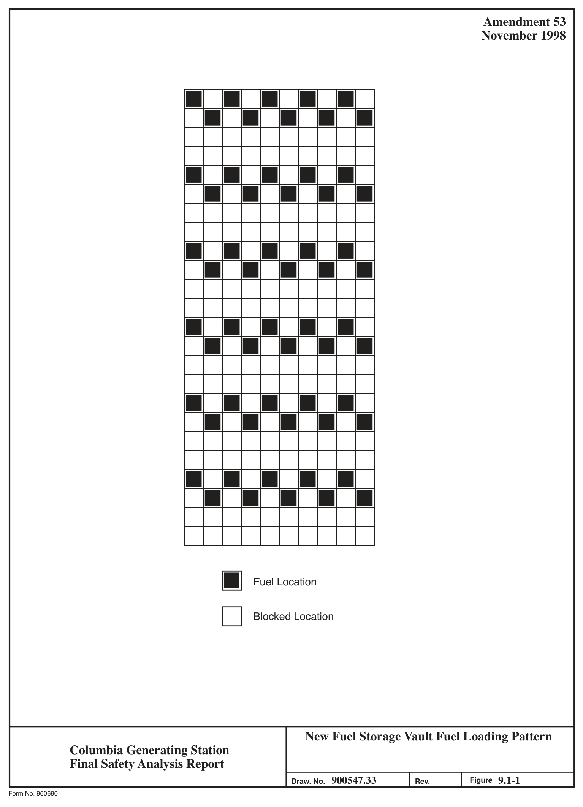

*figure on PDF page 95*

[Vector original (SVG, lossless): fig_page-95.svg](../figures/fig_page-95.svg)

<!-- labels/text on this figure page -->
Amendment 53 November 1998
Fuel Location
□ Blocked Location
New Fuel Storage Vault Fuel Loading Pattern Columbia Generating Station Final Safety Analysis Report 900547.33 9.1-1 Figure Draw. No. Rev.
Form No. 960690

<!-- p.96 -->
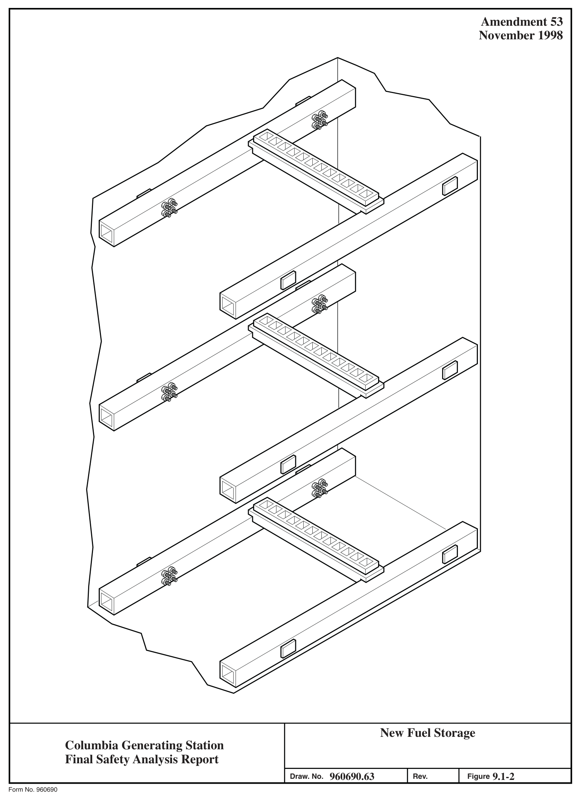

*figure on PDF page 96*

[Vector original (SVG, lossless): fig_page-96.svg](../figures/fig_page-96.svg)

<!-- labels/text on this figure page -->
Amendment 53 November 1998
New Fuel Storage Columbia Generating Station Final Safety Analysis Report 960690.63 9.1-2 Draw. No.
Rev. Figure Form No. 960690

<!-- p.97 -->
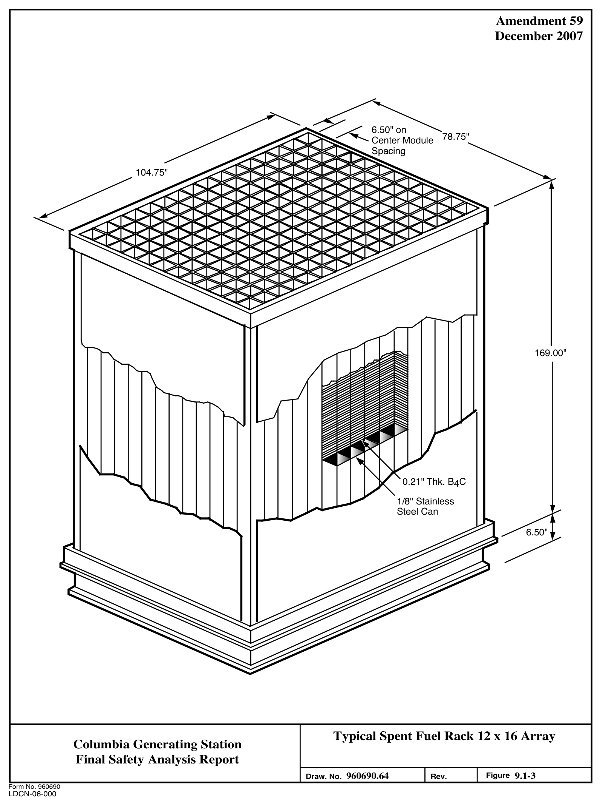

*figure on PDF page 97*

[Vector original (SVG, lossless): fig_page-97.svg](../figures/fig_page-97.svg)

<!-- labels/text on this figure page -->
Amendment 59 December 2007
6.50" on 78.75" Center Module Spacing
104.75"
169.00"
0.21" Thk. B C 4 1/8" Stainless Steel Can 6.50"
Typical Spent Fuel Rack 12 x 16 Array Columbia Generating Station Final Safety Analysis Report 960690.64 9.1-3 Draw. No.
Rev. Figure Form No. 960690
LDCN-06-000

<!-- p.98 -->
Amendment 65 December 2019 4 14 13 12 11 10

~ 1/2"Pl{l)-1S(IR-71)-19 1/2"P1(1)-IS-(IR-11)-20 (EMBEOOEOWEIRPIPE)

2. -'LL Pl!CSSURE. SAI.IPLINC. N-1D/OR FL°"" INSTRUMENT ROOT V-'LVCS NOT ~~~S:~LL BE JI•" Cl.DBE VALi/ES. UNLESS SPEClri<:ALLY NOTED EXi~f~J~~r l~THER NOTES. SH.+.l.L BE CLASSIFIED AS FOLLOWS:
J. -'LL PIPINC. v.o.a.vcs. -'NO ASSOCIATED COMPONENTS ON THIS ORAWINC. TPC-V-185(0)
(BEOPLATEOR,tJN)

4, -'LL PIPINC ON THIS ORAWINC IN THE ROCTOR BOJILOINC -'NO RAOWIISTE ~~~J~c~li°7':EPT AS NOTED IN FQL°""INC NOTES. SH,j_L BE

#### N TE 4 NOTE 7
•~g~RiR~iPeif OESICNEO TO SEISMIC CATECORY I LOl>OS ~~1~f,1 5. AL~::i~~G C~~~R~ING TO THIS NOTE SHALL BE CLASSIFIED AS FOLLOWS

#### DETAIL- .3
SEISMICCATECORYI CONO-v-63---'){J/6)
CODE GROUP B 0/J ---r ---p:g TPC-P-I A\IENTS ,le ORAlNS SEE

#### ZONE (0/12-0)
6.(0ELETEO)
_, 7, PIPING. VALVES. & COMPONENTS SHOWN ON THIS DRAWING IN THE " I CPR(29)-1. MWR(JB)-1. MWR( ,0)-1. CF(ALL), SA(l)-1, CONO(ALL)
I J_,,_-a ~-- SYSTEM SHALL BE CLASSIFIED AS FOLLOWS:

#### DUALITY CLASS II
#### ORYER SEPARA.TOR
SEISMIC CATECORY 11$ POOL

#### CODE GROUP 0
!&HANGERS TO BE OESIGNEO TO SEISMIC CATEGORY I LO.t.OS t-t ~ : I I 8. ALL INSTRUMENTATION, PIPINC. AND TUBINC DOWNSTREAM Of THE i : :
INSTRUMENT ROOT VALVE SHALL BE CL,1,SSIFIEO AS FOLLOWS:
DUALITY CL,1,SS II,;, SEISMICCATECORYlle I CODE GROUP O ♦ I I ,;, EXCEPT AS NOTED ON M619. INSTRUMENT CONN. DIAGRAMS I I 9. ALL PIPING, VALVES, ANO ASSOCIATED COMPONENTS REFERRING 10 THIS I I NOTE SHALL BE c1,1,ssir1EO AS FOLLOWS:
I I ~~ ~~I~~~ ~~~O~Y I I :
§§ I

#### CODE GROUP C I
I 10. PIPINC, VALVES. & ASSOCIATED COMPONENTS ON TI-IIS ORAWINC : I EORI NOTE13 ~I~---------------- __________ --4- ___ J I I SHALL BE CL,1,SSIFIEO AS rOLLOWS: (BRE~ POINTS ARE INDICATED

#### ON THIS DIAGRAM)
#### QUALITY CL.ASS I
~~~fl~Rg~1E~~y I J!tIAIL=Z
• STRAINERS SHALL HAVE ALL rABRICATION & W.TERIALS TO APPLICABLE fPC-P-18\/ENTS REQUIREMENTS or ASME 111-2, EXCEPT CODE STAMP IS NOT REQUIRED & &OR.4JNSSEE PERFORATED PL.,t,TE MAY BE ~STM W.TERIAL & COMPLIANCE WITH N,t,-J70D ZONE (C/12-U)

#### IS NOT MANDA,TORY. FURNISHED & INSTALLED BY CONTR. 21JA
II . ALL PIPING roR rPC(ll)-1 UPSTREMI Of rPC-v-11111, rPC(I0)-1, G

#### SHALLHAVEALL WELOSEXWINEOBYLIOUIO
AND SHALL HIW( ALL rABRICATION "-ND

#### DEU.IL- 1
REQUIREMENTS Of ASME 111-J, EXCEPT CODE
(11/7) SIi 10"FPC(9)-\,.CR.I.VITYFLOW SEISMIC CATEGORY II Ill COOEGROUPO 1o"FPC(9)-1 fPC-V-169 Ill HIINGERS TO BE DESIGNED TO SEISMIC CATEGORY I LOADS
-S 10 WASTE SU"I% TN.IM I OWG. M5l1 (E/9)
12. 0lffUSERSSHALLBECL.ASSIFIEOASSTATEOINNOTE9FORMATERIAL

#### FIIBRICATION ANO INSTALL,1,TION ONLY. CODE STAMP NOT REQUIRED
N0~1S lJ. ALL PIPING, VALVES, & ASSOCIATED COMPONENTS REFERRED TO BY THIS NOTE, If PURCHASED OR INSTALLED PRIM TO 1 JAN. 1~80. SHALL BE:

#### DUALITY CL.ASS II
#### SEISMIC CATEGORY I
#### CODEGROUPC
ANO. ff PURCHASED OR INSTALLED AFTER 1 JAN. 1980, SHALL BE:

#### OUALITYCL.IISSI
~~~fl~Rg~1E~RY I

U , ALL PIPING OOWNSTRE ...... or THE L.IIST ISOLATION VALVE ANO OPEN TO

THE ATMOSPHERE WI TH THE SUBSYSTEM DESIGNATION "sYSTEM" (50)
I THRU {511) SHALL BE CL.IISSIFIED AS CODE CROUP •o• WITH QUALITY L_ ________________ _ CLASS AND SEISMIC CATEGORY PROVIDED BY THE APPLICABLE NOTES ON '"'"""" 1 ! ,' THIS DRAWll<C, EXCEPT WHERE THE APPLICABLE NOTES CALL roR DUALITY CLASS 11-t-. PIPING SHALL BE DUALITY CL.,t,SS 11 TORHR-TRS-601

#### DWC, MS21-1 (J/9)
15. ALL PIPING, VALVES, ANO ASSOCIATED COMPONENTS REFERRED TO BY PC(5J)-2- 1I THIS NOTE SHALL BE CL,1,SSlflEO AS FOLLOWS:
,■ OUALITYCV-SSII+ TPC- I STPC- L SPOOlPIECE l/4 ,._

SEISMIC CATEGORY II Ill TPC-RSP- 2 roe ....:

r.i COOEGROUPO-t- C) 3/ 4" IO"FPC(l)-lS-• IO'TPC(S)- 2- 1 111 HANGERS TO BE DESIGNED TO SEISMIC CATEGORY I LOO\OS.
PC- V- 012(0) ~ + SEE NOTE 12, WNP-'2 SPEC, SECT. 158.1, T"9LE 2 NOTES.
F'PC-V- 120 l'PC-V-119 16• ~~~ci\~0;H:s:Js~~~-c~~s F~L~bw'i~cC~N:~~T~N~~T~~E MA:s!,~~I~ ~ '""" /4"F"PC(52)-2-4 ---!rPC-V-616(0)
NUMBERS ARE IOENTlflEO WITH CORRESPONDING VALVES.

R[.t(;fORWCLL RECll!C.UU.nONVALVC

tTPC(2S)-;~Z"fPC{!Sl- 1- 1 ____ -, fPC-V-127 I 17, rPC- v -u,... ANO rPc- v-U5B INTERN-'LS H.Avt BEEN RE ... OVED, I I 18. owe. Ml337 CONTAINS INFORl,IATION ON THE INNER DRYWELL BELLOWS I ANQASSOCIATEODRA.lNS,
-<- 19. FPC-PS-16AANOFPC-PS-16811REOEACTIVATEOINPL.ACE. CONT,ONOl'G
--------------01----t,1524-l(A/!2)
20. SEE owe t.t501 FOR fLOW DIAGRAl.t LEGENDS. SYMBOLS ANO o, 110BREV111TIONS.
:1 ,---'------,,-------------------i1 ~e'TI>C{J)-1-1

l-e!?'<"""'"'"'""'-ID-'-.... .,_,..,,..._o-1f...,.:'•.-·,C•:--::>",..o: • ...1.-,-"~-,"-,-.,-• ...L..,.li,.W.==- - ---

, 1--~ - -E;j .,, '---.._sEE OETllll-2

#### ZONE (H/4) F'UEL POOL
CIRCULATION PUt.tP ~ LEGEND:
1 .. 1>1.L Vl>l.VCS(EXCEPTTHOSEONINSTRU,..ENTLINES)
~~~~E'!sW~~TtoY") DENOTE II J/•" VENT V-'1.\/E .

2.-'LL V-'LVCS(EXCEPT THOSEONINSTRUMENTLINES)
SUffl XfO WITHll(Q)O(NOTEAJ/ •"ORI\IN VIII.V(

REFERENCES TO CONTRACT NUMBERS. ~fJs AJN z~S zg~~~~ :~tif T~ THE

#### ORIGINAL CONSTRUCTION DESIGN
#### REQUIREMENTS
#### CURRENT DESIGN REOUIREMENTS ARE
#### DOCUMENTED IN THE STATION DESIGN
~~~i~]i~g~~ ~?c~c~u c!~CT

)10 r ''l-: '& --,
- I I 21JCONTR. 215 I ..., I .--------.J Fuel Pool Cooling and Clean-Up System J.->- Columbia Generating Station Final Safety Analysis Report

#### M526-1
104 9.1-6.1 Draw. No. Rev. Figure Form No. 960690ai

<!-- p.99 -->
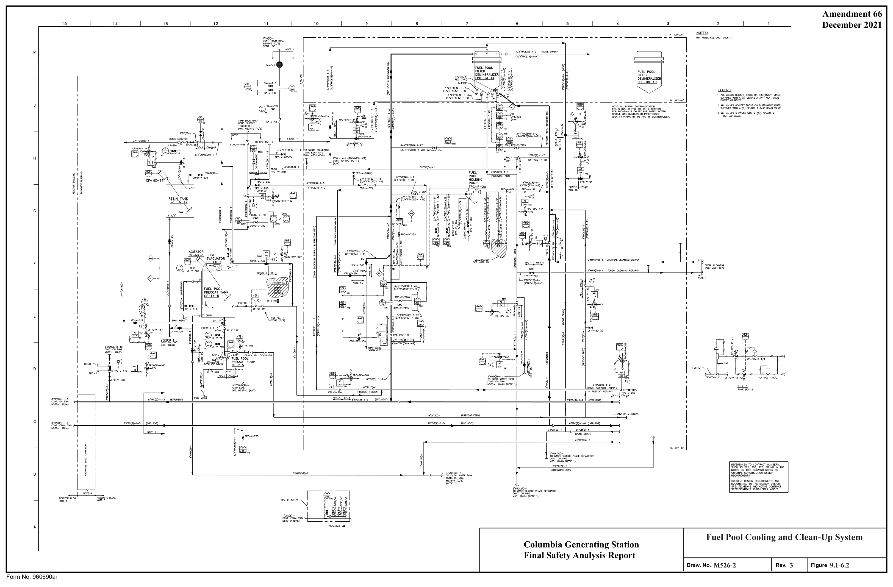

*figure on PDF page 99*

[Vector original (SVG, lossless): fig_page-99.svg](../figures/fig_page-99.svg)

<!-- labels/text on this figure page -->
Amendment 66 December 2021
Fuel Pool Cooling and Clean-Up System Columbia Generating Station Final Safety Analysis Report
M526-2
3 9.1-6.2 Draw. No. Rev. Figure Form No. 960690ai

<!-- p.100 -->
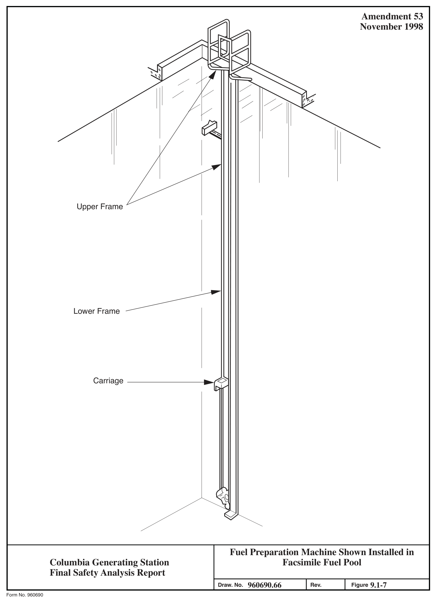

*figure on PDF page 100*

[Vector original (SVG, lossless): fig_page-100.svg](../figures/fig_page-100.svg)

<!-- labels/text on this figure page -->
Amendment 53 November 1998
Upper Frame
Lower Frame
Carriage
Fuel Preparation Machine Shown Installed in Facsimile Fuel Pool Columbia Generating Station Final Safety Analysis Report 960690.66 9.1-7 Draw. No.
Rev. Figure Form No. 960690

<!-- p.101 -->
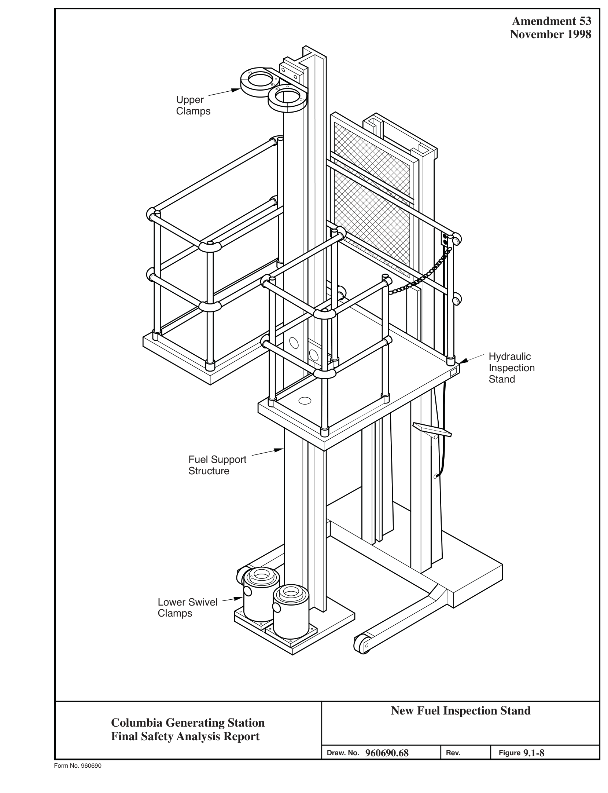

*figure on PDF page 101*

[Vector original (SVG, lossless): fig_page-101.svg](../figures/fig_page-101.svg)

<!-- labels/text on this figure page -->
Amendment 53 November 1998
Upper Clamps
Hydraulic Inspection Stand
Fuel Support Structure
Lower Swivel Clamps
New Fuel Inspection Stand Columbia Generating Station Final Safety Analysis Report 960690.68 9.1-8 Draw. No.
Rev. Figure Form No. 960690

<!-- p.102 -->
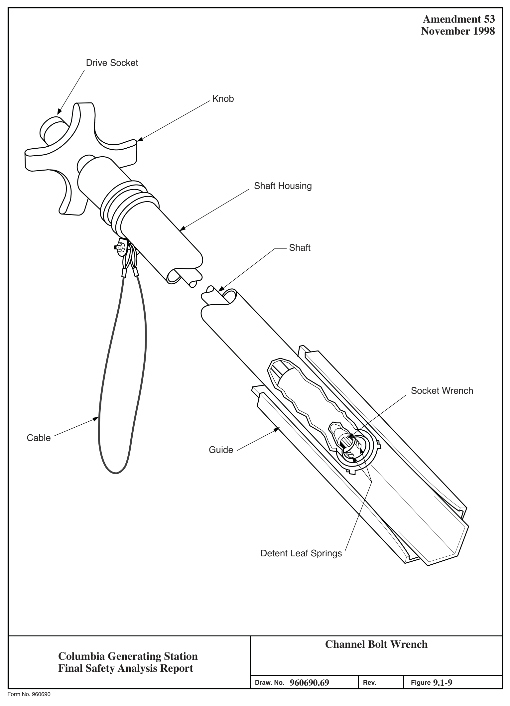

*figure on PDF page 102*

[Vector original (SVG, lossless): fig_page-102.svg](../figures/fig_page-102.svg)

<!-- labels/text on this figure page -->
Amendment 53 November 1998
Drive Socket
Knob
Shaft Housing
Shaft
Socket Wrench
Cable Guide
Detent Leaf Springs
Channel Bolt Wrench Columbia Generating Station Final Safety Analysis Report 960690.69 9.1-9 Draw. No.
Rev. Figure Form No. 960690

<!-- p.103 -->
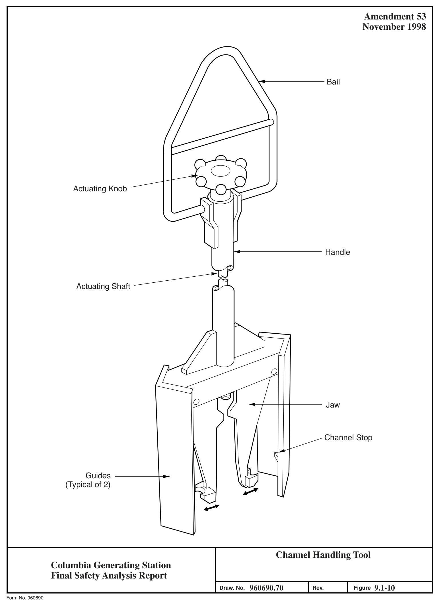

*figure on PDF page 103*

[Vector original (SVG, lossless): fig_page-103.svg](../figures/fig_page-103.svg)

<!-- labels/text on this figure page -->
Amendment 53 November 1998
Bail
Actuating Knob
Handle
Actuating Shaft
Jaw
Channel Stop
Guides
(Typical of 2)
Channel Handling Tool Columbia Generating Station Final Safety Analysis Report 960690.70 9.1-10 Draw. No.
Rev. Figure Form No. 960690

<!-- p.104 -->
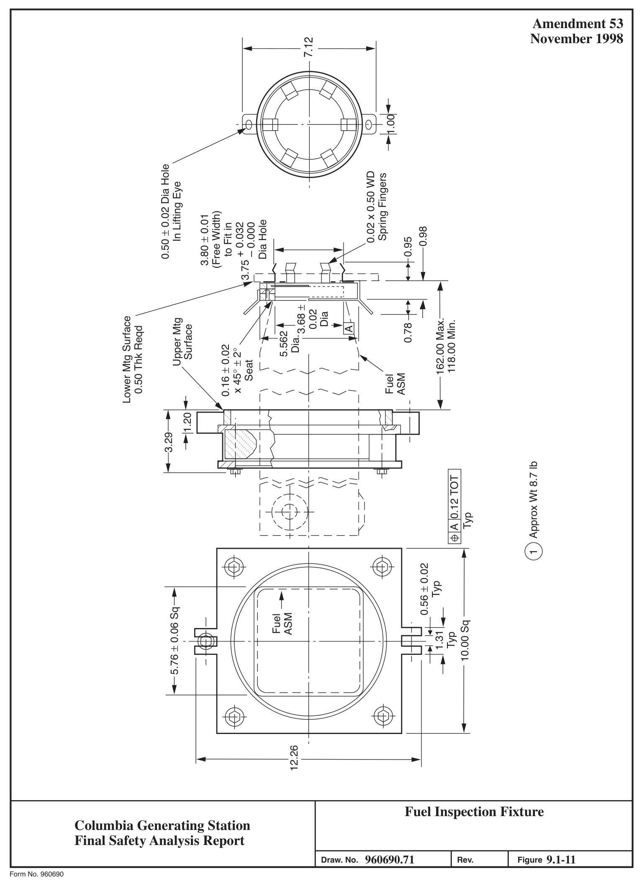

*figure on PDF page 104*

[Vector original (SVG, lossless): fig_page-104.svg](../figures/fig_page-104.svg)

<!-- labels/text on this figure page -->
Amendment 53 November 1998 7.12
1.00
0.50 ± 0.02 Dia Hole 0.02 x 0.50 WD Spring Fingers In Lifting Eye
(Free Width)
3.80 ± 0.01 Dia Hole + 0.032 to Fit in – 0.000 0.98 0.95
3.75 ~H I
-~~~..cl..::;,- =i -------1-----'----
Dia.3.68 ±
0.02 Dia
Lower Mtg Surface Upper Mtg 162.00 Max. 118.00 Min.
0.78 0.50 Thk Reqd Surface A 5.562 0.16 ± 0.02 x 45° ± 2° I i Seat ASM Fuel
1.20
3.29
Approx Wt 8.7 lb I , P~=r 1:::::::::::::::::::1
A 0.12 TOT
I t.,..,,, ~ I -( -+--r---ri }- I I 11 Typ I ', ,/
--+-,----( 0 1
0.56 ± 0.02 t Typ
5.76 ± 0.06 Sq ASM Fuel 10.00 Sq
1.31 Typ
12.26
Fuel Inspection Fixture Columbia Generating Station Final Safety Analysis Report 960690.71 9.1-11 Draw. No.
Rev. Figure Form No. 960690

<!-- p.105 -->
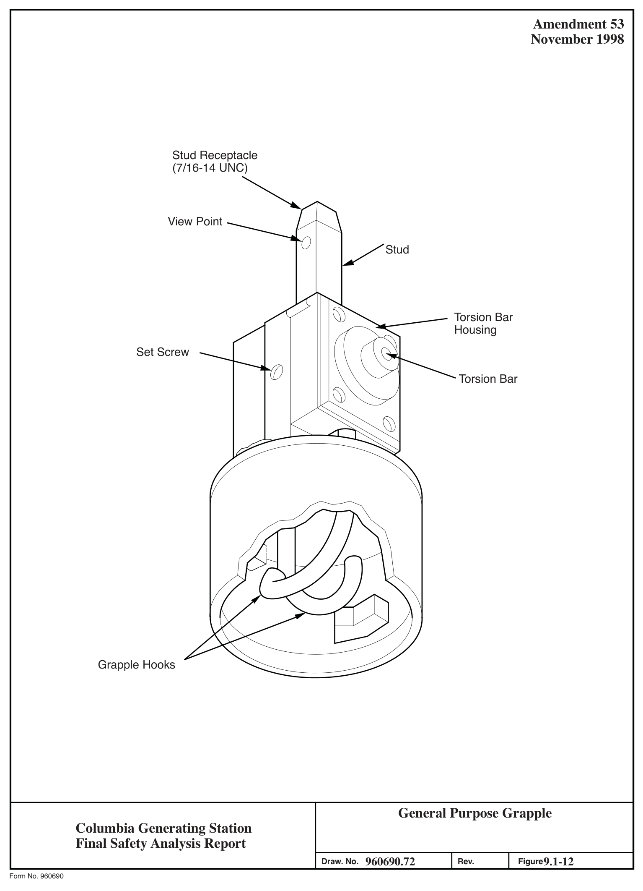

*figure on PDF page 105*

[Vector original (SVG, lossless): fig_page-105.svg](../figures/fig_page-105.svg)

<!-- labels/text on this figure page -->
Amendment 53 November 1998
Stud Receptacle
(7/16-14 UNC)
View Point
Stud
Torsion Bar Housing Set Screw
Torsion Bar
Grapple Hooks
General Purpose Grapple Columbia Generating Station Final Safety Analysis Report 960690.72 9.1-12 Draw. No.
Rev. Figure Form No. 960690

<!-- p.106 -->
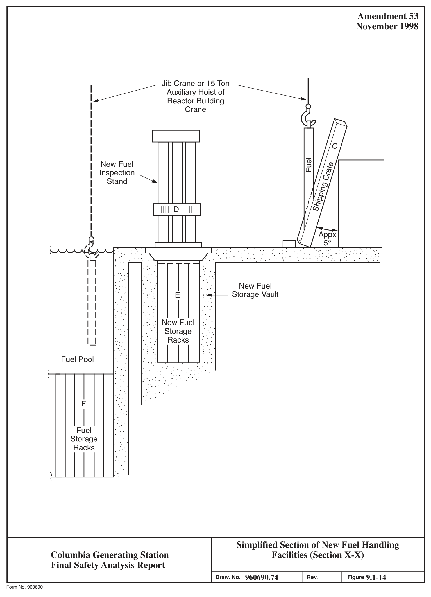

*figure on PDF page 106*

[Vector original (SVG, lossless): fig_page-106.svg](../figures/fig_page-106.svg)

<!-- labels/text on this figure page -->
Amendment 53 November 1998
1.----------- Jib Crane or 15 Ton Auxiliary Hoist of Reactor Building 1 Crane I I I I C I I New Fuel Fuel I Shipping Crate Inspection I Stand I I I I D I I Appx A 5° ,.PJ _· :: . . .·
. . .. : . : . . . . .. •.· .. ~ . . .. . : ·.'. :·: ·:-.: . · ... · . .' ._: .• .....
' / 17 I I . · ..
·· .. ·• I I New Fuel I I Storage Vault ...
E I I I I _.. ~ .. .. ~. . ·.
· .... I I
. ..
New Fuel --~ ....
I I Storage : · •.. ·. ~ I I ·.: .. · Racks IJ ;. : .
Fuel Pool · ... ·.:_ ._ :: .
.... ~ . . . . . ·
. . .-. :_ . ._· ·. :_ ; .·• ...
• . . ·. . .
L.__-r--r---,--TT7
.··~ ..... : .
'• . · .. : _ . : ·. . . .
~ ··.: .. · F ·.
• . . ·.
Fuel Storage Racks ·.
Simplified Section of New Fuel Handling Facilities (Section X-X)
Columbia Generating Station Final Safety Analysis Report 960690.74 9.1-14 Draw. No.
Rev. Figure Form No. 960690

<!-- p.107 -->
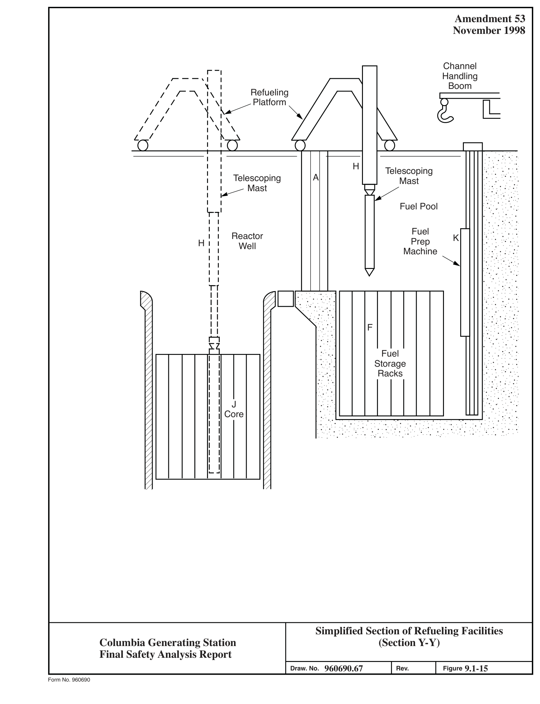

*figure on PDF page 107*

[Vector original (SVG, lossless): fig_page-107.svg](../figures/fig_page-107.svg)

<!-- labels/text on this figure page -->
Amendment 53 November 1998
Channel r-, Handling ,----,1 I Boom
I '1. I
I r, I\ I Refueling \I 'V Platform I I / / i, I\ I I I I I \1 \ L I t,. I I · .. ·•: .· I I H I I Telescoping
. : .... :•;·. · ... A
I I Telescoping .. ·.··.:
Mast
.... .. I I : ~
Mast ·: :·:_ :-:·
Fuel Pool . .. · .. ·• ....
I I 'r,' . . ·.
·:-: ... •.
I Fuel I Reactor K I
. : .... :•;·. · ... Prep
H .. ·.··.:
Well I
.... ..
Machine I ·: :·:_ :-:· I ... · ..
I
·• ....
. . ·.
I I I ·:-: ... •.
rr I I
. : .... :•;·. · ...
I I .. ·.··.:
I I
.... ..
I I ·: :·: :-:· I I F ... · ..
... ;.
I I
·• ....
ii . . ·.
·:-: ... • .
Fuel Storage
. : .... :•;·. · ... ·. ·. ··~ ..
Racks .. ·.··.:
. ... ..
•.· .. · •.
·: :·: :-:· ... ;.
. .. · .. ·• ....
J . . ·.
_ ........ ...,....,..,..,...,..........,...,......,...,,.....,~.,....,.~.,..,... ...... ...,......,.. ·:-: ... • .
Core .
.. . .. . .
.. .. •
. .... . . . .. . . . . . . . .. • . . .. . .... • .
.. . ·. .
. : . ·. ... :._.· .... ·. ~ . . . . . . . .. · .
... . .
Simplified Section of Refueling Facilities
(Section Y-Y)
Columbia Generating Station Final Safety Analysis Report 960690.67 9.1-15 Draw. No.
Rev. Figure Form No. 960690

<!-- p.108 -->
Amendment 57 December 2003

Building Crane I I 11 11 11 Refueling Platform 11 Open 11 Hatchway 11 11 11 .. . ..
. : . . . .
. . . .
.- . : . · · ·

#### I I P
. • .
.. · • · ·• ·• :.:•.: ::· •.• ··• · .. :.

11 ~_..._.., ... ·. . . . . .' . · . .- : . r-------___._.~..:.........;..._ ____ .:................:.l.,___-++---1...:..:..;_.:...::...: . .

. : .... ·. .

. . .. ...:..:....:.:..• .:..:.. .

·. ·. --~ ... :
11
•.· .. · •.·.
11 ~ -~ : . :- : ..
11 ... ; ..
... •.
J..!
·. · ..
( •:l)

.,.....

r-7,--· .. ..
.. .. •

.... · ..

r--,.::s.:-,-• --~--1 ·. ·. --~ ... :
•.· .. · •.·.
~-> / 1 I ~ -~ : . :- : ..
I I . :·. ·
- ✓ ... ; ..

....

·. · ..
I I I I .. .. • .. ..
. .. . · ..
I I P I I ·. ·. --~ ... :
•.- . .- •.·.
I I

.· :·• . ..-----~ :• .. ;•'. :•.:.L,,.·7"' · ... ··; ... ··· ....... : ·.· .. · . . . .. ,• . . . . . . .· •""'."'."'.'"'-:-:-:•·'"'.".":""• '.""'.": ... 7.· '.""."· ,-,-."'.".". "":"""·--:--:"""'""":"""----l-----..l..l~----

. ... ; .. ; · .... ·

. .. . 0

.... ·· ~ · . .-··. ,:t.: · . . . ·.

.
· .. ·. :· .. . .. . . ..
. .. .. · ..
. ... · .. .. • .. ..
. ... · ..
: I M :· . · •. t-•.
L.. _____ I ·. ·. --~ ... :
•.· .. · •.· . . · .. . .
Spent Fuel . · : ·• ~ -~ : . :- Cask : .. . :·. · ... ; ..

....

. . ·.
·. · ..
. . -: :-: .
. . .. .

. . .. • . · .... : ...

·. ·. --~ ... :
·: ... •. ·.
·:·: ·.".
;". ·.· :._•: ·:. L=;::;:::::::;::::;=====-l . ·. ~ : : . :- .. ·•

.... .. · ~ . : ··. t .. · .. · ..... .. · . .

. ·. · .. . .

Simplified Section of Fuel Shipping Facilities Columbia Generating Station
(Section Z-Z)
Final Safety Analysis Report 960690.75 9.1-16 Draw. No.
Rev. Figure Form No. 960690

<!-- p.109 -->
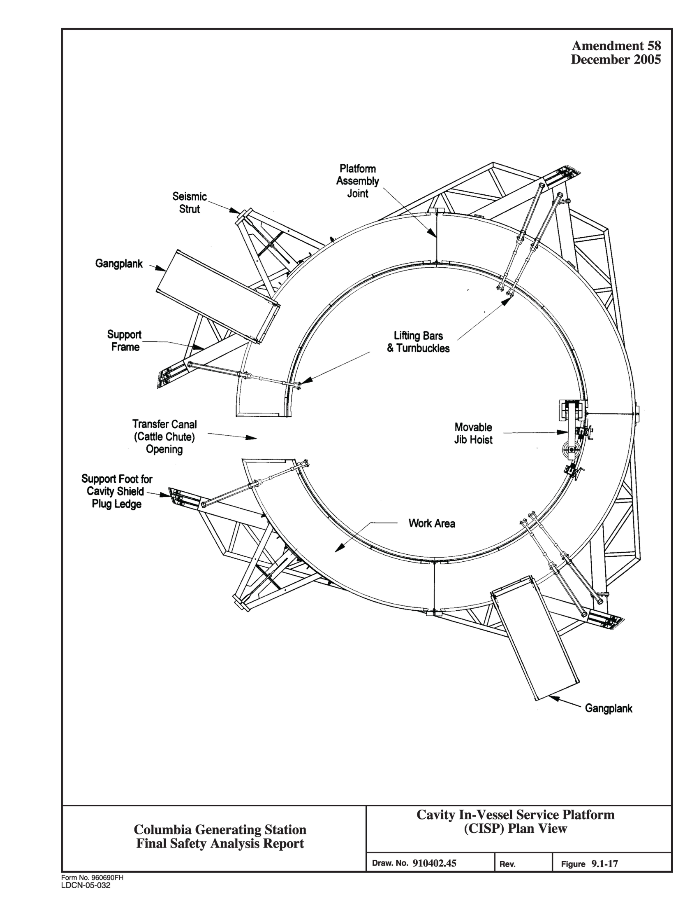

*figure on PDF page 109*

<!-- labels/text on this figure page -->
Amendment 58 December 2005
Platform Assembly Joint Seismic Strut
Gangplank
Lifting Bars & Turnbuckles
Transfer Canal Movable
(Cattle Chute) ~ Jib Hoist Opening
Work Area
Cavity In-Vessel Service Platform
(CISP) Plan View Columbia Generating Station Final Safety Analysis Report Draw. No. 910402.45 Figure 9.1-17 Rev.
Form No. 960690FH
LDCN-05-032

<!-- p.110 -->
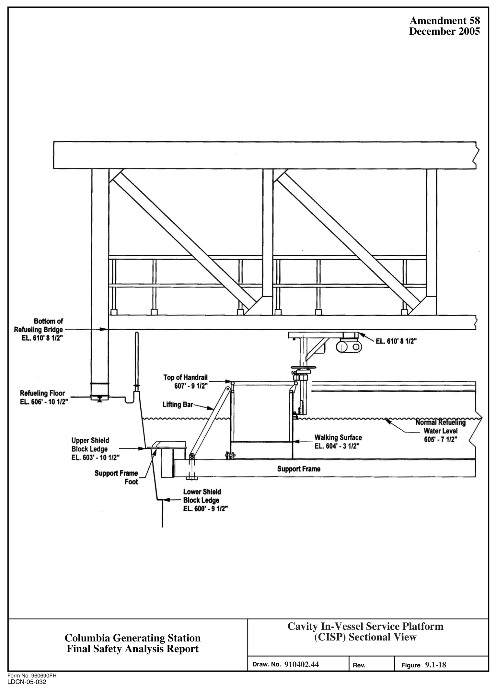

*figure on PDF page 110*

[Vector original (SVG, lossless): fig_page-110.svg](../figures/fig_page-110.svg)

<!-- labels/text on this figure page -->
Amendment 58 December 2005
EL 610' 8 1/2"
r------Lk_ Walking Surface Upper Shield EL. 604' -3 1/2" Block Ledge EL. 603' -10 1/2" Support Frame Support Frame Foot Lower Shield Block Ledge EL 600' -9 1/2"
Cavity In-Vessel Service Platform
(CISP) Sectional View Columbia Generating Station Final Safety Analysis Report 910402.44 9.1-18 Draw. No.
Rev. Figure Form No. 960690FH
LDCN-05-032

