# 9.2 WATER SYSTEMS

> Columbia Generating Station FSAR — Chapter 09: Auxiliary Systems
> Source: `09_chapter-3152-3521.pdf`, PDF pages 111–176 (of 370)
> Amendment 67 compilation (individual pages carry varying amendment dates)

---
<!-- p.111 -->
### 9.2 WATER SYSTEMS
#### 9.2.1 PLANT SERVICE WATER SYSTEM
##### 9.2.1.1 Design Bases
a. The plant service water (TSW) system is designed to provide cooling water for removal of heat rejected from auxiliary (nonessential) equipment, including turbine generator and reactor auxiliaries located throughout the plant, and

b. The plant service water system is designed to remove the maximum expected heat load of the equipment under normal operating conditions.

##### 9.2.1.2 System Description
The plant service water system consists of two 100% capacity pumps (TSW-P-1A, TSW-P-1B)
taking suction from the circulating water intake structure and supplying cooling water to equipment located throughout the plant (see Figure 9.2-1).

Plant service water is returned to the circulating water tunnel for heat removal by the circulating water system cooling towers.
t------___:-----11 The plant service water system is designed to function continuously during all modes of operation except during loss-of-coolant accident (LOCA) with loss of offsite power. Following loss of power under nonLOCA conditions, the plant service water pumps will be supplied from standby power buses (see Section 8.3.1.1.1). The plant service water radiation monitor is continuously recorded in the control room and will alarm if the water becomes contaminated except during loss of offsite power when plant service water will be manually monitored for I radiation. The circulating water system blowdown line radiation monitor serves as backup (see Figure 10.4-4). On detecting radiation in the blowdown line, it automatically isolates the I blowdown to the river except during plant outages as described in Section 11.5.2.2.2.4.

In addition to the biocide treated circulating water supply utilized by the plant service water system, the plant service water system is equipped with a biocide treatment system to retard biological growth. Additional chemical treatment capability is provided to minimize silt deposition, scale formation, corrosion, and consequent fouling of heat transfer surfaces.

Required makeup to the plant service water system is included as part of the overall circulating water system makeup requirements. The makeup flow can be directed in to the circulating water bay or to one or both of the plant service water pump suctions. This is accomplished by means of a weir box and sluice gate arrangement in the circulating water mixing bay (see Section 10.4.5).

#### LDCN-04-020, 04-052, 05-030
<!-- p.112 -->
Water for plant service water (TSW) pump 1B (TSW-P-1B) bearing lubrication and for both TSW pumps 1A and 1B (TSW-P-1A and TSW-P-1B) motor cooling is supplied from the plant service water pump during operation of the pump. This water is filtered before being injected to lubricate the bearings. The Fire Protection system provides TSW pump bearing lubrication water for initial system startup for TSW pump 1B (TSW-P-1B). The Fire Protection system also provides water for motor cooling of both TSW pumps 1A and 1B (TSW-P-1A and TSW- P-1B) during initial TSW system startup after both pumps have been secured (or tripped) (see F.2, Section F.2.4.1).

The plant service water system piping is designed in accordance with ANSI B31.1. The two service water pumps are designed in accordance with the Standards of the Hydraulic Institute, Centrifugal Pump Section.

##### 9.2.1.3 Safety Evaluation
The operation of the plant service water system is not required to ensure any of the following conditions:

a. The integrity of the reactor coolant pressure boundary (RCPB),

b. The capability to shut down the reactor and maintain it in a safe shutdown condition, or

c. The ability to prevent or mitigate the consequences of accidents which could result in potential offsite exposures in excess of the guideline exposures of 10 CFR Part 100.

A single-failure analysis has not been provided for the plant service water system since this system serves only nonessential systems and is not required to perform a safety function. See Section 3.6 for a discussion of piping failures. The system, however, incorporates features that ensure continuity and reliability of operation. Plant service water pumps will be alternately operated to minimize wear, and the standby pump is available as a replacement during maintenance of the normally operating pump.

All piping, valves, and associated components of the plant service water system are classified Seismic Category II except in the reactor building and control building where system hangers are designed for Seismic Category I loads (seismic 1M).

##### 9.2.1.4 Testing and Inspection Requirements
The components used in this system were tested and inspected at the manufacturer’s plant for conformance with specifications. After installation, major components were checked and the system hydrostatically tested to ensure leak tightness prior to plant startup. Preoperational testing included testing of automatic controls for actuation at the proper setpoints, calibration

<!-- p.113 -->
of instruments and alarms. Routine visual inspection of system components, instrumentation, and trouble alarms verify system operability and performance.

##### 9.2.1.5 Instrumentation Requirements
Suitable alarms and indicators are provided to monitor and control the system throughout the system to allow the control room operator to take corrective action as required.
I Each pump is manually started from the main control room. The standby pump is automatically started by actuation of a low pressure switch in the operating pump discharge I I line. The pressure at the discharge of each pump is indicated locally and also in the main I control room. A pressure switch provides annunciation in the main control room on low pump discharge pressure signal.

#### 9.2.2 REACTOR BUILDING CLOSED COOLING WATER SYSTEM
##### 9.2.2.1 Design Bases
a. The RCC is designed to provide adequate cooling water to auxiliary plant equipment in the reactor and radwaste buildings during all normal modes of operation, and

b. The RCC is designed to provide a closed cooling water loop between nonessential systems which are potentially contaminated and the plant service water which is used for cooling. This loop provides an additional barrier between the potentially contaminated systems and the plant service water discharged to the circulating water system.

##### 9.2.2.2 System Description
The RCC is a closed loop system which provides parallel-flow cooling to auxiliary equipment in the primary containment, the reactor building, and radwaste building. The system consists of pumps, heat exchangers, tanks, piping, valves, and instrumentation as shown in Figure 9.2-2. Each of the three pumps and three heat exchangers are half capacity based on maximum normal cooling requirements. Heat is removed from the RCC system by the plant service water system. The plant service water is passed through the tube side of the RCC heat exchangers and the closed-loop water is passed through the shell side. A 550-gal surge tanks accommodates volume changes from thermal expansion and contraction. Makeup water to the system is supplied to the surge tank by the demineralized water system.

The RCC cools the following equipment:

a. Reactor recirculation pumps, b. Drywell fan unit cooling coils, c. Drywell equipment drain condenser,

<!-- p.114 -->
d. Reactor water cleanup (RWCU) nonregenerative heat exchangers, e. Reactor building equipment drain heat exchanger, f. Control rod drive pumps, g. Fuel pool heat exchangers, h. RWCU recirculating pumps, and i. Offgas glycol refrigeration machines.

The RCC piping inside primary containment is constructed in accordance with ASME Section III, Class 3, and Seismic Category II requirements. The RCC piping outside of primary containment is constructed in accordance with ANSI B31.1. In the reactor building and inside primary containment, RCC piping is supported to Seismic Category I. In the radwaste building, RCC piping is supported to Seismic Category II requirements. System primary containment penetrations and isolation valves are constructed to Seismic Category I, and ASME Code Section III, Class 2, requirements. The RCC pumps are constructed to I Seismic Category II, and RCC heat exchangers are constructed to ASME Code Section VIII and the Standards of the Tubular Exchanger Manufacturers Association, Class R. The system design pressure is 195 psig. The design temperature is 150°F for all piping except the RWCU I nonregenerative heat exchanger discharge piping. The piping from the RWCU heat exchanger to the 18-in. return line has a design temperature of 175°F. The system operates at pressures and temperatures below the stated design values.

Equipment Design Parameters

Closed Cooling Water Pumps (RCC-P-1A, RCC-P-1B, RCC-P-1C)

Quantity 3

Driver 200 hp motor - ac

Design capacity 2500 gpm

Head 200 ft

Speed, rpm 1775

Closed Cooling Water Heat Exchangers (RCC-HX-1A, RCC-HX-1B, RCC-HX-1C)

Quantity 3

25 x 106 Btu/hr Heat duty

<!-- p.115 -->
Shell side Tube side

Flow rate 2500 gpm 3333 gpm

Inlet temperature 115°F 85°F

Outlet temperature 95°F 100°F

Pressure drop 11.2 psig 5.0 psig

A chemical addition tank (RCC-TK-2) and metering pump (RCC-P-2) were included in the original design for the addition of corrosion inhibiting chemicals if required. This chemical addition equipment is not normally used.

The RCC pumps supply water to the specified auxiliary plant equipment during all modes of operation except under LOCA conditions. Following loss of normal power and under nonLOCA conditions, the RCC pumps are supplied from standby power.

##### 9.2.2.3 Safety Evaluation
The RCC provides a barrier between nonessential, potentially contaminated systems, and the plant service water discharged to the circulating water system. A radiation monitor is provided in the RCC to detect inleakage to this system from any contaminated system. Leakage is also detected by pressure instrumentation in the system supply headers or by monitoring system surge tank level.

Portions of the RCC which penetrate the primary containment are provided with containment isolation valves which can be remotely actuated by the operator in the main control room and close automatically on the high drywell pressure (F) and the reactor vessel low water level (A)
containment isolation signals.

A pressure bypass line exists around the inboard isolation valve on the return line to prevent overpressurization of the piping between the inboard and outboard isolation valve. The bypass line has a check valve that acts as an inboard isolation valve in parallel with the normal inboard isolation valve.

A single-failure analysis has not been provided for the RCC since this system serves only nonessential systems and is not required to perform a safety function. See Section 3.6 for a discussion of piping failures.

<!-- p.116 -->
##### 9.2.2.4 Testing and Inspection Requirements
Pumps in the RCC are proven operable by their continuous use during normal plant operation.
The motor-operated isolation valves are tested to ensure that they are capable of opening and closing by operating manual switches in the main control room and observing the position lights. The check valve in the bypass line across the inboard isolation valve on the return line is tested to ensure that it is capable of opening and closing by manual means during an outage.
Routine visual inspection of the system components, instrumentation, and trouble alarms is adequate to verify system operability.

##### 9.2.2.5 Instrumentation Requirements
The RCC is a balanced constant-flow system. Local pressure and temperature gauges and test I points are provided throughout the system. Temperature in the primary containment is I transmitted to the main control room, as is pressure downstream of the closed cooling water heat exchangers. A temperature switch downstream of the heat exchangers actuates an alarm I in the main control room on high water temperature. When an operating pump trips, the I standby pump is automatically brought on line. Alarms are actuated in the main control room following a decrease in pressure sensed by pressure switches on each pump discharge.

The system water volume is maintained from the plant demineralized water system by a level control valve actuated by level switches in the surge tank.

#### 9.2.3 PLANT MAKEUP WATER TREATMENT AND DEMINERALIZED WATER
#### SYSTEMS
##### 9.2.3.1 Design Basis
a. The plant potable water system provides the supply water for the plant makeup water treatment system. A vendor furnished and maintained trailer-mounted demineralizer provides the purified water to the demineralized water system using the potable water source.

b. The demineralized water system is designed to utilize the demineralized effluent from the plant makeup water treatment system to provide demineralized water to the condensate storage tanks and to distribute demineralized water throughout the plant.

<!-- p.117 -->
##### 9.2.3.2 System Description
###### 9.2.3.2.1 Plant Makeup Water Treatment System
The plant makeup water treatment system is shown in Figure 9.2-3. Raw water is normally supplied from the Columbia River through a branch line of the tower makeup system (TMU).
From this line a branch is routed to the service building basement and is isolated. Another branch line continues to pump house 3, where raw water is processed into potable water. Here the water is chemically deflocculated and transferred to a 300,000-gal potable water storage tank. Sodium hypochlorite is injected into the potable storage tank influent line. In case the TMU is temporarily not in service, water is supplied from a cross tie with the WNP-1 potable water system.

The trailer-mounted demineralizer is supplied with water from the potable water pump PWC-P-103 which runs continuously. Demineralized water is pumped from the trailer demineralizer to tank DW-TK-1 in the basement of the service building through a tank level control valve.

Demineralized water is stored in a 50,000-gal epoxy-lined carbon steel demineralized water storage tank (see Figure 9.2-4 and Section 9.2.3.2.2).

The effluent from the trailer-mounted demineralizer is continuously recorded with associated alarms.

###### 9.2.3.2.2 Demineralized Water System
The demineralized water system shown in Figure 9.2-4 consists of a 50,000-gal steel, epoxylined storage tank (DW-TK-1) with two 200-gpm transfer pumps with a 265-ft head
(DW-P-1A, DW-P-1B). Among the components being supplied by the pumps are the following:

a. Condensate storage tanks, b. RCC surge tank, c. Diesel generator expansion tanks, d. Auxiliary boiler condensate return tanks, e. Chemical addition tanks, f. Stator cooling makeup, g. Refueling floor service boxes, h. Decontamination facilities, i. Flushing and washdown services, j. Sealing water, k. Laboratory water, l. Reactor containment services,

<!-- p.118 -->
December 2005 l m. Instrument flushing water, and J n. CJW surge pipe.

During operation one demineralized water transfer pump runs continuously to keep the system I headers pressurized to supply demineralized water on demand. The operating pump recirculates a minimum flow back to the storage tank to prevent damage to the pump under low flow conditions.

##### 9.2.3.3 Safety Evaluation
The demineralized water and plant makeup treatment systems are not required for a safe shutdown of the plant and are therefore, not safety related. A failure of these systems will not I affect the operation of systems that are vital to safe shutdown of the plant. Alarmed instrumentation is provided to prevent delivery of out-of-specification water to safety-related systems or components. The piping associated with the demineralized water and plant makeup water treatment systems is designed in accordance with ANSI B31.1 except for piping that penetrates containment is designed ASME III, Class 2. All demineralized water and plant makeup water treatment system piping is classified Seismic Category II except that piping penetrating or routed inside primary containment, which is classified Seismic Category I. In the reactor and diesel generator buildings and inside primary containment, piping is supported to Seismic Category I requirements.

##### 9.2.3.4 Testing and Inspection Requirements
The demineralized water and plant makeup water treatment systems are in daily use and as such do not require periodic testing to ensure operability. Grab samples are periodically tested in the laboratory to verify filter and demineralizer performance and to ascertain stored water quality. Periodic visual inspection and preventive maintenance are conducted.

The major components of these systems were subject to manufacturer shop tests including performance and hydrostatic tests.

Prior to initial operation the piping systems were subject to a hydrotest in accordance with their respective code groups. In addition, the completed systems were subjected to acceptance testing during plant startup as discussed in Section 14.2.

##### 9.2.3.5 Instrumentation Requirements
Instrumentation and controls for the plant makeup water treatment and demineralized water systems are provided to control and monitor the operation of each of the subsystems.

Level controls in the demineralized water storage tank maintain the tank at the proper level by opening and closing a valve in the makeup demineralizer discharge piping.

<!-- p.119 -->
#### 9.2.4 POTABLE WATER AND SANITARY DRAIN SYSTEMS
##### 9.2.4.1 Design Bases
The function of the potable water system is to supply potable water throughout the plant, provide supply water to the plant makeup water treatment system, and can be used to supply makeup water to the spray ponds.

The potable water system is designed to provide cold and/or hot water to the points of potable water usage such as lavatories, urinals, toilets, showers, eyewashes, sinks, electric drinking water coolers located in the various plant buildings, and site grounds irrigation.

The sanitary waste system is designed to drain the noncontaminated sanitary waste from the various buildings served.

All system fixtures, piping, and component material, as well as the fabrication, erection, and testing comply with applicable sections of appropriate codes and standards.

The potable water storage tank is designed and constructed in accordance with ASME Section VIII and Seismic Category II requirements.

##### 9.2.4.2 System Description
###### 9.2.4.2.1 Potable Water System
The potable water system is shown in Figure 9.2-5. Water is supplied to the potable water storage tank (PWC-TK-1). The makeup water treatment system is described in Section 9.2.3.
The potable water tank is located in the basement of the service building from which potable water is pumped to all buildings serviced.

Potable hot water is provided to the various plant buildings by individual electric hot water heaters.

###### 9.2.4.2.2 Sanitary Drain System
The plant sanitary waste system is shown in Figure 9.2-6. All noncontaminated sanitary waste from all buildings is directed into this system. Potentially contaminated drainage, such as that from the radiochemical laboratory sinks, is routed to the radioactive drainage system as described in Section 11.2.

All sanitary drains in the plant are collected into a main 6-in. sewage header which leaves the plant building complex, below grade, from the service building. All waste lines are vented to

<!-- p.120 -->
the atmosphere via roof vents in accordance with applicable codes except those in the reactor building, which are vented to the main reactor building exhaust system (see Section 9.4.6) and in the main control room are vented to the main control room exhaust system.

All sanitary lines drain by gravity flow into the main 6-in. sewage pipe which connects to an 8-in. line leading to a centrally located sanitary waste treatment facility (SWTF) serving WNP-1, Columbia Generating Station (CGS), WNP-4, the Kootenai Building (Plant Support Facility), and the Department of Energy’s 400 Area (FFTF facility). Low levels of radioactive materials, particularly tritium from the 400 Area, are expected to be present in the treatment facility as a result of processing these waste streams. The SWTF is permitted and regulated by the State of Washington and is not part of the CGS licensing basis. Therefore, the radioactive material from FFTF is not considered to be licensed material.

##### 9.2.4.3 Safety Evaluation
The potable water and sanitary drain systems are of conventional design and have no safety function. All contaminated drains are routed to the liquid radwaste system as discussed in Section 11.2. All system piping except that in the reactor building and control building is Seismic Category II as defined in Section 3.2.1. The piping in the reactor building and control building is Seismic Category I.

##### 9.2.4.4 Testing and Inspection Requirements
Routine monitoring during normal operation verifies the system is performing acceptably.

##### 9.2.4.5 Instrumentation Requirements
The system is provided with sufficient instrumentation and controls to monitor and operate the system to meet the normal operating requirements of the facility.

#### 9.2.5 ULTIMATE HEAT SINK
##### 9.2.5.1 Design Bases
a. The ultimate heat sink (UHS), a spray pond system, supplies cooling water to remove heat from all nuclear plant equipment that is essential for a safe and orderly shutdown of the reactor and to maintain it in a safe condition;

b. The UHS is capable of accomplishing its safety function for a normal cooldown or an emergency cooldown following a LOCA without the availability of offsite power. The sink provides this cooling capability for a period of 30 days without outside makeup (except following a tornado). Provisions are made for replenishment of the sink to allow continued cooling capability beyond the initial 30-day period. The sink will accomplish its safety function despite the

#### LDCN-13-005, 13-019
<!-- p.121 -->
occurrence of the most severe site-related natural events including earthquake, tornado, flood, or drought; and

c. Regulatory Guide 1.27 compliance is described in Section 1.8.

##### 9.2.5.2 System Description
During all normal operating conditions, including normal shutdown as well as emergency conditions, waste heat from the reactor auxiliaries is transferred to the UHS by the standby service water (SW) system.

The UHS consists of two concrete ponds. The concrete ponds provide suction and discharge points for the redundant pumping and spray facilities of the SW system. The pond and pump house arrangements are shown in Figure 9.2-7. The ponds and pump houses are designed to Seismic Category I requirements. Standby service water loop A draws water from pond A, cools the Division 1 equipment required for safe shutdown, and discharges through a spray ring into pond B for heat dissipation. Similarly, SW loop B draws water from pond B, cools Division 2 equipment, and discharges through a spray ring into pond A. The high-pressure core spray (HPCS) SW system draws water from pond A, cools Division 3, and discharges without spray into pond A. A siphon between the ponds allows for water flow from one pond to the other.

The spray system illustrated in Figure 9.2-7 consists of two annuli of spray trees, one for each of the SW subsystems. Each annulus is 140.0 ft in diameter and contains 32 spray trees equally spaced (13.75 ft between vertical centerlines) on the circumference. The vertical trees are serviced by the annulus water pipe, 20 in. in diameter, mounted above the water level.
The annulus pipe is fed by the main header from each respective pump house. Each spray tree consists of a vertical riser pipe or trunk 8 in. in diameter and horizontal limbs of 1.5-in. pipe.
The limbs are attached to the riser at 2 ft-8 in. intervals of heights and are rotated at 90 degree subsequent angles from each other so that the arms resemble a counterclockwise helix with increasing height. The arms radial to the annulus are 4 ft-6-7/16 in. long. The lowermost arm is a tangent arm. The arms tangent to the annulus pipe are 3 ft-6 in. long. Spray nozzles are located at the end of each arm and are connected by fittings. The orientation of every nozzle is radially inward with an angle of 55 degrees upward from horizontal. The nozzles are 1-1/2-CX-27-55 Whirljet nozzles supplied by Spraying Systems Company. Since each tree nozzle is located at a different elevation, each nozzle pressure is different. The uppermost nozzle water pressure is approximately 17 psig, and the total water flow from a tree is approximately 300 gpm.

The HPCS SW flow is treated as a straight heat dump in the thermal analyses.

The combined water volume of the spray ponds is adequate to provide cooling water for 30 days without makeup. Although the ponds are not routinely used for cooling during normal

<!-- p.122 -->
operation, some small losses are to be expected due to normal evaporation from the surface, minor leakage from the ponds, and occasional blowdown needed to maintain water chemistry.
A gravity makeup line is provided from the circulating water pump house to the spray ponds;
however, the required pond level will normally be maintained by makeup directly from the TMU water pumps (see Section 10.4.5) or directly from the potable water system. The TMU I is the makeup source credited in the event of water loss due to a tornado. Design parameters for the spray pond are given in Tables 9.2-1 and 9.2-2.

An SW pump is located in each spray pond pump house along with its associated equipment so that an accident, such as a fire or pipe break associated with one pump, would not affect the operation of the redundant pump.

The bottom of the pump sump is depressed below the pond bottom. This ensures that there is still sufficient submergence for the pumps at the lowest possible water level in the pond.
A sand trap and screen precede the pump sump to prevent heavy debris from entering the pump sump area. A skimmer wall and fixed screen prevent floating debris from entering the pumps.

A spray ring bypass is provided that allows water to be returned directly to the pond through use of manually operated dump and spray ring isolation valves. This allows pond temperature to be controlled during cold weather operations, mixing of the pond volumes, minimization of drift losses, and other situations where bypass of the spray rings is desirable. If the spray ring header is bypassed, it will be realigned to allow spray mode of operation before pond I temperature exceeds 70°F. Analysis demonstrates that at pond temperatures less than or equal to 70°F, sufficient time is available under accident conditions to permit realignment to the spray mode prior to pond temperature exceeding 77°F.

To prevent adverse operation during freezing weather, all SW piping and components are either below the frost line, within heated buildings, heat traced or drained when not in use.
I To allow for infrequent maintenance of the spray pond piping and piping supports, a cross connection, consisting of a removable spool piece and two isolation valves, is available I between the two redundant loops of SW. A removable siphon plug is available to prevent one pond siphoning to the drained pond. The cross connecting spool piece and siphon plug are normally not installed and are only used while the plant is shut down for refueling. This cross connection allows water to be pumped back directly to the pond from which it was removed, thus allowing for the other pond to be drained.

##### 9.2.5.3 Safety Evaluation
An oriented spray cooling system (OSCS) is utilized for cooling the water inventory of the UHS. The OSCS was developed as a result of intensive analytical studies and experimental verification over a period of more than 6 years. Details of the OSCS experimental and

<!-- p.123 -->
analytical developmental efforts are described in Topical Report, Oriented Spray Cooling System (OSCS) for Ultimate Heat Sink Application (UHS), I-R 100, which has been submitted for Nuclear Regulatory Commission staff review.

The thermal performance model is based on the correlation of the Canadys test data described in Section 3.1 of the Topical Report, I-R 100. The resulting KAV/L for this application is
2.66. This includes a 10% derate of the KAV/L to cover conservatively the data scatter experienced at Canadys. Since the KAV/L represents the performance of the specified geometry and nozzle pressure, the KAV/L combined with the meteorological data are sufficient to determine the system cooling performance. The performance predicted by this model is modified as shown below.

CR = (-0.761 + 0.009 x TWB) + (0.2677 + 0.004029 x TWB) x CP + (0.001179 - 7.14 x 10-6 TWB) x CP2

CR = cooling range TWB = wet bulb temperature CP = cooling potential

The system model for both the thermal performance analysis and the mass loss analysis was based on the following assumptions:

a. The pond contains total inventory upon onset of LOCA less 0.5 ft for sedimentation of the pond basin;

b. Water losses result only from drift, leakage, evaporation of the sprayed droplets and evaporation due to heat rejection on the pond surface;

c. All the heat transfer is accomplished by evaporation, none of the heat transfer is accomplished by sensible heat transfer;

d. The first 3 days of the thermal performance analysis assume the worst single day of record conditions (Table 9.2-3). It was found that repeating the worst day conditions for 3 days resulted in the maximum peak. The 4 through 30 days are the average meteorological conditions of the worst 30-day period of record
(Table 9.2-3). For conservatism, the root mean square (RMS) average wind speed during each period is used rather than the diurnal variation;

e. The 1 through 30 days of the mass loss analysis are the average meteorological conditions of the worst 30-day period of record (see Section 2.3.1.2 and Table 9.2-3). The analysis assumes a mass loss due to drift of 1.02% of the spray flow. This value is an upper bound obtained from results of tests

<!-- p.124 -->
performed on the spray ponds. Its conservatism was confirmed by testing reported in Reference 2 and shown in Figure 9.2-8;

f. For the design basis mass loss case evaluation, the spray flow is continuous for one spray ring for the first 3 days, with one SW pump in operation. The sprays are cycled on and off for the 4 through 30 days depending on pond temperature.
The sprays are turned on when the SW temperature in the suction pond reaches 85°F and are turned off when the temperature drops below 80°F. This method of operation resulted in one cycle on and off per day;

g. Minor leakage was observed in testing of the spray ponds, so test results were used to establish a leakage rate of 3.94 gpm total for both ponds (170,000 gal per 30 days);

h. While not a design basis case, mass loss was also evaluated assuming two spray rings in continuous operation for 2 days, followed by one spray ring in cyclic mode described in item f;

i. The design basis fuel pool cooling heat load is included;

j. For design basis analysis, offsite power is lost and Division 2 diesel fails to start, resulting in a loss of the pond A spray header. (Division 1 heat loads are slightly higher); and

k. The major heat loads considered are reactor core decay heat, sensible heat from both the coolant and the reactor, fuel pool decay heat, pump work, and the heat removed from the station auxiliaries. These heat loads are listed in Table 9.2-4
(using the calculated heat load values) and Table 9.2-5. The fuel pool decay heat generation rate, listed in Table 9.2-4 as variable, is found in Table 9.2-5.
No credit was taken for heat sinks in the primary containment other than the suppression pool volume.

The RMS average wind speed during the selected 30-day period for the mass loss analysis was 6.91 mph. The drift loss was based on the calculated drift value at the RMS wind speed. The mass loss analysis thus demonstrates that the spray ponds contain sufficient water inventory to meet drift losses significantly higher than expected. Figure 9.2-8 shows the conservatism demonstrated in confirmatory drift loss testing.

The analyses assume an initial temperature of 77°F. This is approximately the highest monthly average temperature expected if the sprays are not operated. To maintain the pond temperature below this limit, the spray headers will be operated and/or river water makeup to the cooling towers will be diverted through the spray ponds. Analyses were performed which demonstrate that the above operations can maintain the spray pond below 77°F.

<!-- p.125 -->
,.
,.
An analysis was conducted which verified failure of Division 1 or Division 2 power results in the most severe service water transient. If the failure was postulated in Division 3 (HPCS)
instead of Division 1 or 2, the peak pond temperature is lower. The HPCS SW flow is a straight heat dump; therefore, inasmuch as the spray pond is concerned, it raises rather than lowers the temperature transient.

The resulting peak spray pond temperature, 89.6°F, predicted by the “worst case” analysis is below the 90°F service water temperature assumed in the analysis performed in Section 6.2.1 for containment heat removal, adding further conservatism to the containment temperature and pressure transients therein presented. The service water temperature, however, exceeds the design basis temperature, 85°F, for short periods of time as shown in Figure 9.2-9.
A temperature of 90°F has been evaluated for those rooms served by emergency heating, ventilating, and air conditioning (HVAC) equipment, and room temperatures remain within the design limit.

A sensitivity study was performed to determine the effect of the RHR heat exchanger effectiveness on the spray pond temperature transient. The RHR heat exchanger effectiveness varies with the amount of fouling and with the flow rates. The RHR heat exchanger flows different from the rated values in Table 6.2-2 are anticipated only if the operator delays or fails to close the RHR heat exchanger shell side bypass valve as discussed in Section 6.2.2.3.
Anticipated variations in fouling were determined to have essentially no affect on the spray pond temperature transient following a design basis LOCA. However, the combination of low SW to RHR cooling flow, low overall SW flow, design RHR HX fouling and no containment spray does adversely affect peak pond temperature. For this reason the temperature case uses low flow/design fouling while the mass loss case uses high flow/clean heat exchangers.

The results of the design basis mass loss analysis assuming an unfouled heat exchanger is shown in Figure 9.2-10 and is tabulated in Table 9.2-6.

Drift losses following loss of makeup to the ponds may be controlled during two spray ring operations by bypassing the spray header on one pond whenever spray pond temperatures drop below approximately 80°F. Continuous, simultaneous operation of both spray rings is not required after a LOCA. Since the two SW loops are redundant to each other, operators will be able to secure any redundant safe shutdown equipment when they determine that the peak temperatures have been passed.

Table 9.2-7 lists the available sources of makeup water to provide continued cooling beyond the initial 30-day period. This table assumes that offsite power is restored within the 30 days.
No credit is taken for the water stored in the cooling tower basins. However, it is expected that this water will not be instantaneously lost and may flow to the pond for the same period of time. Table 9.2-7 also summarizes the effects of natural phenomena and of a LOCA on the water supplies to the spray pond.

<!-- p.126 -->
The possibility of a tornado passing over the spray pond and removing a significant amount of water is considered a credible event. For this reason, the makeup water pump house is designed to be tornado proof, with all piping and electrical power supply between the plant and the pump house underground with adequate soil cover to provide protection from tornadogenerated missiles. Since it is not credible to assume an earthquake coincident with a tornado, this system need not be Seismic Category I. Two 12,500-gpm tower makeup water pumps are provided, one powered from each emergency diesel generator. Should pond water be lost due I to a tornado, one of these pumps will be started to provide makeup. If the spray headers are damaged by a tornado-generated missile, cooling is provided by a feed-and-bleed mode of operation. In the feed-and-bleed mode, cooling water is supplied to the spray ponds from the makeup water pump house. The service water system takes suction from the spray ponds to provide cooling to safe shutdown equipment. The cooling water is then routed to tornado-protected underground circulating water piping and discharged to the circulating water basin.

The design basis of the UHS includes a 6-in. sedimentation allowance for water inventory considerations. This allowance includes all forms of accumulation, such as dust, silt, or volcanic ash. The design basis ashfall is 3 in. which bounds the Mount St. Helens eruption of ~~--------~I I May 18, 1980. When sedimentation levels reach 3 inches, an administrative requirement to clean the spray ponds has been incorporated into plant procedures. This ensures adequate water supply even in the event of a design basis ashfall.

With regard to SW pump operation following a design basis ashfall, experience has shown that there may be some increased seal leakage as a result of ashfall. An evaluation was performed which concludes that the pumps would remain operable during a volcanic ashfall condition.
Bearing life could be shortened, and bearings would be examined for wear when possible following a significant ashfall.

While the plant is shut down it may be necessary to drain one spray pond for maintenance using the cross connecting spool piece and siphon plug to provide a flow path back to the same pond from which the water was pumped. For this infrequently used mode, there is less than a 30-day supply of water available in one pond without makeup. However, with the reactor vessel depressurized, flooded up to 22 ft or greater above the reactor flange, the fuel pool gates removed, and the reactor at a relatively low temperature (less than about 140°F) prior to removal of a pond from service, the risk to public safety is very small. Alternative makeup water sources for the UHS can be made readily available. Experience has shown that temporary pipe lines can be run from the river in about 3 days. Even in the unlikely event of a loss of the siphon plug, the water inventory would not be lost and the system would remain operable. In that event, water in the inactive pond could be transferred back to the operating pond via portable pumps.

<!-- p.127 -->
##### 9.2.5.4 Testing and Inspection Requirements
Availability is ensured by periodic functional tests and inspections as required by the Technical Specifications.

##### 9.2.5.5 Instrumentation Requirements
The spray pond is equipped with redundant level and temperature sensors which are alarmed and indicated in the main control room.

In the event that the spray pond level falls below the minimum level required for 30 days of cooling, an alarm is sounded and makeup to the spray ponds is provided using the TMU.
I High and low temperature alarms are provided. If the pond water temperature approaches the I upper design limit, the spray system is manually initiated to lower the temperature. On a low water temperature signal, return water is dumped directly into the ponds to prevent spray trees and spray headers from icing.

#### 9.2.6 CONDENSATE SUPPLY SYSTEM
##### 9.2.6.1 Design Bases
The condensate supply system (COND) is designed to:

a. Store and provide a condensate supply to the reactor core isolation cooling
(RCIC) system, the HPCS system, and the RHR loops;

b. Maintain an adequate level of condensate in the condenser hotwell;

c. Provide a condensate supply for the control rod drive pumps;

d. Provide makeup water to the spent fuel pool;

e. Provide condensate for various radwaste processes;

f. Facilitate testing and/or flushing of the HPCS, low-pressure core spray (LPCS), RHR, and the RCIC;

g. Receive and accommodate a surge volume for condensate returned to the storage tanks after treatment in the liquid radwaste system; and l h. I System piping is constructed to ANSI B31.1. Condensate storage tanks are constructed to ASME Section III, Class 3 requirements. System piping inside

<!-- p.128 -->
H the reactor building is Seismic Category II, supported to Seismic Category I requirements. All other piping and system pumps are designed to Seismic I Category II requirements. The radwaste building condensate supply pump and the condensate filter demineralizer backwash pump are constructed to ASME I Code Section III, Class 3. The reactor building condensate supply pump is designed to the Standards of the Hydraulic Institute.

##### 9.2.6.2 System Description
The demineralized water system and the liquid radwaste system are the primary sources of makeup water to the condensate storage tanks.

The COND is shown in Figure 9.2-11. The system consists of two storage tanks I I
(COND-TK-1A, COND-TK-1B) each with a nominal capacity of 400,000 gal and equipped with electric heaters, a reactor building condensate supply pump (COND-P-3), a radwaste building condensate supply pump (COND-P-4), a condensate filter demineralizer backwash I pump (COND-P-5), and necessary piping and instrumentation. The tanks are manufactured with a design pressure of atmospheric plus full static head and maximum design temperature of I I 140°F. Minimum operating temperature of the tanks is 40°F. The tanks are designed to withstand a wind load of 20 psf on the vertical projected area of the tank and a snow load of 20 psf.

The radwaste building condensate supply pump and the condensate filter demineralizer I backwash pump each are designed to supply 1535 gpm at 185 ft total head. The radwaste I condensate supply pump has a secondary operating point of 500 gpm at 220 ft total head. The reactor building condensate supply pump is designed to supply 200 gpm at 220 ft total head.

A minimum inventory of 135,000 gal in the condensate storage tanks is reserved for the RCIC and HPCS pumps. This ensures the immediate availability of a sufficient quantity of condensate for emergency core cooling, and reactor shutdown, as discussed in Section 9.2.6.3 and Station Blackout as discussed in Appendix 8A.

Makeup for the condenser hotwell is gravity fed from the storage tank. Bleedoff water from the condensate system is returned to the storage tanks from the discharge of the condensate demineralizer.

A separate line is provided to supply the control rod drive pumps with condensate. Condensate is supplied for various reactor building services, including fuel pool makeup by the reactor building condensate supply pump. The condensate storage tank can be drained to the condenser hotwell. Inadvertent overflow of the tanks is collected in the concrete retaining basin surrounding the tanks. This water can be drained to the radwaste system for processing I if sampling indicates that the water is radioactively contaminated. Rain water collected in the retaining basin can be drained to the radwaste system for processing.

<!-- p.129 -->
##### 9.2.6.3 Safety Evaluation
The condensate storage facilities are not required to ensure any of the following:

a. The integrity of the RCPB,

b. The ability to shut down the reactor and maintain it in a safe shutdown condition, or

c. The ability to prevent or mitigate the consequences of accidents which could result in potential offsite exposures in excess of the guideline exposure of 10 CFR Part 100.

Although a minimum of 135,000 gal is maintained in the condensate storage tanks as a source of water for the RCIC and HPCS pumps, the supply of water in the suppression pool is the emergency source of water for these pumps. The reserve of water is maintained by monitoring the level in the condensate storage tank and by preventing condensate transfer when this reserve level is reached. The RCIC and HPCS pumps are gravity fed from the condensate storage tanks.

The condensate storage tanks are Seismic Category II; however, they are located inside a Seismic Category I concrete dike which is designed to retain the condensate from both tanks.
I Drainage from the dike is routed to the radwaste system for processing. During precipitation, drainage from the dike is sampled and analyzed for radioactivity before being discharged to a Turbine Building sump and processed in the radwaste system.

The evaluation of radiological considerations for the COND is presented in Section 2.4.13.3.
Since the dike is designed to contain any condensate from a postulated tank rupture in conjunction with the heaviest recorded precipitation, the resulting offsite dose rate from this occurrence would be no greater than the value presented in Section 2.4.13.3.

For corrosion protection, the tanks are made of carbon steel with a 1/16-in. corrosion allowance and lined with a modified phenolic coating. Quality control for the application of the coating was in accordance with ANSI N101.4. The interior surfaces of the tanks were blasted to white metal in accordance with SSPC-SP-5 prior to the application of a minimum of 10 mils dry film thickness of Plasite 7155. Coating repairs are made with a compatible amine cured epoxy coating.

##### 9.2.6.4 Testing and Inspection Requirements
! The components were inspected and cleaned prior to installation into the system. The condensate storage tanks side wall, side wall to bottom, and nozzle joints were examined in

<!-- p.130 -->
accordance with ASME Section III, Subsection NC-5000. The tank thickness was tested by magnetic means in accordance with ASTM E376. Underground portions of the HPCS and RCIC piping welds were 100% radiographed to ensure the integrity of the piping.

Periodic functional tests and inspections as required by the Technical Specifications ensure system availability for nonroutine functions. Routine monitoring during normal operation verifies satisfactory system operation to support plant requirements for normal operation.

##### 9.2.6.5 Instrumentation Requirements
Condensate storage tank level is monitored in the main control room. High- and low-level alarms are provided to prevent overflow and to prevent the water level from dropping below I the required reserve level for reactor pressure vessel (RPV) makeup. Level switches provide I I low-low annunciation and interlock with the HPCS and RCIC systems. Building condensate supply pumps are provided with manual controls for maintaining condensate supply pressure in the system headers so that condensate is available for system process services, based on demand.

The following parameters apply to the condensate storage tanks.

Reserve capacity for RPV makeup is provided between the setpoints of the low-level switch and the low-low-level switch. The elevation differential provides a reserve capacity of approximately 67,500 gal per tank.

Thermostatically controlled tank heaters are provided to maintain water temperature in the I tanks at or above a nominal 40°F at all times. All above-ground piping that contains water is heat traced to prevent freezing.

System logic diagrams are given in Chapter 7.

#### 9.2.7 STANDBY SERVICE WATER SYSTEM
##### 9.2.7.1 Design Bases
a. The SW system is designed to remove heat from plant systems that are required for a safe reactor shutdown following a LOCA;

b. The system is designed to remove reactor decay heat from the residual heat removal system during normal plant shutdown;

c. The system is designed to perform its required cooling water function following a LOCA, assuming a single active failure;

<!-- p.131 -->
d. The system is designed to provide a means of flooding the vessel and containment, if required during the post-LOCA period;

e. The system is designed to provide a long-term cooling and makeup source to the fuel pool cooling system following a loss of the RCC system which is the normal source of cooling to fuel pool cooling and cleanup (FPC); and

f. The system is constructed to Seismic Category I and ASME Code Section III, Class 3, requirements with the exception of that portion to and from the plant cooling towers, which is constructed to ANSI B31.1 and Seismic Category II requirements; the spray bypass line discharge orifice and mating flange, which are also constructed to ANSI B31.1 and supported Seismic Category I, the keep full subsystem located in the pump house which is constructed to ANSI B31.1 and supported Seismic Category I, and the spray pond crossover piping which is constructed to ANSI B31.1 and supported Seismic Category I.

##### 9.2.7.2 System Description
The SW system includes vertical service water pumps located adjacent to the two spray ponds in two separate pump houses designed to Seismic Category I criteria. The pumps discharge to three independent piping systems which serve emergency core cooling system (ECCS)
equipment, auxiliary plant equipment, and reactor shutdown cooling equipment (see Figures 9.2-7, 9.2-12 through 9.2-14).

The SW pumps consist of two independent 100% capacity pumps each supplying normal and emergency shutdown cooling equipment as shown in Table 9.2-4. A third 100% capacity HPCS service water pump (housed in pump house A) supplies the HPCS system cooling equipment as shown in Table 9.2-4.

Each of the three SW pumps receives its power from independent electrical buses. Each bus is powered from the offsite power supply or its own diesel generator.

During the normal and emergency shutdown modes of operation, water is circulated from the spray ponds to the equipment requiring cooling, and returned to the ponds. The two SW systems return via the spray rings prior to recycle. The HPCS service water returns directly to pond A with no sprays. Spray pond operation and a description of its ability to dissipate waste heat from the plant during normal, shutdown, and accident conditions are provided in Section 9.2.5.

The system is designed such that on receipt of an ECCS start signal, all three pumps are started automatically.

<!-- p.132 -->
The two spray ponds are sized to have a combined equivalent storage for at least 30 days of operation, assuming no makeup and maximum evaporation and drift losses (see Section 9.2.5).

The SW system is chemically treated to control biological growth and to minimize corrosion.

A small keep-full subsystem is attached to the SW system piping. The keep-full subsystem was originally designed to provide back pressure on the pump discharge valve so that maintenance repairs on the valve could be minimized (i.e., the keep-full subsystem was never intended to keep the system piping completely full). The pump discharge valve design and the system start sequence were changed so that back pressure on the pump discharge valve during the start sequence was no longer necessary. The SW system is able to start from a partially drained condition without damage to system components. The keep-full subsystem has been deactivated and spared in place because it no longer provides a useful function.

The spray ponds are provided with makeup water by the TMU system or the potable water system. The makeup water system supplies Columbia River water to the cooling towers or spray pond to replace water lost during normal operation due to evaporation and drift. The potable water system replaces normal spray pond evaporation and drift losses. In addition, the makeup system is designed to replace spray pond water lost during a tornado. To ensure system availability for this mode of operation, the makeup system is designed to withstand a design basis tornado coincident with a loss of offsite power (see Section 9.2.5.2).

The SW system piping is carbon steel designed to 309 psig (some 150 psig), 150°F, and with a corrosion allowance of 0.080 in. Where SW piping degradation due to erosion/corrosion or other degradation mechanisms occurs, stainless steel material may be substituted to prevent future recurrence.

Standby makeup water to the fuel pool system can be supplied through normally closed Seismic Category I, Quality Class 1, isolation valves by remote manual operation from the control room for SW-V-75A and SW-V-75B and by manual operation for SW-V-75AA and SW-V-75BB (see Section 9.1.3.2.3).

#### EQUIPMENT DESIGN PARAMETERS
Standby Service Water Pumps (SW-P-1A, SW-P-1B)

Quantity 2 Driver Motor - ac Design Capacity 10,300 gpm Head 500 ft

<!-- p.133 -->
HPCS Service Water Pump (HPCS-P-2)

Quantity 1 Driver Motor - ac Design Capacity 1200 gpm Head 123 ft

##### 9.2.7.3 Safety Evaluation
The SW system provides cooling for plant equipment that is essential to a safe reactor shutdown following a design basis LOCA.

System failure mode and effects analyses of passive and active components of the SW system is presented in Table 9.2-8. Any of the assumed failures of the SW system is detected in the main control room by indications and/or alarmed from the various system instruments.

The SW is routed through the tube side of the RHR heat exchanger, through the shell side of the FPC heat exchangers, and through the shell side of the RHR pump seal coolers. The RHR heat exchanger, the FPC heat exchanger, and the RHR pump seal coolers are the only potential sources of radioactive leakage into the standby water system.

A restricting orifice and bypass valve is installed on return lines of loops A and B to maintain sufficient back pressure to ensure flow to all components and to maintain the pressure in the system at a level such that tube leakage in the RHR heat exchanger or pump seal cooler is from the service water system into the RHR system after the reactor is depressurized following I shutdown or after a LOCA. Liquid effluent radiation monitors are provided in each of the two RHR heat exchangers outlet lines of the service water system to detect radioactivity I resulting from a tube leak in one of the RHR heat exchangers. This condition can occur only for a short time when the RHR system is operated in the shutdown cooling mode in which the I service water system pressure may be lower than the RHR system pressure. On detection of radioactive leakage in one of the subsystems, that subsystem is isolated by operator action in I the main control room and the cooling requirements are met by the redundant train.* Per the CGS emergency procedures the operators are directed to utilize the alternate shutdown cooling I mode when a degraded core condition has been identified. The alternate shutdown cooling mode does not have the potential for radiation leakage into the SW system due to the lower RHR pressure. Consequently, radioactivity released to the spray ponds and/or cooling tower basins is minimized.

Under emergency conditions, i.e., loss of RCC system, the SW system can be routed through the shell side of the FPC heat exchangers to provide long-term cooling. The SW system

* Note that the Safety Evaluation Report for CGS (NUREG – 0892) states in 5.2.5 that automatic isolation is provided. The response for CGS has always been by operator action.

<!-- p.134 -->
pressure is higher than the FPC system pressure, so that any leakage will be into the FPC system.

An intertie with the RHR system is provided from the SW system supply header B which contains two remote manually operated isolation valves. These valves can be opened from the main control room in the event primary containment flooding is required following a LOCA.

An atmospheric syphon is provided to allow the transfer of water between the two spray ponds.
In addition, the SW pumps are provided with double valved, normally closed bypass connections for transferring water from one pond to another.

Temperature/pressure controlled and/or manually operated throttle valves are located on the return side of all SW serviced coolers and heat exchangers. The system is balanced for optimum operation and the throttle valves left in that position. The RHR heat exchanger service water outlet valve, while open during normal standby lineup, is interlocked to open on starting of an SW pump to prevent excess flow conditions in other portions of the system.

Normal SW return is to the spray pond, with normally closed redundant isolation valves on the SW return line to the cooling towers. These valves are mechanically and electrically prevented from opening to preclude returning SW to the cooling towers during normal system operation.
This is to ensure that the spray ponds always maintain the capability to meet the system requirements described in Section 9.2.5 and allows control of water chemistry by minimizing dilution.

The non-safety-related SW keep-full subsystem cannot inhibit the ability of the SW system to meet its safety function. Keep-full piping is small and any break in that piping would result in I a flow change to SW that is insignificant. The potential flooding of the valve pit area has been evaluated to ensure continued system performance should a break occur in the deactivated keep-full system.

An orifice is installed on the discharge of each spray bypass line where it enters the spray pond. The purpose of the orifice is to mitigate cavitation damage that has occurred in the past due to the higher flow rate of the system in the spray bypass mode of operation. The orifice balances the flow in the bypass mode so it is approximately the same as that in the spray mode.
The orifice and its mating flange serve no safety-related function and serve to reduce the potential for long-term effects of cavitation. Failure of the orifice cannot affect the ability of the SW system to fulfill its safety function. The elbow to which the orifice is attached directs the return water into the pond after it passes through SW-V-165A/B, and failure of the orifice would not obstruct or limit flow of return water to the spray pond.

During normal plant operation, the SW pumps are not operating. If a LOCA occurs, the diesel generators and respective SW pumps start automatically. Consequently, no operator action is

<!-- p.135 -->
required following a LOCA to start the SW system and put the system into its LOCA operating mode.

##### 9.2.7.4 Testing and Inspection Requirements
The SW system is designed to permit periodic inspection of all active system components to ensure the integrity and capability of the system. For inservice inspection see Section 6.6.

The SW system is periodically tested as required by the Technical Specifications to ensure system availability and capability to perform its required design functions.

Requirements for monitoring of heat exchangers cooled by SW are discussed in Generic Letter 89-13. Energy Northwest response to Generic Letter 89-13 outlines compliance with these requirements.

##### 9.2.7.5 Instrumentation Requirements
Each of the SW discharge lines from the RHR heat exchangers contains radiation monitors to detect any radioactivity resulting from a tube leak in the RHR heat exchanger.

Flow indicators and/or switches are provided for most serviced components to indicate low flow. The radiation monitors have transmitters but no indicators due to the use of gravity flow. There are no permanently installed flow instruments for the control room chilled water
(CCH) since service water flow through the chiller condensers is controlled by pressure control valves. Temperature indicators, temperature switches, pressure indicators, and/or pressure switches are located in each system to determine pump, individual cooling coil, cooler, or heat exchanger performance.

To avoid excessive system surge pressures, SW pumps SW-P-1A and SW-P-1B are started only if the associated pump discharge valve is closed. HPCS-P-2 can auto start with its discharge valve open, in order to minimize running the HPCS DG without service water I cooling (see Section 9.5.5 for discussion of the diesel generator cooling water systems). All three pumps start automatically when the associated diesel generator is started. For each of the three pumps, the pump discharge valve automatically opens when the associated pump is I running and the pump discharge pressure is greater than 50 psig. The system instrumentation is shown in Figure 9.2-12.

#### 9.2.8 COMPRESSOR JACKET WATER SYSTEM
##### 9.2.8.1 Design Bases
a. The CJW system is designed to circulate clean water to remove heat from the control air system compressor oil coolers and aftercoolers,

<!-- p.136 -->
b. The CJW system provides clean water to remove heat from the control air system refrigerated dryer condensers, and

c. Heat is rejected from the CJW system to the plant service water system (TSW).

The CJW system piping and valves are designed in accordance with the ANSI B31.1 Power Piping Code, using design conditions of 125 psig and 200°F, except for the fill and makeup supply piping at the surge pipe, which is designed to 150 psig and 150°F, the same as the demineralized water system. The CJW system is open to the atmosphere at the surge pipe, and the maximum system pressure at the pump discharge is less than design pressure. The heat exchangers are designed and constructed to the ASME Boiler and Pressure Vessel (B&PV)
Code Section VIII for design conditions of 150 psig and 200°F.

##### 9.2.8.2 System Description
The CJW system is shown diagrammatically in Figure 9.2-15. Fill and makeup water is supplied from the demineralized water system to the surge pipe through a float operated valve
(CJW-LCV-1). An overflow line allows expansion volume to drain to an equipment drain.
The surge pipe is connected to the circulating coolant return header at a high point and is open to the atmosphere to vent free air released from the heated water. A positive suction head of approximately 20 ft is provided at the circulating pump suction by the water level in the surge pipe.

Two full-capacity centrifugal pumps (CJW-P-1A and CJW-P-1B) are provided, permitting the system to remain in operation while one pump is isolated for servicing or repair. The operating pump draws water through the return header from the outlets of the compressor(s)
and refrigerated dryers(s) in service at that time. This heated water is discharged from the pump toward two full-capacity plate and frame heat exchangers.

The heat exchangers (CJW-HX-1A and CJW-HX-1B) are designed for one to be in operation while the other is isolated. Heat is rejected from the CJW system to the plant service water system. The plant service water is essentially river water which may contain considerable amounts of particulate solids. The CJW to TSW heat exchangers are of the plate and frame type that maintain water velocities high through the passes on both sides, and are readily opened to clean the plate surfaces without disturbing the connecting piping. In the event a heat exchanger becomes fouled, it may be isolated and cleaned while both the CJW and TSW systems remain in operation. The cooled water from the heat exchangers is piped to the compressor and refrigerated dryer supply header. Coolant flow to the compressors and dryers is controlled by temperature control valves in each unit. The dryers will provide a minimal flow path so the CJW pumps do not deadhead because the dryers are designed for continuous operation.

<!-- p.137 -->
Cooling water at each compressor and refrigerated dryer may be manually isolated when a compressor or dryer is taken out of service for repair, and the coolant may be drained, without disturbing coolant flow at the other compressors and dryers.

##### 9.2.8.3 Safety Evaluation
Operation of the CJW system is not required for the initiation of any engineered safety feature system, or for safe shutdown of the reactor. However, plant availability depends on an adequate supply of compressed control air to operate nonnuclear plant systems, and the CJW system includes redundant components to ensure operability of the system under most conditions.

##### 9.2.8.4 Testing and Inspection Requirements
Routine surveillance inspections while in operation will discover conditions requiring correction before functional failure of the system will occur.

##### 9.2.8.5 Instrumentation Requirements
Sufficient instruments and controls are provided for system operation to support normal facility requirements.

#### 9.2.9 REFERENCES
9.2-1 “1979 Ultimate Heat Sink Spray System Test Results,” Washington Public Power Supply System Nuclear Project No. 2 Report (WPPSS-EN-81-01).

9.2-2 “WNP-2 Spray Pond Drift Loss Report,” Washington Public Power Supply System, July 1985.

9.2-3 “Plant Service Water (TSW) System,” Design Basis Document, Section 350.

9.2-4 “Standby Service Water (SW) System,” Design Basis Document, Section 309.

<!-- p.138 -->
Table 9.2-1

Ultimate Heat Sink Spray Cooling Pond Design

Parameter Quantity

Pond configuration Square (250 ft x 250 ft)

125,000 ft2 Surface area (two ponds)

Normal water elevation (above msl)
433 ft 6 in.

Maximum operating water elevation (above msl)
433 ft 9 in.

Overflow water elevation (above msl)
434 ft 6 in.

Pond bottom elevation (above msl)
420 ft 0 in.

Pump sump bottom elevation (above msl)
408 ft 3 in.

Freeboard above normal water level 1 ft 0 in.

Sedimentation allowance 6 in.

Normal pond capacity (two ponds at el. 433 ft 6 in.) 12,620,000 gal

Minimum pond capacity (two ponds at el. 432 ft 9 in.) 11,920,000 gal

<!-- p.139 -->
Table 9.2-2

Spray System Design

Parameter Quantity

Number of systems 2

Number of trees per system 32

Diameter of the ring headers 140 ft 0 in.

Circumferential spacing between trees 13 ft 9 in.

Number of horizontal arms per riser 7

17.3a psig Pressure at top nozzle

24.5a psig Pressure at interface (flange)

321.9a gpm Flow rate per tree at design pressure

10,300a gpm Total flow rate per system

Nozzle type Spraying Systems Company 1-1/2-CX-27-55

Height of vertical riser 17 ft 9 in.

Spacing between arms 32 in.

Height of bottom nozzle elevation from system interface (flange) riser pipe diameter 6-11/16 in.

Riser pipe 8 in., Schedule 80

Horizontal branch arm pipe
1.5 in., Schedule 80

a Flow rates and pressures are for final design with fuel pool cooling system upgraded (see Section 9.1.3). Prior to completion of fuel pool cooling upgrade, total flow is approximately 9750 gpm.

<!-- p.140 -->
Solar Radiation 276.56 269.47 248.68 215.58 172.40 122.04 68.05 16.46 0.00 0.00 0.00 0.00 0.00 0.00 0.00 0.00 0.00 16.46 68.05 122.04 172.40 215.58 248.68 269.47
(Btu/hr)

Wind Speedb
(mph) 6.60 6.60 6.60 6.60 6.60 6.60 6.60 6.60 6.60 6.60 6.60 6.60 6.60 6.60 6.60 6.60 6.60 6.60 6.60 6.60 6.60 6.60 6.60 6.60

Diurnal Variation in Meteorological Dataa Data based on July 10, 1975 Wet Bulb 72.98 73.58 73.96 72.80 71.78 71.81 71.50 70.68 70.27 70.57 69.31 70.77 69.35 68.39 66.88 65.14 66.21 66.15 69.65 70.67 70.83 71.90 73.38 73.73 (°F)
Table 9.2-3

Dewpoint 59.41 59.69 58.91 56.00 54.11 55.88 56.05 56.13 56.59 60.53 57.68 60.48 58.03 59.17 57.28 56.21 58.48 59.55 62.99 62.91 61.09 62.00 63.36 62.40
(°F)

Dry Bulb 100.91 103.09 105.20 105.71 104.93 102.48 101.15 98.27 96.21 90.72 91.33 91.49 90.91 85.92 84.24 80.61 80.24 78.27 83.25 86.77 90.64 92.64 95.23 98.32
(°F)

1:00 p.m.
1:00 a.m.
Midnight Hour 10:00 11:00 10:00 11:00 Noon 2:00 3:00 4:00 5:00 6:00 7:00 8:00 9:00 2:00 3:00 4:00 5:00 6:00 7:00 8:00 9:00

<!-- p.141 -->
Solar Radiation 276.56 269.47 248.68 215.58 172.40 122.04 68.05 16.46 0.00 0.00 0.00 0.00 0.00 0.00 0.00 0.00 0.00 16.46 68.05 122.04 172.40 215.58 248.68 269.47
(Btu/hr)

Wind Speedb Data based on average values for the period July 9-August 8, 1961 (mph) 5.50 5.50 5.50 5.50 5.50 5.50 5.50 5.50 5.50 5.50 5.50 5.50 5.50 5.50 5.50 5.50 5.50 5.50 5.50 5.50 5.50 5.50 5.50 5.50 Diurnal Variation in Meteorological Datac (Continued)
Wet Bulb
(°F)
65.5 66.0 66.2 66.0 65.5 64.7 63.6 62.3 61.0 59.6 58.4 57.3 56.5 56.0 55.8 56.0 56.5 57.3 58.4 59.6 61.0 62.3 63.6 64.7 Table 9.2-3

Dewpoint 45.9 46.1 46.1 46.2 46.2 46.0 45.6 45.6 45.6 45.2 45.6 46.0 46.2 46.0 46.3 46.1 46.2 45.8 46.0 46.6 45.8 45.6 45.8 45.8
(°F)

Dry Bulb 96.80 96.80 95.40 97.30 95.40 93.10 90.10 86.60 82.80 79.00 75.60 72.50 70.20 68.80 68.30 68.80 70.20 72.50 75.60 79.00 82.80 86.60 90.10 93.10
(°F)

1:00 p.m.
1:00 a.m.
Midnight Hour 10:00 11:00 10:00 11:00 Noon 2:00 3:00 4:00 5:00 6:00 7:00 8:00 9:00 2:00 3:00 4:00 5:00 6:00 7:00 8:00 9:00

<!-- p.142 -->
Solar Radiation 276.56 269.47 248.68 215.58 172.40 122.04 68.05 16.46 0.00 0.00 0.00 0.00 0.00 0.00 0.00 0.00 0.00 16.46 68.05 122.04 172.40 215.58 248.68 269.47
(Btu/hr)

Wind Speedb Data based on average values for the period July 2-August 1, 1960 (mph) 6.91 6.91 6.91 6.91 6.91 6.91 6.91 6.91 6.91 6.91 6.91 6.91 6.91 6.91 6.91 6.91 6.91 6.91 6.91 6.91 6.91 6.91 6.91 6.91 Diurnal Variation in Meteorological Datad (Continued)
Wet Bulb 64.70 65.40 65.60 65.40 64.70 63.70 62.30 60.70 59.00 57.30 55.70 54.30 53.30 52.60 52.40 52.60 53.30 54.30 55.70 57.30 59.00 60.70 62.30 63.70 (°F)
Table 9.2-3

Dewpoint 42.50 43.50 43.50 43.50 42.50 42.00 42.00 40.50 40.00 40.00 39.00 39.00 39.00 39.00 39.00 39.00 39.00 39.50 39.00 40.00 40.00 40.70 42.00 42.20
(°F)

Dry Bulb 98.00 96.40 98.00 98.50 96.40 93.90 90.70 86.90 82.90 78.90 75.10 71.90 69.40 67.80 67.30 67.80 69.40 71.90 75.10 78.90 82.90 86.90 90.70 93.90
(°F)

1:00 p.m.
1:00 a.m.
Midnight Hour 10:00 11:00 10:00 11:00 Noon 2:00 3:00 4:00 5:00 6:00 7:00 8:00 9:00 2:00 3:00 4:00 5:00 6:00 7:00 8:00 9:00

<!-- p.143 -->
a Worst single day of record used to analyze the pond thermal response during first 3 days following LOCA.
Diurnal Variation in Meteorological Data (Continued)
c Day 4 through 30 used to analyze pond thermal response following LOCA.
Table 9.2-3 d Day 1 through 30 used to analyze mass loss following LOCA.
b Wind speed is the average wind speed for period.

<!-- p.144 -->
Table 9.2-4

Flow Rates and Associated Heat Loads Used in the Ultimate Heat Sink Analysisa Flow Heat Load Equipment Cooled
(gpm) (Btu/hr)

Division 1
1. Standby service water pump house cooler A 80 300,000
(PRA-CC-1A)

2. Diesel generator A 1,650 13,200,000

3. Diesel generator building A coolers (DMA-CC-11 144 Variable & 12)

4. LPCS pump motor bearings 4 0

5. LPCS pump room cooler (RRA-CC-5)
56 400,000

6. RHR pump seal cooler A 7 120,000

7. RHR Room Cooler A (RRA-CC-2)
33 200,000

8. Motor control center (MCC) dc room cooler 20 30,000
(RRA-CC-12)

9. MCC room cooler (RRA-CC-11)
15 60,000

10. Control room chiller (CCH-CR-1A)
161 764,750

11. Cable spreading room cooler (WMA-CC-52A1)
40 135,000

12. Switchgear room cooler (WMA-CC-53A1)
60 450,000

13. Hydrogen recombiner MCC room cooler 11 40,000
(RRA-CC-13)

14. Deleted

15. RHR heat exchanger A 6,750 to 7,400 Variable

16. Analyzer room cooler (RRA-CC-15)
10 30,000

17. Fuel pool pump room cooler (RRA-CC-20)
35 112,000

18. Fuel pool heat exchanger A 575 Variable

#### TOTAL
9,800 to 10,301

#### LDCN-22-009, LDCN-22-016
<!-- p.145 -->
Table 9.2-4

Flow Rates and Associated Heat Loads Used in the Ultimate Heat Sink Analysisa (Continued)
Flow Heat Load Equipment Cooled
(gpm) (Btu/hr)

Division 2
1. Standby service water pump house cooler B 80 300,000
(PRA-CC-1B)

2. Diesel generator B 1,650 13,200,000

3. Diesel generator building B coolers 144 Variable
(DMA-CC-21&22)

4. RHR pump cooler B 7 120,000

5. RHR pump cooler C 0 0

6. RHR room cooler B (RRA-CC-3)
33 170,000

7. RHR room cooler C (RRA-CC-1)
33 190,000

8. RCIC pump room cooler (RRA-CC-6)
12 97,000

9. MCC room cooler (RRA-CC-10)
15 55,000

10. Control room chiller (CCH-CR-1B)
161 764,750

11. Cable spreading room cooler (WMA-CC-52B1)
40 130,000

12. Switchgear room cooler (WMA-CC-53B1)
60 400,000

13. Deleted

14. Hydrogen recombiner MCC room cooler B 11 35,000
(RRA-CC-14)

15. RHR B heat exchanger B 6,550 to 7,400 Variable

16. Analyzer room cooler (RRA-CC-17)
10 40,000

17. Fuel pool pump room cooler (RRA-CC-19)
35 100,000

18. Fuel pool heat exchanger B 575 Variable

#### TOTAL
9,700 to 10,266

<!-- p.146 -->
Table 9.2-4

Flow Rates and Associated Heat Loads Used in the Ultimate Heat Sink Analysisa (Continued)

Heat Load Equipment Cooled
(Btu/hr)

Division 3
1. HPCS diesel generator 7,890,000

2. HPCS diesel building coolers (DMA-CC-31 & 32)
Variable

3. HPCS pump room cooler (RRA-CC-4)
600,000

#### TOTAL
a Information in this table is data input into the thermal analysis of the UHS calculation. The thermal analysis is constructed to provide the peak pond temperature for a LOCA. As such, the data in this table was chosen to conservatively bound the conditions in the field and, therefore, does not necessarily represent exact plant conditions.

<!-- p.147 -->
Table 9.2-5

Heat Load Rates Used in Ultimate Heat Sink Analysis Core decay heat loada I.

Calculated using BTP ASB 9-2 data.

Reactor coolant sensible heat loada II.

The energy (414 x 106 Btu referenced to 32F)
of the reactor coolant is accounted for by starting the suppression pool at 150F).

Time Rate
(hr) (106 Btu/hr)

III. Reactor vessel, piping, and core sensible heat t < 24 8.14 t  24 Negligible loada

Metal-water reaction heat loada t < 1 0.47 IV.
t  1 Negligible

ECCS pump work loada,b,c t < 8 13.35857 V.
t  8 5.534

VI. HPCS (division 3) service water system heat t < 8 8.623 t  8 0 loadc,d

VII. Constant division 1 service water system heat t > 0 20.04 loade,f

8.2g VIII. Fuel pool heat load t > 0

a Rejected initially to the suppression pool and subsequently transferred by the RHR heat exchangers to the UHS.

b RHR pump 2.16277 x 106 Btu/hr
3.5623 x 106 Btu/hr LPCS pump HPCS pump 7.6335 x 106 Btu/hr

c HPCS system and HPCS SW system shut down after 8 hr.
LPCS system and RHR loop A maintain long-term cooling.

<!-- p.148 -->
Table 9.2-5

Heat Load Rates Used in Ultimate Heat Sink Analysis (Continued)

d HPCS service water pump work 0.132314 x 106 Btu/hr HPCS coolers (Table 9.2-4) 8.49 x 106 Btu/hr

Does not include HPCS diesel building coolers.

e Division 1 service water pump work 4.198315 x 106 Btu/hr 15.84175 x 106 Btu/hr Division 1 diesel generator, Coolers and misc. equipment
(Table 9.2-4)

f Excludes fuel pool, RHR heat exchanger, and diesel generator building “A” coolers.

g This heat load is treated as a constant.

<!-- p.149 -->
Table 9.2-6

Spray Pond Water Losses and Content
(30 days after design basis LOCA event)

Analysis Quantity (gal)

3.0606 x 106 Drift lossesa

5.5690 x 106 Spray evaporationb

0.6471 x 106 Surface evaporation

Deleted

0.1728 x 106 Leakage

9.4495 x 106

#### TOTAL
2.4705 x 106 Remaining inventory

2.26 x 106 Minimum volume required for system operation

a Based on conservative RHR heat exchanger flow rate of 7400 gpm and fuel pool cooling at 575 gpm.

b Based on inclusion of design basis fuel pool cooling heat load.

<!-- p.150 -->
Table 9.2-7

Source of Spray Pond Makeup Water

Probable River Design Basis Maximum Blockage or Water Source Earthquake Flood Drought Tornado LOCA

Plant makeup water pumps N/Aa N/Aa N/Aa Ab Ab

Cooling tower basin by N/Aa Ab Ab Ab Ab gravity

Ab Ab Ab Ab Ab Tank truck or rail

a Not available

b Available

<!-- p.151 -->
Table 9.2-8

Standby Service Water System Failure Analysis

Single Active Failure Analysis

Loss of power on one emergency bus due to The service water pump powered by the failure of a diesel generator to start or loss redundant emergency bus will be of offsite power.
automatically started to provide the necessary cooling water.

Failure of pump to automatically start. Same analysis as above.

Failure of an isolation valve in the service Redundant valve is operated to perform the water piping to the cooling tower.
isolation function.

Failure of ECCS pump room air cooling. Essential plant cooling requirements met by the redundant ECCS subsystems which have their own independently cooled pump rooms.

Failure of a single service water pump Essential plant cooling requirements met by during operation.
the remaining operable redundant ECCS subsystems.

Failure of system return isolation valve. Essential plant cooling requirements met by the remaining intact ECCS subsystem which includes its own independent return service water headers.

Failure of a pump discharge or RHR outlet Essential plant cooling requirements met by isolation valve to open.
the remaining operable redundant emergency core cooling subsystems.

<!-- p.152 -->
Table 9.2-8

Standby Service Water System Failure Analysis (Continued)

Single Active Failure Analysis

Failure of any supply or return piping. Essential plant cooling requirements met by the remaining intact ECCS subsystem which includes its own independent supply and return service water headers. Passive failures, i.e., pipe whip, missiles, jet loads are discussed in Sections 3.5 and 3.6.1. The SW system is a moderate-energy fluid system since it is operated at less than 275 psig and 200°F.

Failure of RHR heat exchanger.
Essential plant cooling requirements met by the remaining intact redundant RHR subsystem which includes its own 100% capacity heat exchanger.

Fire All credible fires and their consequences were evaluated in Appendix F. Because of physical separation, redundancy, and low inventories of combustibles, there are no credible fires which could impede the SW from performing its function.

Failures of equipment by missile.
The HVAC equipment in the SW pump house is arranged in such a manner that would preclude any postulated missile from preventing the plant to be brought to a safe shutdown. External missiles are discussed in Section 3.5.

<!-- p.153 -->
Q SWg,h 0.158 0.318 0.643 1.646 3.395 7.105 17.222 23.688 51.341 80.616 110.534 169.691 226.206 279.9

1.237 2.244 3.992 8.336 14.475 24.681 45.636 56.725 96.869 133.223 166.994 222.679 273.943 322.548 Q Totalf

Q Aux 3e 0.015 0.031 0.062 0.155 0.621 1.399 1.868 3.744 5.593 7.408 7.408 7.408 7.408 Integrated Heat Data - Ultimate Heat Sink Reanalysis 0.31

Peak UHS Temperature Case 107 Btu Q Aux 2d 0.046 0.091 0.182 0.455 0.911 1.822 4.102 5.472 10.944 16.383 21.784 32.510 43.162 53.841 Table 9.2-9 Q Aux 1c 0.022 0.045 0.089 0.223 0.445 0.891 2.004 2.672 5.343 8.015 10.687 12.977 15.267 17.557

Q Sensb 0.014 0.027 0.054 0.136 0.271 0.543 1.221 1.628 3.256 4.884 6.512 9.768 13.024 16.280

Q Decaya
1.141 3.605 7.367 12.538 20.805 45.085 73.582 98.348 120.603 160.016 195.082 227.462 36.91
2.05

Time After
(minutes)
1200(20H)
#### LOCA 720(12H) 960(16H)
120(2H) 240(4H) 360(6H) 480(8H)
10 20 40 90 1 2 4

<!-- p.154 -->
Q SWg,h 330.914 467.328 590.415 1215.591 1394.847 1736.691 2060.058 2370.193 2963.377 3529.486 4074.732 4865.409 814.75 1022.03

369.484 493.311 825.362 1024.635 1212.435 1390.086 1727.594 2048.003 2356.451 2947.277 4056.368 Q Totalf 3512.06 4843.12 609.37

Integrated Heat Data - Ultimate Heat Sink Reanalysis (Continued)
Q Aux 3e 7.408 7.408 7.408 7.408 7.408 7.408 7.408 7.408 7.408 7.408 7.408 7.408 7.408 7.408 Peak UHS Temperature Case (Continued)
107 Btu Q Aux 2d 64.674 97.210 129.805 196.061 262.615 329.883 395.957 529.081 662.242 795.325 1061.026 1326.568 1592.057 1991.513 Table 9.2-9 Q Aux 1c 19.847 26.717 33.587 47.327 61.067 74.808 88.548 116.028 143.508 170.989 225.949 280.910 335.871 418.312

Q Sensb 19.54 19.54 19.54 19.54 19.54 19.54 19.54 19.54 19.54 19.54 19.54 19.54 19.54 19.54

Q Decaya 258.019 419.033 674.009 878.638 1055.541 1215.309 1363.194 1633.357 1877.638 2101.496 2406.351 342.44 555.03 780.8

14400(10D) 17280(12D) 23040(16D) 28800(20D) 34560(24D) 43200(30D) 2160(1.5D)
Time After
(minutes)
11520(8D)

#### LOCA 1440(1D) 2880(2D) 4320(3D) 5760(4D) 7200(5D) 8640(6D)
<!-- p.155 -->
Q SWg,h 0.242 0.486 0.983 2.514 5.176 10.767 25.613 34.807 71.991 108.443 143.434 207.743 265.500 318.844

1.237 2.242 3.990 14.465 24.659 45.585 56.651 96.691 132.924 166.541 222.027 273.153 321.798 Q Totalf 8.33

Integrated Heat Data - Ultimate Heat Sink Reanalysis (Continued)
Q Aux 3e 0.015 0.061 0.152 0.305 1.375 1.833 3.658 5.449 7.188 7.188 7.188 7.188 0.03 0.61

107 Btu Q Aux 2d 0.045 0.090 0.181 0.453 0.905 1.811 4.075 5.433 10.851 16.228 21.551 32.078 42.592 53.311 Mass Loss Case Table 9.2-9 Q Aux 1c 0.022 0.045 0.089 0.223 0.445 0.891 2.004 2.672 5.343 8.015 10.687 12.977 15.267 17.557

Q Sensb 0.014 0.027 0.054 0.136 0.271 0.543 1.221 1.628 3.256 4.884 6.512 9.768 13.02 16.28

Q Decaya
1.141 3.605 7.367 12.538 20.805 45.085 73.582 98.348 120.603 160.016 195.082 227.462 36.91
2.05

Time After
(minutes)
1200(20H)
#### LOCA 720(12H) 960(16H)
120(2H) 240(4H) 360(6H) 480(8H)
10 20 40 90 1 2 4

<!-- p.156 -->
Q SWg,h 368.821 500.546 622.072 844.583 1041.614 1232.498 1751.881 2073.224 2382.182 2973.486 3538.686 4086.781 4874.731 1412.51

368.861 492.935 609.482 1024.719 1211.991 1389.786 1727.243 2047.439 2355.737 2946.626 3511.588 4056.803 4843.669 Q Totalf 826.27

Integrated Heat Data - Ultimate Heat Sink Reanalysis (Continued)
Q Aux 3e 7.188 7.188 7.188 7.188 7.188 7.188 7.188 7.188 7.188 7.188 7.188 7.188 7.188 7.188

107 Btu Mass Loss Case (Continued)
Q Aux 2d 64.271 97.054 130.138 197.189 262.919 329.660 395.876 528.950 661.898 794.831 1060.595 1326.316 1592.712 1992.282 Table 9.2-9 Q Aux 1c 19.847 26.717 33.587 47.327 61.067 74.808 88.548 116.028 143.508 170.989 225.949 280.910 335.871 418.312

Q Sensb 19.54 19.54 19.54 19.54 19.54 19.54 19.54 19.54 19.54 19.54 19.54 19.54 19.54 19.54

Q Decaya 258.019 419.033 674.009 878.638 1055.541 1215.309 1363.194 1633.357 1877.638 2101.496 2406.351 342.44 555.03 780.8

14400(10D) 17280(12D) 23040(16D) 28800(20D) 34560(24D) 43200(30D) 2160(1.5D)
Time After
(minutes)
11520(8D)

#### LOCA 1440(1D) 2880(2D) 4320(3D) 5760(4D) 7200(5D) 8640(6D)
<!-- p.157 -->
heat exchanger cooling is assumed for the first 10 minutes of an accident. See Sections 6.2.2.2 and 6.3.2.8 for further information Sum of Q Auxiliary 2 and the heat rejected by the RHR heat exchanger into division 1 SW system, i.e, the sum Integrated heat from auxiliary systems rejected to division 1 SW system. This heat includes all sources of heat into division 1 SW system except for the RHR heat exchanger. The RHR heat exchanger transfers heat from h The RHR heat exchangers provide suppression pool cooling from 10 minutes through to the end of an accident (30 days). No Integrated sensible heat rejected by the reactor vessel, piping, and core to the suppression pool.
Integrated heat from HPCS SW system. This heat is a straight heat dump into spray pond A.
Sum of Q Decay, Q Sensible, Q Auxiliary 1, Q Auxiliary 2, and Q Auxiliary 3.
Integrated Heat Data - Ultimate Heat Sink Reanalysis (Continued)
Integrated heat from ECCS pump work rejected to the suppression pool.
Table 9.2-9 the suppression pool to division 1 SW system.
of the heat rejected through the spray nozzles.
Integrated core decay heat suppression pool.
on containment cooling.
d Q Auxiliary 2 e Q Auxiliary 3 c Q Auxiliary I b Q Sensible g Q Service a Q Decay f Q Total

<!-- p.158 -->
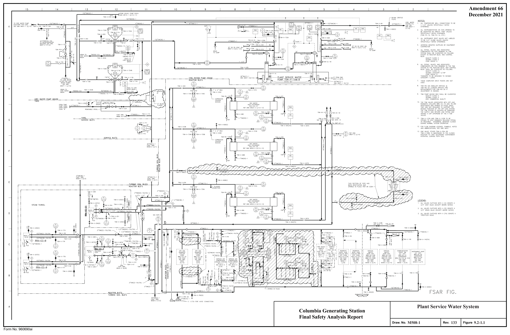

*figure on PDF page 158*

<!-- labels/text on this figure page -->
Amendment 66 December 2021
Plant Service Water System Columbia Generating Station Final Safety Analysis Report
M508-1
133 9.2-1.1 Draw. No. Rev. Figure Form No. 960690ai

<!-- p.159 -->
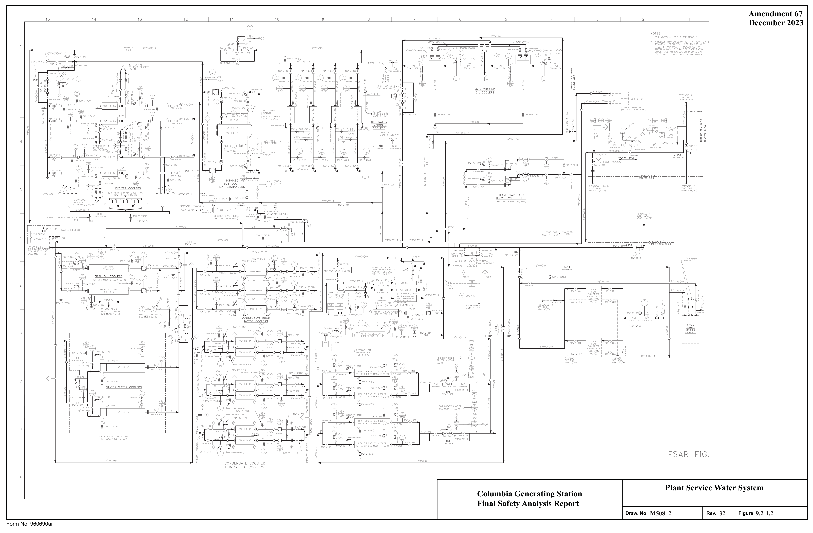

*figure on PDF page 159*

<!-- labels/text on this figure page -->
Amendment 67 December 2023
Plant Service Water System Columbia Generating Station Final Safety Analysis Report M508–2 32 9.2-1.2 Draw. No. Rev. Figure Form No. 960690ai

<!-- p.160 -->
Amendment 65 December 2019 15 14 13 12 11 10

FOR INSTRUMENT & VALVE PREFIX LETTERS SEE DETAIL "A" GENERAL NOTES:
~~~1NNGuS~~~e---:-cc_-_~_x-_ □---F+-A_R_c_c_-_Px_~--□-+-A-*-,-B-••-c--□-,-:-,c-c_;:-,--G------,--s-----Q-----___,
1. ~~ci~~~~¢T~~E~E~~Hi:~~:TION TO OC 1 1 /2" NPT UNLESS

628(V)6JO(V)6J1(V) 2g(V)
2. ,',I_L INSTRU~ENTATION ON THIS DRAWING TO BE INDENTIFlED BY PREFIX "R Cc"UNLESSSPEC ! FlCALLYNQTE□ OTHER l'l'ISE 624(V)626(V)623(V) 27(V)
622(V)621(V)620(V) 25(V)
535(V) 637(V)

5 --~_ ,'" " ~~-•~-"~"➔i'_..')-~1~-'-r--t,----~'~·ec~c~n~-~'-~'-------., ffi fOR CONT FOR CDNT.
DRYWELL AIR SHDET."A" SH OCT, "A"

#### COOLERS
:. --E:l

4"RCC(2J)-1-5 4"RCC(24)-1- 5

6.(DE:LCTED)

7.(0ELETED)

J/4"RCC(60)-l-14 J"RCC(2J)-1-1 J"RCC(24)-1-8 - --------------------------- --;
(~"RCC{23)-1-l FOR CRA- CC-28 ONL'f)

9.CODEBREAKDEFINITlONSFDRTHERMO\I/ELLSARESHCWNONM61 □. "JNSTALLJ,.TIOO OF THERl,IOWELLS AND S,'J,.IPLE PROBES." 10. INSTR UfarnTAllON SONOTED SHAl.lBE CODt GROUP E

#### PRIMARY CONTAINMENT
11. ~~~J\io;H:s~\-i~~ CLASS 3, IT IS CONSIDERED SA105 MATERIAL

THE FOLLO\IING WAS HINGTON STATE SPECIAL NUl,IBERS ARE IDENTIFIED wrm THE CORRESPONDING VALVES ~~c'!v~113~111,1ern :::S":_~IY:'TI~ STATE SPfCW NI IM8fR

#### RCC-V- 1338 WS-25-8JW
#### PRIMARY CONTAINMENT
12.CROSS- HATCHE□ ANDS C[)f' E□ EOO IPMEN T ISNON-O PERATIONAL 13. RCC-V-36A & RCC -V-368 HA\£ OCEN GAGGED CLOSE □

H.VALVEOPERATORHASBEEND E/.CTIVATE□.VN._VE ISI N THE OPEN POS!TlON AND FLUID DRAINE□ FROl,I OPERATOR.

I ~. SAMPLE POINT IS NO LONGER f\JNCrlONAL. ALTERNATE METHOD OF

#### SAMPLING IS DONE PER APPUUBLE PPM
.lifilJil2.;
I. ALL VALVES (EXCEPT THOSE 00 INSTRUl,IENT LINES) SUFFIXED WITHA(V)DENDTEA3/4" VENTVALVE. EXCEPTftSNOTED

2. ALL VALVES (EXCEPT THOSE DN INSTRI.J~ENT LINES) SUFFIXED WITH A (D) DENDTE A .3/4" DRAIN VALVE.
RECIRCULATION PU~P
3. ALL VAlVES SUFFJXED WIT11 A (lH) DENDTE A THROTTLED VALVE RRC-P-1A

#### RECIRCULATION PUMP
835-C001 A

#### RRC-P-1 B
#### B35-C001 B
10"RCC{J)-1-1 lQ"RCC(.3)-I-1 ~
(ZONEF/5,8)

4"RCC(J7)-1-1

8"RCC(J6)-1-1 6"RCC(3)-1-2

[: .. v n,cc(52J-1-I

#### RCC-V-605(0)
7~B ---a 4"RCC{22)-1-2 ?~C---~-~a 4"RCC(22)-1-3 ffi

#### RCC-V-718 RCC-V-71C
l'"lrnf ---P'.~

#### DRYWELL
AIR

#### COOLERS
DETAIL "C"

#### LINE NO. INSTRUMENT NO,
#### INLET FLOW OUTLET FLOW DRAWING ZONE
#### M525 1 C/8 RCC FX 22A
HB -H C6 RCC >X 228 ~525 1 ,-o C/ 8 RCC FX 23A H ~525 1 3/4"Rcr:.:(oo)-1-1 '" '"

#### RCC FX 238
RCC-V-7.30C 1'[

#### RCC FX 24A H
es M525 1 RCC n: 248 4"RCC(3B)-1-1

#### HC HO M525 1 C/S
Z1/2"RCC{:i2)-1-J cs

#### M525 1
#### M525 2 J/6
'" 2 1/2"RCC(~2)-1

,..........__TREN<:H

TODR"i"WELL ~

#### FLOOR DRAIN
A Closed Cooling Water System - Columbia Generating Station Reactor and Radwaste Buildings Final Safety Analysis Report

#### M525-1
86 9.2-2.1 Draw. No. Rev. Figure Form No. 960690ai

<!-- p.161 -->
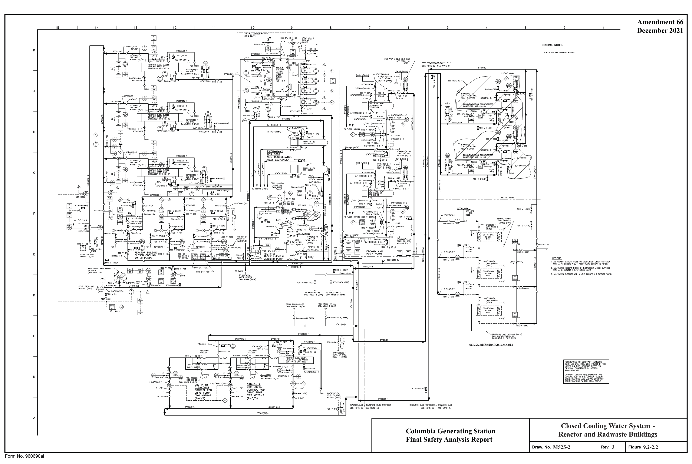

*figure on PDF page 161*

<!-- labels/text on this figure page -->
Amendment 66 December 2021
Closed Cooling Water System - Columbia Generating Station Reactor and Radwaste Buildings Final Safety Analysis Report
M525-2
3 9.2-2.2 Draw. No. Rev. Figure Form No. 960690ai

<!-- p.162 -->
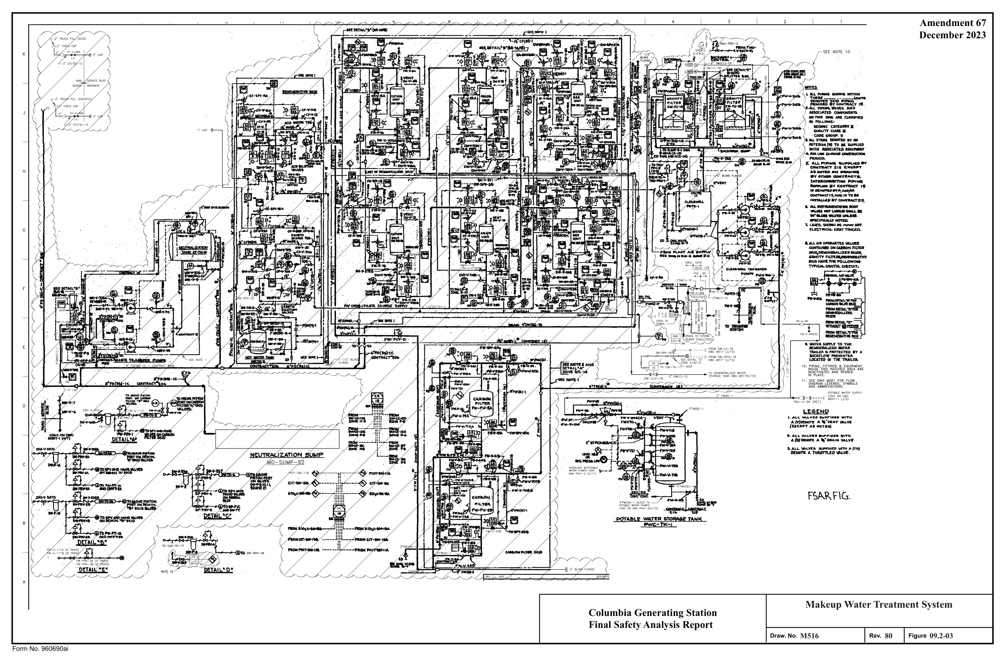

*figure on PDF page 162*

<!-- labels/text on this figure page -->
Amendment 67 December 2023
Makeup Water Treatment System Columbia Generating Station Final Safety Analysis Report M516 80 09.2-03 Draw. No. Rev. Figure Form No. 960690ai

<!-- p.163 -->
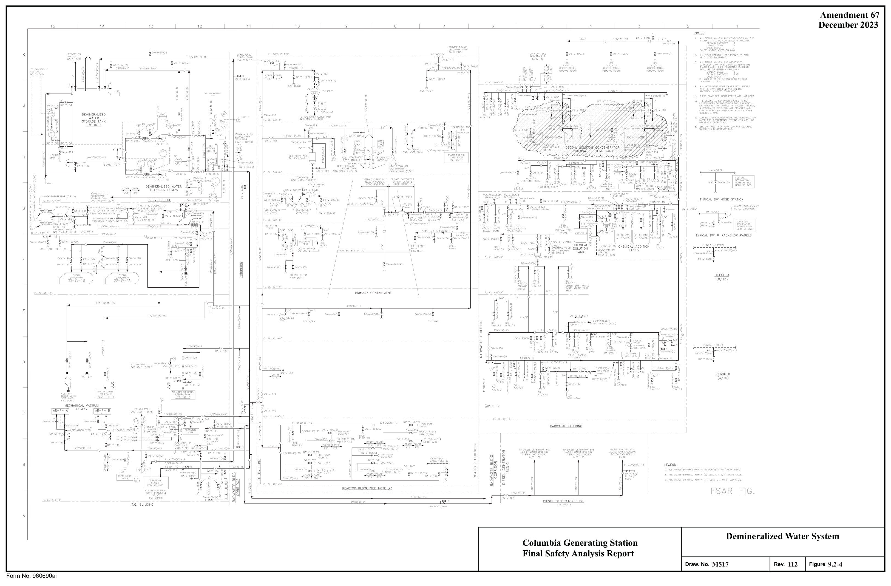

*figure on PDF page 163*

<!-- labels/text on this figure page -->
Amendment 67 December 2023
Demineralized Water System Columbia Generating Station Final Safety Analysis Report M517 112 9.2-4 Draw. No. Rev. Figure Form No. 960690ai

<!-- p.164 -->
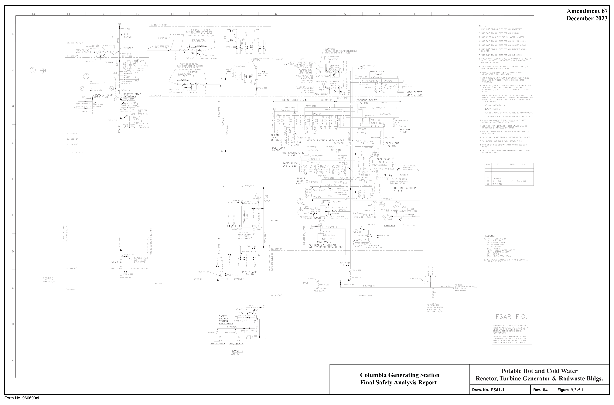

*figure on PDF page 164*

[Vector original (SVG, lossless): fig_page-164_3.svg](../figures/fig_page-164_3.svg)

<!-- labels/text on this figure page -->
Amendment 67 December 2023
Potable Hot and Cold Water Columbia Generating Station Reactor, Turbine Generator & Radwaste Bldgs.
Final Safety Analysis Report
P541-1
84 9.2-5.1 Draw. No. Rev. Figure
Form No. 960690ai

<!-- p.165 -->
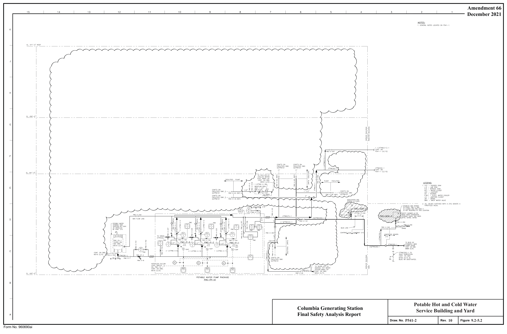

*figure on PDF page 165*

[Vector original (SVG, lossless): fig_page-165_3.svg](../figures/fig_page-165_3.svg)

<!-- labels/text on this figure page -->
Amendment 66 December 2021
Potable Hot and Cold Water Columbia Generating Station Service Building and Yard Final Safety Analysis Report
P541-2
10 9.2-5.2 Draw. No. Rev. Figure Form No. 960690ai

<!-- p.166 -->
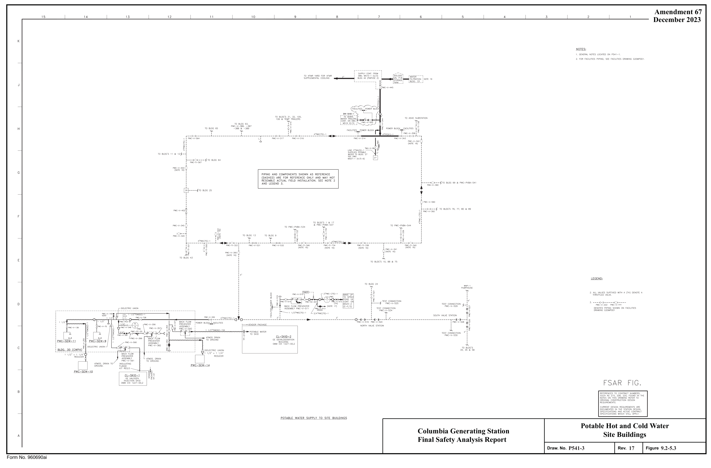

*figure on PDF page 166*

[Vector original (SVG, lossless): fig_page-166_3.svg](../figures/fig_page-166_3.svg)

<!-- labels/text on this figure page -->
Amendment 67 December 2023
Potable Hot and Cold Water Columbia Generating Station Site Buildings Final Safety Analysis Report
P541-3
17 9.2-5.3 Draw. No. Rev. Figure Form No. 960690ai

<!-- p.167 -->
10 3 2 11 5 4 7 6 12 13 8 Amendment 62 15 9 14 N ---«-<-4-...,.--- December 2013 "IDT es:
1, D~lt,..lA.Ge. ANO VE:.r-ll Ut-.lt:::S ':>I-IAI..L 1-1-AVC MU.-llMUtJ\ 51.o"Pe::
1/t//r,oc,r l=QP. PIPS: o\/E::!Z ~• 4" V-41Foo'T' r=o,r.. P1 Pe. 3'' 61'<:: !.~ 'Z, FaR i=L..OW Dl~AAM L.E:GiE:f.:iD1 f.ii,NO AOORE::1/1.A..TIO"-i'S -SYM.e,OL'::I ':ii-= D'NG..r-.'\':>01.
~. ALLPIPl/.1::::;VALV~ ANOi,"#XIATt:.D ~i~:i~b ~~T~i'1~ ~t~~i .I!, QJJAI..IT'f CLAS:'S '<:!:,' E.KC!!.Pi A')
I\ I\ ti I\ I\ N0T!!!!0:3£10W :tA~~~~t14~~~rzi~~Jf rN ,,c,tJ ln 1%)
,;, @-- I " A ~f~f~,~~~u;:~:;:, :_~'~me;) , ,S,l.ljLL e:>E. CLJ.&,-5JFl.f:.D,4,<; ,:sol-J..OW£>_' S,3.E E \,.iNP ~- s .:;;:,:,,r1cAT1(WS Sf'.CT;Of.J i'>D ?, 5-"2~ "'' Ewe!
VALVE~ 4 ;4.,..,.oe1ATE-O i0i(R'.>Nt1-(T'S,-.rr 1,,19! 7 \J.,_zo, I__J B QUALII'<: CLA"i:5~ 1r~~~ ~i~~tJ1~s~i ATED ~ COiW't>N.E}J]"5 - '.:S' Pi..£.JMB>I/J('.I FIXfl.lfZ.B HAVE: 1-0
-- - ~--~-\N~~ -TOfU=-TS@c;~~:-ro ,c;f:JSMI< /Z"f:.QLll.U:Met-Jf5. ~

#### S-214
C017E GTU)AP FOil ALL. PIA/..!~ Cl,IJ ~~-~:-;, THl':>D~I:. - 0 ~~~~~ie~~DW~

## 4 RQIZ. rr.Jre.tz-FAcf serw<=EN
~o' 1/EN.T ~1A.C"I<.
~Jllt£~2~~~j~D 214 ; ~~~ ~~A~ll~l~llg~irec Vla/t;,TOfDENnFYMATCf.,J f'OINTS.
I_,/ ~. ?AN1rA~Y Of(AIN f,rZ.!Nb CALCt/LAT!t',J ,o/ i~ i9,?l(.J2. '
- ·S-204 ,:J,'"~ ~ ~ "'\ ic6G' ' I PLAN-P\.UM&lN<ii ":>.lJJITABY PAAlt,.l. 4: \JE:.NT BQUT!NCi- 1 "5f;l=Z.\/lc.& e.LDG.. liL.. 4-SG.!.o" I ~\16"•j!O~ J"'N- Cl.OS~ T-@ '10,DWASJE &LOG; EL 4a7~0"

VENT ':>TAC!(, N.0.1:,

M•~•s, Toll£f"® TuP.elNE: BLDC.i El.?Ol'-Ci' PIPE CHASE ® TURBINiE !:>LOG EL 441'-a~

R=-At-::IOR ·e,1..o4.
@ PLUM2:,lt..lG G E F 'l(o,'-O" 'l'-'-O" 'l.fo'-0" E

IYI

D t I I I

## 7 OPEN END OF DRA.IN PIPE HAS BEEN ====a===ir'-
SEALED WITH 6 " MIN DCJ-1'>545

#### SILICONE FOAM PLUG,
-+-H---s ... --+++--.... 11-...,.---+--r------.,.,cr

:::

#### LEGEND
~-l~C, I ! ( I ALL VALVES SllfFIX[O WITH A(TH)

#### DENOTE A THROTTLED VALVE
... -- --cti l I

B

SANITARY WASTE- RISER DIAGRAM PLAt,J.~PLIJM;plN5i aANIT.4.fC.'t pRA!tJ. .A,J,,lD ~IJT R.OUT'lt-Ja.
SE.R\/ltE BLDG El 44\'-0' - SC,'.lE '/e.,":l'·O" TUf2-BIN6 8LD6 Plant Sanitary Drain System Columbia Generating Station Final Safety Analysis Report P542 20 9.2-6 Draw. No. Rev. Figure Form No. 960690ai

<!-- p.168 -->
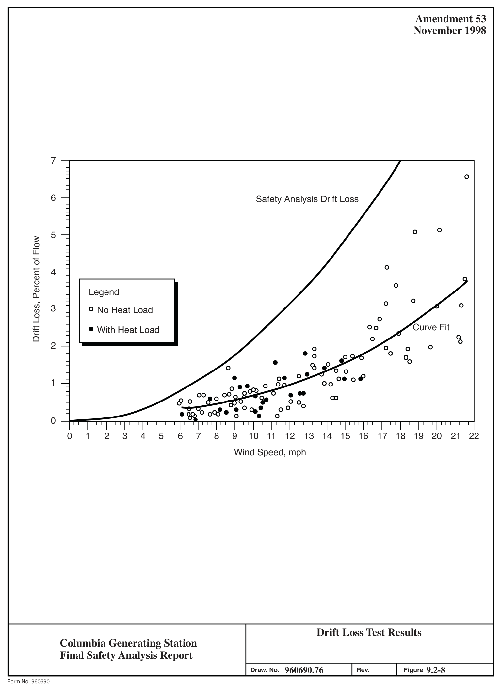

*figure on PDF page 168*

[Vector original (SVG, lossless): fig_page-168_3.svg](../figures/fig_page-168_3.svg)

<!-- labels/text on this figure page -->
Amendment 53 November 1998
7
6 Safety Analysis Drift Loss
0 5 0 Drift Loss, Percent of Flow 0 4 0 Legend 0 0 3 0 No Heat Load 0 oo Curve Fit With Heat Load 2 0 0
• 00
1
00
0 0 1 2 3 4 5 6 7 8 9 10 11 12 13 14 15 16 17 18 19 20 21 22 Wind Speed, mph
Drift Loss Test Results Columbia Generating Station Final Safety Analysis Report 960690.76 9.2-8 Draw. No.
Rev. Figure Form No. 960690

<!-- p.169 -->
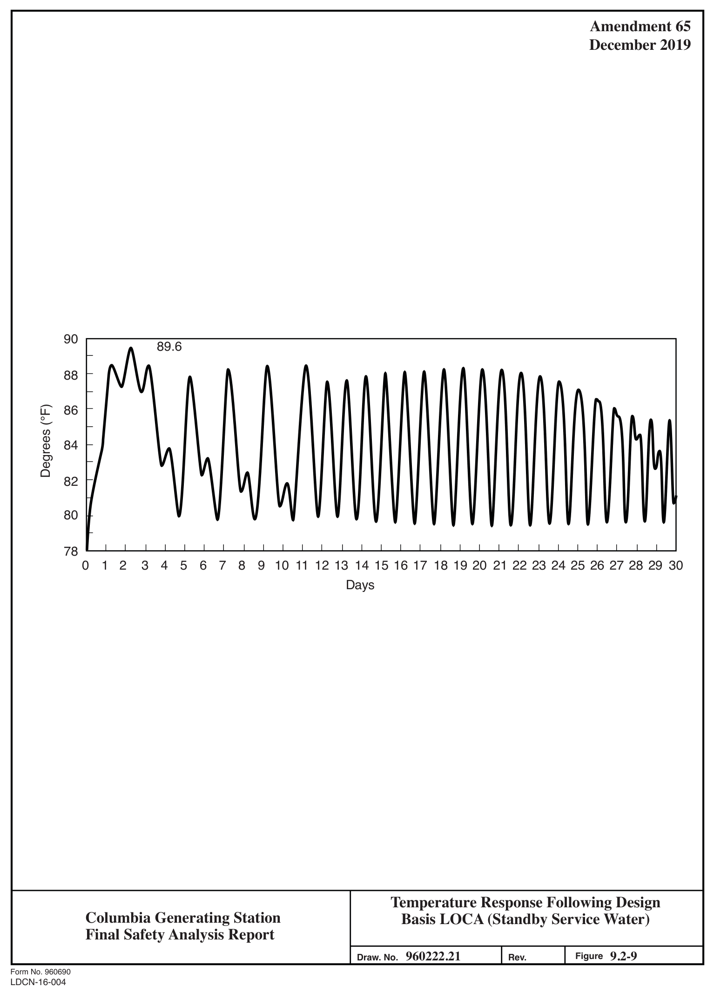

*figure on PDF page 169*

[Vector original (SVG, lossless): fig_page-169_3.svg](../figures/fig_page-169_3.svg)

<!-- labels/text on this figure page -->
Amendment 65 December 2019
90 89.6
88 " 86 - Degrees (°F)
- ' 84
- 82
80
78 I I I I I I I I I I I I I I I I I I I I I I I I I I I I I
0 1 2 3 4 5 6 7 8 9 10 11 12 13 14 15 16 17 18 19 20 21 22 23 24 25 26 27 28 29 30 Days
Temperature Response Following Design Columbia Generating Station Basis LOCA (Standby Service Water)
Final Safety Analysis Report 960222.21 9.2-9 Figure Draw. No. Rev.
Form No. 960690
LDCN-16-004

<!-- p.170 -->
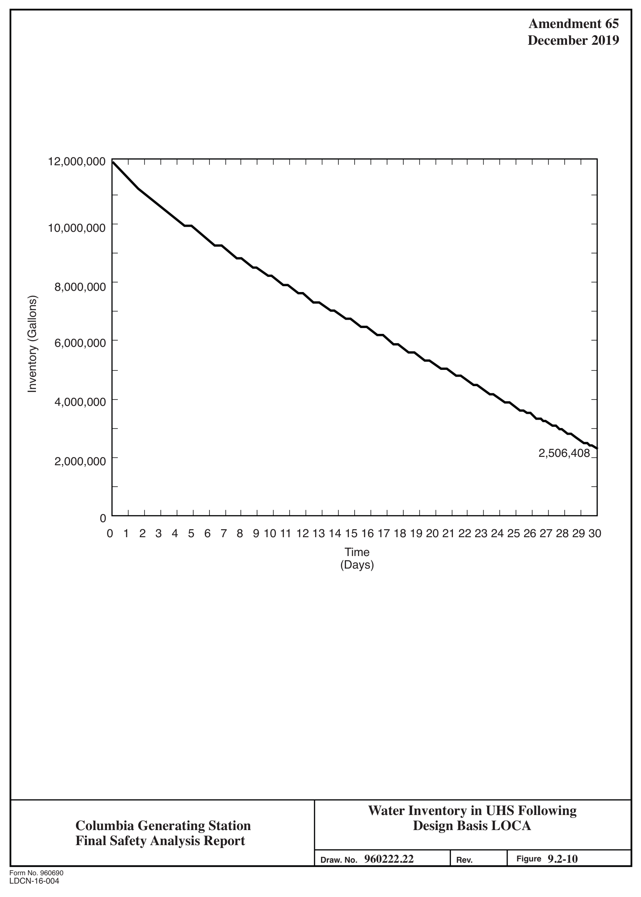

*figure on PDF page 170*

[Vector original (SVG, lossless): fig_page-170_3.svg](../figures/fig_page-170_3.svg)

<!-- labels/text on this figure page -->
Amendment 65 December 2019
12,000,000
10,000,000
8,000,000 Inventory (Gallons)
6,000,000
4,000,000
2,506,408 2,000,000
0 0 1 2 3 4 5 6 7 8 9 10 11 12 13 14 15 16 17 18 19 20 21 22 23 24 25 26 27 28 29 30 Time
(Days)
Water Inventory in UHS Following Design Basis LOCA Columbia Generating Station Final Safety Analysis Report 960222.22 9.2-10 Figure Draw. No. Rev.
Form No. 960690
LDCN-16-004

<!-- p.171 -->
Amendment 65 15 14 13 12 11 10 December 2019 EL. +80'-Q" ----n 3/4" J/+"COND(5J)-1-I

#### COND-V-1060(11)
I I:, ig i~ ,rn $ $ i~ ,·coND(~a)-1-2 7"C0ND(98)-1-J ,0

#### C0ND--1/-1051(0)
DETAIL "c" I- ZQNE(A/6) \v ~ COND-v-ee~ ~ - - 2+·coND(20)-1 CON □

i 1B"COND(79)-1 _D__E.IAfL___'.
[SEEN0TE6)

#### I -----------
= = 8. EQUIP~ENT IN HATCHED AREA IS CONDENSATE CONDENSATE NDTDPERATIDNAL STORAGE TANK STORAGE TANK 3•coN □( 45)-1 BLIND rLANGE ~e; g~0~ 1 l COND-V-37 ',' C:DND-RSP-4~i

14"RHR(1)-2-7·lY- C.G,B EL.44J'-O" J"FD CONT_Lg;:'0~• l~ RHR -2 ~ 521-3 (D/10) f- _ ----f L ___ _ 3"fD(52)-1

#### CONDENSATE STORAGE TANKS
AREA FLOOR DRAIN SYSTE~ I

l_

,..
,..
_f' _f'

14"C0ND(40)-1 14"CON0(40)-1 I c~c 0-;;r-J- ,':,, I "

#### RADWASTE BUILDING ,.
L.S;,5,.-"'

#### RADWASTE/REACTDR BLDG. CORRIDOR
l"COND-V-785A J6 ~ I

#### CONDENSATE
CONDENSATE l"COND-V-842A l"COND-V-786'. STORAGE TANK

#### STORAGE TANK
i REACTORBullo~ SEE NOTE 3 t5EE NOT[ 4 RADWASTE BUILDING 1"COND-V-870A 2•

#### C0ND-TK-1A
#### C0ND-TK-1 B
RD.IOVA8LESPOOL~8_-- PIECE{TYP.) l~~--C□ND- RSP -1

#### T~ ~jc~c-1
BLI N □ FLAN G(

J"RHR(17}-1-l-----..._ -'~ £24"RHR(J)-1 f---'- --j ~~~i~~N(B~~ --; LOOP "c" CC:N:_-,FSP,'-43_!"NE ,, '"" 0

#### C0N0-1S
~-,-<,l,</~).o--',;'--< .'"F,..,~·,-c-;i>-N~O-C-~v---_5-~-_.,_ __ ,•_=_c~[a,~)-_r __________ , ___________ ,, ____ ~--~ 1 coNo-rcv-u 3•

#### RADWASTE BUILDING
#### TURBINE GENERATOR BUILDING
24"C0ND(20)-1 24"COND(20)-1

#### ,._•c~-"'·)-.. I--------------'
SEE DWG. ~g~~~Di?~; ,...._ _________ ..., .... _""1 ________

65B CON □-V-BHB 4"C0ND(80)-1 (GR>,VlTY FL0W)
1COND-V-I B

## 1 TURBINE GENERATOR:
1 ' BUILDING I 6"cM'(J)-1S

1 4 "C0N □(40)-1S

'----'''.:"'aa"~"-"""'""----------------------., I 15··c□N 20)-1 24 "COND(20-1 ~i o, A

Condensate Supply System Columbia Generating Station Final Safety Analysis Report

#### M527-1
104 9.2-11.1 Draw. No. Rev. Figure Form No. 960690ai

<!-- p.172 -->
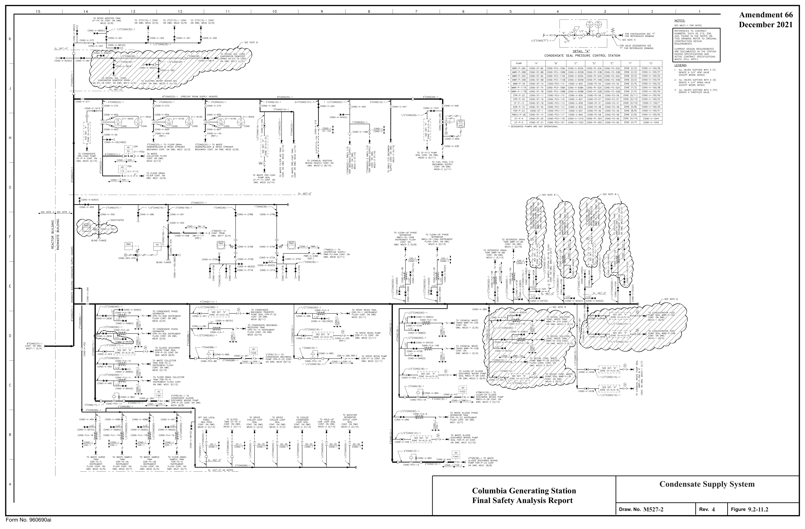

*figure on PDF page 172*

<!-- labels/text on this figure page -->
Amendment 66 December 2021
Condensate Supply System Columbia Generating Station Final Safety Analysis Report
M527-2
4 9.2-11.2 Draw. No. Rev. Figure Form No. 960690ai

<!-- p.173 -->
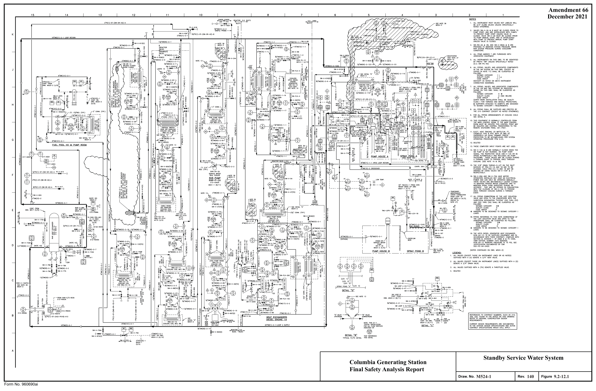

*figure on PDF page 173*

<!-- labels/text on this figure page -->
Amendment 66 December 2021
Standby Service Water System Columbia Generating Station Final Safety Analysis Report
M524-1
140 9.2-12.1 Draw. No. Rev. Figure Form No. 960690ai

<!-- p.174 -->
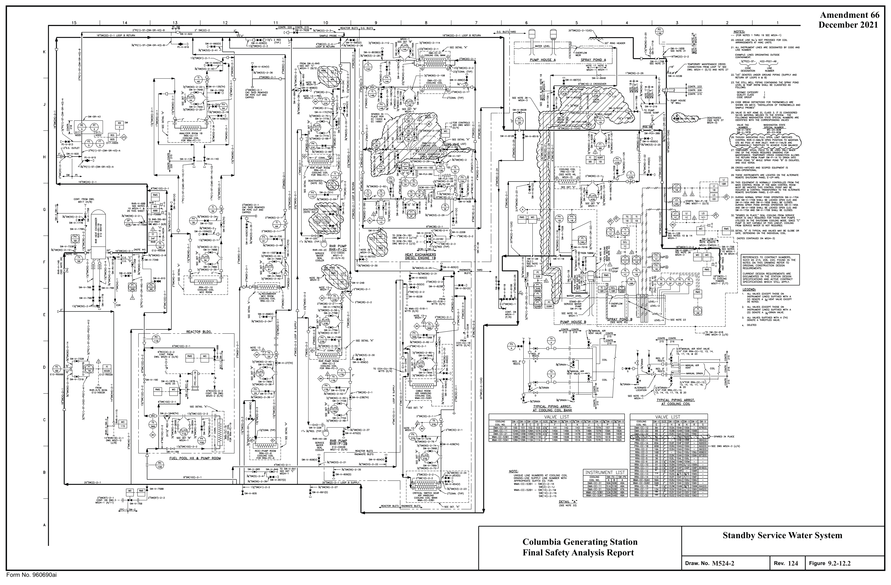

*figure on PDF page 174*

<!-- labels/text on this figure page -->
Amendment 66 December 2021
Standby Service Water System Columbia Generating Station Final Safety Analysis Report
M524-2
124 9.2-12.2 Draw. No. Rev. Figure Form No. 960690ai

<!-- p.175 -->
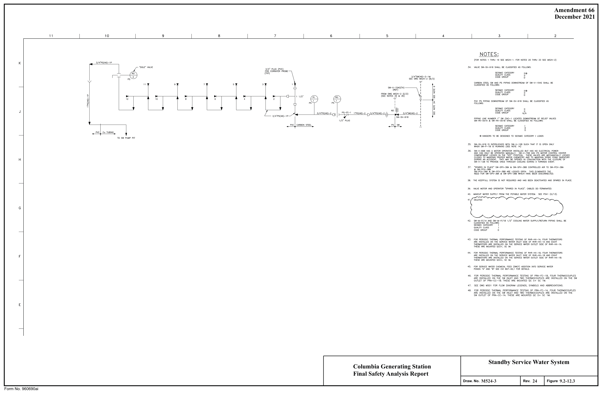

*figure on PDF page 175*

[Vector original (SVG, lossless): fig_page-175_4.svg](../figures/fig_page-175_4.svg)

<!-- labels/text on this figure page -->
Amendment 66 December 2021
Standby Service Water System Columbia Generating Station Final Safety Analysis Report
M524-3
24 9.2-12.3 Draw. No. Rev. Figure Form No. 960690ai

<!-- p.176 -->
Amendment 63 11 10 8 7 5 4 3 2 December 2015 NOTES:

1. ALL TDAPERATURE WELL CONNECTIONS ARE 1 1/2' UNLESS SPECIFICALLY

#### NOTED OTHERWISE.
K
2. ALL INSTRUMENTATION ON TH IS DRAWING TO BE IDENTI FIED BY PREFIX "CJW~

#### UNLESS SPECIFICALLY NOTED OTHERWISE
3. ALL INSTRUMENT ROOT VALVES NOT LABELED WILL BE 3/4" GLOBE

#### VALVES UNLESS SPECIFICALLY NOTED OTHERWISE.
4. ALL PIPING, VALVES ANO ASSOCIATED COMPONENTS ON THIS DRAWING IN THE CJW SYSTEM SHALL BE CLASSIFIED AS FOLLOWS:

#### QUALITY CLASS II
SEISf.llC CATEGORY II

#### CODE GROUP D
1 1 2 ' CJW 22)-1 s. SEE DWG f.4501 roR rLOW DIAGRAM LEGENDS, SYMBOLS AND ABBREVIATIONS.

,.

~C10J4
1. ALL VALVES SUF"r!XED WITH A 0/) DENOTE A 3/4" VENT VALVE
(EXCEPT WHERE NOTED)
2. ALL VALVES SUFFIXED WITH A (D) DENOTE A 3/4'" DRAIN VALVE
(EXCEPT WHERE NOTED).
3. ALL VALVES SUFFIXED WITH A (TH) DENOTE A THROTTLED VALVE

#### J/4' CJW(1)-1
CJW-V-638C(D) 3/4" CAS(56)-1 [4------f SEE DWG ~510-1 (E/1)
H I f--------1.,._-J I Ye, 2C CJW-V-619(¥) J/4" CJW(56)-1
(REF) L 1 1/2" CJW(2)-1

#### CAS-HX-6C
AIR COt.lPRESSOR CAS-C-1 C _J AFTER COOLER 1 1/2" CIRCULATING WATER PU~P

#### CJW-P-1A
_ J_SEE DWG t,,1510-1, ZN B/22_ _ 1_1_~ 2" CJW(22)-1 G 1" CJW 2-1 1 1/2" CJW(2 -1 r ~ ,,,,, 1 1/2" CJW-V-1308 1 1/2" CJW(22)-1

,.
1 1/2 ~~--- CJW-P-18 1sw CJW
------.~ f- 1 1/2' TSW(22)-1 ~/2" TO OWG '-1508-2 (E/4} - ~;:.~_247 ~C1033
(REF)
'+-~·-· ""'='~'~-~· ----,----oa' ..
1''-'------1 ~ 1+''--'"-l'a.."<x!--'----(:kJ---+,.+--+-4----C 60~,~~[rb~E HOSE

#### CJW-V-202 CJW-PCV-752 CJW-V-751
,<I" { CJW-V-639B(D) ..,._,, <.:" v-1~ ,-::::-::::--=:-,1-.L--~f---.;...l 1 1/4" CJW(22)-1

#### AIR DRYER CAS-DY-28
(SEE DWG ~1'!.=_1, ZN C,/5)
1 1 2• CJW 1)-1

,~.,,____,. ,-_,_ __ ,_•~1,'-··~c.,'-w~•)~--• ------1 J/4" CJW{56)-1 Y'°

CJW-V-618(V) f---------- -----i--.....--5 ~E;1~:;s:~~-;\01~J 1 1/2"

#### J/4. CJW(56)-1
1 1/2" (REF)
L AIR COMPRESSOR CAS-C-18 _J 1 1/4" CJW 2)-1 112" CJW(2-1 Vrsw-v-GBB ww-v- 218 Vrsw-V-687 I 'I
(R EF)
(REF) AFTER COOLER

.fl.ill .El&f

#### HEAT EXCHANGER HEAT EXCHANGER
#### CJW-HX-1A CJW-HX-18
_ J_SEE DWG 1,,1510-1. ZN 8/~ _

I I trsw-v-68~ '(rsw-v-684 'f CJW-V-228 'f'
(REF)
(REF)
t.---------- --------'..,.----,' ~E~/~;;s;Jg~-::_; (D/3)

1" CJW(2)-1 1 1/2" CJW(2)-1

L----....LJ-"-,;,_-,-7

1 1/2" CJW(22)-1 D 1 1/2" 1 1/2"

,.
1 1/2 2" CJW(2)-1 1 1/2" CJW(2)-1

L.:.J 1• CJW{2)-1

~C10J2 ~ '+-~•-· °'~"~'~'~)-~• ----,---v' .. l''-'------1 ~

#### CJW-V-6J9A(D)
C 1-::::1-=:-11-.L--~f---.;...l 1 1/4" CJW{22)-1

#### AIR DRYER CAS-DY-2A
(SEE DWG ~510-1, ZN G/9)

J/4" CJW(56)-1 YEO J/4• CJW(56)-1
(REF)

#### FSAR FI G.
L AIR COt.lPRESSOR CAS-C-1A _J 1 1 2" CJW(2 -1 CAS-HX-6A Flow Diagram - Compressor Jacket Water System AfTER COOLER Columbia Generating Station Turbine Generator Building B Final Safety Analysis Report E owe t,,1510-1. ZN B/~ _ _ ~

8 9.2-15 M942 Draw No.
Rev. Figure 2 1/2" CJW(22)-1 Form No. 960690FH

