# 9.3 PROCESS AUXILIARIES

> Columbia Generating Station FSAR — Chapter 09: Auxiliary Systems
> Source: `09_chapter-3152-3521.pdf`, PDF pages 177–233 (of 370)
> Amendment 67 compilation (individual pages carry varying amendment dates)

---
<!-- p.177 -->
### 9.3 PROCESS AUXILIARIES
#### 9.3.1 COMPRESSED AIR SYSTEMS
The compressed air systems consist of the control and service air systems (CAS and SA) and the containment instrument air (CIA) system.

##### 9.3.1.1 Design Bases
###### 9.3.1.1.1 Control and Service Air Systems
The CAS and the SA system are supplied with oil-free compressed air from three rotary screw compressors, two refrigerated dryers, two sets of filters, and three air receivers located in the turbine generator building and by one rotary screw compressor and refrigerated filtered dryer in the radwaste building. The CAS receivers are maintained at a pressure between 110 psig and 120 psig by the compression loading control devices. Normally, the SA compressor and one CAS compressor will meet the plant demand for compressed air. Should the air pressure in the three CAS air receivers, which are interconnected, drop to less than the running CAS I compressor setpoint, a second and if necessary, a third CAS compressor will start. If pressure in the CAS supply header drops to less than 80 psig, the SA system will be automatically isolated from the CAS air receivers to conserve air for use in the CAS.

The CAS provides instrument quality air, oil-free, maximum particle size of 1 micron, and dried to an atmospheric dewpoint of -40°F, throughout the plant for pneumatic instrumentation, controls and actuators. Air is drawn from the air receivers, is passed through prefilters, a desiccant dryer and afterfilters, to distribution piping.

A complete loss of control air will result in a plant shutdown, but none of the reactor systems require control air to achieve and maintain a safe shutdown condition.

The SA system provides oil-free compressed air from the CAS air receivers and/or from the SA receiver in the radwaste building, for use in process functions such as backwashing filters or demineralizers, for general services and maintenance uses throughout the plant, and as a source of breathing air.

The CAS and SA system are generally designed to Safety Class G, Seismic Category II requirements; however, piping and equipment in the reactor building, diesel generator building, and the standby service water (SW) pump houses are supported to Seismic Category I I requirements. Pressure vessels are designed and constructed in accordance with the American Society of Mechanical Engineers (ASME) Boiler and Pressure Vessel (B&PV) Code Section VIII. Piping and valves are designed and constructed in accordance with the ANSI B31.1 Power Piping Code, except for piping or valves performing a primary containment function and the local control piping at the outer main steam isolation valves (MSIV). These

,i, ,i,

<!-- p.178 -->
November 1998 I I portions of the piping are Quality Class I, Seismic Category I, and are designed and constructed in accordance with ASME B&PV Code Section III, Class 2 and Class 3, respectively.

###### 9.3.1.1.2 Containment Instrument Air System
The CIA system is designed to deliver clean, dry, compressed gas, nitrogen or air, to the following valve actuator accumulators and valve pilot controls inside primary containment.
Seven individual accumulators for the seven main steam relief valves (MSRV) dedicated to the automatic depressurization system (ADS) function are supplied with gas through two separate I I isolable headers at a nominal pressure of 180 psig. The four inboard MSIV actuator accumulators, 18 MSRV actuator accumulators for the power-assisted pressure relief function, and two reactor recirculation cooling (RRC) pump seal staging drain valve pilot control valves I are supplied with gas at a reduced nominal pressure of 100 psig. The CIA system also provides I nitrogen to the set pressure verification device (SPVD) system. For normal plant operation, nitrogen is supplied from the containment nitrogen (CN) system cryogenic storage vessel which is also the source of nitrogen for inerting the primary containment atmosphere. Should the normal nitrogen supply become unavailable, the gas supply piping to the ADS function I accumulators will automatically isolate from the cryogenic nitrogen supply, and the ADS accumulator backup compressed gas manifold subsystems will provide a nominal pressure of I 180 psig nitrogen from banks of high pressure compressed nitrogen cylinders. The designed pneumatic supply to the ADS accumulator is such that, following a failure of the safety-related pneumatic supply to the accumulator, at least two valve actuations can occur with the drywell at 70% of design pressure.

The 100 psig line does not have an automatic backup supply, but provision has been made for supplying air from the CAS system through the CIA dryer and filters via manually actuated intertie valves in lieu of the normal CN supply.

The piping for normal supply of compressed nitrogen or air, that is outboard of the primary containment isolation valves, is designed to the ANSI B31.1 Power Piping Code, and pressure vessels are constructed to the rules of the ASME B&PV Code Section VIII. Piping penetrating primary containment and inside of primary containment, from the outermost containment isolation valves to the point of use valve connections, is constructed to Safety Class 2, ASME B&PV Code Section III, Class 2, Seismic Category I, requirements; except that the flexible connectors at the four inboard MSIV actuator supply valves are equivalent to but are not ASME Section III stamped items. Piping located in the reactor building and the diesel generator building is supported by Seismic Category I supports, although most of the non-ADS piping itself is designed to Seismic Category II loadings. The ADS function accumulator backup compressed nitrogen supply subsystems, from the normal supply isolation valves and from the outboard containment isolation valves, to, but not including, the compressed nitrogen cylinders, pressure regulators and overpressure relief valves, are constructed to ASME B&PV Code Section III Class 3 rules including Seismic Category I load conditions. An exception to this I

<!-- p.179 -->
ASME statement occurs at the pressure control valve stations in the diesel generator building corridor, where the sections of line containing the pressure control valve in each station is non-ASME (due to the unavailability of ASME pressure control valves), but is isolable and bypassable via ASME manually operable valves. The compressed gas cylinders are U.S. Department of Transportation approved commercial shipping containers. The cylinder valves, connectors, pressure regulators, and overpressure relief valves are approved by the Compressed Gas Association. The supports for the compressed gas cylinders, cylinder valves, connectors, pressure regulators, and overpressure relief valves are designed to Seismic Category I requirements.

##### 9.3.1.2 System Description
###### 9.3.1.2.1 Control and Service Air System
The CAS and SA system are shown schematically in Figure 9.3-1. Three compressors and three interconnected CAS air receivers in addition to one SA compressor and SA air receiver supply both control and SA requirements.

Each CAS compressor has a run-standby-stop local selector switch. When the selector switch is set in the run position, the compressor runs continuously and loads and unloads to maintain receiver pressure. When the selector switch is in standby position, the standby CAS compressor will automatically start when the CAS supply header pressure falls below the running CAS compressor setpoint. Normally one CAS and the SA compressor are running with at least one CAS compressor on standby.

The CAS compressors take suction from the room through 10  filters. The air is filtered down to 0.1  before entering the air receivers. The CAS compressors are cooled by the compressor jacket water (CJW) system. The CJW system is a closed loop system that transfers heat from the CAS system to the plant SW system.

The SA compressor takes suction from the outside to ensure that the air, which can be used for breathing purposes, is free from contaminants. The use of SA for breathing air is permissible with the use of local air filtration and local monitoring for carbon monoxide. System-level monitoring for carbon monoxide does not provide sufficient assurance of detection and mitigation of an adverse condition. The use of local filtration and monitoring enables the entire SA system to be used for breathing air.

The CAS and SA compressors pump an air/oil mixture to an internal air receiver/oil separator and then the air enters an internal aftercooler for cooling and moisture separation. The air is then discharged to a refrigerated dryer for further moisture removal. The air then enters a series of filters to remove any remaining particles and oil vapor from the air before entering the main air receivers.

<!-- p.180 -->
Control air for station instrumentation and controls is processed through a refrigerated air dryer, a filter array, one of two 100%-capacity air dryer skids. Each skid has two 100% capacity prefilters and after filters arranged in parallel pairs to allow for replacement of the filter cartridge without interruption of air flow. The dryer on each skid is a heatless regenerative twin tower desiccant type which dries through one tower while the other is regenerating. A timer switches between towers and a purge economizer allows reduction in purge usage when the dryer is not operated at full capacity. There are two parallel refrigerated dryer and filter arrays, one or both of which may be operating at a given time.

Service air is distributed from the header to quick-disconnect hose connections where it is used for pneumatic service equipment and maintenance throughout the plant. Service air is also distributed for plant services such as demineralizer resin mixing and filter and demineralizer backwashing (see Figure 9.3-1).

Table 9.3-1 presents the major characteristics of the air compressors, receivers, and the air dryer for the control and SA.

###### 9.3.1.2.2 Containment Instrument Air System
The CIA system is primarily a pressurized nitrogen system as shown in Figure 9.3-2. The location of components in this system in the Seismic Category I reactor building is shown in Figures 1.2-7, 1.2-8 and 1.2-9. During normal reactor operation, the CN system, discussed in Section 6.2.5.7, supplies pressurized nitrogen from an 11,000-gal (approximately 1 million-scf)
cryogenic storage tank to meet the requirements of the following valves inside primary containment:

a. Full supply pressure (180 psig nominal) loads,

1. Seven ADS function MSRVs and their individual ADS accumulators,

b. Reduced pressure (100 psig nominal) loads,

1. Four inboard MSIV accumulators,

2. Eighteen main steam safety/relief valves (SRVs) and their individual accumulators to be used for the power assisted pressure relief function, and

3. Two RRC pump seal staging drain valve pilot control valves.

For a discussion of the function and operation of the ADS, see Sections 6.3 and 7.3. In case the cryogenic nitrogen source does not maintain supply pressure to the ADS accumulator supply headers, two backup nitrogen cylinder bank subsystems are provided to automatically

<!-- p.181 -->
supply a nominal pressure of 180 psig nitrogen. A bank of 15 nitrogen cylinders supplies three of the ADS function accumulators, and a separate bank of 19 nitrogen cylinders supplies the other four ADS function accumulators (see Figure 9.3-2). Of these backup subsystems, only 14 nitrogen bottles for three ADS accumulators and 17 nitrogen bottles for the four ADS accumulators are necessary to provide a 30-day supply of nitrogen for the ADS function during a postulated loss-of-coolant accident (LOCA) condition. The backup subsystems also provide for manual SRV operation during station blackout (Appendix 8A). A remote nitrogen cylinder connection is provided to each subsystem to permit supplementing the cylinder banks through manual connection of portable nitrogen cylinders, and thus maintain the ADS function for at least 100 days following a postulated LOCA event. The remote cylinder connections are located in the diesel generator building corridor, adjacent to the reactor building, outside the secondary containment boundary, permitting personnel access to the connections under postaccident conditions.

Remote pressure control stations, each consisting of a bypassable pressure control valve, are schematically located downstream of the junction of the backup nitrogen cylinders supply with the remote backup nitrogen cylinder supply, and are physically located in the diesel generator building corridor. Thus, any problems with the pressure control valve could be accommodated by isolating it, to allow maintenance to be performed, while the ADS function header pressure was being maintained with the manual bypass valve. The pressure control valve allows the cylinder regulators to be set at a higher, but broad range, pressure.

The backup nitrogen cylinder banks are located in the reactor building vehicle air lock
(railroad bay) and are accessible during normal reactor operation. Cylinders are valved to the supply piping in a sequential manner by a pressure-controlled programmer for each bank, so that only the number of cylinders necessary to maintain pressure in the ADS accumulator supply lines are drawn on. During normal reactor operation, minimum cylinder pressure is maintained as required by the Technical Specifications. The gas cylinders used may only be charged to 3000 psig, a limitation imposed by the system piping.

Once opened, the ADS valves are not expected to be cycled during the postaccident period;
nevertheless, the air supply was conservatively sized to allow for extra cycles, since they may be used for alternate shutdown cooling.

In the event the cryogenic nitrogen source totally fails to supply the system requirements, the backup nitrogen cylinder banks will supply their respective ADS supply headers as described above and the headers will be automatically isolated from the common CIA supply line. The reduced pressure loads will then be without a source of pressurized gas until the CAS intertie valves are opened. A normally open vent between the two in-line series block valves could then be closed (the vent is there to guarantee no backleakage from CIA to CAS, which could lower the oxygen content of CAS/SA and result in an adverse condition should a breathing-air tap be in use). The relatively low pressure CAS supply would still be inadequate for the ADS headers, though, and they would still automatically be supplied as discussed above.

<!-- p.182 -->
##### 9.3.1.3 Safety Evaluation
###### 9.3.1.3.1 Control and Service Air System
Operation of the CAS and SA systems are not required for the initiation of any engineered safety feature systems or for safe shutdown of the reactor.

A complete loss of the CAS system during power operation results in a plant shutdown with the following expected to occur: The SA system is automatically isolated as the CAS system pressure decreases. Control rods drift into the core as the control rod drive (CRD) scram outlet valves begin to slowly open. The outboard MSIVs close causing an automatic reactor scram.
Operator actions based on CAS failure would be taken in accordance with plant procedures to scram the rector, control reactor pressure vessel (RPV) pressure/water level, and to mitigate the effects of individual air-operated valve failure modes.

###### 9.3.1.3.2 Containment Instrument Air System
Since each of the two backup nitrogen cylinder banks and the cryogenic nitrogen supply are independent of each other, a single component failure in one will not affect the operational function of the other. The two ADS header tie line isolation valves are each powered from a different division of the critical power supply.

During normal operation, the cryogenic nitrogen supply will maintain pressure in the inboard MSIV, the power-assisted MSRV, and the ADS function accumulators. The cryogenic nitrogen supply piping and the CAS supply piping are not assumed to be serviceable under accident conditions. In such an event, the local accumulators at the MSIVs and MSRVs provide a short-term source of pressure for actuating these valves. Further discussion of the effects of loss of pressure to the MSIVs and the normal function MSRVs is presented in Sections 5.2.2.4, 5.4.5, and 7.3.1.1.10. The backup nitrogen cylinder bank subsystems will supply operating nitrogen pressure to the ADS MSRV accumulators at any time the normal supply does not function.

The solenoid valves on the ADS function MSRVs could be pressurized to a pressure greater than their qualified pressure under certain accident conditions if the ADS header pressure were allowed to approach the piping design pressure; therefore, the ASME relief valves are set at a lower pressure to preclude this possibility. They are located in the diesel generator building to provide access (post-LOCA) should one open and stick open.

##### 9.3.1.4 Testing and Inspection Requirements
A channel functional test of the ADS accumulator backup compressed gas system alarm with a channel calibration verifies an alarm setpoint of greater than or equal to 135 psig (decreasing).

<!-- p.183 -->
At a frequency no less than once per 22.5 months, the nitrogen capacity in at least two accumulator bottles per division within the backup compressed gas system is verified.
The backup compressed gas pressure instrumentation is periodically tested and calibrated as required by the Technical Specifications.

Instrument air sampling and testing is performed periodically to ensure that the air quality meets system design requirements. Routine maintenance and inspection along with operator observation during operation ensures the system is functioning properly to support normal plant operations.

##### 9.3.1.5 Instrumentation Requirements
###### 9.3.1.5.1 Control and Service Air Systems
Instrumentation and controls are provided in the main control room to control and monitor the operation of the systems. Low receiver air pressure, high air temperature, high filter differential pressure, and other system operating parameters (see Figure 9.3-1) are alarmed in the control room.

An air-operated control valve isolates the SA when its header pressure drops to 80 psig to enable sufficient air flow to the CAS. Nonlubricated control valves, a solid state timer, and a purge economizer regulate the air drying cycle.

###### 9.3.1.5.2 Containment Instrument Air System
The instrumentation provided in the CIA system is shown in Figure 9.3-2. Pressure switches and alarms are provided in this system to regulate the nitrogen supply from the 15 nitrogen bottles in one bank and the 19 bottles in the second bank. Pressure switches in the tie lines between the CIA distribution header, which is itself supplied by either the CN system or the CAS system, and the ADS function lines monitor the supply pressure and cause tie line isolation valves to independently close if the tie line pressure should drop below the switch setpoint for a time period greater than 3 minutes. A pressure switch on each ADS function header then causes the nitrogen bottles to begin supplying their respective headers after the tie-line isolation valves actually close. A redundant pressure switch on each ADS function header set at a slightly lower pressure than the tie-line isolation setpoint, acts as a backup to either the isolation valve closed position switch, or the other pressure switch on the same ADS function header, to initiate supply from the nitrogen bottles. The redundant pressure switch also initiates an alarm in the control room to alert the operators to a low-pressure condition in the ADS function header.

In addition to the low pressure switches, each ADS function header has a pressure switch that provides control room annunciation to alert the operators to a high-pressure condition.

<!-- p.184 -->
November 1998 I t Local pressure indication is provided just downstream of each pressure control valve station should the station require isolation and the ADS function header pressure require regulation via the manual bypass valve.

#### 9.3.2 PROCESS SAMPLING SYSTEM
##### 9.3.2.1 Design Bases
The plant process sampling system is designed to provide representative samples, under controlled conditions, of plant process streams. Provisions for continuous monitoring of selected systems provide a means of analytical surveillance of system trends and performance during plant operations. Laboratory samples are taken to provide (a) comprehensive analytical information on plant operations, (b) a check on continuous monitoring instrumentation, and
(c) regular reports on critical plant systems to ensure safe and proper operation.

The sample system is designed to the following criteria:

a. To ensure that the samples of the process stream are representative of the conditions that exist at the sample tap, the following design practices have been implemented:

1. The shortest practical line length and smallest practical line diameter is used to reduce time lag and sample line plate-out;

2. Sample lines are routed to prevent dead legs and are assembled to avoid traps and dips;

3. Certain sample lines have a continuous purge flow of sufficient velocity to inhibit deposition of suspended solids and to satisfy the requirements of analytical instrumentation;

4. To ensure representative sampling of gaseous effluents, special sampling probes are employed which consider the process line size, flow I conditions, and flow direction. Where appropriate, isokinetic probes are used to ensure representative sampling of the particulates;

5. Where precision measurements are to be made of high purity (low conductivity) water, the process sample flow stream is conditioned by constant temperature baths before in-line conductivity measurement to maintain the internal temperature compensation within the valid range.
Hot process fluids are cooled by heat exchangers before entering grab sample hoods or analysis equipment to avoid measurement errors and the potential for injury; and

<!-- p.185 -->
6. Sample line pressures are reduced at sample racks to protect in-line instruments and minimize the potential for personnel injury. Pressure regulators with relief valves are used to control and limit sample pressure.

7. Where tubing samples are taken from high temperature and pressure lines, flow will be isolated and the temperature allowed to decay to ambient before the system is depressurized, drained and then the sample removed.

b. In addition to limiting sample temperatures and pressures, the following safety precautions are taken:

1. The sample lines are made of stainless steel tubing with a minimum of joints or connections, and

2. Process sample lines containing highly radioactive fluids are routed to minimize personal radioactive exposure.

##### 9.3.2.2 System Description
The sampling system consists of continuous flow in-line analytical instruments, plus numerous grab sample points which are either local or routed to a centralized sampling station. The sampling system is shown in Figures 9.3-3, 9.3-4, 9.3-5 and 9.3-17.

A sample station typically consists of a sample rack and a fume hood. Process fluids enter the conditioning rack and, where necessary, pass through one or more heat exchangers to reduce temperatures to 105°F or less. Pressure is reduced, where necessary, to limit sample pressure to 40 psig or less. If sampling criteria does not allow the temperature and pressure to be reduced at a sample rack, the flow will be isolated and the system brought to a safe temperature and pressure before sample removal to minimize the potential for injury to personnel. After conditioning, the process fluid is routed to the chemical fume hood where grab samples are taken. In the case of continuously monitored process streams, a portion of the fluid is diverted through a constant temperature bath, through conductivity cells and rotameters, and then to a drain line. Selected process fluids are continuously monitored by sample line sensors for conductivity and other parameters. Electric outputs of the sensors go to monitors and continuous recorders. Electrodes located in RWCU piping and inside of the RPV provide electro-chemical potential (ECP) signals to continuous recorders on PSR-CAB-1.
Liquid effluents from the sample racks and chemical fume hoods are routed through closed drains to the liquid radwaste system.

<!-- p.186 -->
The systems that require intermittent or continuous analytical sampling are arranged to permit sampling during normal and shutdown conditions. Many of the sample lines flow continuously. For those that do not, written procedures specify the flow rate and time required for sample line purge before taking the sample. This ensures that representative samples are obtained.

###### 9.3.2.2.1 Sample Locations
The available process liquid sampling system points are described in Table 9.3-2 (not all available sample points are used). The sampling system for radiation monitoring equipment is described in Section 11.5.

###### 9.3.2.2.2 Liquid Sample Taps and Probes
Sample line connections are, where possible, located after a straight run of pipe. Since process piping is designed for turbulent flow conditions, sample taps for nominal line sizes 3 in. and less can be taken from tees or welded-pipe connections. For nominal pipe sizes 4 in. and larger, sample probes are installed into the pipe line. Sample connections to process pipes are a minimum of 0.75 in. and have the root valves as close to process lines as possible. The root valve and connection are the same quality and code group as that of the process pipe.
I The sample probes are fabricated in accordance with Figures 9.3-6, 9.3-7, and 9.3-8 and are designed to avoid failure through vibration or wear.

Sampling taps, where possible, are located at the sides of horizontal process lines rather than at the top or bottom.

###### 9.3.2.2.3 Steam Samples
Two sample taps for main steam are installed, one of which is a spare.

The sample line is stainless steel tubing of sufficient total length (from sample point to sample rack) to allow for decay of 16N to minimize radiation dose rate at the sample station. The steam sample is condensed near the process line tap and the resultant condensate is piped to the sample rack.

###### 9.3.2.2.4 Sample Piping Design
The sample piping, from the root valve at the process tap to the sample conditioning rack in a sample room, is small diameter heavy wall stainless steel tubing to minimize corrosion or contamination of the sample. The small diameter also provides a passive flow restriction in the event of a sample line break.

<!-- p.187 -->
Sample lines are sized to ensure turbulent flow conditions at the required flow rate. This turbulence alleviates stratification or plate-out of particles in the sample line.

Continuous flow lines containing fluids over 150°F are insulated to protect personnel. When warranted by high anticipated radiation levels, sample lines containing radioactive fluids are routed or shielded as described in Section 12.3.

###### 9.3.2.2.5 Fume Hood Design and Grab Samples
All liquid sample lines entering the sample rooms have provisions for grab sampling. Each fume hood is an enclosed sheet metal structure (stainless steel) with manual grab sample valves positioned over a stainless steel sink, all located within the hood. The face of the hood has a transparent sash opening for hood access. Ambient air enters the opening to remove any gases or droplets released from the liquid sample. Air is exhausted from the top of the hood into the building ventilation exhaust system. The hood sink collects the sample liquids not collected in the grab sample and pipes the effluent to a closed drain system. A demineralized water faucet and a compressed air nozzle is located near the sink in the hood to flush and clean sampling apparatus.

##### 9.3.2.3 Safety Evaluation
I The process sampling system has no direct process control functions. Each continuously monitored sample line is provided with local indication and annunciation. This includes a high I alarm, a low alarm where appropriate, and a continuous recorder. Remote indication is provided on certain samples.

Components of the process sampling system which form part of the reactor coolant pressure boundary (RCPB) or containment isolation system are designed in accordance with Seismic Category I requirements and other code and quality requirements as described in Section 3.2.
Sample lines which form part of the containment isolation are provided with automatic fail-closed isolation valves both inside and outside of containment. The components of the process sampling system that do not form part of the RCPB or containment isolation system and are not in the reactor building are not designed to Seismic Category I requirements since they are not necessary to ensure any of the following:

a. The integrity of the RCPB,

b. The capability to shut down the reactor, and

c. The capability to prevent or mitigate the consequence of accidents which could result in potential offsite exposure in excess of the limits of 10 CFR 50.67.

<!-- p.188 -->
The operation of the liquid sampling system is not necessary for plant safety. Therefore, in the unlikely event of an accident, all sample lines which pass through the containment are automatically isolated by fail-closed valves. Electrical power for the sampling subsystem is from a nonessential bus.

The routing of high temperature and high pressure sample lines outside the containment is not considered hazardous because of limited flow and limited stored energy as discussed in Section 3.6. The location of sample temperature and pressure reduction equipment outside the containment allows maintenance during plant operation.

The sample station is a closed system with grab samples taken under the safety of a chemical fume hood to minimize radiological hazard. The hood maintains a constant air velocity of approximately 100 ft/minute through the working face to ensure that airborne contamination will not enter the room.

Pressure control valves are installed in high-pressure sample lines so that operators will not be exposed to high sample pressure when obtaining grab samples.

At PSR-SR-49 sample rack, tubing samples are taken from high temperature and pressure lines that will utilize double isolation valves to protect the worker from harm due to the operating conditions of the high-energy line. This sample rack will be isolated then cooled to ambient temperature and then depressurized. The rack is then drained before the tubing sample is removed. This rack is located in the RWCU heat exchanger room, which minimizes exposure or contamination of personnel and maintains contamination control in case of a spill.

##### 9.3.2.4 Tests and Inspections
The sample nozzles and associated piping, tubing, fittings, and valves are tested and inspected in accordance with the requirements of the main process pipes from which the samples are taken.

The process sampling system is proved operable by its use during normal plant operation.
Grab sampling is provided for laboratory analysis for verification of proper operation and calibration of continuous analyzers.

##### 9.3.2.5 Instrument Requirements
Continuous analyzers and associated recorders monitor conductivity and dissolved oxygen at selected points in the sampling system. Alarms annunciate in the main control room or the radwaste control room when the variables are out of specification to alert the control room operator that corrective action is required.

<!-- p.189 -->
#### 9.3.3 EQUIPMENT AND FLOOR DRAINAGE SYSTEMS
##### 9.3.3.1 Design Bases
The equipment and floor drainage systems are designed to collect and convey the various operational waste liquids from their points of origin to their points of ultimate disposal under I controlled conditions. The following design bases are used to ensure the system integrity during normal plant operation and preclude any danger to the health and safety of plant personnel, the environs, and the general public.

Drainage systems which carry radioactive waste are isolated from drainage systems which do not carry radioactive waste. Radioactive wastes are collected separately in tanks or sumps, based on their classification as floor drainage (low purity), equipment drainage (high purity), chemical drainage (nonneutral) and detergent drainage, to facilitate their treatment in the radwaste building.

Floor and equipment drains in the diesel generator building, service building, isolated areas of the turbine building, and storm water drainage are not intended to be operated as radioactive systems.

The majority of radioactive drainage piping 1-in. and above is of butt-welded construction to avoid the collection of radioactive solids, see Section 12.3.1.3.2. Drain lines are sloped to ensure complete drainage of piping. Appropriate shielding is used in locations which could result in increased radiation exposure. Cover plates are an integral part of all floor drains to prevent solids from entering drain piping and causing subsequent clogging.

##### 9.3.3.2 System Description
Equipment and floor drainage systems are provided to handle radioactive and nonradioactive wastes in separate systems. Radioactive wastes are collected in the building sumps and transferred to the radwaste system (see Section 11.2) for treatment, sampling, and disposal or reuse within the plant. Roof drains are drained by gravity or pumped to the storm drain system.

###### 9.3.3.2.1 Radioactive Equipment Drainage System
9.3.3.2.1.1 Reactor Building Drains. Reactor building equipment drains are collected in two separate subsystems (see Figure 9.3-9). One subsystem handles drainage from all equipment drains located in the primary containment. The other handles drainage from equipment drains located in remaining portions of the reactor building.
n The primary containment equipment drain subsystem starts at funnel drains located at pieces of equipment, collects in branch lines, and discharges to the drywell equipment drain sump. The

<!-- p.190 -->
drywell equipment drain sump is the collecting point for valve leakoffs, the inner refueling bellows seal support drains, reactor recirculation pump seal leakoffs, and equipment vents and drains within the drywell.

The drywell equipment drain sump is drained through a 3-in. line penetrating the containment wall to the reactor building equipment drain sump. This drain line includes two isolation valves located outside the drywell and a flow meter for monitoring of the leakage into the drywell sump during reactor operation. Leakage into the drywell equipment drain sump is considered identified leakage (see Section 5.2.5.2). This drain line is provided with a loop seal to prevent gas flow between the drywell and the reactor building during normal operation.

The containment isolation valves in the drywell sump drain line will close on a high pressure signal in the drywell to prevent blowing out the water seals. All equipment drainage piping in the drywell has been designed to Seismic Category 1M requirements. The drywell equipment sump drain line is Seismic Category I and is constructed to ASME Section III Class 2 requirements from the sump outlet to the second containment isolation valve.

The equipment drains for the remainder of the reactor building start at funnel drains located at pieces of equipment, collect in branch lines, and discharge to the reactor building equipment drain sump. The reactor building equipment drain sump collects drainage and leakage from the following major sources:

a. Fuel pool gate drainage,

b. Residual heat removal system equipment,

c. Fuel pool cooling system equipment,

d. CRD system equipment,

e. Reactor water cleanup system equipment,

f. High-pressure core spray (HPCS) system equipment,

g. Low-pressure core spray system equipment,

h. Reactor core isolation cooling system equipment,

i. Condensate filter demineralizer backwash pump and auxiliary condensate pumps, and

j. Drywell equipment drain sump.

#### LDCN-05-007, 05-017
<!-- p.191 -->
Two sump pumps are installed in the reactor building equipment drain sump to transfer the collected water to the selected collector tank located in the radwaste building. Only one pump is in service at a time. A manual selector switch is located near the pumps to select the active pump.

I A level switch in the sump starts and stops the active pump and timers monitor the fill and pump out rate and energize an alarm(s) in the control room if the settings on the fill and pump I out timers are exceeded. A temperature sensor in the sump starts the active sump pump and directs the sump water through a heat exchanger to cool the water prior to being pumped to the I radwaste system. All drainage piping in the reactor building has been designed to Seismic Category 1M requirements.

To minimize the release of radioactive contaminants, the reactor building equipment drain sump and drain headers are maintained at a negative pressure and vented through a filter system (see Section 9.4.2).

9.3.3.2.1.2 Turbine Building Drains. The turbine building equipment drain sumps serve as the collection point for equipment drains from all floors of the building (see Figure 9.3-10).

The equipment drains start at funnel drains located at pieces of equipment, collect in branch lines, and discharge to one of two turbine building equipment drain sumps. The turbine building equipment drain sumps collect drainage and leakage collection includes the following major sources:

a. Low-pressure feedwater heaters, b. High-pressure feedwater heaters, c. Gland steam evaporators, d. Reactor feed pumps, e. Instrument racks, f. Steam jet air ejector condensers, g. Mechanical vacuum pumps, and h. Main condenser.

Two sump pumps are installed in each turbine building equipment drain sump since the pumps are not accessible during plant operation due to their location in a high radiation area. These pumps transfer the collected water to the waste collector tank located in the radwaste building.
Level switches are provided in each sump to start and stop the sump pumps at predetermined levels. Drainage piping in this system is designed to Seismic Category II requirements.

9.3.3.2.1.3 Radwaste Building Drains. The radwaste building equipment drainage is collected in a separate equipment drain sump (see Figure 9.3-11). The subsystem collects drainage from components containing high purity water. The sump contains a sump pump which transfers the

<!-- p.192 -->
December 2011 l water collected to the waste collector tank. The pump is controlled by a level switch in the J sump.

To minimize the release of radioactive contaminants, the radwaste building equipment drain sump and drain header are maintained at a negative pressure and vented to the radwaste building ventilation system (see Section 9.4.3).

The radwaste building chemical waste sump collects wastes from equipment drains and floor drains associated with the chemical waste system (see Section 11.2.2) in a separate sump (see Figure 9.3-11). These wastes are collected and pumped to the chemical waste tank. The pump is controlled by a level switch located in the sump.

Drainage piping in these systems is designed to Seismic Category II requirements.

###### 9.3.3.2.2 Radioactive Floor Drainage Subsystem
9.3.3.2.2.1 Reactor Building Floor Drains. Reactor building floor drainage is collected in two separate systems (see Figure 9.3-12). One handles drainage from the drywell which collects leakage from piping and equipment. The other handles drainage from all floor drains located in the remaining portions of the reactor building.

The drywell floor drains subsystem collects leakage in the drywell from piping, valves, and equipment in the drywell floor drain sump. In addition, drains from the drywell coolers are routed to this sump.

The floor drain sump system is a gravity flow feed from the drywell floor drain into one of the I reactor building floor drain sumps. The floor drain sump geometry is such that the gravity feed is connected to a perforated standpipe in the center of the sump. Approximately 50 gal of liquid is required to fill a completely dry sump to the first row of holes in the perforated pipe I outlet. A flow transmitter continuously measures flow from the drywell floor drain and supplies this flow information to a flow totalizer in the control room. Drywell floor drain flow is also provided to a recorder whose function is to actuate a control room alarm if flow exceeds a pre-established limit.

The drywell floor drain sump is drained through a 3-in. line penetrating the containment wall to one of the reactor building floor drain sumps. This drain line includes two isolation valves located outside the containment and an in-line flow meter for monitoring the flow from the drywell sump during reactor operation. Leakage into the drywell floor drain sump is considered unidentified leakage (see Section 5.2.5.2). The drain line is provided with a loop seal to prevent gas flow between the drywell and the reactor building during normal operation.

<!-- p.193 -->
The containment isolation valves in the drywell sump drain line will close on a high-pressure signal in the drywell to prevent blowing out the water seal.

All floor drainage piping in the drywell has been designed to Seismic Category 1M requirements. The drywell floor drain sump piping is Seismic Category I and is constructed to ASME Section III Class 2 requirements from the sump out to the second containment isolation valve except 3 ft of 2-in. piping from the diaphragm floor seal, which does not require hydrotest or code stamp.

The floor drain system for the remainder of the reactor building contains four independent sumps. Each sump is located near one of the four corners of the building and collects drainage from roughly one quarter of the building.

The four sumps collect water from the following typical sources:

a. Floor drains throughout the building;

b. Drains from electrical trenches, refueling services boxes, valve boxes, cable reel pit and track drains on the refueling floor, pool liner drains, and the new fuel storage vault; and

c. Equipment drains from equipment containing low-purity water, such as reactor building closed cooling water system and standby gas treatment system.

As shown in Figure 9.3-12, the floor drain piping in the reactor building drains to one of four sumps listed below.

Floor Drain Sump Room Locations Rooms Served

#### FDR-SUMP-R1
RHR A pump room RCIC

#### RHR A
#### FDR-SUMP-R2
RHR B pump room

#### RHR B
#### FDR-SUMP-R3
HPCS pump room HPCS CRD

#### FDR-SUMP-R4
RHR C pump room LPCS

#### RHR C
Each sump is equipped with level instrumentation which (a) controls the sump pumps, i
(b) alarms in the control room (on high sump level), and (c) initiates closure of the isolation l valves in the piping between interconnected rooms. Class 1E level instrumentation is installed

#### LDCN-05-002, 05-007, 05-017
<!-- p.194 -->
December 2005 t I just above floor level in each emergency core cooling system (ECCS) pump room. This instrumentation alarms in the control room.

The floor drain system is analyzed against potential sources of flooding as described in Section 3.6.

The effects of passive failures in the ECCS during post-LOCA long term cooling is addressed in Section 6.3.

Two of the reactor building floor drain sumps are provided with one sump pump
(FD-SUMP-R4 and FD-SUMP-R2). The other two sumps have two pumps, one of which is for backup. The two sumps (FD-SUMP-R3 and FD-SUMP-R1) which have a backup pump, serve rooms containing the reactor core isolation system, residual heat removal system loop A pumps, and the CRD pump, condensate supply pumps, and the HPCS pump.

Floor drain sump FDR-SUMP-R3 also receives the leakage from the drywell floor drain sump.
Each FDR sump draining more than one pump room has an isolation valve installed in the I drain header between the connected pump rooms. The valve will close on high water level I signal from the sump. Thus, except for the sump valve, room doors and piping/cable penetrations, drainage in any pump room, exceeding the capacity of the sump pump, will be confined to that room with the exception of RCIC and CRD pump rooms which are connected by an unisolable sump pipe.

The reactor building floor drain pumps transfer the collected water to the floor drain collector tank located in the radwaste building. Level switches are provided in each sump to start and stop the sump pumps at predetermined levels. A timing switch in each sump monitors the fill-up rate in the sump. Abnormal sump fill-up rate is alarmed in the main control room.

In addition, wall-mounted level sensing instrumentation is provided in each ECCS pump room to detect passive failures in the ECCS during post-LOCA long-term cooling and to alarm in the control room. As discussed in Section 6.3.2.5, ample operator time is available after detection I of the leak to identify and isolate the source before the leak has any adverse effect on the

#### ECCS.
To minimize the release of radioactive contaminants the reactor building floor drain sumps and drain headers are maintained at a negative pressure and vented through a filter system (see Section 9.4.2).

9.3.3.2.2.2 Turbine Building Floor Drains. Turbine building radioactive floor drains are collected in two sumps located in the turbine building (see Figure 9.3-10). Each sump is equipped with two sump pumps. Floor drain water collected in these sumps is pumped to the floor drain collector tank in the radwaste building for processing.

<!-- p.195 -->
Level switches are provided in each sump to start and stop the sump pumps at predetermined levels. A mechanical alternator installed in each sump alternates the operation of each pump.

Drainage piping in this system is designed to Seismic Category II requirements.

9.3.3.2.2.3 Radwaste Building Floor Drains. Three sumps collect radioactive floor drains and equipment drains and overflows from equipment containing water of low purity (see Figure 9.3-11). Two of these sumps pump to the floor drain collector tank. The remaining sump, which collects drainage from the solid waste handling area, discharges to the waste sludge phase separator.

Level switches are provided in each sump to start and stop the pump at predetermined levels.

Drainage piping in this system is designed to Seismic Category II requirements and supported to Seismic Category I requirements.

###### 9.3.3.2.3 Nonradioactive Water Drainage System
9.3.3.2.3.1 Turbine and Service Buildings. Equipment and floor drains from normally uncontaminated areas of the turbine building are collected in three sumps (see Figure 9.3-13).
All these sumps are routed to the radwaste system for processing (see Section 11.2).

Level switches are provided in each sump to start and stop the pumps at predetermined levels.

Area floor drains and equipment drains collected by this system are as follows:

a. Operating floor (el. 501 ft 0 in.)

Air handling units (equipment drains)
Air handling wash pumps (equipment drains)
Instrument panels (equipment drains)
Air washers (equipment drains)
Clean area drains

b. Mezzanine floor (el. 471 ft.0 in.)

Clean area drains Turbine oil coolers (cooling water drains)
HP fluid reservoir (cooling water drains)

<!-- p.196 -->
c. Ground floor (el. 441 ft 0 in.)

Clean area drains H2 seal oil unit (cooling water drains)
Stator cooling water unit (equipment drain)
Main condenser water box (equipment drain)
Elevator pit drain Auxiliary boiler blowdown tank (equipment drain)
Auxiliary condensate tank (equipment drain)
Service and instrument air compressors (equipment drain)

Equipment and floor drains in the service building are collected in a single sump containing two sump pumps. Water collected in the service building floor drain sump is pumped to the storm water drainage system.

Equipment and floor drains in the diesel generator building are routed to the storm water drainage system. Building roof drains are collected in branch lines which empty into a header prior to discharge to the storm water system.

Water collected by the storm water drainage system is conveyed by a concrete pipe to a point approximately 1500 ft northeast of the plant. The pipe discharges to lined evaporation ponds.
Grab samples of the discharge are analyzed as part of the radiological environmental monitoring program (REMP). A composite water sampler was installed in late 1992.

9.3.3.2.3.2 Miscellaneous Drainage System. Liquid waste from curbed oil equipment areas are directed to separate oil sumps for collection and disposal. These areas are as follows:

a. Turbine lube oil storage and conditioning area, and b. H2 seal oil room.

Curbs are provided around fuel oil tanks, auxiliary boiler, and other equipment to contain spillage and prevent oil from entering drainage systems.

##### 9.3.3.3 Safety Evaluation
Each of the sumps in the reactor, radwaste, turbine generator, and service buildings are provided with high-high level alarm signals. The sump pump starts operating on actuation of the high water level switch and shuts down on actuation of the low level switch. On sumps containing two pumps the standby pump is started when a high-high water level switch is actuated and an alarm is actuated. Both pumps shut down on actuation of the low level switch.

Sumps in the reactor building are provided with timers which initiate an alarm when the fill-up rate of a sump exceeds a preset value. These sumps serve as leakage monitors for the CRD

<!-- p.197 -->
seals, the drywell equipment, the RCIC system, ECCS system, and other systems that support and protect the nuclear steam supply system.

Containment integrity is maintained in the transfer of liquid waste from the drywell sumps to the reactor building sump by a loop seal and isolation valves located outside the containment.
I These valves close on high containment pressure or low reactor vessel water level. In the reactor building, floor drain sumps that serve more than one ECCS equipment room isolate the rooms from one another on a high-high level sump signal that closes sump influent isolation valves.

In addition, if failure of the normal sump level detection and isolation system in the ECCS pump rooms should occur, a Class 1E leak detection system is installed (see Section 6.3).

##### 9.3.3.4 Testing and Inspection Requirements
The equipment and floor drainage systems are in daily use and as such do not require periodic testing to ensure operability. Testing and calibration of the leak detection system components are discussed in Section 5.2.5.

##### 9.3.3.5 Instrumentation Requirements
Sump pumps are equipped with run lights and elapsed time meters located on the radwaste control panel. High-high level alarms for the turbine and radwaste building sumps are also annunciated in the radwaste control room. Reactor building equipment drain sump temperature and reactor building sump level are monitored in the main control room.

#### 9.3.4 CHEMICAL AND VOLUME CONTROL SYSTEM
Not applicable to BWRs.

#### 9.3.5 STANDBY LIQUID CONTROL SYSTEM
##### 9.3.5.1 Design Bases
The standby liquid control (SLC) system meets the following design bases:

a. Backup capability for reactivity control is provided, independent of normal reactivity control provisions in the nuclear reactor, to shut down the reactor if I the normal control ever becomes inoperable. The SLC system equipment essential for injection of neutron absorber solution into the reactor is designed to I Seismic Category I requirements (see Section 3.7). The system piping and

<!-- p.198 -->
equipment are designed in accordance with the requirements stated in Sections 3.2 and 3.9;

b. The system has the capacity for controlling the reactivity difference between the steady-state operating condition of the reactor with voids and the cold shutdown condition, including shutdown margin, to ensure complete shutdown from the most reactive condition at any time in core life;

c. The system has the capability to inject sodium pentaborate solution into the RPV in response to a LOCA to control the pH in the suppression pool. Re-evolution of iodine from the suppression pool water can be minimized by maintaining the suppression pool pH level greater than 7.0.

d. The system meets the requirements of 10 CFR 50.62 for response to anticipated transients without scram (ATWS). System modifications have been done in conformance with the criteria presented in the BWR Owner’s Group ATWS Licensing Topical Report, NEDE-31096-P, and in Generic Letter 85-06;

e. The time required for actuation and effectiveness of the SLC system is consistent with the nuclear reactivity rate of change predicted between rated operating and cold shutdown condition. This system is not safety related and is not designed to provide a fast scram of the reactor or operation of fast reactivity transients;

f. The functional performance capability of the SLC system components can be verified periodically under test conditions consistent with system operating parameters. In addition, demineralized water, rather than the actual neutron absorber solution, can be injected during cold shutdown or refueling into the reactor to test the operation of all redundant components of the system;

g. The neutron absorber is dispersed within the reactor core in sufficient quantity to provide a reasonable margin for leakage or imperfect mixing; and

h. The possibility of unintentional or accidental shutdown of the reactor by this system is minimized.

##### 9.3.5.2 System Description
The SLC system (see Figure 9.3-14) is manually initiated through two keylock switches from the main control room to pump a boron neutron absorber solution into the reactor if the operator determines the reactor cannot be shut down with the control rods or suppression pool pH control is required to mitigate the dose consequences of a LOCA. The key locked switches prevent inadvertent injection of neutron absorber by the SLC system.

<!-- p.199 -->
The two key locked switches are provided to ensure positive action from the main control room should the need arise. Standard power plant procedural controls are applied to the operation of the key locked control room switches.

The boron solution tank, the test water tank, the two positive displacement pumps, the two explosive valves, the two motor-operated pump suction valves, and associated local valves and controls are located in the reactor building.

The solution is piped into the reactor vessel and discharged into the core via the HPCS spray header so it mixes with the cooling water (see Section 5.3). In the event of a LOCA, the mixed solution and cooling water flows to the suppression pool by flowing through the break and downcomers.

The SLC system can deliver enough sodium pentaborate solution into the reactor (see I Figure 9.3-15) to ensure reactor shutdown. As well, the SLC system can inject sufficient sodium pentaborate solution to ensure the pH in the suppression pool is maintained greater than I 7.0 following a LOCA. The sodium pentaborate solution is prepared in the SLC tank. The sodium pentaborate enrichment is verified prior to addition to the SLC tank by isotopic analysis. The required sodium pentaborate concentration and solution volume in the SLC tank to ensure reactor shutdown capability is included in the Technical Specifications. An air sparger is provided in the tank for mixing. To prevent system plugging, the tank outlet is raised above the bottom of the tank. Samples for analyses are taken in accordance with approved procedures.

The saturation temperature of the solution is 67°F at the maximum concentration of 15.0%
(see Figure 9.3-16). An automatic electrical resistance heater system provides heat to maintain I the solution temperature greater than saturation conditions for sodium pentaborate to prevent I precipitation during storage. The pump suction piping from the storage tank to the pump suction valves is also electrically heat traced. Administrative controls limit the solution temperature to less than 150°F during heatup and mixing using manual temperature control.

Liquid level in the storage tank is alarmed at either high level or low level.

The positive displacement pumps are sized to inject the solution into the reactor in approximately 1 hr with both pumps operating. The system design pressure between the pump discharge and the explosive valves is 1400 psig, at which pressure the two relief valves are set.
To prevent bypass flow from one pump in case of relief valve failure in the line from the other pump, a check valve is installed downstream of each relief valve line in the pump discharge pipe.
l The two explosive-actuated injection valves provide assurance of opening when needed and I ensure that boron will not leak into the reactor even when the pumps are being tested. Each

#### LDCN-11-001, 11-013
<!-- p.200 -->
explosive valve is closed by a plug in the inlet chamber. The plug is circumscribed with a deep groove so the end will readily shear off when pushed with the valve plunger. This opens the inlet hole through the plug. The sheared end is pushed out of the way in the chamber, and it is shaped so it will not block the ports after release.

The shearing plunger is actuated by an explosive charge with dual ignition primers inserted in the side chamber of the valve. The two ignition circuits of each explosive valve are monitored for continuity. If either circuit opens, a bypass and inoperable status indication (BISI) display occurs in the main control room.

The SLC system is actuated by two key locked switches on the main control room console.
This ensures that switching from the “off” position is a deliberate act. Operating either switch starts one of the injection pumps, actuates both of the explosive valves, opens both pump suction motor-operated valves, and closes the RWCU system outboard isolation valve to I prevent loss or dilution of the boron. (This is the sole purpose of this RWCU isolation. This isolation is not related to RWCU isolation to ensure containment integrity.)

A green light in the control room indicates that power is available to the pump motor contactor and that the contactor is deenergized (pump not running). A red light indicates that the contactor is closed to energize.

Storage tank liquid level, tank outlet valve position, pump discharge pressure, flow indication, and loss of continuity on the explosive valves indicate that the system is functioning. Cross piping and check valves ensure a flow path through either pump and either explosive valve.
Pump discharge pressure and system flow is indicated in the control room.

Equipment drains and tank overflow are not piped to the radwaste system but to separate containers (such as 55-gal drums) that can be removed and disposed of to prevent any trace of boron from inadvertently reaching the reactor.

Instrumentation consisting of solution temperature indication and control, solution level, and heater system status is provided locally at the storage tank. The SLC system is seismically qualified from the storage tank (including the tank) to the injection point to the HPCS piping.
Seismic category and quality class are included in Table 3.2-1. Principles of system testing are discussed in Section 9.3.5.4.

##### 9.3.5.3 Safety Evaluation
The SLC system is a reactivity control system and is maintained in an operable status whenever the reactor is critical. The SLC system may also be used to maintain suppression pool pH above 7.0 following a LOCA and is maintained operable when critical or in hot shutdown.

<!-- p.201 -->
The system is designed to bring the reactor from rated power to a cold shutdown at any time in core life. The reactivity compensation provided will reduce reactor power from rated to zero level and allow cooling the nuclear system to below 200°F with the control rods remaining withdrawn in the rated power pattern. It includes the reactivity gains that result from complete decay of the rated power xenon inventory. It also includes the positive reactivity effects from eliminating steam voids, changing water density from hot to cold, reduced doppler effect in uranium, reducing neutron leakage from boiling to cold, and decreasing control rod worth as the moderator cools.

The minimum average concentration of natural boron in the reactor to provide adequate shutdown margin, after operation of the SLC system, is 780 ppm. Calculation of the minimum quantity of sodium pentaborate to be injected into the reactor is based on the required 780 ppm average concentration in the reactor coolant, including recirculation loops, at 70°F and reactor normal water level. The amount is increased by 25% to allow for imperfect mixing and leakage. An additional 275 ppm is provided to accommodate dilution by the RHR system in I the shutdown cooling mode. This concentration is achieved when the solution is prepared as described in Section 9.3.5.2 and maintained above saturation temperature.
I The saturation temperature of the maximum concentration solution is 67°F. To ensure complete solubility of the solution, a tank operating heater is provided which turns on when the temperature drops below approximately 80°F. The tank heater turns off when the temperature increases to approximately 90°F.

Cooldown of the nuclear system requires a minimum of several hours to remove the thermal energy stored in the reactor, cooling water, and associated equipment. Use of the main condenser and various shutdown cooling systems requires 10 to 24 hr to lower the reactor vessel to room temperature (70°F); this is the condition of maximum reactivity and, therefore, the condition that requires the maximum concentration of boron.

To mitigate the consequences of an ATWS, the SLC system is capable of injecting the equivalent in reactivity control of 86 gpm at 13.0% (by weight) of sodium pentaborate solution per the requirements of 10 CFR 50.62. Each SLC pump injects at not less than 41.2 gpm at 13.6% concentration which is mathematically equivalent to 86 gpm at 13.0%. At this injection rate with only one pump, the solution is injected into the reactor in approximately 2 hr which provides negative reactivity insertion considerably quicker than the reactivity increase caused by the cooldown. The SLC injection path via the HPCS spray ring provides sufficient mixing so that any power oscillations are precluded. This same amount and concentration of boron, at the flow rate of a single pump is adequate to maintain the suppression pool pH greater than 7.0, when used in a LOCA.

The SLC system has redundant electrical components requiring AC power to actuate for sodium pentaborate solution injection. These divisional components are powered by separate safety-related AC divisions that are backed by onsite emergency diesel generators.

<!-- p.202 -->
The SLC system and pumps have sufficient pressure margin, up to the system relief valve setting of approximately 1400 psig, to ensure solution injection into the reactor above the normal pressure in the reactor. The nuclear system safety/relief valves begin to relieve pressure at approximately 1100 psig. Therefore, the SLC system positive displacement pumps cannot overpressurize the nuclear system.

The SLC system is evaluated against the applicable General Design Criteria as follows:

Criterion 2:

The SLC system is located in the area outside of the primary containment and below the refueling floor. In this location, it is protected by walls from external natural phenomena such as earthquakes, tornadoes, hurricanes, and floods and also from the effects of internal postulated accident events.

Criterion 4:

The SLC system is designed for the expected environment in the compartment in which it is located. In this compartment, it is not subject to the conditions postulated in this criterion such as missiles, whipping pipes, and discharging fluids. The SLC system components are qualified in accordance with the CGS Equipment Qualification Program to operate in a post-LOCA environment for a minimum of 24 hours.

Criterion 26:

The SLC system is a backup reactivity control system for the normal reactivity control systems.

Criterion 29:

Although GDC 29 is not a design basis, certain valves outboard of the isolation valves are redundant. Two suction valves and two injection valves are arranged and cross-tied such that operation of either one of a pair results in successful operation of the system. The SLC system also has test capability. A special test tank is supplied for providing test fluid for the injection test.

Pumping capability and suction valve operability may be tested at any time. A trickle current continuously monitors continuity of the firing mechanisms of the injection squib valves.

Regulatory Guide compliance is described in Section 1.8.

<!-- p.203 -->
This system is used in the special plant capability demonstration events, “Reactor Shutdown and Cooldown - ATWS” and “Reactor Shutdown and Cooldown Without Control Rods.” These events are extremely low probability non design basis postulated accidents. Various single failure analytical exercises can be examined to show additional capabilities to accommodate further plant system degradations. See GE Topical Report NEDO-20626, dated October 1974, Studies of BWR Design for Mitigation of ATWS.

##### 9.3.5.4 Testing and Inspection Requirements
Operational testing of the SLC system is performed in accordance with applicable Technical Specifications. The SLC system injection train components and piping are included in the CGS Inservice Inspection (ISI) and Inservice Testing (IST) Programs. The reactor must be in mode 4 or 5 before changing from the SLC system standby mode to the injection test mode.

The concentration of the sodium pentaborate in the solution tank is determined periodically by chemical analysis using samples taken directly from the tank. The sodium pentaborate enrichment is verified prior to addition to the SLC tank by isotopic analysis.

Should the boron solution ever be injected into the reactor, either intentionally or inadvertently, the boron can be removed from the reactor coolant system by flushing, followed by operating the RWCU system. There is practically no effect on reactor operations when the boron concentration has been reduced below approximately 50 ppm.

The SLC system preoperational test is described in Section 14.2.

##### 9.3.5.5 Instrumentation Requirements
The instrumentation and control system for the SLC system is designed to allow the injection of neutron absorber solution into the reactor and to maintain the neutron absorber solution well above the saturation temperature. A further discussion of the SLC system instrumentation is provided in Section 7.4.1.2.

#### 9.3.6 REFERENCES
9.3-1 “Compressed Air Systems,” Design Basis Document, Section 305.

<!-- p.204 -->
April 2000

Table 9.3-1

Equipment Characteristics

Control air system a. Air compressors
1. Quantity 3
2. Rated output (each)
387 ± 4% scfm
3. Rated discharge pressure 115 psig (after filters)

b. Air receivers
1. Quantity 3 96 ft3
2. Volume (each)

c. Air desiccant dryers
1. Quantity 2
2. Type Heatless regenerative
3. Desiccant Activated alumina 4. Rated inlet drying capacity (each skid) 750 scfm 5. Dewpoint at outlet
-40°F 6. Cycle of operation 4 or 10 minutes

d. Air dryer (refrigerated)
1. Quantity 2
2. Type Freon R-22
3. Maximum capacity 830 scfm (each)
4. Dewpoint 39°F ± 4°F 5. Operation Continuous

Service air system a. Air compressor
1. Quantity 1
2. Rated output 630 scfm at 100 psig
3. Pressure modulating range 100 psig to 110 psig

<!-- p.205 -->
April 2000

Table 9.3-1

Equipment Characteristics (Continued)

b. Air Receiver
1. Quantity (main header)
1 140 ft3
2. Volume

c. Service air dryer
1. Quantity 1
2. Type Refrigerated (Freon R-22)
3. Maximum capacity 650 scfm 4. Dewpoint at outlet +40°F 5. Operation Continuous

Containment instrument air system a. Air receiver
1. Quantity 1 34 ft3
2. Volume

b. Air dryer
1. Quantity 1
2. Type Twin tower, heat regenerative
3. Media: active buffer Silica gel Activated alumina absorbent 4. Peak inlet drying capacity 84 scfm (minimum)
5. Dewpoint at outlet
-40°F 6. Cycle of operation “As needed” basis (moisture sensor)

<!-- p.206 -->
Table 9.3-2

Available Sample Locations

Sampling Sample Activityd Analysise Pointa Descriptionb Locationc

SP-1 Reactor water, SR-9 H Conductivity recirculating inlet manifold (SR-48)
(dissolved oxygen dissolved hydrogen)

SP-2A,B Main steam SR-1 H Grab sample

SP-3 Feedwater, after heaters SR-1 L Conductivity,

#### HP-6A,B
dissolved oxygen, corrosion product

SP-4 Condensate, after SR-1 L Grab sample condensate pumps 1A,B,C

SP-5 Condensate after gland Local L Grab sample seal steam condenser

SP-6 Condensate after ejector Local L Grab sample condensers

SP-8 Influent to cleanup filter SR-9 H Conductivity demineralizers A,B
(SR-48)
(dissolved oxygen dissolved hydrogen)

SP-9A,B,C Condensate after low Local L Grab sample pressure heater 1A,B,C

SP-10 Waste collection filter SR-8 L Grab sample EDR-DM-9 outlet

SP-11 Condensate after SR-1 L Conductivity condensate pumps 1A,B,C

SP-12A,B,C Condensate after low SR-1 L Grab sample pressure heaters 4A,B,C

SP-13A Condensate after low SR-1 L Grab sample pressure heater 5A

<!-- p.207 -->
Table 9.3-2

Available Sample Locations (Continued)

Sampling Sample Analysise Pointa Descriptionb Locationc Activityd

SP-13B Condensate after low SR-1 L Grab sample pressure heater 5B

SP-14A Condensate after filter SR-9 L Conductivity demineralizer 1A

SP-14B Condensate after filter SR-9 L Conductivity demineralizer 1B

SP-14C Condensate after filter SR-9 L Conductivity demineralizer 1C

SP-14D Condensate after filter SR-9 L Conductivity demineralizer 1D

SP-14E Condensate after filter SR-9 L Conductivity demineralizer 1E

SP-14F Condensate after filter SR-9 L Conductivity demineralizer 1F

SP-15 Combined condensate after SR-9 L Conductivity, filter demineralizers dissolved oxygen

SP-17A Condenser hotwell SR-1 Spared in place

SP-19A RCIC pump P-1 discharge SR-6 Spared in place

SP-19B RCIC water to SR-6 Spared in place containment

SP-20 HPCS pump P-1 discharge SR-6 Spared in place

SP-21 LPCS pump P-1 discharge SR-6 Spared in place

SP-22A After RHR heat SR-6 H Grab sample exchanger A

#### LDCN-99-062, 02-008
<!-- p.208 -->
Table 9.3-2

Available Sample Locations (Continued)

Sampling Sample Analysise Pointa Descriptionb Locationc Activityd

SP-22B After RHR heat SR-6 H Grab sample exchanger B

SP-23 After RCC heat Local L Grab sample exchangers 1A,B,C

SP-24 Inlet to fuel pool SR-9 L/H Conductivity demineralizers

SP-25A Outlet from fuel pool SR-9 L Conductivity demineralizer A

SP-25B Outlet from fuel pool SR-9 L Conductivity demineralizer B

SP-26 Drywell equipment SR-6 Spared in place cooling water return

SP-27A After cleanup filter A SR-9 H Conductivity

SP-27B After cleanup filter B SR-9 H Conductivity

SP-28 Nonregenerative heat Local L Grab sample exchanger shell outlet

SP-29 Waste collector pump SR-8 L Conductivity EDR-P-11, discharge

SP-30 Waste surge pump SR-8 L Grab sample EDR-P-15, discharge

SP-31 Floor drain collector pump SR-8 L Conductivity FDR-P-16 discharge

SP-32 Floor drain filter SR-8 L Grab sample FDR-FU-10, discharge

SP-33A Waste demineralizer SR-8 L Conductivity EDR-DM-29 inlet

<!-- p.209 -->
Table 9.3-2

Available Sample Locations (Continued)

Sampling Sample Analysise Pointa Descriptionb Locationc Activityd

SP-33B Waste demineralizer SR-9 L Conductivity EDR-DM-29 outlet

SP-34A Waste sample pump SR-8 L Grab sample EDR-P-14A, discharge

SP-34B Waste sample pump SR-8 L Grab sample EDR-P-14B, discharge

SP-35A Floor drain demineralizer SR-8 L Conductivity FDR-DM-111, inlet

SP-35B Floor drain demineralizer SR-9 L Conductivity FDR-DM-111, outlet

SP-36 Floor drain sample pump SR-8 L Grab sample FDR-P-21, discharge

SP-37 Effluent from centrifuges Local L Grab sample

#### PWR-FU-94A,B
SP-38A Chemical waste pump SR-8 L Grab sample MWR-P-26A, discharge

SP-38B Chemical waste pumps SR-8 L Grab sample MWR-P-26B, discharge

SP-43 Detergent drain pumps Local L Grab sample MWR-P-20A,B discharge

SP-44 Cleanup decant pump SR-8 H Grab sample RWCU-P-27 discharge

SP-46 Condensate decant pump SR-8 L Grab sample CPR-P-24 discharge

<!-- p.210 -->
Table 9.3-2

Available Sample Locations (Continued)

Sampling Sample Analysise Pointa Descriptionb Locationc Activityd

SP-47 Condensate sludge Local L Grab sample discharge mixing pump CPR-P-25 discharge

SP-48A Auxiliary boiler feedwater Local N Grab sample

SP-48B,C Auxiliary boiler blowdown Local N Grab sample

SP-59 Demineralized water SR-5 N Grab sample system supply

SP-61 Potable water supply SR-5 N Grab sample

SP-62 RCC heat exchangers Local N Grab sample 1A,B,C, service water outlet

SP-63A RHR heat exchanger 1A Local N Grab sample service water outlet

SP-63B RHR heat exchanger 1B Local N Grab sample service water outlet

SP-65A Condensate storage Local N Grab sample tank 1A

SP-65B Condensate storage Local N Grab sample tank 1B

SP-67C Polishing demineralizer SR-8 L Conductivity MWR-DM-4D, outlet

SP-69 Fuel pool demineralizer SR-9 L Conductivity outlet

SP-70A,B Carbon filter Local N Grab sample FW-FU-2A,B inlet

<!-- p.211 -->
Table 9.3-2

Available Sample Locations (Continued)

Sampling Sample Analysise Pointa Descriptionb Locationc Activityd

SP-71 Condensate filter SR-9 L Conductivity demineralizer, inlet header

SP-115 COND-P-5 suction Local L Grab sample combined CSTs

SP-1088 COND-P-4 suction Local L Grab sample combined CSTs

a Sequential numbering of sample points.

b Indicates type of system being sampled, i.e., reactor water, main steam, condensate, etc., and general location of the process line tap.

c Sample is taken from either a local process line tap or in a sample station rack, i.e.,

TBSR Turbine building sample rack, SR-1 RWSR Radwaste building sample racks, SR-8, SR-9 RBSR Reactor building sample rack, SR-6 SBSL Service building sample laboratory, SR-5

d The sample is expected to have H (High), L (Low), or N (No) radioactivity.

e Type of continuous monitor and/or a grab sample.

<!-- p.212 -->
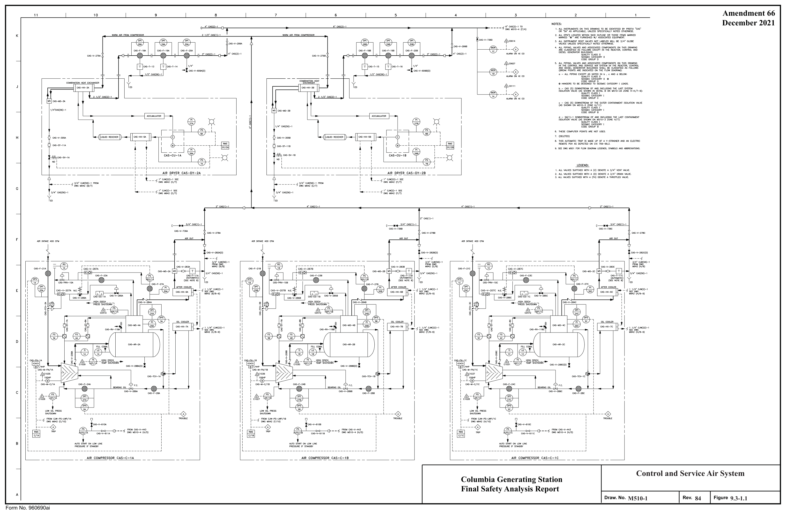

*figure on PDF page 212*

[Vector original (SVG, lossless): fig_page-212_2.svg](../figures/fig_page-212_2.svg)

<!-- labels/text on this figure page -->
Amendment 66 December 2021
Control and Service Air System Columbia Generating Station Final Safety Analysis Report Draw. No. M510-1 Rev. 84 Figure 9.3-1.1 Form No. 960690ai

<!-- p.213 -->
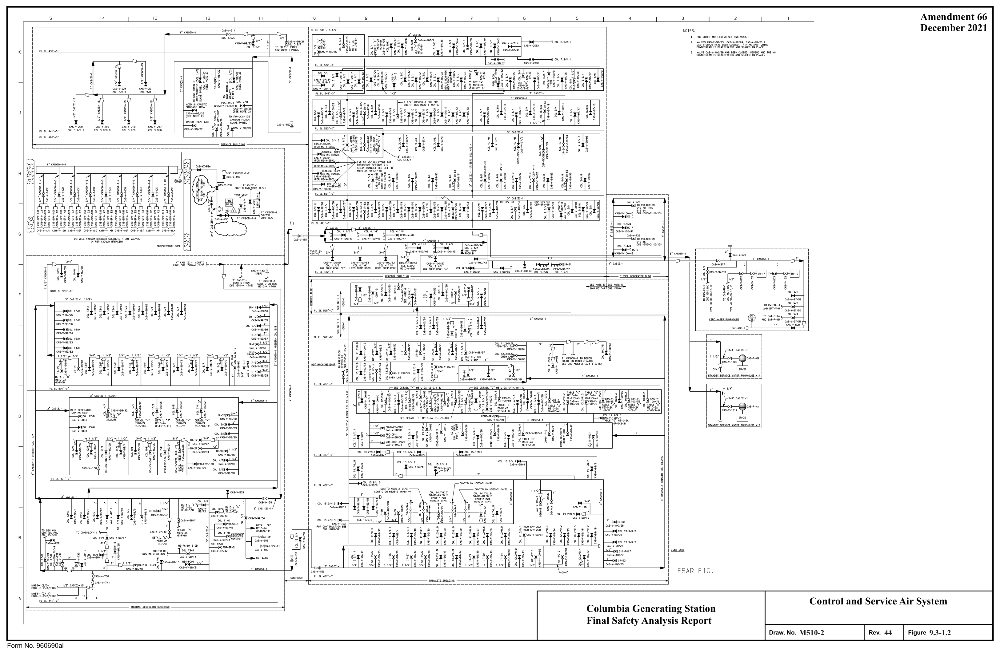

*figure on PDF page 213*

<!-- labels/text on this figure page -->
Amendment 66 December 2021
Control and Service Air System Columbia Generating Station Final Safety Analysis Report
M510-2
44 9.3-1.2 Draw. No. Rev. Figure Form No. 960690ai

<!-- p.214 -->
Amendment 63 I I I I 8 2

## 11 I 10 I
## 7 I 6
5 4 3 I I December 2015 MSIVSOLEN0IDPll.OTVAL.VE~IFOLD-'SSEt.lclLY I D,~ 1 r1 I NOTES:
K SE[ ,~.,~ t,1;>29(J/J)
,__•,•l••tv ~"~""f .,.
CASVALVESREFLECTE□ INTAIILESAREROOTVALVESrDRSPV'S REFERENCED. TUBINGTAKE-DFFSFDllEACHSPV ARELDCATED WITHIN 12" DF CAS VALVES. EACH TAKE-OFF HAS A 3/t,"

#### ,;,· """-_) r _J ,'I•,· , __
SrUT-OFFVALVEINSTAlLED(TYPICALLY)NEARTHESPV Fl'.R SINGULAR ISOLATION or FHE Sl'V AIR SUPPLY.
- [ l, "' CAS-V-326A THRU 3260 )
<T- :
,;,•c,*)-1, I ~ZCAS-V-100/5 SEEN01E5o SEENOTE5b •CA5-1tCAS-~S 2'CAS(5)-1S-d j
(REF) •ow.:; ~10-1t DWG l.eil □-1 • ~

#### -1
J" CA'i(:'i)-1 (HEADER _ 1/2" CAS{S)-10 • ~ ~=~=:i:
J.. g:t~=~ 1/2'" CAS(5}-1 .._,.-,_ 1/2" CAS(5)-1 C/>S-V-29A ._. ' CAS-V-2~8 '--2• ~ 5)-15-b CAS-V-.!!OC CAS-V-29C

#### CAS-V-514C
#### CAS-Y-300 CAS-V-290
CAS-V-614D I/◄" CAS{5)-1\ [ 1/4" CAS(5)-1 /_ 1/4" CAS(5)-1

AOCUIJULATOR LINE NO "o' LINE NO "b" LINE NO 'c" LINE NO "d" TO FP-SPV-SGT/26\.-./Xl-....l..<~l-4,.--f,-.L./)<',-..\TO FP-SPV-SGl/16 fO FP-SPV-SGT/66

FP-V-SGT/17B FP-V-SGT/177 11/•" CAS(S)-1 FP-V-SGl/182 1/2" CAS(5)-1-11 2"CAS(5)-1S-11 1/2"CAS(5)-1-15 2" CAS(5)-1S-19 1,1S-TK-2El 1/2"CAS(5)-1-12 2" CAS{5)-1S-12 1/2"CAS(5)-1-1& 2"CAS(5)-1S-20 1/• " CAS(S)-1\ 1/4" CAS{S)-1 [ WS-TK-2C 1/2" CAS(5)-1-U 2" CAS(5)-1S-D 1/2" CAS(5)-1-17 2"CAS(5)-1S-21 r CAS(5)-1S-22 1/2" CAS!5)-1-1 4 2"CAS(5}-1S-14 1/2"CAS(5)-1-18 1,1S-TK-2D TO FP-SPV-SGT/36\.-./Xl--'-<~,-...L-f,-Ll,<',--',TO FP-SPV-SGT/◄6 '--, .)-J'-,)<'.f--1 TCl FP-SPV-SGT/58 CO~AIRTOMAINSTEAMISOLATICNVALVES
(N01E2)
(NOTE2) FP-V-SGT/179 FP-V-SGT/1BO FP-V-SGT/181 lilS-V-28A, MS-V-288, MS-V-28C & MS-V-28D

filifil_"(" .DUAfL"B"

#### CAS-V-100/81 EDR-SPV-44 CAS-V-100/75 RWCU-SPV-206A
#### M510-2(K/10) H
#### M510-2 (H/10)
#### RWCU-SFV-21 4A
#### EDR-SFV-51
#### RWCU-SFV-232A
#### EDR-SFV-52
#### RWCI-SFV-234A
(~~~=~~=~!~~ ~ E□R-SFV-54

#### EDR-SFV-S7
EDll-SFV-SB

#### TO BS-V-64
TABLE "F" TRN> STATION 27

#### TOBS-V-66
#### M510-2 (D/4)
,.TRN>STATION28 .!A6LLX

#### M510-2(0/6)
<,0-----\

#### CPS-V-98/13
(REC[ 3/4" CAS(~)-1_/ l J/+" CAS(S)-,_/ l {NOTE2)
(NOTE2) G lt ,_ CAS-V-100/90 ,_ CAS-Y-100/85 l{i- (REF) (REF)
CAS-V-100/63 FDR-SP.,,-11).4 : CAS-V-1 00/77 CF-Sl'V-616

#### FDR-SP.,,-105
#### CF-SPV-619 I
#### CAS-V-294(0)
FDR-SP.,,-11):1 I I CF-Sl'V-620
--'- J--

#### FDR-SPV-100
CONO-PCV-264(CVl220-01,905,1, THRU4)

#### FDR-SPV-111
FDR-SP.,,-112 DETAIL ''H" .l2illJL"E" .ilE!AfL"J2" .llEIAfL"E" ~ FDR-SPl-115 TABLE "G"
1.1510-2(8/12)
t,1510-2(0/7)
1,1610-2 (D/7)

#### FDR-SP.,,-116
#### M510-2 (0/13)
1,1510-2(8/12)

#### MS10-2(D/4)
#### FDR-SP.,,-118
ffi1 "'

#### IABLLE'.
I I

#### M510-2(D/6)
~?CAS-V-99/32 i

#### TOIR-1A tl F f 11;~•M
I
--f' "' i I I I
(N01E2)
(NOTE2)
: * TT '.",;i~"I' ' I CAS-V-98; 40 ~~=:=; ISCU.llON SUPPLIES

#### CAS-V-99/81
*,~;;:~s,/4'

#### CAS-V-100/79 RWCU-SPV-2068
" y ~ ~: TOIR-1Ji"(OEC[

#### T0MS-SPV-155A
R\li'CU-Sl'V-2148 ANDMS-Sl'V-15~ ~ ~ COND-Sl'V-221(CV1220-01,1105,1THRU 4)
" 1.,_ S' R\li'CU-SPV-2328 CONO-SN-21!'1{CVl220-01,905,1 Tf-A.1 4) -'-'-'--'-" TO IR-18 ~ ::g:=:~=~:~r w:i, a,~ Rl'ICU-SPV-223 e:, ~~ 1;2· . L,~ ~;;
1/2" SA-SPV-~

#### CAS-V-312
I :Ji~ I ~~

#### CAS-V-281
CAS-V-280 e~ e~ " ~ TABLE "C .IAeLE...X el

#### TO 1GHV-2A
1.1510-2( □/5) ~ ~ TO TGHV-28 M510-2(0/6) TO RFW-CP-RFT/1A TO RFW-CP-Rn/1B E 1,1985-1 (G/10)
Y!lt.5-2 {G/10)
fillliL'.1'. ~ JlEIAfL'1" .J2UAlL."M" ~ ~ {N01E2) 1,1510-2 (8/13)
1,1510-2 (D/1.3) t.1510-2 (D/13)
1,1510-2([/15)
MSl0-2 (0/14)
t.1510-2(8/12)

#### w
#### CAS-V-100/78 RWCU-SPV-2078
#### RWCU-SPV-2118
·.
R\li'CU-SPV-2128 i
-, Rlli'CU-SPV-2138 ~ i, RWCU-SPV-231El W I ~z CAS-V-97 /30 t ~, RWCU-SPV-2388 "' " (REF) I ~ r)i°O.D.CU(TYP)
I
- w TABLE "D" ½" ½" r-TO COND-V-208C

#### M510-2(D/5)
,tiTI* CAS(;:,~r/'9 ~ :a COND-V-S~/231Cc=~~ ~~:~=~=!~:~ 7 D + 1--------,•x 1;2·---- ~ ~ "' u• r--TO CON □-V-2088 L.,,. 1 COND-V-SPV/2318 C::~~ ~~~~=:=!~::
1------1/2' X 3/11•- ~ ~ s J J '\ 1 " \., CAS-V-322 " \., I ~
(N01E2) u :::- ~ :::- ~z CAS-Y- 1111/50 : ®c,s

#### ½" r-~~ ~~:~=:=:~~: J
l~ (REF}

#### CAS-V-100/76 R'/ICU-SPV-207A
J +" 34• ½" ~ /pi'\ I R'/ICU-SPV-211A ' I lf1',. CAS-V-320 (TH) 9 = 9 = ,_ 1' CDND-V-SP'//231 A L-ro COND-V-231A ! R'/ICU-SPV-212A ____i:__ w y

## 10 CAS 10 CAS 10 CAS
"CAS-V-97/35 "CAS-V-100/1 ½" r-~~ ~~~~=:=!~~~ :c.i..s-v-319CA~10

#### IMCU-SPV-231A
(REF)
½" _,. 1· RWCU-SPV-2JBA (TYP1~-~~5)\ I I I I CAS-V-~16 \ T_ \e>s-V-61!1 . \1"(TYP) I I I CDND-V-SPV/231Dc= TO CONO-V-2l1D J-- J--
--'- .f--;<>:)-l--.--,xi-----itJ>l<t>-'--t><r--1 , ½" r-~~ ~~:~=:=!~~~ OOLL'.C (REC[ ½" J2Eifil..'K DETAIL "u" DETAIL '1/1" CAS-V-100/93 CAS-PRV-11 1'

#### DETAIL 'V'
DETAIL "S" DETAIL "T" M510-2 (□/+} 1" CAS-V-618 T 1· ~DND-V-SP'//231Ec=ro COND-V-231E 1¥1510-2 (B/11) M510-2{K/6) 1,1510-2 (K/9) 1,1510-2 {K/10) 1,1510-2 (K/8) t,1510-2 {K/7)

#### CAS-V-617
C ½" r-~~ ~~~~=:=!~~~ l/2" ½" ~ S-PR,1-12 1/2" CAS-V-62D ~I CDND-V-SP'l/231 F L-ro COND-V-231F '"' CA5 a

#### ISOLATION SUPPLIES
#### CAS-V-9B/4 FPC-SPV-BA
-

#### FPC-SPV-118
DETAIL •N"

#### MWR-SPV-509A
t.1510-2 {0/8)

#### MWR-SPV-509B
#### MWR-SPV-525A
Control and Service Air System

#### MWR-SPV-5258
#### MWR-SPV-576A
Columbia Generating Station f.lWR-SPV-S768

#### MWR-SPV-620A TOOEH-V-75
Final Safety Analysis Report DWG M959 (E/6)
B

#### MWR-SPV-6200
#### RWCU-SW-443 - DEACTIVATED
I I .l20AlL"x"

#### M510-2A
16 9.3-1.3 TABLE "J'' Draw. No.
Rev. Figure

#### M510-2 (D/12)
f.1510-2(0/4)
Form No. 960690ai

<!-- p.215 -->
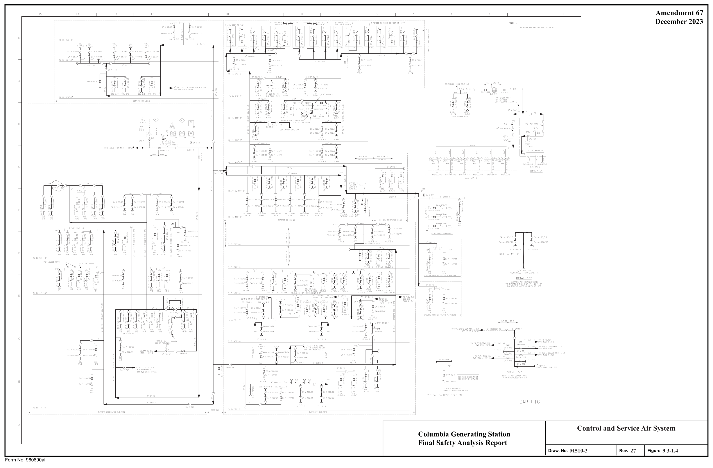

*figure on PDF page 215*

<!-- labels/text on this figure page -->
Amendment 67 December 2023
Control and Service Air System Columbia Generating Station Final Safety Analysis Report
M510-3
27 9.3-1.4 Draw. No. Rev. Figure Form No. 960690ai

<!-- p.216 -->
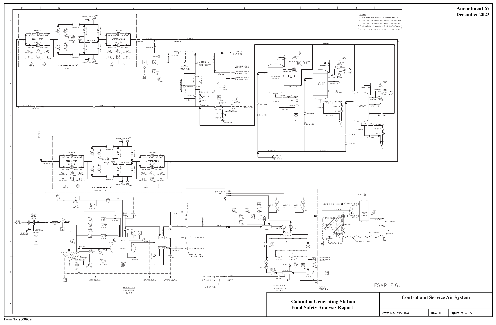

*figure on PDF page 216*

[Vector original (SVG, lossless): fig_page-216_2.svg](../figures/fig_page-216_2.svg)

<!-- labels/text on this figure page -->
Amendment 67 December 2023
Control and Service Air System Columbia Generating Station Final Safety Analysis Report
M510-4
11 9.3-1.5 Draw. No. Rev. Figure Form No. 960690ai

<!-- p.217 -->
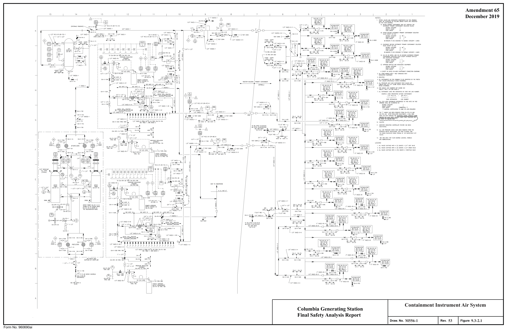

*figure on PDF page 217*

<!-- labels/text on this figure page -->
Amendment 65 December 2019 15 14 13 12 11 1D
]TESTC<JNN
J/+"W,(00)-1 J/4" X 1/2"
3/4"
2./,,LLITEM51JARKED\IID1'~FURNIS/-t'DWITH /..SSOCl'.TED EQ UIP~ENT l/2" Cll.(50)-1
3.(DELITED)
+. ALL INSTRUMENTS ON nm DRAWING TO El( IDENTimDBYTHE PREFJX ·w.:uNLESSSPEC!flCALLYNITTrnOTft'RWIS[
1"CJA(2)-1 6.FOR""IQUELINENUMBERSOOT5HO~SEE T,',B_E'i I HO II ON D\IG M~56-2.
7. "-1.LINSTRlJMENT L..N ES Nll: DESIGW\TEDBYCOOC~DUNEWMIJEJl
B. M..L fU:X ~[ ASSEMBLIES l~EJIRENCUJ TO n11S ~E ON THIS DAAWINGSHALL OC a.J,SSFlED/,S
12. ,t!_l LOI\' PRESSUFIE GAGE5 HA\IEEHN REr.ovED FROM THE NITRO(;[N OOTTLL REG ULATORS. 1)-f' PORT PLUGGED, l,'O :~l'[~r;ES RELOCATED OOWN STREAW CFTI-IE E!L!ED/Si-1.Jl--Cf'F
I J , Sl:Etl'l',GMW1 r□R flDlfDIAGR,l,l,l lJ:~E~S,SYlolEll..S !Nl"8ElRE'llA.TIONS
LEGEND
I. /,,LL VAL\IE5 SUFFlXED WITH A (Y) □ENOlE A J/+" ¥£NT V/,,L\IE
2.ALLVAL\IESSUFFlXEDWITHA(D)DENOlE AJ/ +" DRA!NY/<J..Vf.
~. /,,LL VAL\IES SUFFJXED WITH A (m ) DENOTE A THROTTLED VALVE
1/2" Cl,',(5)-2-6
1/2" CIA(~)-1-4
1/2" Cil<))-2-+
1/2"CIA(5)-2-2
1/2'
Containment Instrument Air System Columbia Generating Station Final Safety Analysis Report
M556-1
53 9.3-2.1 Draw. No. Rev. Figure Form No. 960690ai

<!-- p.218 -->
## 12 I 11 ID 9 l) I I
I April 2000
-· ftlr a'IIN1 ..:rtfl - LUI._, fl C:•IWI -ia,.,, 1.

lifl.l.J.1 ' ltt..-lUIU.Tli:i.
,•,u.u,-n-,, r tl•Gl~ll (IA-Il,fil 1/J. {ll(ll•~ l"Cl•1Jlo ... U t1'i'CU,GJ-,-.11 "i-1(-111 t,,1• CU,Qllob13 ,1• UIUD-3-1.1 tl•l~•.111 l,Z- ~l•ffl•'-~ ,,,,- CJ•f)T-1\..1• r t,1a,.a,.U ,•uu:J,-:s-u l"r:'f.l:ll•l"l•U Ttl&l.)li.,._,.14 lli°UH!l•J-lf '5-1(-4 :1•·""•" 1,r Cl••~-,-., J,." CIIUl•Z,..n !1..,1&.,a 11£Cl11$J""""' l 0 tllltlJ•JIS,,.tG ,1•c1ul,..a-Y {l&..flt,..u ldCJOM"'-4 rtllCJII-IS-)1 J" C:1611>•.l'S,.4 11:t"(IIQl•l•II r o~,,, . .l!J.4 "r t1•<5-,-S-11 a·,,.a.c.n-::?".-1, ~• (UUl·JS-.B 2·r11rn.,h--,;, .,~t1.1ui411 cn-a-4 U&-ft.~ 1,l'" [1111le')-11 1'Cllrn-a-1• ru1cn4!1.-• 1• C:11.Q:1-6-lf J"Uul1-A-:.II 1,1i'Cl•0>·1·11
(lhfW,SI 1f'i"Clt~•'!l-l;J 1· C11QJ-Y.r-•I i· UHJl•2'1·11 rcu1.:a•&-o1 ;,• U&r»-15-U 11('uu11°;~u Uo.-t~-U. i,;t" (1.1.,~,-\.-U 1" rnOl4;.-JI til•II-W 1,r tl•ftl•,-11 rr,uu . .,..n 11!1-f,...,, 1rr ,11,m-s-11 r c:ru:n-a-~ ~ (UtJtwlJ-IJ' z't!IOJ~'lll!I :rruQJ.l'!ofl 'J:i"C,«lJ•l•11 Cl•·'••h 1n9 Uif'"il-S-1'1 tt ... 'o;-,a ia· t11.r~-,.11 ...-rt...,..
2•u.-1D-6-.l.J 1.• C1&W ·A-Cl a·c1AJJ1-a-i1 2·,uaa-zs.11 1/Z°«:IHJ>+ll 11.l.° Cllu::1-2'i-Zl ;I" tll.UJ•&-U t1l•'Jl-1l,fr, UT tl•dil•,._lr

1,,1c•t1•m .. s-1111 a· (IIC,,~l r C1.IIJl-&11 ;r• l;UCJl-&GS IJl' et•O>-l•I In"" Cl.llli•l'l---4 ,l. ,1HJhl1•t JI' Clll1'•&9 1,a• Cl.t.lSl-!,.lQI

1,ruu-.;.,-11 ~f,t.O 11r Cllll1-Mi-1' .1· (IHJl•ni•.n ,a,· c1•1J1•l'S-~ 1· C.Hl'll·..... T tlH»-n,-H J' Clllb-25-<tll Id u~u.,+;o Ch•!~elt,I

U6-~-10ll 1n'c1.u1t-!>-u Clk~•llt 1f1"tll"1-l-l31 J15-.'l'C-l": 1..,. tlUJl-11-U :t' cur,i.Jl.-1" .1· l:UUI-J"i.-U 7' tlU"ll'-&l .a' r:nrv-n-1' 1' [lll.D4'$-611 Tri' i::rtf1>"r7' cu.1 •. 111 1,;;"<l•l!.l•~ 111.· tlA..iJ•2S-l'I l' U-'ll)•ll-il J' '1-llJl-..li-a 2· (ll~-&1 r' C:Jlf!)•JS-ZII ;r· Ull»•u-61 ln" ltl•\l)~ ics-,1--J lll'UIIS).!,,.ZI, ur <1.1.11•-~l'J .r e1•1»-..,,.._a r ti•m-g., r c111b-a,.,o "'i-ro:..- 2° cum-a-a ;r• CtHY•IS-fl "z· c1,u:n-2-11 1n•c1•<!l-S-a ,d-tc-u rn• ({IUJ-J'-S 1n· cum-2 ... IIT' (111--~·' :,· CJUJI-J'i.S J' CIJ.Ol·.15-1 111'c1•i::w-wr

a• cuQl-bl ,n• cr,,m-1-IO 112·c1usa-•·lll 1,r c1 .. Q1•1•• i,~· c111,:,-a,.t; 1· ci, .. ,,.....,

;r lll!Jl-1'-J !ll'°CJ.tr5i.,-a ,,,,..11~1c ,,r (lJ.t'.!1-1-, 11¥' Cl•t;II·~·~ ;· c1u,1-•• ,11- "'ffl•2-!l 1,rtl-'B.•S-» 111·e1•1S!'•._n .,~c,,u,1.1-!ll:I' (11.-.111:.1•
(l._tt•!SII 11rci•~•'l-» CIMIIMII IICU•$+lt Cl~-l(•I· •n•u,u1i-~n

llUAIL'..l:.'..
ctNfJ.llft■f ll15nnJl!lff llll nl

......... X,.Ql..UoQ.';111111:

JiarJ~m,-•cn,

-

-

Q

-

Containment Instrument Air System Columbia Generating Station Final Safety Analysis Report

#### I Rev. 8
I Figure 9.3-2.2 Draw. No. MS56-2

Foffll No. 960690

<!-- p.219 -->
Amendment 65 10 15 14 13 December 2019

#### GENERAL NOTES
1 ,',,LL PROCESS ( EXQUSI\IE Of PS& PSR --~=-~x~-- "" IS 8YCONTRACT 2SOS-2 l 5 □~;~~;,;;;;;;~;[}-_---ix;...2!·1 ,l,.LL TUBINC PSR D[ SIGNATI DN)ISElY

#### CONTRACT
2 (DELETED) J-R~F~H_X=-~

!T~.P.~ .... TER~

~o~ ALL SAi.ft_( UNES TO B[ 1/; ~. 0.0. X O.D.35" WALL ~i S.S.TUBING, EXCEPT ~NOT

s,,,r, PLE PROBES S H,',LL 6\ : ~ ~:AL~EE~□; 4+.", :N □ AEKl\lEP IP' ING ON._Y. FOR SAI.IP LEPR □El [ PRESSIJRE ~TA P SHALL OC USED.
u:ec•(•l:j 3P ,.,,-- SYt.l ElOL l/4 "PSR(4 )-1S 4"&U P

:;,I ~·1 ~.
1

#### P5R- FA-2
#### PSR-QOC-2
INSULATE FOR PER50N~ L PROTECTION ON LY

10 smPLEP!PINGTO BE CLASS II AA □ SEISWC CATEGORY rLASS II WH ERE NOTED)
!-£REIN AND ON t.1619, C~ ECTION

#### DIAGRAMS
## 0 DENOTESSAt.lP LERACK SERVICENOZ ZLE CO ~
1/4"PSR(13B)-3S

L E~~LN~ALVES SUFFJXED WITH A (TH) OCNOTE ATf-F!OTTL[D V,1,LVE.

3. t.1~10-INSTALLATION Cf" SAAWU PROE£S TES t.CXJ l- f LOW DIAGRAM LEGEND. SYMBC'LS. NO ~~!: ~~~~:~~E:0~0~::1~00:~_6 ~ ,1,,ND ABB REVl,l,,TIONS.

#### NITOR
,:~!-"J !
-=i, SMaPLE ROO~ r □R CO NT. SH □WG i"TSW(3B)-I t.1510-l(B/1 2)
EL. ,U l'-0"

#### SR-1SAMPLE RA.CK
"
- "
-

#### SR- 2 CONSTANT TEW. BATH
---\-----l'i[I]'f[ii]:::Jc PI..A N 5H □WING LOCATIOS OF SA~ PUNG Af'f>IIRATUS ~~ [fil I (S:~: ;_\N)I TH l"TSW(38)-1 __/ SPRAY V,',LVE B □XNol PON D (REF C>WG"'742) ,.,_ CONSTAN~P. BA 1

(SECON DARYOUr)

C a r ~

#### POTABLE WATER
#### PUMP PACKAGE
#### PWC-PP-51
C~D. ST~ : ~ ~ TURBIN E BUII Dl~NG =-----,L~~~~;=;===~

#### FSAR FIG.
J/4"PS(4G)-1 S

A

Steam and Liquid Sampling - Columbia Generating Station Turbine and Service Buildings Final Safety Analysis Report

#### M607-1
56 9.3-3 Draw. No. Rev. Figure Form No. 960690ai

<!-- p.220 -->
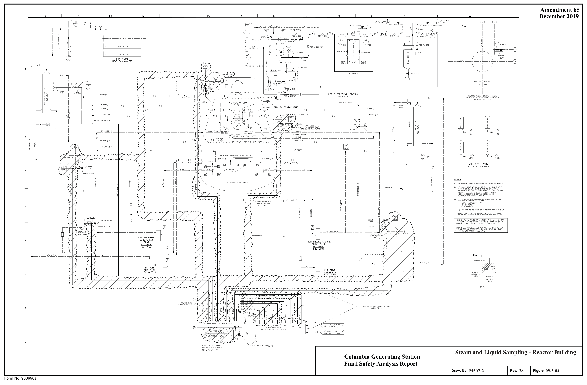

*figure on PDF page 220*

<!-- labels/text on this figure page -->
Amendment 65 December 2019 15 14 13 12 11 10
• 3/8.(VENl) 3/B" •
(VENT)
N ---+-
I I ~1 ' rt\~@
---\i) ·'"'·
I
RCC FI LJER/PENIN STATION
(SE(NOTE.5)
S.IJ.IPLE
PROBE
~ I ~
I ' G I i ' ;1 1 ' 1
EXPANSION TANKS
AT DIESEL ENGINES
I ' ii I t1J ~GERS TO El[ DESIGNED TO SEISMIC CArEGORY I LOADS.
SAMPLE PGINT5 ,>RE NQ LDNGER FUNCTIONAL. l<LTERNATE ~ElHOO OF SA~PLING IS OONE PER THE /IPPUGAaE PPM ~I lj 11
----------j1}1LJ I ~I I I
I- - I
l
LOW PRESSURE I
- - -
CORE SPRAY
PUMP '_J 1 LPCS-P-1 1 I r , E21-C001 •-, --------~ f
-----------------, _'_j
7!"RHR(1)-~ __ _j '
RHRPUMPW
~
E12-C002A
C
OCAUIVATEDANO SPAR£□ IN PLACE
(SEE NOTE ~)
A
Steam and Liquid Sampling - Reactor Building Columbia Generating Station Final Safety Analysis Report
M607-2
28 09.3-04 Draw. No. Rev. Figure Form No. 960690ai

<!-- p.221 -->
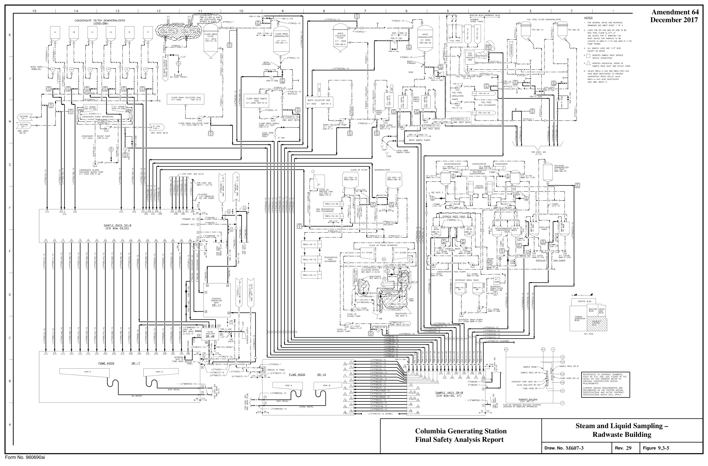

*figure on PDF page 221*

<!-- labels/text on this figure page -->
Amendment 64 14 12 15 4 13 6 December 2017 CONDENSATE FILTER DD.ilNERALIZERS
COND-DM-
I FORGENERALNOlESAND REFRENCE DRAWINGS SEE MW7 -SHEU 1 or 4
RUN THRU FLOOR EL.477'-0 " USE SLEEVE FOR +M MWR(78)-1SX ROOT VALVES FOR SIIMPLES ro BE LOCATED IN MWR-P-117A AND i,iWR-P-1178 PUl5'R00 t.1S.
ALLSAMPLELINESARE1/+"SIZ:E 4. □ :~~:~s EXCEPT AS NOTED c::~~:CK SERv1CE 1/2"
s.D ocNonssEc<JENTJALORDEROF SAMPLE RACK INLITi'.NDOUTLIT CO~ .
6 VALVES RWCU-V-442 ANO RWCU-SPV-442
HAVEBEENOEACllVATEDlOPREVENT
L....J
INADYERTENTRESINSPILLS.VAL\IE W5 SUMP TRENCH RWCU-V-ol-43 ALSO DEACTIVATED
(SEE DWG. ~523-1)
FLOOR DRAIN COLLECTOR TANK
1;11-AOOS FOR-TK-6 T L.,...-E?" ~I ~,_ ____ J ~,-J '
DWG. t.1534
(B/1 ':i)
M607-1 (H/13) ~ ~ ~ FORCONT, SEE (G/j)
~--r"-~ !~ FOR CONT.SEE ~:
~ ' "d;1" T 2,s
-- 220 220 I
SA~Pl E RACK SR-9
(CVI S0A-00,32)
SAMPLE RACK SR S
(CVI 60A-00, 31)
PL,1,.N ON RAOWASTE BUILDING SflOWING
(CHEt.1.WASTE)
LOCATION OF SA~PLING AFPARATL/S.
1 1/2"MWR(59)-1S
1/4'PSR(7Jj-1S(SPAAE)
Steam and Liquid Sampling – A Columbia Generating Station Radwaste Building Final Safety Analysis Report
M607-3
29 9.3-5 Draw. No.
Rev. Figure Form No. 960690ai

<!-- p.222 -->
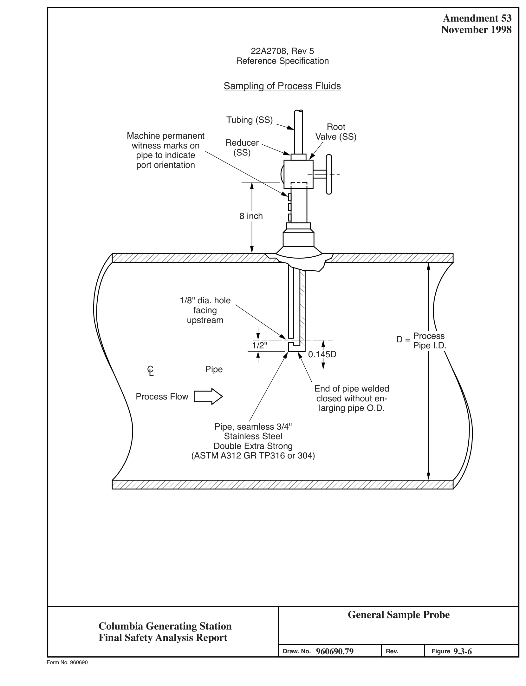

*figure on PDF page 222*

[Vector original (SVG, lossless): fig_page-222.svg](../figures/fig_page-222.svg)

<!-- labels/text on this figure page -->
Amendment 53 November 1998
22A2708, Rev 5 Reference Specification
Sampling of Process Fluids
Tubing (SS)
Root Machine permanent Valve (SS)
Reducer witness marks on
(SS)
pipe to indicate port orientation
8 inch
1/8" dia. hole facing upstream D = Process 7 1/2" Pipe I.D.
t 0.145D _+_ _______ _ CL Pipe End of pipe welded Process Flow closed without enlarging pipe O.D.
Pipe, seamless 3/4" Stainless Steel Double Extra Strong
(ASTM A312 GR TP316 or 304)
General Sample Probe Columbia Generating Station Final Safety Analysis Report 960690.79 9.3-6 Draw. No.
Rev. Figure Form No. 960690

<!-- p.223 -->
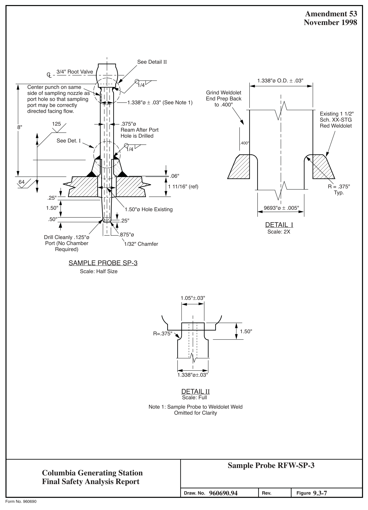

*figure on PDF page 223*

[Vector original (SVG, lossless): fig_page-223.svg](../figures/fig_page-223.svg)

<!-- labels/text on this figure page -->
Amendment 53 November 1998
See Detail II 3/4" Root Valve CL I
1.338"ø O.D. ± .03" 1/4 Center punch on same Grind Weldolet side of sampling nozzle as End Prep Back port hole so that sampling
1.338"ø ± .03" (See Note 1) \ to .400" port may be correctly directed facing flow.
Existing 1 1/2" Sch. XX-STG 125 .375"ø Red Weldolet 8" Ream After Port Hole is Drilled See Det. I .400" 1/4
.06" t 64 1 11/16" (ref)
R = .375" Typ.
.25"
1.50" 9693"ø ± .005" 1.50"ø Hole Existing .50" .25"
DETAIL I
Scale: 2X .875"ø Drill Cleanly .125"ø ' Port (No Chamber 1/32" Chamfer Required)
SAMPLE PROBE SP-3
Scale: Half Size
1.05"±.03"
1.50" R=.375"
1.338"ø±.03"
DETAIL II
Scale: Full Note 1: Sample Probe to Weldolet Weld Omitted for Clarity
Sample Probe RFW-SP-3 Columbia Generating Station Final Safety Analysis Report 960690.94 9.3-7 Draw. No.
Rev. Figure Form No. 960690

<!-- p.224 -->
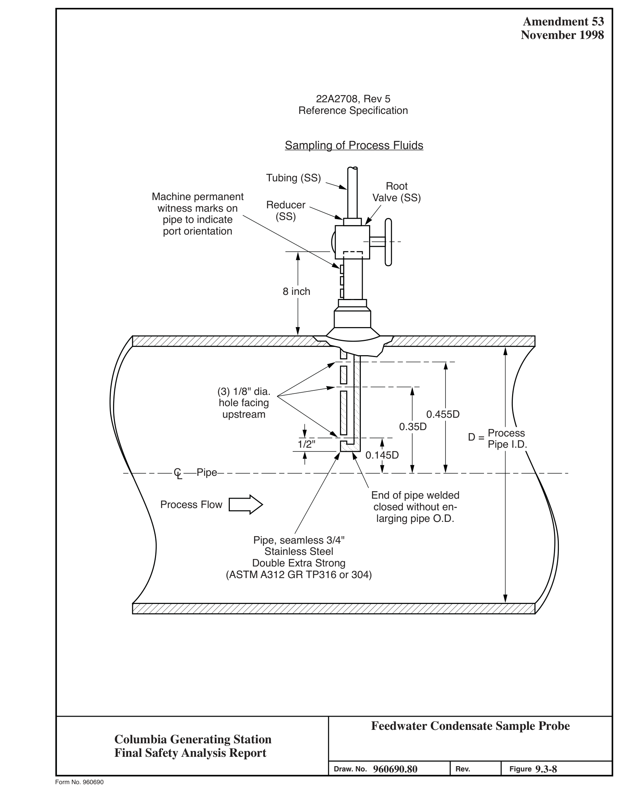

*figure on PDF page 224*

[Vector original (SVG, lossless): fig_page-224.svg](../figures/fig_page-224.svg)

<!-- labels/text on this figure page -->
Amendment 53 November 1998
22A2708, Rev 5 Reference Specification
Sampling of Process Fluids
Tubing (SS)
Root Machine permanent Valve (SS)
Reducer witness marks on
(SS)
pipe to indicate port orientation
8 inch
(3) 1/8" dia.
hole facing upstream 0.455D 0.35D Process D = 1/2" Pipe I.D.
0.145D CL Pipe End of pipe welded Process Flow closed without enlarging pipe O.D.
Pipe, seamless 3/4" Stainless Steel Double Extra Strong
(ASTM A312 GR TP316 or 304)
Feedwater Condensate Sample Probe Columbia Generating Station Final Safety Analysis Report 960690.80 9.3-8 Draw. No.
Rev. Figure Form No. 960690

<!-- p.225 -->
Amendment 65 December 2019 1 a 15 14 13 12 11

ALL PI PI NG,VALVES,&ASSOCIATEDCot.PONENTSON THISDRAWI NG INCLUDED IN Cl>NTRACfS 205, 206. & 215 ARE CLASSIFJED AS FOLLO\\'S OUA.UTYCL,\SS-11+ SEIS t.11CCATEGORYl '-I

2. SU t.1 P PUt.1P EDR-P-5 AND DISCHARGE PIPING FROt.1 PI.Jt.1P, REACTOR B UILDING EQ UI PMENT DRAIN HEATEXC HAN G ER ,CON DEN S ER ,AN □ ASSOCIATED PIPING AAE IN SCOPE DI' CONTRACT 21 ~

3. ALL PIPl'1GINSIDE PRlt.1ARYCON rAI Nt. ENT, EXCEPT ASNOTE D,

#### IS IN CONTRACT21 5
4. ALL PI P],IG & ASS OCIATED cm.lP<lN ENTS ON THIS DRAWING ARE ARE DEN OTED BY I INQUD ED IN CONTRACT 206 EXCEPT \I/HERE CONTRACT INTERFACES

I .">.(DELETED )
+·x11;2 · 6. PIPINGANDASSOCIATED CO t.1 PONENTSIN SU BSl'Slrn EDR(48) <,- nE@D)-1 FRO t.1 RP,' FLG. LEIIKOFF N-17 I UPSTREAt.1 OF VN_VE EDR-V-20 AAE CL"5SIFIED AS FOLLOWS ow;_ 1,1529 (J/9)
~I il ' 7.(0ELITED)

8. ALL INSTRIJMENr ROO r Wt..\lES Nor LABELED WI LL B[ J/4" GLDBE VALVES ' UNLESS SP£Cl f lCALLY NOfED OfHERWIS E

#### EL C,41 '- J J/4.
10. \IAL\IE5 EOR-V-601 & 602 ,',RE CLOSED AND TO BE OPENED ONLY l'IHEN ACCO ~t.KlOAflNG REFUELING OPER,l,TIONS

13.lHIS EQ\JIP. DRAI N IS MODIFIED TO FUN-GTIONt,SA. fLODRDRAI N PIPINGISROUlED T06"FDR('4+)-1TO FCfi SUMP R4 IN RHR PU ~ P ROOM "C."

\/ALVES EDR-\I-J94 & EDR-\I-J95 ZONE A/12):

15. 5" EDR (49)-1 PIPl~G BETVl'EEN EDR-\1-) 94 & [C>'<-\1-)95 ISCLASS!FlEDASFOLLOIIS(ALSO SEE NOlE H ANDDETAIL'"A'"_zDNEA/12)
OOALITYCU,,SS-n+ SEIS~ IC CATEGORY I REACTOR DR'fWELL 16. l HE ATIACHED PIPING ANO SUPP ORTS HAVE OCEN ANALYZ ED 10 SEIS~ IC CATE GORY I CRITERIA TO AN ANCHO R OR THROUGH AN OVERLAP REGION AS REQUI RED IN ~ ES-J
(SEEOETAIL "A"-lONEA/12)
i i

#### LEGEND
1. ALL VALVES SUFFIXED WI TH A (II) □ENOTE A
2. AL L VALVES SUFFIXED WI TH A (D) DENOTE A J . ALL VALVES SUfflXED WI TH A (TH) DENOTE A

#### SUPPRESSION POOL
'"'°""'~] L__
(SH NOTE H) E00-\I-J1l~

(S EE NOTE15)= A Equipment Drain System – Reactor Building
(SEE NOTE 14)r- E~ -Y-394 Columbia Generating Station
(5EE NOTE 16)
~ Final Safety Analysis Report
(ZONE C/15)

M537 79 9.3-9 Draw. No. Rev. Figure

Form No. 960690ai

<!-- p.226 -->
Amendment 63 14 12 10 15 13 11 4 December 2015

#### ALL PIPENG & ASSOCIATED COMPONENTS ON
THIS owe. INCLUDED IN CON TRACT 206 ,'.ND ALL PIP[NG & ASSOCIATED CO MPONENTS

#### INCLUOCDINCONTRACT21 5,UPSTREAM
OF THE SU MP PUt.1P ARE CLASSIFI ED />S FUME HOOD =

#### FUME HOOD
QUALITY CLASS II ~ SE!St.11CCATEGORY II H l ' -O"LEVEL ------

#### SUMP PUMPS FDR- P-1 5A & 15B, FDR- P-1 13A &
188, EDR- P-17A & 178, E □R - P -HlA &: 1BB il~WioN~ AND DISC H,O,.RGE PI PING ASSOCIATED SEE z□Nr(c/~

#### SAMPLERACK HOOKUP FOR
WITH THESE PU~PS ME IN SCOPE OF COOROSION PRODUCTS t.10NITOR & SR- 3 CONTR/ICT 215, THIS PIPINGSHALL BE ROCf" ----------------------------------------------------------------------------------------------------------------

QUALITY CLASS II+ SE!S t.11CCATEGORY II

+SEE NOTE 12, WNP-2 SPECS,

#### SECT.158.1, TABLE 2NOTES
n:
ALL PIPlNG, VALVES, & ASS OCIATE □ a._ a.
[l._ [l._ [l._

#### COMPONENT5 ON THIS OWG. ARE INCLU DED
nnnnnn _J _J _J _J _J _J

#### IN COOTRA.CT 205 EXCEPT WHERE
CONTRACT INTER FACES ARE □E N Dl ED BY:

ALL INSTRUMENT ROOT VALVES NOT LABELED TO EL.501'-0" F.L. 5D1 '-0" 8Ej/4"GLOBEVALVES UNLESSSPECffl CALL'T"
---------------

#### NOTED OTH ERWISE
#### PORTIONS OF PIPING UPSTREAM OF THIS WERE
ORIGIN>.L.LY INST,O,LLED AS FDR-1 QC JH BUT HAVE BEEN DOWNGRADED TO FDR-1 QC ] SEE owe M~□, FOR FLOW DIAGRAM LEGENDS.
SY"180LSANDA8BREVIATIONS

#### LEGEND
#### ALL VALVES SUFFIXED WITH A (V)
DENOTEDA3/4"VENT VN._VE

#### ALL VALVES SUFFIXED WITH A (D)
DENOTE A 3/4" DRAIN VALVE

#### ALL VALVES SUFFIX ED WITH A (TH)
DENOTEA l HROTTLEDVALVE n

EL. 471'-0" __________ _

2"FDR(75)-1

EDR-V-6~J(V)
2"EDR(66)-1

--------EL
--------EL

~ Ll#f~P~Y~f~~ B ' 1 6"FDR(52)-1

#### TURBINE BLDG
#### TURBINE BLDG
#### TURBINE BLDG TURBINE BLDG
#### RADIOACTIVE EQUIPMENT
#### RADIOACTIVE FLOOR
#### RADIOACTIVE EQUIPMENT RADIOACTIVE FLOOR
#### DRAIN SUMP
#### DRAIN SUMP
#### DRAIN SUMP DRAIN SUMP
#### FDR-SUMP-T4
#### EDR-SUMP-T7 FDR-SUMP-T5
#### EDR-SUMP-T6
#### FSAR FIG.
Floor Drains - Turbine Building Equipment Columbia Generating Station Final Safety Analysis Report A M538 37 9.3-10 Draw. No.
Rev. Figure Form No. 960690ai

<!-- p.227 -->
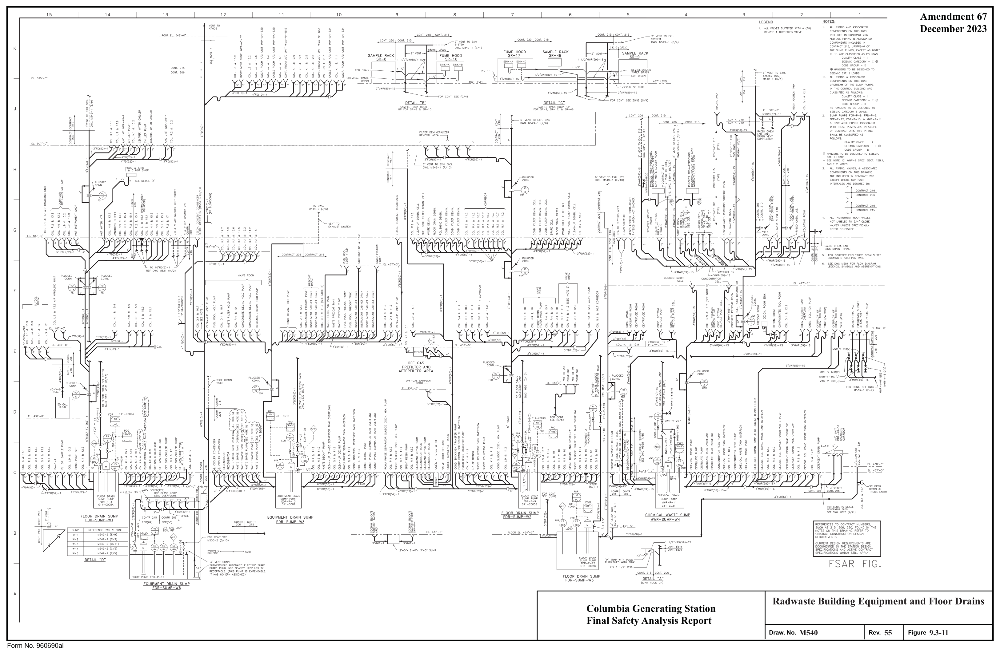

*figure on PDF page 227*

<!-- labels/text on this figure page -->
Amendment 67 December 2023
Radwaste Building Equipment and Floor Drains Columbia Generating Station Final Safety Analysis Report M540 55 9.3-11 Draw. No. Rev. Figure Form No. 960690ai

<!-- p.228 -->
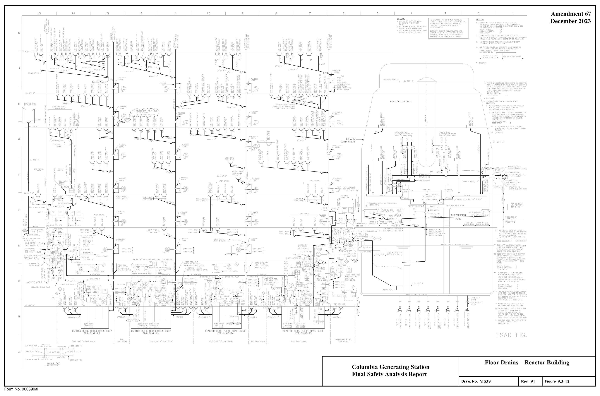

*figure on PDF page 228*

<!-- labels/text on this figure page -->
Amendment 67 December 2023
Floor Drains – Reactor Building Columbia Generating Station Final Safety Analysis Report M539 91 9.3-12 Draw. No. Rev. Figure Form No. 960690ai

<!-- p.229 -->
Amendment 65 December 2019 15 14 13 12 11 10

ALL PIPING, VALVES, ii< ASSOCl"l ED COMPON ENTS ON TH IS DWG AR[ CLASSIFIED AS FOLLOWS:
QU',L!TYCU.SSII SEISt.m; CATEGO RY II

h i8 ____________ oee~"~ '="-~,·-o· _____ _

## 3 CDNTRACTSSOOPE
PIPINGlDSU!,PS 8i'C0NTRACT 206, PUMPS DISC HARGl:PI PING BY

#### CDNTRACT 215
~- ALL !TE~ MARKED • AR E FURNISHED \IIITH

#### ASSOCIATEDEQ UIPIJENT
## 6 F'ORTIDNS OF PI PINGUPSTREAMDfTHISWERE
OOIGl~ALLY l>ISTALL ED FDR-1 QC It- BUT HAif( BErn 00\\ING~AD ED TO fDfl-1 DC I .

~EZZA.NINE FLOOR EL.471'-0" ----------------------------

J"C.0/2 3"F0(1 5}-1 J"C.D.1-"---"---'--"---'-'-'-"-------~

1. ALLVALVES SUFflXED'MTH A(Y)OCNOTEAJ/4" VENT VAL\IE CURBEDPA0rDR M0B!l[ DRAIN SUMP

#### DRAIN SUMP
#### DRAIN SUMP
50 1.. !Dl nO.TJON SYST[M FD-SUMP-T3 FD-SUMP-Tl FD-SUMP-T2 RRC- PV MP
2. ALLVALVESSUFfl XED'MTH
-~-

#### ASDBUILDING
A(D) DHKJlE A J/4" DRAIN VALVE EL.4:)~·-s· ,~ CAB! E CHASE AR EA 3 ALLVALVES SUrf JXEDWITH A(TH ) RADWASTE BLDG.
~'-•rn_(,_,)_-, ___ _,_,_ __ ►~~T;t BASIN D[ NDlE A TH ROllLED VALVE. SUMP

#### TURBIN E GENERATOR BUI LDING
3"FD(11)-1

#### RRC PUMP ASP BUILDING FLOOR DRAIN
#### MOBILE SOLIDIFICATION SYSTEM
#### PAD SUMP DRAIN
F!EAClOR/ RA[Ml-'SlE8LDG.CORRJDOR WALL

#### RWB CABLE CHASE DRAINAGE RISER DIAGRAM
AREA DRAlNS ~ 1,1ACHIN ( SHOP~ EL. 44 1'_Q"

:3•c_o_f,.......~--~-----•-·rn~(•~)-,'

6"rD{4)-1

#### DRAIN SUMP
#### FD-SUMP-S1
#### SERVICE BUI LDING
Nonradioactive Floor Drains Columbia Generating Station Final Safety Analysis Report M518 38 9.3-13 Draw. No. Rev. Figure Form No. 960690ai

<!-- p.230 -->
Amendment 65 December 2019 12 10 14 13 11 15 2

## 1 ALLITEMSMARKED"AREFURNISHED
#### WITH ASSOCIATED EQUIPMENT
PIPING ,VALVES,ANDASS(]CIATED COMPON ENTS

#### ON TH IS D'IIG. SH ALL BE CLASSIFIED
,_• _~c~(<~)-_<S ___ ~~---------iio.__ ___ ~~ A<;; FOLLOWS; I" D1'11 {20)-IS )'-------------=CCO'-s-S,--S~,•~sc~C(d S ~-,~S _____________________

SEE DWG. ~517 (H/7) ow-,s lsLc-is SLC-V-60~(¥)
4-l

8YTHENOTE"SEENOTE 3b."

#### SEI SMIC CATEGOR Y
OON..ITT'Gl.ASS ~h"" ~- ALL PI PING, VALVES, AN □ COM PONENTS DESIGNATE D BY THEN OTE"SEENOTE 3c"DR fHE SYSfEM

#### DESIGNATIONSLC(56)UNLESSNOTED.
§~ ,· w = _J:,e__J_ _ _l_ _ _J_j_~ e n , o-----€8 ,B HANGERS ro BE DESIGNED TO SEISMIC a "

SLC (Sl:ENOTE6) SLC STORAGE TANK

#### C41-A001
d. COMPONENTSDESIGflATED 8Y N(lrE "SEEN01ExJ"

#### SLC-TK-1
,,.
I a

4 (DELETED}

5 ,',LL INSTRUMENT LINES ARE DESIGNATED BY COOE AN □ LINE NU~ BER.

#### REACTOR
#### VESSEL
1/2"Pl(l)-4S G

## 6 SLC-R0-1ISAElLANKINGPLATE(ANQRIFICE
PLIITE\'flrHNOH-OLE)
11/2" 7. SEE Dll'G ~501 FOR FLOW DIAGRAM LEGENDS,

#### SLC(2)-1-S-1
#### SLC-V-27 0
11/2" SLC-V-049(\1)0

I 1/2"SLC(2)-~S-I

#### DRAIN & TESTCONN.Y
I 2"SLC(1)-7S-5 I ,--a---, I 9s

#### SEE NOTESEENOTE I
k ,o I I •=
--------------------+--@---~----~--- f'Bffi I I I

I .!, 1 I & TOCLOSEOUTOO ARD ~tci~T1~i';:,r0:LVE

#### SIJFFIXED WITH A (V) DENOTE
VENlVALVE

#### SU FFIXED WITH A (D)
DENOTE A J/4"DRAINVALVE

#### J. ALL VALVES SIJFFIXED WITH A (TH)
C

Standby Liquid Control System - Columbia Generating Station Reactor Building Final Safety Analysis Report M522 40 9.3-14 Draw. No. Rev. Figure Form No. 960690ai

<!-- p.231 -->
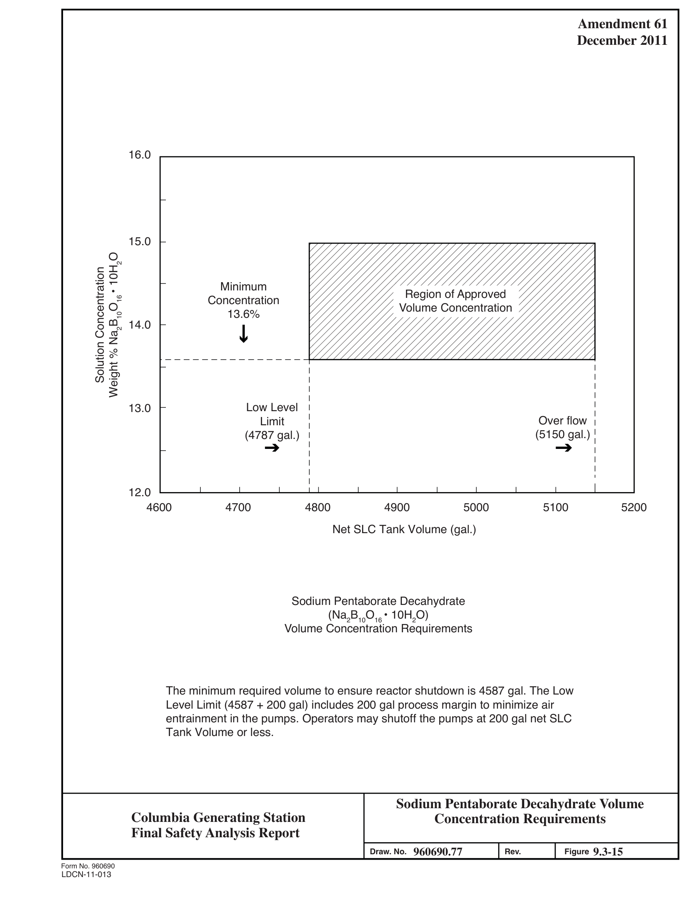

*figure on PDF page 231*

[Vector original (SVG, lossless): fig_page-231_2.svg](../figures/fig_page-231_2.svg)

<!-- labels/text on this figure page -->
Amendment 61 December 2011
16.0
15.0 Weight % Na2B10O16 • 10H2O Solution Concentration Minimum Region of Approved Concentration Volume Concentration 13.6% 14.0
Low Level 13.0 Over flow Limit
(5150 gal.)
(4787 gal.)
➔ ➔
12.0 4600 4700 4800 4900 5000 5100 5200 Net SLC Tank Volume (gal.)
Sodium Pentaborate Decahydrate
(Na2B10O16 • 10H2O)
Volume Concentration Requirements
The minimum required volume to ensure reactor shutdown is 4587 gal. The Low Level Limit (4587 + 200 gal) includes 200 gal process margin to minimize air entrainment in the pumps. Operators may shutoff the pumps at 200 gal net SLC Tank Volume or less.
Sodium Pentaborate Decahydrate Volume Columbia Generating Station Concentration Requirements Final Safety Analysis Report 960690.77 9.3-15 Draw. No. Rev. Figure Form No. 960690
LDCN-11-013

<!-- p.232 -->
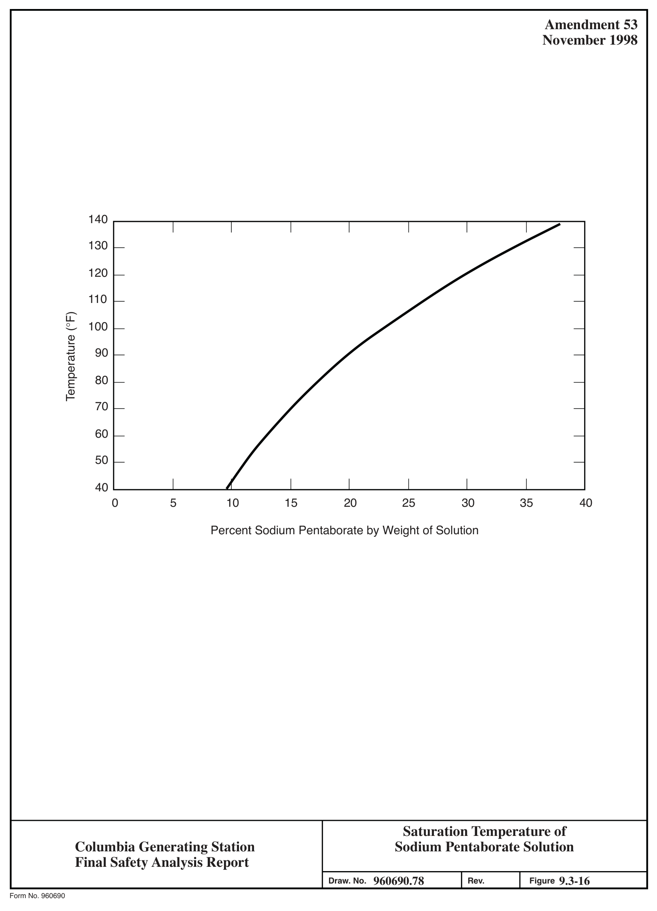

*figure on PDF page 232*

[Vector original (SVG, lossless): fig_page-232_2.svg](../figures/fig_page-232_2.svg)

<!-- labels/text on this figure page -->
Amendment 53 November 1998
140
130
120
110 Temperature (°F)
100
90
80
70
60
50
40 0 5 10 15 20 25 30 35 40
Percent Sodium Pentaborate by Weight of Solution
Saturation Temperature of Sodium Pentaborate Solution Columbia Generating Station Final Safety Analysis Report 960690.78 9.3-16 Draw. No.
Rev. Figure Form No. 960690

<!-- p.233 -->
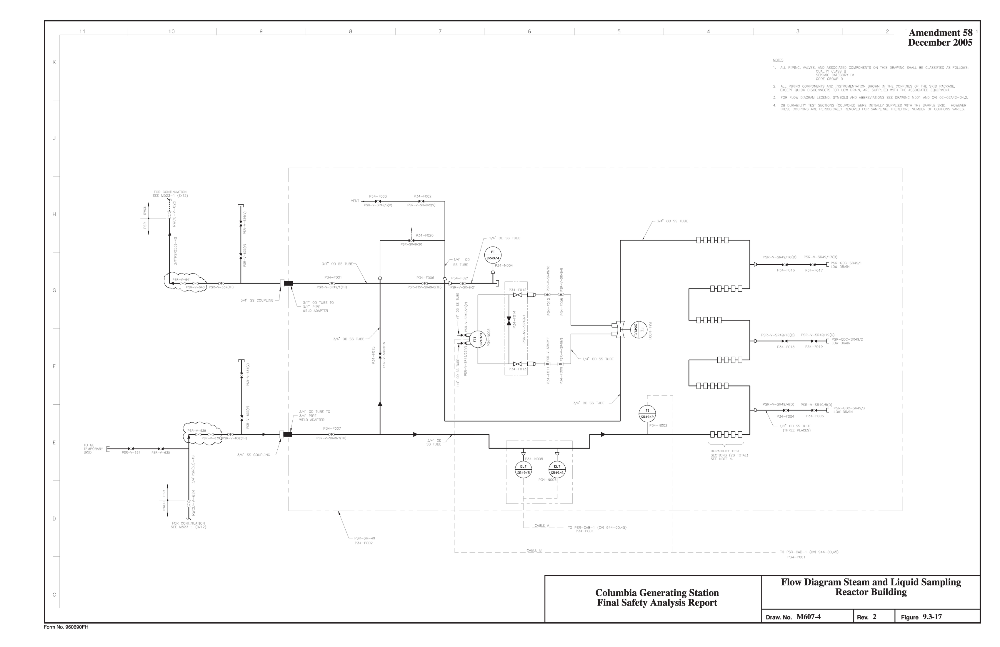

*figure on PDF page 233*

<!-- labels/text on this figure page -->
• Amerldment 58 1 , 0 .3 5 2 8 7 6 I' L December 2005
K
II
l)
Cfa.l::'Ll i<.
-----
IU
Flow Diagram Steam and Liquid Sampling Reactor Building Columbia Generating Station Final Safety Analysis Report Draw. No. M607-4 Rev. 2 Figure 9.3-17 Form No. 960690FH

