# 9.4 HEATING, VENTILATING, AND AIR CONDITIONING SYSTEMS

> Columbia Generating Station FSAR — Chapter 09: Auxiliary Systems
> Source: `09_chapter-3152-3521.pdf`, PDF pages 234–324 (of 370)
> Amendment 67 compilation (individual pages carry varying amendment dates)

---
<!-- p.234 -->
April 2000

### 9.4 HEATING, VENTILATING, AND AIR CONDITIONING SYSTEMS
The various heating, ventilating, and air conditioning (HVAC) systems serving the plant are designed to provide suitable environmental conditions throughout the plant for personnel comfort and/or equipment operation.

The following performance objectives are implemented in the design of the HVAC systems:

a. Maintain appropriate ambient temperature and humidity conditions for station operating personnel and equipment,

b. Control and monitor all potentially radioactive airborne releases from the plant so that releases are within the limits of 10 CFR Part 20,

c. Control and limit airborne radioactive contaminants within the plant structures by inducing air flow from areas of low contamination potential into areas of progressively higher contamination potential, and

d. Remove all potentially explosive gases, noxious fumes, or smoke from the plant.

In addition, a number of HVAC systems are required to ensure a safe shutdown of the reactor or to mitigate the results of the design basis accident. These systems are designed to continue operation in the event of any or all of the following events:

a. Safe shutdown earthquake (SSE), b. Loss of offsite power, c. Single failure of any active component, and d. Design basis accident.

The effect of a loss of normal ventilation during a station blackout is discussed in Appendix 8A.

The following areas containing engineered safety features (ESF) equipment are serviced by critical HVAC systems:

a. Main control room/cable spreading room/critical switchgear area, b. Diesel generator building, c. Standby service water (SW) pump houses, d. Reactor building emergency pump rooms, e. Reactor building critical electrical equipment rooms, and f. Diesel generator cable area corridor.

<!-- p.235 -->
April 2000

The balance of the plant structures are serviced by noncritical HVAC systems.

The following outdoor design conditions are used in the design of HVAC systems having ESF:

Summer: 105°F dry-bulb, 71°F wet-bulb Winter: 0°F dry-bulb

The extreme outdoor conditions are:

Summer: 115°F dry-bulb Winter: -27°F

The effect of these extreme outdoor conditions on main control room/cable spreading room and critical switchgear area temperatures is negligible for the frequency and duration of these conditions since the rooms are interior rooms and the total load changes due to fresh air
(maximum 5% of total air flow for control room and maximum 10% of total air flow for critical switchgear area) are within equipment capacity limits for maintaining inside design conditions. The mechanical equipment rooms housing these three systems are of extra heavy exterior wall and roof construction and the effect of extreme outside conditions is considered to be negligible for the frequency and duration of these extremes.

Extreme outside conditions have no effect on reactor building emergency pump rooms and reactor building critical electrical equipment rooms since these are interior rooms without any outdoor air supply during emergency. During normal operation the emergency pumps are not running and the critical electrical equipment is operating at a reduced load. The battery rooms are provided with room heaters to prevent excessive cooling from SW that could affect battery capacity.

The effect of extreme outdoor conditions on the diesel generator building ventilation system, diesel generator area cable cooling system, and SW pump house ventilation systems is discussed in Sections 9.4.7, 9.4.8, and 9.4.10 respectively.

#### 9.4.1 MAIN CONTROL ROOM/CABLE SPREADING ROOM/CRITICAL
#### SWITCHGEAR AREA
##### 9.4.1.1 Design Bases
The critical switchgear area, cable spreading room, and main control room are located, one above the other, on three successive levels of the radwaste building, with the main control room on the top level. Each level is served by a separate HVAC system. Redundant HVAC systems are provided for the main control room and the cable spreading room. These three systems are ESF systems and all system components, except the radwaste building chilled water system (WCH) (see Section 9.4.4) to the control room, cable spreading room and critical

<!-- p.236 -->
switchgear area systems, and the plant service water (TSW) system to the switchgear area system, are designed to operate under all emergency modes. During an emergency condition, the SW system is used as the cooling medium for the cable spreading room and switchgear area systems. The control room chilled water (CCH) system, or SW system when capable of the required heat removal, is used as the cooling medium for the control room HVAC system during emergency conditions.

The three systems are designed to satisfy the following design criteria:

a. Main control room

During normal operation the main control room ambient conditions are normally maintained at 75°F ±3° dry-bulb temperature by the radwaste chillers. In the event both radwaste chillers are inoperative (emergency condition), the control room temperature will be maintained to ensure 30 days continuous occupancy of the control room and ensure the equipment qualification temperature limit is not exceeded. The control room habitability design condition is 85⁰F with a sustained occupancy of 10 persons. The equipment qualification temperature limit for equipment cooled by the control room HVAC system is 104⁰F. The CCH system is the preferred cooling source to the control room HVAC system, however, SW is an acceptable alternate cooling source when evaluated as capable of maintaining the bounding 85⁰F long term steady state control room temperature. The ingress of smoke or combustion vapors (due to a fire within the plant but external to the control room), or of airborne radioactive contaminants released due to the design basis accident, is minimized by pressurizing the control room. During a loss-of-coolant accident (LOCA), the control room emergency pressurization mode through the emergency filter unit maintains a positive pressure with respect to its surroundings as measured in the cable spreading room.

Three air intakes are provided from which fresh air can be drawn. One local intake is provided for normal operation and two remote intakes are provided for normal and emergency operation. Fire external to the plant and any ingress of smoke or combustion vapors are detected by smoke detectors in the control room fresh air intake ducting, which will alarm in the control room.

Isolation of the control room fresh air intakes would place the control room HVAC in an unfiltered recirculation mode. In the event of a hazardous chemical release, the control room HVAC is manually isolated into the recirculation mode without filtration through the emergency filter units by closing the normal fresh air isolation damper.

b. Cable spreading room

The cable spreading room HVAC system is designed to maintain the cable spreading room and the remote shutdown room at approximately 80°F during

<!-- p.237 -->
normal operation and to limit the temperature below equipment operability limits during all emergency modes of operation. See Table 3.11-1.

c. Critical switchgear area

The critical switchgear area HVAC system is designed to maintain temperatures in the electrical rooms between 55°F and 104°F during normal operation and to limit the temperatures below equipment operability limits during all emergency modes of operation. See Table 3.11-1. The system is also designed to remove any combustible fumes generated by the emergency batteries.

##### 9.4.1.2 System Description
The HVAC systems of the main control room, cable spreading room, and critical switchgear areas are shown in Figure 9.4.1-1 through 9.4.1-3. The HVAC systems for these three areas are located in equipment rooms above the main control room. These two equipment rooms are separated from each other by a missile barrier. Each equipment room houses three separate and independent systems serving the three areas. Equipment details are given in Table 9.4-1.
Equipment seismic information is given in Table 3.2-1.

###### 9.4.1.2.1 Main Control Room
Each of the main control room’s 100%-capacity HVAC systems are composed of a primary air handling system and an emergency filter system. The two HVAC systems share a common outside air intake system and a common duct distribution system within the main control room.
A single exhaust system, composed of a fan, shutoff damper, and ductwork, discharges air from the main control room toilet and kitchen. The exhaust fan operates continuously during normal operations.

Each primary air handling system consists of a centrifugal supply fan which blows through an air handling unit consisting of an air filter, two water cooling coils in series (one normal use coil for radwaste chilled water and one emergency use coil for control room chilled water or SW), and an electric blast coil heater and associated ductwork and dampers.

Separate return air ductwork containing a sound absorber unit is provided from the main control room to each of the primary air handling systems.

During normal operation one air handling system operates, distributing air to the main control room. The temperature is controlled by electronic controllers located in the main control room which modulate the radwaste chilled water flow to the cooling coil.

Chilled water is normally supplied to the main control room air handling systems by the WCH.
The WCH, which includes two 100%-capacity chillers and two 100%-capacity pumps is not an

<!-- p.238 -->
ESF. During emergency conditions, CCH water is supplied to the air handling unit emergency cooling coil for control room cooling. The CCH system is normally in standby alignment for emergency use and is manually initiated. The CCH system is capable of maintaining the control room below the control room habitability design condition of 85⁰F which also bounds the 104⁰F equipment qualification temperature limit for the control room. SW can be used as an acceptable alternate emergency cooling source when CCH is unavailable and when SW is evaluated as capable of maintaining the bounding 85⁰F long term steady state control room temperature.

The two 1000-cfm capacity filter systems are normally in standby and operate in the event of an emergency (F, A, Z signal). Each of the emergency filter systems consists of an emergency filter unit, a 5-kW electric heater, bypass and recirculation control dampers, and associated ductwork. Each emergency filter unit consists of a medium efficiency prefilter, high efficiency particulate air (HEPA) filter, activated charcoal filters, and direct drive centrifugal fan, all enclosed in an all-welded sheet metal housing. A deluge water spray system is provided to soak the charcoal filters in the event of high temperatures in the charcoal beds. Check valves are provided on all drain connections from the filter unit, and the drain header is provided with a deep water seal trap to prevent inleakage of air during unit operation. The electric heater located in the fresh air duct to each emergency filter limits the relative humidity of the air entering the filter to 70%.

The medium efficiency prefilters are provided to protect and extend the life of the HEPA filters. They have an 80% to 85% dust spot efficiency by ASHRAE Standard 52.1 (MERV 13 rating by ASHRAE standard 52.2).

Regulatory Guide 1.52 compliance is described in Section 1.8.

Motor-operated outside air intake (bypass) dampers WMA-AD-51A-1 and 51B-1 are spring-loaded fail-closed type and are provided with limit switches to indicate full open and full closed positions on the main control room panel. Each damper is provided with a remote manual switch in the main control room. Dampers are automatically closed when deenergized by isolation signal or by the main control room panel-mounted switch. These dampers have a design leak rate of 0.5% of the rated flow. Main control room supply fan inlet pressure is higher than the emergency filter unit fan; therefore, when the emergency filter unit is operating, a negative pressure is developed on the inlet side of the bypass dampers preventing any contaminated air bypass of the emergency filter unit. In the event that either bypass damper does not close, an alarm will be activated in the main control room.

The three fresh air intakes (one normal and two remote) for the main control room are fitted with two butterfly isolation valves in series. The normal control room fresh air local intake valves are automatic isolation valves which isolate on an F, A, or Z signal. The normal fresh air intake valves have electrohydraulic operators which are powered from the Class 1E buses.
All fresh air intakes are connected via ductwork to a common intake header from which both main control room air handling systems and both emergency filter systems draw fresh air. The isolation valves in the purge lines and the normal air intake and position indication on all fresh

<!-- p.239 -->
air intakes, the emergency filter units, and the bypass dampers that direct fresh air through the emergency filter units are division oriented electrically.

The remote air intake valves are manual, and the design is simple and reliable enough that the valve may be manually repositioned in a short period of time.

In the event of a LOCA, the main control room is protected from potential airborne radioactivity by pressurizing the control room with air supplied via the remote air intakes. The system operates in the following manner:

The isolation valves in the normal fresh air intake are closed by any of the F, A, or Z signals.
These are the same signals provided for isolating the primary and secondary containments.

Both sets of remote air intake isolation valves are normally locked open. At least one air intake must be maintained open to ensure the control room is pressurized.

The two purge exhaust systems each consists of two isolation valves in series. One purge valve is equipped with an electrohydraulic operator and is interlocked with its remote intake valve, and the other purge valve is maintained open.

Both purge exhaust systems utilize battery exhaust fans WEA-FN-53A and WEA-FN-53B
(which are both ESF) to purge air from the remote intake headers.

Both battery exhaust fans provide the necessary redundancy through cross over ductwork between each set of purge exhaust valves.

The emergency filter units are energized by F, A, Z signals and all outdoor pressurizing air is automatically diverted through the filter units. The main control room kitchen exhaust fan and its isolation damper are also shut off by F, A, Z signals.

Operating in the above manner ensures that the main control room is continuously pressurized with filtered air. The details of the control room dose analysis are discussed in Sections 15.4.9, 15.6.4, 15.6.5 and 15.7.4.

###### 9.4.1.2.2 Cable Spreading Room
The cable spreading room HVAC system consists of two 100%-capacity air-handling units, each with its own duct distribution system, common distribution system inside the cable spreading room, and one purge exhaust fan. The air handling units are similar to those servicing the main control room, i.e., filter, SW coil, chilled water coil, electric heater, and centrifugal fan in the sheet metal housing. Normally one air handling unit operates continuously on a 100% recirculation mode of operation maintaining the cable spreading room and remote shutdown room at approximately 80°F.

<!-- p.240 -->
The cable spreading room purge exhaust fan does not normally operate. In the unlikely event of fire developing in the cable spreading room, the purge fan can be manually operated to remove any smoke from the cable spreading room prior to personnel access.

If the radwaste chilled water supply to the cable spreading room air handling units is lost, SW is supplied to the units for emergency cooling. Under this mode of operation the cable spreading room and remote shutdown room temperature is limited below equipment operability limits. See Table 3.11-1.

###### 9.4.1.2.3 Critical Switchgear Area
The switchgear and batteries associated with the redundant emergency electric power systems are located in separate equipment rooms below the cable spreading room. A separate heating and ventilation system is provided for each set of equipment rooms. Ventilation of the emergency chiller area at the 525 ft level is also provided by this system. Each of the two heating and ventilating systems consists of an air handling unit, battery room exhaust fans and associated ductwork and controls. The air handling unit consists of a roughing filter, two water coils in series (one for WCH or plant service water, one for SW), an electric blast coil heater, and a centrifugal fan in a sheet metal housing. The two air handling units have different capacities due to heat load differences between the two sets of rooms. Electric heaters are provided in the ducts supplying air to the battery rooms to maintain temperature in those rooms above 60°F.

Both heating and ventilating systems normally operate continuously during all modes of operation. They are both partial recirculation systems with fresh air provided as makeup for the air exhausted from the battery rooms. The battery rooms are continuously exhausted (no recirculation) to prevent the possible buildup of combustible gases generated by the batteries.
During normal operation, either WCH or plant service water is provided to the air handling units as the cooling medium.

Under all emergency modes of operation SW is provided to both units as the cooling medium.
The critical switchgear area air handling units also provide the normal and emergency ventilation for the HVAC equipment rooms and the emergency chiller area at the 525 ft level.
Temperatures in the HVAC equipment rooms are limited to a range of 55°F to 104°F during normal operation and below equipment operability limits during all emergency modes of operation. See Table 3.11-1.

##### 9.4.1.3 Safety Evaluation
###### 9.4.1.3.1 Main Control Room
The reliability of the HVAC system serving the main control room is achieved by providing two 100% redundant trains. Only one of the two redundant trains is required to operate to provide adequate cooling and dose mitigation. The two HVAC trains are physically separated to preclude simultaneous failure from any one incident. These HVAC trains are cooled

<!-- p.241 -->
normally by the non-safety related Radwaste Building Chilled Water (WCH) System. During an emergency, the HVAC trains are cooled by the CCH system, or can be cooled by the SW system when CCH is unavailable and the SW is evaluated as capable of the required heat removal. All components of the two HVAC trains and the SW and CCH cooling systems are designed to withstand the effects of a SSE and are powered from emergency diesel buses. The emergency chillers are located in a general area. During initial licensing the emergency chillers were installed as directed in License Condition 2.c.(21) of the Operating License. The emergency chillers were required to be redundant, Seismic Category I, and environmentally qualified.

The CCH system is normally aligned for emergency standby service. The CCH system is manually started post-accident upon a loss of normal control room cooling. Analyses were performed to evaluate control room heat up without cooling, acceptable temperature levels/stay times for operators, and time available to bring cooling back online. The results demonstrated that temperatures would not exceed acceptable limits during manual operation. At no time will the control room exceed the 104⁰F equipment qualification temperature limit. Prior to start of the CCH system, the control room may temporarily exceed the steady state habitability temperature of 85⁰F but would remain below the National Institute for Occupational Safety and Health wet-bulb globe temperature for unlimited duration habitability (Reference 9.4-1).

The normal fresh air intake is provided with two division oriented valves (normally open, fail closed) in series to close in the event of an F, A, Z signal. The valves are a highly reliable butterfly-type with the disc keyed to the pivot shaft. If one of the remote air intake isolation valves should fail it may be easily repositioned or repaired. One remote intake will always remain open to ensure a pressurized control room and prevent infiltration.

The remote fresh air intakes are used to pressurize the main control room through emergency filter units. This limits infiltration of airborne radioactive contaminants and smoke due to a fire within the plant but external to the control room. Infiltration of airborne radioactivity in the main control room is discussed in Section 6.4.

The emergency filter unit starts operating in the event of a LOCA.

The main control room is maintained at 75 ±3°F dry-bulb temperature under normal conditions. In the event of an emergency, the control room will be cooled by CCH. When CCH is unavailable, SW can be an acceptable alternate cooling source when evaluated as capable of maintaining the bounding 85°F long term steady state control room temperature.

###### 9.4.1.3.2 Cable Spreading Room
The cable spreading room is provided with two 100%-capacity HVAC systems which are physically separated. All components of the two systems, except the chilled water system, are designed to operate through the SSE and are powered from emergency diesel buses. As with the control room HVAC system, SW is used as the cooling water for the cable spreading room

<!-- p.242 -->
handling units to maintain an acceptable temperature in the cable spreading room for equipment operation in the event that the chilled water system is inoperable.

###### 9.4.1.3.3 Critical Switchgear Area
The essential electric equipment for each of the redundant emergency diesel generators is serviced by separate heating and cooling systems. Each system is powered from a Class 1E bus which is supplied by the diesel generator it serves and is designed to operate through an SSE.

Standby service water is used as the system cooling medium whenever WCH or plant service water are not available, thus ensuring cooling during all modes of plant operation. The two systems are physically separated and arranged in such a manner that the failure of one system can affect only the diesel generator that it services.

##### 9.4.1.4 Testing and Inspection Requirements
The performance of the HVAC systems servicing the main control room, cable spreading room, and critical switchgear areas can be verified while the systems are operating. The operability and performance of standby equipment is determined by alternating the duty of redundant systems.

The control room system ductwork was subject to leak tests during erection and was balanced for air flows in accordance with the procedures of the Associated Air Balance Control Council
(AABC). All system components were subject to preoperational testing. All piping systems components were subject to hydrostatic tests during erection.

The emergency filter housings and filters were subject to both shop and field efficiency tests.

The HEPA and charcoal adsorber filters are periodically tested as required by the Technical Specifications. Charcoal samples laboratory test results are required within 31 days of removal.

##### 9.4.1.5 Instrumentation Requirements
All essential controls for the control room, cable spreading room, and critical switchgear area HVAC systems are electric or electronic except the remote air intake isolation valves.
Pneumatic controls are used only on nonessential components.

###### 9.4.1.5.1 Main Control Room
The following controls are provided in the main control room in addition to those discussed in Section 9.4.1.2.1.

Both air handling systems serving the main control room can be started from separate selector switches located in the main control room. When an air handling unit fan is started, all

<!-- p.243 -->
controls associated with that system are energized via electrical interlocks initiating the following operations:

a. The fresh air intake damper is opened, and

b. The electronic thermostat in the main control room modulates the radwaste valve and energizes the two stages of electric heaters, as required, to satisfy the heating/cooling requirements of the main control room. (The heater breakers are normally locked open in modes 1, 2, and 3.)

In the emergency condition (loss of radwaste building chilled water during a design basis accident), the emergency cooling coils in the HVAC air handling units are supplied from the CCH system. The CCH system is manually initiated. The HVAC air handling unit recirculation fans auto-start on a F, A, Z signal. During a LOOP event, the recirculation fan that had been running will restart upon its associated diesel generator start. The control room operator will re-establish control room cooling from the control room, however, local field operation at the CCH chiller is required to load (adjust) the chiller to obtain the required heat removal. No valve manipulations are required to initiate control room cooling using the CCH system when it is maintained in the standby emergency cooling configuration.

Use of the SW system to provide cooling, in lieu of the CCH system, and when evaluated as capable of the required heat removal, requires local valve manipulations to isolate the CCH system supply and align SW to the HVAC air handling unit emergency cooling coil. To support the use of SW, valves SW-V-104C(D) and SW-V-106C(D) on the outlet of the air handling unit emergency cooling coils will be throttled to provide a minimum 125 GPM SW flow rate through the air handling unit coils.

Control switches are provided in the main control room for all fans, local air intake isolation valves, and dampers so that all components can be controlled manually as well as automatically. The remote air intake isolation valves are manual valves.

###### 9.4.1.5.2 Cable Spreading Room
The air handling units serving the cable spreading room are started from separate selector switches located in the main control room. When an air handling unit fan is started, an associated solenoid valve is energized permitting the air handling unit pneumatic chilled water control valve and electric heating coils to receive a pneumatic control signal from a temperature controller sensing temperature in the air return duct from the cable spreading room (the heater breakers are normally locked open in modes 1, 2, and 3). The starting of the fan also energizes the air handling automatic roll filter control circuit permitting the filter drive motor to change media at selected preset timer intervals. Redundant temperature switches located in the cable spreading room will annunciate alarms in the main control room in the event of a temperature rise to 90°F thus alerting the operator of a possible equipment

<!-- p.244 -->
malfunction. A differential pressure switch across the air handling unit filter will alarm in the event of high differential pressure.

Smoke detectors in the cable spreading room return air ducts annunciate alarms in the main control room in the event of smoke so that the operator can activate the fire protection system
(see Appendix F).

There are no control valves associated with the SW coils in the cable spreading room units.
Whenever SW is on, there is full water flow through the coil. During normal operation any heat added to the space by the SW coil is compensated for by the air handling units chilled water coil.

###### 9.4.1.5.3 Critical Switchgear Area
The two air handling units and the two battery room exhaust fans which service the critical switchgear area each have their own selector switch located in the main control room. When an air handling unit fan is started, an associated solenoid valve is energized permitting the air handling unit pneumatic plant service water valve and electric heating coils to receive a pneumatic control signal from a temperature controller sensing temperature in the supply air I duct to the critical switchgear area. The temperature controller is set to maintain the temperature as described in Table 3.11-1. The starting of the fan also energizes the air handling unit automatic roll filter control circuit, permitting the filter drive motor to change media at selected preset timer intervals.

Temperature switches located in each of the electrical equipment rooms serviced by the critical switchgear system annunciate alarms in the main control room in the event of abnormally high temperatures thus alerting the operator of a possible malfunction of the cooling system. Smoke detectors in the main return air ducts to the air handling unit and in the battery room exhaust ducts will annunciate alarms in the main control room in the event of fire in the switchgear area. Differential pressure switches across each of the battery room exhaust fans and across the filter of the air handling units will annunciate alarms in the main control room in the event of low differential pressure across fan or high/low differential pressure across filter.

As with the cable spreading room air handling units, there are no control valves associated with the SW coils in the switchgear area units. Whenever SW is on, there is full water flow through the coil.

#### 9.4.2 REACTOR BUILDING
##### 9.4.2.1 Design Bases
The reactor building, or secondary containment, is provided with a HVAC system designed to meet the requirements for all general areas of the building, the spent fuel pool, potentially contaminated areas and the primary purge as follows.

<!-- p.245 -->
a. To provide fresh, tempered, ventilating air to the various spaces in the reactor building in sufficient quantity to limit the temperature during all normal operating conditions and/or during loss of ac power as specified in Table 3.11-1, while providing at least one air change per hour in all areas;

b. To draw air across the surface of the spent fuel pool, reactor well, and dryer/separator pool by exhausting around their perimeters to control temperature and to maintain airborne radioactivity within acceptable levels in these spaces;

c. To provide for controlled air movement from areas of potentially low radiation to areas of potentially high radiation. This serves to isolate and segregate airborne radioactivity which may be released due to equipment failure or malfunction. The system is designed to preclude recirculation of reactor building air under normal operating conditions;

d. To maintain the reactor building during normal operation at a negative pressure of 0.25 in. w.g. with respect to atmosphere as indicated at the reactor building el. 572 ft to minimize release of airborne radioactive material. During emergency operation, the standby gas treatment (SGT) system (see Section 6.5)
maintains the reactor building at a negative pressure;

e. Maintain the reactor building equipment drain sumps and headers at a negative pressure with respect to the rest of the reactor building, and provide means to filter the effluent before discharging it to the main reactor building exhaust header so that the release of radioactive contaminants is minimized;

f. Provide means to monitor all effluent from the reactor building prior to release for radioactive contamination and to isolate all ventilation openings in the building in the event that radiation levels so monitored exceed the limits defined in 10 CFR Part 20; and

g. In addition, the reactor building ventilation system is designed to provide for purging of the primary containment. Primary containment purge air is supplied and exhausted by the reactor building ventilation system.

Except for the emergency cooling system which is described in Section 9.4.9, the only portions of the reactor building heating and ventilating system which are designed as ESF are the isolation valves located in the outdoor air intake duct and the exhaust system discharge duct, and the isolation valves on the purge connections to the primary containment. The reactor building isolation valves are designed, manufactured, and N-stamped Class 3 in accordance with Section III of the ASME Boiler and Pressure Vessel (B&PV) Code. The primary containment purge isolation valves are N-stamped Class 2 in accordance with

<!-- p.246 -->
Section III of the ASME B&PV Code. All isolation valves are Seismic Category I. The means of protecting the system vents and louvers from missiles is discussed in Section 3.5.

##### 9.4.2.2 System Description
The reactor building heating and ventilating system is shown in Figure 9.4-2. The system is basically a “push-pull” heating and ventilation system providing once-through air flow with no recirculation and consists of the following systems:

a. Supply air, b. Exhaust air, c. Sump vent exhaust filter, d. Emergency cooling (described in Section 9.4.9), and e. Miscellaneous ventilation.

Equipment details are given in Table 9.4-2. Equipment seismic information is given in Table 3.2-1.

###### 9.4.2.2.1 Supply Air System
The supply air consists of a heating and ventilation unit, air distribution ductwork, two isolation butterfly valves on the fresh air intake, and associated controls. The heating and ventilation unit is composed of the following elements in an insulated housing:

a. An automatic roll type prefilter,

b. Steam coils with face and bypass dampers,

c. A capillary type, evaporative cooling section with two 100%-capacity spray pumps, and

d. Two 100%-capacity vaneaxial fans with back draft dampers on the fan discharges.

During normal plant operation and shutdown, the supply air system isolation valves are open and the ventilation system operates continuously distributing tempered, 100% outdoor air throughout the building. One supply fan is normally operating with the second fan in standby.
The standby fan starts automatically in the event the operating fan fails. During winter months, the steam coil in the ventilating unit heats the supply air. A second steam booster heater in the supply duct to the refueling floor heats the air to maintain the refueling floor area.
(See Table 3.11-1 for temperature limitations.) During summer months, the capillary type air washer cools the incoming air by evaporative cooling. Water for this air washer is supplied from the potable water system (see Section 9.2.4).

<!-- p.247 -->
The reactor building supply air system also provides makeup air to the primary containment during primary containment purge if needed. During purge, supply air is directed into the I primary containment through the isolation valves. The purge supply air flow rate is controlled by an air operated directing damper in the supply system ductwork which is set manually from the main control room. A backdraft damper is provided in this purge line and is I counterweighted so that the pressure drop across the backdraft damper in the open position, does not exceed 0.25 in. w.g.

###### 9.4.2.2.2 Exhaust Air System
The reactor building exhaust system draws air from all areas with potential radiation contamination and discharges it to the elevated release point. There are two 100%-capacity vaneaxial fans in the system. One fan normally operates with the second fan in standby.

Approximately one-half of the reactor building exhaust air is drawn from the refueling level of the reactor building. Intake ducts to the exhaust system are embedded around the periphery of the spent fuel pool, dryer/separator pool, and reactor well to remove any potentially radioactive vapors generated in the pools. Volume control dampers in the ducts from each pool are controlled from a local panel in the reactor building to permit the operator to vary the flow over each pool during various fuel handling operations.

Primary containment purge can be performed by discharging the purge air through the reactor building exhaust system or through the SGT system (see Section 6.5). Ducts connect the I primary containment drywell and suppression pool area with both systems. The reactor building exhaust system is normally used for purge after the SGT system is used for the first 24 hr. The SGT system is also used when an unacceptably high level of airborne radioactivity is present inside the primary containment.

Radiation monitors are located just outside of the air plenum on the intake side of the two reactor building exhaust fans. In the event that a preset high level limit of radioactivity is exceeded, the radiation monitors will annunciate an alarm in the main control room and transmit an isolation signal to the affected emergency safeguards systems. In the event of an I F, A, or Z signal, the reactor building exhaust fans stop and the isolation valves close. All isolation signals which stop and isolate the reactor building exhaust system also start the SGT system (see Section 6.5.1).

###### 9.4.2.2.3 Sump Vent Exhaust Filter System
All potentially radioactive leaks and/or spills in the reactor building are channeled to the equipment and/or floor drain systems. To minimize the release of radioactive contaminants from the building, the drain system sumps and drain headers are maintained at a negative pressure and vented through a filter system. The sump vent exhaust system is composed of

<!-- p.248 -->
two, full-capacity, filter units which draw air from the sumps and drain headers and pass it through filters, a moisture separator, and electric heater before discharge to the main reactor building exhaust system upstream of the radiation monitors.

Each filter unit consists of the following elements in a sheet metal housing:

a. A moisture separator to remove entrained moisture,

b. An electric blast coil heater to limit the relative humidity of the air entering the filter to 70%,

c. A medium efficiency particulate prefilter,

d. A HEPA filter,

e. A tray type, 2-in.-thick activated charcoal filter, and

f. A centrifugal fan.

All filters in the sump vent exhaust units are designed to satisfy the same efficiency requirements as those of the control room emergency filter units outlined in Section 9.4.1.2.1.
One filter unit operates continuously during normal plant operation. The standby unit is started from the main control room in the event that the fan of the operating unit fails. Neither unit operates in the event of a reactor building isolation signal. Deluge fire protection is provided for each filter unit (see Appendix F).

###### 9.4.2.2.4 Miscellaneous Area Ventilation Systems
The following miscellaneous HVAC systems are provided to service local areas in the reactor building:

a. The main steam tunnel is serviced by three fan coil units located within the tunnel. Three fan coil units are composed of a water cooling coil supplied by I the plant service water system and a direct drive centrifugal fan in a sheet metal I housing. Two fan coil units normally operate continuously in the recirculation I mode to remove heat generated by the steam piping in the tunnel. Two fan coil units operating has sufficient capacity to limit the temperature in the tunnel to 130°F with one fan coil unit in standby.

b. The reactor water cleanup (RWCU) sample hood is provided with an exhaust filter unit which is operated whenever a sample is taken. The hood is of the air curtain type with supply air to the hood provided from the reactor building supply air system. An electric duct heater is provided in the supply air duct to

<!-- p.249 -->
temper the air into the hood to 70°F. The exhaust filter unit, which draws air from the hood, is composed of a medium efficiency prefilter, a HEPA filter, and a centrifugal fan in a sheet metal housing. The exhaust fan discharges air into the reactor building exhaust system upstream of the radiation monitors.

c. The vehicle air lock (railroad bay), on grade elevation, is heated and cooled by an air handling unit which operates in a 100% recirculation mode. The air handling unit is composed of a prefilter, water cooling coil, and centrifugal fan in a sheet metal housing. A 15-kW electric blast coil heater is provided in the unit discharge duct for heating. Plant service water is supplied to the water coil for cooling.

During periods when the large railroad lock door (R106) is open for operations associated with the Independent Spent Fuel Storage Installation (ISFSI), or other activities requiring the door to be open for an extended period, engineered features are available to maintain the railroad lock at temperate conditions.
Eight thermostatically controlled heaters are installed near the door, and an air curtain is installed above the door. These supplemental heaters, used in conjunction with the air curtain, keep the railroad lock warm during winter conditions when the door is open.

##### 9.4.2.3 Safety Evaluation
The following safety features are incorporated in the design of the reactor building ventilation system:

a. The air distribution within the building provides for controlled air movement from areas of potentially low radiation to areas of potentially high radiation.
Under normal operating conditions, recirculation of contaminated air is precluded by system design.

b. There are only two penetrations of the reactor building associated with the building ventilation system. Two butterfly valves in series are provided in the I duct connections to each of these ventilation openings. The four valves close, isolating the reactor building, and the ventilation system fans stop in the event of any of the F, A, Z isolation signals.

The redundant, fail-closed valves on each ventilation opening ensure reactor building isolation in the event of failure of any one valve.

Two fail-closed, air-operated isolation valves, in series, are also provided on all purge connections to the primary containment. These valves are open only

<!-- p.250 -->
during primary containment purge operations and close automatically in the event of any of the above isolation signals.

c. The reactor building is maintained at a negative pressure of 0.25 in. w.g. with respect to atmosphere by differential pressure controllers which position the blade settings of the exhaust fans. This atmospheric control limits the exfiltration of radioactive contaminants from secondary containment. See Section 6.5.1 for emergency operation of the SGT system which maintains the reactor building at a negative pressure under postulated accident conditions.
Each set of main supply and exhaust fans are powered from different divisions of the Class 1E power supply.

d. Radiation monitors, located just outside of the exhaust air discharge plenum, monitor exhaust air discharged from the building and transmit an isolation signal in the event that the radiation level exceeds a preset level. See Chapter 11 for further discussion of radiation monitoring.

e. The equipment drain system sumps and headers are vented through two 100%-capacity filter units. This operation minimizes the release of radioactive material during normal plant operation. Two 100%-capacity redundant filter trains ensures continuous system operation in the event of any single component failure.

f. Each ventilation header with embedded exhaust duct connections around the spent fuel pool, reactor well and dryer/separator pool is equipped with a flow transmitter and flow indicator to ensure that the designed quantity of air is being exhausted for proper airborne contamination control. See Figure 9.4-2.

##### 9.4.2.4 Testing and Inspection Requirements
The performance of the HVAC systems servicing the reactor building can be verified while the systems are operating. The operability of standby equipment is determined by rotating the duty of the redundant components.

The performance of those portions of the exhaust system which serves the fuel pool can be verified by measuring air flow in the fuel pool exhaust system exhaust header. A damper located in the fuel pool exhaust header controls this air flow. The flow indicator and damper controller are mounted on a local panel in the reactor building.

All system ductwork was balanced for air flows in accordance with procedures of the AABC.
All system components were subject to preoperational testing to verify that the system functions in accordance with the design requirements. All piping systems and components were subject to hydrostatic and/or pressure tests during erection. Primary containment purge

<!-- p.251 -->
system isolation valves are normally closed and are leak tested in accordance with the Technical Specifications.

The sump vent exhaust system filter housings and filters were subject to both shop and field I efficiency tests. The HEPA filters are given in-place DOP tests in accordance with ANSI N510-1980, “Testing of Nuclear Air Cleaning System.” Filters are tested at rated flow I with an acceptance limit of less than 0.05% penetration at rated flow. Charcoal adsorber filters are leak tested in accordance with ANSI N510-1980 to ensure that filter bypass is less than 0.05% of full flow.

##### 9.4.2.5 Instrumentation Requirements
The following are the major instrumentation devices used for controlling the reactor building heating and ventilation system:

a. Isolation valve control

The isolation valves on the purge lines to the primary containment and the reactor building supply air intake and exhaust air discharge ducts are controlled by individual OPEN-AUTO-CLOSE selector switches located in the main control room. The switch springs back to AUTO from either the OPEN or CLOSE position. With the selector switch in the AUTO position, an isolation signal will deenergize the solenoid and close the isolation valve. The isolation valves are designed to fail in the closed position in the event of loss of control air.

b. Supply ventilation unit fan control

Selector switches, with indicating lights, are provided in the main control room for the two supply ventilation unit fans.

A differential pressure switch, with probes on either side of the fan/damper assembly, will automatically start the standby fan in the event of low differential pressure which is indicative of fan failure. The differential pressure switch will also annunciate an alarm in the main control room.

In the event of an isolation signal, both supply fans are stopped automatically via electric interlocks.

c. Main exhaust system fans

The two main exhaust fans are controlled by selector switches located in the main control room. When one fan is started, an associated solenoid valve is

<!-- p.252 -->
energized causing the pneumatic, fail-closed damper on the fan discharge to receive control air and open. A differential pressure switch, with probes on either side of the fan/damper assembly, will start the standby fan in the event of low differential pressure which is indicative of fan or damper failure.

The reactor building is maintained at a negative pressure of 0.25 in. w.g. with respect to atmosphere by automatically varying the pitch of the main exhaust fan blades, thereby changing fan capacity, via a pneumatic controller. There is an electronic differential pressure sensor across each of the reactor building’s four exterior walls. The lowest of the four signals is transmitted to a differential pressure controller which transmits a signal, converted to a pneumatic signal, to the pneumatic fan blade controller to maintain the lowest differential pressure at the selected setpoint.

In the event of an isolation signal, both exhaust fans are stopped via electric interlocks.

d. Primary containment purge control

When the primary containment is purged to the reactor building exhaust system, the following operations are performed:

The primary containment purge exhaust isolation valves and the valve connecting the purge exhaust header to the reactor building exhaust system are opened via individual selector switches located in the main control room.
A pneumatic volume damper in the purge line to the exhaust system is controlled by an adjustable differential pressure controller. The pressure is sensed between the ductwork connecting the primary containment and the I reactor building. The differential pressure controller is located in the main control room. The primary containment is depressurized, if required, by slowly lowering the setpoint of the differential pressure controller thus gradually opening the damper. Flow indication of purge exhaust is provided in the main control room so that depressurization can be performed at a controlled rate.

Once the containment is depressurized, the isolation valves on the supply purge connection to the containment are opened via selector switches in the main control room. Pneumatic dampers in the supply system, which divert supply air I into the purge supply header, are used for purge rate control. When the valve in the supply line to the supply purge header is opened, an associated solenoid valve is energized permitting the diverting damper to receive a control signal.
The control signal is transmitted from an adjustable flow controller located in the main control room, which will modulate the damper as required to maintain

<!-- p.253 -->
the purge supply rate at the controller setpoint. Purge flow is adjustable up to 10,500 cfm.

Normally the primary containment drywell and suppression pool area are purged separately by opening the appropriate isolation valves. In the event of an isolation signal during purge, all isolation valves are automatically closed.

e. Sump vent exhaust system control

Selector switches with running lights are provided for each sump vent exhaust unit. When a unit fan is started, the control circuit for the unit is energized causing the electric blast coil heater to start and a damper control solenoid valve to energize. When energized, the solenoid valve permits the pneumatic volume damper on the unit fan discharge to receive a control signal from a differential pressure controller set to maintain a flow of 1000 cfm through the unit.

The drain system main exhaust header from which the filter unit draws is maintained at a negative pressure of approximately 1.0 in. w.g. with respect to I the reactor building atmosphere. A volume control damper, located between the exhaust header and reactor building atmosphere, is modulated by a differential pressure controller set to maintain that pressure differential.

In the event that the operating sump exhaust unit fails, a differential pressure switch with probes set across the unit filters will annunciate an alarm in the I main control room, thus alerting the operator to start the standby unit. The differential pressure switch also deenergizes the units electric heater.

A thermocouple on the charcoal filter will annunciate an alarm in the main control room on a temperature rise to 250°F.

f. Heating control

Supply air is heated in the supply ventilation unit by a steam coil with pneumatic face and bypass dampers. The source of the heating steam (HS) is from the gland steam evaporator during turbine generator operation and from the auxiliary boiler during shutdown. The dampers are controlled by a temperature controller which senses supply air temperature downstream of the fans. The setpoint of the temperature controller is adjustable. A temperature switch with a sensor in the outdoor air intake energizes a solenoid valve, thus causing the steam shutoff valve in the feed line to the steam coil to open whenever the outdoor temperature drops below the setpoint.

<!-- p.254 -->
The steam booster heater in the supply duct to the refueling floor is controlled in a similar manner to that of the main ventilation unit and is supplied HS from the same sources that supply the main unit. Face and bypass dampers on the booster heater are modulated by an adjustable, area mounted, temperature controller.

g. Evaporative cooler control

The supply ventilation unit evaporative cooler (air washer) section is controlled by temperature switches with sensors located in the outdoor air intake.

#### 9.4.3 RADWASTE BUILDING
##### 9.4.3.1 Design Bases
The radwaste building houses the solid, liquid, and gaseous radwaste treatment systems. The HVAC systems serving the radwaste building are designed to satisfy the following requirements:

a. To provide fresh tempered ventilation air to the various spaces in the radwaste building in sufficient quantity to limit the temperature as specified in Table 3.11-1, while providing at least three air changes per hour in potentially contaminated areas. Additionally, areas in which personnel will spend extended periods of time performing sensitive operations are air conditioned for personnel comfort;

b. The air distribution within the building provides for controlled air movement from areas of low radiation contamination potential to areas of progressively higher radiation contamination potential;

c. To filter the exhaust air from the building before discharging it to the atmosphere to limit the release of airborne radioactive particulates;

d. To heat the supply air as required during the winter season to maintain minimum temperatures as specified in Table 3.11-1; and

e. To maintain the lower level of the radwaste building at a negative pressure with respect to atmosphere to minimize the release of radioactivity.

##### 9.4.3.2 System Description
The radwaste building HVAC system is shown in Figure 9.4-3. The main system is a push-pull heating and ventilating system providing once-through air flow with no recirculation.

<!-- p.255 -->
In addition, individual air conditioning units are provided for all rooms which personnel will normally occupy for extended periods of time. Equipment details are given in Table 9.4-3.
Equipment seismic information is given in Table 3.2-1.

The main radwaste building supply air system consists of a supply ventilation unit and distribution ductwork. The supply ventilation unit consists of an insulated steel cabinet housing a prefilter, steam coil with face and bypass dampers, an evaporative cooling section, and two I 100%-capacity centrifugal fans. The prefilter is of the renewable roll type, automatically progressed to maintain uniform pressure drop. The steam coil is of the nonfreeze type with automatic face and bypass dampers for temperature control. The evaporative cooling section is of the capillary type with two full-capacity pumps with common suction from the washer basin and common discharge into the spray header system. Makeup water to the evaporative cooler is supplied from the plant potable water system.

During normal plant operation the supply unit operates continuously, providing tempered air throughout the building via the supply duct distribution system. The radwaste building supply system has no safety functions and will be inoperative in the event of loss of offsite power.

The radwaste building exhaust system is composed of three 50%-capacity exhaust filter units.
Each exhaust unit consists of medium efficiency prefilters, HEPA filters, and a centrifugal fan in a sheet metal housing. The prefilters are of the cartridge type with a minimum Dust Spot Efficiency of 80%-85% by ASHRAE standard 52.1 (MERV 13 rating by ASHRAE standard 52.2). The HEPA filters are designed for removal of fine airborne particulates. These filters are of water repellent and fire-resistant construction for operation at temperatures up to 300°F.
The HEPA filter has a minimum efficiency of 99.97% on a 0.3 m DOP test. The HEPA filters are fabricated in accordance with MIL-F-51068C, MIL-STD-282, and carry a UL label certifying compliance with UL586.

Each exhaust unit fan is provided with an automatic air-operated inlet vane for flow control.
The inlet vanes are controlled by differential pressure controllers set to maintain the tank enclosures in the lower level of the radwaste building at a negative pressure with respect to atmosphere.

During normal plant operation two exhaust units operate, with the third unit in standby, drawing air from a common exhaust duct system and discharging the air above the radwaste building roof. All radwaste building exhaust air is processed by the exhaust units and monitored by radiation detectors prior to discharge. Radioactive releases to the environment are discussed in Section 11.3.3. The radiation monitoring system is discussed in Section 11.5.2.2.1.7 with arrangement details shown in Figure 11.5-7. The exhaust duct system is arranged in such a manner that all exhaust is drawn from areas with the highest radioactive contamination potential thus inducing air flow from clean areas into the potentially contaminated zones. Where applicable, automatic volume dampers are provided in ventilation openings in walls between clean and potentially contaminated areas. The volume dampers are

<!-- p.256 -->
controlled by differential pressure controllers, with probes on either side of the vent opening, to maintain “hot zones” at a negative pressure with respect to “clean zones.”

The radwaste control room, instrument shop, radiochemical laboratory, sample room, counting room, and health physics area are provided with air conditioning systems to maintain suitable conditions for personnel comfort. All areas except the radwaste control room are serviced by I once-through air conditioning systems. The radwaste control room, which has no I I contamination potential, has a partial recirculation air conditioning system.

The air conditioning for each area is provided by air handling units which draw air from the radwaste building supply air system, pass it through filters, chilled water coils, and electric heaters, and discharge it into the rooms being conditioned. Chilled water is supplied to the coils from the WCH.

The conditioned air leaves the rooms by exfiltration to the rest of the building or, as in case of radiochemistry laboratory, hot instrument shop and sample room, through exhaust hoods which discharge into the main exhaust system. The exhaust hoods in the radiochemistry laboratory, hot instrument shop and sample room are provided with local filter units composed of prefilters, HEPA filters, and fans to remove radioactive particulates at the hoods prior to I discharge into the exhaust system. These HEPA filters are similar to those in the main exhaust filter units.

Effluent from the radwaste building ventilation is continuously monitored for gaseous activity and continuously sampled for laboratory analysis of particulate radioactivity. The sampling and monitoring system is described in Section 11.5.2.2.3.

##### 9.4.3.3 Safety Evaluation
The radwaste building HVAC system is not required for a safe shutdown of the plant;
however, the following features are incorporated in its design to ensure system reliability and to minimize the uncontrolled release of airborne radioactive contaminants during normal plant operation:

a. The 50% standby capacity of the exhaust filter system ensures full system capacity with any unit inoperative due to equipment failure or maintenance outage,

b. Redundant supply fans ensure supply system operation in the event of single fan failure,

c. All exhaust air is passed through HEPA filters prior to discharge thus minimizing the release of radioactive contaminants, and

<!-- p.257 -->
d. The potentially contaminated area is maintained at a negative pressure and all air is monitored by radiation detectors prior to discharge to ensure against release of radioactive contaminants.

##### 9.4.3.4 Testing and Inspection Requirements
The performance of the HVAC systems servicing the radwaste building can be verified while the systems are operating. The operability and performance of standby equipment is determined by rotating the duty of redundant components. Pressure, temperature, and flow instrumentation is provided as shown in Figure 9.4-3.

The HEPA filters in the radwaste building exhaust filter units are subject to both shop and field I efficiency tests. On installation, and periodically thereafter, HEPA filters are given in-place DOP tests in accordance with ANSI N510-1980, “Testing of Nuclear Air Cleaning System.” Filters are field tested at rated flow with an acceptance limit of less than 0.05% penetration.

All system ductwork was balanced for air flows in accordance with the procedures of the AABC. All system components were subject to preoperational testing to verify that the system functions in accordance with the design requirements.

#### 9.4.4 RADWASTE BUILDING CHILLED WATER SYSTEM
##### 9.4.4.1 Design Bases
The WCH is designed to provide a reliable source of chilled water to the main control room air handling units, the cable spreading room air handling units, the switchgear area air handling units, and the air handling units serving the conditioned areas of the radwaste building (see Sections 9.4.1 and 9.4.3).

The temperature of the chilled water supplied to the air handling units is maintained between 44°F and 55.

##### 9.4.4.2 System Description
The WCH is shown in Figure 9.4-4. It is a closed loop system incorporating two 100%-capacity pumps and two 100%-capacity water chillers. The chillers are arranged to operate independently with bypass and shutoff valves provided for ease of maintenance.
During normal operation, either chiller operates to maintain the chilled water supplied to the air handling units between 44°F and 55°F. The two chilled water pumps are arranged in parallel with one normally operating and one in standby. The liquid chillers are each rated at 150 tons refrigeration capacity. Each consists of a compressor, evaporator, water-cooled condenser, and controls. Condenser cooling water is supplied to the chillers from the plant service water system (see Section 9.2.1).

<!-- p.258 -->
An air separator, expansion tank, chemical feed tank, and appropriate valves and piping connections are provided at the common suction to the two pumps for system control. Makeup water to the system is supplied from the plant potable water system (see Section 9.2.4).

##### 9.4.4.3 Safety Evaluation
The WCH has no safety function; however, redundant circulating pumps and liquid chillers are incorporated in the design to ensure uninterrupted system operation during normal plant operation.

All components of the chilled water system are designed to Seismic Category II requirements.

##### 9.4.4.4 Testing and Inspection Requirements
The performance of the WCH can be verified while the system is operating. The functionality of standby equipment is determined by rotating the duty of redundant components. Pressure, temperature, and flow instrumentation is provided as shown in Figure 9.4-4.

##### 9.4.4.5 Instrumentation Requirements
Each of the two chilled water pumps are controlled locally. When either pump is energized, the chiller control circuit is energized via electrical interlocks. If the operating chilled water pump fails, a pressure switch on the pump discharge will start the standby pump after a delay and an alarm will be actuated in the main control room.

Each chiller has a temperature sensing element in the chilled water supply line which controls the chiller capacity to maintain the required temperature.

A single trouble alarm is actuated in the control room to alert operators upon chilled water low temperature, high condenser temperature, or high motor temperature.

#### 9.4.5 OFFGAS CHARCOAL ADSORBER VAULT REFRIGERATION SYSTEM
The offgas charcoal adsorber vault refrigeration system has been permanently deactivated in-place.

<!-- p.259 -->
#### 9.4.6 TURBINE GENERATOR BUILDING
##### 9.4.6.1 Design Bases
The turbine generator building is provided with HVAC systems designed to satisfy the following requirements.

a. Provide fresh, tempered, filtered ventilating air to the various spaces within the turbine generator building in sufficient quantity to limit the temperatures as specified in Table 3.11-1;

b. Provide for controlled air movement from areas of potentially lower airborne radiation contamination to areas of progressively higher airborne radiation contamination potential. This distribution serves to limit airborne contaminants from migrating from potentially contaminated areas into clean areas. The ventilation systems operate on a once-through basis without recirculation;

c. Monitor exhaust air from the building for radioactive contaminants, prior to discharge, to ensure that the release of contaminants does not exceed the concentration limits defined in 10 CFR 20;

d. Maintain the turbine generator building potentially radioactive areas at a negative pressure with respect to atmosphere to minimize the release of radioactive contaminants;

e. Automatically provide combustion air for the auxiliary boiler in the turbine generator building;

f. Provide ventilation air to the makeup water pump transformers in the turbine building, this portion of the ventilation system is to remain operable through a design basis tornado; and

g. Provide the sample room exhaust hood with a supply and exhaust filtration system and to provide tempered ventilation air to the sample room.

The components of the turbine generator building ventilation systems are classified Seismic Category II. The system fans are constructed and rated in accordance with the applicable AMCA standards.

<!-- p.260 -->
##### 9.4.6.2 System Description
The HVAC systems of the turbine generator building are shown in Figure 9.4-6. The primary system is a “push-pull” heating and ventilating system consisting of the following systems:

a. Main supply, b. Main exhaust, c. Auxiliary boiler room ventilation, d. Transformer vault ventilation, and e. Sample room air conditioning.

Equipment details are given in Table 9.4-4. Equipment seismic information is given in Table 3.2-1.

###### 9.4.6.2.1 Main Supply System
The turbine generator building supply air system consists of four supply ventilation units and associated distribution ductwork. The units are operated in pairs, with one pair discharging into a common supply duct system servicing the west side of the building and the other pair discharging into a common supply duct system servicing the east side of the building.

Each of the four ventilation units consists of a prefilter, a steam coil with face and bypass dampers, an evaporative cooling section, and a centrifugal fan enclosed in an insulated housing. The prefilters are of the renewable roll type, automatically progressed to maintain uniform pressure drop. The steam coil is of the nonfreeze type with automatic face and bypass dampers used for temperature control. The evaporative cooling section is of the capillary air washer type with two full capacity pumps which have a common suction line from the washer basin and common discharge line into the washer spray healer system. Makeup water to the air washer is supplied from the plant potable water system.

The centrifugal fans of each ventilation unit have automatic inlet vanes for fan capacity control and are used to vary supply air flow to maintain the turbine building at a set pressure with respect to outdoors. The fan intake ducts of each pair of ventilation units are joined by means of a manual damper so that a single fan can draw air through both ventilation units in the event of failure of one fan. Automatic dampers are provided on the intake of each supply fan which can be controlled from the local panel.

###### 9.4.6.2.2 Main Exhaust System
The main exhaust system consists of four roof-mounted centrifugal fans which draw air from a central exhaust plenum. Three of the exhaust fans normally operate continuously with one fan in standby. During the winter, if the temperature in the turbine generator building can be maintained within the design limit, two of the exhaust fans can be operated.

<!-- p.261 -->
Almost all exhaust air is drawn from the shielded areas of the turbine building, where the potential for airborne radioactive contamination is highest, thus inducing flow from the less contaminated areas through the shielded areas. The air in the exhaust duct is monitored for radioactive contaminants by a recorder in the main control room. Radioactive releases to the environment are discussed in Section 11.3.3.

In the event that supply air to the turbine generator building is reduced, as during a plant outage, only one or two exhaust fans may be operated. Motor-operated shutoff dampers are provided in the main branches of the exhaust duct system so that exhaust can be stopped on an area-by-area basis. Automatic volume dampers are provided in the exhaust system so that full exhaust flow can be drawn from the shielded equipment vaults on the lower level of the turbine building when the exhaust system is operating at reduced capacity. These vaults house equipment with higher contamination potential such as the air ejectors and the offgas system hydrogen recombiners.

###### 9.4.6.2.3 Auxiliary Boiler Room Ventilation System
The auxiliary boiler room, which is located in the lower level of the turbine generator building, is normally ventilated from the turbine generator building supply air system. This ventilation rate is sufficient when the boiler is not operating. However, when the boiler is operating and drawing combustion air from the room, additional ventilation is supplied to the boiler room by a separate air handling unit. This air handling unit starts automatically, via electrical interlocks, when the boiler is started and draws 100% outdoor air through a weather louver, heats it as required, and discharges it into the room. Part of this air is drawn by the boiler as combustion air, with the balance of the air leaving the boiler room via relief dampers in the exterior wall of the boiler room.

###### 9.4.6.2.4 Transformer Vault Ventilation System
Two transformers, located in adjacent equipment vaults in the lower level of the turbine generator building, must remain operational in the event of a design basis tornado. The power feeds of the makeup water pumps, which are the source of makeup water to the emergency spray ponds, are drawn from these transformers which can be fed from the emergency diesel generator buses. Two tube-axial fans are provided for the ventilation of the vaults in the event of a tornado. The two fans exhaust air from the vaults with makeup air provided through ventilation openings in the vaults walls. Either fan has sufficient capacity to remove the heat generated by the transformers and both are powered from the emergency diesel generator buses. During normal plant operation, makeup air to the vaults is provided by the main turbine generator building supply air system with one vault ventilation fan operating and other in standby.

<!-- p.262 -->
###### 9.4.6.2.5 Sample Room Air Conditioning System
The turbine building sample room located on the lower level of the turbine generator building is provided with a sample hood exhaust filter system and a self-contained air conditioning system. The sample room hood is of the air curtain type with air supplied to the hood by a centrifugal fan which draws air from the corridor outside the sample room and from the room itself. Air is exhausted from the hood by a filter unit. This unit is composed of a medium efficiency prefilter, a HEPA filter, and an exhaust fan in a sheet metal housing. The filter unit discharges into the main turbine building exhaust system.

##### 9.4.6.3 Safety Evaluation
The transformer vault ventilation system is designed to operate in the event of a design basis I I tornado. Two full-capacity fans powered from the emergency diesel buses are provided to I ensure system operation in the event of a single active component failure. The vaults, which house the ventilation fans as well as the transformers, are designed to withstand the effects of the design basis tornado.

The following features are incorporated in the design of the turbine generator building HVAC system to ensure system reliability and to control air movement from the potentially contaminated areas:

a. Standby exhaust fan capacity is provided (three of four fans operating) to ensure full system capacity in the event of a single fan failure,

b. The supply system ventilation units are designed with cross ties between fans to minimize the effect of a fan failure on system capacity,

c. The building air is monitored by radiation monitoring system sampling from the exhaust ductwork, and

d. Exhaust air is drawn from within the shielded areas of the turbine generator building thus inducing air flow from “clean” areas to areas of potential airborne contamination.

The radiological considerations of normal system operation are evaluated in Chapters 11 and 12.

##### 9.4.6.4 Testing and Inspection Requirements
The performance of the HVAC systems serving the turbine generator building can be verified while the systems are operating. The operability and performance of standby equipment is

<!-- p.263 -->
determined by rotating the duty of redundant components. Pressure, temperature, and flow instrumentation is provided, as shown in Figure 9.4-6, to monitor system performance.

All system ductwork was balanced for air flows in accordance with the procedures of the AABC. All system components were subject to preoperational testing to verify that the system functions in accordance with the design requirements.

##### 9.4.6.5 Instrumentation Requirements
Control devices for the turbine generator building HVAC system are mounted on racks in unshielded areas of the building. The following major instrumentation devices are used for the turbine generator building HVAC system:

a. Main supply system: The inlet vortex damper on each supply fan is automatically controlled by a differential pressure controller and transmitter, which sense the pressure inside the turbine building relative to outside the building. The differential pressure controller can maintain a differential pressure from approximately -0.25-in. w.g. to +0.25-in. w.g.

b. Auxiliary boiler room ventilation system: The unit is automatically started, via electrical interlocks, when the boiler is started.

c. Transformer vault ventilation system: The two transformer vault fans are controlled by locally mounted selector switches. One unit normally operates continuously with the second unit in standby. In the event of operating fan failure, a pressure switch on the fan discharge will annunciate an alarm and start the standby fan.

#### 9.4.7 EMERGENCY DIESEL GENERATOR BUILDING
##### 9.4.7.1 Design Bases
Each of the three diesel generator rooms is serviced by a separate HVAC system. With the exception of the fuel oil day tank room and the oil pump room exhaust fans, the function of the three systems is to maintain suitable temperatures within the rooms for equipment operation.
The exhaust fans provided in each of the three oil pump rooms and in the three day tank rooms prevent the buildup of oil fumes.

All three HVAC systems operate automatically to maintain ambient temperature below equipment operability limits during all emergency modes of operation (see Table 3.11-1) for the various locations in the diesel generator building. Electric heaters are designed to maintain diesel generator rooms above the minimum required for reliable equipment operation (down to the design low of 0°F) and may be supplemented as necessary by other means (down to the

<!-- p.264 -->
H I extreme low of -27°F). The high-pressure core spray (HPCS) diesel generator batteries will be maintained at a temperature of 60°F or greater by the HVAC system and supplemented as necessary by portable heaters or other means.

Since an independent and separate diesel generator HVAC system serves each diesel generator, a failure in one system will not effect the operational function of the other systems. The HVAC systems are housed in separate rooms in the Seismic Category I diesel generator building. The means of protecting system vents and louvers from missiles is discussed in Section 3.5.

All system components (except the electric unit heaters, the intake filters, the day tank room exhaust fans, and the fuel oil pump room exhaust fans) are Seismic Category I. The system fans are constructed and rated in accordance with applicable AMCA standards.

##### 9.4.7.2 System Description
The three similar heating and ventilating systems serving the diesel generator rooms are shown in Figure 9.4-7.

Each room has a main “push-pull” ventilation system and an exhaust system for each oil day tank room. Each diesel fuel pump room is served by its own independent ventilation system.
Equipment details are given in Table 9.4-5. Equipment seismic information is given in Table 3.2-1.

Each “push-pull” ventilation system is composed of two air handling units, an exhaust fan, associated ductwork, and controls. The two air handling units share a fresh air intake plenum and a common intake air filter bank. Each air handling unit has a water cooling coil (with a bypass damper) and a centrifugal fan in a sheet metal housing. The exhaust fan is a direct drive, vaneaxial fan.

Normally, the smaller of the two air handling units operates continuously to maintain proper temperatures in the diesel generator room. Heating is provided by an electric blast coil heater located in the air handling unit discharge duct. Ambient temperature control is provided by temperature regulated proportional dampers on the air handling unit intake which mix outside air and recirculated room air.

When a diesel generator is started, the larger air handling unit and the main exhaust fan automatically start, and SW is supplied to the water cooling coils in both air handling units.
The exhaust fan ductwork is arranged such that the exhaust air can be discharged outside (via the pipe area) or recirculated through the two air handling units in any proportion from 0% to 100% to control supply air temperature. The water cooling coils provide additional cooling during high outdoor air temperatures.

#### LDCN-09-020, 09-028
<!-- p.265 -->
The fuel oil day tank exhaust fans and the fuel oil pump room exhaust fans operate to purge oil I fumes from the rooms. An outside air intake louver is provided in each oil pump room. The I oil pump exhaust fan discharges to the atmosphere. The explosion-proof electric unit heaters in the pump rooms will maintain the temperature above 50°F.

##### 9.4.7.3 Safety Evaluation
Components of the three emergency diesel generators are serviced by separate and independent HVAC systems. Each HVAC system is powered from a Class 1E bus which is supplied by the diesel generator it serves. All components of each system are located within the equipment I room it serves and are therefore protected from all external missiles. All HVAC components required to ensure emergency diesel generator operation are Seismic Category I and Quality Class I.

The HVAC system is started automatically, via electric interlocks, whenever the associated diesel generator is started. Failure of part of any of the three systems will only effect the diesel served and will not impair the operational function of the remaining two systems. These systems are designed to operate in the event of a LOCA coincident with loss of offsite power.

##### 9.4.7.4 Testing and Inspection Requirements
The diesel generators are normally on standby with the ventilation system equipment accessible for out-of-service inspection. All system ductwork was balanced for air flows in accordance with the procedures of AABC. All system components were subject to preoperational testing to verify that the system functions in accordance with the design requirements. All piping system components were subject to hydrostatic tests during erection.

The performance of the heating and ventilation system components are verified while the system is in operation. The performance of standby components are verified during Technical Specifications required testing of the diesel generators. Temperature and pressure instrumentation are provided as shown in Figure 9.4-7.

##### 9.4.7.5 Instrumentation Requirements
The following is a discussion of the instrumentation provided for each of the three emergency diesel generator room HVAC systems.

The smaller air handling unit in each room is controlled by a local rack-mounted ON-OFF switch. In the ON position, the fan operates and the control circuits of all associated equipment are energized causing the following:

<!-- p.266 -->
a. Electric duct heater control circuit is energized permitting the heater to operate, to satisfy the electric heating thermostat. (Heaters can only operate when the differential pressure switch across the air handling unit fan indicates air flow);

b. Fresh air/recirculation air damper control circuit permitting the electronic temperature controller to proportion air to maintain a proper supply air temperature (100% outdoor air supplied when outdoor temperature is above the damper motor controller setpoint). A sensor located in the supply air duct upstream of the heating unit signals the temperature of the supply air to the damper control; and

c. A motor-operated face and bypass damper on the air handling unit water cooling coil is controlled by a temperature switch located in the fresh air intake. When the fresh air temperature falls below the damper motor controller setpoint, the air is bypassed over the cooling coil to prevent the supply air temperature from dropping below the setpoint temperature.

The larger air handling unit fan and the main exhaust fan are controlled by separate local rack-mounted ON-OFF-AUTO switches. Both unit switches are normally in the AUTO position and are started automatically, via electric interlocks, whenever the associated diesel generator is started. The control circuits for the dampers associated with the larger air handling unit are energized when the fan is started and operated in the same manner as those of the smaller air handling unit.

The oil day tank room and fuel oil pump room exhaust fans are all controlled by local rack mounted ON-OFF switches. The explosion proof electric unit heaters are controlled by local ON-OFF switches. In the ON position, the heaters are cycled on and off by electric room thermostats.

Differential pressure switches are installed across all fans serving the diesel generator rooms.
In the event of low differential pressure, an alarm is annunciated in the main control room and/or on local panels. Temperature sensors in the diesel generator rooms and in the exhaust ducts also annunciate alarms in the event of abnormally high or low temperatures (see Figure 9.4-7).

#### 9.4.8 DIESEL GENERATOR AREA CABLE COOLING SYSTEM
##### 9.4.8.1 Design Bases
The critical electric cabling which runs between the emergency diesel generators and the main control room and critical switchgear room is routed in corridors adjacent to the diesel generator building and in corridors between the reactor building and radwaste building. These corridors are normally ventilated by the turbine building and radwaste building ventilation

<!-- p.267 -->
systems with normal ambient temperatures below 115°F (except for corridor C-121 below 104°F); however, an emergency cable cooling ventilation system is provided to ensure that ambient temperatures in the corridors do not exceed the ambient environmental temperatures for which the cables are rated, in the event of loss of offsite power. During an extreme winter outside temperature of -27°F, the incoming air is heated to a minimum temperature of 35°F.

The ventilation system is comprised of two independent and separate systems which cool Division 1 and Division 2 cable areas. A failure in one system will not effect the operational functions of the other cooling system.

The fresh air intake opening is located in the south exterior wall and is shielded by a concrete I barrier which would preclude entry by a missile such as generated by a tornado. Division 1 exhaust fan discharges air into a cable chase which is not open to the atmosphere. The air is removed by the radwaste building exhaust system.
I All components in the system are Seismic Category I, Quality Class I. The system fans are constructed and rated in accordance with AMCA standards.

##### 9.4.8.2 System Description
I The cable cooling system is shown in Figure 9.4-7. The system is composed of one exhaust fan powered from the Division 1 emergency power bus and one supply air handling unit powered from the Division 2 emergency power bus.

The exhaust fan, which is normally in standby, is started automatically when the Division 1 I diesel generator is started. The operation of this standby exhaust fan opens the outdoor air bypass damper when outdoor air temperature is above 40°F and when the Division 2 supply fan is not running.

The Division 2 air handling unit is composed of a 30-kW electric blast coil heater and a centrifugal fan in a sheet metal housing. It is normally in standby. When the Division 2 diesel generator is started, this air handling unit is automatically started through interlocks. When this air handling unit is started, a damper in the supply air duct from the turbine building HVAC system (which is used for normal ventilation of the corridors) is automatically closed.
This air handling unit then supplies tempered air to the corridors in which Division 2 cable is routed.

##### 9.4.8.3 Safety Evaluation
All components of the cable cooling system are powered from their respective emergency diesel buses. All HVAC components in this system are Seismic Category I, Quality Class I.

<!-- p.268 -->
The capacity of the Division 1 and Division 2 components of the HVAC system is sufficient to I maintain safe ambient conditions in the event of failure of either power division. The components powered from the two divisions are independent and physically separated to preclude the possibility of any single failure damaging both systems.

##### 9.4.8.4 Inspection and Testing Requirements
All components of the cable cooling system which are normally in standby are accessible for out-of-service inspection. All system ductwork was balanced for air flows in accordance with the procedures of AABC. All system components were subject to preoperational testing to verify that the system functions in accordance with the design requirements.

The performance of the ventilation system components are verified while the system is in operation. Temperature and pressure instrumentation is provided, as shown in Figure 9.4-7, to monitor system performance.

##### 9.4.8.5 Instrumentation Requirements
The Division 1 standby exhaust fan and the Division 2 air handling unit are controlled by separate, local, ON-AUTO-OFF switches (spring back from OFF to AUTO). With the control switches in the AUTO position, the Division 1 standby exhaust fan starts automatically, via electric interlocks, when the Division 1 diesel generator is started.

The Division 2 air handling unit control switch is normally in the AUTO position. It automatically starts and its control circuit energizes, via electric interlocks, when the Division 2 diesel generator is started. When energized, the air handling unit's control circuits perform the following function:

The inlet mixing damper and electric blast coil heaters are controlled by electric thermostats located in the corridor. When corridor temperature is above 70°F, the damper is positioned for 100% outdoor air. When the temperature drops below a nominal 70°F, the damper is positioned for minimum outdoor air. When the temperature drops below a nominal 62°F and 54°F, respectively, the two stages of electric heater are energized.

Failure of air flow through the air handling unit fan after the fan motor is energized will trip a differential pressure switch that deenergizes the air handling unit control circuits and activates an alarm. Also, the filter bank in the air handling units is provided with a differential pressure switch which activates an alarm on high differential pressure.

The operation of the Division 1 standby exhaust fan opens the outdoor air bypass damper when outdoor air temperature is above 40°F and when the Division 2 supply fan is not running.

<!-- p.269 -->
#### 9.4.9 REACTOR BUILDING EMERGENCY COOLING SYSTEMS
##### 9.4.9.1 Design Bases
All equipment located within the Seismic Category I reactor building which requires a controlled environment to operate, and which must operate in the event of a LOCA, is enclosed in individual equipment rooms. These rooms are normally heated and ventilated by the reactor building HVAC system (see Section 9.4.2); however, under emergency conditions, the rooms are automatically cooled by recirculation of room air through their respective reactor building emergency cooling system. Ambient temperatures of the following rooms are maintained below equipment operability limits during all emergency modes of operation. See Table 3.11-1.

HPCS pump room Division 1 Low-pressure core spray (LPCS) pump room Division 2 Reactor core isolation cooling (RCIC) pump room Division 1 Residual heat removal (RHR) pump room Division 2 RHR pump rooms (2 pump rooms)
Division 1 Motor control center (MCC) room (el. 522)
Division 2 MCC room (el. 522)
Division 1 dc MCC room (el. 471)
Division 1 H2 recombiner MCC room (el. 572)
Division 2 H2 recombiner MCC room (el. 572)
Fuel pool cooling (FPC) pump room

The critical MCC and FPC pump rooms emergency cooling fans auto start and the rooms are I isolated from the reactor building HVAC system on an F, A, or Z signal. Although the FPC pump room is isolated from the reactor building HVAC system, the room temperature can be maintained below equipment operability limits with the reactor building HVAC dampers open.
The ECCS and RCIC pump rooms emergency cooling fans auto start when their respective pump starts. SW is provided to the emergency cooling coils as described in Section 9.4.9.5.

All components of the reactor building emergency cooling system are designed Quality Class I, Seismic Category I and are powered from the same diesel generator bus as the equipment being served. Since each separate cooling system services redundant emergency equipment systems, a failure of one cooling system will not effect the operational function of the other cooling systems or the safe shutdown of the reactor. The means of protecting the system vents and louvers from missiles is discussed in Section 3.5.

All ductwork connected to the fan coil units in this system is designed to Seismic Category I requirements. The system fans are constructed and rated in accordance with the applicable I AMCA standards. The water cooling coils are designed and code stamped in accordance with the requirements of the ASME Code Section III, Class 3.

<!-- p.270 -->
##### 9.4.9.2 System Description
The reactor building emergency cooling system is shown in Figure 9.4-2. Each of the rooms housing critical equipment is provided with an individual air handling unit (two units in the FPC pump room) which is fully enclosed within the room. Each air handling unit is comprised of a direct drive centrifugal or vane axial fan and a water cooling coil in a sheet metal housing.
Water is supplied to the water coils by the SW system (see Section 9.2.7). During normal operation, these air handling units are in standby.

All units recirculate the air within the room they serve, removing the heat generated in the room via the water coil, to maintain temperatures below the design limits. Equipment details are on Table 9.4-2. Equipment seismic information is given in Table 3.2-1.

##### 9.4.9.3 Safety Evaluation
Each of the emergency equipment rooms in the reactor building is provided with a separate, independent cooling system, all components of which are located within the room serviced.
Each cooling system is powered from a Class 1E bus of the same division as the equipment it serves and is designed to withstand the effects of an SSE. A failure of one cooling system will not affect the operational function of any other system or the safe shutdown of the reactor.

With the exception of the FPC pump room the air handling units serving the pump rooms are interlocked electrically with the pumps they serve in such a manner that they start when the pump is started. The air handling units serving the FPC pump room and critical MCC rooms are started by any of the F, A, or Z isolation signals.

The FPC pump room air handling units also start on loss of offsite power.

##### 9.4.9.4 Testing and Inspection Requirements
All components of the reactor building emergency cooling system are normally in standby and are accessible for out-of-service inspection. All piping systems were subject to hydrostatic tests during manufacture and erection.

The cooling system was subject to preoperational testing to verify that the system functions in accordance with the design requirements, and performance is verified periodically by testing during unit operation.

##### 9.4.9.5 Instrumentation Requirements
With the exception of the FPC pump room units, the air handling units serving the pump rooms are controlled identically. Each is electrically interlocked with the pump it serves to

<!-- p.271 -->
operate when the pump operates. Running lights for the fans are located on the MCCs. The SW system supplies the air handling unit water coil when the pump is started. A local manual switch is provided in each pump room for testing the air handling unit fan.

The controls for each of the air handling units serving the FPC pump room and the critical MCC rooms are identical. An ON-AUTO-OFF switch (spring back from OFF to AUTO) is provided for each fan unit in the main control room. Normally all switches are in the AUTO I position and the fan units are in standby. In the AUTO mode, any of the three isolation signals
(F, A, Z) will cause the following operations, via electric interlocks.

a. Air handling unit fans start,

b. Solenoid valves associated with the air-operated dampers in the reactor building ventilation system supply air ducts to the critical MCC and FPC pump rooms are deenergized, thus isolating these rooms from the balance of the reactor building.

For the F isolation signal, the Division 1 and 2 SW systems are auto started as described in Section 7.3.1.1.6 and provide cooling water to these unit cooling coils. For the A isolation signal, the Division 2 SW system is auto started via RCIC as described in Section 7.3.1.1.6 and the Division 1 SW system can be manually started as needed from the control room. For the Z isolation signal, the Division 1 and 2 SW systems can be manually started as needed from the control room.

In addition, the FPC pump room fan units will start on loss of offsite power when the control switch is in the AUTO position.

Room temperature indicators, alarms and/or HVAC related alarms are provided in the main control room for each of the equipment rooms as shown on Figure 9.4-2 or 9.2-12, as applicable. The alarms will annunciate in the event that temperatures exceed the design limit.

In addition, the leak detection system provides temperature indication and alarms in the main control room for Division 1 RHR A pump room, Division 2 RHR B pump room and the RCIC pump room as shown on Figure 7.6-1.

#### 9.4.10 STANDBY SERVICE WATER PUMP HOUSE
##### 9.4.10.1 Design Bases
The SW pump house HVAC systems are designed to remove the heat generated by operation of the SW pumps and the HPCS service water pump and to limit the temperature in the two pump houses as specified in Table 3.11-1. The ventilation systems are designed as ESF systems and are powered from a Class 1E bus of the same division as the pumps being served.

<!-- p.272 -->
Since each HVAC system associated with the redundant SW pumps is separate and independent, a failure in one system will not affect the operational function of the other system.
The means of protecting the system vents and louvers from missiles is discussed in Section 3.5.

Heating of the pump houses is provided by electric unit heaters (four in each building) sized to heat the building spaces to maintain temperatures as specified in Table 3.11-1. The unit I heaters are powered from the emergency diesel-generator buses, but are classified Seismic Category II. If the pumps are required to operate following a seismic event, the heat generated from the pump motor is sufficient to maintain the building above freezing. The SW I pumphouse outside air supply fans and motors are classified Seismic Category IM. These fans and motors are not required to operate to cool the safety related equipment in the pump houses under accident conditions. The remaining components, ductwork, and piping in the SW pump house ventilation systems are classified Seismic Category I.

The fan coil units and the supply fans are constructed and rated in accordance with the I applicable AMCA standards. The water cooling coils are designed and code stamped in accordance with the requirements of ASME Code Section III, Class 3.

##### 9.4.10.2 System Description
The SW pumps are located in pump houses adjacent to the emergency spray ponds. The loop A SW pump and the HPCS service water pump share one pump house and the loop B SW pump is in a second pump house. The HVAC systems serving the two pump houses are I depicted in Figure 9.4-7. Each system consists of a fan coil unit composed of a sheet metal cabinet containing a direct-drive centrifugal fan and a water cooling coil, and a separate centrifugal supply fan with inlet mixing dampers.

Each fan coil unit is interlocked electrically with the associated SW pump it serves in such a manner that the unit fan starts and recirculates room air over the water cooling coil when the pump starts. Water is supplied to the unit coil from the main supply header of the SW pump.
The fan coil units are normally in standby and operate only when the pump is started.
I The supply ventilation fans in both pump rooms operate automatically when required. A room thermostat in the pump house starts the fan on a temperature rise to 80°F or above and stops I the fan on a temperature drop to 60°F or below. When the outdoor temperature is above 40°F, 100% outdoor air is supplied to the room. When the outdoor temperature falls below 40°F, a temperature indicating switch, with its sensor in the outdoor air intake duct, positions I the motor-operated intake mixing damper to a position for 4400 cfm recirculation air and 600 cfm outdoor air. Air is exhausted from the pump houses through relief dampers at a rate between 600 cfm and 5000 cfm depending on the intake of outside air.

There are four 10-kW electric unit heaters in each pump house. Each heater is controlled by a I separate wall-mounted thermostat which starts the heater on a drop in room temperature to 1• 1•

<!-- p.273 -->
December 2011 I t below 40°F. Equipment details are given in Table 9.4-6. Equipment seismic information is given in Table 3.2-1.

##### 9.4.10.3 Safety Evaluation
The following safety features are incorporated in the design of the heating and ventilating systems serving the SW pump houses:

a. Each of SW pump rooms 1A and 1B is serviced by a separate 100%-capacity fan coil unit powered from the same Class 1E bus as the pump room being serviced,

b. The HPCS service water pump is located in SW pump house 1A,

c. Both fan coil units and the HPCS supply fan start when the pump serviced starts,

d. In the event of loss of offsite power, the ventilation equipment is powered from the emergency diesel generator buses, and

e. All ESF components of the system are designed to operate in the event of an SSE.

Since each HVAC system associated with the redundant SW pumps is separate and independent, a failure in one system will not effect the operational function of the other system.

##### 9.4.10.4 Testing and Inspection Requirements
The performance of normally operating components of the SW pump house ventilating systems can be verified while operating. All standby equipment is accessible for out-of-service inspection. All system ductwork was balanced for air flows in accordance with the procedures of AABC. All system components were subject to preoperational testing to verify that the system functions in accordance with the design requirements. All piping systems and components were subject to hydrostatic tests during erection.

##### 9.4.10.5 Instrumentation Requirements
In addition to the instrumentation described in Section 9.4.10.3 the following devices are provided:

a. Each fan coil unit fan is provided with a local rack-mounted ON-AUTO-OFF switch (spring back to AUTO) which is used to test fan operation,

<!-- p.274 -->
b. Each supply air fan is provided with a local rack-mounted ON-AUTO-OFF switch (spring back from OFF to AUTO) which is used to test fan operation,

c. Differential pressure switches are provided across each fan coil unit fan and each supply fan which annunciate an alarm in the main control room in the event of low differential pressure when the fan is given a start signal, and

d. Temperature switches in each pump room annunciate alarms in the main control room in the event of high or low temperatures.

#### 9.4.11 PRIMARY CONTAINMENT
##### 9.4.11.1 Design Bases
The primary containment is divided into two separate volumes: the drywell which houses the reactor vessel and auxiliaries, and the wetwell which housed the suppression pool. There is no heat producing equipment in the wetwell; therefore, a wetwell air cooling system is not required. The drywell, which has a high internal heat load, is provided with recirculation cooling system designed to meet the following requirements:

a. To limit during normal plant operation, the average air temperature within the primary containment drywell to Table 3.11-1 limits,

b. To provide suitable working temperatures inside the primary containment for personnel during shutdown and refueling operations, and

c. To remove the additional heat released in the event of a reactor scram, and to limit temperatures in the neutron monitoring cable area beneath the reactor to Table 3.11-1 limits.

The primary containment cooling system is not required for safe shutdown of the reactor.
Essential equipment located in primary containment that is required for safe shutdown of the reactor is designed to function without the containment cooling system in operation.

All components of the primary containment cooling system are classified Seismic Category I.
System fans are constructed and rated in accordance with applicable AMCA codes. The water cooling coils are designed and code stamped in accordance with the requirements of the ASME Code Section III, Class 3.

<!-- p.275 -->
##### 9.4.11.2 System Description
Equipment seismic information is given in Table 3.2-1. The equipment details are described in I Table 9.4-2. The primary containment cooling system is shown in Figure 9.4-8. Cooling of the drywell is provided by five fan coil units which recirculate containment air through water cooling coils for heat removal. Seven recirculation fans and two head area return fans are also provided at various locations in the drywell to provide additional air turbulence to prevent pockets of hot air from developing. Each of the five fan coil units consists of two vaneaxial I fans, both of which operate at the same time, and a water cooling coil in a sheet metal housing.
Provisions have been made to install filters in the units, for coil protection, while the units are operated during plant construction; however, no filters are required during normal plant operation. Water is supplied to the unit cooling coils from the reactor building closed cooling water system as described in Section 9.2.2.

Three of the fan coil units are located low in the drywell and two of the units are located at a higher level.

Each of the three lower level fan coil units are provided with two vaneaxial fans one of which discharges directly into the general drywell volume, and the other discharges, via ductwork, into the neutron monitoring cable area beneath the reactor and general drywell volume.

The two upper level fan coil units are each provided with one 30,000-cfm capacity fan and one 10,000-cfm capacity fan. The larger fans discharge directly into the upper volume area.
The smaller fans discharge into the containment head area above the refueling bellows.
Two vaneaxial head area return fans draw air from the containment head area and discharge it below the refueling bellows. Return air to the upper fan coil units is drawn from immediately I below the refueling bellows. During normal operation, one or both of the head area return fans will be running.

Three recirculating fans are located at lower level and four fans are located at upper level in the drywell to provide air circulation. During normal operation, up to three lower level fans and up to four upper level fans are operating.

In the event of a reactor scram, both of the head area return fans are started (unless already operating).

##### 9.4.11.3 Safety Evaluation
The primary containment cooling system does not have to operate, in the event of LOCA, to ensure the safe shutdown of the reactor. Head area return fans (CRA-FN-4A and CRA-FN-4B) will operate post-LOCA to help ensure hydrogen mixing. Design of the system incorporates the following features to ensure safe operation.

<!-- p.276 -->
a. All fan coil units, recirculation fans, and head area return fans are designed to withstand the effects of an SSE and are powered from the emergency diesel buses;

b. All containment fans have been evaluated for the normal environmental conditions in containment to ensure long term reliable operation; and

c. Those fans used for hydrogen mixing following a LOCA are identified and qualified to Class 1E requirements. Additionally, these fans are powered from Class 1E sources.

##### 9.4.11.4 Testing and Inspection Requirements
All components of the primary containment cooling system were subject to shop and field tests prior to plant operation. System performance is verified during reactor operation when the equipment is operating at design conditions.

All system ductwork was balanced for air flows in accordance with the procedures of the AABC. All system components were subject to preoperational testing to verify that the system functions in accordance with the design requirements.

##### 9.4.11.5 Instrumentation Requirements
The primary containment fan coil units, recirculation fans, and cooling water isolation valves are each controlled by individual selector switches with indication lights, mounted in the main control room.

Temperature sensors are located throughout the primary containment as indicated in Figure 9.4-8. These sensors continuously monitor ambient conditions inside the containment and the performance of the cooling system.

#### 9.4.12 MAKEUP WATER PUMP HOUSE
##### 9.4.12.1 Design Bases
The heating and ventilating system provided in the makeup water pump house is designed to maintain temperatures within the structure between 50°F and 104°F to ensure suitable conditions for equipment operation. In the event of the hypothesized dewatering of the SW spray ponds due to a tornado, the makeup water pumps may be operated to refill the spray ponds (see Sections 9.2.7 and 10.4.5).

Since the ventilation system must be operated to ensure an acceptable environment for the makeup pump motors, the system is designed with redundant equipment to ensure that a single

<!-- p.277 -->
component failure will not interfere with the operation function of the system. In the event a tornado causes the loss of offsite power, the system is powered from the emergency diesel generator buses. The fresh air intake and exhaust air openings are located in the east exterior wall and are shielded by a concrete barrier wall which precludes entry of a missile such as a tornado-generated missile.

The makeup water pumps and auxiliaries are not required to operate in the event of an SSE;
therefore, all components of the heating and ventilating system serving the pump house are designed to Seismic Category II requirements as defined in Section 3.2. The system fans are constructed and rated in accordance with applicable AMCA standards.

##### 9.4.12.2 System Description
The makeup water pump house heating and ventilating system is shown in Figure 9.4-7. It consists of two full-capacity air handling units and two battery hood exhaust fans which service the electric equipment area, and two full-capacity fan coil units and two electric space heaters which service the pump area. Equipment details are given in Table 9.4-7. Equipment seismic information is given in Table 3.2-1.

The two air handling units serving the electric equipment area consist of an insulated sheet metal cabinet housing a replaceable roughing filter, a two-stage electric blast coil heater, a I water cooling coil, and a centrifugal fan. One of the two air handling units operates at all times to maintain design temperatures in the electric equipment area. The second unit is in standby and starts in the event that the operating unit fails.

The air handling units draw air from the outside atmosphere through intake louvers. The air is discharged, via ductwork, into the electric equipment area from which it flows into the pump room. It is then released either to the outside atmosphere, via relief dampers, or is partially recirculated back through the unit. Motor-operated dampers on the unit intake ducts are so arranged that the unit can draw 100% outdoor air or recirculate air drawn from the pump area back through the unit. The damper motor is controlled by a temperature switch which senses outdoor temperature. The damper will be positioned for 100% outdoor air when the outside I temperature is between 50°F and 70°F.

The fan coil units servicing the pump area consist of a centrifugal fan, a water cooling coil, and a roughing filter in a sheet metal housing. The units recirculate air in the pump room only and are interlocked electrically with the makeup water pumps to start when the pumps start.
Each unit has sufficient capacity to maintain design conditions with two of the makeup water pumps operating. In the event all three pumps are operating, the second fan coil is automatically started.
I Water is supplied to the electrical area air handling units and the pump area fan coil units from the discharge header of the makeup water pumps. A fail-closed, motor-operated valve is

<!-- p.278 -->
December 2011 i i provided in the water supply line to each unit. The valve control circuit is energized when its respective fan is energized. With the control circuit energized, the valve is controlled by a I thermostat, located in the area serviced, which opens the valve on a temperature rise to 90°F or above.

The electric blast coil heaters in the electrical equipment area air handling units are controlled by separate two-stage room thermostats. Two electric unit heaters provide supplementary heating to the pump area. A temperature switch starts the heaters at the desired temperature setpoint.

Two spark resistant, battery hood exhaust fans both operate continuously to exhaust any combustible gases generated from the batteries to the atmosphere.

##### 9.4.12.3 Safety Evaluation
The makeup water pumps are required to supply water to the SW spray ponds in the event a design basis tornado empties the ponds of their coolant (see Section 9.2.7). The pump house HVAC system is required to ensure that the operation of the makeup pumps is not diminished by extremes in temperature. The HVAC system provided in the makeup water pump house incorporates the following safety features to ensure that a single component failure will not prevent the system from performing its operational function:

a. Two full-capacity air handling units are provided for the electrical equipment area and two full-capacity fan coil units are provided for the makeup pump area;
therefore, failure of any one unit will not effect system operation,

b. The redundant HVAC equipment is powered from different divisions of the emergency diesel generator buses; therefore, failure of any one bus will affect only one train of ventilating equipment, and

c. All heating and ventilating equipment is located within the pump house where it is protected from tornado missiles.

##### 9.4.12.4 Testing and Inspection Requirements
The performance of the heating and ventilating system servicing the makeup water pump house can be verified while the systems are operating. The operability of standby equipment is determined by rotating the duty of redundant systems.

All systems ductwork was balanced for air flows in accordance with the procedures of AABC and all piping systems and components were subject to hydrostatic tests during erection.

<!-- p.279 -->
##### 9.4.12.5 Instrumentation Requirements
The following major instrumentation devices are used in the control and monitoring of the makeup water pump house heating and ventilating system in addition to those described in Section 9.4.12.2:

a. Three position selector switches (ON-OFF-AUTO) are provided locally for each of the two pump area fan coil units and are normally in the AUTO position. In I this position, the starting of the makeup pump, powered from the same bus as the fan coil unit, will start the fan coil unit and energize its control circuit via an I electric interlock. The second makeup pump start will not start the second fan coil unit. Both fan coil units operate only when all three pumps are operating.
Differential pressure switches across the fan of each unit will annunciate an alarm and start the standby unit in the event of a low differential pressure;

b. Three position selector switches (ON-OFF-STANDBY) are provided locally for each of the two electrical equipment area air handling units. One unit is I normally operating with the second unit in standby. Differential pressure switches across each fan, annunciate an alarm and start the standby unit in the event of low differential pressure across the operating fan;

c. Each of the two battery hood exhaust fans are provided with local selector switches and a differential pressure switch across the fan which annunciates a local alarm in the event of fan failure; and

d. Temperature switches located in the electrical equipment and pump areas annunciate alarms in the main control room on high or low ambient temperature conditions.

#### 9.4.13 SERVICE BUILDING
##### 9.4.13.1 Design Bases
The service building HVAC system is designed to provide a controlled environment for personnel comfort within the building. The heating and air conditioning system is of a conventional design.

##### 9.4.13.2 System Description
The service building HVAC system is a “push-pull,” multizone system using chilled water for cooling and hot water for heating.

<!-- p.280 -->
##### 9.4.13.3 Safety Evaluation
The service building HVAC system has no safety function. Malfunction or failure of the HVAC system will not impair normal or emergency plant operations.

There are no potential sources of radioactive contaminants, with the exception of tritium (see Section 9.4.16.3), nor safety related equipment in the service building.

#### 9.4.14 WATER TREATMENT AREA AND MACHINE SHOP
##### 9.4.14.1 Design Bases
The HVAC system serving the water treatment area and machine shop, both of which are in the service building, is designed to remove noxious fumes generated in the area served and to provide tempered air for personnel comfort. The HVAC system is of a conventional design.
The system is sized to provide three air changes per hour in the areas served.

##### 9.4.14.2 System Description
The system is basically a once-through system with the facility for partial recirculation of air from the machine shop to reduce heating requirements during the winter months.

Air is supplied to the machine shop and water treatment area by a central supply air system composed of a ventilation unit and distribution ductwork.

Exhaust fans are provided to exhaust air from the machine shop and water treatment area.

##### 9.4.14.3 Safety Evaluation
The heating and ventilating system serving the water treatment area and machine shop has no safety function. Malfunction or failure of the system will not effect reactor operation nor cause the release of radioactive materials.

There are no potential sources of radioactive contaminants, with the exception of tritium (see Section 9.4.16.3) nor safety-related equipment in the areas serviced.

<!-- p.281 -->
#### 9.4.15 CIRCULATING WATER PUMP HOUSE
##### 9.4.15.1 Design Bases
The HVAC system serving the circulating pump house is designed to satisfy the following criteria:

a. Limit the maximum temperature in the circulating pump area to within 10°F of the ambient temperature when the pumps are operating,

b. Maintain the pump area at a minimum temperature of 50°F when the pumps are not operating,

c. Maintain the electrical equipment room and control room pressurized, with respect to the adjacent rooms, to prevent the ingress of noxious fumes, and maintain the room temperature between 65°F and 85°F,

d. Exhaust air from the halogen storage tank room, halogen injection pump room, and acid pump room to prevent the potential buildup of noxious fumes, and heat the halogen injection pump room to 65°F for personnel comfort during room occupancy, and

e. Continuously exhaust air to atmosphere from the diesel oil storage room to prevent the potential buildup of combustible fumes.

##### 9.4.15.2 System Description
The HVAC systems serving the circulating water pump house are shown in Figure 9.4-7.

The pump area is ventilated by six 33,000-cfm capacity roof exhaust fans, each of which is controlled by a manual switch.

When the exhaust fans are on, air is induced into the pump area through weather louvers in the exterior walls of the structure. Heat is provided in the pump area by twelve electric unit heaters, each controlled by separate room thermostats.

The electrical equipment room and control room are serviced by an air-cooled, roof-mounted air conditioning unit. The unit has a built-in, electric blast coil heater, a roughing filter bank, an integral air-cooled condenser, and a centrifugal fan. The unit supplies air to the two rooms, drawing outdoor air to pressurize the rooms and recirculating air from the electric equipment room. The pressurizing outside air supplied to the rooms is relieved to the pump area via relief dampers in the partition wall between the rooms and the pump area.

<!-- p.282 -->
A fiberglass roof ventilator continuously exhausts air from the halogen injection pump room, and the acid pump room. The halogen storage tank room is served by a heat pump unit, which recirculates air from this area. If needed, the fiberglass roof ventilator can be used to exhaust air from the halogen storage tank room by opening a volume damper in the exhaust duct.
Makeup air is induced into the halogen injection pump room and the acid pump room through relief dampers from the pump area. An electric unit heater is provided in the halogen injection pump room for personnel comfort when the area is occupied. A motor-operated damper in the branch exhaust duct from the halogen injection pump room is controlled by a thermostat located in the halogen storage tank room in such a manner that air exhaust from the halogen injection pump room can be reduced when the outdoor temperature (as sensed in the halogen storage tank room) falls below a predetermined setpoint to minimize the halogen injection pump room heating requirements.

An explosion proof wall fan continuously exhausts air from the diesel oil tank storage room to I the atmosphere to prevent the buildup of combustible gases. Air is introduced into the room from the pump area through a vent opening protected by a 3-hr rated fire damper. Air exhausted from the room is also vented through a 3-hr rated fire damper. Equipment details are given in Table 9.4-8. Equipment seismic information is given in Table 3.2-1.

##### 9.4.15.3 Safety Evaluation
The HVAC system serving the circulating water pump house has no safety function.
Malfunction or failure of the system will not impair normal or emergency operation.

##### 9.4.15.4 Testing and Inspection Requirements
All system ductwork was balanced for air flows in accordance with the procedures of AABC.
All system components were subjected to preoperational testing to verify that the system functions in accordance with the design requirements.

##### 9.4.15.5 Instrumentation Requirements
Each electric unit heater is put in service by a local hand switch and is controlled by its own thermostat.

Each fan is put in service by an OFF-ON switch.

The electrical equipment room air conditioning unit is put in service by a local ON-OFF switch. When ON, the fan runs continuously and the unit control circuit is energized permitting a one-stage cooling, two-stage heating thermostat to cycle the unit compressor or the two-stage electric blast coil heater, as required.

<!-- p.283 -->
Pressure switches with sensors in the exhaust duct of the chlorine exhaust fan and the supply duct of the air conditioning unit fan will annunciate alarms in the event of a fan failure.

#### 9.4.16 PLANT HEATING STEAM SYSTEM
##### 9.4.16.1 Design Basis
The plant HS system, in conjunction with heating coils, humidifiers, and steam unit heaters in the plant HVAC systems, discussed previously in this section, is designed to:

a. Maintain a minimum temperature of 50°F in the reactor, radwaste, and turbine generator buildings during cold weather conditions,

b. Maintain a minimum temperature of 65°F on the refueling floor of the reactor building and in the service building machine shop and water treatment areas,

c. Provide humidified air to the radwaste control room, radiochemistry laboratory, counting room, and hot instrument shop, and

d. Generate, through a hot water heat exchanger, 180°F water for perimeter heating of service building offices and laboratories.

The plant HS system is designed for 50 psig service. The source of the HS is the gland steam evaporator during turbine generator operation and the auxiliary boiler during plant shutdown.
The heating condensate (HCO) system is designed as a gravity return to the auxiliary boiler condensate return tank (CO-TK-1) in the turbine generator building.

##### 9.4.16.2 System Description
The plant HS system is depicted in Figure 9.4-9. The system originates from four pressure reducing stations (two in the turbine generator building and one each in the reactor and radwaste buildings). Steam at 200 psig pressure is supplied to these pressure reducing stations from either the auxiliary boiler or the gland steam evaporator. At the pressure reducing stations, the steam pressure is reduced to 50 psig and this steam is fed to the heating coils, humidifiers, steam unit heaters, and hot water heat exchanger.

The condensate from the HS system is returned to the auxiliary boiler condensate return tank located in the auxiliary boiler room of the turbine generator building. Condensate from the reactor building, turbine generator building, and upper level of the service building is returned to the auxiliary condensate return tank by gravity.

In the radwaste building and lower level of the service building, the condensate returns are below the level of the auxiliary condensate return tank. A condensate pump-set is, therefore,

<!-- p.284 -->
provided in each of these areas to pump the condensate to the return tank. Equipment details are given in Table 9.4-9. Equipment seismic information is given in Table 3.2-1.

##### 9.4.16.3 Safety Evaluation
The auxiliary boiler and associated steam systems were originally intended to be free from radiological contamination. During operation, however, the system has become contaminated with tritium. Possible sources of the tritium activity are tube leaks in the feedwater heaters or the steam evaporator. As is discussed in Section 11.1.3, all tritium produced in the reactor is eventually released to the environs. Tritium may be released from the heating system in vapor and gaseous form or in auxiliary boiler water blowdown. The boiler blowdown tank drains to a turbine building sump (see Section 9.3.3.2.3.1) which is directed to radwaste processing.
The tritium contamination in the auxiliary boiler and associated steam systems is monitored and efforts are made to minimize the levels of activity. The tritium does not necessitate changes in system design or operation and will not cause significant radiological impacts.

The plant HS system has no safety function. Any rupture in HS or HCO piping does not impair safe reactor shutdown as discussed in Sections 3.6.1.15.3 and 3.6.1.18.3.6. All system piping except that in the reactor building is Seismic Category II. All system piping in the reactor building is analyzed and supported to Seismic Category I loading requirements.

##### 9.4.16.4 Testing and Inspection Requirements
The performance of plant HS system was verified by tests prior to startup and is verified during system operation. All components in the system were tested and inspected at the manufacturers plant for conformance with specifications. After installation, the major components were checked and the system hydrostatically tested to ensure leaktightness.

##### 9.4.16.5 Instrumentation Requirements
Adequate instrumentation is provided to monitor and control operation of the system.

#### 9.4.17 REFERENCES
#### 9.4.1 Calculation ME-02-17-02, Control Room Habitability during a LOCA with LOOP and
Emergency A/C Coils Aligned to Emergency Chillers (CCH)

<!-- p.285 -->
Table 9.4-1

Main Control Room/Cable Spreading Room/Critical Switchgear Area Major Components of HVAC Systems

a. Exhaust fans
1. Tag number WEA-FN-51 WEA-FN-52 WEA-FN-53A WEA-FN-53B
2. Number of fans 1 1 1 1
3. Area served Main control Cable spreading Battery room 1 Battery room 2 room room 4. Fan type and style Centrifugal SWSI Centrifugal SWSI Centrifugal SWSI Centrifugal SWSI 5. Drive Direct Direct Direct Direct 6. Capacity 750 acfm 1000 scfm 2400 scfm 900 scfm 7. Total static pressure 1.4
1.75
1.64
1.5
(in., w.g.)
8. Motor type Open drip-proof self-ventilated with Class B insulation with a maximum temperature rise of 50° C above a 50°C ambient 9. Motor (hp) 1 1 2 1

b. Air handling units
1. Tag number WMA-AH-51A WMA-AH-52A WMA-AH-53A

#### WMA-AH-51B WMA-AH-52B WMA-AH-53B
2. Number of units 2 (1 standby) 2 (1 standby) 2
3. Area served Main control room Cable spreading room Critical switchgear 4. Air flow per unit (acfm) 21,000 9500 28,100 (22,800 for

#### WMA-AH-53B)
5. Total static pressure 5.50 4.27 6.13
(in., w.g.)
6. Sensible cooling capacity (Btu/hr) per unit a) Normal operation 600,000 235,000 370,000 (320,000 for

#### WMA-AH-53B)
b) Emergency operation 285,000 160,000 370,000 (320,000 for

#### WMA-AH-53B)
7. Water supply source a) Normal operation Chilled water Chilled water Chilled water or Plant service water b) Emergency operation CCH or standby Standby service water Standby service water service water

<!-- p.286 -->
Table 9.4-1

Main Control Room/Cable Spreading Room/Critical Switchgear Area Major Components of HVAC Systems (Continued)

c. Main control room emergency filter units
1. Tag number

#### WMA-FU-54A, WMA-FU-54B
2. Number of units 2
3. Capacity (scfm)
1000 4. Fan Centrifugal direct drive 5. Total static press (in., w.g.)
9.6 6. Prefilters a) Type Replaceable media b) Efficiency 80-85% c) Initial pressure drop 0.5 in. maximum 7. HEPA filters a) Type High efficiency b) Media Glass media, water repellent and fire resistant c) Efficiency (DOP 0.3  particle size) 99.97% d) Initial pressure drop (in., w.g.) 1.0 maximum 8. Charcoal adsorber a) Media Activated carbon b) Test efficiency @ 70% RH 97.5% (methyl iodide)

d. Emergency chiller units
1. Tag number

#### CCH-CR-1A, CCH-CR-1B
2. Number of units 2 (1 each division)
3. Peak operating load 50 tons 4. Motor (kW)
126 5. Chilled water (gpm)
145 6. Chilled water supply temperature 44°F 7. Condenser cooling source Standby service water

e. Emergency chiller pumps
1. Tag number

#### CCH-P-1A, CCH-P-1B
2. Number of units 2 (1 each division)
3. Capacity 145 gpm at 56 ft total head 4. Motor (hp)
7.5 5. Units served

#### CCH-CR-1A, CCH-CR-1B
<!-- p.287 -->
Table 9.4-2

Reactor Building and Primary Containment Areas Major Components of HVAC Systems

a. Heating and ventilating unit (evaporative air washer)

1. Tag number

#### ROA-HV-1
2. Number of units 1

3. Air flow (scfm)
80,000

4. Steam flow (lb/hr)
6800

5. Supply air temperature

a) Summer 72°F DB (evaporative cooling)

b) Winter 50°F

6. Fan type Vaneaxial V-belt drive (200 hp motor)

7. Number of fans 2 (1 standby)

8. Fan total pressure (in., w.g.)
9.3

b. Reactor building exhaust fans

1. Tag number

#### REA-FN-1A
#### REA-FN-1B
2. Number of fans 2 (1 standby)

3. Fan type Vaneaxial

4. Drive Direct (200 hp motor)

5. Capacity 80,000 - 105,000

6. Total (scfm) pressure (in., w.g.) 9.43 @ 105,000 scfm

7. Motor type TEAO with Class “RH” insulation

<!-- p.288 -->
Table 9.4-2

Reactor Building and Primary Containment Areas Major Components of HVAC Systems (Continued)

c. Reactor building emergency fan coil units (part 1 of 2)

1. Tag number RRA-FC-1

#### RRA-FC-2 RRA-FC-19
#### RRA-FC-3 RRA-FC-20 RRA-FC-4 RRA-FC-5 RRA-FC-6
2. Number of units 3 2 1 1 1

3. Air flow per unit 5208 10,000 15,625 9375 3125
(acfm)

4. Sensible cooling 165,000 134,000 500,000 280,000 60,000 capacity (Btu/hr)
per unit

5. Total static 1.34 0.5 1.64 1.46 1.53 pressure (in.,w.g.)

6. Area served RHR pump FPC pump HPCS pump LPCS pump RCIC pump rooms room room room room

7. Water supply Standby Standby Standby Standby Standby service service water service water service water service water service water

c. Reactor building emergency fan coil units (part 2 of 2)

1. Tag number RRA-FC-10

#### RRA-FC-13
#### RRA-FC-11 RRA-FC-12 RRA-FC-14
2. Number of units 2 1 2

3. Air flow per unit 5730 6500 4100
(acfm)

4. Sensible cooling 71,280 85,000 53,900 capacity (Btu/hr)
per unit

5. Total static 0.5 1.41 1.39 pressure (in.,w.g.)

6. Area served MCC rooms Division 1, H2 recombiner dc-MCC- rooms room

7. Water supply Standby Standby Standby service service water service water service water

<!-- p.289 -->
December 2021 FINAL SAFETY ANALYSIS REPORT

Table 9.4-2

Reactor Building and Primary Containment Areas Major Components of HV AC Systems (Continued)

d. Reactor building steam tunnel fan coil units

#### RRA-FC-8
1. Tag number

#### RRA-FC-9
#### RRA-FC-21
2. Number of units 3
3. Air flow per unit (scfm)
4250 (RRA-FC-8)
4000 (RRA-FC-9)
3000 (RRA-FC-21)
4. Sensible cooling capacity (Btuh) per unit 97,200 RRA-FC-8 84,758 RRA-FC-9 97,200 RRA-FC-21 5. Total static pressure (in., w.g.) 1.53 6. Area served Steam tunnel 7. Water supply source Plant service water

e. Vehicle air lock (railroad bay) HVAC

#### RRA-AH-7 RRA-AH-8 RRA-EUH-1
1. Tag number

#### RRA-EUH-2
#### RRA-EUH-3
#### RRA-EUH-4
#### RRA-EUH-5
#### RRA-EUH-6
#### RRA-EUH-7
#### RRA-EUH-8
1 1 8
2. Number of units
3. Fan type Centrifugal DWDI Centrifugal Axial 4. Drive (per unit)
V-belt Belts Direct drive
(3 hp motor) (20 hp motor) (1/3 hp motor)
5. Nominal air flow 5000 scfm 32,500 cfm 1635 cfm None None 6. Sensible cooling capacity at nominal 42.5 air flow (MBtu/hr)
7. Electric heating capacity per unit (kw) 15 None 38.4 8. Total static pressure (in., w.g.) 1.68 NIA NIA 9. Area served Vehicle air lock Vehicle air lock Vehicle air
(railroad bay) (railroad bay) lock (railroad R106 Door bay)

<!-- p.290 -->
Table 9.4-2

Reactor Building and Primary Containment Areas Major Components of HVAC Systems (Continued)

f. Sump vent filter units

1. Tag number

#### REA-FU-2A
#### REA-FU-2B
2. Number of units 2 (1 standby)

3. Capacity (scfm)
1000

4. Fan Centrifugal direct drive

5. Total static pressure (in., w.g.)
9.6

6. Prefilters

a) Type Replaceable media

b) Efficiency 80-85%

c) Initial pressure drop (in., w.g.) 0.5

7. Heater

a) Type Electric resistance (3 stage)

b) Quantity 1

c) Capacity 21 kW total

8. HEPA filters

a) Type High efficiency

b) Media Glass media, water repellent and fire resistant

c) Efficiency (DOP 0.3  particle size) 99.97%

d) Initial pressure drop (in., w.g.) Maximum 1.0

9. Charcoal adsorber

a) Media Activated carbon

b) Test efficiency @ 70% RH 99.9% elemental iodine 99% methyl iodide

10. Moisture separator

a) Type Impingement

b) Initial pressure drop (in., w.g.) Maximum 1.0

<!-- p.291 -->
Table 9.4-2

Reactor Building and Primary Containment Areas Major Components of HVAC Systems (Continued)

g. Sample room fume hood exhaust filter unit

1. Tag number

#### REA-FU-15
2. Number of units 1

3. Capacity (scfm)
850

4. Type of fan Centrifugal direct drive (3 hp motor)

5. Prefilter Replaceable viscous impingement type

6. HEPA filter Glass media, water repellent and fire resistant

7. HEPA filter efficiency (DOP 0.3 μ 99.97% particle size)

8. Total static pressure (in., w.g.) 4.5

h. Primary containment fan coil units

1. Tag number

#### CRA-FC-1A
#### CRA-FC-1B
#### CRA-FC-2A
#### CRA-FC-1C
#### CRA-FC-2B
2. Number of units 3 (1 standby)
2 (1 standby)

3. Fan type Vaneaxial (2 per unit) Vaneaxial (2 per unit)

4. Fan motor type TEAO with Class RN TEAO with Class RN insulation insulation

5. Nominal air flow (scfm)
40,000 40,000

6. Cooling capacity (sensible) at nominal 1,140,000 1,140,000 air flow (Btu/hr)

7. Water supply source Reactor building closed Reactor building closed cooling system cooling system

<!-- p.292 -->
Table 9.4-2

Reactor Building and Primary Containment Areas Major Components of HVAC Systems (Continued)

i. Primary containment head area return fans

1. Tag number

#### CRA-FN-4A
#### CRA-FN-4B
2. Number of fans 2 (1 standby)

3. Fan type Vaneaxial

4. Drive Direct

5. Capacity (acfm)
5000

6. Total pressure (in., w.g.)
1.68 (normal condition)
5.23 (accident condition)

7. Motor type TEAO with Class RN insulation

j. Primary containment recirculating fans

1. Tag number

#### CRA-FN-3A, CRA-FN-3B, CRA-FN-3C, CRA-FN-5A,
#### CRA-FN-5B, CRA-FN-5C, CRA-FN-5D
2. Number of fans 7 (2 standby)

3. Fan type Vaneaxial

4. Drive Direct

5. Capacity (acfm)
20,000

6. Total pressure (in., w.g.)
0.83

7. Motor type TEAO with Class RN insulation

#### LDCN-08-036, 09-028
<!-- p.293 -->
Table 9.4-3

Radwaste Building Area Major Components of HVAC Systems

a. Heating and ventilating unit
(evaporative air washer)
1. Tag number

#### WOA-HV-1
2. Number of units 1
3. Maximum air flow (acfm)
91,304 (82,430 cfm normal)
4. Steam flow (lb/hr)
6980 5. Supply air temperature a) Summer 72°F DB (evaporative cooling)
b) Winter 50°F (minimum)
6. Fan type Centrifugal SWSI V-belt drive (150 hp motor)
7. Number of fans 2 (1 standby)
8. Total static pressure (in., w.g.)
5.43

b. Air handling units
1. Tag number WOA-AH-3 WOA-AH-4 WOA-AH-5 WMA-AH-6 WOA-AH-9
2. Number of 1 1 1 1 1 units
3. Drive V-belt V-belt V- belt V-belt V-belt
(1 hp motor) (5 hp motor) (2 hp motor) (5 hp motor) (1.5 hp motor)
4. Nominal air 1475 6900 3000 7000 2000 flow (scfm)
5. Cooling 57 255 155 204 76 capacity
(sensible and latent) at nominal air flow
(MBtu/hr)
6. Total static 1.9 1.9 1.77 1.9 1.7 pressure
(in., w.g.)
7. Area served Health Radio chem Hot Radwaste Counting room physics area lab instrument control room shop 8. Cooling water Chilled water Chilled water Chilled water Chilled water Chilled water supply source

<!-- p.294 -->
Table 9.4-3

Radwaste Building Area Major Components of HVAC Systems (Continued)

c. Exhaust filter units

1. Tag number

#### WEA-FU-1A, WEA-FU-1B, WEA-FU-1C
2. Number of units 3

3. Maximum capacity (scfm)
42,000

4. Fan type Centrifugal direct drive (75 hp motor)

5. Total static pressure (in., w.g.) 7.6

6. Prefilters

a) Type Replaceable media

b) Efficiency 80-85%

c) Initial pressure drop (in., w.g.) 0.5 maximum

7. HEPA filters

a) Type High efficiency

b) Media Glass media, water repellent and fire resistant

c) Efficiency (DOP 0.3  particle size) 99.97%

d) Initial pressure drop (in., w.g.) Maximum 1.0

<!-- p.295 -->
Table 9.4-3

Radwaste Building Area Major Components of HVAC Systems (Continued)

d. Fume hood filter units

1. Tag number WEA-FU-2A

#### WEA-FU-2B WEA-FU-4
#### WEA-FU-2C WEA-FU-5 WEA-FU-6
2. Number of units 3 2 1

3. Capacity (scfm) 1850 1850 3700

4. Fan type Centrifugal direct Centrifugal direct Centrifugal direct drive drive drive

5. Prefilter Replaceable viscous Replaceable viscous Replaceable viscous impingement type impingement type impingement type

6. HEPA filter Glass media, water Glass media, water Glass media, water repellent and fire repellent and fire repellent and fire resistant resistant resistant

99.97% 99.97% 7. HEPA filter 99.97% efficiency (DOP 0.3  particle size)

4.5 4.5 8. Total static pressure 4.5
(in., w.g.)

9. Area served Fume hood radio Fume hood instrument Fume hood sample chem labs shop room

e. Water chillers

1. Tag number

#### WCH-CR-51A, WCH-CR-51B
2. Number of units 2 (1 standby)

3. Nominal capacity 150 tons

4. Chilled water (gpm)
360

5. Chilled water supply temperature 44°F

6. Condenser cooling water source Plant service water

7. Area served Main control room, cable spreading room, health physics area, radwaste control, radio chem lab, counting room, and hot instrument shop

<!-- p.296 -->
Table 9.4-3

Radwaste Building Area Major Components of HVAC Systems (Continued)

f. Offgas charcoal adsorber vault air handling units (spared in place)

1. Tag number

#### WRA-AH-7A, WRA-AH-8A, WRA-AH-7B,
#### WRA-AH-8B
2. Number of units 4 (2 standby)

3. Drive V-belt (15 hp motor)

4. Nominal air flow (acfm)
15,000

5. Total cooling capacity at -55°F brine 155
(R-11) temp (MBtu/hr)

6. Nominal brine flow (gpm)
150

7. External static pressure (in., w.g.) 1.5

g. Brine chillers (spared in place)

1. Tag number

#### WRE-CR-7A, WRE-CR-7B
2. Number of units 2 (1 standby)

3. Brine R-11

4. Brine flow range (gpm)
265

5. Brine inlet and outlet temperature -51°F and -55°F

6. Nominal capacity (MBtu/hr) 175

7. Condenser cooling water source Plant service water or chilled water (both physically disconnected from brine chillers)

8. Area served Offgas charcoal adsorber vault

<!-- p.297 -->
Table 9.4-4

Turbine Generator Building Major Components of HVAC Systems

a. Heating and ventilating unit (evaporative air washer)

1. Tag number

#### TOA-HV-1A TOA-HV-2A
#### TOA-HV-1B TOA-HV-2B
2. Number of units 2 2

3. Nominal air flow (scfm) 80,000 97,000

4. Steam flow (lb/hr)
4530 5570

5. Supply air temperature

a) Summer 72°F DB (evaporative 72°F DB (evaporative cooling)
cooling)

b) Winter 50°F 50°F

6. Fan type Centrifugal V-belt Centrifugal V-belt
(125 hp motor) (125 hp motor)

7. Number of fans 2 (1 for each unit) 2 (1 for each unit)

8. Total static pressure (in., w.g.) 5.8 4.8

b. Exhaust fans

1. Tag number

#### TEA-FN-1A, TEA-FN-1B,
#### TEA-FN-1C, TEA-FN-1D
2. Number of fans 4 (one standby)

3. Fan type Centrifugal SWSI

4. Drive Direct (200 hp motor)

5. Capacity (acfm)
117,000

6. Total static pressure (in., w.g.) 7.0

<!-- p.298 -->
Table 9.4-4

Turbine Generator Building Major Components of HVAC Systems (Continued)

c. Boiler room air handling unit

1. Tag number

#### TOA-AH-51
2. Number of units 1

3. Drive V-belt (15 hp motor)

4. Nominal air flow (scfm)
15,000

5. Steam flow (lb/hr)
980

6. Total static pressure (in., w.g.)
2.1

7. Area served Boiler room

d. Local exhaust fans

1. Tag number TEA-FN-52 TEA-FN-53 TEA-FN-2 TEA-FN-3A

#### TEA-FN-3B
2. Number of units 1 1 1 2

3. Drive Direct (2 hp Direct (3/4 Direct (1/4 Direct (2 hp motor) hp motor) hp motor) motor)

4. Nominal air flow 1350 810 400 9000
(scfm)

5. Total static pressure 4 1/2 5/8 3/4 1/4
(in., w.g.)

6. Area served Fume hood Sample Toilet Transformer sample room room room

<!-- p.299 -->
Table 9.4-5

Diesel Generator Building Areas Major Components of HVAC Systems

a. Diesel generator building air handling units

1. Tag number DMA-AH-11 DMA-AH-12

#### DMA-AH-21 DMA-AH-22
#### DMA-AH-31 DMA-AH-32 DMA-AH-51
2. Number of units 3 3 1

15,000a 6000
3. Design air flow per 36,000 unit (scfm)

4. Sensible cooling 506,000 210,000 capacity (Btu/hr)

5. Total static pressure 3.57 4.37
2.57
(in., w.g.)

6. Water supply Standby service Standby service source water water

7. Area served Electrical equipment Electrical equipment Corridor area and generator area and generator area
(normally standby) (normally standby)

<!-- p.300 -->
Table 9.4-5

Diesel Generator Building Areas Major Components of HVAC Systems (Continued)

b. Diesel generator building exhaust fans

1. Tag number DEA-FN-11

#### DEA-FN-12 DEA-FN-13
#### DEA-FN-21
#### DEA-FN-22 DEA-FN-23
#### DEA-FN-31 DEA-FN-52 DEA-FN-32 DEA-FN-33
2. Number of fans 3 1 3 3

3. Fan type Vaneaxial Propeller Centrifugal Centrifugal

#### SWSI SWSI
4. Drive Direct Direct Direct Direct
(50 hp motor) (1.0 hp motor) (0.5 hp motor) (1.5 hp motor)

5. Design air flow 51,000a 2,000 350 300
(scfm)

6. Total pressure 4.03 1.07
1.25 0.5
(in., w.g.)

7. Motor type Totally enclosed air over Open drip proof Explosion
(TEAO) class F insulated self ventilated proof type windings, rated for a 50°C type class B with class B ambient temperature insulated insulated windings with a windings maximum temperature rise of 50°C above ambient

8. Area served Diesel Corridor Day tank rooms Oil pump generator area area rooms

a Actual air flow of the units is higher and is shown in Figure 9.4-7.

<!-- p.301 -->
Table 9.4-6

Standby Service Water Pump House Areas Major Components of HVAC Systems

a. Standby service water pump house supply fans

1. Tag number

#### POA-FN-2A
#### POA-FN-2B
2. Number of fans 2

3. Fan type and style Centrifugal SWSI

4. Drive Direct (2 hp motor)

5. Capacity (scfm)
5000

6. Total static pressure (in., w.g.) 1.0

b. Standby service water pump house fan coil units

1. Tag number

#### PRA-FC-1A
#### PRA-FC-1B
2. Number of units 2

3. Nominal air flow (scfm) per unit 17,000

4. Sensible cooling capacity (Btu/hr) 404,000 per unit

5. Total static pressure (in., w.g.) 1.71

6. Water supply source Standby service water

<!-- p.302 -->
Table 9.4-7

Makeup Water Pump House Major Components of HVAC Systems

a. Air handling and fan coil units

1. Tag number

#### PMA-AH-81A PRA-FC-91A
#### PMA-AH-81B PRA-FC-91B
2. Number of units 2 2

3. Air flow per unit (acfm)
8000 16,500

4. Sensible cooling capacity per unit 221,000 474,000
(Btu/hr)

5. Total static pressure (in., w.g.) 2.57
2.19

6. Fan motor (hp)
7 1/2 10

7. Area served Electrical equipment Pump area area

8. Water supply service Cooling tower Cooling tower makeup water makeup water

b. Exhaust fans

1. Tag number

#### PEA-FN-81A
#### PEA-FN-81B PEA-FN-82
2. Number of units 2 1

3. Air flow per unit (scfm) 150 100

4. Total static pressure (in., w.g.) 0.625 0.375

5. Area served Battery hood exhaust Toilet room

6. Motor (hp)
1/6 1/8

<!-- p.303 -->
Table 9.4-8

Circulating Water Pump House Major Components of HVAC Systems

a. Ventilators

1. Tag number

#### PEA-FN-51 PEA-FN-52 PEA-RVT-11
#### PEA-RVT-12
#### PEA-RVT-13
#### PEA-RVT-14
#### PEA-RVT-15
#### PEA-RVT-16
2. Number of units 1 1 6

3. Rated air flow, (scfm) 4800 250 33,000

4. Total static pressure (in., w.g.) 0.5 1/8 1/8

5. Fan (hp)
2 1/12 7-1/2

b. Air conditioning unit

1. Tag number

#### PMA-AC-51
2. Number of units 1

3. Rated air flow (scfm)
2000

4. Cooling capacity (Btu/hr)
52,000

5. Heating capacity (Btu/hr)
66,000

<!-- p.304 -->
Radwaste building and demineralizer equipment room Counting room

#### WRA-SUH-3 WRA-SUH-4 WRA-SUH-5
removal area

#### WOA-HU-9
mechanical 2250 204 224 65 75 3

Radwaste building Radwaste control room

#### WRA-SUH-1
truck door 25,000

#### WMA-HU-6
1265 1490 65 1

35 Machine shop

#### SRA-SUH-1
truck door 15,400 Plant Heating Steam System 1000 915 65 Hot instrument shop 1

Table 9.4-9 Turbine building

#### WOA-HU-5
#### TRA-SUH-2
truck door 12,000 95 708 775 50 1

Turbine building Radio chem lab railroad door TRA-SUH-1

#### WOA-HU-4
25,000 1410 1540 200 50 1

4. Entering air temperature (°F)
3. Heating capacity (mbh)
5. Nominal flow (cfm)
6. Steam flow (lb/hr)
2. Number of units
2. Capacity (lb/hr)
1. Tag number
1. Tag number 3. Area served b. Steam humidifiers 7. Area served a. Unit heaters

<!-- p.305 -->
Radwaste building

#### WHCO-CU-1
80,000 120 25

Plant Heating Steam System (Continued)
Reactor building Service building Service building

#### SHHW-HX-51
#### SHCO-CU-1
#### ROA-HC-2
Table 9.4-9 33,200 161°F 180°F 115°F 15,000 1800 1980 2560 50°F 22.5 190 20

4. Discharge pressure (psig)
6. Outlet water temperature
3. Pumpset capacity (gpm)
2. Heating capacity (mbh) 5. Inlet water temperature 5. Air temperature out
3. Steam flow (lb/hr)
3. Steam flow (lb/hr) 4. Air temperature in 4. Water flow (gpm)
d. Heat transfer package
2. Air flow (cfm)
2. Unit capacity
1. Tag number 5. Area served 1. Tag number 7. Area served 1. Tag number 6. Area served c. Condensate pumps e. Reheat Coil

<!-- p.306 -->
Amendment 65 December 2019

#### L--J 15 14 13 12 11 1 0
=~'°' ~- 'i!OlEINTAKE ~FIR[ CONrROL y PmEL
-------V - I -@' Ar GRA(J( LEl'EL I---~--

#### CONTR.215
, (NOH 14)

W~ A-RE -1 0~, 10B J. ;~H 1i~~~~m~rnE~W~t~t•.STERISK (•) .'ff: P R OVI OC□

FOR FLOW OIAGRAAI LEG END, SY"OOLS. AND

#### ABBREVIATIONS SEE DIIG. ~501 [J-s-t:7
5. c)

- I I SEISM IC CATEGORY ll'RA-EUH-5.3 I- I "' i__c_c_r-----;=-'---T1 ~:,:~E£!J,: ~----Tj ~:l:SR6~~2,:· [;IJALJTYCLASS (ns'\ =

#### INTE RLOCK
1 □ nee:~ kW -~ rf/lTHOIV.2 o
---::,VAL\IES& I __ LJ_.__~ ~L~ i E1-1~

#### WA-FU-S ... B
#### SEISMJCCATEGOOY
#### OOALITYCL'ISS
f-,.-r, i-,.,➔rn.,._ ___ ...,_,_~-,,---+:---~-,.-----'------------1 10 kW

SEISMJCCATEGOOY I 1,000/0ACf"

#### OOALITYCLASS I
COM~UNICATION I =7-----_ __rc=--"

#### EQUIPMENT ROON
"=fill :
\;J SEISMJCCATEGORY W&ITYCLJ\SS ~ ~ ~ L _______________ : 8

'-C--'WRA --....c,,, WRA '--'._./WRA

#### CONTAT
#### ZONE (B/11)
= HYAC EQUIPMENT ROON #2 a L,J TOI::-(~~~; 1-- - - - - - -t---7 y~ I 0-~- : :
~ I

#### ALL TICS FOR JNSTRU'-IENT ROOT VAL.YES WILL BE
FU RN ISHED AND INST&LE □ BY OW NER

o)

ALLFIRE: PR OHCTIOH PlPINGON l HIS ORAll'ING SHALL BE

#### CLA5SIFIED ASFOLLOW5
a) PIPING <le V.O,LY(S

b) PI PINGSUPPOR15

____________________________ EL. 525'-o• I s1J:v~4LYES SUFFIXED WITH A (Tl-,) DEOOTE A THROTTLED

.j;ty[4LYES SUFFIXED WirH A (DV) DE~TE A DELUGE 2 .

J. ~K~~'lRs v\~: 1xrn WirH A (BWY'J DENOTE A

& INST.U.LED BY CONTR 218 0.'.'CC,0,'",","c""~ BY CONTR. J16, & !~STALLED

THE

EL. 4S4'-0" - - - --- - -- - - -- - - --- - - HVAC for Control and Switchgear Rooms Columbia Generating Station Radwaste Building Final Safety Analysis Report

#### M548-1
103 9.4-1.1 Draw. No. Rev. Figure Form No. 960690ai

<!-- p.307 -->
Amendment 64 12 10 14 2 15 13 11 8 '.~~:!~ December 2017
----------- ----------

#### INSTRUMENT
SHOP ~~Mr--OUTSIDE AIR LOUVER NOTES: TO C-503 DWG. t.15415-1 (J/4)

#### C-510
& C-510 SEE ZONE (J/6) ----------------------------- = FOR NOTES SEE MS48-1
1. -:;;tJALVESSUFFIXE□ WITHA(TH)DENOTEATHRQTTLE□

#### EQUIPMENT ACCESS AREA
2 • .J;;~ALVESSUFFlXE□ WITHA(IJV)DENOTEAOELUCE FORA~INFO.
SEE DWG, t.1548-1 (8/12) 0/1,000 ACF"f.l

u DENOTES FURNISIEO .le INSTJil..LEO 8Y CONTR. 218 ::~J~~R~~~~SHED BY coNTR. 21&, ac JNSlALLED

"'" 2~;:r~{}l ~ ECUIP.
"'~D, ZONE
(E/4)

#### CABLE
ROOlit UNIT ~

'\_DIRT L[G 12. LC.(TYF'.) CONT.ON G ~ RADWASTE CHILLED

#### WORK WITH VALVE AND WATER
INSTRUMENT SCHEDULE owe. M550-2

#### ZONE(A/9) (J/7)
' ; T ,i_oo _ ~:e i I

__ _. .---.....---

#### --------:7
: : i ' ' ~~:
ID! , ~ 8,450 WI.IA-FD-II I -./'- Eri IB"" ' I ' Acr'/~g EOPl, 74-+----+----,,-+--i ROO~ / 1 ZONE i
(J/14)
CONT. ON D'/iG.
t.1548-1 (0/13}

3/4"PWC(33}-1 CQfjT_ FROM DWG t.1548-1 (E/11)
J/4'VNC(:n)-1

J/4~~-~:i~~ATER

#### P541-1 (J/7)
#### CONT, ON OWG.
l M548-1 (A/13} i'

#### CONT.ON DWG.
= = 1,15'!-1 (S/1.3) 1WE,t,-FD-~ HVAC EQUIPMENT ROOt.1 /11 HYAC EQUIPt.iENT ROOM f2 _j-_________ 'f ,--------------, EL . .!!2.!l'-0" L"',_1'__~ t ---- ---- --t-:: - ' ~Z"VENTFROlilf.lAINBLDG.TRAP S EE owe. P~42 (F/.}) :
--------!----~ _____ EL501'-0" I I WEA-FD-7 0-J'~ 1m-m-ss CABLE R~RJADING ~ ~~ "7 lf-------!H-----==~-----------------------~_=_,~,_~,-,, ,--1•- ' ' ~'l§' 1--:-+-+r==~------------------------------~==-----<I ' ' fD□:Q~iAJ;f ' ' ' ' WEA-FD-5 I --+- --+- I WEA-FD-S L ______________ _j --- '" ------------------------------------- EL. 484'-Q"
---- -- - --.---- -i-- --- -- WMA-F□-53 C

WW.-FD-45r

REFERENCES TO CONTRACT NUf.lBERS, ~~~~s ~N 2 i~is ~~J~~ ;~~E~ it THE

#### ORIGINAL CONSTRUCTION DESIGN
#### REQUIREMENTS
#### CURRENT DESIGN REOUIRDIENTS ARE
#### DOCUMENTED IN THE STATION DESIGN
SPECIFICATIONS AND ACTIVE CONTRACT 2111-00,25!';1.I ~EV- D SPECIFICATIONS WHICH STILL APPLY. 216-00,2."i61.2REV.8 ...
216-00,2561,;!.REV.C

#### FSAR FIG.
216-00,251!11,4 REV. D ~- '_, '_, ·,· ·,· ·,· ·,· ~- n " '_, " ·,· ·,· 216-00,2."i61,5REV.D DRAINVAlYE VENT VALVE ISOLATION VALVE -u· ISOLATJONVALYE STRAINER DRAIN VALVE VENT VALVE DRAIN VALVE □RAIN VALVE BLOWOOWN VALVE ROOTVALVE ROOTVALVE SHUT-OFF VALVES BALANCING VALVES BYPASS VALVE ROOTV/ILVE ROOT VALVE ·o· ·s· ·o· 216-00,2561,6REV.D "L" "A"-"B"-"C"-"D" "E" - "F"' T 2"lsw-v-H~3.M. AB, AC, AD 2'TSW-V-H5JAE(TH), AF 1 1/2'TSW-V-H5JN:: TSW-TI-53'.1, A2 TSW-TX-5JA1, Kl TSW-Pl-5JA1. Kl TSW-V-2758 TSW-ST-538 TSW-V-H6t58 TSW-V-H7798 TSW-V-H6128 TSW-V-He1te TSW-V-H810B TS\li'-V-H782B TSW-V-H761B WMA-,lj.l-53B TSW-TCV-leB 2"TSW-V-H5JBA, BB, BC. 8D 2"TSW-V-H53BE, BF" 1 l/2"TSW-V-H5JBC TSW-11-5381. B2 TSW-TX-53B1, B2 TSW-Pl-~B1. B2 TSW-F"E-5381 TSW-F"X-53B1 TSW-V-H75J8 TSW-V-H7548

HVAC for Control and Switchgear Rooms A Columbia Generating Station Radwaste Building Final Safety Analysis Report

#### M548-2
9 9.4-1.2 Draw. No.
Rev. Figure Form No. 960690ai

<!-- p.308 -->
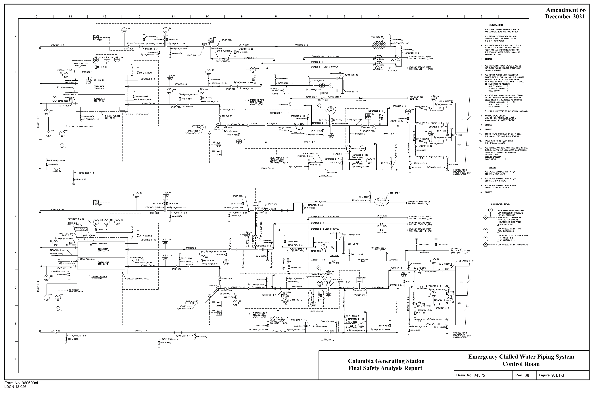

*figure on PDF page 308*

<!-- labels/text on this figure page -->
Amendment 66 December 2021
Emergency Chilled Water Piping System Columbia Generating Station Control Room Final Safety Analysis Report M775 30 9.4.1-3 Draw. No. Rev. Figure Form No. 960690ai
LDCN-18-026

<!-- p.309 -->
Amendment 65 11 10 December 2019

#### NOTES
#### r--
IN::@::~A FOR FLOW DlAGRI\M LEGEND, SYl,EIDLS, AND ABBREVlA.TIONS, SEE DRAWING M50 1 ::DSD: ,F~L::@:r:O:A: ,:O::;_;A ij 1750 CFM t~ ~~

#### ISOLATION SIGNAL CODES
I ~I ~ ~I
- I _J

#### r
I

#### MCC ROOM (DIV. 2)
REA-F□-.rn.L 3HR F.D I

#### ACCESS AREA e
RCl"--FD-IBT

#### PIPE SPACE
I RDA-flJ-19 T

#### CRO MODULES
EAST START ON !Sa..ATION !- - I 7 I

#### ELECTRONICS
#### ROA- FD-20 T
#### SIGNALF,A,Z
I Jl.QQ.M_ e 0 I ~I I

#### LEGEND
#### R0A-FD-17
~I
1. ALL VALVES SUFflXED WITH A (TH) DENOTE A THROTTLED VALV-;_. JHRF.D.

#### CRD MODULES
WEST I G

#### ROA - FD-1 6
#### I 3HRF.D
g-L-1_

- - - - - ~ i~ --,I CONN. FOR PORTABLE HEPA UNIT - - - - - - -"~- - -J J" 7 ~ - - =

#### VALVE ACCESS SHUTDOWN
AREA ~I ~1 ~I .I.QQE____'.K ---"'------- ~------- u o

#### e
c:i. .AfilJ,,_ v

#### NEUTRON MONITORING GENERAL AREA CRD REPAIR
#### SHUTDOWN COOLING
#### DRIVE MECHANISM EAST ROOM
#### SUPPLY AREA
I _A_8_g_

,C;)_ CRD EQUIPMENT t::'.i...bQgs_

t::).. SHUTDOWN COOLING tJ LOOP B AREA
- - ~

#### -1;::
#### I ,---, ,I

#### GENERAL AREA
~I I I I I ~-L-L----------1--_j 7 ______ t g-L1-

#### -------t
T ""T I DUCTCOI\NECTION • ~ e,s REA

#### I ROA-AD-12
I I I I Sf.lOKE RrnOVAL FN/ 15 _d C

#### JHRF.D
#### FLEX DUCT FOR SMOKE REMOVAL
(NOR~ALLY DISCONNECTED AND STORED)

W- eeA-CO- <LIL\eM~ M RRA-FC-5~<"~ rE f.lVI E .□Y10HFM 1-----0 E . □Y5HP I -----0 1 1 f.l~l
-----0 "~' I RRA RR'\ RRA w/J~~R~~ri_ - ~R~ffi AUX. COND INTERLOCK'--!~ ~I 2200cm SNS W/LPCS PUMP ' L_ - R~ 1 CRD PUMP ROOM ~ FN/5
(DIV. I) RRA ~-------~- '- ' /_4 RRA 2
- - ---(c~~~
--------

HVAC Systems – Reactor Building A Columbia Generating Station Final Safety Analysis Report

#### M545-1
73 9.4-2.1 Draw. No. Rev. Figure Form No. 960690ai

<!-- p.310 -->
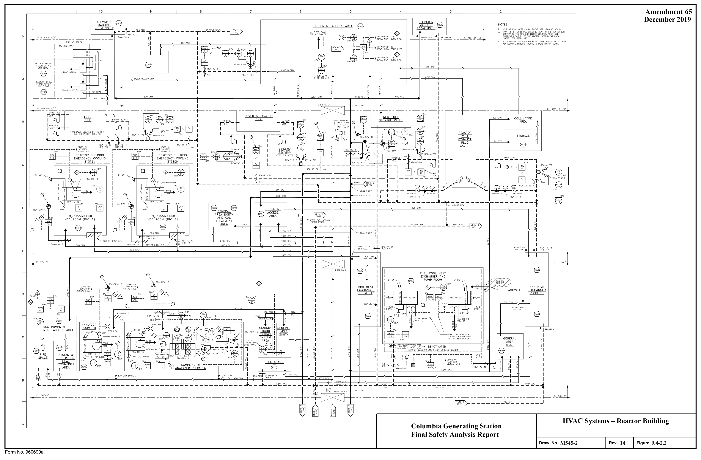

*figure on PDF page 310*

<!-- labels/text on this figure page -->
Amendment 65 11 I 0 2 December 2019 e e ~ L_------..±::--~ 1~.::~:(J CFM -,
ROOM NO 2 '
- T - - - - - 2· VENT ST,O,CK ~
- 700 Cn.l - - -
(F/2)
J•-------""----"-"-i
3 EXF! LTRATION AIR FLOW FROM ANAL'iZER RODl.1S 1A & 1B IS
VJ A LEAKAGE Tl-ROUGH DOORS & PENEmATION SEAMS ROHH : :
I I ROA$ e : I ~ M 14"" ____ l ________ ~1r---t-
MOU NTED ON
E-C P- RBHV/ B
·--""'""--'-'~""--------~ I L---l----::+-----+-----,t------::t---- 1 b b I ~ ~- --t-------;"--
-------t : b 12.e24 CFM 18,636 CFM
~
COLLIMATOR
AREA I
e
G
el I
ROA-FD-14 I REA- FD -1 5
R0A- FD-1 3 3HRF.D e-,1-
3 HRF.D
JHRF.D
e
RHR HEAT
EXCHANGER
ROOM "a" C047* RRA L--~ ~---~;L--+--J _ _: __ r-;;-i ~ RClA-FD-12
-i:::,aJ JtflF.D.
ee, "'@ ff " RCC PUMPS &
--PEA- FD -12
EQUIPMENT ACCESS AREA
C
HVAC Systems – Reactor Building Columbia Generating Station A Final Safety Analysis Report
M545-2
14 9.4-2.2 Draw. No. Rev. Figure Form No. 960690ai

<!-- p.311 -->
Amendment 63 11 10 4

.....

L,~rn_'I,.
December 2015 ...£L.l.OOO~- T REACTOR•,-a,-co-"-,---=,..-----:1 ~----y,~

#### NOTES
+ ~ 4"EDR(45)-1 IIDT I

..!....

..i THISEaUI PMENTDRAIN R0UTES T0fDRSUWR-4 I _J
(S EE M537 !, M539)

#### CLOSE ON ISOLATION I
SIGNAf_ FAZ\---7 FROM EQLJI ~ENT

#### ACCESS AREA.
I

#### REA REA
~ ~ T I ~I _J h;EACsev=-, - t- _J I ~---t:;;:---,

#### SEEN0TE 2
(THIS Dl'/G.)

#### REA-V-18
"'EB----1

#### FP-Y-REA/11
#### REA-V-1
SEE N:JTE 7 N.0. 2 'FP(&O) 1 FP-V-REA/14 Pl r- ---, ~ (M545 -1) ~ 1/4" REA A2

#### N.D. REA-V-2
F.C. SEE NOTE 7 TO ELEVATED 7"FP(50)-1
("-545 _ 1) RELEASE POINT

HOLD 4"FP(50)-1 RUN)

#### FP-V-REA/2B
FPt'" '";;;,,a :~:::,R,~/,2:/r . ',· ~
- 1"FP(60)-I FP-V- REA/701 B REA ZBl

#### FP- V-REA/2 1
2"FP(50)-1 H;,-,..,IF;-:,: .Vj)-<JSe-4/---,:pr;;:,,';c:.--;l

1"FP(5D)-I

4"FP(50)-1

#### SUMP VENT EXHAUST FILTER SYSTEM
(PIPE ~ATERIAL ONLY DESIGNATED AS "s\/T")

' ,' oo,;:
y 1~: i- I 11/2" DRAIN 11/2" DRN N E.D.Ry 1 1/2" DRAIN E.D.Ry ~ ~ 14--J ~ S~~ 5~~~E1i6°

#### E.D. R.
(SEE NOTE 5)
(SEE NOTE S)
(SEE NOTE S)

#### MAIN STEAM TUNNEL
EL. 501'-0"

#### f
i _/TOTSW-V- H7 I

#### DWG MSOB-, IBN)
I I I I e I I
-+4'-t---.~t--' RO, I I

#### ROA- P- 18
j

#### I --------------------------------
#### RAILROAD LOCK
L __ EL.441 o· L__ - - -- -------------------------~

#### FSAR FIG . -----E.D1
E.Di TO 4• FDR-1 DWG. ~539~(<:/:,i _________________________________ T _________________________________ _ \/ ELEV 422'-0" HVAC Systems – Reactor Building ml A Columbia Generating Station Final Safety Analysis Report

#### M545-3
26 9.4-2.3 Draw. No.
Rev. Figure Form No. 960690ai

<!-- p.312 -->
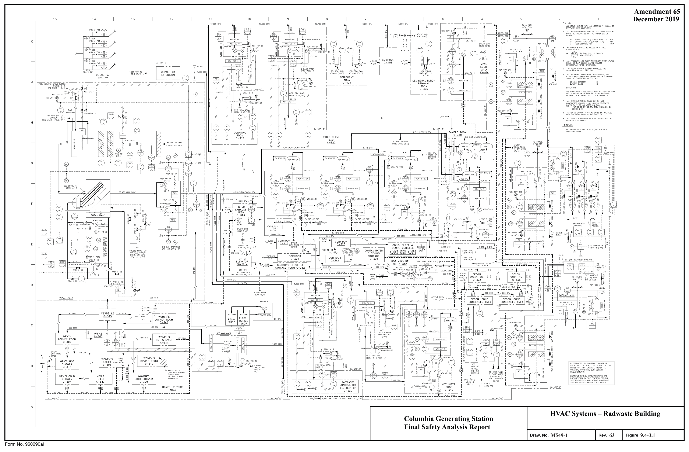

*figure on PDF page 312*

<!-- labels/text on this figure page -->
Amendment 65 December 2019
12 II 15 14 13 10
NOTES:
ALL ITHIS MAR KED WI TH AN ASTERISK(•) S HALL BE SUPPLIED WlfH EQUIPI.IENT.
J INSTRU hl ENTS SH&L BE TAGGED WITH FULL IDENfl FICATION i e . ~ IN EXH . SYS., IS TAGG ED WEII- DPIC-IC- 1. ~
5 FOR FLOW □IAGRAAI LEGEND, SYMBOLS, AND
ABBREVIATIONS SEE DWG. M501
''°
DRAWING
I 8b ::;.1b I I e SUPPLY&: EX K-1.UST SYSTEhl5 SHALL SE: SA!ANCED I cc ,o,·-o· L _ _ __ _ _ __ _ _ __ _ _ __ _ _ __ _ _ __ WITHALLFUhlEH(]00f1LTER UNITS ON
ALL TAGS FOR INSTRUMENT ROOT VALYE:S WILL BE
FURNISHED BY OW NER
EL. 5ot-o· RADIO CHEM. LAB = ROOhlZONE(D/ 7)
6?--L~ S3; : ' M '-V·U ,0~, V ,-- ~ 1 --7-------------------------_j ___ _J I ' ,- I 0 ~----7 I I I 1 I ➔ I I i I I
I I I
I
I I I
I
I I I
I I I I I a3. 45<l cn,1 (w.x.J
I I I
I I I I i~ I I I I I I I , ---+ L-@---;=!==~:::=i=::::;7 I I• I~ f---'~~-e----r--~ : 11 ~J I I • I I er I ,__ I I I I : e +---t--- I I I I
&--i----r---- ~~ 00 : ~ LJ I I +---------------
ONE FAN OPERATING
ONEf"ANSTAN0-8Y ' !Q : ~-ffi 0 l--k4--~ :
L_.._ _______ t-_ : is I
L
W0A-HV-1
-- --- ------
J_
A HVAC Systems – Radwaste Building Columbia Generating Station Final Safety Analysis Report
M549-1
63 9.4-3.1 Draw. No. Rev. Figure Form No. 960690ai

<!-- p.313 -->
Amendment 59 , 0 15 1 L 12 13 December 2007

' ' ' ' CORRIDOR OUTSIDE

#### RAJWASE CONTROL
ROOM L---2.Ql_

coi:~~~\ggwfc\ ---=•:d~2~1...,J L---~ ACCESS A:.:EA I I ~ I : I I I I I ::.cl bl ~i:

#### VESTIBULE
EL. 452'-Q"" '-')

#### C-142 1/
:
~--~ ,, ~:~
---ff--'-/C_=-t__,

#### C-203
:
_r=;;:=;,'J _________________ j \!I-,,/ ' -----+-
-- -:- -- ♦ __________ ::e---~:~::==.~:ic.'~.cc!! _______ _, _ r4" ___ ] _, T _________ js _________________________ J ________ ,.,,,;,x Tl---
-J'v--c:c---i ~11%:Rs;tJ t------1/_. __ c=t [?~j~~~ I,
---------- ' ::,I

#### C-139
WASTE MIXING TANK ROOM t-, __ _ ~------"Ir------~ __ ,·,~,/,,r-r-~• ,~n,.. -~ '-!I EL. 452'-o"
-- -.- -.- -- I

#### C-137
~--- t_~c,: ,:-fl ______ t_ ·,:,:": ::f\l __________________ i __ l.-c,:D ,:-f..- i C~~~;AT NG AREA ------------r------- · .~nt;/?,C:CO cv_~

: EQUIPMENT ACCESS
- - -___A~ _v_--~ 7r __ _JL ___ -,-{]-,_:~-.. 1_, __ ;
:: - : I A~EA INCLUDING TRUCK /_Rr;6 , t ~ I 0:')_ ___ l ___ , , -J 6
---1\,--+- ~L~'!!'--- , , s,
------------------------ _J ~ .. , __ i /C ;R "'" :---=i 1------'=-"--'---..--------'=-"-'-----'--'--'----"T-------='-''-',,'-L-{,_~
--1 ------,.~-~;J'.~~~ :::1 %:~ I 'I 2" i\?; AREA c-::~~ ~'''~·"" ', C : - - - - - - - - - - REFRIG. EQUIP~ENT - ~UMP & _:-A;K------1\, ~m I
- - -- - - -- 'I _ Fw-,

#### i AREA
-------~---------------- +1/"! "'' J, ~ TAN<c~~<i~100, DECC::~:;:ATION C-105 cl,
-vk~ cp~~ ,L (r ,1~ "-1,.1 - ,:c/1,; c ::·~, :
:.JI'' ___________ l __ .. , .. , , --------- : ---------------------------------------------, . . . ,,,, ··"' j ~r-_G2;'F".!;;T_ ----0--2.:__]""" C L'6, ~ e '"i f-------------------------------------- ... , ., ---------- ,,,, .,_

1/ L ~-+---ff-+--cn7()~.,~-,----------------~

VFSffllJIF

#### C-'.C2
E_, 4.',7' C•" _ __ _ _ __ _ _ __ _ _ __ _ _ __ _ _ __ _ _ __ _ _ __ _ _ __ _ _ __ _ _ __ _ _ __, -· _____________________________________________________________________ CL. 407' C"

HVAC Systems – Radwaste Building Columbia Generating Station A Final Safety Analysis Report

#### M549-2
2 9.4-3.2 Draw. No. Rev. Figure Form No. 960690ai

<!-- p.314 -->
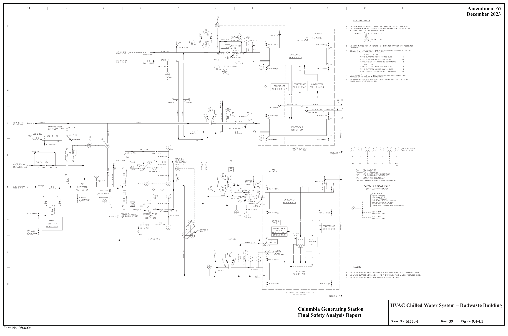

*figure on PDF page 314*

[Vector original (SVG, lossless): fig_page-314_2.svg](../figures/fig_page-314_2.svg)

<!-- labels/text on this figure page -->
Amendment 67 December 2023
HVAC Chilled Water System – Radwaste Building Columbia Generating Station Final Safety Analysis Report
M550-1
39 9.4-4.1 Draw. No. Rev. Figure Form No. 960690ai

<!-- p.315 -->
5 4 11 10 Amendment 62 1 , 2·wcH 2 -1 December 2013

1 FOR GENERAL NOTES AND LEGEND SEE DRAWING M550-1.
DRAWING SHALL BE IDENTIFIED BY PREFIX "WCH"

#### WMA CC 52A2
#### AIR HANDLING UNIT
#### CABLE SPREADING
(WMA-AH-51 B)
27/2"wCH2-1 WCH-\1-5181 ROOM SEE owe M548-1 (D/8)

#### WCH-V-6488
#### AIR HANDLING UNIT
J
(WMA-AH-52A)

#### SEE DWG. M548-2 (G/10)
#### WMA CC 51 B2
(LOWER COIL)

#### CONTROL ROOM
#### WMA-CC-51 A2
#### AIR HANDLING UNIT
(UPPER COIL) 2 1/2"
(WMA-AH-51 B)

#### -7 WCH-V-639B
#### CONTROL ROOM
3/8" INLET VENT SEE DWG M548-1 (D/8) WCH-V-~Al(T11) W/HOSE CONN. (Ti'P) .---__.__ __ ___i____i_---2:...i WCH-Y-51BE

#### AJR HANDLING UNIT
#### WCH-V-61BB(D)
(WMA-AH-51A)

#### CDILDRAIN
W/HOSE CONN. (Tr'P) L.:.I SEE DWG. t.1548-1 (D/9)

#### WCH-V-51BH(TH)
#### DIRT LEG
1" X 12" LG Mm
(m')
'

#### WMA-CC 51A2
(LOWER COIL)
"' WCH V 574

#### CONTROL ROOM
#### AJR HANDLING UNIT
(WMA-AH-51A)
2'wCH2 SEE DWG. t.1548-1 (D/9)

#### CABLE SPREADING
ROOM

#### AIR HANDLING UNIT
(WMA-AH- 52B) 2"W"CH(1 -1 SEE DWG. t.1548-2 (G/9)
G

#### WCH-V-621 8(0)
COILDRAlN W/HOSE CONN. L.:.I 4"w'CH I -1 2"WCH(I -1

#### W0A-CC-4
#### RADIO CHEMICAL LAB
#### AND SAMPLING ROOM
6"WCH(1)-1 AIR HANDLING UNIT
(WOA-AH-4)
SEE DWG. t.1549-1 (J/9)

t---"-'"::aC;::1<,1,1,> ;;a-1 .... ____ CONT. ON DWG.

~550-1 (E/11)

~

#### WCH-V-591
#### HOT INSTRUMENT
ROOM

#### AIR HANDLING UNIT
(WOA-AH-5)
SEE DWG. t.1549-1 (C/7) L-;-_l

#### W0A-CC-9
t""'J-"-"--'--0-'-'_.:.;:_:::.:~;:,_,.i,,.!><J,,,.:::.;;:.::.o-""I

#### COUNTING ROOM
WCH-V-~9A 1"

#### AIR HANDLING UNIT
(WOA-AH-9)
1 1/2"WCH(1 -1 SEE DWG. M549-1 (J/10)
11/4"WCH1-1

#### WCH-V-577(0)
#### WMA-CC-6
C

#### RADWASTE CONTROL
ROOM

#### AIR HANDLING UNIT
(WMA-AH-6)

#### SEE DWG. M549-1 (C/8)
#### WOA-TCV-53 (REF) WCH-V-53H(TH) HEALTH PHYSICS
SEE DWG M549 {F/12)
ROOM

#### AIR HANDLING UNIT
~,·
(WOA-AH-3)

#### SEE DWG. M549-1 (B/10)
#### SEE NOTE 3
HVAC Chilled Water System - Radwaste Building Columbia Generating Station Final Safety Analysis Report A

#### M550-2
5 9.4-4-2 Draw. No. Rev. Figure Form No. 960690ai

<!-- p.316 -->
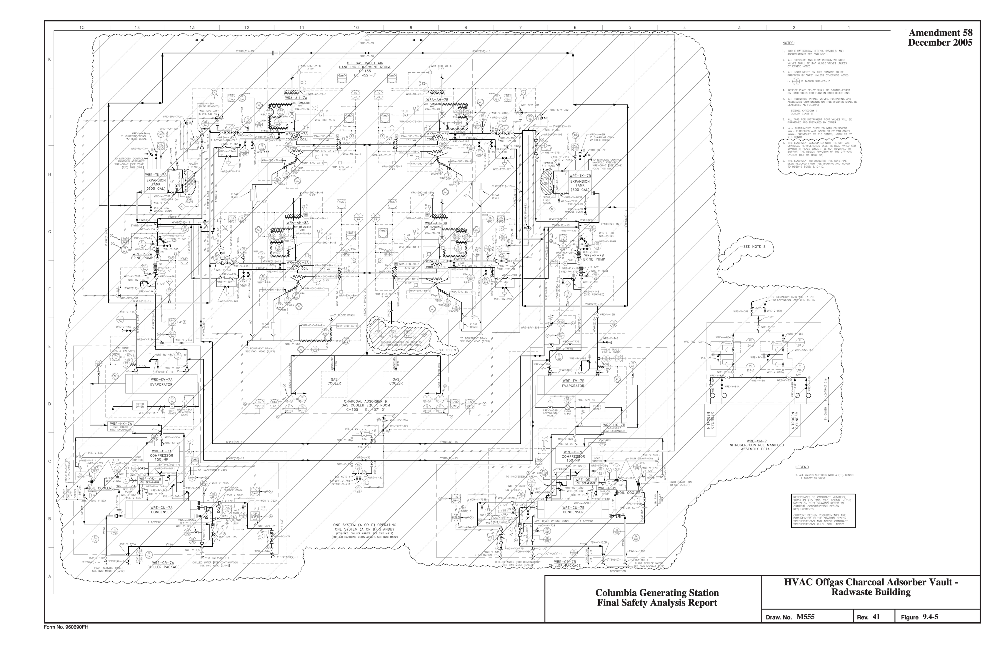

*figure on PDF page 316*

<!-- labels/text on this figure page -->
1?
• Amendment 58 December 2005 tiQIE__S_;
W - 0.1-7
NITR OG EN ON TR O_ ~-/\NI- /\ EMB LY □E - /\ IL
HVAC Offgas Charcoal Adsorber Vault - Radwaste Building Columbia Generating Station Final Safety Analysis Report Rev. 41 Figure 9.4-5 Draw. No. MSSS Form No. 960690FH

<!-- p.317 -->
Amendment 63 15 14 13 12 11 10 8 7 4 3 TO Art,ms. ' TO ATMOS ' TO,t,TMDS ' TO ATMOS ' December 2015 NOTES:
1. FOR FLOW DIAGAAM LEGEND, SYt.100LS, NOTES AND ~ ~ ~ ~ ABBREVIATIONS SEE DWG. 1,1:,01.

#### I I I I
tt--t r~ K ~AD-lA ~All-18 ~AD-IC ~AD-ID a) INSTRUMENTS IN SU PPLY SYSTEt,1 ''<;-~ ''<;-~ ''<;-~ ''<;-~
-------B!lEA @ISTAGGEDTDA-TE-1.3A 11EA=£li=.1.C g-r 11EA=Eli=1D 11LA=£N=.1.A g-1 ;:f-i b) INSTRUt,IENTSINEXHAUSTSYSTEM.
~ ~ ~ ~ :116.915CFM :116.915CFM :116,915CFM :11s,g1scn.1 ~ISTAGGEDfEA-DPT-1A ' ' i :

#### I I I I
TO~-RR-;'! 3. ::. A~frk~:s ~~~Ji[ l~~J~R. s~~:~gy JT~~~R. • ASTERISK DENOlES INSTRUt,IENTS SUPPLIED WITH EQUI P DWG. M54S-J (F/1) = 216,ANDINSTP<I...LEDBYCOMTR.218 lEA-VD-1B TE•-vD-1C !
4. ALL PRESSURE AND FLOW INSTRUf.lENT ROOT VALVES EXHAUST PLENUM ~Hi~;SE~OBE: VALVES. UNLESS SPECIFIC/t..LY ?~AN~~JE~i-1i~.2•~o;TAND-BY NOTE:
~. REFER TO HEATING STEAM FLOW Dl>GRAt,1 t,1514 FOR LINE

#### AND VALVE DESIGNATIONS.
! i O. ALLOOJCTWORK,EOUIPMrNT.AND>CCESSORIESONTHIS DWC. ARE CLASSIFIED >S FOLLOjljS, EXCEF'T TOILET EXH: TEA-OOC-1 I S£15MICCATEGORY II I
- i _____________________________________________ J QUALITY CLASS II • I FT ij, Jm~IF1VoHA~STFo~O:~RK, FAN, at ,t,CCESSORIES ARE I ~ l:3 TEA I CONT. ON llWG.
I

#### SEISMICCATEGORY II
bi ~I M5+6-2 (C/15)
QUALITY CLASS G ~.:
"I 10. ALL INSTRUt,IENTATION SHALL 9E FURNISHED AND CONT. ON §1 □WG.
~~~~~ikBJo-\f~ CONTRACTOR (CONTR. 216), UNLESS .f----:r--------------:r----------c5-j_ I' E _,_ o, t.1546-2 (C/8)
: § 11, ALL TAGS F"OR INSTRUMENT ROOT VALVES WILL BE H ~I 1 "TA 222,750 CFt,1 303,350 CFt,1 7

#### FURNISHED AND INSTALLED BY OWNER.
'°",~':'] TEA-AD-2: ; 2~CHI bl t.1 b1 1 ~ !1 &'.) $ 13.NITTETOBAI.ANCINGCONTFW:TOR: §I /4', ~I y T M54ol-1 31g ~I §I 0) ~l =s~Ml~Riu~~ur~~ST]~~~~ HATCHES ~I g1 I 1/2'TEA-V-701 : Cf~
(D/10)
,.. ___
-~ 0 0 _,.__ ~
-1 ~r.o.
.a,.1 ___ '-'7'"-',000"--'-CF-"'"---,------''-''''"-'''-'"''"'-------''------<~ 6'11.ANCINV REOIJIRE:MENTS FORA ZONE AND FOR = ooe><,ooesl TEA-AIJ-14 ~ I SMD ~~T~~C,,l1i?T~~~~~TN~:~:E~.E THE '., I 51 ;.o11,.;i--/6"SUt,1F'VENT (3)
~~~gfE~:~~~~c~s~Li:o~IRECTION ~I CFl,I (MIS:•l_j QOOCFl,I I L.ii-1---1 CONT, ON owe.
~-7- -I ~~/\sf5, H/7, ~ ~$ ~~~~1 J., b)
THE I ~I 250CFf,1~1-----=-- ~TDEAST Cf"M'SINDICATEO ARESTANOAR □ CFt.l'S.
~: ~ EXHAUST CFIJ'S SHALL BE BALANCE□ TO /loCTUAL CONT. CORRIDOR CFM"S(ACFt,1 - 1.lxCFM) 124,55!'.CFM TRUSS AREA

#### FROM ,-- ZONE
39.27□ cn.1 M5f~i (C/S)

## 14 INSTALL THESE FILTERS ACCORDING TO ABNORt,IAL 163,B25CFt,1 I
#### I (A/B)
CONDITION l'ROCEDlJRE ABN-ASH "ASH FALL." I G I I ... -,~~ 27.l!IOCFM L ~o~ 19,25DCFM ~I I I CENERl>l I I

#### "1 t--~==---1 AND EXCITER ffi I IEASTAREA ffil ,
,. C.!:t~ALVES SU FFIXED WJTl-1 A (TI-I} DENOTE A THROTTLED ,., 1 ,--------'=-'-----1 15,(Y.;OCFt,1 ~[;~~

#### I ,, I
~I L_AREA"A_:______j ~I 19,450CFM 1CENERATOR®1 L_~~ T~-~~ I "I I ~I I ,.__ I I ___r-:-:;:-----, ... -2~-c~ I
- - ~·~ ::91~y-----------
---,--- I ___ OPERATINC-EL.!!01'-0"
- - - _j_ I 31,000CFt,1 35,50 □ CFt,1 ELEVATOR NO. ~----------'=~~----1------- ,, I I 3 31,000CFIJ §:
I bl 42,875 CF~ :
4,000CFt,1 >-'-'o~·'~"~'~'"~--'\ ~------'\,~~I----<-< H0i:~ ~ :i:
~-------- ,s,ooo ,,, ___________ _i ___ ? J ~ I ):;:(o ~ .L~o : (if>• ::Ill ~ ~ §I --~ ~ bl I C - - C I '"·\Ee~- ;L __ !t-~ 1i:®l §~---------,-~=~_L ~ ~ ~:
b ___ _

I FO

---~------------------~--- _____ MEZZANINE-EL.471'-0"

54D CFt,1 10

#### CORRIDOR
#### ZONE(C/3)
!>1,765 CFt,1

119,770CFM 6B.005CFM

2B.30CJCFIJ CONDENSATE

#### PUMPS AREA
#### D 91,470CFM

80.SOOCFM

1,200CFt,1 I FROt,IZONE !: : vi I {E/15)
,-_:~~;1r~,' FROM STEAM ;a

#### HEATINC ST'S.
' I

#### TOA-DPIC-28
□WG. t.15 46-2 I C
(C/15)

IGENE~ LW l.,... __ ..... ==------+---1

~~T;~~:[r.t~

#### __ H: b1 ~--,~.,~@-" -~1->-----o I ~ I I
~ 81

#### I ANDRADWASTE I
,-,----~y~--~=~--I I\, ------1\. ~ V ~ rn c__ BLDG.S EfL-441"-0" __J I T ' I "v~--==----1----~ I

5,000CFM 1,600 CFM

#### CONT ON DWG. 2,000 CFM
t.1551(8/2) COMT.FROMD'IIG.
REFERENCES TO CONfRl>CT NUMBERS, t.1551 (B/2)

#### SUCH AS 215, 206, 220, FOUND IN THE
NOTES ON ll·HS DRAWING REFER TO

#### ORIGINAL CONSTRUCTION DESIGN
#### REQUIREMENTS. OUTSIDE
#### T.C. BLDG.
~~~~k~s~~N T~~Q~~~~ITTiES~~ '° SPECIFICATIONS AND ACTIVE: CONTRACT TOA-DPIC-2A SPECIFICATIONS WHICH STILL APPLY. DWO. l,j54e -z
(C/15)

#### FSAR FIG.
____________________________________________________________________________ GROUND FL. EL. 441'0" HVAC Systems – Turbine Generator Building Columbia Generating Station A Final Safety Analysis Report

#### M546-1
56 9.4-6.1 Draw. No.
Rev. Figure Form No. 960690ai

<!-- p.318 -->
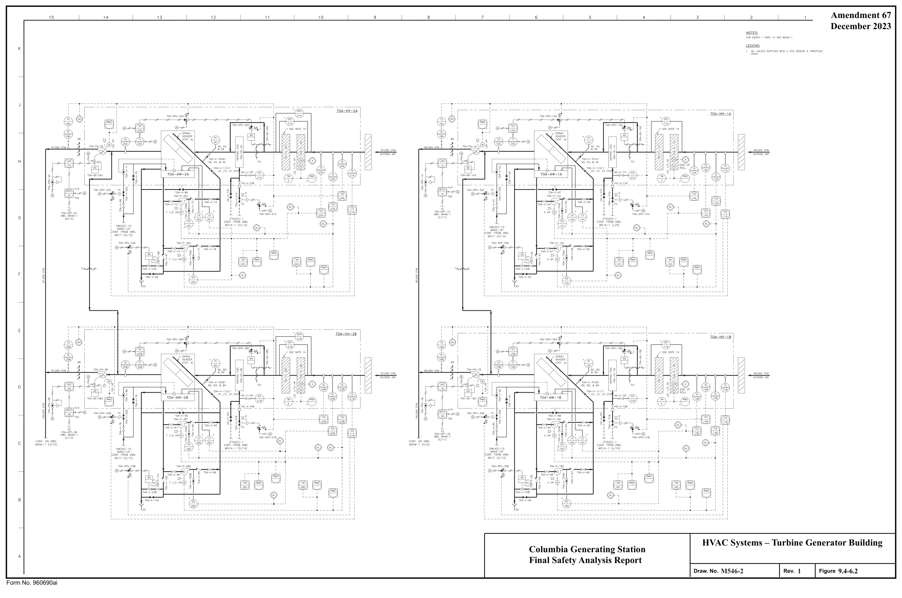

*figure on PDF page 318*

[Vector original (SVG, lossless): fig_page-318.svg](../figures/fig_page-318.svg)

<!-- labels/text on this figure page -->
Amendment 67 December 2023
HVAC Systems – Turbine Generator Building Columbia Generating Station Final Safety Analysis Report
M546-2
1 9.4-6.2 Draw. No. Rev. Figure Form No. 960690ai

<!-- p.319 -->
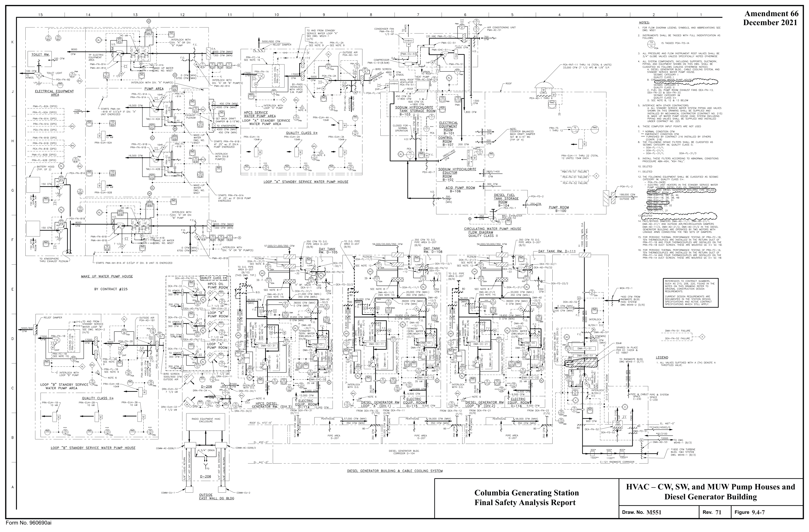

*figure on PDF page 319*

<!-- labels/text on this figure page -->
Amendment 66 December 2021
HVAC – CW, SW, and MUW Pump Houses and Columbia Generating Station Diesel Generator Building Final Safety Analysis Report M551 71 9.4-7 Draw. No. Rev. Figure Form No. 960690ai

<!-- p.320 -->
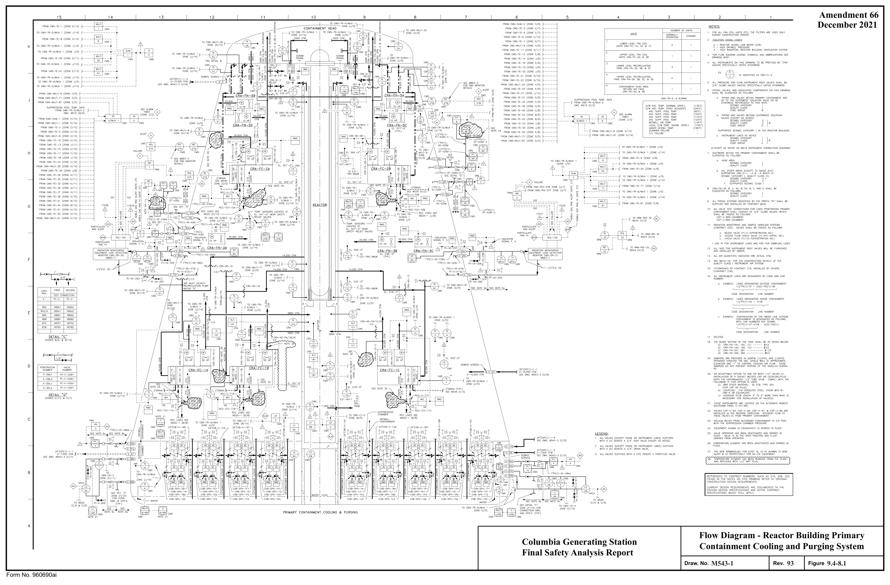

*figure on PDF page 320*

<!-- labels/text on this figure page -->
Amendment 66 December 2021
Flow Diagram - Reactor Building Primary Columbia Generating Station Containment Cooling and Purging System Final Safety Analysis Report
M543-1
93 9.4-8.1 Draw. No. Rev. Figure Form No. 960690ai

<!-- p.321 -->
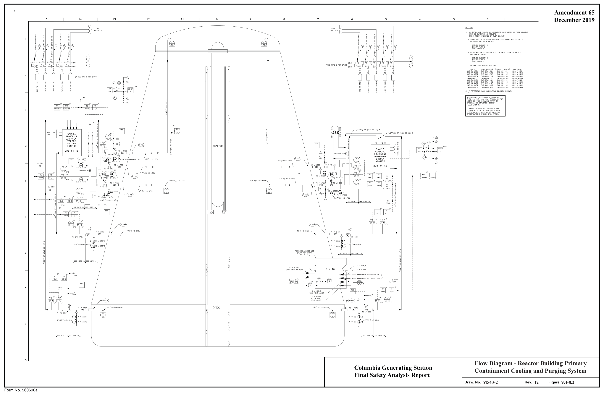

*figure on PDF page 321*

[Vector original (SVG, lossless): fig_page-321_2.svg](../figures/fig_page-321_2.svg)

<!-- labels/text on this figure page -->
Amendment 65 December 2019 4 15 14 13 12 11 10 } " " ZDNE ci, s
a. PIPING mo VA.LYES l'l'IrHIN PRlMARY CONTAINMENT ANO UP ro THE Ba OUTERMOST ISOLATIDN VAL\fES
(i) © 0 0 ® © ®
b. PI PING mo VALVES BEYDND THE OUTERMOST ISOLATION VALVES
(lNSTR UMENT UNE:S): ~ :~ < 0
--- p
(2)*
(* SEE NOTE 2 FOR EPN'S)
~ ~
(1)*
3, Q REPRESENTS R;.c;K CONNECTION OOLKHEAD NU~BER
1/2"P1{1)-sr-(c...s-SR-1 +)-~
= ,-------,-~-'--------i_~1~
s: G
I 8 ~~
-s 'i.cJ-\1,-i 1"PI(1)-4S-X73c L_ __ --0----'------,---{=}-<o«)----,---W---{}-L--'--'- ¼HT :
Sl3.:::J.\;2 :
~1~1~ Sb\ 1,7 L ~--~ -i--~- -- __ c:~~::~tT : HT HT L. TEMP.: l "PI(l)-4S-X7;5ci
~\;2 L~-~-ti-i
3/4"Pl(1)-4S-X73d J/+"PI(1}-4S-X72~
c_ ___ ~ L. TrnP. I I I I I l}-----4 L. TE~P. I I rn-r_c;;:::f'J ~~-~ I @HT~HT 2/1 2/2
SEE NOTE lb SEE NOTE la
)}---7 L. TE~P. I I r-ffia"'f~fL C
~HT~HT R-14l/l R-1\/l
SEENOTE1b SEENOTE1a SEENOTE1a SEEN<JTE 1b
A Flow Diagram - Reactor Building Primary Columbia Generating Station Containment Cooling and Purging System Final Safety Analysis Report
M543-2
12 9.4-8.2 Draw. No. Rev. Figure Form No. 960690ai

<!-- p.322 -->
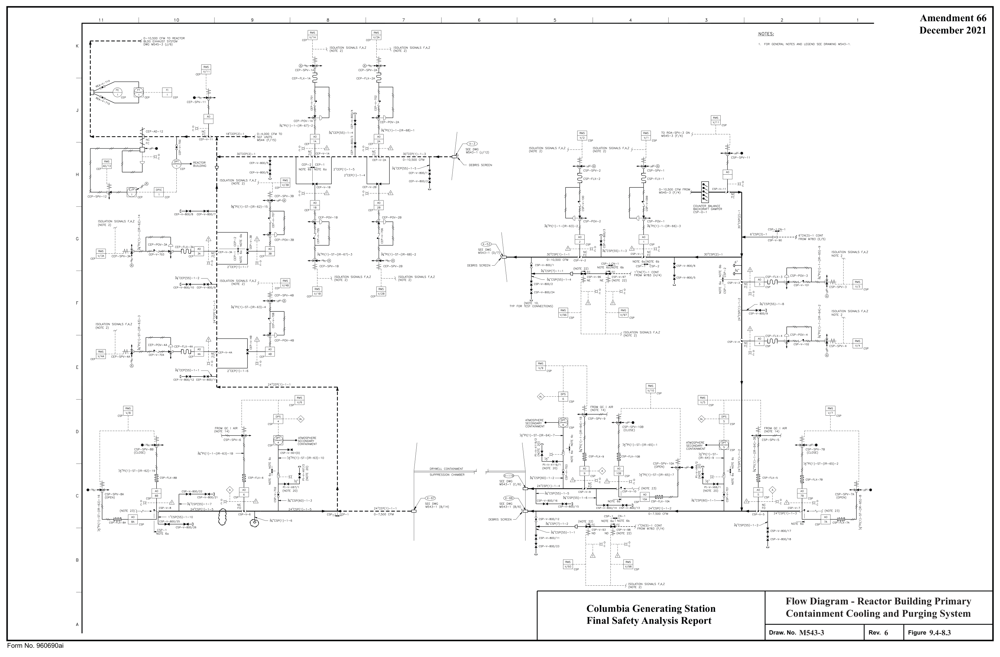

*figure on PDF page 322*

[Vector original (SVG, lossless): fig_page-322_2.svg](../figures/fig_page-322_2.svg)

<!-- labels/text on this figure page -->
Amendment 66 December 2021
Flow Diagram - Reactor Building Primary Columbia Generating Station Containment Cooling and Purging System Final Safety Analysis Report
M543-3
6 9.4-8.3 Draw. No. Rev. Figure Form No. 960690ai

<!-- p.323 -->
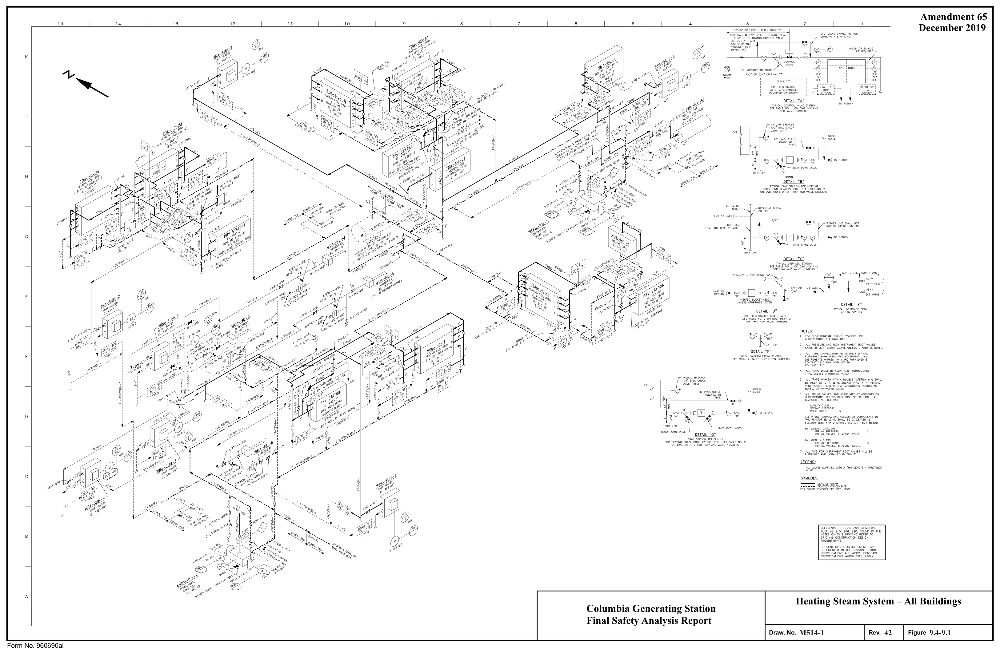

*figure on PDF page 323*

<!-- labels/text on this figure page -->
Amendment 65 December 2019 14 13 12 11 10 4 15
',,,"''""'',,,, .. r. ",, _____ __
-- ' -- !
_r, :
/
i !
REDUC l,IG ELBOW
OR TEE
~-=----~.:;,--c" j__ "°' mo, acwa, "" ivBYPASS LINESHALLNOT
' ' ' ' ' ' ' ' ' ' ' ' ' ' i, ... , ....
C---~v.,-"C, •l§I~ ___ ., TO RETURN G "[LJ w ~ ""'' 00.S ""-" y C0NlR.216 G0NTR.215 .
HSMI.IN~ HS
DETAIL "E" TYPIC,l,,LINTERFACEDETAIL
ATPRVSTATIDN
1' COILS OTHER l------~--l~z·c li., m ~Wes I i
I . ·c ·s·
ELOW DOWN VALVE
ASSOC.COMP
~~Ni~~/~ol~~~~:L~~T :ro~itES NILL BE
,~E~LNV~~VES sumxrn WITH A (TH) DENOTE A THROTTLED
VALVE
C
Heating Steam System – All Buildings A Columbia Generating Station Final Safety Analysis Report
M514-1
42 9.4-9.1 Draw. No. Rev. Figure Form No. 960690ai

<!-- p.324 -->
#### I I I I I I I I I

#### I 11 10 9 8 7 6 5 4 3 2
#### NOTES
#### TABLE NO. VALVE NUMBERS FOR CONTROL STATIONS
#### TABLE N0.3-VACUUM BREAKER EPN NO'S.
K

#### BY-PASS BLOW OOWN Y STRAINERS SHUT OFF VALVES
1. FOR GENERAL NOTES SEE DRAWING M514-1. VALVE "c" "BB"

#### HS STATION NO.
VALVE "D" "H" "K THRU s" S-1 1" HS-V-709A 1" HS-V-709B 3"TOA-V-31A 4"HS-V-T1A & T1B 1/2"HS-V-T1F 3"HS-V-T1C 4"HCO-ST-S1 2"HS-V-T1 K TI-lRU T1 P S-2 3"T0A-V-31B 4"HS-V-T2A & T2B 1/2"HS-V-T2F 3"HS-V-T2C 4"HC0-ST-S2 2"HS-V-T2K THRU T2P S-2 1" HS-V-710A 1" HS-V-710B S-3 1" HS-V-711A 1" HS-V-711B 3"TOA-V-21A 4"HS-V-T3A & T3B 1/2"HS-V-T3F 3"HS-V-T3C 1/2"HS-V-T3D 4"HCO-ST-S3 2"HS-V-T3K TI-lRU T3P S-4 3"TOA-V-218 4"HS-V-T4A & T4B 1/2"HS-V-T4F 3"HS-V-T4C 1/2"HS-V-T40 4"HC0-ST-S4 2"HS-V-T4K THRU T4P S-4 1" HS-V-712A 1" HS-V-712B S-5 S-S rHS-TCV-S5 2 1 /rHS-V-S5A & S5B 2"HS-V-S5C 3/4"HS-V-S5D 2"HC0-ST-S5 2 1/2"HS-V-S5K S-6 1" HS-V-713A 1" HS-V-713B 3"sMA-V-21 3"HS-V-S6A & S6B 1/2"HS-V-S6F 2 1/2"HS-V-S6C 3"HCO-ST-S6 2"HS-V-S6K & S6L S-7 3"ROA-V-21 4"HS-V-R7A & R7B 1/2"HS-V-R7F 3"HS-V-R7C 1/2"HS-V-R7D 4"HCO-ST-S7 2"HS-V-R7K THRU R7S S-7 1" HS-V-714A 1" HS-V-714B S-8 2"ROA-V-31 2 1/2"HS-V-RBA &: RBB 2"HS-V-R8C 2 1/2"HCO-ST-S8 S-9 1" HS-V-715A 1" HS-V-715B 3"WOA-V-21 4"HS-V-W9A &: W9B 1/2"HS-V-W9F 3"HS-V-W9C 3/4"HS-V-W9D 4"HCO-ST-sg 2"HS-V-W9K THRU W9P

#### TABLE NO. 2 - VALVE NUMBERS FOR TRAP STATIONS
HCO STATION ORIFICE TRAP SHUT OFF VALVES BY PASS BLOW DOWN CHECK CHECK Y STRAINER HEATING COIL INLET VALVE VALVE "E" ''H" OR DRIP LEG (STATION #) NUMBER SIZE NUMBER VALVE "D" VALVE "F" "A" & "B" VALVE "c" 1/2"HCO-V-T1AD 1 1/2"HCO-V-T1AE HCO-V-T1AF 1 1/2"HCO-ST-T1A HS-V-TIK EAST SIDE TOA-HC-1A (S-1)
19/64" 1 1/2"HCO-T-T1A 1 1/2"HCO-V-T1M & T1A8 19/64" 1 1/2"HCO-T-T1B 1 1/2"HCO-V-T1BA & T1BB 1/2"HCO-V-T1BD 1 1/2"HCO-V-T1BE HCO-V-T1BF 1 1/2"HCO-ST-T1B HS-V-T1L EAST SIDE TOA-HC-1A (S-1)
T-1C 19/64" 1 1/2"HCD-T-T1C 1 1/2"HC0-V-T1CA & T1CB 1/2"HC0-V-T1CD 1 1/2"HC0-V-T1CE HC0-V-T1CF 1 1/2"HCO-ST-T1C HS-V-T1M EAST SIDE TOA-HC-1A (S-1)
19/64" 1 1/2"HCO-T-T1D 1 1/2"HCO-V-T1DA & T1DB 1/2"HCO-V-T1DD 1 1/2"HCO-V-T1DE HCO-V-T1DF 1 1/2"HCO-ST-T1D HS-V-T1N WEST SIDE/ TOA-HC-1A (S-1)
H T-1E 19/64" 1 1/2"HCO-T-T1E 1 1/2"HCO-V-T1EA & T1EB 1/2"HCO-V-T1ED 1 1/2"HCO-V-T1EE HCO-V-T1EF 1 1/2"HCO-ST-T1E HS-V-T10 WEST SIDE TOA-HC-1A (S-1)
19/64" 1 1/2"HCO-T-T1 F 1 1/2"HCO-V-T1FA & T1FB 1/2"HCO-V-T1FD 1 1/2"HCO-V-T1FE HCO-V-T1FF 1 1/2"HCO-ST-T1 F HS-V-T1P WEST SIDE TOA-HC-1A (S-1)
T-1G 11/64" 1"HCO-T-T1G 1"HCO-V-T1GA &: T1GB 3/4"HCO-V-T1GC 1/2"HCO-V-T1GD 1"HCO-V-T1GE 1"HCO-ST-T1G DRIP LEG EAST SIDE TOA-HC-1A (S-1)
T-1H 11/64" 1"HCO-T-T1H 1"HCO-V-T1HA & T1HB 3/4"HCO-V-T1HC 1/2"HCO-V-T1HD 1"HCO-V-T1HE 1"HCO-ST-T1H DRIP LEG WEST SIDE TOA-HC-1A (S-1)
T-2A 19/64" 1 1/2"HCO-T-T2A 1 1/2"HCO-V-T2AA & T2AB 1/2"HCO-V-T2AD 1 1/2"HCO-V-T2AE HCO-V-T2AF 1 1/2"HCO-ST-T2A HS-V-T2N SOUTH SIDE TOA-HC-18 (S-2)
1/2"HCO-V-T2BD 1 1/2"HCO-V-T2BE HCO-V-T2BF 1 1/2"HCO-ST-T2B HS-V-T20 SOUTH SIDE TOA-HC-18 (S-2) 19/64" 1 1/2"HCO-T-T2B 1 1/2"HCO-V-T2BA &: T2BB 1/2"HCO-V-T2CO 1 1/2"HCO-V-T2CE HCO-V-T2CF 1 1/2"HCO-ST-T2C HS-V-T2P SOUTH SIDE TOA-HC-18 (S-2)
19/64" 1 1/2"HCO-T-T2C 1 1/2"HCO-V-T2CA &: T2CB 1/2"HCO-V-T2DD 1 1/2"HCO-V-T2DE HCO-V-T2DF 1 1/2"HCO-ST-T2D HS-V-T2K NORTH SIDE TOA-HC-18 (S-2)
19/64" 1 1/2"HCO-T-T2D 1 1/2"HCO-V-T2DA & T2DB T-2E 19/64" 1 1/2"HC0-T-T2E 1 1/2"HC0-V-T2EA & T2EB 1/2"HC0-V-T2ED 1 1/2"HC0-V-T2EE HC0-V-T2EF 1 1/2"HCO-ST-T2E HS-V-T2L NORTH SIDE TOA-HC-18 (S-2)
19/64" 1 1/2"HCO-T-T2F 1 1/2"HCO-V-T2FA & T2FB 1/2"HCO-V-T2FD 1 1/2"HCO-V-T2FE HCO-V-T2FF 1 1/2"HCO-ST-T2F HS-V-T2M NORTH SIDE TOA-HC-18 (S-2)
T-2G 11/64" 1"HC0-T-T2G 1"HC0-V-T2GA & T2GB 3/4"HC0-V-T2GC 1/2"HC0-V-T2GO 1"HC0-V-T2GE 1"HC0-ST-T2G DRIP LEG NORTH SIDE TOA-HC-18 (S-2)
11/64" 1"HCO-T-T2H 1"HCO-V-T2HA &: T2HB 3/4"HCO-V-T2HC 1/2"HCO-V-T2HD 1"HCO-V-T2HE 1"HCO-ST-T2H DRIP LEG SOUTH SIDE TOA-HC-18 (S-2)
1 1/2"HCO-V-T3M & T3A8 T-3A 19/64" 1 1/2"HCO-T-T3A 1/2"HCO-V-T3AD 1 1/2"HCO-V-T3AE HCO-V-T3AF 1 1/2"HCO-ST-T3A HS-V-T3N WEST SIDE TOA-HC-2A (S-3)
G 19/64" 1 1/2"HCO-T-T3B 1 1/2"HCO-V-T3BA &: T3BB 1/2"HCO-V-T3BD 1 1/2"HCO-V-T3BE HCO-V-T3BF 1 1/2"HCO-ST-T3B HS-V-T30 WEST SIDE TOA-HC-2A (S-3)
T-3C 19/64" 1 1/2"HCO-T-T3C 1 1/2"HCO-V-T3CA &: T3CB 1/2"HCO-V-T3CD 1 1/2"HCO-V-T3CE HCO-V-T3CF 1 1/2"HCO-ST-T3C HS-V-T3P WEST SIDE TOA-HC-2A (S-3)
1/2"HCO-V-T300 1 1/2"HCO-V-T3DE HCO-V-T3DF 1 1/2"HCO-ST-T3D HS-V-T3K EAST SIDE TOA-HC-2A (S-3) 19/64" 1 1/2"HCO-T-T3D 1 1/2"HCO-V-T3DA &: T3D8 T-3E 19/64" 1 1/2"HCO-T-T3E 1 1/2"HCO-V-T3EA & T3EB 1/2"HCO-V-T3ED 1 1/2"HCO-V-T3EE HCO-V-T3EF 1 1/2"HCO-ST-T3E HS-V-T3L EAST SIDE TOA-HC-2A (S-3)
1/2"HCO-V-T3FD 1 1/2"HCO-V-T3FE HCO-V-T3FF 1 1/2"HCO-ST-T3F HS-V-T3M EAST SIDE TOA-HC-2A (S-3)
19/64" 1 1/2"HCO-T-T3F 1 1/2"HCO-V-T3FA & T3FB 11/64" 1"HCO-T-T3G 1 "HCO-V-T3GA &: T3GB 3/4"HCO-V-T3GC 1 /2"HCO-V-T3GD 1 "HCO-V-T3GE 1 "HCO-ST-T3G DRIP LEG WEST SIDE TOA-HC-2A (S-3)
11/64" 1"HCO-T-T3H 1"HCO-V-T3HA &: T3HB 3/4"HCO-V-T3HC 1/2"HCO-V-T3HD 1"HCO-V-T3HE 1"HCO-ST-T3H DRIP LEG EAST SIDE TOA-HC-2A (S-3)
H A 19/64" 1 1/2"HC0-T-T4A 1 1/2"HC0-V-T4M & T4AB 1/2"HC0-V-T4AD 1 1/2"HC0-V-T4AE HC0-V-T4AF 1 1/2"HCO-ST-T4A HS-V-T4K EAST SIDE TOA-HC-28 (S--4)
19/64" 1 1/2"HCO-T-T4B 1 1/2"HCO-V-T4BA & T4BB 1/2"HCO-V-T4BD 1 1/2"HCO-V-T4BE HCO-V-T4BF 1 1/2"HCO-ST-T4B HS-V-T4L EAST SIDE TOA-HC-2B (S-4)
1 1/2"HCO-V-T4CA & T4CB 19/64" 1 1/2"HCO-T-T-4C 1/2"HCO-V-T-4CD 1 1/2"HCO-V-T4CE HCO-V-T-4CF 1 1/2"HCO-ST-T4C HS-V-T4M EAST SIDE TOA-HC-28 (S-4)
19/64" 1 1/2"HCO-T-T4D 1 1/2"HCO-V-T4DA &: T4DB 1/2"HCO-V-T4DD 1 1/2"HCO-V-T4DE HCO-V-T4DF 1 1/2"HCO-ST-T4D HS-V-T4N WEST SIDE TOA-HC-28 (S-4)
T-4E 19/64" 1 1/2"HCO-T-T4E 1 1/2"HCO-V-T4EA & T4EB 1/2"HCO-V-T4ED 1 1/2"HCO-V-T4EE HCO-V-T4EF 1 1/2"HCO-ST-T4E HS-V-T40 WEST SIDE TOA-HC-28 (S-4)
19/64" 1 1/2"HCO-T-T4F 1 1/2"HCO-V-T4FA & T4FB 1/2"HCO-V-T4FD 1 1/2"HCO-V-T4FE HCO-V-T4FF 1 1/2"HCO-ST-T4F HS-V-T4P WEST SIDE TOA-HC-2B (S-4)
F T-4G 11/64" 1"HCO-T-T4G 1"HCO-V-T4GA &: T4GB 3/4"HCO-V-T4GC 1/2"HCO-V-T4GD 1"HCO-V-T4GE 1"HCO-ST-T4G DRIP LEG WEST SIDE TOA-HC-2B (S-4)
11/64" 1"HCO-T-T4H 1"HCO-V-T4HA &: T4HB 3/4"HCO-V-T4HC 1/2"HCO-V-T4HD 1 "HCO-V-T-4HE 1"HCO-ST-T-4H DRIP LEG EAST SIDE TOA-HC-28 (S-4)
T-5 3/8" 1 "HCO-T-S5 1 1 /2"HCO-V-S5A &: S58 1 "HCO-V-S5C 1 1/2"HCO-V-S5D 1 1 /2"HCO-V-S5E 1 1/2"HCO-ST-S5C 19/64" 1 1/2"HCO-T-S6A 1 1/2"HCO-V-S6AA & S6AB 1 1/2"HCO-V-S6AC 1/2"HCO-V-S6AD 1 1/2"HCO-V-S6AE HCO-V-S6AF 1 1/2"HCO-ST-S6A HS-V-S6K)WEST SIDE SMA-HC-1 (S-6)
T-68 19/64" 1 1/2"HC0-T-S6B 1 1/2"HC0-V-S6BA &: S688 1 1/2"HC0-V-S6BC 1/2"HC0-V-S68D 1 1/2"HC0-V-S6BE HC0-V-S68F 1 1/2"HCO-ST-S68 HS-V-S6LjWEST SIDE SMA-HC-1 (S-6)
5/16" 1"HCO-T-R7A 1 1/4"HCO-V-R7M &: R7AB 1/2"HCO-V-R7AD 1 1/4"HCO-V-R7AE HCO-V-R7AF 1 1/-4"HCO-ST-R7A HS-V-R7K NORTH SIDE ROA-HC-1 (S-7)
T-78 5/16" 1"HC0-T-R78 1 1/4"HC0-V-R78A &: R788 1/2"HC0-V-R78D 1 1/4"HC0-V-R78E HC0-V-R78F 1 1/-4"HCO-ST-R78 HS-V-R7L NORTH SIDE ROA-HC-1 (S-7) - 5/16" 1"HCO-T-R7C 1 1/4"HCO-V-R7CA &: R7CB 1/2"HCO-V-R7CD 1 1/4"HCO-V-R7CE HCO-V-R7CF 1 1/-4"HCO-ST-R7C HS-V-R7M NORTH SIDE ROA-HC-1 (S-7)
T-7D 5/16" 1"HCO-T-R7D 1 1/4"HCO-V-R7DA &: R7DB 1/2"HCO-V-R7DD 1 1/4"HCO-V-R7DE HCO-V-R7DF 1 1/-4"HCO-ST-R7D HS-V-R7N SOUTH SIDE ROA-HC-1 (S-7)
5/16" 1"HCO-T-R7E 1 1/4"HCO-V-R7EA &: R7EB 1/2"HCO-V-R7ED 1 1/4"HCO-V-R7EE HCO-V-R7EF 1 1/-4"HCO-ST-R7E HS-V-R70 SOUTH SIDE ROA-HC-1 (S-7)
T-7F 5/16" 1"HCO-T-R7F 1 1/4"HCO-V-R7FA &: R7FB 1/2"HCO-V-R7FO 1 1/4"HCO-V-R7FE HCO-V-R7FF 1 1/-4"HCO-ST-R7F HS-V-R7P SOUTH SIDE ROA-HC-1 (S-7)
5/32" 3/4"HCO-T-R7G 1"HCO-V-R7GA &: R7GB 3/4"HCO-V-R7GC 1 /2"HCO-V-R7GD 1 "HCO-V-R7GE 1 "HCO-ST-R7G DRIP LEG NORTH SIDE ROA-HC-1 (S-7)
T-7H 5/32" 3/4"HCO-T-R7H 1"HCO-V-R7HA &: R7HB 3/4"HCO-V-R7HC 1/2"HCO-V-R7HD 1 "HCO-V-R7HE 1 "HCO-ST-R7H DRIP LEG SOUTH SIDE ROA-HC-1 (S-7)
5/16" 1"HCO-T-R7J 1 1/4"HCO-V-R7JA &: R7JB 1/2"HCO-V-R7JD 1 1/4"HCO-V-R7JE HCO-V-R7JF 1 1/4"HCO-ST-R7J HS-V-R7S NORTH SIDE ROA-HC-1 (S-7)
E T-7K 5/16" 1"HCO-T-R7K 1 1/4"HCO-V-R7KA &: R7KB 1/2"HCO-V-R7KD 1 1/4"HCO-V-R7KE HCO-V-R7KF 1 1/4"HCO-ST-R7K HS-V-R7R SOUTH SIDE ROA-HC-1 (S-7)
7/16" 1 1/2"HCO-T-R8 2"HCO-V-RBA &: RBB 1"HCO-V-R8C 1/2"HCO-V-R8D 2"HCO-V-RBE HCO-V-R8F 2"HCO-ST-R8 T-9A 19/64" 1 1/2"HC0-T-W9A 1 1/2"HC0-V-W9AA & W9AB 1/2"HC0-V-W9AD 1 1/2"HC0-V-W9AE HC0-V-W9AF 1 1/2"HCO-ST-W9A HS-V-W9N EAST SIDE WOA-HC-1 (5-9)
T-98 19/64" 1 1/2"HC0-T-W98 1 1/2"HC0-V-W9BA & W9BB 1/2"HC0-V-W9BD 1 1/2"HC0-V-W9BE HC0-V-W9BF 1 1/2"HCO-ST-W98 HS-V-W90 EAST SIDE WOA-HC-1 (S-9)
19/64" 1 1/2"HCO-T-W9C 1 1/2"HCO-V-W9CA & W9CB 1/2"HCO-V-W9CD 1 1/2"HCO-V-W9CE HCO-V-W9CF 1 1/2"HCO-ST-W9C HS-V-W9P EAST SIDE WOA-HC-1 (S-9)
1 1/2"HCO-T-W9D 1 1/2"HCO-V-W9DA & W9DB T-9D 19/64" 1/2"HCO-V-W90D 1 1/2"HCO-V-W9DE HCO-V-W9DF 1 1/2"HCO-ST-W9D HS-V-W9K WEST SIDE WOA-HC-1 (S-9)
19/64" 1 1/2"HCO-T-W9E 1 1/2"HCO-V-W9EA & W9E8 1/2"HCO-V-W9ED 1 1/2"HCO-V-W9EE HCO-V-W9EF 1 1/2"HCO-ST-W9E HS-V-W9L WEST SIDE WOA-HC-1 (S-9)
T-9F 19/64" 1 1/2"HCO-T-W9F 1 1/2"HCO-V-W9FA &: W9FB 1/2"HCO-V-W9FO 1 1/2"HCO-V-W9FE HCO-V-W9FF 1 1/2"HCO-ST-W9F HS-V-W9M WEST SIDE WOA-HC-1 (S-9)
1 "HCO-T-W9G 1 "HCO-V-W9GA & W9GB 3/4"HCO-V-W9GC 1/2"HCO-V-W9GD 1 "HCO-V-W9GE 1 "HCO-ST-W9G DRIP LEG EAST SIDE WOA-HC-1 (S-9) 11/64" 11/64" 1 "HCO-T-W9H 1 "HCO-V-W9HA & W9HB 3/4"HCO-V-W9HC 1/2"HCO-V-W9HD 1 "HCO-V-W9HE 1 "HCO-ST-W9H DRIP LEG WEST SIDE WOA-HC-1 (S-9)
1/B" 3/4"HCO-T-T10 3/4"HCO-V-T10A &: T10B 3/4"HCO-V-T10D 3/4"HCO-V-T10E DRIP LEG HCO-V-T11G SOUTH OF TRA-SUH-1 j T-11 3/8" 1"HCO-T-T11 1 1/2"HCO-V-T11A &: T118 3/4"HCO-V-T11C 1/2"HCO-V-T11D 1 1 /2"HCO-V-T11E HCO-V-T11F 1 1/2"HCO-ST-T11
( 1 1/2"HCO V T11H 0 T-12 1"HC0-T-T12 1"HC0-V-T12A &: T128 3/4"HC0-V-T12C 1/2"HC0-V-T12D 1"HC0-V-T12E 1"HC0-ST-T12 T-13 5/16" 1"HCO-T-T13 1 1/4"HCO-V-T13A &: T138 3/4"HCO-V-T13C 1/2"HCO-V-T13D 1 1/4"HCO-V-T13E HCO-V-T13F 1 1/-4"HCO-ST-T13 T-14 11/64" 1"HC0-T-T14 1"HC0-V-T14A &: T1 48 3/4"HC0-V-T14C 1/2"HC0-V-T14D 1"HC0-V-T14E 1"HC0-ST-T14 11/64" 1"HCO-T-T15 1"HCO-V-T15A & T158 3/4"HCO-V-T15C 1/2"HCO-V-T15D 1"HCO-V-T15E 1"HCO-ST-T15 T-16 5/16" 1"HCO-T-T16 1 1/4"HCO-V-T16A & T168 1"HCO-V-T16C 1 /2"HCO-V-T1 6D 1 1/4"HCO-V-T16E HCO-V-T16F 1 1/-4"HCO-ST-T16 1/2"HCO-V-T17D 3/4"HCO-V-T17E 3/-4"HCO-ST-T17 11/64" 3/4"HCO-T-T17 3/4"HCO-V-T17A & T17B 3/-4"HCO-V-T17C 1/6" 3/4"HCO-T-T18 3/4"HCO-V-T1BA & T1BB 3/4"HCO-V-T1BD 3/4"HCO-V-T18E 9/32" 1"HCO-T-S21 1 1/2"HCO-V-S21A &: S218 1"HCO-V-S21C 1/2"HCO-V-S21D 1 1/2"HCO-V-S21E HCO-V-S21F 1 1/2"HCO-ST-S21 11/64" 1"HCO-T-S22 1"HCO-V-S22A &: S22B 3/4"HCO-V-S22C 1 /2"HCO-V-S22D 1 "HCO-V-S22E 1 "HCO-ST -S22 T-23 11/64" 1"HC0-T-S23 1"HC0-V-S23A & S238 3/4"HC0-V-S23C 1/2"HC0-V-S23D 1 "HC0-V-S23E 1 "HC0-ST-S23 T-24 5/32" 3/4"HCO-T-S24 3/4"HCO-V-S24A &: S248 3/4"HCO-V-S24D 3/4"HCO-V-S24E 3/ 4"HCO-ST-S24 T-25 #38 3/4"HCO-T-R25 3/4"HCO-V-R25A &: R25B 3/4"HCO-V-R25C 1/2"HCO-V-R25D 3/4"HCO-V-R25E 3/4"HCO-ST-R25 T-26 5/32" 3/4"HC0-T-R26 3/4"HC0-V-R26A &: R26B 3/4"HC0-V-R26E C T-27 5/32" 3/4"HCO-T-R27 1"HCO-V-R27A & R27B 3/4"HCO-V-R27C 1/2"HCO-V-R27D 1 "HCO-V-R27E 1 "HCO-ST-R27 T-28 1/-3B 3/4"HC0-T-R28 3/4"HC0-V-R28A & R288 3/4"HC0-V-R28C 1/2"HC0-V-R28D 3/4"HC0-V-R28E 3/4"HC0-ST-T28 1/2"HCO-V-R29D 3/4"HCO-V-R29E 3/4"HCO-ST-T29 ll-38 3/4"HCO-T-R29 3/4"HCO-V-R29A &: R298 3/4"HCO-V-R29C T-30 5/32" 3/4"HCO-T-W30 3/4"HCO-V-W30A & W308 3/4"HCO-V-W30D 3/4"HCO-V-W30E 11/64" 1"HCO-T-W31 1"HCO-V-W31A &: W31B 3/4"HCO-V-W31C 1/2"HCO-V-W31 D 1 "HCO-V-W31E 1"HCO-ST-W31 3/8" 1 "HCO-T-W32 1 1 /2"HCO-V-W32A &: W328 1 "HCO-V-W32C 1/2"HCO-V-W32D 1 1/2"HCO-V-W32E HCO-V-W32F 1 1/2"HCO-ST-W32 3/16" 3/4"HCO-T-W33 3/4"HCO-V-W33A & W338 3/4"HCO-V-W33C 1/2"HCO-V-W33D 3/4"HCO-V-W33E HCO-V-W33F 3/4"HCO-ST-W33 Heating Steam System – All Buildings 3/16" 3/4"HCO-T-W34 3/4"HCO-V-W34A & W34B 3/4"HCO-V-W34C 1/2"HCO-V-W34D 3/4"HCO-V-W34E HCO-V-W34F 3/4"HCO-ST-W34 T-35 3/16" 3/4"HCO-T-W35 3/4"HCO-V-W35A & W358 3/4"HCO-V-W35C 1/2"HCO-V-W35D 3/4"HCO-V-W35E HCO-V-W35F 3/4"HCO-ST-W35 Columbia Generating Station T-36 11/64" 3/4"HC0-T-W36 1"HC0-V-W36A & W36B 3/4"HC0-V-W36C 1 /2"HC0-V-W36D 1 "HC0-V-W36E 1 "HC0-ST-W36 T-37 Final Safety Analysis Report T-38 11/64" 3/4"HCO-T-W38 3/4"HCO-V-W38A & W38B 3/4"HCO-V-W38C 1/2"HCO-V-W38D 3/4"HCO-V-W38E 3/4"HCO-ST-W38 I I T-39 11/64" 1"HC0-T-W39 1"HC0-V-W39A &: W398 3/4"HC0-V-W39C 1 /2"HC0-V-W39D 1 "HC0-V-W39E 1 "HC0-ST-W39 B

#### M514-2
6 9.4-9.2 11/64" 1"HCO-T-W40 1 "HCO-V-W40A &: W-408 3/4"HCO-V-W40C 1 /2"HCO-V-W40D 1 "HCO-V-W40E 1 "HCO-ST-W40 Draw. No. Rev. Figure Form No. 960690ai

