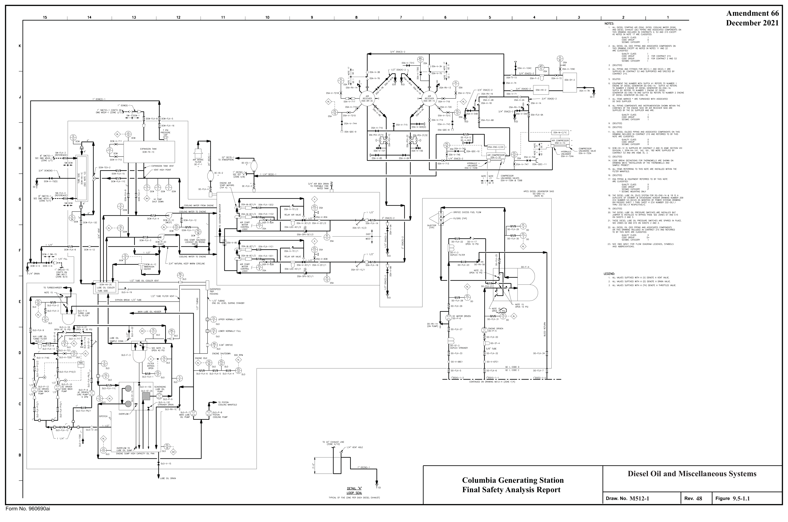
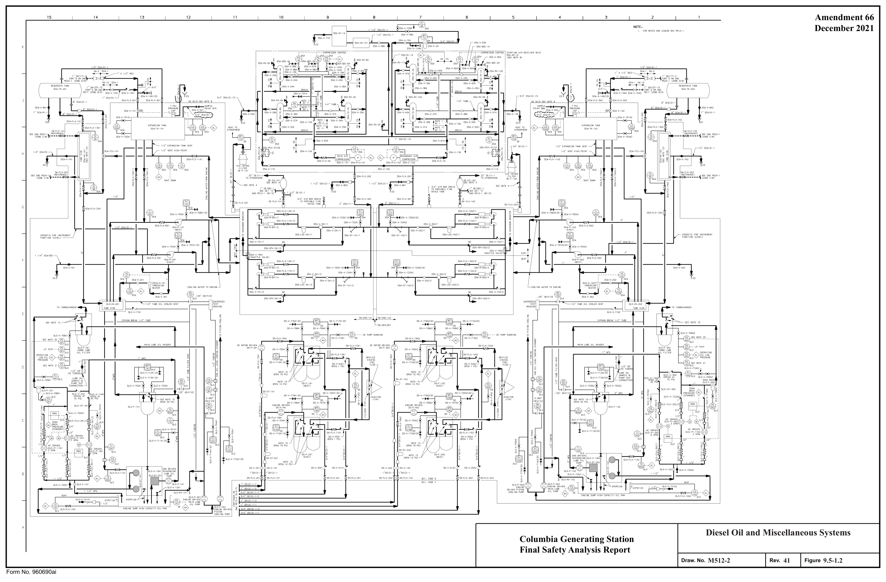
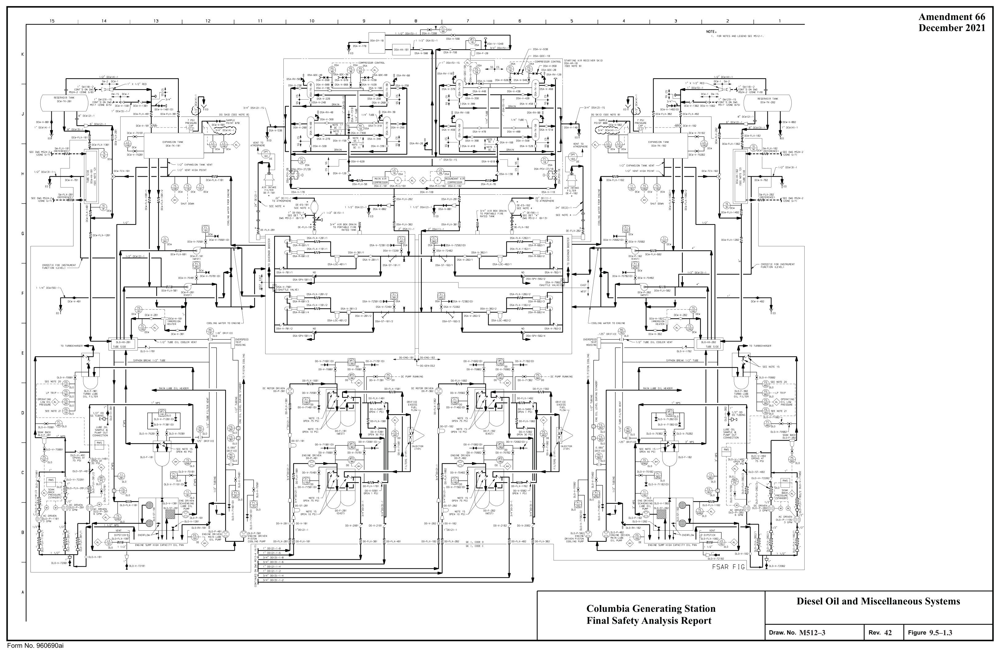
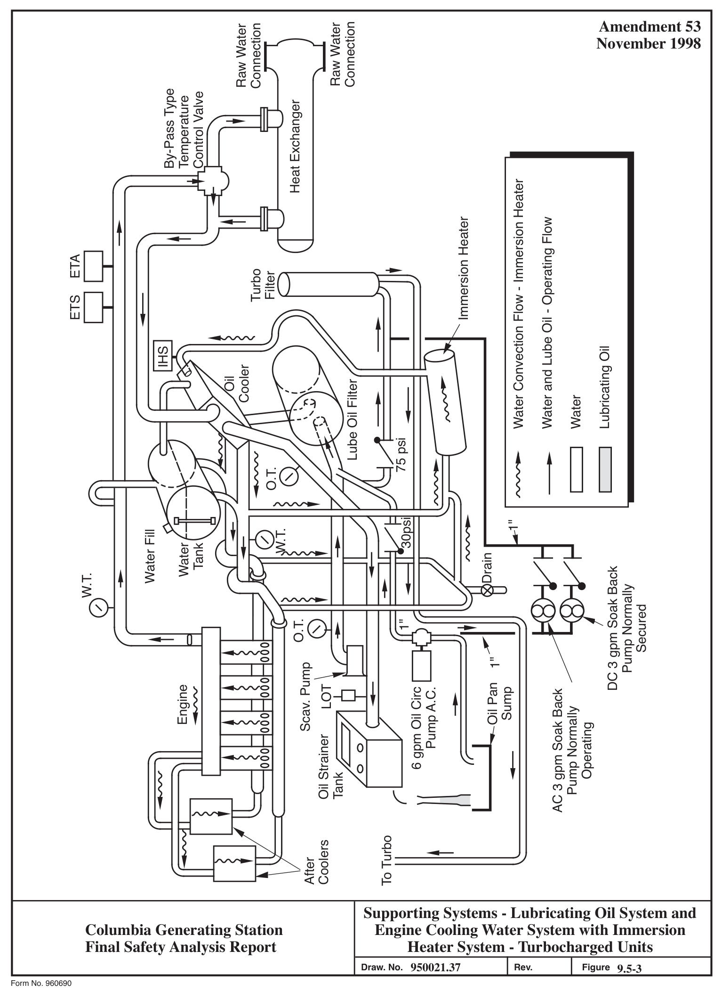
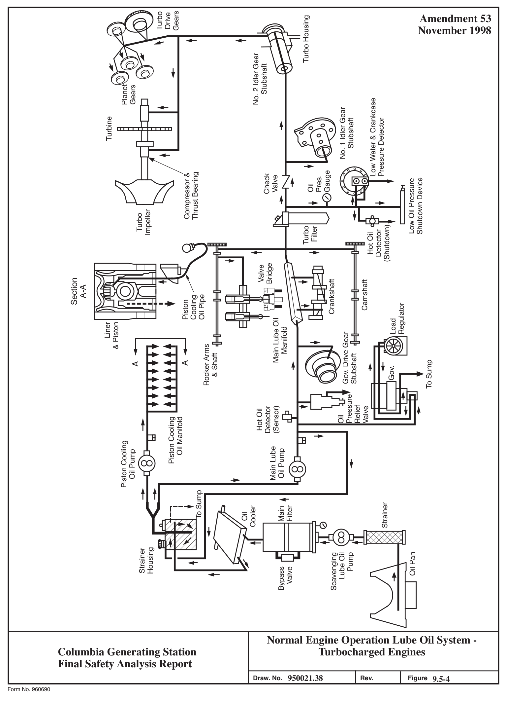
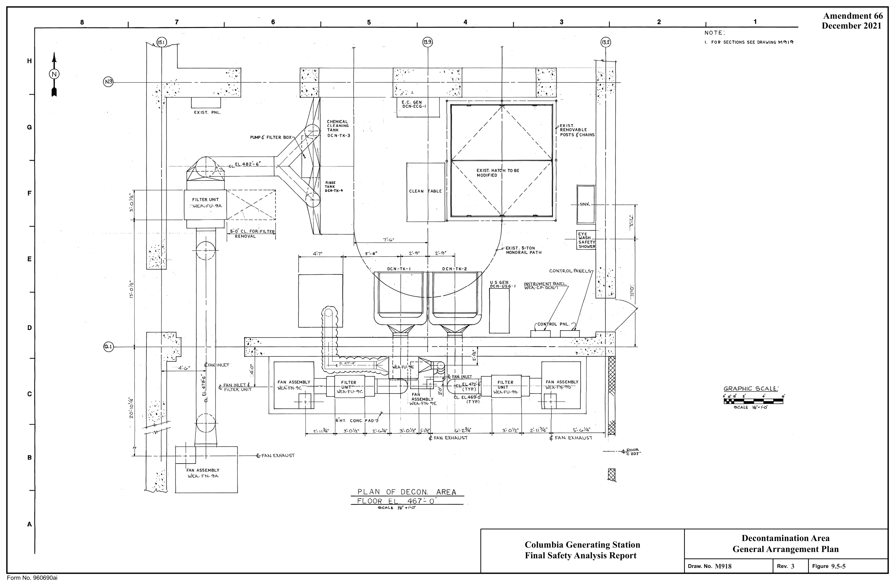
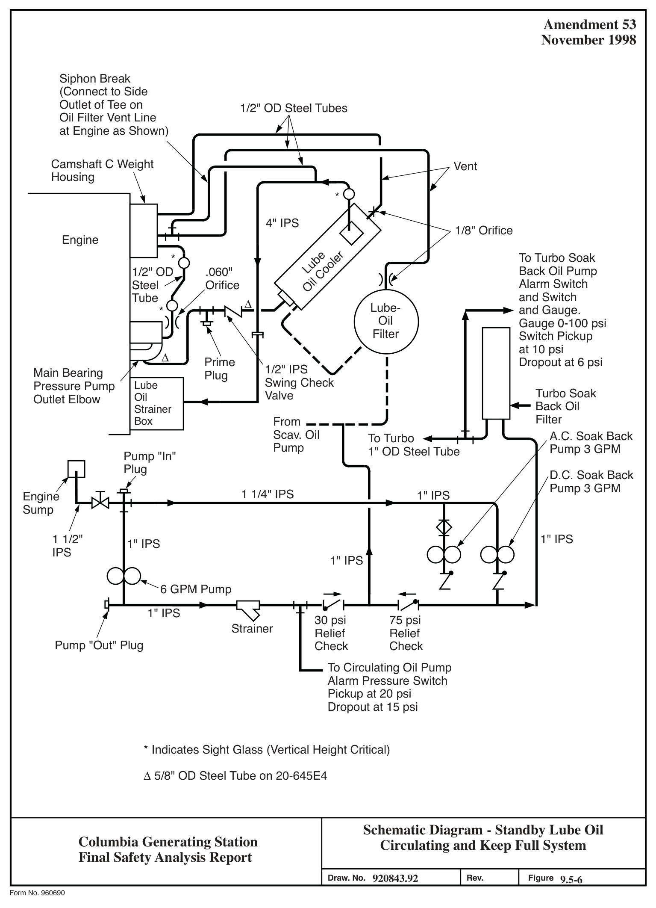

# 9.5 OTHER AUXILIARY SYSTEMS

> Columbia Generating Station FSAR — Chapter 09: Auxiliary Systems
> Source: `09_chapter-3152-3521.pdf`, PDF pages 325–370 (of 370)
> Amendment 67 compilation (individual pages carry varying amendment dates)

---
<!-- p.325 -->
### 9.5 OTHER AUXILIARY SYSTEMS
#### 9.5.1 FIRE PROTECTION SYSTEM
Appendix F, Fire Protection Evaluation, contains information on the plant fire protection systems.

#### 9.5.2 COMMUNICATIONS SYSTEMS
##### 9.5.2.1 Design Basis
Columbia Generating Station is provided with the following communication systems:

a. Public telephone access,

b. Private branch exchange (PBX),

c. Sound-powered telephone system,

d. Public address and building-wide alarm system,

e. Radio communication systems, and

f. Telephone link to Bonneville Power Administration (BPA) Dittmer Control Center.

The public telephone network provides for connection of PBX phones to outside lines.

The PBX provides intraplant communications, communication to BPA, and access to the public address and radio paging systems.

The sound-powered telephone system provides a backup to the PBX and can be used as a supplementary communications circuit to aid in the testing and maintenance of plant process systems.

The public address system provides a way of contacting personnel in the various buildings of the plant and locations of the site that might be inaccessible using other means of communication. The building-wide alarm system alerts (via the public address system speakers) operating personnel to fire hazards and other trouble conditions for which plant management finds it necessary to alert plant personnel.

The radio communications system provides a communications link for security and emergency communications to local law enforcement agencies and emergency control centers. In

<!-- p.326 -->
addition, the radio communications system is used for communications with personnel involved in maintenance and security in and around the plant complex by means of hand-held portable radio units, mobile radio units, and paging receivers. The telephone link to BPA provides a direct communication link to the BPA Dittmer Control Center.

Post-fire safe shutdown operator actions that require emergency communication with the control room or remote shutdown room rely on the PBX phone system. The post-fire safe shutdown communication system must remain operational during a loss of offsite power. Fire brigade activities use radio communication and may communicate with the control room or remote shutdown room using a PBX phone.

All equipment, components, raceways, and support systems located in the main control room are designed and anchored such that they will not cause loss of function of nearby safetyrelated equipment as a result of the safe shutdown earthquake. The same criteria is followed wherever such equipment is located close to safety-related equipment.

##### 9.5.2.2 System Description
###### 9.5.2.2.1 Public Telephone Access
This system consists of interconnections to the public telephone network as described in the following:

a. Individual direct lines with inward and outward dialing access to several plant locations:

1. Plant Manager’s office,
2. Main control room,
3. Security central alarm station (CAS), 4. Remote shutdown room, and 5. Security secondary alarm station (SAS).

b. Provisions for extension of individual lines with direct inward and outward dialing access to other plant locations:

1. Shift Manager’s office and
2. Radwaste control room.

c. Trunks to the PBX provide inward and outward dialing access to various plant locations.

<!-- p.327 -->
###### 9.5.2.2.2 Private Branch Exchange
This system consists of an all electronic, stored program, computer controlled telephone switching system with integral redundant computers. Telephones are strategically located throughout the plant complex. The system receives power from an uninterruptible power supply (UPS) system for reliable operation, consisting of a battery E-B0-PBX and battery chargers E-C0-PBX/1 and E-C0-PBX/2, located in building 25 (PAAP).

The PBX provides complete intercommunication at all times between any two telephones.
Connections are established by means of a dial on each telephone. Automatic dial tone, busy tone, and ringing current are provided.

Telephone communications boxes (CBs) are provided throughout the plant. The CBs in offices have a jack for plugging in a desk-type telephone. These CBs are extensions of the PBX exchange.

Most CBs in the operating and work areas have a PBX telephone jack and a sound-powered telephone jack. Instrument and control panels in the control room have PBX and soundpowered telephone jacks installed in the panels. Operating and work areas use portable telephones plugged into the jacks. A telephone number is assigned to one CB or jack of a compatible group and the others in the group are wired in parallel to it.

Head sets may be plugged into telephones in the operating and work areas when hands-free communication is required. Approved wireless communication devices, such as cordless handsets, may be used in the plant main control room and radwaste control room. To support outage activities approved wireless communication devices can be used in the drywell and approved reactor building elevations. Administrative control of wireless devices based on the location, operating frequency, field strength, minimum distance of an exclusion zone, visual postings, and end user training are established to preclude the effects of EMI.

Dedicated communication links provide access to BPA. The PBX provides the following special features:

a. Conference - up to eight telephones can be connected into a conference network to facilitate maintenance, testing, and management activities.

b. Paging - the Public Address System can be accessed from any PBX telephone extension.

c. Ringdown - the PBX can be programmed to provide ringdown (hotline) service for selected telephones. The service provides automatic ringing without dialing.

<!-- p.328 -->
###### 9.5.2.2.3 Sound-Powered Telephone System
The sound-powered telephone system consists of jack access in the communications boxes and panels and connecting wiring. The system is divided into eight circuits. Each circuit serves a different area of the plant. All wiring is routed to a terminal box located in the communications equipment room. The terminal box is equipped with jumpers for interconnecting the circuits. During normal operation the jumpers are connected to form a single bus so that all sound-powered jacks are connected in parallel. Each circuit can be isolated at the terminal box if shorts or grounds occur.

Portable sound-powered telephones are plugged into the jacks to complete a communications link.

###### 9.5.2.2.4 Public Address and Building-Wide Alarm Systems
9.5.2.2.4.1 Public Address System. The public address system is designed to provide areawide announcements throughout the plant by means of loudspeakers located in various areas.
Audio power to the speakers is provided by electronics located in equipment racks in the communications equipment room, which is located in the radwaste and control building.
Power to the electronics is provided from the UPS bus.

The speakers in each of the buildings or zones are connected in two separate circuit loops.
This provides an alternative path for partial communications should one loop be damaged.
Paging microphones are located in various areas and are used for “all zone” pages and have priority over telephone-accessed paging.

Most telephone instruments in the PBX can access the paging system by dialing the appropriate access number. Telephone pages can be directed to a specific building/zone or to all zones.
The connection between the PBX and the paging system is provided through special paging adapters which interface the two systems.

Critical electronic equipment is redundant and is automatically switched on line as required.
Failure of the amplifier systems is alarmed in the control room as well as locally at the public address racks.

9.5.2.2.4.2 Building/Zone-Audio Alarm System. The audio alarm system consists of a multitone generator with redundant backup which is located within the public address (PA)
system racks. The audio generators are capable of producing five distinct audio tones which are amplified by the PA system. The redundant generator is automatically switched online should the primary unit fail and an alarm is activated. The units are fed from the UPS system along with the PA system. One tone is used to alert personnel, followed by specific announcements. The audio alarm system has priority over PBX paging and “microphone actuated paging,” and will override either of these functions. The main control room is

<!-- p.329 -->
capable of activating all tones that are used. The alert tone may be activated from either the Plant Manager’s office or the remote shutdown room or the TSC.

###### 9.5.2.2.5 Radio Communications System
The radio communications system for Columbia Generating Station is integrated into the Energy Northwest radio network, which provides communications for all Energy Northwest facilities in the Hanford area.

The system is comprised of the following:

a. P25 L2 Core b. Fiber-Optic Distributed Antenna System c. In-Plant Repeaters d. Area Wide Repeaters e. Base Radio Stations f. Radio System Desk Sets g. Radio Dispatch Consoles h. Portable Handheld Radios, and i. Mobile Radios installed in vehicles.

P25 L2 Core

The P25 L2 Core zone controller system is the core of the radio communications system and is run using the ASTRO 25 “L” Core platform. The system architecture is designed with inherent fault distribution to ensure that a single point failure will not cause a complete loss of radio communications. The fault distribution includes the ability to reroute IP voice and data packets among the various redundant router configurations. Faults within the network will provide notification on the fault management terminal.

Fiber-Optic Distributed Antenna Systems (FODAS)

The FODAS consist of the ION-M master unit, ION-M4 remote unit transceivers, antennas, and rediax cables used as antennas. The master unit transmits and receives radio frequency signals to/from the base radio stations while controlling the entire ION-M system, including provisioning of the backhaul connectivity. The remote units are connected to the master unit via fiber optic cable. Up to four antennas can be connected to a transceiver using a single fiber back to the master unit.

In-Plant Repeaters

In-plant repeaters are used to provide radio communications within the plant using a fiber optic distributed antenna system. In-plant repeaters provide in-plant radio communications for

<!-- p.330 -->
Operations, Security, Emergency Preparedness, Fire Brigade, and Maintenance. The in-plant system consists of six repeaters. One repeater is designated as a “control channel” while the other five repeaters provide the audio communications. In a trunked system the control channel notifies the zone controller when a radio user initiates or ends a call using the push-toto-talk button on the radio, console, or desk set. The zone controller then designates an audio repeater to start or end the call. The in-plant repeaters are located in the Diesel Generator Building and are separated from other communication systems. Six traffic channels support the in-plant radio communications.

Area Wide Repeaters

Area wide repeaters provide area wide radio communications for Operations, Security, and Emergency Preparedness talkgroups. Mobile radios have been programmed to operate using area wide talkgroups. Area wide repeaters are located in the Consolidated Community Communications Facility (CCCF) on Rattlesnake Mountain.

Base Radio Stations

Base radios are programmed with talkgroups to support the in-plant and area wide radio communications. Base radios are connected to radio system desk sets and allow the desk set to talk to any talkgroup programmed within the base radio.

Radio System Desk Sets

Desk sets enable managers, supervisors, and team leaders the ability to communicate with plant and field teams through the in-plant and area wide radio communication systems to provide directional instructions.

Radio Dispatch Consoles

Dispatch consoles have access to all RF resources available to the L2 Core Trunked Digital Radio System. Offsite agencies using conventional radio channels will only be available to the dispatch consoles. Dispatch consoles serve as the mutual aid for interoperability and have the ability to patch offsite agencies into talkgroups for communications with radio users.

All equipment other than mobile radios or handheld portable radios are powered by a UPS bus for reliable operation.

9.5-5a

<!-- p.331 -->
###### 9.5.2.2.6 Telephone Link for Connection to the BPA Dittmer Control Center
This circuit consists of telephones located in the main control and remote shutdown rooms of the radwaste and control building, which are directly connected to the Columbia Generating Station/BPA communications equipment. These phones automatically ring to the Dittmer Control Center of BPA when they are used.

##### 9.5.2.3 Inspection and Testing Requirements
All communication cable conductors are tested for continuity and insulation resistance before connection to the various communication apparatus. Fiber optic cables are tested using an Optical Time Domain Reflector (OTDR) to measure continuity. A functional test on all communications systems is made after installation.

The functional test on the total installed radio communications system included a complete test of all system functions such as operation from dispatch consoles, base radios, desk sets, and two-way communication between offsite and onsite stations. Tests were made using both the maintenance and security system frequencies. Tests were performed to ensure that no harmful interference results between this equipment, the repeater station on Rattlesnake Mountain, and control room equipment. During preoperational and postoperational surveillance testing, solid state electronics in some areas exhibited spurious response to radio transmission. These areas have been flagged by signs showing “Prohibited Area For Use of Radios” and are put under administrative control.

##### 9.5.2.4 Capability During Postulated Accident and Anticipated Transients
Table 9.5-1 shows the strategic work areas and the type of communications available between these locations and the control room, remote shutdown room, and outside Columbia Generating Station.

###### 9.5.2.4.1 Protective Measures
The plant communications system provides assurance that a reliable communications link is available from the strategic plant work stations to the control room. The following design factors contribute toward this goal:

a. The PBX is built with plug-in modular circuit boards so that defective boards can be quickly replaced,

b. The PBX has redundant processing units with automatic switching from a failed computer to the redundant computer,

<!-- p.332 -->
c. The sound-powered telephone system backs up the PBX system in case of a major failure of the PBX,

d. Several telephones are connected directly to the public telephone network to operate independently of the PBX. These include telephones in the main control room, remote shutdown room, building 62, and the Plant General Manager’s office, and

e. During a loss of offsite power, the PEC/PAAP diesel generator ensures the PBX system operation beyond the 8-hr capacity of the PBX communication system battery, E-B0-PBX.

###### 9.5.2.4.2 Severing of Lines or Trunks
The failure of a single line or trunk cannot prevent communications from critical plant locations. Alternate facilities are available as follows:

a. Radios do not require offsite lines and can be used in lieu of telephones if telephone lines are not available,

b. Portable radios can be used if the antenna leads to fixed stations are inoperable, and

c. Tie lines connect the PBX to the BPA communications system. The lines provides telephone communications from Columbia Generating Station to telephones in BPA facilities. These communications are independent of the public telephone network.

###### 9.5.2.4.3 High Noise
The communication system design addresses high noise area problems as follows:

a. Telephones may be installed in sound dampening booths with either or both noise-canceling handsets and amplified receivers, and

b. Public address system speakers have volume controls which are adjusted according to the ambient noise level.

###### 9.5.2.4.4 Post-Fire Safe Shutdown
Fire induced failures of the PBX communication system are evaluated for the various fire areas as part of the post-fire safe shutdown analysis. See F.2.6.2 for more detail.

<!-- p.333 -->
#### 9.5.3 PLANT LIGHTING SYSTEM
##### 9.5.3.1 Design Bases
a. Lighting intensities are designed to provide indoor and outdoor illumination consistent with the Illumination Engineering Society recommendations (July 1974), and to meet or exceed OSHA requirements,

b. Light sources are selected with consideration for environmental conditions and ease of maintenance,

c. Fluorescent or high-intensity discharge (HID) sources are not used inside primary containment. These contain mercury, a known contaminant in reactor coolant system,

d. The normal lighting supplied from either the main generator or offsite power is designed to provide adequate lighting for normal plant operation and associated plant access routes, and for control and maintenance of equipment, and

e. The emergency lighting supplied from onsite power is designed to provide adequate lighting for safe shutdown of the plant and for associated plant access routes during the full spectrum of accidents, transients and special events.

##### 9.5.3.2 System Description
The plant lighting system consists of four systems: normal ac lighting, normal-emergency ac lighting, emergency dc lighting, and battery-pack emergency lighting. For the location of various fixed emergency lighting systems that support safe shutdown of the plant, see Table 9.5-2. See Figures F.6-18, F.6-19 and F.6-20 for locations of portable lantern use.

###### 9.5.3.2.1 Normal Alternating Current (ac) Lighting Systems
This system consists of two systems (A and B) which are energized from the plant non-safetyrelated 480-V ac auxiliary system motor control centers directly from three-phase 480-V ac, or through 208/120-V ac dry type lighting transformers and local area lighting panels.

###### 9.5.3.2.2 Normal-Emergency ac Lighting Systems
Normal-emergency ac lighting is provided for safe and orderly shutdown during the loss of normal ac power. This system is energized from the safety-related 480-V ac motor-control centers through isolation devices to non-Class 1E three-phase, four-wire 208/120-V ac dry type lighting transformers that feed lighting panels.

<!-- p.334 -->
,.

This lighting system consists of two systems (Divisions 1 and 2). Each system has ac lighting energized from critical buses that are connected both to and backed by their associated diesel generators (DG1 & 2).

This ac lighting comprises approximately 15% of the normal plant lighting load. The ac lighting fixtures in the main control room are designed and supported as Seismic Category I.

Some of the ac lighting system within the main control room can be manually transferred from its critical bus to an inverter supplied source if the associated battery charger is in service.

###### 9.5.3.2.3 Emergency Direct Current (dc) Lighting Systems
Emergency dc lighting is provided in the main control room, the access route to the remote I shutdown room, and in the remote shutdown room. The emergency dc lighting system is necessary for conducting shutdown operations during the coping period of a Station Blackout event.

This lighting consists of two systems (Divisions 1 and 2). Each system is energized from a I 125-V dc plant emergency battery system. The remote shutdown room and access route lighting is continuously lit, and the control room dc lighting is energized on a loss of power to I the normal-emergency lighting in the main control room. This dc lighting load consists of incandescent light sources.

###### 9.5.3.2.4 Battery-Pack Emergency Lighting Systems
Battery-pack emergency lighting consists of 1.5-hr and Appendix R lighting units. The lamps automatically energize on loss of the respective normal and/or normal-emergency ac lighting.
Emergency battery units in Seismic Category I areas of the radwaste building are Seismic Category I mounted and supported.

The 1.5-hr lighting consists of Emergency Battery Units (EBUs) and Emergency Reserve Ballast (ERB) units in areas without EBUs, installed for the safety of operating personnel to provide lighting for egress routes.
LJ Appendix R 8-hr emergency battery packs and portable 8-hr lanterns are available for use to ensure operators can perform post-fire safe shutdown manual actions outside the control room, for a fire in specific plant areas, concurrent with a LOOP. At a minimum, 8-hr emergency battery pack lighting is installed at locations where operators perform long-term plant control and shutdown actions. The portable 8-hr lanterns are used for short-duration operator actions.
There are four stations provided in various plant locations with five portable lanterns available at each location.

<!-- p.335 -->
##### 9.5.3.3 Safety Evaluation
Normal and normal-emergency lighting is located throughout the plant to provide necessary lighting during normal plant operation and during a power system failure. In the Reactor Building, during accident conditions, the normal lighting is tripped by an accident signal (FAZ)
to reduce building heat load.

In areas that are serviced by HID lighting sources, 10% of the fixtures are provided with tungsten halogen standby lamps. These standby lamps will be immediately energized after an interruption of the power source and will provide partial illumination until the HID lamps restrike.

The normal and normal-emergency lighting provide no safety-related function and thus are non-safety related.

#### 9.5.4 DIESEL GENERATOR FUEL OIL STORAGE AND TRANSFER SYSTEM
##### 9.5.4.1 Design Bases
a. The onsite storage capacity of each subsystem provides for continuous operation of each diesel generator for at least 7 days while satisfying post-LOCA maximum load demands;

b. The design of the system conforms to Regulatory Guide 1.137. The equipment within the system conforms to the applicable codes and standards of ASME, ASTM, ANSI, DEMA, IEEE, API, and NFPA;

c. The system piping off of the engine skid is constructed to ASME Section III, Class 3 and Seismic Category I requirements except for the portions of the I piping associated with the filter/polisher system. Except for the diesel oil storage tanks and portions of the filter/polisher system, all portions of the system, including the fuel oil day tanks, are protected from tornado missiles by enclosure in tornado-hardened, Seismic Category I structures. The diesel oil storage tanks and associated piping (except for exposed fill, vent, and filter/polisher piping as described in Section 3.5) are buried for tornado protection and to maximize containment of postulated oil spills. The system is not subject to flooding since the site is not subject to flooding. The piping on I the engine is constructed using ANSI B31.1 as a guide and is Seismic Category I;

<!-- p.336 -->
d. The diesel fuel storage system is augmented by the installation of a filter/polisher unit located in a separate filter/polisher building east of the storage tanks. This unit is non-safety-related. It is used to clean bulk fuel of contaminants and fuel degradation products formed due to long storage. It is also used to polish fuel oil delivered by fuel supply tankers, if necessary, prior I to delivery to the storage tanks. The filter vessels are constructed to ASME Section VIII, Division I, and the piping components to ANSI B31.1 Power Piping Code.

e. The Quality Class II Auxiliary boiler storage tank is used as an additional I storage tank for the emergency diesel generator fuel oil. This tank was cleaned I before putting it into diesel fuel storage service and is maintained to the same cleanliness requirements as the other Class I fuel oil tanks. The diesel fuel oil stored in this tank is surveyed to the same requirements as the other diesel I storage tank’s fuel oil. This storage tank and its connective piping are not required to be Seismic Category I, since this additional qualified fuel oil is nonsafety-related.

##### 9.5.4.2 System Description
The fuel oil storage and transfer system consists of separate, independent diesel oil supply systems serving each of the two tandem diesel generators (DG 1 and DG 2) and the highpressure core spray (HPCS) diesel engine generator (DG 3). Each of these systems consists of a fuel oil storage tank, a transfer pump, a day tank, interconnecting piping and valves, and associated instruments and controls. The system diagram is shown in Figure 9.5-1.

In each supply system, a transfer pump powered from a safety-related motor control center
(MCC) takes suction from the diesel oil storage tank and discharges to an associated diesel I generator fuel oil day tank to maintain the fuel oil level within the day tank. The transfer pump is sized to provide a flow several times the maximum engine consumption rate (of 110% I I load) and is automatically controlled by level switches activated by day tank fuel level. The fuel stored in each diesel generator 60,000-gal storage tank (50,000 gal for the HPCS diesel generator) plus the fuel maintained in each 3000-gal day tank is adequate for 7 days of operation.

Each transfer pump supplies a separate day tank for each diesel generator. There is a pipe interconnecting the diesel generator 1 and 2 transfer lines with normally locked closed valves.
If a rupture occurs in the interconnecting cross line when in use, this line will be manually isolated and thereby the fuel oil supply will not be interrupted between any storage tank and its associated day tank.

<!-- p.337 -->
The volume of the day tanks permits 8.5 hr of engine operation of the associated diesel generator without resupply to the day tank. This arrangement allows the transfer pump start signal to occur prior to the day tank low level alarm. In the event the transfer pump does not start, there remains at least 3.5 more hours of operation after low level alarms are actuated to take required corrective action. These operating times are for Division 1 and Division 2 with the diesel generators operating at 100% of the continuous rated load of 4400 kW. The maximum operating time for Division 3 (HPCS) will be substantially longer since the day tanks are the same size. The single HPCS engine carrying 2600 kW will use substantially less fuel than two engines carrying a load of 4400 kW.

At normal high oil level a switch will shut off the pump. If the fuel oil level goes above the I normal high level, a high level switch is activated and sends an alarm signal. If the pump does not shut off, the day tank overflow line will return all pump flow to the storage tank of the same diesel generator.

The fuel oil storage system has provisions to fill the storage tanks, transfer fuel from one tank to another, and filter/polish the fuel in the tanks or fuel being delivered to the tanks. The fill header is designed to allow delivery of fuel directly to a storage tank or run through the filter/polisher unit prior to delivering it to the tank from the fuel tanker. The piping boundary between the ASME III fill lines and header and the Quality Class II filter/polisher are at ASME III, 3 normally closed butterfly valves.

The filter/polisher, when used to polish the fuel stored in the tanks, removes oil from the bottom of the tank through a suction sparger that extends along the length of the tank. This oil is filtered and polished removing water and particulates. Then the filter/polisher returns the oil to the tank through the fill line.

The filter/polisher can be used to transfer fuel from one tank to another with or without filtering and polishing. The filter/polisher is equipped with a recording flow meter so the operator knows the quantity of fuel that has passed through the filter/polisher.

The filter/polisher suction line from the storage tank flanged nozzle to the filter/polisher suction header isolation valves is ANSI B31.1 Quality Class 2, Seismic Category I. The sparger in the tank is ANSI B31.1, Quality Class 2, Seismic Category I, and the fill line returning oil to the tank is ANSI B31.1, Quality Class 2, Seismic Category II. The suction and fill line for the auxiliary boiler storage tank is ANSI B31.1, Quality Class 2, Seismic Category II.

Operation of the fuel storage tank transfer pump is controlled manually when fuel is being transferred through the interconnecting line from storage tank A to day tank B or from storage tank B to day tank A. High level annunciation of the day tank fuel level will provide a warning of overfilling the day tank.

<!-- p.338 -->
The fuel oil supply from the day tanks to each diesel engine consists of two systems. Either system is capable of supplying fuel oil to the engine. For diesel generator 1 and 2 each system contains a fuel supply line strainer, fuel oil pump, duplex filter, pressure gauge, relief and check valves, and separate fuel return lines to the day tanks. The HPCS diesel generator fuel oil system is slightly different, see Section 8.3.1.1.7.2.6 for a description of the HPCS diesel generator fuel oil system.

One of the fuel supply pumps is mechanically driven by the engine and is normally used during engine operation. The other supply pump is driven by a 120-V dc motor and is used to fill the fuel oil system and fuel header prior to initial operation and after maintenance has been performed on system piping and components. The dc-motor-driven pump is running during engine operation in the event fuel supply through the engine-driven pump system fails.

The fuel pumps are located 2.3 ft higher than the suction pipes inside the day tank. The fuel pumps are designed to operate at this negative suction pressure. The fuel oil supply and return piping is not exposed to ignition sources such as open flames or hot surfaces. The transfer lines between the storage and day tanks are buried.

The fuel oil day tank is located in a separate ventilated room which is sized to contain the full contents of the tank should a leak develop. For discussion of fire protection see Section 9.5.1.

The tanks are filled through individual lines from a common fill header that has a strainer and I locked fill connection. Each tank also has an individual vent with a flame arrestor.

The fill and vent lines terminate at 2.33 ft and 8.0 ft, respectively, above plant grade, which prevents direct seepage of any ground water into the storage tanks.

In the event of fill line damage due to a missile, the pump-out connection which is protected by a metal enclosure, located at ground level, may be used for the fuel oil filling operation.

Prior to filling the storage tanks, the day tank will be confirmed to be full. This will allow sufficient time for sediment to settle before oil from the storage tanks is transferred to the day tank.

Diesel fuel oil conforming with the requirements of the Technical Specifications is provided for operation of the diesel generators. This grade of diesel fuel complies with the engine manufacturer’s requirements and is available from local distribution sources as discussed in Section 9.5.4.3.

Equipment design characteristics for the fuel oil supply system are shown in Table 9.5-3.

<!-- p.339 -->
##### 9.5.4.3 Safety Evaluation
The entire diesel oil supply system is located within the confines of a Seismic Category I building except for the buried storage tank and the fill, vent, and filter/polisher piping. Each system oil storage tank transfer pump, day tank, and diesel generator set is physically separated within separate concrete enclosures designed to protect against missiles, in compliance with Section 3.5, and to provide fire protection. No high- or moderate-energy piping is present in the diesel generator building which could present a potential hazard to the operational function of these systems. The oil storage tanks are buried for protection so that storage tank failure is completely contained within the soil at a level below any building penetration or access opening. Each storage and day tank is provided with a vent directly to the outside atmosphere. In addition, the enclosures are provided with exhaust ventilation to the outside atmosphere to ensure that diesel fuel vapors are maintained well below the combustible limit. The enclosures are automatically monitored by temperature detectors which initiate the preaction sprinkler system in the event of fire (Appendix F). All storage and day tank vents are equipped with flame arrestor devices.

Although a single failure may result in loss of fuel to one diesel generator, the other diesel generator can provide sufficient capacity for emergency conditions, including safe shutdown of the reactor (see Section 8.3) coincident with loss of offsite power.

The fuel level in each storage tank is maintained above the level at which the fuel in the storage tank plus the fuel in the corresponding day tank is adequate for 7 days of continuous I operation at 4400 kW for diesel generators 1 and 2, and 2630 kW for diesel generator 3
(HPCS).

The minimum site storage of 7 days is considered adequate time for obtaining additional fuel oil, if required. The auxiliary boiler storage tank is available as an additional source for qualified diesel fuel oil. On an expedited basis fuel can also be available at the site from a remote source within 12 to 24 hr.

Materials for the fuel oil supply system are provided in Table 9.5-3.

For corrosion protection, the exterior surfaces of the buried piping and components are coated with coal tar enamel. Application of coatings are in strict accordance with AWWA Standard C203.

The buried components of the fuel oil system are all at a relatively uniform temperature and I not subject to condensation phenomena. The periodic sampling of the diesel fuel storage tank bottom below the transfer pump will be performed to determine if any water has accumulated and if so corrective action will be taken.

#### LDCN-09-038, 10-031
<!-- p.340 -->
A fuel oil filter and strainer is provided on each fuel line to each engine to eliminate passage of particles, 12  or larger in size to the engine injectors.

The overflow lines from the day tank to the storage tank run underground south of the diesel generator building. Diesel oil pipe lines extending under the diesel generator building do not receive full protection from the exterior rectifier-anode system because of the electrical shielding effect of the ground grid and foundation reinforcing and structural steel. Since the earth area under the diesel generator building is sheltered and hence relatively much drier than the earth exterior to this building, no additional cathodic protection system is provided or required.

##### 9.5.4.4 Testing and Inspection Requirements
System components are inspected and cleaned prior to installation. Instruments are calibrated during testing and automatic controls are tested for actuation at the proper setpoints. Alarm functions are checked for operability and limits during plant preoperational testing. Automatic actuation of system components is tested periodically in accordance with the Technical Specifications and plant procedures. The system is operated and tested initially with regard to flow paths, flow capacity, and mechanical operability (see Chapter 14).

Operability of the diesel fuel oil system is ensured by I a. At least once per 10 years: Draining each fuel oil storage tank, removing the accumulated sediment, and cleaning the tank using a sodium hypochlorite or equivalent solution, and

b. At least once per 10 years: Performing a pressure test of those portions of the diesel fuel oil system designed to Section III, Subsection ND of the ASME Code in accordance with ASME Code Section XI, Article IWD-5000.

New and stored fuel oil is sampled and tested in accordance with the Technical Specifications.

##### 9.5.4.5 Instrumentation Requirements
Each diesel oil storage tank is provided with local level indicators and high and low level switches which actuate alarm annunciators in the main control room. In addition, there are system fault annunciators in the main control room for each diesel oil storage tank that will alert the operator of a malfunction of the level instrumentation for a given storage tank. Each day tank is provided with two level switches and a float switch which perform the following functions:

a. Start and stop the transfer pump to maintain level in the day tank, b. Actuate an alarm in the main control room on low level, and

<!-- p.341 -->
,.
,.
c. Actuate an alarm in the main control room on high level.

The fuel oil filter/polisher is equipped with a flow totalizer to aid in maintaining minimum fuel quantity in each storage tank when transferring from tank to tank. The filter/polisher is equipped with instrumentation and a level switch in a sump to alarm in the main control room I if a malfunction occurs or fuel oil leakage occurs in the filter/polisher building. The filter/polisher control panel contains a bargraph/digital level indicator for each diesel oil storage tank. Each bargraph drives a visual and audible annunciator that alerts the operator of a high level condition in that tank. An outside alarm is provided at the filter/polisher facility to alert the operator if any storage tank has a high level condition. A remote shutdown switch is provided in the control room for the operator to shut down the filter/polisher. An emergency shutdown switch is also located just outside of the door of the filter/polisher building.

Each transfer pump discharge line is provided with local pressure indicators. The system maintains the proper supply of diesel oil in each day tank by means of the level switches in the day tanks which signal the corresponding pump motor starters to automatically start and stop the transfer pumps.

Each diesel generator local control panel is provided with a control switch for control of its respective transfer pump.

Local indication of differential pressure is provided across the duplex filters of the fuel oil supply lines to the diesel engines of diesel generators 1 and 2.

#### 9.5.5 DIESEL GENERATOR COOLING WATER SYSTEM
##### 9.5.5.1 Design Bases
a. The diesel generator cooling water system is designed to provide full load cooling for the diesel generator engines while they are operating and to maintain each engine at an acceptable starting temperature under standby conditions;

b. The piping system associated with the diesel cooling water system was constructed to the guidelines of ANSI B31.1. Seismic classification of the I I system is Seismic Category I as discussed in Section 3.2.4. The diesel cooling water heat exchangers for diesel generators 1A and 1B are designed and built in I accordance with ASME Section III, Class 3 and TEMA Standards, Class C;
diesel generator 1C (HPCS) cooling water heat exchanger is designed and built I in accordance with ASME Section VIII, TEMA Standards, Class C; and

c. The reliability of the diesel cooling water system is achieved by providing separate cooling water systems for each diesel generator. Thus, failure of a single component in one cooling water system would not effect the operation of

<!-- p.342 -->
the other diesel generator. In addition the systems are housed separately in a Seismic Category I structure containing no high- or moderate-energy piping which could present a potential hazard to the operational function of these systems.

##### 9.5.5.2 System Description
Each diesel generator is serviced by an independent cooling system. These systems are located in separate rooms associated with their respective diesel generator. Each engine cooling water system is a closed water circuit which recirculates treated water (see Section 9.2.3) for engine cooling (see Figures 9.5-1 and 9.5-3). The treated water is circulated through the waterjacketed components of the engine to remove heat from the engine parts. This jacket water heat is rejected through a shell and tube heat exchanger to the standby service water (SW)
system (see Section 9.2.7). Location of the system is shown in Figure 9.5-2.

The forced circulation of cooling water through the engine, lube oil cooler, heat exchanger, and heat exchanger bypass circuit is maintained by two engine-driven pumps. The separate bypass piping flow paths are provided to bypass the heat exchanger at low engine outlet temperatures and to heat the jacket water system during standby. The heat exchanger bypass flow and temperature is automatically regulated by a three-way self-contained thermostatic I valve. This valve is set to maintain the engine outlet water temperature at about 180°F. This thermostatic valve outlet opens to the heat exchanger when the engine jacket water temperature reaches 165°F and is full open to the heat exchanger at 180°F. A high temperature alarm I annunciates at 200°F (195°F for HPCS diesel engine). A high temperature shutdown switch is provided to shut down the engine when coolant temperature reaches 208°F (205°F for HPCS diesel engine) during test conditions.

The heat exchangers are designed for 110% continuous rating of each diesel generator using 95°F service water to the heat exchanger. The maximum service water temperature is always well below 95°F. This provides a 10% margin in the size of the heat exchangers.

The only time the diesel generators are run at 110% of their continuous rating is during required surveillance testing. This is usually for 2 hr once a year, and always less than 10 hr/year, compared to the 2 hr/day as allowed by the engine manufacturer’s rating.

The diesel generator heat exchangers are designed to perform as given in Table 9.5-4.

An expansion tank is mounted on the diesel engine skid, located above the cooling water circulating pump suction. The expansion tank is provided with a pressure cap that maintains pressure on the cooling water system (7 psi) and prevents loss of water due to evaporation.

The expansion tank is provided with a level sight glass which is mounted on the front with instructions that indicate minimum water level. An alarm is provided in the control room to

<!-- p.343 -->
December 2011 l annunciate in case of low water level. Makeup water is normally supplied by the J demineralized water system, but a Seismic Category I, Safety Class 3, makeup water line from the SW system is provided as an alternate supply to the expansion tank.

Diesel generator unit reliability, including the functions required of the circulating water pump and expansion tank were demonstrated prior to installation (qualification and shop performance tests). Periodic testing and maintenance ensure continued reliability.

During shutdown periods, an electric immersion heater is provided for standby heating. The engine can thus be kept in constant readiness for an immediate start. The heating unit is mounted at the bottom of the accessory rack to heat the engine cooling water which circulates by thermosyphon action to the lube oil cooler, engine, and turbocharger after coolers.
A thermostat sensing water temperature controls the heating elements. The water temperature is controlled to maintain a lube oil temperature of approximately 120F as described in Section 9.5.7. The auxiliary motor-driven oil pump circulates lube oil through the lube oil cooler to pick up heat during standby conditions and then returns the warmed oil to the engine sump (see Section 9.5.7). Low oil temperature alarm is provided to ensure that the immersion heater is operating properly (see Sections 9.5.7.2 and 8.3.1.1.7.2.3).

To ensure that all components and piping are initially filled with water, a demineralized water supply is temporarily connected to the 1.25-in. fill-drain connection located on the engine base at the cooling water pump end. Filling the cooling water system from the bottom up allows entrapped air to be vented to the expansion tank. (The HPCS engine has a permanent connection.)

The engine cooling water return pipe (between engine block and temperature regulating valve)
is slightly higher than the top of the expansion tank. However, as may be seen from Figures 9.5-1 and 9.5-3, during system operation any entrapped air will be properly relieved to the expansion tank through the provided vent lines due to the differential pressures involved.

A 500-gal reservoir tank is provided in the cooling water system of each diesel engine associated with diesel generators 1 and 2 to permit operation of the engine for the time I required to receive SW cooling. The HPCS diesel engine is designed to permit operation without cooling for a time equivalent to that required to bring the cooling equipment into service with energy from the HPCS diesel generator.

In accordance with the manufacturer’s maintenance instructions, a corrosion inhibitor is added to the demineralized fill water to preclude corrosion and organic fouling in the diesel engine I cooling water system. Since the entire system is enclosed in the diesel generator building and maintained in a warm condition with immersion heaters, antifreeze compounds are not needed.

Cooling system materials of construction include cast irons, carbon steel, rubber, and bronze.
Corrosion inhibitors can be used effectively with these materials.

<!-- p.344 -->
Demineralized water and a corrosion inhibitor are in conformance with the engine manufacturer’s recommendations.

##### 9.5.5.3 Safety Evaluation
The diesel generator cooling water system meets the single failure criterion in that if a failure in the system prevents the operation of its associated diesel generator, the remaining diesel generators will not be affected.

This redundancy is accomplished by segregating the power supplies to engineered safety features into three mutually exclusive divisions, each provided with a diesel generator and associated cooling water system. The cooling water systems associated with a particular diesel generator are cooled from an independent SW system.

In the event of the loss of offsite power, the SW pumps which supply cooling water to the heat exchangers begin operation within a safe margin of the point at which the diesel generators 1 or 2 would require the cooling capability of the heat exchangers. See Section 9.2.7 for evaluation of this system.

The high temperature shutdown switches are locked out of the safety circuit during the automatic (emergency) operational mode of the diesel generators to ensure the availability of the emergency power from each generator.

Evaluation of the diesel generator operation under light load conditions is presented in Sections 8.3.1.1.7.1.11 and 8.3.1.1.7.2.11.

##### 9.5.5.4 Testing and Inspection Requirements
The system is operated and tested initially with regard to flow path, flow capacity, and mechanical operability (see Section 14.2).

To ensure continued integrity of the diesel generator cooling water system, scheduled testing of equipment is performed as part of the overall engine performance checks at regular intervals in accordance with the Technical Specifications. Periodic inspections are conducted in accordance with plant procedures prepared in conjunction with the manufacturer’s recommendations.

Instrumentation is provided to monitor cooling water temperature and pressure, expansion tank level, and to alarm high water jacket temperature. These instruments receive periodic calibration and inspection to verify their accuracy.

<!-- p.345 -->
The water in the cooling water system is periodically analyzed and treated, as necessary, to maintain the desired quality.

#### 9.5.6 STARTING AIR SYSTEM
##### 9.5.6.1 Design Bases
a. Each emergency diesel generator, including the HPCS diesel generator, is provided with separate, independent starting air systems;

b. Each starting air system on diesel generator 1 or 2 has sufficient air receivers to I provide for five diesel generator starts. The starting air system on each diesel generator consists of two completely redundant systems including two banks of air receivers, separate piping and valves, and one pair of air motors per engine which are both actuated on a start signal. The starting system on HPCS diesel generator 3 consists of two separate systems from separate air receivers through separate piping and control valves to a pair of air motors on each side of the I engine. The air receivers have sufficient air capacity for three starts; and

c. The starting air piping off the engine skid is designed, fabricated, inspected, and erected in accordance with ANSI B31.1. The piping on the engine skid is constructed using ANSI B31.1 as a guide. The system is designed to Seismic Category I requirements. The air receivers associated with diesel generators 1 or 2 are designed and constructed in accordance with the requirements of ASME Section VIII (1973 Edition). The HPCS diesel generator air receivers were designed and constructed in accordance with the 1971 Edition of the same code.

##### 9.5.6.2 System Description
The starting air system is shown schematically in Figure 9.5-1. The starting air systems for diesel generators 1 and 2 consist of two electric-motor-driven air compressors, eight air receivers, and associated piping and controls.

Control switches for the electric-motor-driven operation of the air compressors on diesel generators 1 and 2 are on the local diesel engine control board. These control switches permit on-auto-off operation. A selector switch permits selection of either compressor function as the primary pressurization compressor.

Pressure switches in either air receiver bank automatically start the selected compressor when I the receiver pressure decays to 241 psig. If the selected compressor fails to operate or cannot hold system pressure, a separate low pressure alarm switch is provided for each bank of air I receivers and is set to alarm at 238 psig on a local panel and in the main control room. When the receiver pressure decays to a lower pressure, the back-up air compressor starts.

<!-- p.346 -->
The HPCS starting air system has two separate air supply trains: one supplied by a dieseldriven compressor and the other by an electric-motor-driven compressor.

The compressor discharge piping is cross connected. Both air receivers charge if either compressor operates. A check valve on each receiver inlet isolates one train from the other.

The compressors are controlled automatically by pressure switches on their associated air receiver. The compressor’s low pressure setpoint ensures that the compressor starts to maintain the air receiver pressure at a sufficient amount to start the engine the required number of times.

The HPCS diesel-driven compressor may shut down prior to clearing the low pressure alarm on the receiver in the electric-motor-driven compressor train.

The air receivers are equipped with safety/relief valves set at the receiver design pressure.

The major system components are located adjacent to the diesel generator skid.

For each diesel generator (1 and 2), two separate air-cooled compressors discharge through I I I common piping to two banks of four 32 ft3 air receivers which are connected in parallel. Each bank of air receivers has the capability of a minimum of five engine starts. Each bank is I connected through separate piping to a pair of air start motors on each engine.

The flow path is from the air receiver manifold, through an isolation valve, a pressure reducing valve, through piping to the engine, then a strainer, an air relay valve, and a lubricator to each pair of air starter motors. The starting air system on each engine consists of I four air start motors. These air start motors drive a flywheel ring gear which turns the engine.
When a start signal is given, an air start solenoid valve in each redundant system admits air to engage a pair of the air start motor pinions on each engine to the flywheel ring gear. When the pinions are engaged, air is admitted through an air control valve to a pair of air start motors.
The other pair of start motors on the engine are simultaneously engaged by the redundant start solenoid valves. Engine cranking time is approximately 2 sec.

The starting air system is designed to provide a reliable method for automatically starting each diesel generator unit. The system design is such as to preclude fouling of its components.
Downstream of the air compressors, dryers are installed to ensure the dewpoint of the air will be below the minimum room temperature if the system is filled during the worst ambient air I I conditions. The air dryers are drained periodically to remove oil and moisture. A filter is provided downstream of the dryer to ensure no desiccant or debris can enter the system. In addition, “Y” type strainers are provided upstream of the starting air valves and motors.
These strainers are cleaned periodically to ensure that they are kept free from contaminants.

<!-- p.347 -->
The air starting system of the HPCS diesel generator is similar to that of diesel generators 1 and 2 described above except (a) the number of air receivers: two, of approximately 36 ft3 each, (b) the number of engine starts: three from the air receivers with the compressors locked out, (c) the redundant starting air compressor is diesel driven and automatically operates without manual actions, and (d) there are two parallel systems that each simultaneously operate a pair of air motors on the diesel generator for a start. The parallel systems provide the ability to produce a start even if one system sustains a pressure boundary failure or a failure of one starting air solenoid valve to open.

See Section 8.3.1.1.7.2.5 for additional discussion of the HPCS diesel engine starting air system.

##### 9.5.6.3 Safety Evaluation
Each diesel generator starting air system is capable of supplying a sufficient quantity of air from its associated air receivers to ensure a successful starting operation of the diesel generator independent of normal plant power sources.

The starting air systems for each diesel generator unit are physically and electrically separated to ensure that no single failure can cause malfunction of both divisions of standby ac power.
The single failure criterion is satisfied and significantly enhanced by having redundant piping systems and mechanical equipment for diesel generators 1A and 1B and duplicate (but not functionally redundant) piping systems and mechanical components for the HPCS diesel generator. All three diesel generators also have redundant starting solenoid valves.

##### 9.5.6.4 Testing and Inspection Requirements
Preoperational testing was performed as described in Section 14.2. To ensure continued integrity of the diesel generator starting air system, scheduled testing of equipment is performed as part of the overall engine performance checks at regular intervals in accordance with the Technical Specifications. Periodic inspections are conducted in accordance with plant procedures prepared in conjunction with the manufacturer’s recommendations.

#### 9.5.7 DIESEL GENERATOR LUBRICATION SYSTEM
##### 9.5.7.1 Design Bases
a. The diesel generator lubrication system is designed to provide sufficient lubrication for proper operation of its associated diesel generator under all loading conditions. The system is required to circulate the lube oil to the diesel engine working surfaces and to remove excess heat generated by friction during operation. The system provides oil at the engine surfaces at approximately

<!-- p.348 -->
December 2005 t 120°F during the anticipated long periods of standby duty by use of an electric J immersion heater in the cooling water system; and

b. The piping system was constructed to the guidelines of ANSI B31.1 and Seismic Category I requirements.

##### 9.5.7.2 System Description
The lubrication system for each diesel generator is shown in Figure 9.5-1. The lubrication system for each diesel engine is mounted on its diesel generator skid (see Figure 9.5-4) and is a combination of three separate systems. These are the main lubricating oil systems, the piston cooling system, and the scavenging oil system. Each system has its own pump. The main lube oil pump and the piston cooling oil pump are in tandem housings and share a common drive shaft. All three pumps are positive displacement, helical gear type, mounted externally at the front of the engine, and are gear-driven from the engine.

The main lubricating pump supplies oil under pressure to the various moving parts of the engine. The piston cooling pump supplies oil for the cooling of the pistons and lubrication of the piston pin bearing surfaces. After circulation through the engine parts, the lubricating oil flows back to the engine oil sump. The scavenging oil pump takes suction from the engine oil sump and pumps this oil through a filter and lube oil cooler to the strainer sump which supplies the main and piston lubricating pumps. The lube oil cooler is a shell and tube, water-cooled type capable of adequately cooling the engine lube oil when operating at any load point within the engine generation load range. The diesel cooling water acts as the lube oil cooler heat sink.

The engine lubrication system including the lube oil cooler is furnished by the engine manufacturer, Electromotive Diesel, a division of General Motors. The diesel cooling water system, also furnished with the engine, removes the heat from the lube oil coolers. Heat from the diesel cooling water system is removed in the diesel generator cooling water heat exchangers. The characteristics of these heat exchangers are described in Section 9.5.5.

The lubrication system on each engine also has three small lube oil pumps to circulate oil through the engine main bearings and the turbocharger bearings to minimize wear when the engine starts.

The circulating lube oil pump continuously circulates lube oil through the main lube oil system filter, the lube oil cooler (where it is warmed to approximately 120°F) and then through the I engine main bearings. This maintains the oil level in the engine just below the camshaft so the oil pressure will increase rapidly when the engine starts from a normal standby condition or on a hot restart.

<!-- p.349 -->
An ac-driven soak back pump continuously circulates lube oil through the turbocharger bearings to minimize wear when the engine starts and to remove heat from the turbocharger I following engine shutdown. A dc-driven soak back pump is arranged in parallel with the ac soak back pump and will automatically start on loss of pressure downstream of the ac and dc pumps.

Instrumentation is provided that alarms locally and activates a “DG Trouble Alarm” in the control room on loss of pressure downstream of any of the pumps.

Abnormal lube oil pressures, temperatures, low sump level, and loss of pressure on the lube oil circulating pump discharge are annunciated.

In the event of a high crankcase pressure, annunciator and computer alarms are provided to I I alert the operator. A manual shutdown will then be made for diesel generators 1 and 2. For diesel generator 3 (HPCS) an automatic shutdown will occur unless an auto initiation signal is I present. The hand-hole or top deck covers, following a high crankcase pressure condition, will not be opened until the engine has been allowed to cool off. This will prevent ignition of oil vapors due to air admittance.

Suitable screens and/or filters in the engine lubrication oil fill pipes prevent entry of foreign material into the engine crankcase. Procedural control, operator training, and careful labeling of fill ports to identify the standard and grade of lubricant to be used ensures that the proper lubricant is used. Lubricant storage containers are similarly labeled to identify contents.
Sampling and testing of the lubricating oil to verify conformance to ASTM Standard 0975-74, Grade 2-D, is performed periodically.

The manufacturers recommendations on measures to be taken to maintain the required quality of the lubricating oil provided in the engine instruction manual are followed.

The following sensors and alarms are provided as described below (diesel generator 3 values are in parentheses):

Sensor Alarm Point Purpose D Engine lube oil temperature low 115°F To warn of loss of warm-up
(100°F) immersion heater D Engine lube oil temperature high 240°F To warn of loss of cooling
(230°F) water system D Engine lube oil pressure low 26 psig To warn of low oil pressure
(alarm)
(25 psig) prior to engine damage

<!-- p.350 -->
Sensor Alarm Point Purpose

Engine lube oil pressure low 21 psig Shut down engine only
(shut down)
(23 psig) during test mode to prevent damage Shutdown engine lube oil 7 psig Warns of inadequate lube oil pressure low (alarm)
(7 psig) pressure in standby mode.

Operator actions to be taken to resolve alarm conditions are provided in appropriate plant procedures.

See Sections 8.3.1.1.7.1.4 and 8.3.1.1.7.2.4 for additional discussion of the diesel generator lubrication system.

##### 9.5.7.3 Safety Evaluation
The diesel generator lubrication system is capable of providing sufficient lubrication under all loading conditions. Each engine oil sump is of adequate size to contain a supply of oil to support 7 days of continuous operation.

The provision for a physically separate lubrication system for each diesel engine satisfies the requirements of the single failure criterion for complete independence and redundance of the onsite power system by avoiding any commonality between diesel generator units. All system equipment is housed inside a Seismic Category I structure containing no high- or moderateenergy piping.

The lubrication system has a low level alarm in the sump to warn of low oil level. The engines are periodically visually inspected for oil leaks to guard against excessive oil leakage.

##### 9.5.7.4 Testing and Inspection Requirements
Preoperational testing was performed as described in Section 14.2. To ensure continued integrity of the diesel generator lubrication system, scheduled testing of equipment and lubrication oil quality is performed as part of the overall engine performance checks at regular intervals in accordance with the Technical Specifications. Periodic inspections are conducted in accordance with plant procedures prepared in conjunction with the manufacturer’s recommendations.

<!-- p.351 -->
#### 9.5.8 DIESEL GENERATOR COMBUSTION AIR INTAKE AND EXHAUST SYSTEM
##### 9.5.8.1 Design Bases
a. The diesel generator combustion air intake and exhaust system is designed to supply clean combustion air to each diesel engine and to exhaust combustion gases in a manner that will not effect the operational function of the diesel engines;

b. Each diesel engine is provided with an independent combustion air intake train which filters and directs air from the exterior of the diesel generator building
(south side) to the engine turbocharger, and an independent exhaust train which silences and directs engine exhaust gases to the exterior of the diesel generator building (north side). Since each diesel generator unit has its own independent and separate intake and exhaust train, the single failure criterion is satisfied;

c. The air intake trains are designed to eliminate contaminating substances, such as dust and larger foreign objects, by filtering the air supply through a screened air intake louver, a prefilter, and then through an oil bath air cleaner for the HPCS engine and a cartridge type air cleaner for the engines associated with diesel generators 1 and 2; and

d. The combustion air intake and exhaust system is protected from externally generated missiles (i.e., tornado missiles) by enclosure in a Seismic Category I I structure. The piping for the diesel engine intake and exhaust systems is Seismic Category I and is in accordance with the requirements of ANSI B31.1.
The exhaust silencers, however, are not ANSI B31.1 material but are ASTM A569 which is suitable for the service. The seismic and quality group classification of components in this system is provided in Section 3.2.

Nondestructive examination in accordance with ASME Section III, ND-5000 requirements, was performed on the welds in the combustion air intake and exhaust systems piping.

##### 9.5.8.2 System Description
The combustion air intake and exhaust system is shown in Figure 9.5-1 and the location within the diesel generator building is shown in Figure 9.5-2.

The air intake trains associated with each diesel generator are housed in separate rooms and each is supplied air from the exterior of the diesel generator building (south side) through a screened air intake louver. Each engine air intake system consists of prefilters, an oil bath type air cleaner for the HPCS engine and cartridge type for the engines associated with diesel

<!-- p.352 -->
generators 1 and 2, air turning box, the necessary piping, ductwork, and flexible connections to the inlet of the engine turbocharger and aftercooler. An in-line air intake silencer is also provided in the HPCS diesel engine air intake system.

Intake air is cooled in the aftercooler by the engine cooling water system to improve engine I operational efficiency. The air intake capacity of each diesel engine associated with diesel I generators 1 or 2, at 14.7 psi and ambient temperature, is 10,120 cfm. The air intake flow to the HPCS diesel engine at 14.7 psi and ambient temperature is 10,200 cfm.

The exhaust trains associated with each diesel generator are also housed in separate rooms.
Each engine exhaust system consists of an exhaust manifold, turbocharger, exhaust silencer, I and the necessary piping and ductwork. Exhaust piping from the diesel-driven air compressor in the HPCS starting air system is connected to the corresponding diesel exhaust line upstream of the exhaust silencer.

Exhaust gases are discharged through the turbocharger from the exhaust manifold and are expelled through ductwork and an exhaust silencer to the exterior of the diesel generator I building (north side). The exhaust gas flow from each diesel engine associated with diesel I generators 1 or 2 is 23,000 cfm at 770°F and from the HPCS diesel engine is 23,000 cfm at 735°F.

##### 9.5.8.3 Safety Evaluation
The provision of a physically separated and independent intake and exhaust train for each diesel generator unit satisfies the requirements of the single failure criterion for complete independence between units.

Since each air intake and exhaust train is housed within a Seismic Category I building, they are protected from externally generated missiles. No high- or moderate-energy piping is present in the diesel generator building which could present a potential hazard to the operational function of these systems.

The air intake trains are designed so that an adequate supply of quality air is available to the diesel engines as required. To eliminate foreign objects which could restrict the supply of air to an engine, air is drawn into the system from the outside atmosphere through a screened intake louver and prefilter and then through combustion filters; oil bath cleaner for the HPCS engine and a cartridge type air cleaner for the engines associated with diesel generators 1 and
2. The postulated design worst-case dust storm is defined in Section 2.3. The postulated design basis ashfall event is defined as a 20 hour event concurrent with a 2 hour loss of offsite power. The dust storm concern is negligible by comparison with the design worst-case ashfall event due to the smaller amount of particulate accumulation associated with the dust storm.
The results of an analysis of the oil bath and cartridge filters for the intake air system shows the adequacy of either of these combustion filters in handling a severe dust storm event without

<!-- p.353 -->
affecting the diesel generators performance. The results of an analysis for the intake air systems shows the adequacy of the combustion filters and pre-filters in handling an ashfall event without affecting the safe shutdown credited Division 1 and 2 diesel generators.
Evaluation of a postulated release from the containment inerting nitrogen tank determined that such a release could stall all three diesels for approximately 8 minutes. This postulated release, however would not result in any conditions that would lead to turbine trip or reactor scram. Because the postulated release from a non-mechanistic failure on the nitrogen tank does not result in a reactor scram or turbine trip, offsite power remains available during the postulated nitrogen tank release and reliance on the diesel generators is not required. This assumption is consistent with guidance in Standard Review Plan (SRP) Sections 3.6.1 and
3.6.2.

There is no appreciable effect on a diesel generator’s ability to carry its required load as a result of barometric pressure drops which would effect the capacity of the combustion air intake train.

Recirculation of combustion products from the diesel exhaust to the air intake which could significantly effect the operation of the diesel engine is precluded by the degree of horizontal and vertical separation between the exhaust and air intake (see Figure 9.5-2).

##### 9.5.8.4 Inspection and Testing Requirements
The combustion air intake and exhaust system was checked for system leaks and blockage following initial installation and testing of the diesel engines (see Section 14.2).

Periodic cartridge replacement/cleaning of air intake filter units is performed at regular intervals and when the filter differential pressure observed during engine operation indicates the filter is dirty. Periodic inspection of the adapter and screen assemblies in the exhaust manifold is performed as needed. Routine testing of the diesel engines in accordance with the Technical Specifications verifies the integrity of the air intake and exhaust systems. Periodic inspections are conducted in accordance with plant procedures prepared in conjunction with the manufacturer’s recommendations.

#### 9.5.9 PLANT DECONTAMINATION FACILITY
##### 9.5.9.1 Design Bases
The plant decontamination facility is designed to provide a central location for equipment decontamination in a relatively safe and efficient environment. Safety of personnel has been carefully considered and built into all aspects of the operation. Local filtration and increased capability, per recommendations of the Handbook of the American Conference of Governmental Industrial Hygienists, have been incorporated into the existing radwaste building ventilation system to minimize airborne contamination. Each of the facility components has been strategically located to provide a safe, efficient, and relatively quiet process from entry to

<!-- p.354 -->
disassembly, cleaning, reassembly, and exit. Controls and indication have been positioned in a central location to minimize setup time and thus reduce personnel exposure. The decontamination facility has been designed to Quality Class II and Seismic Category II requirements.

##### 9.5.9.2 System Description
The decontamination facility is located in the radwaste building on the 467-ft el. adjacent to the contaminated tool room (see Figure 9.5-5). This facility consists of the equipment necessary to enable decontamination of a variety of plant components, tools, and other portable equipment.

To minimize airborne contamination and process fumes in the decontamination room, cleaning tanks are provided with individual exhaust hoods per recommendations of the Ventilation Handbook of Governmental Industrial Hygienists. The exhaust system for each hood is complete with its own high-efficiency particulate air (HEPA) filter unit and exhaust fan. The air from the exhaust fans is ducted to the radwaste building exhaust system (see Section 9.4.3.2 for system description).

Differential pressure switches are provided across the prefilters and the HEPA filters to annunciate in case of a dirty filter condition. The fan flow is controlled by the fan differential pressure controller which controls a modulating damper at the fan discharge. All the fans are located in the contaminated tool room to minimize noise levels in the decontamination room during operation.

An automatic sprinkler system has been installed for protection against the unlikely event of a fire. Curbs have been installed at all doors to the decontamination room, the equipment hatch, and the contaminated tool room to contain flooding caused by a major spill or activation of the sprinkler system. A decontamination sink and an emergency eyewash shower station have been installed to permit immediate treatment in case of a splashing accident.

##### 9.5.9.3 Safety Evaluation
The plant decontamination facility has no safety function. Malfunction or failure of the decontamination facility will not impair normal or emergency plant operations.

##### 9.5.9.4 Testing and Inspection Requirements
On installation and periodically thereafter, HEPA filters are given in-place DOP tests in accordance with ANSI N 510-1980, Testing of Nuclear Air Cleaning Systems.

<!-- p.355 -->
#### 9.5.10 REFERENCES
9.5-1 H. R. Clay, “Power Generation Control Complex Design Criteria and Safety Evaluation,” General Electric NEDO-10466, Revision 1, September 1977.

9.5-2 Electro-Motive Division, General Motors, LaGrange, IL, “Stationary Power Operating Manual,” Volume 11, 2nd Edition, June 1971.

9.5-3 SER Licensing Condition No. 9. Letter from G. D. Bouchey, Supply System, to A. Schwencer, NRC, dated June 4, 1982 (G02-82507).

<!-- p.356 -->
Table 9.5-1

#### REDACTED
<!-- p.357 -->
Table 9.5-1

#### REDACTED
9.5-31a

<!-- p.358 -->
Table 9.5-2

Locations of Fixed Emergency Lighting

Battery Packs DC (125V Life Safety Safe Shutdown Equipment Normal-Emergency Plant Battery (1.5-hr Areas/Access Egress AC (DG Backed) Backed) Batteries) (8-hr Batteries)

#### RADWASTE BUILDING
Access route from the Control YES YES EBU Room to RSD Room via stairwell A-7

Remainder of stairwell A-7 for YES

#### EBU EBU
PFSS event mitigation

Control Room YES

#### YES EBU EBU
RSD Room YES YES EBU

ARSD Panel YES EBU

#### SM-8 YES EBU

SM-7 YES

Battery Chargers Div. 2 YES ERB

#### RPS 1A
YES EBU

#### RPS 1B
YES EBU

125 VDC Div. 1 Battery ERB

125 VDC Div. 2 Battery ERB

Remainder of RW el. 467 ft for YES

#### EBU EBU
PFSS event mitigation

RW el. 525 ft PFSS event YES

#### EBU, ERB
mitigation

Remainder of RW YES

#### EBU, ERB,
High Intensity Discharge Light

<!-- p.359 -->
Table 9.5-2

Locations of Fixed Emergency Lighting (Continued)

Battery-Packs DC (125V Life Safety Safe Shutdown Equipment Normal-Emergency Plant Battery (1.5-hr Areas/Access Egress AC (DG Backed) Backed) Batteries) (8-hr Batteries)

#### TURBINE BUILDING
Corridor C121 at el. 441 ft YES EBU Corridor C120 at el. 441 ft YES EBU
(remainder of the access route from the Control Room to the DG Bldg. For PFSS event mitigation)

SM-1, 2, 3; SH-5, 6 at YES EBU, High el. 471 ft Intensity Discharge Light

Remainder of TG YES

#### EBU, ERB,
High Intensity Discharge Light

#### DIESEL GEN. BUILDING
Corridor D104 at el. 441 ft YES

Div. 1 DG YES EBU

Div. 2 DG YES

#### EBU EBU
#### HPCS DG, SM-4
YES EBU

#### SSW PUMPHOUSE
Pumphouse 1A (Div. 1)

Pumphouse 1B (Div. 2 & 3)

<!-- p.360 -->
Table 9.5-2

Locations of Fixed Emergency Lighting (Continued)

Battery-Packs DC (125V Life Safety Safe Shutdown Equipment Normal-Emergency Plant Battery (1.5-hr Areas/Access Egress AC (DG Backed) Backed) Batteries) (8-hr Batteries)

#### REACTOR BUILDING
Access route via stairwell A-6 YES EBU for PFSS event mitigation

Fuel Pool at el. 606 ft YES EBU, High Intensity Discharge Light

MCCs at el. 572 ft YES EBU

SSW Valves at el. 548 ft YES EBU

RWCU-V-32 at el. 501 ft YES EBU

MCCs at el. 522 ft YES EBU

RHR-P-3 at el. 422 ft YES EBU

LPCS-P-2 at el. 422 ft YES EBU

Access Route from corridor YES EBU C402 at el. 501 ft via stairwell S3 to el. 522 ft

Remainder of RB YES EBU

EBU

#### TECHNICAL SUPPORT
#### CENTER
EBU Fixed Emergency Battery Units (Life Safety Units 1.5-hr, PFSS Units 8-hr)
ERB Fixed “Emergency Remote Ballast” with 1.5-hr Battery

<!-- p.361 -->
Table 9.5-3

Diesel Generator Fuel Oil Storage and Transfer Systema

Number 3 Capacity (gal)
Diesel generator 1A or 1B 60,000 HPCS diesel generator 50,000 Type Horizontal - buried Shell material ASME SA-515 Grade 70 Shell thickness (in.)
3/4-15/16 Design temperature 150 Design pressure Atmosphere plus static head Corrosion allowance (in.)
3/16 Code ASME Section III, Class 3, April 1973 Seismic Category I Diesel Oil Day Tank Number 3 I Capacity (gal)
3000 Type Horizontal Shell material ASME SA-285 Grade C Shell thickness (in.)
3/8 Design pressure Atmosphere plus static head Corrosion allowance (in.)
3/16 Code ASME Section III, Class 3, April 1973 Seismic Category I Diesel Oil Transfer Pumps Number 3 Type Vertical turbine Rated speed (rpm)
3500 Rated capacity (gpm)
25 Total dynamic head (ft)
51 Code ASME Section III, Class 3, April 1973 Seismic Category I

aCapacities are on a per component basis.

<!-- p.362 -->
Table 9.5-4

Diesel Generator Heat Exchanger Design and Performance Data

Shell Side Tube Side

Diesel generators 1A and 1B Fluid circulated Engine water Standby service water Number per engine 1 1 Flow (gpm)
1100 825 190 95 Temp in (°F)
175.4 113.9 Temp out (°F)
Fouling factor 0.0005 0.001 7,800,000a Heat load (Btu/hr)
300 Design temperature (°F) 300 HPCS generators 1C Fluid circulated Engine water Standby service water Number per engine 1 1 Flow (gpm)
1100 910 187

## 95 Temp in (°F)
170 118 Temp out (°F)
Fouling factor 0.0005 0.00185 8,872,000a Heat load (Btu/hr)
200 Design temperature (°F) 250

a This heat rejection value is based on 110% of the continuous rating of the diesel generator.

<!-- p.363 -->

*figure on PDF page 363*

[Vector original (SVG, lossless): fig_page-363_2.svg](../figures/fig_page-363_2.svg)

<!-- labels/text on this figure page -->
Amendment 66 December 2021
Diesel Oil and Miscellaneous Systems Columbia Generating Station Final Safety Analysis Report
M512-1
48 9.5-1.1 Draw. No. Rev. Figure Form No. 960690ai

<!-- p.364 -->

*figure on PDF page 364*

<!-- labels/text on this figure page -->
Amendment 66 December 2021
Diesel Oil and Miscellaneous Systems Columbia Generating Station Final Safety Analysis Report
M512-2
41 9.5-1.2 Draw. No. Rev. Figure Form No. 960690ai

<!-- p.365 -->

*figure on PDF page 365*

<!-- labels/text on this figure page -->
Amendment 66 December 2021
Diesel Oil and Miscellaneous Systems Columbia Generating Station Final Safety Analysis Report M512–3 42 9.5–1.3 Draw. No. Rev. Figure Form No. 960690ai

<!-- p.366 -->
Amendment 65 11 8 10 December 2019 NOT ES :

## 1 FOR GENERAL NOTES AND LEGEND SEE DRAWING M512-1
"A" I 1/2"oo(1) 1-4 :1±i 1/4" 1/4" EXM<PLE a rn 1 1/2"DO I -1-2 2 ! ~L d~g1RxU~~~JAUi~s~\~1g DRAWING TO BE IDENTIFIED i'jf

#### IFICALLY NOTED OTHERWISE
#### DO V726 DO V737
d_ . PLUG & NOZZLE FOR 1"00(2)-1-6 (D)o DO V729 DO V740 ·c-: STICK MEASUREMENT □O-V-B8J4"003-1-8~ I "E"I I 3"00(56)-1-2 I ·n·· I J 8L\\~~Eo~F sJ~[~~~ ~ L_ -~_J L_ __J (D)LJ AN □ o,>..Y TANK VENTS TD BE PI PED

1/4" 1/4" ~~SE D~f~L R~~~~~-L VALVE IS NO LO~ER FUNCTIONAL INTERNAL PAATS 1/4"" T l"D0(2)-1-2 (D)u I 3/4"003-1-4~: ~ )/4 5. ~)/4fg,~0P,;t~Ei~LTALLED INSIDE 4• PIPE, SEE DRAWIN G 3/4"00(57)-1-10 □O-V-58 i----1 H 8 3 4" 3)-1-2 (D)LJ 3/4"00(57)-1-8 6. g~;L:z \;i26~. 16 ARE DEACTIVATED AND SPARED IN PLACE
(D)LJ

#### DETAIL-1
i 0------r--------T-- ___ --- ---.------------ 7 (SEE TABLE 1 FOR EPN #)
I I ' I I * I I I• ~ ' I I I I I I I I I I+ I+ 3/4'DD(56)-H I' I :DIESEL OIL DAY TANK g 8 DO-V-74~ 1/2" °c':)rn I
(DO-TK-3B) • I ~ 0 ,;, !
i ;
g 2"00(56)-1-2 I 1/2" ~ Qi " 00 - \/- M .3/4 ~ I 1--~ LJ8 ,-----~---- I I

#### J I ' I 7
EMERG. STO~D,ERG.STOPI I ~ ~ RMS ~ ~ FP/ .3"0D9 I L ---"

l"l)ANTI-SIPHONLINE\ FILTER POLISHER SKID * G
(DD-FP-1)

#### N0TE22 N0TE2
(M5 12-1) (M512-1)
.3"00 5 -1

3•00 5 -1 !
.--------,~ DIESEL OIL STORAGE TANK i:(:')
(DO-TK-1 B)

,,., 00-\/-62 11/2" 005)-1-1 00(9)t:(5)
~---~,.,.
PLUG & NOZZLE FOR 1 l/2"00(1)-1-5 STJCK MEASUREMENT 00-\/-63 DO-FA-4 ' 1 1/2"lXJ (1)
1 1/2"00(1)-1-1

#### OO-V-4A
#### PLUG & NOZZLE FDR
#### STICK MEASU REMENT
0 $ .3""Dc{56)-1-1 3"D0(5)-1-3

FF I I I I * ® Qi---------+< I I .3"00(5)-1-:'l FILLING CONNECTION .3/4-"00(57)-1-7

#### I .. I I PLUG & NOZZLE
I I

#### I I I
I I [ II. 3/4"00(56)-1-3 'o" {ill

#### DIESEL OIL DAY TANK
#### I (DO-TK-3C)
"!;V I I 2"00(56)-1-3 I i Q I :DIESEL OIL DAY TANK t-ll-"'';"-'-"."""'~'>2.:-2.:'-"-'--+1••- ,']' iii DO,-FA-2 r"'l"I ~ 00c;l" "f' : (DO-TK-3A)
:
0 2 "D0(56)
L_J T--;I1 I I I STICKMEASuRrnENT F i .3"00(9)-1-7 I.

#### §DO-P-2 ------------------------------~C:,O~&~":":LC=FOR jj
#### ra:i_ i ! C
?, ~ ~ 3"009)-1 'o l \ 1 1;2·00(~)-1-1 _____ _J ,. * 4•00(9)-1-9 ~ 'i .3"00(9)-1-1 ~ ~ z e,
-' ~R 1/2"00(6)-1-3

#### i---•
~ "

#### N0TE22 N0TE2
~---7 .3/4" SYS FAU~ db
(M512-7) (M512-1)
7 ~ ~ DIESEL OIL STORAGE TANK * TD 00-Ll-1 6
(ZN G/1) lM (DO-TK-2)
L __ 4 ___ _.
0 -l?L77---7 DIESEL OIL STORAGE TANK

#### SYS FAULT
Diesel Oil and Miscellaneous Systems ~ ~
(DO-TK-1A)
TO OO-Ll-11A Columbia Generating Station
(ZN G/2)

A Final Safety Analysis Report M512–4 15 9.5–1.4 Draw. No. Rev. Figure Form No. 960690ai

<!-- p.367 -->

*figure on PDF page 367*

[Vector original (SVG, lossless): fig_page-367_2.svg](../figures/fig_page-367_2.svg)

<!-- labels/text on this figure page -->
Amendment 53 Connection Raw Water Connection Raw Water November 1998
By-Pass Type Control Valve Temperature Heat Exchanger Water Convection Flow - Immersion Heater Immersion Heater Water and Lube Oil - Operating Flow ETA Turbo Filter ETS
Lubricating Oil IHS Cooler Oil Lube Oil Filter Water t l D D 75 psi O.T.
30psi 1" W.T.
Water Fill Water Tank Drain DC 3 gpm Soak Back W.T.
Pump Normally Secured O.T.
1"
1" Scav. Pump Oil Pan Engine LOT 6 gpm Oil Circ Pump A.C. Sump AC 3 gpm Soak Back Pump Normally Operating Oil Strainer Tank
To Turbo Coolers After
Supporting Systems - Lubricating Oil System and Engine Cooling Water System with Immersion Columbia Generating Station Heater System - Turbocharged Units Final Safety Analysis Report 950021.37 Draw. No. Rev. Figure 9.5-3 Form No. 960690

<!-- p.368 -->

*figure on PDF page 368*

[Vector original (SVG, lossless): fig_page-368_2.svg](../figures/fig_page-368_2.svg)

<!-- labels/text on this figure page -->
Amendment 53 Turbo Gears Drive Turbo Housing November 1998
No. 2 Idler Gear Stubshaft Planet Gears Low Water & Crankcase No. 1 Idler Gear Turbine Stubshaft Pressure Detector Gauge Compressor & Thrust Bearing Check Valve Pres.
Low Oil Pressure Shutdown Device Oil
Impeller Turbo
(Shutdown)
Turbo Filter Detector Hot Oil
Bridge Valve Section Crankshaft Camshaft A-A Oil Pipe Cooling Piston Regulator Main Lube Oil Load Liner & Piston Manifold Gov. Drive Gear Rocker Arms & Shaft Stubshaft To Sump A A Gov.
Pressure Relief Valve Detector (Sensor)
Hot Oil Oil Piston Cooling Oil Manifold Piston Cooling Main Lube Oil Pump Oil Pump
To Sump Strainer Cooler Main Filter Oil
Housing Strainer Scavenging Lube Oil Pump Oil Pan Bypass Valve
Normal Engine Operation Lube Oil System - Turbocharged Engines Columbia Generating Station Final Safety Analysis Report 950021.38 Draw. No. Rev. Figure 9.5-4 Form No. 960690

<!-- p.369 -->

*figure on PDF page 369*

[Vector original (SVG, lossless): fig_page-369.svg](../figures/fig_page-369.svg)

<!-- labels/text on this figure page -->
Amendment 66 December 2021
Decontamination Area Columbia Generating Station General Arrangement Plan Final Safety Analysis Report M918 3 9.5-5 Draw. No. Rev. Figure Form No. 960690ai

<!-- p.370 -->

*figure on PDF page 370*

[Vector original (SVG, lossless): fig_page-370_2.svg](../figures/fig_page-370_2.svg)

<!-- labels/text on this figure page -->
Amendment 53 November 1998
Siphon Break
(Connect to Side Outlet of Tee on 1/2" OD Steel Tubes Oil Filter Vent Line at Engine as Shown)
Camshaft C Weight Vent Housing *
4" IPS 1/8" Orifice Engine Oil Cooler Lube To Turbo Soak * Back Oil Pump 1/2" OD .060" Alarm Switch Steel Orifice and Switch Tube ∆ Lubeand Gauge.
* Oil Gauge 0-100 psi Filter Switch Pickup at 10 psi ∆ Prime Dropout at 6 psi 1/2" IPS Main Bearing Plug Swing Check Pressure Pump Lube Turbo Soak Valve Outlet Elbow Oil Back Oil Strainer Filter Box From Scav. Oil A.C. Soak Back To Turbo Pump Pump 3 GPM 1" OD Steel Tube Pump "In" Plug D.C. Soak Back Pump 3 GPM 1 1/4" IPS Engine 1" IPS Sump
1 1/2" 1" IPS 1" IPS IPS 1" IPS
6 GPM Pump
1" IPS 30 psi 75 psi Strainer Relief Relief Pump "Out" Plug Check Check To Circulating Oil Pump Alarm Pressure Switch Pickup at 20 psi Dropout at 15 psi
* Indicates Sight Glass (Vertical Height Critical)
∆ 5/8" OD Steel Tube on 20-645E4
Schematic Diagram - Standby Lube Oil Columbia Generating Station Circulating and Keep Full System Final Safety Analysis Report 920843.92 Draw. No. Rev. Figure 9.5-6 Form No. 960690

