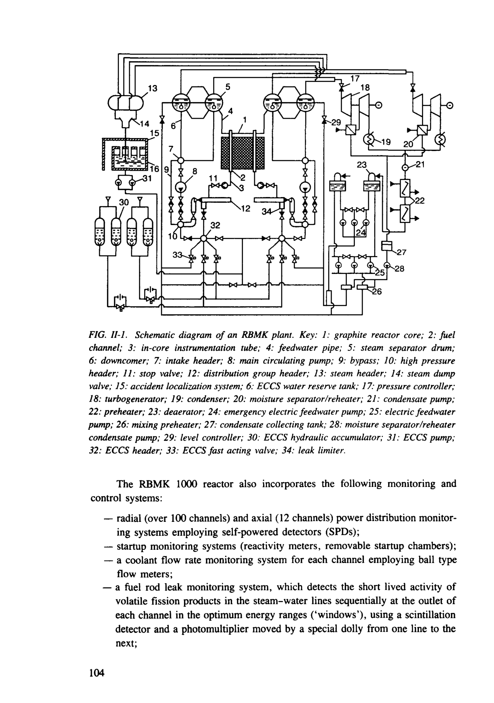
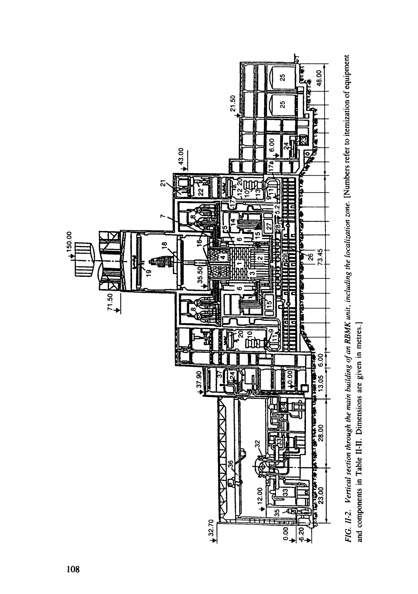
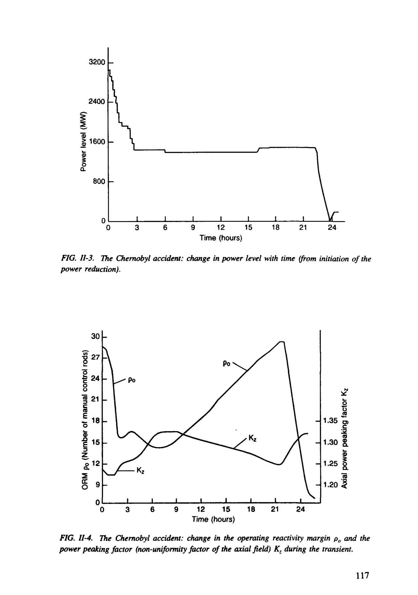
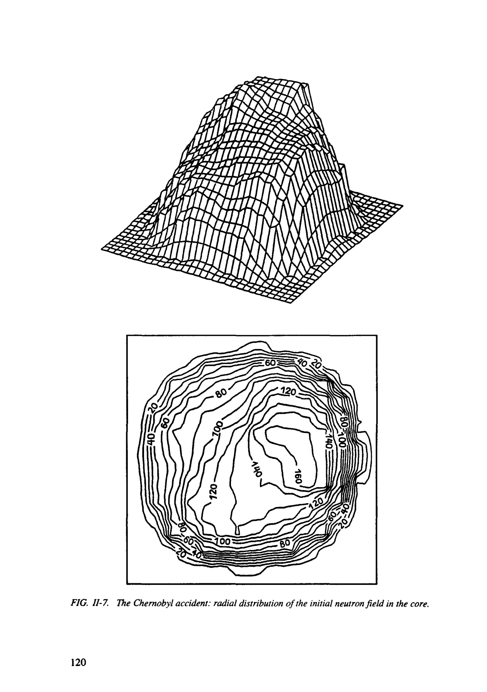
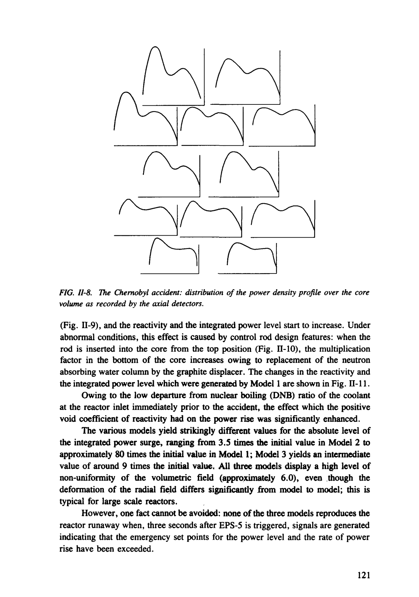
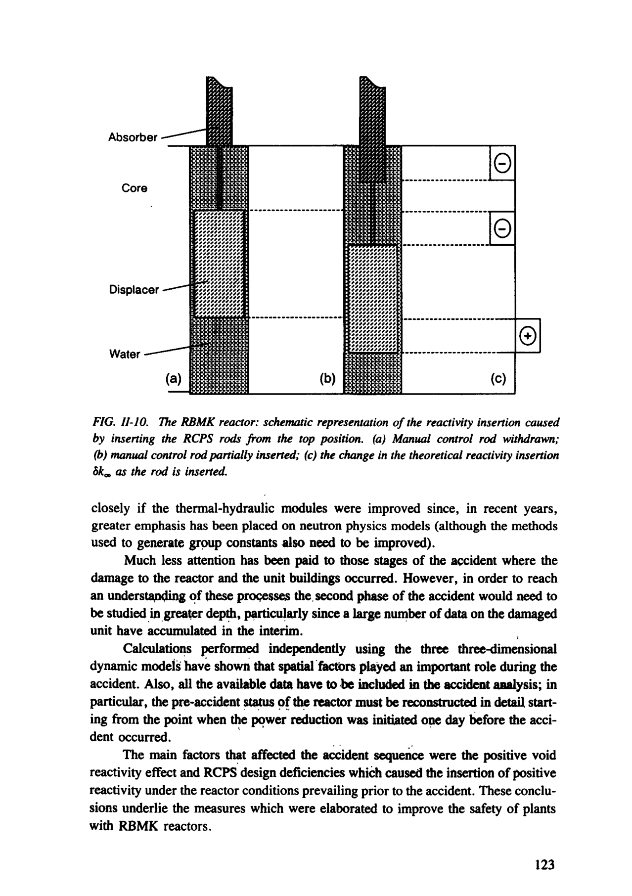
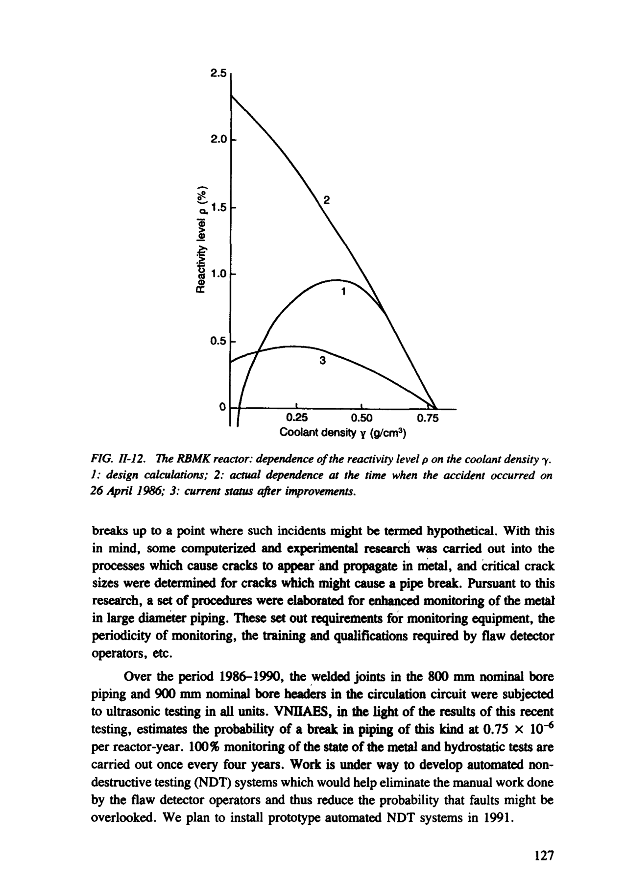
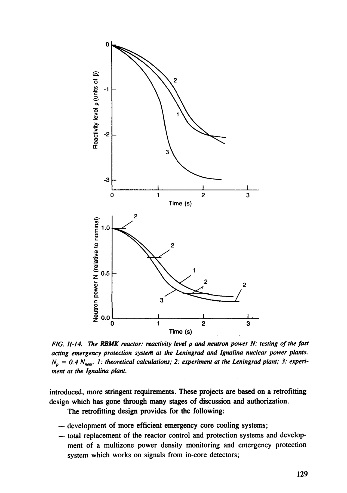

# Annex II REPORT BY A WORKING GROUP OF USSR EXPERTS

> Pages 111–142 of `Pub913e_web.pdf`
> IAEA Safety Series No. 75-INSAG-7 (1992) — The Chernobyl Accident: Updating of INSAG-1

---
<!-- p.111 -->
Annex II

#### REPORT BY A WORKING GROUP OF USSR EXPERTS1
Causes and Circumstances of the Accident at Unit 4 of the Chernobyl Nuclear Power Plant and Measures to Improve the Safety of Plants with RBMK Reactors
(Moscow, 1991)

This report was prepared by a Working Group comprising the following members:

Abagyan, A,A. Director General, Scientific Production Group Ehnergiya; All-Umon Scientific Research Institute for Nuclear Power Plant Operation (VNHAES)
Director, Scientific Research and Design Institute Adamov, E.O.
for Power Technology (NIKIET)
Bol'shov, L.A. Director, Nuclear Safety Institute (ffiRAE)
Chukardin, Eh.I. Chief Expert, State Committee for Science and Technology of the USSR Council of Ministers
(GKNT)
Petrov, V.A.
Director, Scientific and Technical Centre of the USSR State Committee for the Supervision of Safety in Industry and Nuclear Power (GPAN)
Velikhov, E.P. Director, I.V. Kurchatov Institute of Atomic Energy OAE)

This report was translated into English by the IAEA.

101

<!-- p.112 -->
The report was approved by a committee comprising the following members:

Abagyan, A.A.

#### VNHAES
Afanas'ev, A.M.

#### IBRAE
Asmolov, V.G.
IAE Bol'shov, L.A.

#### IBRAE
Borshchev, V.P.

#### NIKIET
Burlakov, E.V.
IAE Cherkashov, Yu.M. NIKIET Chukardin, Eh.I.
GKNT Filimontsev, Yu.N.

#### VNHAES
Kalugin, A.K.
IAE KisiF, I.M.

#### VNHAES
Krayushkin, A.V.
IAE Kroshilin, A.E.

#### VNIIAES
Malkin, S.D.
IAE Nikitin, Yu.M.

#### NIKIET
Novosel'skij, O.M.

#### NIKIET
Petrov, A.A.

#### NIKIET
Petrov, V.A.
GPAN Petrunin, D.M.
GPAN Podlazov, L.N.

#### NIKIET
Ponamarev-Stepnoj, N.N. IAE Vasilevskij, V.P.

#### NIKIET
Voronin, L.M.

#### VNIIAES
102

<!-- p.113 -->
II-l. BRIEF DESCRIPTION AND FEATURES OF THE RBMK-1000 REACTOR

#### OF CHERNOBYL UNIT 4
Operating experience with pressure tube type reactors in the USSR amounts to over 580 reactor-years. This type of reactor was used in the world's first nuclear power plant in Obninsk, in Units 1 and 2 of the Beloyarsky nuclear power plant, in the Bilibino and Siberian nuclear power plants, and finally in a large group of plants with RBMK-1000 and RBMK-1500 reactors. Such is the history of these pressure tube type uranium-graphite reactors.
Chernobyl Unit 4 was a heterogeneous pressure tube type thermal neutron reactor with a graphite moderator and a boiling light water coolant. There were 1660 fuel channels in the vertical ducts of the graphite columns; these channels were tubes 80 mm in diameter made of zirconium alloy. Each fuel channel contained a fuel assembly incorporating 18 rod type fuel elements which were 13.6 mm in diameter and were enclosed in zirconium alloy cladding.
The heat flow diagram is typical for single circuit boiling water reactors
(Fig. n-1). The multipass forced circulation loop consists of two parallel loops each of which cools half of the fuel channels in the reactor. The coolant is circulated by the main circulating pumps (MCPs). Individual pipes supply subcooled water to each channel and remove the steam-water mixture. The steam and water are separated in the horizontal steam separator drums at a pressure of about 7 MPa. The saturated steam is sent to two turbines and the steam condensate is returned to the separators, after preheating and deaeration; it is then mixed with the separated saturated water and sent to the reactor inlet by the MCPs.
The reactor control and protection system (RCPS) consists of 211 movable solid absorber rods in special channels cooled by an independent water circuit. In normal operating modes, and in design basis accidents (DBAs), the RCPS automatically maintains the preset power level; initiates a swift power reduction using the automatic and manual control rods if there are signals indicating main equipment failures; terminates the chain reaction using the rods of the emergency protection system (EPS) if there are signals indicating dangerous divergences hi unit parameters or equipment failures; compensates for reactivity changes during heatup and when the reactor is being brought up to power; and controls the core power density.
The independent control rods are inserted into the core at a speed of 0.4 m/s when the EPS is triggered.
The RCPS has a local automatic control (LAC) subsystem and a local emergency protection (LEP) subsystem. Both these systems respond to signals from in-core ionization chambers. The LAC system automatically stabilizes the main harmonics of the radial-azimuthal power density distribution, while the LEP system protects the reactor by ensuring that the preset fuel assembly power level at specific core locations is not exceeded. The axial fields are controlled by shortened absorber rods which are inserted into the core from below (24 rods).

103

<!-- p.114 -->
#### Figure 11-1

*Schematic diagram of an RBMK plant. Key: 1: graphite reactor core; 2: fuel channel; 3: in-core instrumentation tube; 4: feedwater pipe; 5: steam separator drum;*

<!-- labels/text on this figure page -->
FIG. 11-1. Schematic diagram of an RBMK plant. Key: 1: graphite reactor core; 2: fuel channel; 3: in-core instrumentation tube; 4: feedwater pipe; 5: steam separator drum;
6: downcomer; 7: intake header; 8: main circulating pump; 9: bypass; 10: high pressure header; 11: stop valve; 12: distribution group header; 13: steam header; 14: steam dump valve; 15: accident localization system; 6: ECCS water reserve tank; 17: pressure controller;
18: turbogenerator; 19: condenser; 20: moisture separator'/reheater; 21: condensate pump;
22: preheater; 23: deaerator; 24: emergency electric feedwater pump; 25: electric feedwater pump; 26: mixing preheater; 27: condensate collecting tank; 28: moisture separator•/reheater condensate pump; 29: level controller; 30: ECCS hydraulic accumulator; 31: ECCS pump;
32: ECCS header; 33: ECCS fast acting valve; 34: leak limiter.
The RBMK 1000 reactor also incorporates the following monitoring and control systems:
— radial (over 100 channels) and axial (12 channels) power distribution monitoring systems employing self-powered detectors (SPDs);
— startup monitoring systems (reactivity meters, removable startup chambers);
— a coolant flow rate monitoring system for each channel employing ball type flow meters;
— a fuel rod leak monitoring system, which detects the short lived activity of volatile fission products in the steam-water lines sequentially at the outlet of each channel in the optimum energy ranges ('windows'), using a scintillation detector and a photomultiplier moved by a special dolly from one line to the next;
104

<!-- p.115 -->
— a pressure tube integrity monitoring system, which monitors the humidity and temperature of the gas circulating through the channels.

All the data are sent to the computer. The information is presented to the operators in the form of signals indicating divergences, readouts (which may be called up as required) and data from the recording equipment.
The RBMK 1000 units are intended for base load operation (at constant power).
The main design characteristics of the RBMK reactor in Chernobyl Unit 4 are as shown in Table II-I.

TABLE n-I. MAIN DESIGN CHARACTERISTICS OF THE RBMK REACTOR

#### IN CHERNOBYL UNIT 4
Thermal power (MW)
3200 Fuel enrichment (%)
2.0 Mass of uranium in fuel assembly (kg)
114.7 Number/diameter of fuel rods in fuel assembly (mm)
18/13.6 Fuel burnup (MW-d/kg)
20 Axial power peaking factor
1.40 Radial power peaking factor
1.48 Maximum design power of fuel channel (kW)
3000 Void coefficient of reactivity af at the working point +2.0 x 10"4
(%-' (5k/k) void)
Fast power coefficient of reactivity aw at the working point (MW1) -0.5 x 10~* Fuel temperature coefficient of reactivity «T ("C"1)
-1.2 x 10'5 Graphite temperature coefficient of reactivity «c (CC~')
6 x 10~5 Minimum efficiency of RCPS rods (%)
10.5 Efficiency of manual control rods (%)
7.5 Effect (on average) of replacing a spent fuel assembly by a new one (%) 0.02

One important physical characteristic from the point of view of reactor control and safety is the operational reactivity margin (ORM), which is expressed in terms of a specific number of equivalent fully inserted RCPS rods, depending on the axial neutron field.
According to the Operating Procedures for Units 3 and 4 of the Chernobyl Nuclear Power Plant [see Annex I, Ref. f40J] (lEh-S-11, pp. 34, 46), the ORM at rated power and in steady state mode should be 26-30 rods.

105

<!-- p.116 -->
Reactor operation with an ORM of less than 26 rods is permitted if authorized by the Chief Engineer at the plant.
If the ORM decreases to 15 rods, the reactor should be shut down immediately.
Raising the power after a short term shutdown (when there have been no iodine poisoning effects and the pre-shutdown power level was less than 50% of rated power) is allowed if the ORM prior to shutdown was at least 30 rods.
The reactivity margin during a power raise following a short term shutdown must be at least 15 rods.
If the reactivity margin drops to 15 rods and it continues to decrease when the RCPS rods are withdrawn while the reactor is reaching criticality, then all the automatic control, manual control and emergency protection overcompensation system rods must be inserted up to the bottom limit switches and the shortened absorber rods must be inserted into the zone of their greatest efficacy. The duration of the outage is determined from the depoisoning curves.
The dependence of the effective multiplication factor on the coolant density in an RBMK is largely determined by the various kinds of absorbers which have been placed in the core. During initial loading of the core (which includes approximately 240 additional absorbers containing boron), coolant vaporization in a fuel channel produces a negative reactivity effect. The increase in steam quality which occurs during normal on-line refuelling at rated power with a 30 rod reactivity margin causes a positive reactivity rise.
The Unit 4 RBMK reactor was equipped with safety systems. These included the following:
— reactor control and protection system (RCPS);
— emergency core cooling system (ECCS);
— main coolant circuit overpressure protection system;
— reactor space overpressure protection system;
— the accident localization systems, which include:
• system of leaktight compartments
• isolation valve system
• pool type pressure suppression system;
— executive safety systems;
— control safety systems;
— radiation monitoring system.
Thanks to the aforementioned reactor characteristics, and the safety systems
(including the protection, localization and executive safety systems) (Fig. H-2 and Table H-II), reliable and effective operation of RBMKs in all authorized regimes and safety for the whole range of DBAs have been maintained, in accordance with the approved design documentation.

106

<!-- p.117 -->
RBMK reactors have the following drawbacks:
— insufficient automatic engineered protection of the reactor to prevent its being put into an unauthorized regime;
— the void coefficient of reactivity af varies, and there is a coolant vaporization effect owing to decreased coolant density in the core;
— the emergency protection system response is too slow, and a positive reactivity insertion can occur when there is an unacceptable decrease in the reactivity margin.
Chernobyl Unit 4 was brought into operation in December 1983. When the unit was shut down for medium term maintenance, which was scheduled for

## 25 April 1986, the core contained 1650 fuel assemblies with an average burnup of
### 10.3 MW-d/kg, one additional absorber, and one empty fuel channel. Most of the
fuel assemblies (75%) were from the first core charge and had a burnup of 10-15 MW-d/kg.
Unit 4 was designed in accordance with the safety codes and standards which were in force in the USSR in the late 1960s and early 1970s. The engineering design for the plant was developed in 1974. The design for the second stage of the plant was approved in the normal way. The design documentation on plant safety was approved by the USSR State Committee for the Supervision of Nuclear Power Safety, the USSR State Supervisory Committee for Industrial Safety and Mining Inspection, and the USSR State Committee for Public Health Supervision in 1975.

#### H-2. LATEST VIEWS ON HOW THE CHERNOBYL ACCIDENT OCCURRED
#### AND DEVELOPED
The analysis of the circumstances surrounding the Chernobyl accident started on 27-28 April 1986 when specialists gained access to documents giving the main parameters in Unit 4 prior to the accident and daring its first stage (until the measurement and recording systems railed). At least two factors were striking: first of all, the high speed of the process; secondly, the fact that there were hardly any control rods in the core during the run-up to the accident. It was more or less evident that the process was uncontrollable and mat the reactor runaway had been caused by a positive reactivity effect.
The first version of the events, which was put together in situ, was based on the assumption that the accident had been caused by an uncontrollable reactor runaway triggered by oversteaming in the core fuel channels as a result of a breakdown in coolant circulation in the multipass forced circulation loop. This breakdown in coolant circulation was in turn caused by a mismatch between the feedwater and coolant flow rates.
After more detailed analysis of all the recorded information it became clear that, for a correct understanding of causes of the accident, computerized simulation

107

<!-- p.118 -->

*figure on PDF page 118*

<!-- p.119 -->
TABLE n-II. MAIN EQUIPMENT FOR AN RBMK UNIT (see Fig. 11-2)

Number Number Mass Unit Equipment/component per unit (0 in Fig. H-2

Reactor section 1 1 Graphite stack Set 1850 Set 126 1

## 2 System S metal structures
Set 280

## 3 System OR metal structures
Set 450

## 4 System E metal structures
Set 79

## 5 System KZh metal structures
Set 592

## 6 System L metal structures
Set 7 System D metal structures 236

## 8 Steam separator drum
Item 278 4 67 8 9 TsVN-8 main circulating pump Item

## 10 MCP motor
Item 33 8 11 Item 5.7 8 Main isolation valve, 800 m nominal bore

## 12 Intake header
Item 46.0 2 2 13 High pressure header Item 46.0

## 14 Distributing group header
Item 1.3 44 Set 400 Lower water lines 15 Set 450

## 16 Steam-water lines
Set 16 Downcomers, 300 mm nominal bore 17 17a Main coolant circuit 800 mm nominal Set 350 bore piping Set 18 Refuelling machine 450

## 19 Bridge crane in central hall (Q = 50/10 tf) Item 121
176 2 20 Bridge crane in MCP room (Q = 50/10 tf) Item

## 21 VDN type suction ventilator at level +43.0 Item 3.5 30
22
3.5 50 Exhaust ventilator at level +35.0 Item

## 23 Controlled leakage tank
Item 1.4 2 24 0.2 2 Controlled leakage system heat exchanger Item

## 25 Planned preventive maintenance tanks
Item 25 4

## 26 Metal structures and piping in accident
Set 270 1 localization zone

## 27 Non-return valves in lower water lines area Set 2.5 11
28 2 8 Accident localization system bypass, valve Item

## 29 Accident localization system condensers Item 3.7 36
## 30 Container wagon*
146 1 Item

## 31 Crane in gas activity reduction system area* Item 45 1
(Q = 30/3 tf)
Carbon steel piping Item 1170 1 Stainless steel piping Item 760 1

Machine hall

## 32 Turbogenerator, type K-500-65/3000
Item 3500 2 33 15 8 Moisture separator/reheater, type 500 Item

## 34 Low pressure preheater
Item 37.5 4 35
2.5 6 Condensate pumps Item

## 36 Bridge crane in machine hall (Q = 125 tf) Item 211 1
## 37 Deaerator
Item 4.5 2 Set 3825 1 Carbon steel piping Set 1300 1 Stainless steel piping

a [Not shown in the cross-section in Fig. 11-2.]

109

<!-- p.120 -->
of the accident sequence would be required. This work was undertaken inependently by three organizations (the I.V. Kurchatov Institute of Atomic Energy (IAE), the Scientific Research and Design Institute for Power Technology (NIKIET), and the All-Union Scientific Research Institute for Nuclear Power Plant Operation
(VNIIAES)). In addition, much experimental work was carried out at test facilities and in operating reactors.
The significance of the void reactivity effect was assessed more closely, and the way in which the additional absorbers and control rods affect it. It was found that, for a double peaked axial neutron flux distribution, inserting the control rods from the top position could induce a negative reactivity insertion during the first second and then a reactivity rise as rod insertion continued owing to displacement of the water columns in the lower part of the reactor by the graphite displacers.
In August 1986, an analysis of the accident was performed using an integrated model. This analysis formed the basis of the USSR's report to the IAEA. This document states that the prime cause of the accident was "an extremely improbable combination of violations of instructions and operating rules committed by the staff of the unit", and that "the accident assumed catastrophic proportions because the reactor was taken by the staff into a non-regulation state in which the positive void coefficient of reactivity was able substantially to enhance the power excursion" [see Annex I, Ref. [1], Part I, p. 23}.
The subsequent analysis of the accident employed distributed neutron physics models with thermal hydraulics feedback. These models were validated against available experimental data.
The results which were submitted to the IAEA in September 1987 showed that axial-azimuthal effects had played a significant role. At the same time, the research using integrated models continued; with these, it was easier to assess the effects of the various physical processes and individual factors on the accident sequence.
In October and November 1989, various aspects of the Chernobyl accident and the effectiveness of the measures to improve the safety of plants with RBMK reactors were discussed in detail at the first meeting of the international working group on severe accidents and their consequences held in Dagomys (USSR). At this meeting, specialists from the USSR and other countries presented papers in which they analysed the accident sequence using three dimensional neutron physics models, which took into account feedback on thermal-hydraulics. It was generally agreed that the accident was attributable to "reactor instability caused both by design faults and the operating regime." The measures that had been implemented to improve reactor safety were deemed effective.
Foreign participants noted that the actual details of the accident sequence might be different from those produced by the Soviet specialists, and it was recommended that the research continue. So far, three full scale models of the combined physical and thermal-hydraulic processes in an RBMK reactor have been developed, the details of which are given below.

110

<!-- p.121 -->
#### n-2.1. Overview of the test programme that led to the accident
The accident occurred during rundown tests on turbogenerator No. 8 in Unit 4 with the auxiliary power system on load.
The aim of the tests was to verify whether cooldown of the core by forced circulation could be maintained in the event of a total power loss.
In the event of a total power loss during a DBA, the feedwater pumps, which form part of the third subsystem of the ECCS, are supposed to be powered from the rundown current of the turbogenerator.
In 1982, some similar tests were performed in Unit 3 of the Chernobyl plant which showed that the excitation control system of the turbogenerator would require retrofitting if an acceptable current level was to be maintained for the required period of time during rundown of the turbogenerator. Additional rundown tests with the retrofitted excitation system were carried out in 1984 and 1985. In the 1982 and 1984 test programmes, one MCP from each side of the reactor was connected up to the turbogenerator in rundown mode, whereas in the 1985 and 1986 programmes two MCPs were connected up from each side. In the 1984, 1985 and 1986 test programmes, the ECCS was isolated using the manually operated valves. In the light of present day approaches to the drawing up of such test programmes, this programme is unsatisfactory primarily as regards the safety measures employed.
It is incorrect to qualify these tests as purely electrical since they involve changes in the power supply circuit for main equipment in the unit and interventions on the normal protection and interlock systems.
According to the Operating Procedures for Units 3 and 4 of the Chernobyl Nuclear Power Plant [see Annex I, Ref. [40]] (lEh-S-11, p. 11), the plant management is responsible for preparing any programmes, drawings and technical documentation relating to assemblies, sensors, absorbers and other devices intended for use in the reactor while it is operating at power that are not covered by the reactor design; it is also supposed to clear them with the Scientific Manager, the Chief Design Engineer and the Chief Designer, and have them approved by the USSR Ail-Union Production Group Soyuzatomehnergo. Any modifications to design components and systems in the reactor must be cleared with the Scientific Manager, the Chief Design Engineer and the Chief Designer, and approved by Soyuzatomehnergo. Any changes which have nuclear safety implications must also be cleared with the USSR State Committee for the Supervision of Nuclear Power Safety.
One specific thermal-hydraulics feature of the test regime was the increased initial coolant flow rate through the reactor over the rated level. The steam quality was at minimum level and the coolant temperature at the core inlet was slightly below boiling point. Both die above factors turned out to have a direct bearing on the scale of the effects which occurred during the tests.

#### II-2.2. Chronology of events at the Chernobyl plant on 25-26 April 1986
[Table II-III presents the chronology of events at the Chernobyl plant on 25-26 April 1986.] Ill

<!-- p.122 -->
#### TABLE II-III. CHRONOLOGY OF EVENTS AT THE CHERNOBYL PLANT
#### ON 25-26 APRIL 1986
Time Event

## 25 April 1986
(time in operating log)

01:06 Start of unit power reduction; operational reactivity margin
(ORM) equals 31 manual control rods 03:45 Replacement of nitrogen-helium mixture used to cool the graphite stack with nitrogen commences 03:47 Thermal reactor power 1600 MW 07:10 ORM equals 13.2 manual control rods 13:05 Turbogenerator 7 disconnected from the grid 14:00 ECCS isolated from the circulation circuit; test programme postponed by request of the grid controller Kievehnergo 15:20 ORM equals 16.8 manual control rods 18:50 Auxiliary power equipment not required for tests switched over to operating transformer T-6 23:10 Unit power reduction continues; ORM equals 26 manual control rods

## 26 April 1986
00:05 Thermal reactor power 720 MW; steady unit power reduction continues 00:28 With thermal reactor power at around 500 MW, switchover from local power control system (LAC) to main range automatic power controllers 1 and 2; an unplanned drop in thermal power to 30 MW was permitted during this switchover
(neutron power dropped to zero); after a pause lasting 4 to 5 min, a power raise was initiated;
(time on printout of DREG)
00:34:03 Level in steam separator drums went beyond the triggering 00:43:37 set point for the emergency protection system of —600 mm 00:52:27 (emergency set point for a level drop was left at —1100 mm)
01:00:04 01:09:45 01:18:52

112

<!-- p.123 -->
TABLE II-III. (cont.)

Time Event

## 26 April 1986 (cont.)
00:41-01:16 Turbogenerator 8 disconnected from grid to check
(in operating log) vibrational characteristics on no load running

00:43:37 The emergency protection system which shuts down both turbogenerators was disabled

Thermal reactor power raised to 200 MW and stabilized at this 01:03
(in operating log) level

MCP-7 switched on 01:03
(in operating log)

Feedwater flow rate raised to 1200-1400 t/h to restore level in 01:06 steam separator drums

01:07 MCP-8 switched on
(in operating log)

01:09 Sudden reduction in the feedwater flow rate to 90 t/h on the right hand side and 180 t/h on the left hand side for a total flow rate in the circuit of 56 000-58 000 t/h; as a result, the temperature at the MCP inlet reached 280.8 °C (left side) and 283.2°C (right side)
01:18:52 DBA signal (according to the DREG program)

01:22:30 Parameters of the SKALA centralized monitoring system recorded on magnetic tape; non-measurable parameters at the Chernobyl plant were not calculated; after the accident, the ORM was calculated using the standard axial power distribution curve in the PRIZMA program, which yielded a value of
1.9 manual control rods; the calculations using real data on the axial power distribution yielded an ORM value of 6-8 manual control rods

01:23:04 'Oscillograph on' command given, stop valves for turbine No. 8 closed, turbine rundown operation commences; according to the oscillograph that was recording the electrical parameters of the MCPs, the MCPs that were connected to the turbogenerator in rundown mode operated for 36.2 s; the DBA button was pressed"; the exact times at which the DBA button was pressed and at which the oscillograph was turned on are not known

113

<!-- p.124 -->
TABLE n-HI. (cont.)

Time Event

## 26 April 1986 (cont.)
01:23:40 EPS-5 (emergency protection system 5) signal recorded;
according to the explanatory notes written by personnel, the EPS-5 button was pressed; insertion of emergency protection and manual control rods into the core commenced

01:23:43 All the lateral ionization chambers generated emergency protection signals for a reactor runaway and overpower

01:23:47 Sudden drop in flow rate (by 40%) in MCPs not involved in the rundown operation, and misleading readings for the flow rates in the MCPs which were involved in the rundown operation; sudden rise in the pressure and level in steam separator drums; signals for a measurement fault in both the main range automatic controllers

01:23:48 Flow rates in MCPs not in the rundown operation restored almost to initial levels; continued rise in the level and pressure in the steam separator drums (left side 75.2 kg/cm2; right side 88.2 kg/cm2); triggering of fast acting steam dump to condenser systems for turbine

01:23:49 Emergency protection signal for a pressure rise (fuel channel rupture) in the reactor space; 'No voltage equals 48 V signal
(RCPS rod drive couplings de-energized); signals indicating a fault in the actuators for main range automatic controllers 1 and 2

01:24 Severe shocks recorded; RCPS rods stopped before reaching
(in operating log) limit switches; power supply to RCPS rod drive coupling switched off

## 1 A DBA button had been specially installed for the test programme to simulate the DBA
signal. The signal was to be transmitted to the startup circuit of the diesel generator and to the turbogenerator rundown system to start that. The button was to be pressed when the stop valves closed.

#### II-2.3. Data on information sources
The processes prior to and during the accident were analysed using data from the following instruments and computer systems.

114

<!-- p.125 -->
H-2.3.1. Standard recording equipment

, This equipment is used to record relatively slow processes (maximum tape speed 240 mm/h). It can record extreme parameter values rather accurately but is not suitable for reconstructing fast transients.

77-2.5.2. SKALA centralized monitoring system and subsystems

This system calculates the main reactor parameters approximately every 5 min
(this limitation is due to the capacity of the V-3M type computer). Of course, this cycle is too long for the analysis of fast processes.
The diagnostic parameter recording program (DREG) scans and records several hundred discrete and analogue signals. However, it does not record the main reactor parameters such as the power and reactivity levels, the coolant flow rate in the channels and other mass parameters. The positions of only nine of the 211 RCPS rods are recorded, including one rod in each of the three groups of automatic controllers. These parameters are not directly measurable and their scan cycle is therefore much longer (1 min). Although the recording cycle for some parameters is short (1 s), the length of the scanning interval may be rather uncertain as the DREG program has a very low priority in the SKALA system. Moreover, during the hour preceding the accident there were three interruptions in the running of the DREG program caused by a SKALA system restart. This resulted in additional losses of information. The cycle for other results produced by the SKALA system is longer (S min), including the PRIZMA program and the recording of reactor status data on magnetic tape (RESTART); and there are interruptions caused by system restarts and certain software features. In addition, the results produced by the PRIZMA program are recorded Only on printouts. The process parameter data produced.by the DREG program are given.

II-2.3.3. Osdllography

A non-standard system employing oscillographs to record rapidly varying parameters was installed for the test programme. It monitored the operating parameters of certain items of electrical equipment. However, these electrical equipment parameters were not synchronized with the reactor parameters recorded by the system.

11-2.3.4. Other information obtained from operational sources

This category includes entries in the operating togs and the tape recordings of telephone calls made by personnel. This information and the explanatory notes written by personnel did not turn up any further essential data above and beyond that recorded by the instrumentation. In some cases, the accounts of the sequence of

115

<!-- p.126 -->
events given by personnel were highly inaccurate. Most importantly, the majority of people reported that there had been two explosions. The operating logs also contain entries which confirm the chronology just given of events before and after the accident.

11-2.4. Initial explanations of the accident

Once the nature of the damage and some details of the accident became known, a number of explanations and scenarios were put forward in an attempt to understand and explain what had happened. Some of these were rather fanciful and others were quite convincing. Most of them were rejected when additional information on the damaged unit became available, or pursuant to more detailed analysis.
The analysis centred around attempts to identify contradictions between the expected effect of a particular explanation of the accident and the available factual data recorded by the DREG program.

H-2.5. Computerized simulation of the accident

11-2.5.1. One dimensional simulation

A one dimensional program was used to simulate the power reduction transient which took account of iodine-xenon kinetics and feedback on the temperatures of graphite and fuel and on the coolant density.
Figure II-3 shows the power reduction curve (the power reduction started at 01:06 on 25 April). Figure II-4 shows the time dependence of the ORM and indicates the actual ORM values where these are known.
It is clear that the ORM dropped initially below the minimum permissible level of 15 manual control rods owing to the 50% power reduction. By 22:00 on 25 April, it had been restored almost to its initial value. A further power reduction soon followed, and the ORM started to fall reaching a value of no more than 6-8 manual control rods prior to the accident. Figure II-4 also shows the axial peaking factor Kz as a function of time. The shape of the axial field is shown in Fig. II-5. Prior to the accident, the field had a double peaked shape with a large upper maximum.

11-2.5.2. Characteristics of the three dimensional models

Model 1 (developed by the I.V. Kurchatov Institute of Atomic Energy)

The neutron field is described by a system of two-group equations with a point for each cell in the finite difference grid. The WIMS code is used to calculate the neutron cross-sections. The initial status can be adjusted to match the readings from the in-core detectors. The thermal hydraulics module describes the section of the circulation circuit from the high pressure header to the steam separator drums. The

116

<!-- p.127 -->
#### Figure 11-3

*The Chernobyl accident: change in power level with time (from initiation of the power reduction).*

<!-- labels/text on this figure page -->
3200
J I [_ 9 12 15 18 21 24 Time (hours)
FIG. 11-3. The Chernobyl accident: change in power level with time (from initiation of the power reduction).
30 I27 1*4
§ 21 §
1.35 CT 18
3I o 2a)
15
1.30 g.
5
1.25 o I12 Q.
"(6
1.20'I 1 9
9 12 15 18 21 24 Time (hours)
FIG. 11-4. The Chernobyl accident: change in the operating reactivity margin p0 and the power peaking factor (non-uniformity factor of the axial field) Kz during the transient.
117

<!-- p.128 -->
£ 5 I oo CDO I* I 4 to CO

#### TJ T3
15 1 "5 3

1.4 0.5 0.8 1.1 1.4 0.5 0.8 1.1 */<t> (relative units)
*/<!> (relative units)

FIG. II-5. The Chernobyl accident: axial distribution of the thermal neutron flux density in the core at various times during the xenon transient preceding the accident: 1: 00:00;
2: 07:00; 3: 22:00; 4: 24:30 (before the accident).

model has been tested against a large number of steady state modes and transients in operating reactors.

Model 2 (developed by the Scientific Research and Design Institute for Power Technology (NIKIET))

The neutron field is described by a one-group equation. The number of difference grid nodes in the reactor plan varied from 140 to 2000. The constants were derived from the two-group constants that were obtained using the WIMS code. The thermal hydraulics module describes the section of the circuit from the distributing group header to the steam separator drums. A single fluid homogeneous model is used for one dimensional flow of the two phase coolant with empirical corrections for phase slipping.

Model 3 (developed by VNIIAES in collaboration with the Nuclear Research Institute of the Academy of Sciences of the Ukrainian SSR, Kiev)

The neutron field is described by a one-group equation with one point for every four cells. The constants were derived from data that were obtained using the WIMS

118

<!-- p.129 -->
code. The thermal hydraulics diagram of the reactor circuit is described in detail, including the two coolant circulation loops. The equations from the single temperature variant of the flow model with slipping are used. The slipping functions and the flow regime map are taken from the TRAC-PIA code.
Thus, these three models differ significantly from one another. On the other hand, the fact that we have three independent models and the opportunity to compare results enhances the validity of the main conclusions drawn pursuant to the analysis of the accident sequence.

77-2.5.3. Calculation results

First of all, the positions of all the controllers (Fig. H-6) and the power density field for 01:22:30 on 26 April 1986 were reconstructed. The radial-azimuthal distribution is shown in Fig. n-7, and the readings frdm the axial distribution sensors in Fig. n-8. At the point in time corresponding to 01:23:40 on 26 April 1986, the insertion of all the RCPS rods into the core pursuant to the EPS-5 signal was simulated.
All three models indicate a drop in reactivity during the first one second. Then, the neutron field is redistributed, the maximum shifts to the bottom of the core

0 0 0 0

0 0....86 0....20 0 0

0 0...240 0 0 0 0 0 0 0 .0...110 0 0 0

0 0 0 0 0 0 0 0......0 0

0 0 0....30 0...140 0 0 0 0 0

0 0 0 0 0 0...120 0 0 0 0 70...160 0 0... 160. ...30 0

0 o;,.120 0 0... 100 .0....30 .0.... 20... 140 0

0 0.....0 .0 0 20 0....80...120 0... 190

0 0 0 0....20 0 0.....0...140 0 0....180

0 0...140 20 0 20 ....140 .0......0

0 0.....0 ,0 0......0 90 0 0......0 0......0

180 0...:.0 .0 0 20 20 0...100...170; 0

20... 120 0 .0.... 20...260 0 0....40 0.....20 0

0 0...160 0 0...160 0 0

0 0.....0..... 0 0 0. 0 .....0....30 0 0

0 20 0 0 0...140. 0.....0......0.,..,.0 0

o o o .0 p o......o....ao..v..o o

0 0 0.... 20......0.............0 0

0 0 0 0 0 30 0 0 0 0 0 0 0 0 0 0 0 0 0 0

FIG. 11-6. The Chernobyl accident: plan of the core showing the insertion depths of the RCPS rods in centimetres.

119

<!-- p.130 -->
#### Figure 11-7

*The Chernobyl accident: radial distribution of the initial neutron field in the core.*

<!-- labels/text on this figure page -->
FIG. 11-7. The Chernobyl accident: radial distribution of the initial neutron field in the core.
120

<!-- p.131 -->
#### Figure 11-8

*The Chernobyl accident: distribution of the power density profile over the core volume as recorded by the axial detectors.*

<!-- labels/text on this figure page -->
FIG. 11-8. The Chernobyl accident: distribution of the power density profile over the core volume as recorded by the axial detectors.
(Fig. n-9), and the reactivity and the integrated power level start to increase. Under abnormal conditions, this effect is caused by control rod design features: when the rod is inserted into the core from the top position (Fig. II-10), the multiplication factor in the bottom of the core increases owing to replacement of the neutron absorbing water column by the graphite displacer. The changes in the reactivity and the integrated power level which were generated by Model 1 are shown in Fig. II-11.
Owing to the low departure from nuclear boiling (DNB) ratio of the coolant at the reactor inlet immediately prior to the accident, the effect which the positive void coefficient of reactivity had on the power rise was significantly enhanced.
The various models yield strikingly different values for the absolute level of the integrated power surge, ranging from 3.5 times the initial value in Model 2 to approximately 80 times the initial value in Model 1; Model 3 yields an intermediate value of around 9 times the initial value, All three models display a high level of non-uniformity of the volumetric field (approximately 6.0), even though the deformation of the radial field differs significantly from model to model; this is typical for large scale reactors.
However, one fact cannot be avoided: none of the three models reproduces the reactor runaway when, three seconds after EPS-5 is triggered, signals are generated indicating that the emergency set points for the power level and the rate of power rise have been exceeded.
121

<!-- p.132 -->
#### Figure 11-9

*The Chernobyl accident: distortion of the axial neutron fields during rod insertion at the time when the accident occurred. The displacement of the neutron flux maximum to the lower part of the core is clearly shown. Key: time after EPS-5 button was pressed: *: 0 s;*

<!-- labels/text on this figure page -->
3.0 r-
800 600 400 Core bottom Distance (cm)
FIG. 11-9. The Chernobyl accident: distortion of the axial neutron fields during rod insertion at the time when the accident occurred. The displacement of the neutron flux maximum to the lower part of the core is clearly shown. Key: time after EPS-5 button was pressed: *: 0 s;
o .- 4 s; D: 6 s; A: 7 s.
The models need to be further refined both with regard to their neutron physics and their thermal-hydraulic elements to achieve a better fit between the calculation results and the experimental data.
One highly important point which was noted by all the groups of research workers is the very strong dependence of the characteristics of the transient on the potential error level of the initial axial distribution, the void reactivity effect value, the change in the reactivity level when the water column in the RCPS channel is replaced by the graphite displacer, and many other factors.
By eliminating the major deficiencies which cause reactor instability we can preclude the possibility of an accident of this kind recurring. Indeed, calculations using the same models and for the initial reactor states already analysed, but with present day parameters, show that the reactor is shut down sufficiently quickly.
Thus, all the models can be said to yield equivalent results.
Nevertheless, the results obtained from the analysis of the first phase of the accident cannot be viewed as final: the models could probably be made to agree more
122

<!-- p.133 -->
#### Figure 11-10

*The RBMK reactor: schematic representation of the reactivity insertion caused by inserting the RCPS rods from the top position, (a) Manual control rod withdrawn;*

<!-- labels/text on this figure page -->
Absorber Core •I i «1|5| Kill?.
Slllsi Slill
Displacer >>>>>>>>
Water •
(b)
(c)
FIG. 11-10. The RBMK reactor: schematic representation of the reactivity insertion caused by inserting the RCPS rods from the top position, (a) Manual control rod withdrawn;
(b) manual control rod partially inserted; (c) the change in the theoretical reactivity insertion Sk^ as the rod is inserted.
closely if the thermal-hydraulic modules were improved since, in recent years, greater emphasis has been placed on neutron physics models (although the methods used to generate group constants also need to be improved).
Much less attention has been paid to those stages of the accident where the damage to the reactor and the unit buildings occurred. However, in order to reach an understanding of these processes the. second phase of the accident would need to be studied in greater depth, particularly since a large number of data on the damaged unit have accumulated in the interim.
Calculations performed independently using the three three-dimensional dynamic models have shown that spatial factors played an important role during the accident. Also, all the available data have to be included in the accident analysis; in particular, the pre-accident status of the reactor must be reconstructed in detail starting from the point when the power reduction was initiated one day before the accident occurred.
The main factors that affected the accident sequence were the positive void reactivity effect and RCPS design deficiencies which caused the insertion of positive reactivity under the reactor conditions prevailing prior to the accident. These conclusions underlie the measures which were elaborated to improve the safety of plants with RBMK reactors.
123

<!-- p.134 -->
#### Figure 11-11

![Figure 11-11 — The Chernobyl accident: time dependence of the reactivity level and the neutron power during the initial phase of the accident. D: reactivity; A: neutron power. [Reactivity is expressed in units of effective delayed neutron fraction /3eff.]](../figures/fig_11-11.png)

*The Chernobyl accident: time dependence of the reactivity level and the neutron power during the initial phase of the accident. D: reactivity; A: neutron power. [Reactivity is expressed in units of effective delayed neutron fraction /3eff.]*

<!-- labels/text on this figure page -->
1.75
- 1.50
I-0.25
3 4 5 6 7 Time (seconds)
FIG. 11-11. The Chernobyl accident: time dependence of the reactivity level and the neutron power during the initial phase of the accident. D: reactivity; A: neutron power. [Reactivity is expressed in units of effective delayed neutron fraction /3eff.]
II-3. MEASURES TO IMPROVE THE SAFETY OF PLANTS WITH
RBMK REACTORS
Pursuant to the analysis of the causes of the accident in Chernobyl Unit 4, organizational and technical measures were developed to improve the safety of operating plants with RBMK reactors.
First of all, measures were developed and put into effect which aimed at:
— reducing the positive void coefficient of reactivity;
— improving the response efficiency of the emergency protection system;
— introducing ORM calculation programs which output a numerical indication of the current ORM value on the operator's control panel;
— preventing the emergency protection systems from being shut down while the reactor is operating at power;
— avoiding regimes which cause a reduction in the DNB ratio of the coolant at the reactor inlet.
124

<!-- p.135 -->
The reduction in the void coefficient of reactivity was implemented in two steps. First of all, its value was reduced to +/3 by installing additional absorbers in the core (80-90) and increasing the ORM to 43-48 RCPS manual control rods.
Table n-IV gives the measured values for the void and fast power coefficients in all units with RBMK reactors currently in operation. Figure 11-12 shows the dependence of the reactivity level on the coolant density both before and after the safety measures were implemented, and the design basis dependence. The second step in reducing the void coefficient of reactivity involves converting all the reactors to use fuel with a 2.4% 235U enrichment level.
Three independent retrofitting operations were carried out to improve the efficiency and response speed of the emergency protection system.
First of all, the manual control rods were replaced with ones of improved design which do not give rise to water columns at the bottom end of the RCPS channels and have a larger absorber section (Fig. 11-13).
The RCPS rod drives were retrofitted, reducing the time required to insert the rods fully into the core from 18 to 12 s. The implementation of these first two measures has improved by several times the response efficiency of the emergency protection system during the first few seconds of rod insertion.
As a third measure to improve the performance of the emergency protection system, a fast acting emergency protection system was developed and systems of this kind were installed in all operating reactors. The actuator in this system cools the channel wall with a thin film of water and moves the rod in a gas medium. In 1987-1988, this new system was put through full scale testing at the Ignalina and Leningrad plants. The tests confirmed the design characteristics of the system, i.e.
24 fast acting EPS rods in less than 2.5 s cause an insertion of negative reactivity ofover 2|8 [where 0 is the delayed neutron fraction} (Fig. 11-14). All RBMK reactors are now equipped with these systems.
Figure n-15 shows the improved level of response efficiency which has been achieved by retrofitting the RCPS rods and installing the fast acting emergency protection system by comparison with the response efficiency of the system at the time of the accident in Unit 4 in terms of reactivity change curves.
By implementing the above measures to improve the neutron physics characteristics of the reactor and significantly improving the performance of the emergency protection system, we have been able to preclude the possibility of an uncontrolled power rise during a loss of coolant accident (LOCA) and limit the consequences of all DBAs to the permissible levels for radiation exposure of personnel, the general public and the environment.
The operational documentation was updated to take account of the results of the accident analysis and the measures which have been implemented to improve the safety of plants with RBMKs.
Of course, there are six first generation RBMK units which have no reinforced leaktight compartments and no special structures to localize radioactive releases. The main aim in these units must be to reduce the probability of large diameter pipe

125

<!-- p.136 -->
ass I *;
£ § 1 To 00 00 in ON r- oo t-; r-; rs

#### ON NO
#### a j> K x CS (N (S <S 7
S (S ^ -i

#### I I I I I I I I I I I I I I
,? 8 «.- 91

zop ill r- oo oo ON O O O O N oo NO NO »n oo ooo o'o'o'o -« ^ ^ o ooo oo o -«

PL)
og .§1 a C/3 r- ^ ON CO ON ^f o M E oo vo P^ r^ oo (*} h -Si -g r- r- . in oo t~ —' JJ ill

#### PJ 3 D
CO o^ in f^ ^^ oo in in ^f m ^-J" in NO in ^3 ^— I'll X

on J1! f s m o < s TJ- — O N O 2*"*" mo r M f S
(X

#### S .§ -e PH 1^ g
O O O O O T f O N — —< O —< —' - H — (N 1* o o o o o o o o O N O N O O O O o o o o o o oo oo i n m O GOU 3 -O X)
£r cd C3 HH CO5

#### til
u ^ • O O O N * — ' ^ H ^ T * r o ^ ^ o ^ ^ > n inin

## 5 3 | — oo m <s ^ - o r - N O T t o ^ t rjT* OONO
— cs rs <s o o o - - ,-,-,„ ^-1 ^H oooo

uoz corso'co ( ^ r > i o 6 m c S f N i r s rsin Or^i °.1~:9 q o q q q q q — q -^ q ON ^O OO >O ^5 IO ^^ ^f I*"" ^3 (**• fi OO f^i O*

#### C M O ( N ^ O V J ^ H ^ ^ (^ Cv| — - ^ O ^ H O OHo
ff cu1 OQ

00

126

<!-- p.137 -->
#### Figure 11-12

*The RBMK reactor: dependence of the reactivity level p on the coolant density y.*

<!-- labels/text on this figure page -->
0.25 0.50 0.75 Coolant density Y (g/cm3)
FIG. 11-12. The RBMK reactor: dependence of the reactivity level p on the coolant density y.
1: design calculations; 2: actual dependence at the time when the accident occurred on 26 April 1986; 3: current status after improvements.
breaks up to a point where such incidents might be termed hypothetical. With this in mind, some computerized and experimental research was carried out into the processes which cause cracks to appear and propagate in metal, and critical crack sizes were determined for cracks which might cause a pipe break. Pursuant to this research, a set of procedures were elaborated for enhanced monitoring of the metal in large diameter piping. These set out requirements for monitoring equipment, the periodicity of monitoring, the training and qualifications required by flaw detector operators, etc.
Over the period 1986-1990, the welded joints in the 800 mm nominal bore piping and 900 mm nominal bore headers in the circulation circuit were subjected to ultrasonic testing in all units. VNIIAES, in the light of the results of this recent testing, estimates the probability of a break in piping of this kind at 0.75 x 10~* per reactor-year. 100% monitoring of the state of the metal and hydrostatic tests are carried out once every four years. Work is under way to develop automated nondestructive testing (NOT) systems which would help eliminate the manual work done by the flaw detector operators and thus reduce the probability that faults might be overlooked. We plan to install prototype automated NDT systems in 1991.
127

<!-- p.138 -->
Absorber element Graphite displacer [ [ Cooling water

(a)
(c) (b)
FIG. 11-13. Manual control rods in the RBMK reactor, (a) old design rod; (b) old design rod inserted into the core to avoid the insertion of positive reactivity; (c) retrofitted rod. 1: rod withdrawn; 2: rod inserted. [Dimensions are given in centimetres.]

One of the problems of pressure tube type reactors which was widely discussed after the Chernobyl accident is the possibility of a simultaneous rupture of a large number of fuel channels. The existing steam dump system for the reactor space is designed to cope with the steam discharge from a simultaneous rupture of two channels, the probability of such an event being low.2 Over the period in which these units have been operating, several incidents involving fuel channel damage have occurred. In two of these incidents (which were caused by local power tilting and an interruption in coolant flow triggered by procedural breaches), the fuel channels and the fuel assemblies in them were almost totally destroyed. However, in both cases there was no damage to the adjacent fuel channel pressure tubes which are all still operating normally. Nevertheless, despite the relatively low probability of an event of this kind, an emergency steam dump system for the reactor space has been installed in the recently commissioned Unit 3 at the Smolensk plant which is designed to cope with the steam discharge from a simultaneous rupture of 9-10 fuel channels. Similar measures will be implemented at all operating units in the course of the planned retrofitting programmes for these reactors.
Retrofitting projects are currently being elaborated for first generation units with RBMK reactors in order to bring them into line as far as possible with recently

NIKIET estimates it at 10 per reactor-year.

128

<!-- p.139 -->
#### Figure 11-14

*The RBMK reactor: reactivity level p and neutron power N: testing of the fast acting emergency protection system at the Leningrad and Ignalina nuclear power plants.*

<!-- labels/text on this figure page -->
CO, "5 CO 4 «•- -1 c ^ o.!
2 I -
(D CC
Time (s)
raI 1.0 oc
z o
0 1 2 3 Time (s)
FIG. 11-14. The RBMK reactor: reactivity level p and neutron power N: testing of the fast acting emergency protection system at the Leningrad and Ignalina nuclear power plants.
Np = 0.4 N^. 1: theoretical calculations; 2: experiment at the Leningrad plant; 3: experiment at the Ignalina plant.
introduced, more stringent requirements. These projects are based on a retrofitting design which has gone through many stages of discussion and authorization.
The retrofitting design provides for the following:
— development of more efficient emergency core cooling systems;
— total replacement of the reactor control and protection systems and development of a multizone power density monitoring and emergency protection system which works on signals from in-core detectors;
129

<!-- p.140 -->
•* r- wo CM oo Os CO CM Tt —S WO 00 — CM OO "° 0 ~ J 1 ~ O i/-j co SO CO Os Tj- OO r- CM 00 CO — wo r~ r- r- oo 00 sS OO WO i 1 « t 3f

## 8 S so r- wo — ' O WO CO Tj- — SO WO OS
o OO 00 r- CM O O Os
•t S" ^ wo r- wo r- so SO ^«o ^ SO OO OO WO WO OO QO Tt SO —1 CJ 3 ^ c!o SO oe w C

Q o oo O5 wo CM O CM SO -Q ^ f ^ SO •*
(^ ^5 CO ^^ WO Os J | £ SO wo Os r~ CO in r*- oo os so r~- r-~ r- § Z r? 00 O.
^ UJI 00r- 5 r- H so wo so r— os wo OO SI ^ $ P 'c a. 2

## 1 CM Os SO wo O O SO SO 9
r^- r- 1 od r~ Tt so r- oo so so fv;
so SO so SO SO ^J 3 ^2 U 4) O * ^.o DJ 2

C/2 Q£ o 00 Os SO •* CO Os r~- OS CO OO C*4 ^^ WO "a B *~~ — S O tj fe^ wo Os 00 00 — -^ SO WO — ' C O oo oo CM CO I , 1 a *~* oo oo oo r- oo t—
•* so 00 00 U ^ _

#### PJ 00
oo Q^ Os — ' ^ r~ oo o Os CM wo so OS CM Tfr WO '^ H ^ CM WO ^

#### CM SO OS
Os '£ S-S CM CM CO WO M r- 1 so SO so wo r-' r- r^ r- so r- so r- r- COo | — CQ |°2 Oi acH co *-« q r- £™ SO Tf "T3 Q , — s SO WO P"- P- CM CM T^- j ^ S p: 1 o 1 3 o wo CM CM OO CO O CM CO r- oo ^ OS OO SO OO OO OO C/3H P ' Z f^ y 00 5

## 1 Ii —
I~ oo o. so — * CO CM CM CM O 5 WO CO so wo q CO I — i CM O CO O CM * wo 06 f~- so r*- 1 — C— SO so SO ' SO ' ,-J
( — SO CO C*Ou. Os

## 1 S 2
H o o wo 0 -^ so CM CM "ffl O x~v CO Tt O OO ^^ CO
•^ Q r- wo 1 00 CM 1 co oo so r*- o os 8 r-- oo oo oo r~- so CO CM CO 00 J ^ S t^- PUU ^ Z 00 S" S — wo O '3 ** > CM WO CO OS Tt f~ SO SO SO Os 00 Tt r- wo so — o wo 'C p, & — CO CM CM i oo i 00 CM r- ' C6O u ^ "^ so r- r- r- so so S' WO so CO CO CM CO Os 1 uu 4i O °* 3 2 UQ Q- 't ^H - CM CO Tf - CM CO CM CO ^ CM CO — CM > S T32 PJ — J3 .1 B 2 60 C PQ "3 "3 •- "2 Ulou C « "« & S co H E § J ^

130

<!-- p.141 -->
#### Figure 11-15

*The RBMK reactor: efficiency of the emergency protection system. 1: the Chernobyl plant on 26 April 1986, ORM = 7 manual control rods (DBA conditions); 2: ORM as specified in the Operating Procedures (15 manual control rods); 3: retrofitted RCPS, ORM = 30 manual control rods; 4: retrofitted RCPS, fast acting emergency protection system in operation.*

<!-- labels/text on this figure page -->
FIG. 11-15. The RBMK reactor: efficiency of the emergency protection system. 1: the Chernobyl plant on 26 April 1986, ORM = 7 manual control rods (DBA conditions); 2: ORM as specified in the Operating Procedures (15 manual control rods); 3: retrofitted RCPS, ORM = 30 manual control rods; 4: retrofitted RCPS, fast acting emergency protection system in operation.
— multitrain redundancy of safety systems;
— full-scale introduction of automated metal monitoring systems;
— improvement of the efficiency and reliability of the auxiliary power systems;
— improvement of the resistance of reactor structures and components to earthquakes;
— improvement of the capacity of the steam dump system for the reactor space, and other measures.
During the retrofitting outages we also plan to replace all the fuel channels in all reactors. On the whole, units with RBMK reactors have a good performance record (Table H-V).
As of the beginning of 1991, the installed capacity of plants with RBMK reactors accounted for 16.5 GW, or some 45% of the total installed capacity of nuclear power plants in the USSR (36.6 GW). In 1990, RBMK plants generated 47.8%
(101.0 x 109 kW-h) of the total quantity of nuclear electricity generated in the country (211.5 x 109kW-h).
131

<!-- p.142 -->
#### H-4. CONCLUSIONS
Since the Chernobyl accident, a great deal of analytical work has been done.
The aims of this work were as follows: a more accurate determination of the status of Unit 4 prior to the accident; the processing of factual data from the monitoring system on the accident sequence; the analysis of the status of the unit after the accident; and mathematical modelling of the first phase of the accident.
On the basis of this research, and the discussions which have been held at various meetings (including international meetings) on the results obtained, the following main conclusions may be drawn:
(1) The accident was caused by interaction of the following main factors: the physical characteristics of the reactor; specific design features of the control elements; and the unauthorized state into which the reactor was brought.
(2) Thanks to the availability of new, up to date computer programs, the use of powerful computers, and experimental studies which have been carried out on the coolant vaporization effect in RBMKs, we have been able to define more accurately the main physical parameters of the reactor and thus develop new sets of requirements for systems which improve reactor safety.
(3) The safety level of RBMK reactors has been significantly enhanced by a series of organizational and technical measures which have been implemented as part of the 'Comprehensive Action Plan'. These measures include: modification of the physical characteristics of the reactor by installing additional absorbers;
conversion to fuel with a 2.4% enrichment level; installation of a fast acting emergency protection system; updating of operational documentation and improvement of staff qualifications; tightening up of the operating procedure requirements.

132

