# 1.7 Reactor Physics

> Source: `1.7_Reactor_Physics.pdf` (53 pages)
> GE (BWR) Systems Technology Manual — USNRC HRTD, Rev 09/11

---
<!-- p.1 -->
#### General Electric Systems Technology Manual
#### Chapter 1.7
#### Reactor Physics
<!-- p.3 -->
TABLE OF CONTENTS

1.7 REACTOR PHYSICS ............................................................................................... 1

1.7.1 Introduction ........................................................................................................ 2

1.7.2 Neutron Cycle .................................................................................................... 2

1.7.2.1 Multiplication Factor (K) ................................................................................ 2

1.7.2.2 Effective Multiplication Factor (Keff) ............................................................... 3

1.7.2.3 Terms Related to Keff .................................................................................... 6

1.7.3 Reactivity and Factors Affecting Reactivity ........................................................ 7

1.7.3.1 Reactivity Coefficients .................................................................................. 8

1.7.3.2 Reactivity Coefficient Values ...................................................................... 13

1.7.3.3 Reactivity Coefficients Summary ................................................................ 13

1.7.4 Fission Product Poisons ................................................................................... 13

1.7.4.1 Iodine-Xenon Fission Product Poisons ....................................................... 13

1.7.4.2 Promethium-Samarium Fission Product Poisons ........................................ 16

1.7.4.3 Fission Product Poisons - Summary ........................................................... 16

1.7.5 Reactor Control ................................................................................................ 17

1.7.5.1 Source Range ............................................................................................. 17

1.7.5.2 Intermediate Range .................................................................................... 23

1.7.5.3 Power Range .............................................................................................. 24

LIST OF TABLES

1.7-1 Neutron Population In A Subcritical Reactor Without A Neutron Source ............ 18

1.7-2 Subcritical Multiplication, Keff=0.9 and S0=100 .................................................... 20

1.7-3 Subcritical Multiplication, with a Keff increase from 0.90 to 0.95 and S0=100 ...... 21

1.7-4 Subcritical Multiplication, with a Keff increase from 0.95 to 1.00 and S0=100 ...... 22

1.7-i USNRC HRTD

<!-- p.4 -->
#### LIST OF FIGURES
1.7-1 Neutron Cycle in a Thermal Reactor
1.7-2 Moderator Temperature Coefficient
1.7-3 Water Density Versus Temperature
1.7-4 Over/Under Moderation
1.7-5 Void Coefficient
1.7-6 Doppler Coefficient
1.7-7 Effect of Increasing Temperature On Absorption Cross Section At Resonance Peak
1.7-8 Core Age Effect On Doppler Coefficient
1.7-9 Doppler Defect
1.7-10 Subcritical Multiplication
1.7-11 Differential Rod Worth
1.7-12 Integral Rod Worth
1.7-13 Rod Shadowing Effect
1.7-14 Radial Flux Shaping
1.7-15 Response To Increase In Recirculation Flow
1.7-16 Xenon Transients Following A Reactor Shutdown
1.7-17 Typical Xenon Transients
1.7-18 Samarium Buildup and Response to Power Increases
1.7-19 Samarium Response to Scram
1.7-20 Summary Of Fuel Depletion And Poison Effects On Keff

1.7-ii USNRC HRTD

<!-- p.5 -->
### 1.7 REACTOR PHYSICS
Learning objectives:

1. Recognize the factors of the neutron life cycle, including the definition of each factor.

2. Recognize the following reactivity coefficients and explain how their values change with the parameters listed:
a. Moderator Temperature Coefficient (αT) and how it varies with moderator temperature and core life, b. Moderator Void Coefficient (αV), and how it varies with void concentration and core life, c. Doppler Coefficient (αD). and how it varies with fuel temperature and core life.

3. Recognize what is meant by subcritical multiplication.

4. Recognize how the neutron population of a subcritical reactor changes in response to reactivity changes.

5. Recognize the meaning of the following reactor physics terms:
a. Reactivity b. Kexcess c. Point of adding heat (POAH)
d. Keff e. Reactor Period f. Shutdown Margin g. Critical h. Subcritical and i. Supercritical

6. Recognize how reactor power and the fission product poison concentration of xenon interrelate.

7. Recognize how reactor power and the fission product poison concentration of samarium interrelate.

8. Evaluate the operational characteristics of:
a. Differential Rod Worth b. Integral Rod Worth c. Rod Shadowing Effect d. Variations in Rod Worth (axially and radially).

1.7-1 USNRC HRTD

<!-- p.6 -->
9. Evaluate how reactor power will initially respond (in terms of the reactivity coefficients) to changes in the following plant parameters:
a. Control rod movement b. Recirculation flow c. Reactor pressure d. Feedwater inlet temperature.

#### 1.7.1 Introduction
The purpose of this section is to provide a basic understanding of certain reactor physics concepts relating to BWR technology.

The operation of a nuclear reactor is based upon the successful control of neutron flux, and hence reactor power. Startup and shutdown, as well as power level changes are typical operations involving transient conditions. Factors affecting the reactor behavior include control rod movements, fuel depletion, fission product poisoning, temperature and pressure changes (i.e., changes in coolant density and density distributions).
These, and other concepts important to BWR operation, are discussed in the paragraphs that follow.

#### 1.7.2 Neutron Cycle
The neutron cycle is taken as a complete sequence of steps necessary to produce the neutron chain reaction. To operate at a constant power level, the reactor must be able to sustain the chain reaction. The neutron population in the previous generation must equal the neutron population in the next generation. The principle of operating a nuclear reactor is based on neutron economy, which is the accounting of the number of neutrons between successive generations.

Many of the processes within a reactor compete for the neutrons. In the case of a thermal reactor, such as a BWR, thermal neutrons are required to initiate fission; and in turn the fast neutrons produced by the fission reaction lead to the regeneration of thermal neutrons. Events that are included in a neutron cycle are shown in Figure 1.7-
1.

##### 1.7.2.1 Multiplication Factor (K)
The expression which describes all the events in the life of a neutron and effectively describes the state of a reactor (critical, subcritical, or supercritical) is called the multiplication factor.

The multiplication factor is a measure of the change in the fission neutron population from one neutron generation to the subsequent generation. If the multiplication factor for a reactor core is less than 1.0, then the system is decaying or dying out and not selfsustaining. With a multiplication factor greater than 1.0, a nuclear system is producing

1.7-2 USNRC HRTD

<!-- p.7 -->
more neutrons than are being used by the system and is subjected to an increasing chain reaction that must be controlled by some exterior factor.

The stable nuclear system occurs when the multiplication factor is equal to 1.0.

In a core of infinite size, there can be no neutron leakage. For such a core the infinite multiplication factor, K∞, is the ratio of the number of neutrons resulting from fission in each generation to the number of neutrons absorbed in the preceding generation.

##### 1.7.2.2 Effective Multiplication Factor (Keff)
In a system of finite size, however, some neutrons are lost by leaking out, and the multiplication factor is called the effective multiplication factor, Keff. Keff is defined as the ratio of the number of neutrons resulting from fission in each generation to the total number lost by both absorption and leakage in the preceding generation. The effective multiplication factor is the product of the nonleakage probability, P, and the infinite multiplication factor, K∞.

Keff K P = ⋅ ∞

In the case of a core of infinite size the nonleakage probability is equal to 1.0 and the Keff is equal to K∞. In reactor operation, Keff is the most significant property with regard to reactor control. At any specific power level or condition of the reactor, Keff is kept as near to the value of 1.0 as possible. At this point in operation, the neutron balance is kept to exactly one neutron completing the life cycle for each original neutron absorbed in the fuel (Figure 1.7-1). When a reactor is operating at a constant power level or condition, the effective multiplication factor is defined in equation form as:

K = ε ⋅ L ⋅ ρ ⋅ L ⋅ f ⋅ η eff f th

These symbols are defined and considered in detail in the following paragraphs.

###### 1.7.2.2.1 Fast Fission Factor (ε)
The fast fission factor, ε, is the contribution to neutron multiplication from the fissions that occur at higher than thermal energies. This contribution is from the fast fission in U235 and U238. The probability for a fission reaction in U238 is quite low, but since >95% of the core is U238 these fast fissions contribute ~7% of our total power and a significant contribution to the multiplication factor. The fast fission factor is defined as the ratio of the neutrons produced by fissions at all energies to the number of neutrons produced in thermal fission.

Physically, ε is a function of physical spacing of fuel rods, the size of the fuel rod, the moderator and the amount of U238 and Pu239 in the core. This is because the longer

1.7-3 USNRC HRTD

<!-- p.8 -->
neutrons remain at a higher energy, or the greater the numbers of target nuclei, the greater the probability of a fast fission occurring. A typical value for ε is 1.04.

###### 1.7.2.2.2 Fast Nonleakage Factor (Lf)
The fast nonleakage factor, Lf, is the fraction of neutrons that are not lost because of leakage from the core during the slowing down process from fission energies to thermal energies. It is also the probability that a neutron will remain in the core and become a thermal neutron without being lost by fast leakage.

The fraction of all neutrons which does not leak from the reactor will depend on the size and shape of the reactor (which determines what fraction of the neutrons are produced close to reactor boundaries), and the material of which it is composed (which determines how far the neutrons travel within the reactor). The leakage of fast neutrons is determined by slightly different material factors from the leakage of thermal neutrons, For this reason the leakage probability is broken down into both the Fast Nonleakage Probability (Lf) and the Thermal Nonleakage Probability (Lth).

A good moderator presents a large target for collision, decreasing the probability that the neutron will escape. A large core allows more moderator and fuel, thus decreasing the likelihood of leakage. A typical value of Lf is 0.865.

###### 1.7.2.2.3 Resonance Escape Probability (ρ)
The resonance escape probability, p, is the probability that a neutron will be slowed to thermal energy and will escape resonance capture. It is also the fraction of neutrons that escape capture during the slowing down process. It is always <1.0 because of the presence of Uranium and Plutonium in the core, which means that high energy capture by these heavy nuclides always removes some of the neutrons.

Physically, p is a function of the amount of resonance absorbers in the core and the neutron energy spectrum. Because the amount of resonance absorbers is dependent on enrichment and core age, p also varies with a change in either parameter. A typical value for resonance escape probability is 0.800.

###### 1.7.2.2.4 Thermal Nonleakage Factor (Lth)
This factor, Lth, is the fraction of the thermal neutrons that do not leak out of the core during thermal diffusion but remain to contribute to the chain reaction. Lth is also the probability that a thermal neutron will remain and be used in the core.

The value of Lth decreases as the temperature of the core increases because as temperature is increased, the values of absorption cross sections decrease, and the thermal neutrons must travel further before being absorbed.

1.7-4 USNRC HRTD

<!-- p.9 -->
Physically, Lth is analogous to Lf and is also a function of the moderator, core size, and core shape. A typical value of Lth is 0.861.

###### 1.7.2.2.5 Thermal Utilization Factor (f)
The thermal utilization factor, f, is the factor describing how effectively thermal neutrons are absorbed by the fuel, or how well they are utilized within the reactor. This factor is defined as the ratio of the probability that a neutron will be absorbed in the fuel to the probability that the neutron will be absorbed in all the material that makes up a core. It is described by the following equation:

∑ fuel a f = ∑ ∑ ∑ fuel mod other + + a a a

Where Σa is the macroscopic cross section for absorption; the combination of the capture cross section, ∑c, and the fission cross section, ∑f, (i.e., ∑a =∑c + ∑f). The ∑other covers the macroscopic cross sections of the control rods, burnable poisons, fission product poisons, core structural materials, etc.

Since the fuel number density decreases slowly over core life and the number of nonfission neutron absorbers increases, f will decrease. The absorbers are functions of core power history, core age, and power level. A typical value for thermal utilization factor is 0.799.

###### 1.7.2.2.6 Reproduction Factor (η)
The neutron production factor, η, is the average number of neutrons produced per thermal neutron absorbed in the fuel. Physically, η is a function of enrichment and core age since enrichment varies with core age.

The numerical value of η does not change with core temperature over the range considered for most reactors. Also, there is essentially no change over the lifetime of the reactor core because of the closeness of the values of η for U235 and Pu239.

As the reactor operates for a period of time, and Pu239 begins to contribute to the neutron economy of the core, the average effect of is expressed by:

∑ ∑ 235 239 ν + ν 235 239 f f η = ∑ ∑ ∑ 235 238 239 + + a a a

where ν is the number of neutrons per fission. A typical value for η is 2.02.

1.7-5 USNRC HRTD

<!-- p.10 -->
###### 1.7.2.2.7 The Six Factors Cumulatively (Keff)
Combining the values for the above six factors into the formula:

K L L f eff = ε ρ η f th

we get:

K = .1( 04 )( .0 865 )( .0 800 )( .0 861 )( .0 799 )( .2 02 ) = .1 0000 .
eff

The value of 1.0, representing criticality, is the base line for Figure 1.7-20. We will discuss the other factors relating to the core Keff and how operators can manipulate some of these factors to control the reactor.

##### 1.7.2.3 Terms Related to Keff
###### 1.7.2.3.1 Excess Multiplication Factor
Excess multiplication factor (Kexcess) is a term used to describe how much Keff differs from a value of 1.0. The excess multiplication factor may be defined as a measure of a reactor's absolute departure from criticality. Absolute departure is when all rods are fully withdrawn, the reactor is cold, with no fission product poisons and no burnable poisons. It is shown as the uppermost line on Figure 1.7-20. It may be simply determined by:

K K 1 . = − excess eff

Excess reactivity is loaded into the core to allow for operation at 100% power for a given length of time. Factors considered in the amount of Kexcess include fuel cycle length, fission product poisons, voids and temperature effects, and the means to avoid flux peaking problems (i.e., where to load burnable poisons).

A means of limiting the cycle maximum Kexcess is through the thermal utilization factor (f).
The thermal utilization factor can be decreased by the introduction of burnable poisons into the fuel fabrication. The use of burnable poisons will help suppress the value of Kexcess early in core life. Burnable poisons deplete at a rate faster than the rate of fuel depletion, but at a slower rate than the buildup of the fission product poisons Xenon and Samarian. As a result the burnable poisons allow for the loading of more fuel (i.e., higher enrichment of U235) without a higher Kexcess.

Another means of limiting Kexcess, the easiest and most widely used, is by the use of control rods which have large thermal neutron absorption cross sections. When control rods are inserted into the core they cause an increase in the denominator of the fraction

1.7-6 USNRC HRTD

<!-- p.11 -->
defining the thermal utilization factor. This decrease in the thermal utilization factor compensates for a majority of the Kexcess designed into the core.

These two previous paragraphs explain why less than ten percent of the control rods are inserted into the reactor core at the beginning of an operating cycle. As the burnable poisons deplete (faster than the fuel depletes) the control rods are inserted to maintain the Keff equal to one. Once the fuel depletion becomes greater than the burnable poison depletion (the burnable poisons have been consumed) the control rods are gradually withdrawn until an all rods full out condition is obtained shortly before the next refueling outage.

###### 1.7.2.3.2 ShutDown Margin (SDM)
The ShutDown Margin (SDM) is the amount by which the reactor can be made subcritical. Mathematically, this can be expressed as:

SDM = 1 K (for Keff < 1) − eff

The value of Keff in this case is the Keff with the reactor cold, all rods fully inserted, and with no xenon fission product poison, but credit is given for burnable poisons and the fission product poison samarium. The Keff in this case is displayed as the two dashed curves in Figure 1.7-20. The design shutdown margin will be specified for a plant, and tests are conducted periodically to demonstrate that it is met. The value specified in the upper curve assumes that the strongest rod is stuck out in the fully withdrawn condition.
These tests demonstrate a margin of safety should that event ever occur.

#### 1.7.3 Reactivity and Factors Affecting Reactivity
We have seen that neutron population will change in the reactor only when the production of neutrons in one generation is either greater than or less than the absorption plus the leakage of neutrons in the preceding generation. Thus, Keff has been described as:

production from fission (in one generation )
K ) = eff absorption + leakage (in the preceding generation

If Keff = 1, the neutron population remains constant, and the reactor is critical. If Keff >1, then the neutron population increases with time, and the reactor is supercritical.
Reactor power is directly proportional to thermal neutron flux; therefore, as thermal neutron population changes, reactor power also changes. When discussing changes in neutron population in a reactor, it is convenient to describe how Keff differs from one, since the magnitude of this difference will directly effect how fast the neutron population will change with time.

1.7-7 USNRC HRTD

<!-- p.12 -->
Reactivity is defined as the fractional change in neutron population per neutron generation and can be determined as follows:

If there are (n0) neutrons in one generation, then there will be (n0Keff) neutrons present in the next generation. The numerical change in neutron population will be (n0Keff) -
(n0). The fraction of the present neutron population that represents a gain or loss in neutron population since the preceding generation will be:

n K n − 0 eff 0 .
n K 0 eff

Therefore, the fractional change in neutron population per generation (ΔK/K) may be expressed as:

( )
n K − 1 n K − 1 K − 1 Δ K 0 eff eff eff 0 .
= = • = K n K n K K 0 eff 0 eff eff

From this we see that ΔK/K may be positive (+), zero, or negative (-), depending upon whether Keff is greater than one, equal to one, or less than one. The larger the absolute value of reactivity in the reactor, the farther the reactor will be from criticality. Therefore it is convenient to think of reactivity as a measure of the reactor's departure from criticality.

Beginning with an all rods in condition in a cold clean core, enough reactivity must be added to bring the reactor initially critical. With the reactor critical, Keff=1, the reactivity is zero. Anything that will cause a change in Keff will cause a change in neutron population and a change in reactivity.

Many factors can affect the reactivity of a reactor both directly and indirectly throughout core life. Factors such as fission product poisons, fuel depletion, moderator temperature, fuel temperature, steam void fraction, reactor pressure, control rods, and burnable poisons.

Each of these factors must be accounted for in the design of the core so that criticality and full power can be attained and maintained throughout the design lifetime of the core.

##### 1.7.3.1 Reactivity Coefficients
Reactivity coefficients are a means of describing the effect on the multiplication factor
(Keff) as a result of unit changes in a particular reactor parameter. They are usually expressed in terms of ΔK/K/unit change of parameter variable. There are three such coefficients at work in a BWR operating at power. These are the moderator

1.7-8 USNRC HRTD

<!-- p.13 -->
temperature coefficient (αT), the moderator void coefficient (αV), and the Doppler (fuel temperature) coefficient (αD).

###### 1.7.3.1.1 Moderator Temperature Coefficient (αT)
The moderator temperature coefficient of reactivity (αT) is defined as the change in reactivity produced by a change in moderator temperature (ΔK/K/Δ°F). A typical value of αT is -1 x 10-4 ΔK/K per 1 ºF increase in moderator temperature. As the temperature of the moderator increases, it becomes less dense. From standard steam tables, we find that at rated temperature (545°F) and pressure (1005 psig) an increase in moderator temperature of 1°F will increase the specific volume of the moderator from 0.02160 to 0.02163 ft3/lb, an increase of 0.00003 ft3/lb. This decreases the amount of neutron moderation and increases the probability that a neutron may leak from the core or undergo a non-fission absorption in a control rod or some core structural material.
The effects of moderator temperature and fuel burnup on the coefficient are shown in Figure 1.7-2.

The value of the moderator temperature coefficient becomes more negative with increasing moderator temperature. Figure 1.7-3 shows the negative slope of the moderator temperature coefficient curve. This arises from the fact that moderator density varies non-linearly with moderator temperature. The change in density per °F change in temperature increases with increasing temperature. In other words, a ten degree increase in moderator temperature at 400°F results in a larger moderator density change (and a larger impact on αT) than a ten degree increase in moderator temperature at 200°F.

Several factors affect the moderator temperature coefficient of reactivity (Figure 1.7-2)
as core burnup increases:

1. The buildup of Pu240, a strong resonant absorber, increases the chance of resonance absorption and makes the coefficient more negative.
2. At the same time, control rods are withdrawn to balance the decrease in reactivity because of fuel burnup. This causes the effective size of the core to become larger, thus decreasing fast and thermal leakage. This tends to make the coefficient less negative.
3. Since local steam voids cause an increase in the distance a neutron travels after it has become thermal, the presence of thermal neutron absorbing control rods cause the moderator temperature coefficient to be initially negative. Consequently, when control rod density decreases (all rods fully inserted = 100% control rod density, all rods fully withdrawn = 0% control rod density) at higher core exposures, moderator temperature coefficient becomes less negative.

The net affect of all these factors combined is that the moderator temperature coefficient becomes less negative over core life.

1.7-9 USNRC HRTD

<!-- p.14 -->
In a BWR, the moderator temperature coefficient is designed to be negative by establishing a proper moderator to fuel ratio (Figure 1.7-4). However, at low temperatures toward the end of core life, the negative effects of resonance absorption and neutron leakage may not be sufficient to overcome the positive effects that the moderator to fuel ratio becoming over-moderated and control rod withdrawal have on the thermal utilization factor. These combined effects can result in the moderator temperature coefficient becoming slightly positive when the reactor is cold at end of core life. This is a safety consideration requiring startups at end of life to be conducted at a sufficiently high enough temperature to ensure that the moderator temperature coefficient is in the negative range.

Changes in fuel element temperature will affect the distribution of the most probable energies for neutron resonance capture by U238. This effect will be discussed more thoroughly in connection with the Doppler coefficient of reactivity later in this chapter.
For now, suffice it to say that an increase in the temperature of the fuel elements causes increased resonance capture and hence a decrease in the resonance escape probability. Thus, the moderator temperature coefficient of reactivity will become more negative with increasing fuel element temperature.

###### 1.7.3.1.2 Moderator Void Coefficient (αV)
As the moderator boils and the void fraction increases, the moderator density decreases resulting in a reactivity change involving several interacting mechanisms. The moderator void coefficient of reactivity (αV) is defined as the change in reactivity produced by a unit change in void volume percentage (ΔK/K/Δ%V) and is illustrated in Figure 1.7-5. A typical value of αV = -1 x 10-3 ΔK/K per 1% increase in void volume.

A decrease in moderator density results in less absorption in the moderator and a small increase in the thermal utilization factor. Again, from standard steam tables, we find that at rated pressure (1005 psig) and steam quality (13%), an increase in moderator void percentage will increase the specific volume of the moderator from 0.02160 to 0.07655 ft3/lb, an increase of 0.05495 ft3/lb. The density decrease when voids increase is thousands of times larger than the density decrease when moderator temperature increases. Therefore, the void coefficient is much more negative than the moderator temperature coefficient. An increased distance between moderator molecules means that the neutrons travel a greater distance while at higher energies and have a greater probability of being captured in resonance regions of the uranium or plutonium; thus, the resonance escape probability decreases. In addition, the distance a neutron travels after being thermal also increases, producing a decrease in thermal nonleakage probability. The large negative effects of increased resonance absorption and, to a lesser degree, increased thermal leakage outweigh the positive effect of less absorption in the moderator and result in a coefficient of reactivity which is strongly negative.

The slopes of the curves in Figure 1.7-5 are negative because resonance capture increases more rapidly at high void fraction than at low void fraction. The increased

1.7-10 USNRC HRTD

<!-- p.15 -->
resonance capture results from the decrease in moderation as the water boils, as discussed earlier. Also, as the void fraction in the moderator increases there is a larger decrease in density for each percentage increase in void fraction. Consider two examples: 10% void fraction and 70% void fraction.

1. At a 10% void fraction (90% liquid water), a 1% increase in void fraction decreases the liquid water fraction from 90% to 89% or roughly 1.1%.

2. At 70% void fraction (30% liquid water), however, a 1% increase in void fraction decreases the liquid water from 30% to 29% or a change of 3.45%.

Thus, at higher void fraction for a similar percent change in moderator void fraction, there is a greater percentage change in liquid water fraction than for the same change at low void fraction. Therefore, the negative reactivity contribution at higher voids is greater than at lower void fractions.

The behavior of the void coefficient as core burnup increases is similar to the moderator temperature coefficient. As with moderator temperature coefficient, the effects of control rod withdrawal usually dominate and the moderator void coefficient becomes less negative as core burnup increases.

An increase in the temperature of the fuel elements causes increased resonance capture and hence a decrease in the resonance escape probability. Thus, the moderator void coefficient of reactivity will become more negative with increasing fuel element temperature.

###### 1.7.3.1.3 Doppler Coefficient (αD)
The final reactivity coefficient that is of primary importance in safety considerations is the Doppler coefficient of reactivity which is defined as the change in reactivity that results from a unit change in fuel temperature (ΔK/K/Δ0F) and which accounts for the prompt negative reactivity addition which acts to slow down or turn a power increase in the event of a reactivity excursion. A typical value of αD = -1 x 10-5 ΔK/K per 1 ºF increase in fuel temperature. The coefficient is negative, as shown in Figure 1.7-6, because an increase in fuel temperature results in an increase in resonance absorption.
To examine the reason for this increase, Doppler broadening must first be discussed.

A resonance peak is a narrow band of neutron energy in which the neutron capture cross section within that band of energy is considerably higher than at other neutron energies. As the temperature of the fuel changes, the thermal motion of the fuel nuclei changes. As fuel temperature increases, the energy band of the resonance broadens and the cross section of the peak decreases as shown in Figure 1.7-7. This broadening is referred to as Doppler broadening. Doppler broadening shifts the energy at which the neutrons are absorbed to higher or lower values depending on the direction of motion of the fuel nuclei with respect to that of the incident neutron. The nuclear properties of the

1.7-11 USNRC HRTD

<!-- p.16 -->
nucleus, however, are not affected; thus, the total probability of absorption (i.e., area under the curve) over the entire energy band remains constant. Therefore, although the total amount of absorption of a resonance peak does not change, the energy band of the resonance absorption is broadened.

It may appear then that Doppler broadening would have no effect on resonance absorption in a reactor. This is not the case for nuclides that are present in sufficient concentration because of another effect called self shielding. At low temperatures, the resonance peak is very narrow and the capture cross section is very high, resulting in a very large reduction in neutron flux in that energy band in the outer layer of the fuel pellet. The interior of the pellet sees very little flux in that energy band, so there is very little absorption toward the center of the fuel pin. Thus, the interior of the pellet is shielded from the flux of the proper energy by the outer layers of fuel atoms.

Now, consider an increase in fuel temperature. The energy band is wider for neutron absorption in the central higher regions of the rod. The broadened areas of absorption are not shielded by the less broadened fuel surface and the shielding resonance absorption in the fuel pellet increases. So the negative Doppler reactivity associated with an increase in fuel temperature arises from the combined effect of Doppler broadening and the fact that a BWR is a heterogeneous reactor with fuel lumped into fuel pellets.

The slope of the curves in Figure 1.7-6 is positive because as the temperature rises, the broadening of the resonance peaks become less and less, it follows a 1/v behavior. In a BWR the doppler coefficient of reactivity is always negative and always adds negative reactivity when the fuel temperature rises. The doppler coefficient is more negative at greater void fraction because of the increase in resonance capture with steam voids.

As core age increases, the buildup of Pu240 in the fuel results in an increase in the total resonance absorption cross section. This will increase self shielding so a reduction in self shielding has a greater effect on the total amount of resonance absorption. Thus, the doppler coefficient of reactivity becomes more negative with increased burnup as shown in Figure 1.7-8.

A typical value for the doppler coefficient of reactivity is -1x10-5 ΔK/K per each one degree Fahrenheit increase in fuel temperature.

1.7-12 USNRC HRTD

<!-- p.17 -->
##### 1.7.3.2 Reactivity Coefficient Values
Approximate numerical values for the three reactivity coefficients are as follows:

αV = -1 x 10-3 ΔK/K per 1% increase in void volume

αT = -1 x 10-4 ΔK/K per 1º F increase in moderator temperature

αD = -1 x 10-5 ΔK/K per 1º F increase in fuel temperature

These values explain why the void coefficient is dominant when the reactor is in the power range (i.e., a substantial percentage of voids).

##### 1.7.3.3 Reactivity Coefficients Summary
The previous discussion has been a simplified explanation of how various factors affect the reactivity in a BWR. Many of the mechanisms causing change are constantly interacting with other mechanisms. For example, under normal operating conditions, an increase in fuel temperature as a result of control rod withdrawal or a core flow increase is always accompanied by an increase in moderator temperature or void fraction.

#### 1.7.4 Fission Product Poisons
During the operation of a reactor, a large variety of fission products is being produced.
Although most of the fission products have relatively low absorption cross sections, there are some which are very strong absorbers of thermal neutrons.

These are referred to as fission product poisons. Any change in the concentration of these nuclei changes the thermal utilization factor (∑ FP changes) and, therefore, a inserts either positive or negative reactivity into the reactor. The concentration of these fission product poisons depends on fission rate, decay rate of the poisons, decay rate of precursors, and neutron absorption by the poisons. Although the fission product poisons may have a significant effect on reactivity, their impact on immediate operation is primarily on the resulting effects of modified ramp rates, power level drifts, or the need for compensating control rod movements. Fission product poison transient reactivity effects are slow. Therefore, their reactivity effects are not of first order importance in the evaluation of reactivity transients pertinent to nuclear safety.

##### 1.7.4.1 Iodine-Xenon Fission Product Poisons
The most important fission product poison is xenon-135 (Xe135), which has an absorption cross section of 2.6 x 106 barns for thermal neutrons at 68ºF. This is an equilibrium reactivity poison effect on the order of -0.03 ΔK/K, and the slow transient reactivity effects of -0.04 ΔK/K. Because the Xe-135 concentration is dependent on power, it is useful to describe its production and removal mechanisms.

1.7-13 USNRC HRTD

<!-- p.18 -->
Xe135 production:

Xe135 has two production terms. One is as a direct fission yield (0.2%). The other is an indirect fission yield (5.6%) which comes from the tellurium (Te), iodine (I), xenon decay chain, as shown in the following reaction.

− − β β Te 135 I 135 Xe 135 → → 52 53 54 19 0. Secs .6 57 Hours

Because of the relatively short half life of tellurium, it is often dropped from a discussion of Xe135.

Xe135 removal:

Xe135 has two removal mechanisms. One is the burnout term, which represents the absorption of a neutron by the Xe135 as indicated in the following reaction:

Xe 135 n 1 Xe 136 + → + γ 54 0 54

Xe136 has a low absorption cross section meaning it is not a neutron poison like Xe135.
The other removal mechanism is radioactive decay as indicated in the following reaction:

β − β − Xe 135 → Cs 135 → Ba 135 54 55 56 6 .9 35 Hours 3.2 x 10 Years

The following diagram helps to develop a feel for xenon increase or decrease as a function of current and preceding operation:

Production Removal

n + 1 U 235 Xe 135 n 1 + 0 92 54 0
(fission)
(burnout)

Xe 135 54

I 135 Cs 135 53 55
(β- decay)
(β- decay)

From this diagram, one can associate the formation term largely with prior operation and the burnout term with current power level. For example, after some hours of operation, then sudden shutdown, the xenon simply cannot decay as fast (9.2 hr) as it is being formed (6.7 hr) for a while. Conversely, a sudden rise in power level equates to

1.7-14 USNRC HRTD

<!-- p.19 -->
an increase in neutron flux (the burnout term) and, for a while, the xenon depletes faster than it can be formed from decay of the iodine backlog created at the lower power level.

When the reactor power is first increased into the power range, the Xe135 concentration
(atoms/cm3) is slowly built up to an equilibrium. This is due primarily to the relatively long half lives of I135 (6.7 hr) and Xe135 (9.2 hr). Because of the high thermal neutron cross section of Xe135, as the concentration of the isotope increases, so does the macroscopic absorption cross section in the core increases. Operationally, as Xe135 builds up, other poisons in the core (control rods) must be removed, to maintain the reactivity balance. Provided one has enough control material to remove during this Xe135 buildup, after approximately 40 hours of power operation it reaches equilibrium, a point at which the production of Xe135 is equal to the removal of Xe135 by neutron capture plus the loss of Xe135 through radioactive decay.

The equilibrium value for the xenon concentration is a function of the reactor's neutron flux level (power level). Since an absorber is added to the reactor when xenon is built into the system, its effect on the chain reaction can be described in terms of reactivity.
The multiplication factor is lowered primarily through the decrease in the thermal utilization factor.

A change in power causes a transient in xenon concentration. At the end of the transient, which takes about 2 days, the xenon concentration reaches its new equilibrium, assuming that power is held constant after the change.

Once a reactor has reached an equilibrium xenon concentration and the reactor is then shut down, the thermal neutron flux is reduced essentially to zero. The I135 decays more rapidly (6.6 hrs) than does Xe135 (9.2 hrs); therefore, after shutdown, the concentration of Xe135 increases. Maximum peak Xe135 depends directly upon the concentration of Xe135 and I135 present in the reactor at the time of shutdown. Xe135 concentration rises for a period of about 7 to 11 hours after shutdown (Figure 1.7-16).
During this time, the I135 decays causing the rate of xenon production to be more than the rate of Xe135 decay, and the Xe135 concentration increases. The exact time required to reach a maximum depends upon the Xe135 and I135 concentration before the shutdown which, in turn, is dependent upon the power history.

The greater the power level before shutdown, the greater will be the concentration of I135 in the reactor at the time of shutdown and, thus, the greater will be the increase in xenon concentration after shutdown. If the value of the positive reactivity needed to overcome the negative reactivity due to peak xenon is not available from the control rods, reduced steam voids, and temperature, the reactor will not be able to achieve criticality.

When reactor power is reduced, but kept in the power range, the behavior of Xe135 is similar to that after shutdown, but the Xe135 peak is considerably reduced because there is still a significant neutron flux available to remove the Xe135. About 40 to 50 hours after a decreasing power maneuver, Xe135 reaches the new equilibrium value for the decreased power level (Figure 1.7-17).

When reactor power is increased, xenon concentration initially decreases as removal by neutron absorption increases and production initially remains constant because of I135

1.7-15 USNRC HRTD

<!-- p.20 -->
decay. After a few hours (roughly 4 to 6 hours depending on power levels), the Xe135 concentration reaches a minimum and subsequently begins to increases to an equilibrium level for the new higher power level. The new equilibrium is reached in roughly 40 to 50 hours (Figure 1.7-17).

##### 1.7.4.2 Promethium-Samarium Fission Product Poisons
Next to Xe135, the most important fission product poison is samarium-149 (Sm149), a stable isotope with an absorption cross section of 4.0 x 104 barns which has an equilibrium reactivity poison effect on the order of -0.01 ΔK/K. It is the end product of the decay chain which follows:

− − β β 149 149 149 Nd → Pm → Sm 60 61 62

### 7.1 Hours .2 21 Days
This occurs with a total fission yield of about 1.07%. Sm149 is a stable nuclide and is removed only by burnout.

Sm 149 n 1 Sm 150 + → + γ 62 0 62

Sm150 has a low absorption cross section, meaning it is not a neutron poison like Sm149.

Because Sm-149 is stable its equilibrium value is independent of the neutron flux. The rate at which Sm-149 approaches this equilibrium is determined by the Pm-149 half-life
(53 hours). As shown on Figure 1.7-18, equilibrium is reached in about 500 hours (~60 days). A power increase will reduce samarium concentration initially due to increased burnout, but the concentration returns to the same equilibrium value. The promethium concentration is power level dependent. After shutdown, promethium-149 (Pm149) will continue to decay to Sm149, but there is no removal of the Sm149, thus the Sm149 concentration increases after shutdown until there is no Pm149 left in the reactor (Figure
1.7-19), Sm149 concentration builds up to a constant value. But, because of its smaller microscopic absorption cross section, low fission yield, and the longer half life of Pm149, transient Sm149 absorptions are less important than those of Xe135. Sm149 is often treated as an equilibrium poison.

##### 1.7.4.3 Fission Product Poisons - Summary
In summary, it can be stated that fission product absorption has not caused any serious operating problems in BWRs and none are expected. Near the end of a fuel cycle, it is possible that the time required to return to rated power from a shutdown could be limited by xenon. The delay would not be very long in any case and, in fact, return to power is usually limited by other considerations.

After a significant change in power level or power shape, the operator will observe a power drift and an axial power distribution transient as xenon comes into equilibrium. If necessary, following xenon building, the power level may be reduced temporarily by flow control to readjust the rod pattern to permit further power ascension by flow control.

1.7-16 USNRC HRTD

<!-- p.21 -->
#### 1.7.5 Reactor Control
The reactor power level is directly related to the neutron population. The flux is related to neutron level by:

φ = n ν ,

where n is the neutron density (neutrons/cm3) and ν is the neutron velocity (cm/sec).

Power is expressed as:

t P P e , = Τ 0

an expression which describes how reactor power varies with time. This means that power increases exponentially for a stable period (Τ). Period (Τ) is defined as the time in which neutron flux level changes by a factor of the natural log base
(e=2.718281828459045…).

The following sections apply the principles covered above to explain reactor control during a normal startup from a cold shutdown condition.

##### 1.7.5.1 Source Range
The source range covers reactor power from 10-8 % to 10-4 %. The power is controlled by control rod movement to establish the reactor criticality. Further control rod withdrawals will establish a power increase into the intermediate range. Entry into the intermediate range will commence a plant heat up.

As the operator withdraws control rods, a non-fission absorber is being removed from the core. This causes the thermal utilization factor to increase. Which in turn, causes the core Keff to increase. The lowest range of nuclear instrumentation will show increase in count rate. The neutrons being counted are coming from both fission and an incore neutron source. The phenomenon of an increasing transient count rate or a steady state count rate while subcritical which is subcritical multiplication.

###### 1.7.5.1.1 Source Neutrons
After sufficient power operation there will be neutrons available from various sources other than thermal fission in the reactor. They make it possible to see the approach to criticality on the reactor's nuclear instrumentation. Power (neutron level) increases can be seen on the instrumentation as the control rods are withdrawn. If there were no sources present, the instrument range would not be sensitive enough to detect a positive, increasing period until the power was significantly higher. By the time the

1.7-17 USNRC HRTD

<!-- p.22 -->
power was high enough to indicate on the instruments, the period could be very short and a startup accident could occur.

###### 1.7.5.1.2 Subcritical Multiplication
Subcritical multiplication is the phenomenon that accounts for the changes in neutron flux that takes place in a subcritical reactor due to reactivity changes. It is important to understand subcritical multiplication in order to understand reactor response to changes in conditions.

In the subcritical condition, excessive numbers of neutrons are lost by leakage or absorption each generation (Figure 1.7-10). The resulting chain reaction with fission neutrons is not self sustaining (i.e., Keff<1). If left alone, the power level of the core would eventually drop to intrinsic levels which are below the range of indication of the Source Range Monitors.

As an example, take the case in which Keff = 0.9 and no source neutrons are present. A table can then be generated:

Table 1.7-1 Neutron Population In A Subcritical Reactor Without A Neutron Source

Source Neutron Neutrons Total Generation Neutron Population From Fission Neutrons Contribution Decrease 0 1000 0 900 100 1 900 0 810 90 2 810 0 729 81 3 729 0 656 73 4 656 0 590 66 5 590 0 531 59 6 531 0 478 53 7 478 0 430 48 8 430 0 387 42 9 387 0 345 39 10 345 0 306 35 * * 0 * * * * 0 * * * * 0 * * N 0 0 0 0 N+1 0 0 0 0 N+2 0 0 0 0 N+3 0 0 0 0

1.7-18 USNRC HRTD

<!-- p.23 -->
This is an undesirable condition and to prevent it, the incore neutron sources (described in Chapter 5.1, Source Range Monitoring System) are used.

The neutron source makes up for the excessive loss of fission neutrons. With neutron sources added the core the chain reaction can be self sustaining with Keff<1. The total core neutron levels are not dependent solely on fission neutrons. Also a steady state power level can be reached that is within the indication band of the core's source level instrumentation.

Since Keff is the ratio of the neutrons in this generation to the neutrons in the previous generation, then:

n Keff = 1 ; Therefore, n n K . 1 = 0 eff n 0

If, at any given time, a source could be placed into a subcritical reactor, the instantaneous neutron level would be:

n = S 0 0

Assuming that the source generates S0 neutrons in each generation, the level after one generation would be:

. n = S + S K = S 1( + K )
1 0 0 eff 0 eff

Where, S0 represents the neutrons generated by the source in this generation and S0Keff represents the fission neutrons generated from the source neutrons in the initial generation.

After the next generation, the neutron level would be:

n S n K S K 1( S K ) S S K S K 2 S 1( K K 2 ) = + = + + = + + = + + 2 0 1 eff 0 eff 0 eff 0 0 eff 0 eff 0 eff eff

Extending this on for n generations:

2 3 n n S 1( K K K ... K ) . = + + + + + n 0 eff eff eff eff

1 − K Multiply by eff yields

## 1 K −
eff S 1( K n + 1 ) − 0 eff n = n 1 − K eff

1.7-19 USNRC HRTD

<!-- p.24 -->
This will converge to the following expression as the number of generations approach infinity:

S n = 1 0 − K eff

This will not tell the time it takes to get there, but does give the final neutron level.
Clearly, this is dependent upon Keff<1 (i.e., the reactor is subcritical).

In this example, the Keff again equals 0.9, but now there is a neutron source that produces 100 fast neutrons per generation. The table below is generated:

Table 1.7-2 Subcritical Multiplication, Keff=0.9 and S0=100

Source Neutron Neutrons Total Neutron Population Generation From Fission Neutrons Contribution Increase 0 0 100 100 100 1 90 100 190 90 2 171 100 271 81 3 244 100 344 73 4 310 100 410 66 5 369 100 469 59 6 422 100 522 53 7 470 100 570 48 8 512 100 612 42 9 551 100 651 39 10 586 100 686 35 * * 100 * * * * 100 * * * * 100 * * N 900 100 1000 0 N+1 900 100 1000 0 N+2 900 100 1000 0 N+3 900 100 1000 0

Note the following items:

1. If at any time the source is removed, neutron level will decrease, as in the first example.

2. As long as the source is present, neutron level will increase, but by a smaller amount each generation.

1.7-20 USNRC HRTD

<!-- p.25 -->
3. After a large number of generations, neutron level should be substantially constant, with source neutron production equal to the difference between the number of neutrons that start the generation and the number reproduced by the fission process.

Now consider the new steady state count rate following a step increase in Keff. The immediate response of the core to the Keff step increase is that the number of neutrons lost per generation decreases. Since the number of source neutrons contributed per generation remains constant, the number of neutrons causing fission increases and power level increases. As power level increases, the number of neutrons lost per generation also increases until it again equals the source contribution per generation.
At that time a new, higher, steady state power is achieved. Note also, that the rate of decrease of fast neutrons gained decreases slower. Therefore, it takes longer to reach the new steady state power level as Keff gets closer to 1.

Table 1.7-3 Subcritical Multiplication, with a Keff increase from 0.90 to 0.95 and S0=100

Source Neutron Neutrons Total Generation Neutron Population From Fission Neutrons Contribution Increase 0 900 100 1000 0 1 950 100 1050 50 2 997 100 1097 47 3 1042 100 1142 45 4 1085 100 1185 43 5 1126 100 1226 41 6 1165 100 1265 39 7 1202 100 1302 37 8 1237 100 1337 35 9 1270 100 1370 33 10 1301 100 1401 31 * * 100 * * * * 100 * * * * 100 * * N 1900 100 2000 0 N+1 1900 100 2000 0 N+2 1900 100 2000 0 N+3 1900 100 2000 0

1.7-21 USNRC HRTD

<!-- p.26 -->
To carry the discussion through, next consider what happens when Keff = 1. In this case the source neutrons are always in excess of the minimum number of neutrons required for the chain reaction to be self sustaining. The power increase per generation is what the source neutrons contribute.

Table 1.7-4 Subcritical Multiplication, with a Keff increase from 0.95 to 1.00 and S0=100

Source Neutron Neutrons Total Generation Neutron Population From Fission Neutrons Contribution Increase 0 1900 100 2000 0 1 2000 100 2100 100 2 2100 100 2200 100 3 2200 100 2300 100 4 2300 100 2400 100 5 2400 100 2500 100 6 2500 100 2600 100 7 2600 100 2700 100 * * 100 * 100 * * 100 * 100 * * 100 * 100 ∞ ∞ N 100 100

In actual operation this power increase is very slow, and the fact that the reactor is critical is difficult to detect. In order to have a positive indication of criticality, control rods are withdrawn until the reactor is slightly supercritical. Then when the operator sees a continuously increasing power, which is not confused with the level increases which were caused by subcritical multiplication, the reactor is declared to be "Critical." At this point the power level and its rate of increase are important parameters monitored by the operator.

###### 1.7.5.1.3 Source Range - Summary
The reactor operator withdraws control rods until the reactor is slightly supercritical.
Indications of this condition are a continuously increasing power level and a sustained positive period without control rod motion. The power level will increase to the point of adding heat. At this point the fuel temperature and moderator temperature will increase causing a negative reactivity feedback due to the Doppler coefficient (αD) and the moderator temperature coefficient (αT). The reactor operator then adjusts the reactor period, by control rod withdrawal, to about 100 seconds and which allows power to increase into the intermediate range where the plant heat up is started.

1.7-22 USNRC HRTD

<!-- p.27 -->
##### 1.7.5.2 Intermediate Range
The intermediate range encompasses power levels from approximately 10-5 % to about 40% of Rated Thermal Power (RTP). The power level is controlled by control rods and the negative feedback effect of the moderator temperature coefficient of reactivity and to a small extent the Doppler coefficient from the fuel temperature rise. The purpose of power control here is to control the heat up rate of the plant to prevent undue thermal stresses on plant structural materials. In this range, certain approximations can be used to calculate the period after criticality has been achieved. Making appropriate substitutions and mathematical manipulations, yields the following:

t P e then taking the natural log of both sides, = Τ P 0 P ) = t and solving for Τ yields ln( P Τ 0

t Τ = P ln( )
0P

This expression gives reactor period for a given power increase in a given length of time. Using only the power increases and elapsed time, the period can always be determined provided the rate of increase is constant (step change in reactivity). Some quick methods of doing this are:

1. Time to increase by a factor of 10:

t P P = 10 P ⋅ or = 10 so Τ = or Τ = .0 434 t .
0 P ln( 10 )
0

2. Doubling time (increase by a factor of 2):

t P P 2 P or 2 so or .1 443 t . = ⋅ = Τ = Τ = 0 P ln( 2 )
0

Once criticality is confirmed by a constant period and increasing flux level (actually supercritical), the core's reactivity can be adjusted to a positive stable period.

Power increases to the point of adding heat, and moderator temperature begins to increase. The resulting moderator density decrease adds negative reactivity, and net core reactivity becomes <0. This causes power to turn and begin to decrease. The reactor will now stabilize at a steady state power level with a slightly higher temperature than at initial criticality. The operator now withdraws control rods until core reactivity is positive and the process is repeated. The rate at which this is done and the magnitude

1.7-23 USNRC HRTD

<!-- p.28 -->
of positive reactivity added by control rod withdrawal controls reactor power. This in turn controls the reactor's heatup rate. This process is continued until the plant is at its rated operating temperature.

##### 1.7.5.3 Power Range
From 1% RTP to approximately 25% RTP, reactor power is controlled by control rod withdrawals to generate the heat and steam flow required for auxiliary steam loads and the initial loading of the turbine-generator. From 25% to 100%, reactor power is mainly used to increase the generator output. Reactor power changes are accomplished through the use of control rods and the Reactor Recirculation (RR) System. The negative reactivity coefficients related to the fuel temperature (αD) and core void fraction
(αV) provide a negative feedback to power changes. The effect of the moderator temperature coefficient (αT) is limited here because of the temperature relationship in a saturated system. The limited range of operating pressure for a BWR will cause temperature to be maintained in a narrow band (~533ºF - ~549ºF). Longer term reactivity changes can be caused by fission product poisons over a period of hours and fuel depletion over a period of weeks.

###### 1.7.5.3.1 Power Changes With Control Rods
The purpose of control rods is to control reactor power or to shape thermal neutron flux for optimum fuel burnup and control of peaking factors. To accomplish this, the control rods contain boron-10 (B10) which absorbs thermal neutrons according to the following reaction:

10 1 4 7 B + n → α + Li 5 0 2 3

Relating this to Keff, one finds the thermal utilization factor (f) changes most with control rod motion

∑ Fuel a f = ∑ ∑ ∑ ∑ ∑ Fuel mod CR FP other + + + + a a a a a

As the control rods are withdrawn from the core,∑ CR decreases and f increases.
a Conversely, control rod insertion will cause f to decrease.

The effectiveness of a specific control rod for absorbing thermal neutrons is called control rod worth and is measured in units of reactivity (ΔK/K). Two types of control rod worth are generally considered.

The first is the differential rod worth (Figure 1.7-11), which is the reactivity per notch of control rod travel. By summing reactivity from all notches through one normal stroke of

1.7-24 USNRC HRTD

<!-- p.29 -->
travel, one generates the integral rod worth curve (Figure 1.7-12). Using this curve, one can calculate reactivity for any amount of rod movement between full in and full out.

Because an increase in either type of control rod worth causes an increase in the other, one often speaks of only rod worth and specifies the type only where significant.

The worth of a control rod is a direct function of the thermal neutron flux to which it is exposed. Several of the factors affecting control rod worth are discussed below.

1. Core position - Considering radial core position, control rods at the center of the core are exposed to a higher thermal flux than those at the core periphery and, therefore, have greater worth. Considering axial rod worth, the differential rod worth is highest as the control rod tip travels through the peak axial thermal neutron flux. This peak changes because of voids, and this in turn causes the differential rod worth peak to shift.

2. Plant condition (cold to hot at 1% power) - As the moderator temperature increases, neutron leakage from the fuel cell to the volume around the control rod increases.
Thus the control rod is exposed to a higher thermal neutron flux, and the rod worth increases.

3. Plant condition (hot at 1% power to 100% power): During operation in this power band, voids form. The voids, occurring at areas of high thermal neutron flux (which are also areas of high power) depress the thermal neutron flux peak. Therefore, a control rod in this area is exposed to less flux than it would be without voids, and the control rod worth decreases.

4. Position of adjacent control rods - Figure 1.7-13 (upper) shows control rod positions at a given time. Rod A at this time is absorbing neutrons or controlling only the four adjacent fuel bundles. The adjacent control rods being inserted provide control over their fuel bundles. Figure 1.7-13 (lower) shows the rod positions at some later time.
Now rod A is absorbing neutrons from more fuel than it was earlier, or its zone of control is increased. It follows then that the rod is exposed to a greater thermal neutron flux has its worth increased. The Rod Worth Mininizer System (Section 7.5)
constrains the operator to prescribed control rod withdrawal and insertion sequences so that excessively high control rod worths are not generated. Figure 1.7-14 is an example of the use of control rods for radial flux shaping. The nuclear engineer normally is responsible for recommending rod motion for these purposes.

###### 1.7.5.3.2 Power Changes Using Recirculation Flow
The target rod pattern is defined as the rod pattern that yields 100% RTP for 100% rated core flow. If the plant were at the target rod pattern and but only at 75% reactor power, recirculation flow could be increased to bring power to 95%. Figure 1.7-15 shows just such a transient. As the flow increases, voids are swept from the core,

1.7-25 USNRC HRTD

<!-- p.30 -->
resulting in a lower void fraction and a net positive core reactivity increase. The response of the core to the positive reactivity is a power increase. The power increase causes the fuel temperature, the moderator temperature, and the void fraction to increase. This continues until the core net reactivity again equals zero. During this transient, the power increase starts immediately after the core net reactivity (ΔK/K) is greater than 0; the Doppler coefficient (αD) is the first to add negative reactivity. The amount of positive reactivity from the void decrease will equal the negative reactivity from the Doppler and moderator temperature increase.

The ability to change power by changing flow enables a BWR to undergo large power changes without disturbing the core power distribution. Power level can be changed at rates well in excess of those obtainable by control rod manipulation while maintaining thermal margins, etc.

###### 1.7.5.3.3 Coupled Steam Void Feedback
The large negative void reactivity in a BWR causes a flux increase from local Xe135 burnout to be heavily damped. For example, if the local flux starts to rise in a PWR, the xenon burnout caused by the rise causes the flux to increase further. In a BWR, when the local flux increases, boiling also locally increases and the reactivity feedback reduces the flux. Consequently, the spatial xenon shape cannot easily shift in the radial direction in a BWR because of the damping from steam void reactivity feedback and the BWR is inherently spatially stable to xenon transients. Axial flux and power distribution transients can occur because of spatial xenon shifts in a BWR. However, unless these transients are driven by inappropriate operator movement of control rods, they will always be damped in 16 to 25 hours by the steam void reactivity feedback which acts like an axial shock absorber. The power can shift downward in a BWR more easily than it can shift upward as a result of the more negative steam void reactivity coefficient in the top of the core.

###### 1.7.5.3.4 Fuel Depletion and Burnable Poisons
The long term mechanisms affecting reactivity in the power range are fuel depletion and the burn out of the burnable poisons.

The maximum amount of Kexcess is determined by control rods and burnable poisons.
As the fuel is used up, the core has less and less reactivity and control rods must be withdrawn more and more to maintain 100% reactor power. To allow the loading of more fuel (higher Kexcess) without increasing the number of control rods or reaching flux peaking problems, a burnable poison, gadolinium (Gd), is loaded into the core.

Figure 1.7-20 shows the relationship of burnable poisons and fuel depletion over core life. From points A to B, the core becomes less reactive because of the buildup of Samarium. From points B to C, the core becomes more reactive for two reasons. One is that the gadolinium is being depleted (used up through neutron absorption).
Secondly, Pu239 is being produced. Of the two, the gadolinium burnout is the most significant. At point C, the Pu239 buildup rate has decreased and the poison burnout and fuel burnup are about equal. From point C to the end of the core life (end of cycle),

1.7-26 USNRC HRTD

<!-- p.31 -->
the fuel burnup is the overriding factor and the Kexcess drops to a point where 100% reactor power cannot continue using normal means of control.

Two tests are conducted at various times in core life to ensure that the core Kexcess is following predictions. One, termed the shutdown margin test, is conducted at the beginning of core life and ensures that the reactor can be made subcritical any time in core life by at least a certain value of K. If point C (Figure 1.7-20) is greater than point A
(this difference is termed R) then the shutdown margin specification must be increased to account for this R value.

The second test is the reactivity anomaly test. It is conducted periodically over core life and ensures that for a given exposure the control rod density is within +1% of the expected control rod density for the current core parameters (i.e., power, pressure, flow, age, etc.)

###### 1.7.5.3.5 Power Range - Summary
When the plant startup is complete, power range operation is normally steady state.
Small power changes required to accommodate grid load changes are normally done by adjusting recirculation flow. Control rods are moved at low power, usually under the direction of the nuclear engineer, to offset fuel depletion or fission product poison reactivity.

1.7-27 USNRC HRTD

<!-- p.32 -->
1.7-28 USNRC HRTD

<!-- p.33 -->
#### Figure 1.7-1

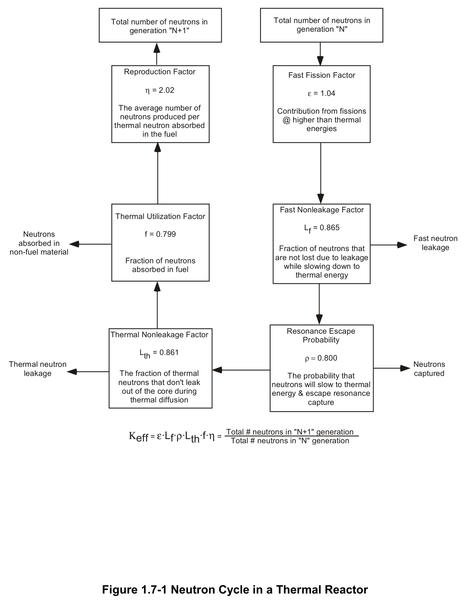

*Neutron Cycle in a Thermal Reactor*

[Vector original (SVG, lossless): fig_1.7-1.svg](../figures/fig_1.7-1.svg)

<!-- labels/text on this figure page -->
Total number of neutrons in Total number of neutrons in generation "N" generation "N+1"
Reproduction Factor Fast Fission Factor
η = 2.02 ε = 1.04
The average number of Contribution from fissions neutrons produced per @ higher than thermal thermal neutron absorbed energies in the fuel
Fast Nonleakage Factor Thermal Utilization Factor Lf = 0.865 f = 0.799 Neutrons Fast neutron absorbed in Fraction of neutrons that leakage non-fuel material are not lost due to leakage Fraction of neutrons while slowing down to absorbed in fuel thermal energy
Resonance Escape Thermal Nonleakage Factor Probability Lth = 0.861 ρ = 0.800 Thermal neutron Neutrons leakage captured The fraction of thermal The probability that neutrons that don't leak neutrons will slow to thermal out of the core during energy & escape resonance thermal diffusion capture
Κeff = ε·Lf·ρ·Lth·f·η = Total # neutrons in "N+1" generation Total # neutrons in "N" generation
Figure 1.7-1 Neutron Cycle in a Thermal Reactor

<!-- p.34 -->
#### Figure 1.7-2

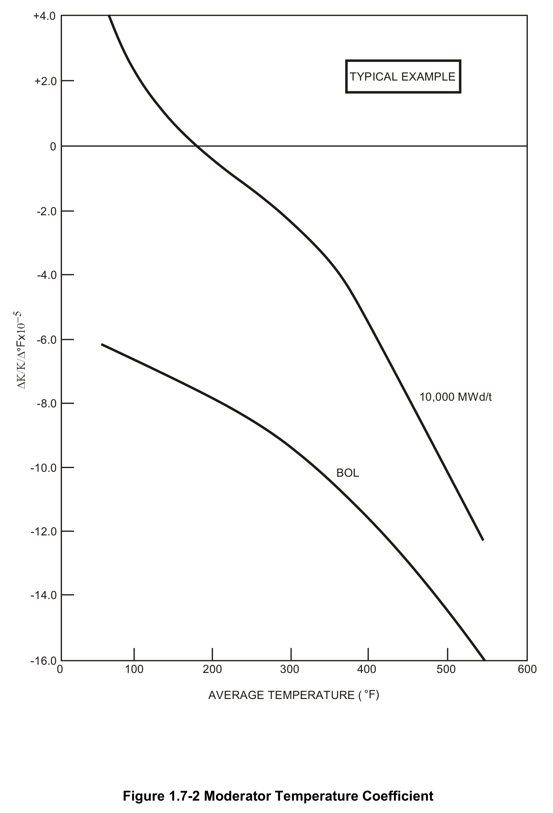

*Moderator Temperature Coefficient*

[Vector original (SVG, lossless): fig_1.7-2.svg](../figures/fig_1.7-2.svg)

<!-- labels/text on this figure page -->
+4.0
TYPICAL EXAMPLE +2.0
0
-2.0
-4.0
-6.0
10,000 MWd/t
-8.0
-10.0 BOL
-12.0
-14.0
-16.00 100 200 300 400 500 600
AVERAGE TEMPERATURE ( °F)
Figure 1.7-2 Moderator Temperature Coefficient

<!-- p.35 -->
#### Figure 1.7-3

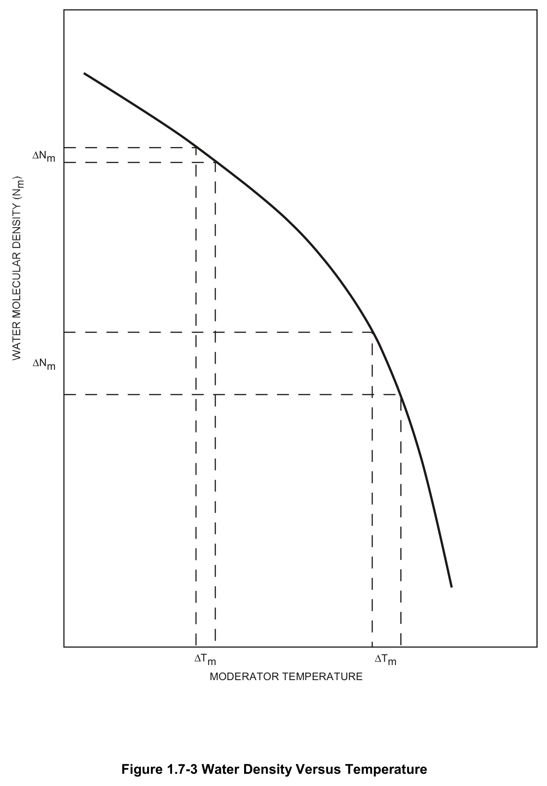

*Water Density Versus Temperature*

[Vector original (SVG, lossless): fig_1.7-3.svg](../figures/fig_1.7-3.svg)

<!-- labels/text on this figure page -->
ΔNm
ΔNm
ΔTm ΔTm MODERATOR TEMPERATURE
Figure 1.7-3 Water Density Versus Temperature

<!-- p.36 -->
#### Figure 1.7-4

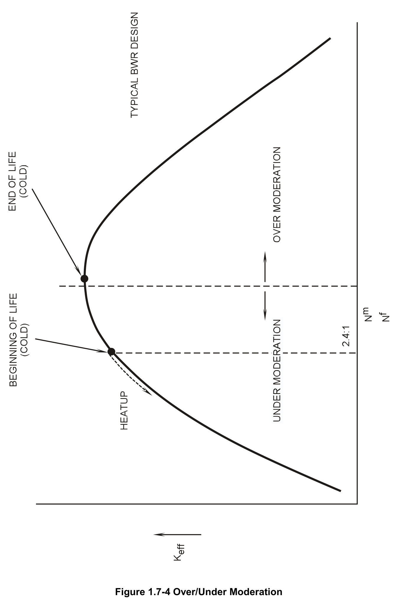

*Over/Under Moderation*

[Vector original (SVG, lossless): fig_1.7-4.svg](../figures/fig_1.7-4.svg)

<!-- p.37 -->
#### Figure 1.7-5

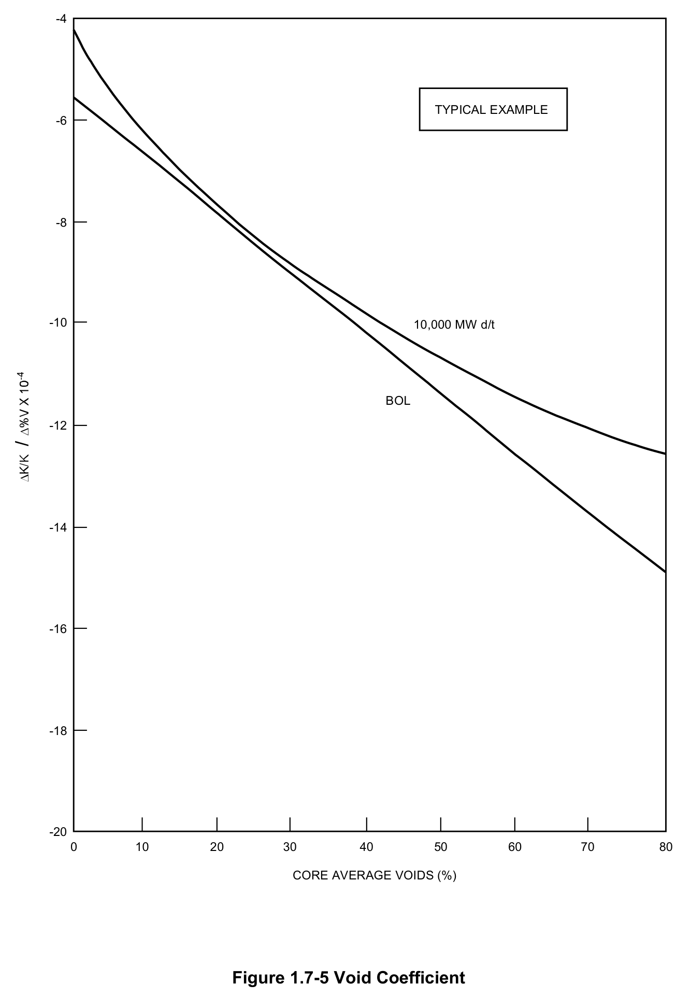

*Void Coefficient*

[Vector original (SVG, lossless): fig_1.7-5.svg](../figures/fig_1.7-5.svg)

<!-- labels/text on this figure page -->
-4
TYPICAL EXAMPLE
-6
-8
-10 10,000 MW d/t
BOL
-12
-14
-16
-18
-20 0 10 20 30 40 50 60 70 80
CORE AVERAGE VOIDS (%)
Figure 1.7-5 Void Coefficient

<!-- p.38 -->
#### Figure 1.7-6

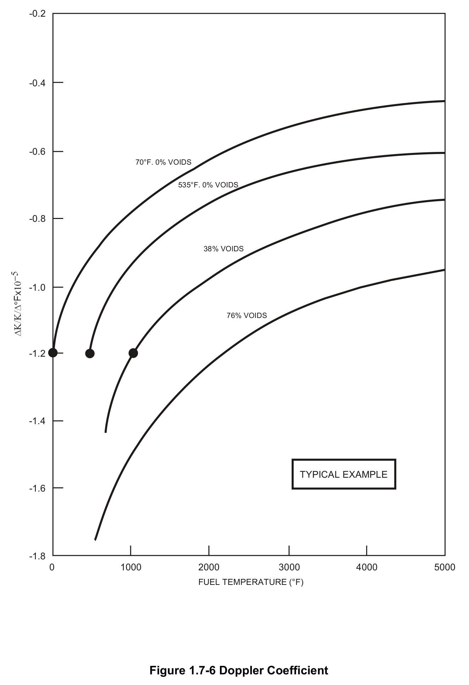

*Doppler Coefficient*

[Vector original (SVG, lossless): fig_1.7-6.svg](../figures/fig_1.7-6.svg)

<!-- labels/text on this figure page -->
-0.2
-0.4
-0.6 70°F. 0% VOIDS
535°F. 0% VOIDS
-0.8
38% VOIDS
-1.0
76% VOIDS
-1.2
-1.4
TYPICAL EXAMPLE
-1.6
-1.8 0 1000 2000 3000 4000 5000
FUEL TEMPERATURE (°F)
Figure 1.7-6 Doppler Coefficient

<!-- p.39 -->
#### Figure 1.7-7

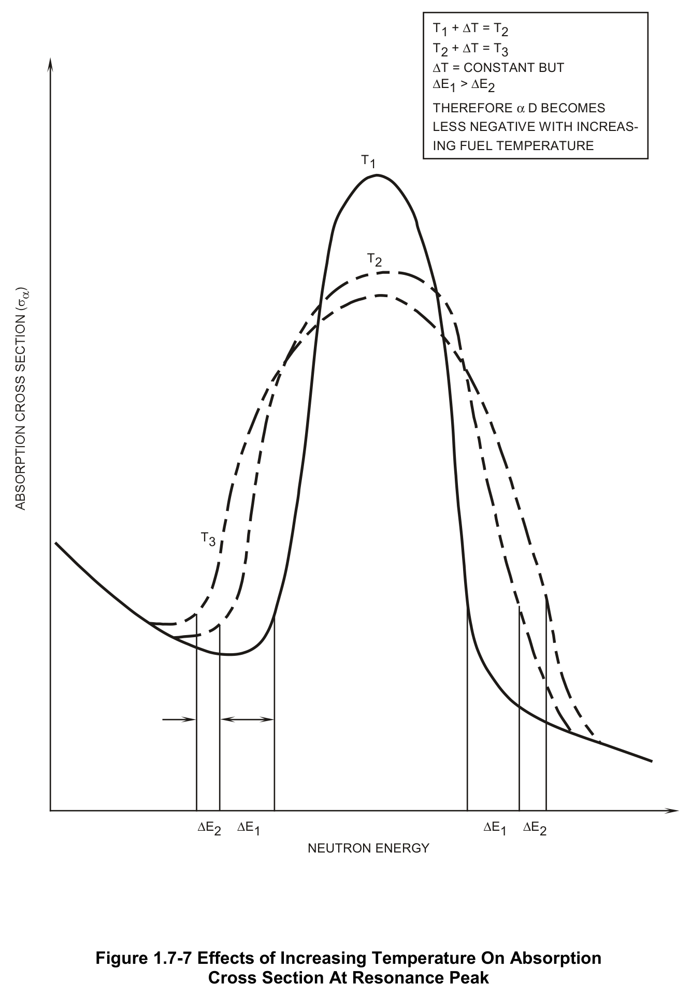

*Effects of Increasing Temperature On Absorption Cross Section At Resonance Peak*

[Vector original (SVG, lossless): fig_1.7-7.svg](../figures/fig_1.7-7.svg)

<!-- labels/text on this figure page -->
T1 + ΔT = T2 T2 + ΔT = T3 ΔT = CONSTANT BUT ΔE1 > ΔE2 THEREFORE α D BECOMES LESS NEGATIVE WITH INCREAS- ING FUEL TEMPERATURE T1
T2
T3
ΔE2 ΔE1 ΔE1 ΔE2 NEUTRON ENERGY
Figure 1.7-7 Effects of Increasing Temperature On Absorption Cross Section At Resonance Peak

<!-- p.40 -->
#### Figure 1.7-8

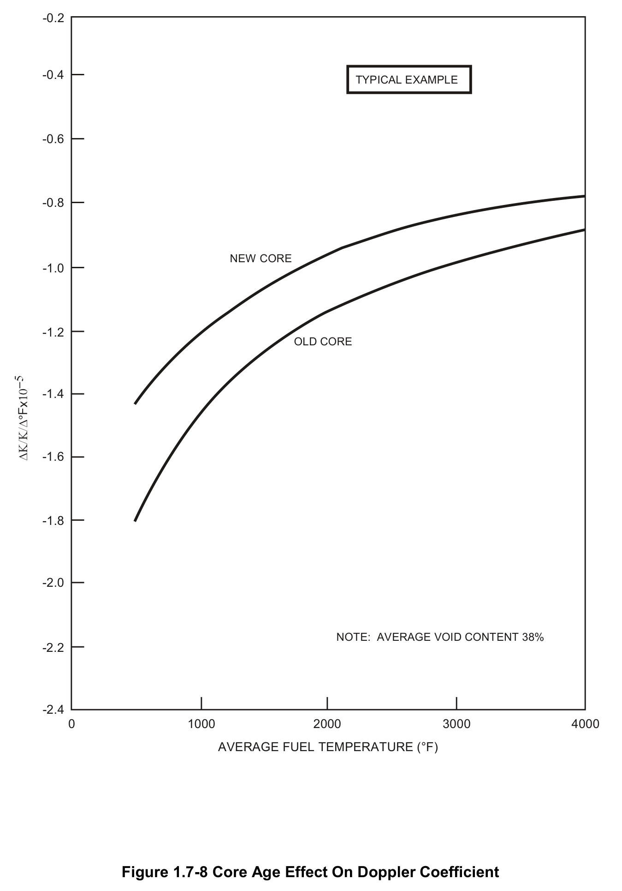

*Core Age Effect On Doppler Coefficient*

[Vector original (SVG, lossless): fig_1.7-8.svg](../figures/fig_1.7-8.svg)

<!-- labels/text on this figure page -->
-0.2
-0.4 TYPICAL EXAMPLE
-0.6
-0.8
NEW CORE
-1.0
-1.2 OLD CORE
-1.4
-1.6
-1.8
-2.0
NOTE: AVERAGE VOID CONTENT 38%
-2.2
-2.4 0 1000 2000 3000 4000
AVERAGE FUEL TEMPERATURE (°F)
Figure 1.7-8 Core Age Effect On Doppler Coefficient

<!-- p.41 -->
#### Figure 1.7-9

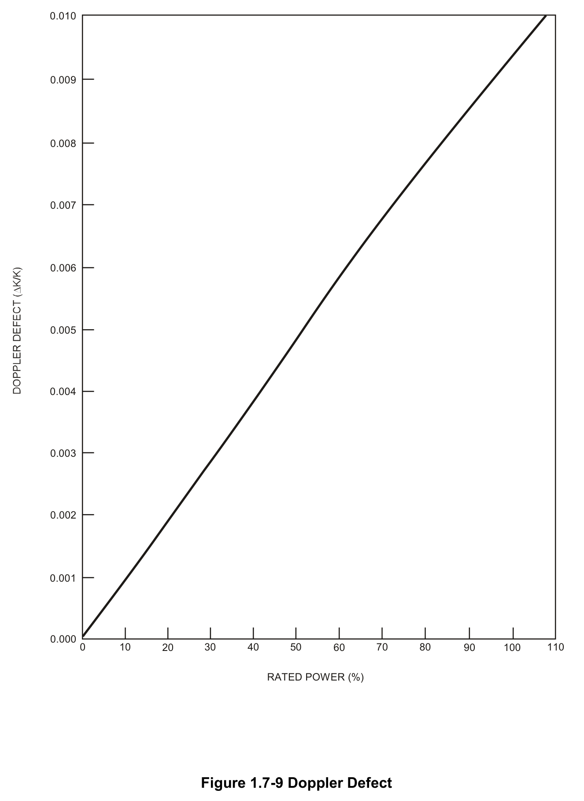

*Doppler Defect*

[Vector original (SVG, lossless): fig_1.7-9.svg](../figures/fig_1.7-9.svg)

<!-- labels/text on this figure page -->
0.010
0.009
0.008
0.007
0.006
0.005
0.004
0.003
0.002
0.001
0.000 0 10 20 30 40 50 60 70 80 90 100 110
RATED POWER (%)
Figure 1.7-9 Doppler Defect

<!-- p.42 -->
#### Figure 1.7-10

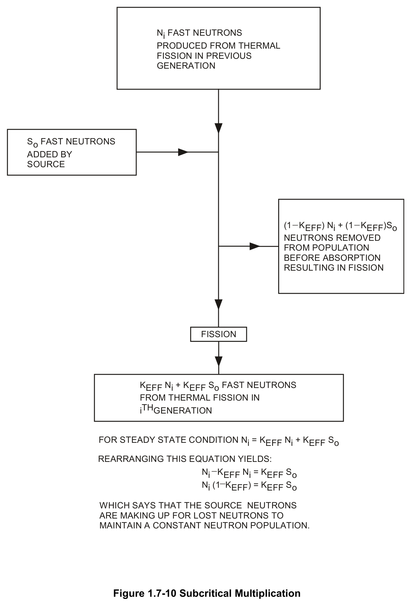

*Subcritical Multiplication*

[Vector original (SVG, lossless): fig_1.7-10.svg](../figures/fig_1.7-10.svg)

<!-- labels/text on this figure page -->
Ni FAST NEUTRONS PRODUCED FROM THERMAL FISSION IN PREVIOUS GENERATION
So FAST NEUTRONS ADDED BY SOURCE
(1 KEFF) Ni + (1 KEFF)So NEUTRONS REMOVED FROM POPULATION BEFORE ABSORPTION RESULTING IN FISSION
FISSION
KEFF Ni + KEFF So FAST NEUTRONS FROM THERMAL FISSION IN iTHGENERATION
FOR STEADY STATE CONDITION Ni = KEFF Ni + KEFF So
REARRANGING THIS EQUATION YIELDS:
Ni KEFF Ni = KEFF So Ni (1 KEFF) = KEFF So
WHICH SAYS THAT THE SOURCE NEUTRONS ARE MAKING UP FOR LOST NEUTRONS TO MAINTAIN A CONSTANT NEUTRON POPULATION.
Figure 1.7-10 Subcritical Multiplication

<!-- p.43 -->
#### Figure 1.7-11

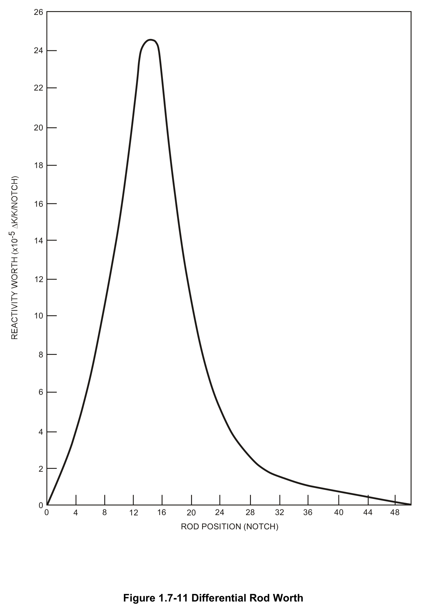

*Differential Rod Worth*

[Vector original (SVG, lossless): fig_1.7-11.svg](../figures/fig_1.7-11.svg)

<!-- labels/text on this figure page -->
26
24
22
20
18
16
14
12
10
8
6
4
2
0 0 4 8 12 16 20 24 28 32 36 40 44 48
ROD POSITION (NOTCH)
Figure 1.7-11 Differential Rod Worth

<!-- p.44 -->
#### Figure 1.7-12

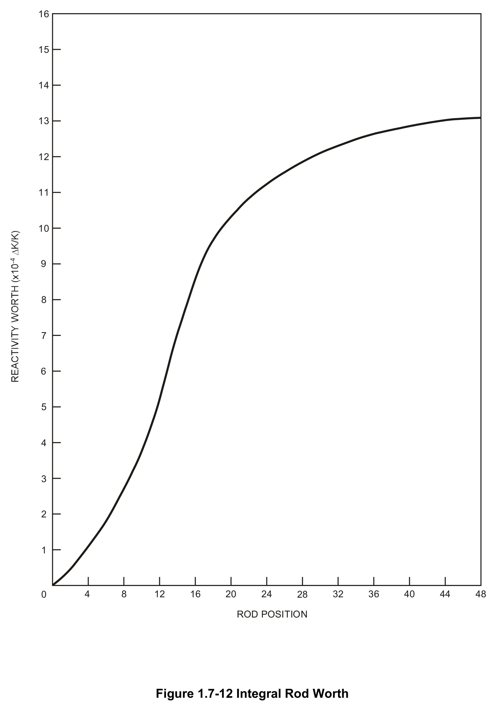

*Integral Rod Worth*

[Vector original (SVG, lossless): fig_1.7-12.svg](../figures/fig_1.7-12.svg)

<!-- labels/text on this figure page -->
16
15
14
13
12
11
10
9
8
7
6
5
4
3
2
1
0 4 8 12 16 20 24 28 32 36 40 44 48
ROD POSITION
Figure 1.7-12 Integral Rod Worth

<!-- p.45 -->
#### Figure 1.7-13

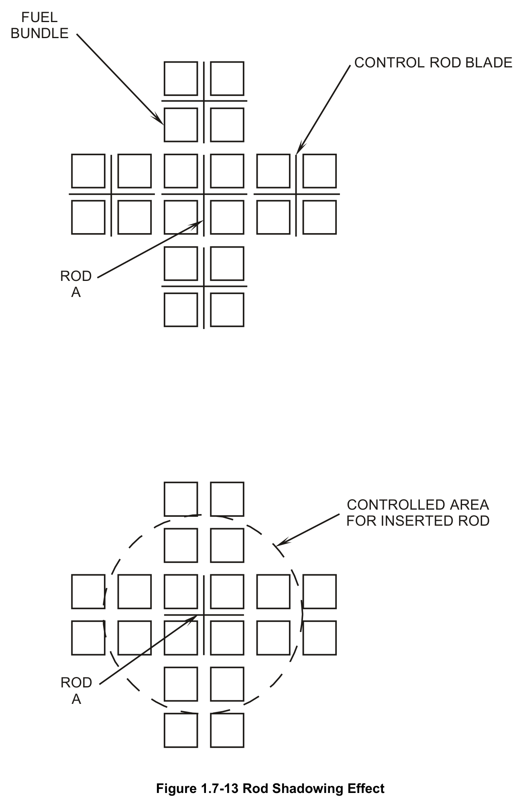

*Rod Shadowing Effect*

[Vector original (SVG, lossless): fig_1.7-13.svg](../figures/fig_1.7-13.svg)

<!-- labels/text on this figure page -->
FUEL BUNDLE
CONTROL ROD BLADE
ROD A
CONTROLLED AREA FOR INSERTED ROD
ROD A
Figure 1.7-13 Rod Shadowing Effect

<!-- p.46 -->
#### Figure 1.7-14

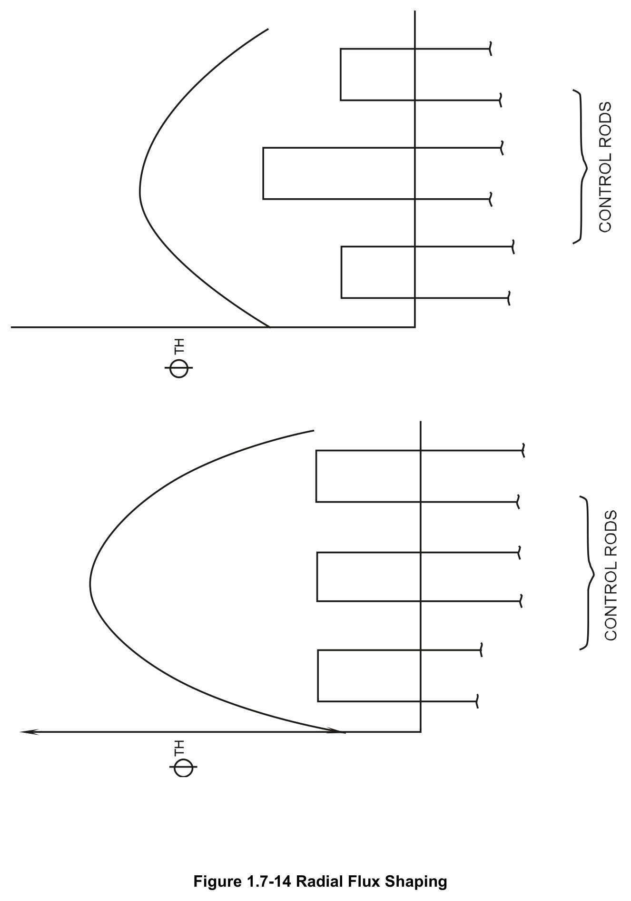

*Radial Flux Shaping*

[Vector original (SVG, lossless): fig_1.7-14.svg](../figures/fig_1.7-14.svg)

<!-- p.47 -->
#### Figure 1.7-15

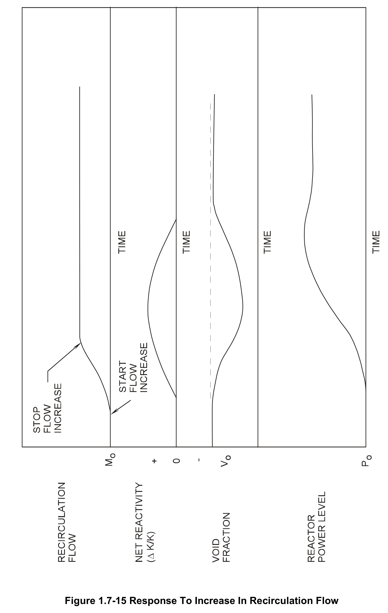

*Response To Increase In Recirculation Flow*

[Vector original (SVG, lossless): fig_1.7-15.svg](../figures/fig_1.7-15.svg)

<!-- p.48 -->
#### Figure 1.7-16

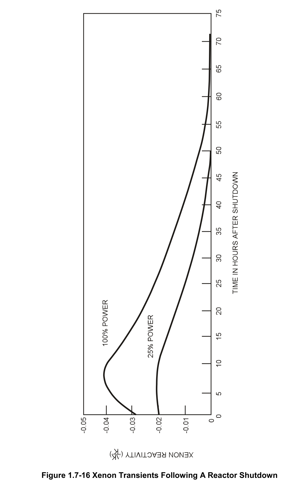

*Xenon Transients Following A Reactor Shutdown*

[Vector original (SVG, lossless): fig_1.7-16.svg](../figures/fig_1.7-16.svg)

<!-- p.49 -->
Rev 0909 USNRC HRTD

<!-- p.50 -->
#### Figure 1.7-17

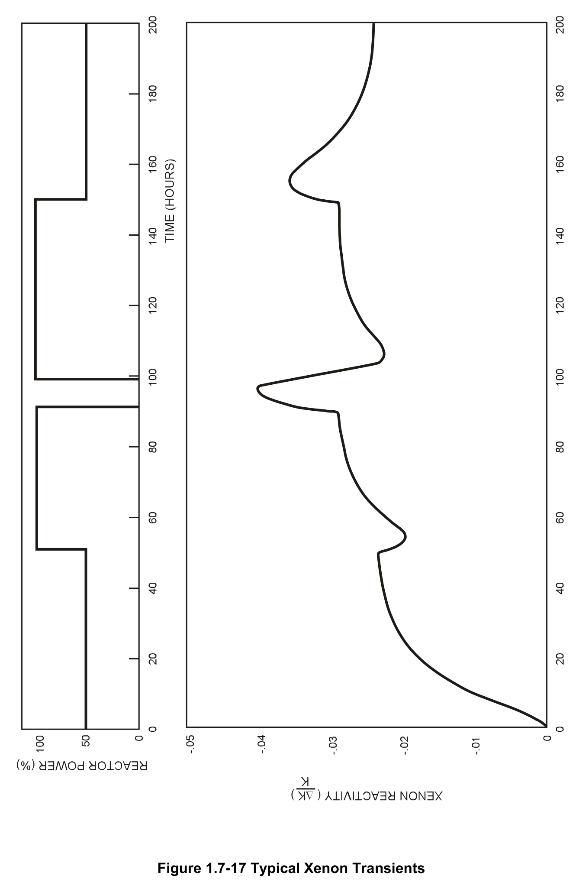

*Typical Xenon Transients*

[Vector original (SVG, lossless): fig_1.7-17.svg](../figures/fig_1.7-17.svg)

<!-- p.51 -->
#### Figure 1.7-18

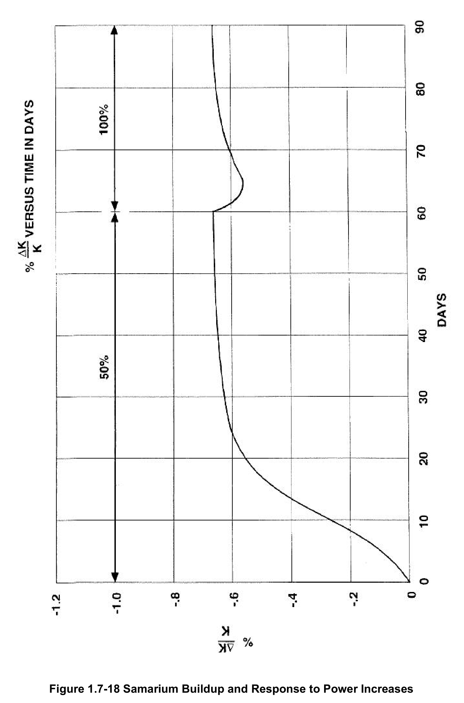

*Samarium Buildup and Response to Power Increases*

<!-- p.52 -->
#### Figure 1.7-19

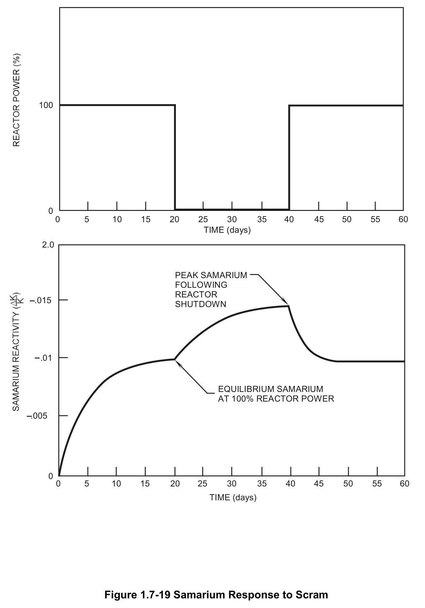

*Samarium Response to Scram*

[Vector original (SVG, lossless): fig_1.7-19.svg](../figures/fig_1.7-19.svg)

<!-- labels/text on this figure page -->
100
0 0 5 10 15 20 25 30 35 40 45 50 55 60 TIME (days)
2.0
PEAK SAMARIUM FOLLOWING REACTOR .015 SHUTDOWN
.01
EQUILIBRIUM SAMARIUM AT 100% REACTOR POWER
.005
0 0 5 10 15 20 25 30 35 40 45 50 55 60 TIME (days)
Figure 1.7-19 Samarium Response to Scram

<!-- p.53 -->
#### Figure 1.7-20

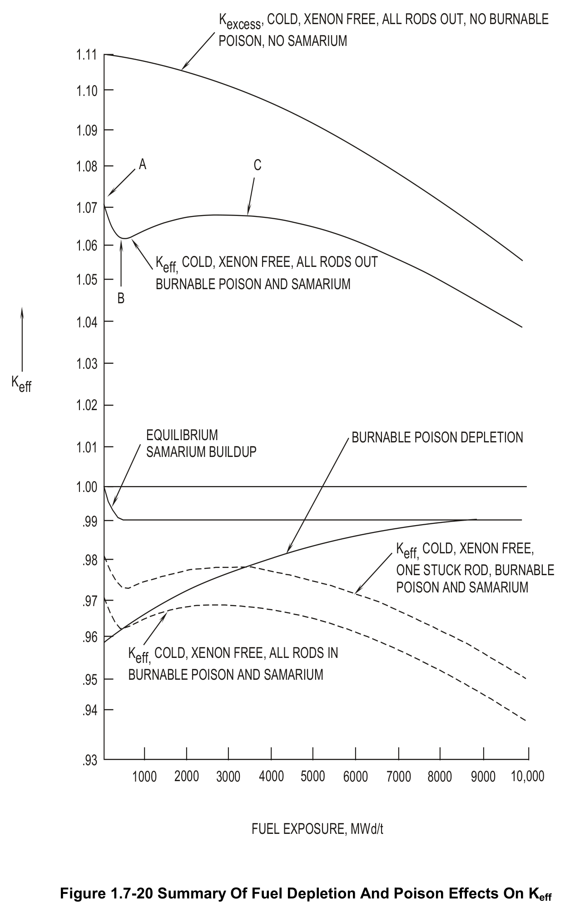

*Summary Of Fuel Depletion And Poison Effects On Keff*

[Vector original (SVG, lossless): fig_1.7-20.svg](../figures/fig_1.7-20.svg)

<!-- labels/text on this figure page -->
Kexcess, COLD, XENON FREE, ALL RODS OUT, NO BURNABLE POISON, NO SAMARIUM
1.11
1.10
1.09
A 1.08 C
1.07
1.06 Keff, COLD, XENON FREE, ALL RODS OUT
1.05 BURNABLE POISON AND SAMARIUM B
1.04
1.03 Keff
1.02
EQUILIBRIUM BURNABLE POISON DEPLETION
1.01 SAMARIUM BUILDUP
1.00
.99
Keff, COLD, XENON FREE, .98 ONE STUCK ROD, BURNABLE POISON AND SAMARIUM .97
.96 Keff, COLD, XENON FREE, ALL RODS IN BURNABLE POISON AND SAMARIUM .95
.94
.93 1000 2000 3000 4000 5000 6000 7000 8000 9000 10,000
FUEL EXPOSURE, MWd/t
Figure 1.7-20 Summary Of Fuel Depletion And Poison Effects On Keff

