# 1.8 Thermal Limits

> Source: `1.8_Thermal_Limits.pdf` (48 pages)
> GE (BWR) Systems Technology Manual — USNRC HRTD, Rev 09/11

---
<!-- p.1 -->
#### General Electric Systems Technology Manual
#### Chapter 1.8
#### Thermal Limits
<!-- p.3 -->
TABLE OF CONTENTS

1.8 THERMAL LIMITS .................................................................................................... 1

1.8.1 Introduction ........................................................................................................ 1

1.8.2 Thermal Limit Description................................................................................... 2

1.8.3 Background Information ..................................................................................... 3

1.8.3.1 Heat Transfer ................................................................................................ 3

1.8.3.2 Fluid Flow ..................................................................................................... 4

1.8.3.3 Boiling Heat Transfer .................................................................................... 5

1.8.4 Fuel Damage ...................................................................................................... 6

1.8.5 Critical Power Ratio (CPR) ................................................................................. 7

1.8.5.1 The GEXL Correlation .................................................................................. 7

1.8.5.2 The MCPR Safety Limit ................................................................................ 9

1.8.5.3 MCPR Modifications for Limiting Transients ................................................. 9

1.8.5.4 The Thermal Power Safety Limit ................................................................. 10

1.8.6 Linear Heat Generation Rate (LHGR) .............................................................. 11

1.8.6.1 Elasticity and Plasticity ............................................................................... 11

1.8.6.2 The LHGR (Thermal Hydraulic) Limit .......................................................... 11

1.8.7 Average Planer Linear Heat Generation Rate (APLHGR) ................................ 12

1.8.7.1 The APLHGR (ECCS LOCA) Limit ............................................................. 12

1.8.7.2 APLHGR Modifications ............................................................................... 13

1.8.7.3 ECCS/LOCA and Thermal-Mechanical Limits ............................................ 13

1.8.8 Methods to Prevent Exceeding Thermal Limits ................................................ 14

1.8.8.1 Technical Specification Safety Limits (Figure 1.8-16) ................................. 14

1.8.8.2 Technical Specification Operating Limits (Figure 1.8-16) ........................... 14

1.8.9 Plant Process Computer .................................................................................. 14

1.8.9.1 Introduction ................................................................................................. 15

1.8.9.2 Component Description .............................................................................. 16

1.8.9.3 Data Results ............................................................................................... 17

1.8.10 Summary .......................................................................................................... 18

1.8-i USNRC HRTD

<!-- p.4 -->
LIST OF TABLES

1.8-1 Comparison of BWR Core Parameters ........................................................... 19

1.8-2 GEXL Bounding Parameter Values ................................................................. 21

1.8-3 Thermal Limits Calculations ............................................................................ 23

LIST OF FIGURES

1.8-1 Thermal Limits
1.8-2 Fuel Temperature Cross Section
1.8-3 Regions of Boiling Heat Transfer
1.8-4 Plot of Coolant and Fuel Bundle Temperature vs. Flow Path Length
1.8-5 Forced Convection Boiling Curve
1.8-6 Critical Power Ratio
1.8-7 MCPR Limits
1.8-8 MCPR Limit as Function of Average Scram Time
1.8-9 Power-Dependent MCPR Multiplier (KP)
1.8-10 Flow-Dependent MCPR Limits, MCPR (F)
1.8-11 Typical Stress/Strain Curve for Ductile Metal
1.8-12 Fuel Power versus Pellet/Clad Expansion
1.8-13 Average Planar Linear Heat Generation Rate Limit vs. Average Planar Exposure
1.8-14 MACFACF
1.8-15 MACFACP
1.8-16 Thermal Limits & Modifications (BWR/3/4/5, without "ARTS")
1.8-17 Process Computer Simplified Block Diagram
1.8-18 LPRM Adaptive Monitor Case Output (Sample Output)
1.8-19 LPRM Adaptive Monitor Case (continued)
1.8-20 Core Axial Array Definition
1.8-21 Core Ring Array Definition

1.8-ii USNRC HRTD

<!-- p.5 -->
### 1.8 THERMAL LIMITS
Learning objectives:

1. Recognize the three mechanisms of heat transfer and where they occur from fuel centerline to bulk coolant.

2. Recognize the characteristics of a typical fuel to coolant temperature profile.

3. Recognize the regions of heat transfer that occur along the heated length of a fuel pin.

4. Recognize the shape and the regions of the forced convection pool boiling curve.

5. Recognize what is meant by fuel damage and the thermal limit mechanisms that may cause it.

6. Recognize the characteristics and significant points of a typical stress-strain curve.

7. Recognize what is meant by the following terms:
a. Critical Power Ratio (CPR)
b. Linear Heat Generation Rate (LHGR)
c. Average Planar Linear Heat Generation Rate (APLHGR)

8. For each of the thermal limits:
a. Recognize the associated failure mechanism, cause and limiting condition.
b. Recognize the method to prevent exceeding the limitation.

9. Recognize the purposes of the Process ComputerDescribe the three mechanisms of heat transfer and where they occur from fuel centerline to bulk coolant.

#### 1.8.1 Introduction
Thermal limits are provided to minimize the radiological release from the plant during normal operation, transient operation, and accidents by restricting plant operation so that fuel cladding integrity is maintained.

Normal operation is that condition in which the plant is operated up to the licensed power level and within all other conditions and limitations of the operating license, technical specifications and the final safety analysis report. In this condition the plant may be operated continuously.

Transient operation is that condition of operation in which an abnormality has occurred resulting in challenges to continued plant operation. The allowable abnormalities are those which were originally designed for and reasonably expected to occur at least once over the entire operating life of the facility. Examples can be found described as

1.8-1 USNRC HRTD

<!-- p.6 -->
Abnormal Operational Transients in the plant specific Final Safety Analysis Report and includes items such as a loss of the feedwater system or main turbine trip.

Accidents are those conditions of very low probability of occurrence yet are analyzed to result in the most significant challenges to the health and safety of the public with respect to radiation dose. These conditions are also described in the plant specific Final Safety Analysis Report and include items such as a large loss of coolant accident or a control rod drop accident.

#### 1.8.2 Thermal Limit Description
As you study this chapter, it is important to recognize that all references to plant power are to be interpreted as thermal power. Thermal power is the heat generation rate or heat flux that results from the fission process. Another power representation is referred to a neutron power and is what we measure with our nuclear instrumentation. Neutron power is the neutron population density or number of neutrons in the core. The difference between the two is the time delay associated with heat transport from fuel centerline to the cladding/coolant interface. This time delay is called the thermal time constant and has a value of 6-7 seconds. The importance here is to recognize that because of this thermal time constant, normal power maneuvering, transients and accidents can cause large rapid changes in neutron population yet the thermal power response is much more tempered and delayed. For example, a small transient that results in a spike up in neutron population that immediately returns to its previous value will have little noticeable affect in clad surface temperatures.

Two thermal limits are provided for normal operation and transient events to maintain the integrity of the fuel cladding. This objective is achieved by limiting fuel rod power density to avoid overstressing the fuel cladding because of fuel pellet-cladding differential expansion and by maintaining nucleate boiling around the fuel rods so that the transition to film boiling is avoided. The thermal limits established for these purposes are the Linear Heat Generation Rate (LHGR) limit and the Critical Power Ratio (CPR) limit.

One thermal limit is provided for postulated accidents to maintain the core geometry by minimizing the gross fuel cladding failure because of the heatup following a Loss of Coolant Accident (LOCA). The thermal limit established for this purpose is the Average Planar Linear Heat Generation Rate (APLHGR) limit.

The basic thermal limits are shown in Figure 1.8-1. Table 1.8-1 gives typical values for BWR/3, BWR/4, BWR/5, and BWR/6 core parameters and is provided for reference only.

1.8-2 USNRC HRTD

<!-- p.7 -->
#### 1.8.3 Background Information
In order to understand the BWR thermal limits, it is necessary to have an understanding of related background material such as heat transfer and fluid flow characteristics. This subject material is discussed in the paragraphs that follow using Figure 1.8-2.

##### 1.8.3.1 Heat Transfer
During reactor operation, heat is transferred from the fuel center line to the coolant which comes into contact with the outer fuel cladding surface. The heat can be transferred by conduction, convection, or radiation. Conduction and convection are the primary modes of heat transfer during normal and transient conditions. Radiation becomes significant during accident conditions.

###### 1.8.3.1.1 Conduction
When heat is applied to a material, the kinetic energy of the atoms or molecules of the material is increased. Because of this increase in kinetic energy, the particles have a greater tendency to collide with each other. When these collisions occur, the particles transmit a portion of their kinetic energy to neighboring atoms. This is conduction or heat transfer by virtue of physical contact without the influence of a flowing medium.

This is the process by which heat generated in the fuel pellet is transmitted to the outer pellet surface. In relation to the fuel rod, this conduction flow is in a horizontal plane from the fuel center line to the pellet outer surface. Conduction is also the primary heat transfer mechanism through the fuel cladding.

###### 1.8.3.1.2 Convection
Convection is the process of transmitting heat from a heated surface or area to a fluid by circulation or mixing of the fluid. Convection takes place only in fluids.

The application in this case deals with a fluid flowing past a metallic fuel/cladding surface. Fluids have a tendency to adhere to solid surfaces resulting in the formation of a stagnant film on the surface. This film is normally very thin and heat is transferred across this film by a combination of conduction and convection. After the heat penetrates the film, it is transferred rapidly through the remainder of the fluid by convection.

The resistance of heat flow is so low that there is virtually no temperature variation through the bulk of the fluid (coolant) at any given elevation along the fuel rod.

Although much less efficient, convection is the primary means of heat transfer through the gap between the fuel pellet and the inside cladding surface. In this case, the fluid is

1.8-3 USNRC HRTD

<!-- p.8 -->
not under forced flow conditions and therefore a larger delta-T is required to transfer the same amount of heat.

###### 1.8.3.1.3 Radiation
Radiation heat transfer is the transmission of heat in the form of radiant energy from one object to another across an intervening space. This form of heat transfer is avoided in nuclear power plants because very high temperature differentials are required to transfer the same amount of heat as compared to conduction and convection. If high temperatures were allowed to occur, the materials would degrade. During worst case accident conditions, it is assumed that the loss of water as a convection heat transfer medium results in fuel centerline heat transfer primarily by radiation.

##### 1.8.3.2 Fluid Flow
Figure 1.8-3 shows the different flow patterns which can exist in a fuel bundle during normal operation. As coolant enters the fuel bundle, it is slightly subcooled, (single phase liquid) and begins to gain heat from the forced flow convection mechanism.
Because of subcooling, there is little or no bubble formation. As energy is gained, the coolant temperature increases until nucleate boiling with its attendant bubble formation begins. Early states of nucleate boiling (bubble flow) occur while the bulk coolant in the bundle is below liquid saturation enthalpy, and the bubbles readily collapse as the turbulent flow and their buoyancy sweeps them away from the cladding surface. A point will be reached where the bulk coolant enthalpy is at liquid saturation, (bulk boiling) and the bubbles will no longer collapse in the coolant as they are swept away. The bubbles now begin to exist separately throughout the bulk coolant, causing a significant steam fraction to be present in the coolant. From this point to the bundle outlet, the bubbles continue to form at the fuel rod surface (nucleate boiling) and to be swept into the coolant and begin to coalesce (slug flow) into larger and larger slugs of steam. At the outlet of very highest powered fuel bundles, steam may fill most of the bundle flow area between fuel rods, but a thin annulus of water (annular flow) adheres to the fuel rod surfaces. In this annular flow region, the wetted rod surface is still transferring heat through the nucleate boiling mechanism. The mist flow region is known for poor heat transfer characteristics due to the steam blanket acting as a better insulator than conductor. This region is avoided as will be discussed later. Entry into the mist flow region is defined by the Departure from Nucleate Boiling (DNB) also known as Onset of Transition Boiling (OTB) or Critical Heat Flux (CHF). This region is avoided during normal and transient operations yet is considered in the evaluation of accident conditions.

###### 1.8.3.2.1 Fuel Channel Parameter Characteristics
Figure 1.8-4 shows a plot of coolant and fuel bundle temperature versus flow path length of an average fuel bundle. Coolant enters the bottom of the core, flows upward around the fuel rods, and absorbs energy from heat transfer originating from the nuclear

1.8-4 USNRC HRTD

<!-- p.9 -->
process. Because of the peculiar characteristics of neutron-caused fission reactions, the average heat flux (Q/A) produced from fission in the core assumes a shape somewhat like that shown in Figure 1.8-4. The highest heat flux is in the core interior, hence some fuel bundles have a higher than average heat flux while some have a lower than average heat flux.

The coolant temperature curve rises as heat is added, until temperature saturation occurs, and coolant bulk boiling begins. From this point the coolant temperature remains constant all the way to core outlet. Because the coolant is changing phase, the coolant temperature profile is not altogether descriptive of coolant energy increase. A better description is obtained by plotting coolant enthalpy change, which continuously increases from core inlet to outlet, with the largest rate of increase at the maximum value of heat flux.

The curve for fuel rod surface temperature rises and then levels at a constant value above coolant temperature. The initial rise is caused by the ΔT across the film required to accommodate the heat flux (Q/A) during single phase forced convection heat transfer. The fuel rod temperature levels off when nucleate boiling starts. Nucleate boiling is an excellent heat transfer mode; therefore, even thought the heat flux increases, the ΔT across the boiling film remains relatively constant.

The curve for fuel rod center line temperature is above that of the fuel surface temperature. The amount that the center line temperature is greater than surface temperature depends directly on the heat flux. The beneficial effects of nucleate boiling on center line temperature can also be seen. As long as nucleate boiling is occurring on the fuel rod surface, the fuel rod surface temperature is only slightly greater than liquid temperature. This, in turn, keeps the fuel center line temperature at a lower value than if single phase convection were the mode of heat transfer from surface to liquid.

###### 1.8.3.2.2 Fuel Temperature Profile
Figure 1.8-2 illustrates a typical fuel temperature cross section with nucleate boiling at a high heat flux. The beneficial effect of nucleate boiling can be seen. As long as nucleate boiling is occurring on the fuel rod surface, the fuel rod surface temperature is only slightly greater than liquid temperature. This, in turn, keeps the fuel center line temperature at a lower value than if single phase convection were the mode of heat transfer from surface to liquid.

##### 1.8.3.3 Boiling Heat Transfer
The boiling heat transfer curve is shown in Figure 1.8-5. The amount of heat transferred from the fuel cladding to the coolant is greatly affected by the coolant properties and by the thermal and hydraulic conditions of the coolant. The rate at which heat is transferred from the cladding, the heat flux, is dependent on the specific temperature difference between the cladding and the coolant (ΔT) and the heat transfer

1.8-5 USNRC HRTD

<!-- p.10 -->
coefficient. The heat flux may be plotted against the temperature difference between the cladding and the coolant. This curve can be divided into boiling regions corresponding to the regions shown in Figure 1.8-3. The heat transfer coefficient in each region is controlled by the mode of heat transfer in that region.

The first region is single phase convection heat transfer. The heat flux increases somewhat with increased ΔT.

The second region is associated with subcooled nucleate boiling. Subcooled nucleate boiling is boiling that occurs at the cladding surface while the bulk coolant temperature is not yet at saturation temperature. The steam bubbles may collapse before departing from the cladding surface or they will collapse as they enter the subcooled region after departing from the surface. This mode of convective heat transfer is a complicated mixture of single phase convection and nucleate boiling modes of heat transfer.

The next region is fully developed nucleate boiling also called bulk boiling. Nucleate boiling is a very efficient mode of heat transfer because of high turbulence created by the boiling process. Annular flow exists at the outlet of high power fuel assemblies during normal operation. The fuel rod surface remains in a well cooled, nucleate boiling type of heat transfer state. Nucleate boiling is maintained in the core in all modes of normal operation and in all transient conditions caused by a single operator error or equipment malfunction.

The heat flux increases as the temperature difference between the cladding and the coolant increases. There is a point where a slight rise in heat flux requires a very large ΔT to transfer the heat. This is a transition boiling regime where the boiling mode changes from nucleate boiling to film boiling. Entry to this region is highly unstable and is characterized by the intermittent physical rewetting of the heated surface by the coolant. The beginning of this region is called Onset of Transition Boiling (OTB) and is labeled so on Figure 1.8-5. The OTB point is avoided in the BWR by remaining within the Critical Power Ratio (CPR) thermal limit.

The crosshatched region represents temperature oscillations which take place during transition boiling. At a given heat flux the clad surface temperature will oscillate between a point on the right in the crosshatched region and a point on the left in the crosshatched region along a horizontal line. This is caused by intermittent physical rewetting of the clad surface. At OTB, the temperature oscillations reach 25ºF in magnitude, which is used to define the critical power point or critical heat flux.

#### 1.8.4 Fuel Damage
Fuel damage is defined for design purposes as perforation of the cladding, which permits release of fission products. The mechanisms which could cause fuel damage in reactor transients are:

1.8-6 USNRC HRTD

<!-- p.11 -->
• Fatigue failure of the fuel cladding caused by the Onset of Transition Boiling. This fuel damage results from local temperature oscillations of the cladding. The Critical Power Ratio (CPR) thermal limit provides protection against this failure mechanism.

• Rupture of the fuel cladding because of strain caused by relative expansion differences between the uranium dioxide (UO2) pellet and the fuel cladding. The Linear Heat Generation Rate (LHGR) thermal limit provides protection against this failure mechanism.

• The loss of convective heat transfer during accident conditions replaced by the less efficient radiation heat transfer mechanism resulting in severe fuel cladding overheating. The Average Planer Linear Heat Generation Rate (APLHGR) thermal limit provides protection against this failure mechanism.

#### 1.8.5 Critical Power Ratio (CPR)
As discussed earlier, the critical power ratio thermal limit protects against fuel damage resulting from the loss of nucleate boiling by limiting the total power that a given fuel bundle is allowed to produce.

##### 1.8.5.1 The GEXL Correlation
The General Electric Critical Quality (Xc) vs. Boiling Length (LB) (GEXL) correlation predicts the onset of transition boiling. The OTB point is a function of many parameters including:
• local steam quality
• local heat flux
• coolant mass flow rate
• bundle boiling length (LB)
• pressure
• flow geometry
• core inlet sub-cooling
• local peaking patterns

The General Electric (GE) Company conducted extensive experimental investigations of the transition boiling event and its relation to these parameters over their design range.

The boiling transition testing was done at the Atlas Test Facility in San Jose, California, which was specifically designed to simulate reactor conditions and to handle transients as well as steady state conditions. The Atlas Test Facility test fuel bundle components
(lower tie plate, fuel rod interim spacers, upper tie plate, fuel channel, and fuel bundle rods) were dimensionally the same as those used in the BWR. The fuel rods were electrically heated to simulate nuclear heat. Axial power shapes and local peaking of specific rods were simulated by varying the thickness of the fuel rod conductor. The

1.8-7 USNRC HRTD

<!-- p.12 -->
fuel rods which were expected to achieve OTB were instrumented with thermocouples to monitor temperature changes.

The testing procedure involved constructing a bundle with the desired axial power shape and local peaking factor and then establishing a constant system pressure, bundle flow rate, and inlet subcooling. The power in the test bundle was slowly increased until OTB was indicated. A rod thermocouple was considered to be indicating a boiling transition condition when about 25ºF rod surface temperature oscillations were observed. The bundle power at this point was defined as critical power.

The data for each boiling transition point was recorded and the inlet subcooling was changed for the next test. The inlet subcooling was varied for each test until the desired range had been covered. A similar procedure was used to study the variation in the OTB point relative to changes in reactor pressure, inlet flow, axial power shape, and local peaking.

The test results of the ATLAS Test Facility were analyzed extensively to find a correlation that could be used to predict how close actual operating conditions are to OTB. GE chose the critical quality versus boiling length correlation to evaluate the boiling transition data because it is independent of axial flux profile and subcooling, it yields good precision, and it is fairly simple to apply in both design and operation.

Critical quality Xc is defined as the fuel bundle planar quality at the plane where boiling transition occurs, and boiling length LB (Figure 1.8-3) is defined as the distance from the plane where bulk saturation conditions are reached to the plane where boiling transition occurs.

The previous description can be seen in the GEXL correlation curve in Figure 1.8-6 which shows that, for a specific reactor condition, boiling transition occurs at a distance LB from the plane of saturation if the quality rises to the critical quality Xc. Both the axial elevation where saturation occurs and the quality at any axial elevation can be easily calculated by doing an enthalpy balance on the fuel bundle. This makes the determination of the CPR using the GEXL correlation relatively simple to apply to existing operating conditions.

Line (1) of Figure 1.8-6 represents a heat balance plot of average steam quality versus distance along an operating fuel bundle from the start of bulk boiling. For the same initial parameters as the operating bundle (mass flow rate, pressure, etc.), line (3)
represents the quality-boiling length points which would result in transition boiling. By successively increasing bundle power from its initial level, a set of curves, located somewhere above curve (1), can be generated until the bundle power is high enough that its curve becomes tangent at some point to the correlation curve (3). The bundle power corresponding to curve (2) is the critical power, or the bundle power that is required to cause transition boiling in the bundle at the reactor conditions of interest.

1.8-8 USNRC HRTD

<!-- p.13 -->
The GEXL correlation is valid over the range of conditions used in the tests of the data used to develop the correlation. These conditions are listed in Table 1.8-2.

##### 1.8.5.2 The MCPR Safety Limit
Critical power is the fuel bundle power required to cause transition boiling somewhere in the fuel bundle. The Critical Power Ratio (CPR) of a fuel bundle is the ratio of its critical power to the actual fuel bundle operating power. The CPR is a measure of how close to transition boiling a fuel bundle is operating. The minimum CPR value for all fuel bundles in the core is the Minimum Critical Power Ratio (MCPR) and represents the fuel bundle which is the closest to transition boiling. MCPR limits are imposed to avoid fuel damage due to fatigue failure when cladding surface temperatures experience large
(>25 degrees) oscillations due to transition from nucleate to film boiling (OTB).

The MCPR safety limit is determined by safety analysis for each core reload and typically has a value of approximately 1.07. Fuel cycle operation within the limitation (>
1.07) ensures that in the event of an abnormal operating transient more than 99.9% of the fuel rods in the core are expected to avoid transition boiling. The margin between an MCPR of 1.0 (onset of transition boiling) and the safety limit is derived from a detailed statistical analysis of uncertainties in monitoring the operating state of the core and in the boiling transition correlation.

##### 1.8.5.3 MCPR Modifications for Limiting Transients
The required MCPR at steady state operating conditions is derived from the MCPR safety limit of approximately 1.07, and an analysis of abnormal operational transients.
The types of transients evaluated include turbine trip without bypass valves, generator load rejection without bypass valves, feedwater controller failure, pressure regulator failure downscale, loss of feedwater heating, fuel loading error, and rod withdrawal error. The evaluations determined the change in CPR (ΔCPR) caused by the positive reactivity introduced by these conditions. To ensure that the MCPR safety limit is not exceeded during any anticipated abnormal operational transient, the most limiting transients have been analyzed to determine those which result in the largest reduction in CPR (ΔCPR).

The operating MCPR limit is obtained by addition of the maximum ΔCPR value for the most limiting transient (including any imposed adjustment factors) to the MCPR safety limit as shown in Figure 1.8-7.

The pressurization transient is analyzed using computer models to obtain the ΔCPR for the core. The licensing basis OLMCPR is given as:

OLMCPR = MCPR Safety Limit +ΔCPR and a typical value ranges from 1.2 to 1.5 depending upon fuel type. Most fuels in current use (GE-14/GNF-4) are around 1.44.

1.8-9 USNRC HRTD

<!-- p.14 -->
Another approach is a statistical determination of the transient ΔCPR values such that there is a 95% probability with 95% confidence (95/95) that the event will not cause the CPR to fall below the MCPR safety limit. Utilities using this option must demonstrate that their control rod scram insertion times are consistent with that used in the statistical analysis. This is accomplished through technical specification surveillances which require testing and ensures adjustment of the operating limit MCPR if the scram speed is outside the assumed distribution. Since slower average scram times result in a slower termination of transients, adjustments in the allowable MCPR operating value ensure fuel damage does not occur under these conditions. Figure 1.8-8 is a typical curve where Tau (T) is the time, in seconds, that average scram times are longer than the analysis average scram times plotted against the appropriate MCPR limitation. This curve will appear for all different fuel types in the current cycle core load.

At conditions of less than 100% core flow or less than 100% power, the MCPR operating limit is additionally adjusted. During these operational conditions, transients such as rod withdrawal errors, feedwater controller failures, or recirculation pump run out become more limiting than pressurization transients. For this reason, the operating limit MCPR is raised to compensate. For reactor power conditions between 25% and 30% the MCPR operating limit is provided in Figure 1.8-9. For reactor power conditions greater than 30% power the MCPR operating limit is the greater of either (1) the flowdependent MCPR limit shown in Figure 1.8-10 or (2) the appropriate kp given by Figure
1.8-9, multiplied by the rated flow and rated power limit obtained from Figure 1.8-8.
These reduced flow or power limits are established to protect the core from inadvertent core flow or power increases.

##### 1.8.5.4 The Thermal Power Safety Limit
The use of the GEXL correlation is not valid for all critical power calculations at pressures below 785 psig (800 psia) or core flows less than 10% of rated flow.
Therefore, the fuel cladding integrity safety limit, under these plant conditions, is established by other means. This is done by limiting core thermal power to 25% of rated when reactor pressure is below 785 psig. Since the pressure drop in the bypass region is essentially all elevation head, the core pressure drop at low power and flows will always be greater than 4.5 psi. Analyses show that with a bundle flow of 28 x 103 lb/hr, bundle pressure drop is nearly independent of bundle power and has a value of
3.5 psi. Thus, the bundle flow with a 4.5 psi driving head will be greater than 28 x 103 lb/hr. Full scale ATLAS test data taken at pressures from 14.7 psia to 800 psia indicate that the fuel assembly critical power at this flow is approximately 3.35 MWt. With the design peaking factors, this corresponds to a thermal power of more than 50% of rated thermal power. Thus, a thermal power limit of 25% of rated thermal power for reactor pressure below 785 psig is conservative.

1.8-10 USNRC HRTD

<!-- p.15 -->
#### 1.8.6 Linear Heat Generation Rate (LHGR)
As discussed earlier, the linear heat generation rate thermal limit limits fuel pin power to protect against fuel damage resulting from fuel and cladding differential expansion that could result in excessive cladding stresses.

##### 1.8.6.1 Elasticity and Plasticity
Suppose stress (force acting upon a unit area) is plotted as a function of the corresponding strain (elongation). If Hooke's law is obeyed, stress is directly proportional to strain and the graph is a straight line. Real materials show several types of departures from this idealized behavior.

Figure 1.8-11 shows a typical stress-strain graph for a metal such as copper or soft iron.
The stress in this case is a simple tensile stress, and the strain is shown as the percent elongation. The first portion of the curve, up to a strain of less than 1%, is a straight line, indicating Hooke's-law behavior with stress directly proportional to strain. This straight-line portion ends at point a; the stress at this point is called the proportional limit.

From a to b, stress and strain are no longer proportional, but if the load is removed at any point between a and b, the curve is retraced and the material returns to its original length. In the entire region, a to b, the material is said to be elastic or to show elastic behavior. Point b, the end of this region, is called the yield point, and the corresponding stress is called the elastic limit. Up to this point the forces exerted by the material are conservative. When the load is removed, the material returns to its original shape, and the energy put into the material in causing the deformation is removed. The deformation is said to be reversible.

If the stress is increased further, the strain increases rapidly, but when the load is removed at some point beyond b, say c, the material does not come back to its original length but traverses the thin line in Figure 1.8-11. The length at zero stress is now greater than the original length, and the material is said to have a permanent set.
Further increase of load beyond c produces a large increase in strain (even if the stress decreases) until a point d is reached at which fracture takes place. From b to d, the material is said to undergo plastic flow, or plastic deformation. Plastic deformation is irreversible; when the stress is removed, the material does not return to its original state. If a large amount of plastic deformation takes place between the elastic limit and the fracture point, the metal is said to be ductile; but if fracture occurs soon after the elastic limit is passed, the metal is said to be brittle.

##### 1.8.6.2 The LHGR (Thermal Hydraulic) Limit
LHGR is heat flux integrated over every square centimeter of cladding surface for one linear foot of fuel rod. Limits on LHGR are set to restrict the strain on the fuel cladding

1.8-11 USNRC HRTD

<!-- p.16 -->
because of relative expansion of the fuel pellets and the cladding. A value of 1% plastic strain of the cladding is conservatively defined as a threshold below which fuel damage due to fuel cladding overstraining is not expected to occur.

Relative expansion arises from several sources:
• the UO2 fuel thermal expansion coefficient is approximately twice that of zircaloy
• the fuel pellets operate at higher temperatures than the cladding
• the fuel pellets undergo irradiation growth as they are exposed
• the fuel pellets crack and redistribute toward the cladding because of thermal stress.

Cladding cracking because of differential expansion of pellet and cladding is prevented by limiting fuel pin power so that 1% plastic strain does not occur. Figure 1.8.12 shows the relative contact between the cladding and the fuel pellet during (a) low power, (b)
medium power and (c) high power conditions. If the deformation of condition (c) is maintained below the 1% plastic strain value, permanent deformation is not expected to occur and repeated occurrences are not expected to result in fuel damage. In other words, when a fuel rod power level changes from high to low, the lower strain value allows the deformed cladding to return to its original shape.

The linear heat generation rate required to cause 1% cladding strain in 8 x 8 fuel pin is approximately 25 KW/ft for non-irradiated fuel, but decreases with burnup to a value of approximately 20 KW/ft at a local exposure of 40,000 MWd/sT.

The LHGR for 8 x 8 fuel is 13.4 KW/ft, which provides a margin to the 1% plastic strain threshold. The LHGR limit for newer 8 x 8 fuel and 9 x 9 fuel is 14.4 KW/ft.

#### 1.8.7 Average Planer Linear Heat Generation Rate (APLHGR)
As discussed earlier, the average planer linear heat generation rate thermal limit limits fuel node power levels to protect against fuel damage resulting the fuel overheating caused by the loss of coolant accident.

##### 1.8.7.1 The APLHGR (ECCS LOCA) Limit
APLHGR is the average LHGR of all fuel rods in a given fuel bundle in a given horizontal plane (actually a 6 inch segment or node). This parameter is important in the core heatup analysis for a LOCA.

In the event of a LOCA, the heat stored in the fuel at the time of the accident and the decay heat produced following the accident could significantly damage the fuel. In the case of some LOCAs, nucleate boiling is maintained around the fuel long enough for the majority of the stored energy in the fuel to be conducted to the coolant; thus fuel damage is minimized. In the design basis LOCA, however, the core region is voided of coolant in a relatively short time. Once water is removed from the cladding, radiation is the only heat transfer mechanism. If the fuel was previously operating at a high power

1.8-12 USNRC HRTD

<!-- p.17 -->
level, the stored energy in the fuel could lead to a gross cladding failure and possible severe degradation of core geometry.

Gross cladding failure is prevented by placing a limit on the power level which would result in a peak cladding temperature (PCT) of 2200ºF following a LOCA. The thermal limit specified is the APLHGR which is used because the PCT following a postulated LOCA is primarily a function of the average heat generation rate of all the rods of a fuel assembly at any axial location and is dependent only secondarily on the rod-to-rod power distribution within an assembly.

The thermal limit in this case is given in terms of the incore Maximum APLHGR
(MAPLHGR) and is specified for each individual fuel type as a function of fuel exposure.
The units of the MAPLHGR are the same as those of the LHGR (KW/ft) even though the parameters are different. Typical MAPLHGR limiting values are depicted in Figure 1.8- 13.

##### 1.8.7.2 APLHGR Modifications
Similar to the MCPR operating limit, the APLHGR limit is further adjusted for low flow
(Figure 1.8-14) or low power (Figure 1.8-15) conditions. These adjustments assure that the fuel thermal-mechanical design criteria are preserved during abnormal transients initiated from off rated flow or power conditions.

MAPFACf is usually determined by the recirculation pump runout event results.
MAPFACp is usually determined from the feedwater controller failure event results.

Below PBypass, there is significant sensitivity to core flow during transients. PBypass is defined as the power level at which a reactor scram on turbine stop valve position/turbine control valve fast closure is bypassed. For this reason the MAPFACp is further defined separately for a high flow (>50% core flow) and a low flow condition
(≤50%).

##### 1.8.7.3 ECCS/LOCA and Thermal-Mechanical Limits
The ECCS/LOCA limit (APLHGR) and the thermal-mechanical limit (LHGR) can be combined into one number. Current GE BWR MAPLHGR limits (as a function of exposure) are based on the most limiting value of either the ECCS/LOCA limits or the thermal-mechanical design limits. Since the thermal-mechanical design limit is included in the determination of the MAPLHGR limit, it can not be exceeded if the MAPLHGR limit is met. Separate specification of the steady state thermal-mechanical limit in the Technical Specifications is redundant. Therefore, GE has proposed and the NRC has agreed that the separate, redundant steady state thermal-mechanical limits be eliminated from Technical Specification. The MAPLHGR limit will continue to provide assurance that the limits in 10CFR50.46 will not be exceeded, and that the fuel design analysis limits defined in NEDE-24011-P-A (GESTAR-II) will be met.

1.8-13 USNRC HRTD

<!-- p.18 -->
#### 1.8.8 Methods to Prevent Exceeding Thermal Limits
##### 1.8.8.1 Technical Specification Safety Limits (Figure 1.8-16)
The thermal limits listed in the plant technical specifications include two safety limits.
Allowable values for these limitations are typically found in the Core Operating Limits Report (COLR), a subset of technical specifications, produced for each core reload.

The MCPR safety limit is a minimum value of approximately 1.07. The Limiting Safety System Settings (LSSS) of the RPS, in conjunction with a higher operating MCPR LCO discussed in Section 1.8.5.3, prevent exceeding the safety limit even during abnormal operational transients. This safety limit is applicable with reactor pressure >785 psig, core flow >10% of rated flow and core thermal power >25%.

The core thermal power safety limit, applicable when reactor pressure <785 psig or core flow <10% of rated, is 25% of rated core thermal power. The LSSS of the RPS
(specifically the fixed APRM scram at 15% of rated power with the reactor mode switch not in the run position) prevent exceeding the safety limit.

##### 1.8.8.2 Technical Specification Operating Limits (Figure 1.8-16)
The thermal limits listed in the plant technical specifications include three Limiting Conditions for Operation (LCO). Allowable values for these limitations are typically found in the Core Operating Limits Report (COLR), a subset of technical specifications, produced for each core reload.

The LCO for the MCPR Operating Limit was discussed with the MCPR Safety Limit in
1.8.8.1 above.

The LCO for LHGR is a typical maximum value of 13.4 KW/ft (for older style fuels). The LHGR limit can be exceeded during abnormal operational transients but is limited by the Limiting Safety System Settings (LSSS) of the Reactor Protection System (RPS). The Average Power Range Monitor (APRM) System high power scram setpoint value is a maximum of 120% of rated power. Thus, with the core at 100% power and some fuel rod operating at its design LHGR (13.4 KW/ft), the maximum LHGR achieved by that fuel rod is 16.08 KW/ft (13.4 KW/ft x 120%), which is still well below the LHGR required to cause 1% plastic strain.

The LCO for MAPLHGR is listed in graph form as a function of fuel type and exposure.
Administrative control (procedures and technical specification license requirements) is the only method to prevent exceeding this thermal limit.

#### 1.8.9 Plant Process Computer
1.8-14 USNRC HRTD

<!-- p.19 -->
##### 1.8.9.1 Introduction
The purposes of the process computer (including the 3D monicore subroutines) are to:
• provide on-line monitoring of significant plant process variables.
• scan the inputs and issue appropriate alarms and messages if limits are exceeded.
• use appropriate input data to complete various plant performance monitoring calculations.
• provide the operator with periodic and on demand plant performance data and reports.
• provide data necessary for the maintenance of optimum core power distribution, economical utilization of fuel and overall plant operating efficiency.
• use operator input data to predict the effects on core performance.

The Process Computer System provides on-line monitoring of several hundred input points representing significant plant process variables. The system scans digital and analog inputs at specific intervals and issues appropriate alarm indications and messages if monitored analog values exceed predefined limits or if digital trip signals occur. It performs calculations with selected input data to provide the operator with essential plant performance information through a variety of logs, trends, summaries, and other typewriter data arrays. Computer outputs include various front panel displays, printers, typers and status indications.

The primary function is to perform reactor core calculations and provide the plant operating staff with current core performance information.

The 3D Monicore is a typical system of computer programs designed to monitor and predict important core parameters. As such it is divided into two major functions, the "monitor" and the "predictor". Both components use a three dimensional BWR core simulator called "Panacea." The term Panacea in refers to the computer program that also is known as PANAC09. Panacea calculates the reactor's power, moderator, void, and flow distributions. From these, other parameters such as margin to thermal limits, fuel exposure, and Preconditioning Interim Operating Management Recommendations
(PICOMR) envelope data can be determined.

The 3D Monicore monitor function is designed to track current reactor parameters automatically or on demand. The predictor function runs upon user request. It predicts core parameters for reactor states other than the present one. 3D monicore's accuracy is enhanced by making use of in-core neutron flux measurements. Nodal fit coefficients are calculated such that Panacea calculated, TIP (Traversing In-core Probe) readings are identical to actual TIP readings. These fit coefficients may be utilized for later monitor and predictor cases. The process of calculating and using fit coefficients is called 3D Monicore's "adaptive process". Results of adaptive cases match expected operating parameters more closely than results of standard non-adaptive cases.

1.8-15 USNRC HRTD

<!-- p.20 -->
##### 1.8.9.2 Component Description
The major components of the process computer are discussed in the paragraphs that follow.

###### 1.8.9.2.1 Computer Hardware
A simplified block diagram of a process computer system is shown in Figure 1.8-17.
Analog voltage and current inputs representing reactor flux levels, flows, pressures, temperatures, and power levels are applied to the analog input scanner. Digital (contact closure) inputs, which include various trips and alarms, TIP system signals, control rod positions, and rod worth minimizer inputs, are applied to the digital input scanner. Pulse inputs for TIP probe positions and gross generator energy are applied directly to the central processor. The central processor performs the calculations required for the program being run, assigns priorities to the various programs and computer functions, and contains a memory unit, which provides for data storage. Computer commands and input data originating from the computer operator's console, computer room console, or the rod worth minimizer components are routed through the central processor.

An analog to digital converter changes the analog inputs into digital inputs for use by the computer. Program messages, logs, etc. are routed to the appropriate output typer.
Other outputs from the central processor are distributed by the multiple output controller to controls, indicators and displays on the computer operators console, computer room console, rod worth minimizer panel, TIP system, rod position information system (RPIS)
and to the VAX minicomputer.

1.8.9.2.2 3D Monicore System

3D Monicore operates on the plant's data acquisition system’s process computer and the 3D monicore VAX minicomputer. Special application and protocol programs control data flow between the process computer and the VAX. The process computer stores live data needed for 3D Monicore calculations in live memory.

The three types of data scanned are analog, pulse, and digital. Analog inputs indicate continuously varying quantities such as flows, pressures, temperatures, and flux levels.
Digital inputs indicate various trips and alarms. Pulse inputs are used with counting devices to represent TIP positions. Programs executed by the process computer control the scanning of input points at specific intervals, the testing of scanned values against predefined limits, and the activation of alarm messages.

###### 1.8.9.2.3 Core Monitoring Functions
1.8-16 USNRC HRTD

<!-- p.21 -->
The 3D Monicore System provides a variety of options for monitoring thermal limits, power distribution, and exposure updates. A monitor case automatically executes up to 24 times a day. Users may run additional cases on demand. These manually demanded cases can be either official or unofficial. Official cases are used in plant statistics, while unofficial cases are for information only. FAST is an unofficial monitoring case which allows the user to obtain a quick estimate of thermal limits.

###### 1.8.9.2.4 Data Acquisition
Periodically (every several seconds or several times a second) the data acquisition system scans plant data including nuclear instrumentation (APRMs and LPRMs), gross generator MWe, and reactor water level. A control rod position update occurs within 5 seconds of a change. The data update also records plant heat balance results. These data are transferred to a segment of 3D Monicore system memory in the VAX allocated to the live plant data. Physically failed LPRM signals are flagged as a zero input. The live data, the wrapup file of the previous monitoring case, and various plant constants files, form the basis for the next monitoring case.

###### 1.8.9.2.4 Gross Energy Tracking (GET)
Part of the data acquisition and transfer program updates cycle thermal and electrical energy. This program is called Gross Energy Tracking (GET). The gross thermal energy tracking function calculates energy increments for the entire core.

The monitor case officially updates exposures of fuel and core components. It determines the difference between the value of GET's cycle thermal energy and the last monitor's cycle thermal energy. The 3D Monicore program runs a Panacea case which increases the fuel's exposure so that the core average exposure matches the most recent GET value. The LPRMs and control blades have their exposures updated based on the average flux in their local area.

The input signals for the GET program are:

Core Thermal Power MWT Generator Output MWE Time of Current Data Date of Current Data

##### 1.8.9.3 Data Results
Data obtained and computed by the process computer and 3D Monicore functions can be displayed to the operating staff in the form of:

1.8-17 USNRC HRTD

<!-- p.22 -->
• panel mounted digital displays and recorders.
• computer terminal selected displays
• typer information and alarm line printouts
• operator demanded and routine report output to line printers

Figures 1.8-18 and 1.8-19 are an example of a 2 page routine or operator demanded report printed by the process computer. This report is commonly referred to as the P-1 edit or report. The types of information found on this report include:
• the top core locations operating closest to the MCPR (MFLCPR), LHGR (MFLPD)
and MAPLHGR (MAPRAT) thermal limitation operating limits.
• the position of all control rods (fully withdrawn rods are shown as blanks).
• the neutron flux levels in the vicinity of all 124 LPRM detectors.
• core average axial relative power at 6 inch intervals (Reference Figure 1.8-20).
Notice how power is bottom peaked
• core average radial power distribution (Reference figure 1.8-21)
Notice how power peaks in rings 2, 4 and 6.

#### 1.8.10 Summary
Thermal limits minimize the radiological release from the plant during normal operation, abnormal operation, abnormal operational transients, and postulated accidents by restricting plant operation so that the fuel cladding integrity is maintained. Limits are imposed on LHGR and CPR to ensure fuel cladding integrity during normal and transient operation. APLHGR is limited to meet ECCS criteria.

LHGR limits are imposed to prevent fuel cladding perforation because of mechanical stress of the fuel pellets. The LHGR limit is set to account for high local power peaking.

CPR limits are imposed to prevent cladding perforation because of the OTB (breakdown of the heat transfer mechanism), and are modified to account for transients and flow conditions less than rated. When outside of the bounds of the correlation normally used to calculate CPR, limits are imposed on core thermal power.

APLHGR limits are imposed to restrict the amount of stored energy in the fuel, thus limiting the rate of cladding heatup on a LOCA. Power and flow dependent corrections are applied to the rated conditions APLHGR to assure that the fuel thermal-mechanical design criteria are preserved during abnormal transients initiated from below rated conditions.

The plant process computer provides monitoring capability and alarm functions to ensure adherence to the thermal limitations.

#### Table 1.8-1 Comparison of BWR Core Parameters
PARAMETER BWR/3 BWR/4 BWR/5 BWR/6

1.8-18 USNRC HRTD

<!-- p.23 -->
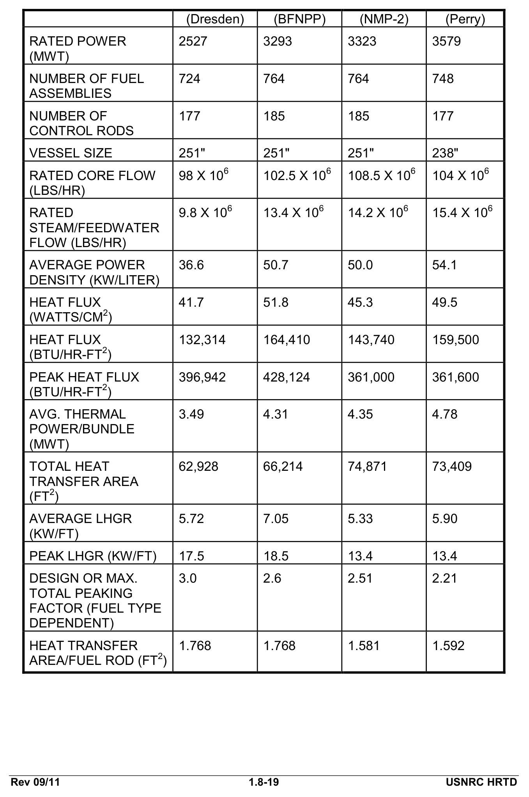

*figure on PDF page 23*

[Vector original (SVG, lossless): fig_page-23.svg](../figures/fig_page-23.svg)

<!-- labels/text on this figure page -->
(Dresden) (BFNPP) (NMP-2) (Perry)
RATED POWER 2527 3293 3323 3579
(MWT)
NUMBER OF FUEL 724 764 764 748 ASSEMBLIES
NUMBER OF 177 185 185 177 CONTROL RODS
VESSEL SIZE 251" 251" 251" 238"
98 X 106 102.5 X 106 108.5 X 106 104 X 106 RATED CORE FLOW
(LBS/HR)
9.8 X 106 13.4 X 106 14.2 X 106 15.4 X 106 RATED
STEAM/FEEDWATER FLOW (LBS/HR)
AVERAGE POWER 36.6 50.7 50.0 54.1 DENSITY (KW/LITER)
HEAT FLUX 41.7 51.8 45.3 49.5
(WATTS/CM2)
HEAT FLUX 132,314 164,410 143,740 159,500
(BTU/HR-FT2)
PEAK HEAT FLUX 396,942 428,124 361,000 361,600
(BTU/HR-FT2)
AVG. THERMAL 3.49 4.31 4.35 4.78 POWER/BUNDLE
(MWT)
62,928 66,214 74,871 73,409 TOTAL HEAT TRANSFER AREA
(FT2)
AVERAGE LHGR 5.72 7.05 5.33 5.90
(KW/FT)
PEAK LHGR (KW/FT) 17.5 18.5 13.4 13.4
DESIGN OR MAX. 3.0 2.6 2.51 2.21 TOTAL PEAKING FACTOR (FUEL TYPE DEPENDENT)
HEAT TRANSFER 1.768 1.768 1.581 1.592 AREA/FUEL ROD (FT2)
Rev 09/11
1.8-19 USNRC HRTD

<!-- p.24 -->
1.8-20 USNRC HRTD

<!-- p.25 -->
#### Table 1.8-2 GEXL Bounding Parameter Values
Parameter Value

800 to 1400 psia Pressure:

0.1 to 1.25 106 lb/hr-ft2 Mass Flux:

Inlet Subcooling:
0 to 100 Btu/lb

Local Peaking:
1.61 at a corner rod to
1.47 at an interior rod

Axial Peaking:
Shape Max./Avg.
Uniform
1.0 Outlet Peaked 1.60 Inlet Peaked 1.60 Double Peak 1.46 and 1.38 Cosine
1.39

64 rods in an 8x8 array, Rod Array:
49 rods in a 7x7 array

1.8-21 USNRC HRTD

<!-- p.26 -->
1.8-22 USNRC HRTD

<!-- p.27 -->
#### Table 1.8-3 Thermal Limits Calculations
MFLCPR = Max Fraction Limiting Critical Power Ratio

MFLCPR = MCPR Operating Limit
------------------------------------- MCPR Actual Critical Power Actual Power

MFLPD = Max Fraction of Limiting Power Density

MFLPD = MRPD Maximum LHGR (Actual) KW/ft
---------- ------------------------------------------- RPDLM LHGR Limit (13.4 KW/ft)

MAPRAT = Max Fraction of Limiting Average Planar Linear Heat Generation Rate

MAPRAT = MAPLHGR (Actual Value of Average Planar LHGR) KW/ft
----------------------------------------------------------------------------- MAPLHGR Limits (from T.S.) KW/ft

1.8-23 USNRC HRTD

<!-- p.28 -->
#### Figure 1.8-1

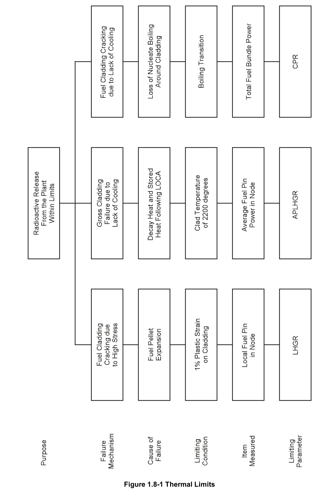

*Thermal Limits*

[Vector original (SVG, lossless): fig_1.8-1.svg](../figures/fig_1.8-1.svg)

<!-- p.29 -->
#### Figure 1.8-2

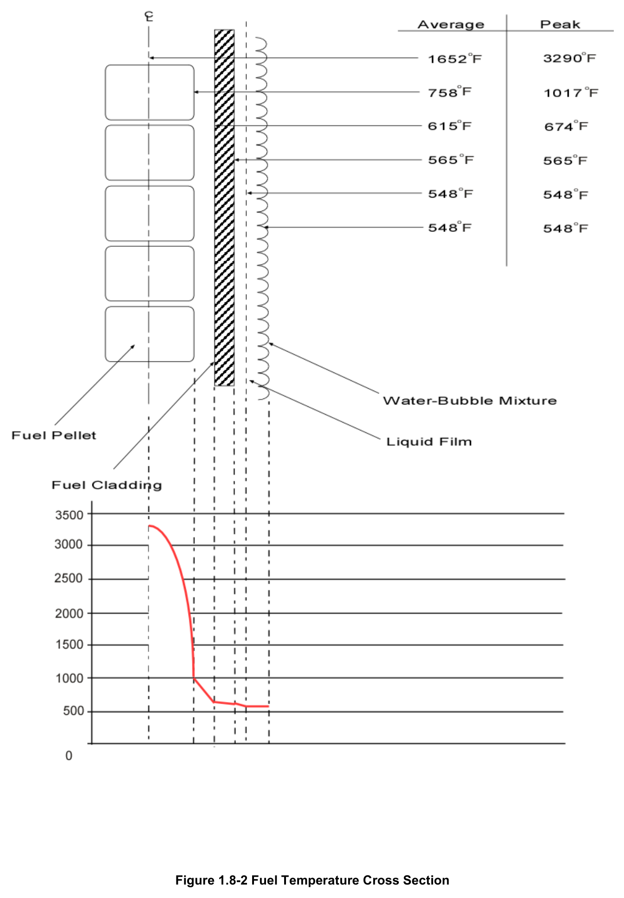

*Fuel Temperature Cross Section*

<!-- p.30 -->
#### Figure 1.8-3

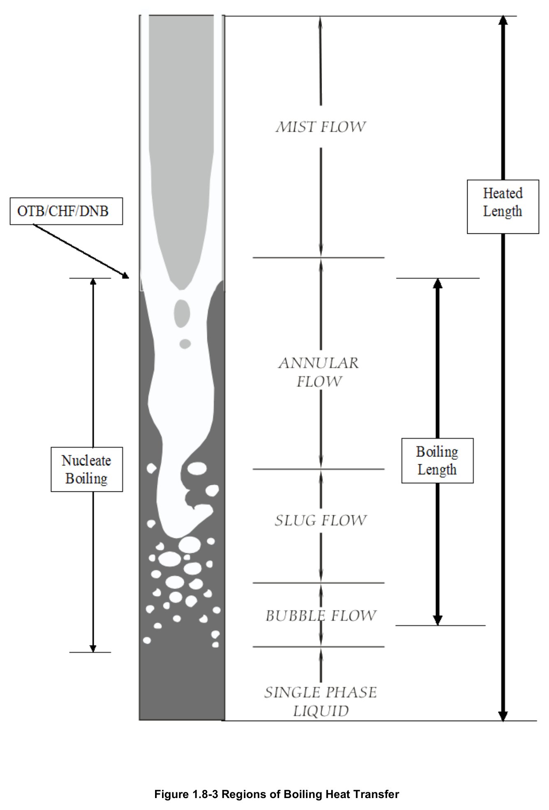

*Regions of Boiling Heat Transfer*

<!-- p.31 -->
#### Figure 1.8-4

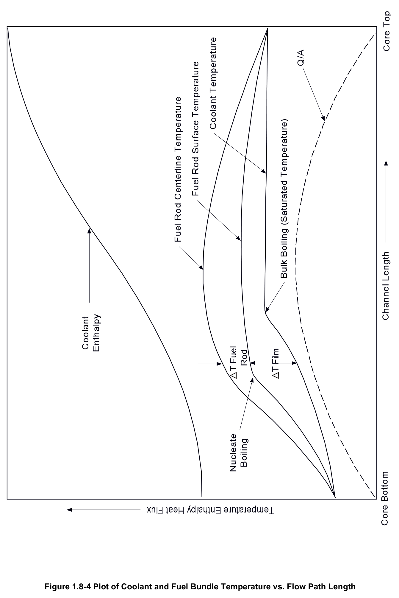

*Plot of Coolant and Fuel Bundle Temperature vs. Flow Path Length*

[Vector original (SVG, lossless): fig_1.8-4.svg](../figures/fig_1.8-4.svg)

<!-- p.32 -->
#### Figure 1.8-5

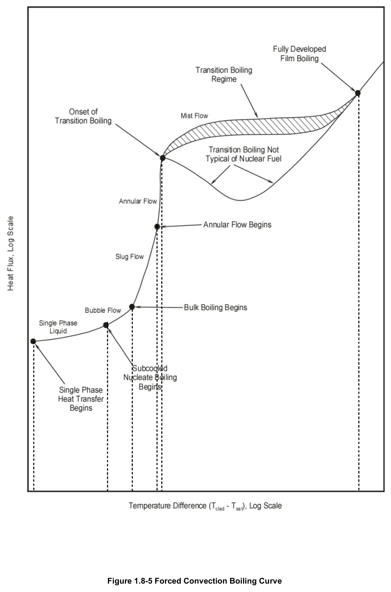

*Forced Convection Boiling Curve*

<!-- p.33 -->
#### Figure 1.8-6

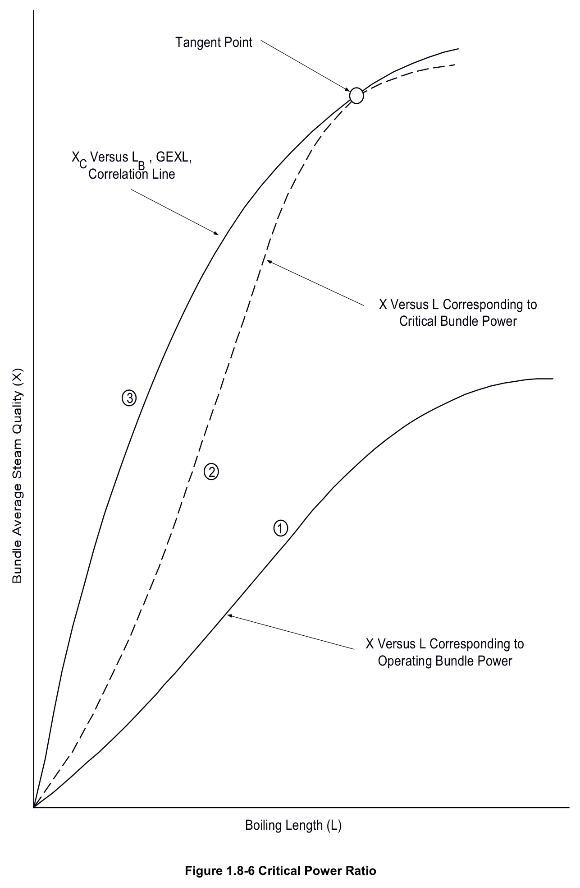

*Critical Power Ratio*

[Vector original (SVG, lossless): fig_1.8-6.svg](../figures/fig_1.8-6.svg)

<!-- labels/text on this figure page -->
Tangent Point
X Versus L , GEXL, C B Correlation Line
X Versus L Corresponding to Critical Bundle Power
3
2
1
X Versus L Corresponding to Operating Bundle Power
Boiling Length (L)
Figure 1.8-6 Critical Power Ratio

<!-- p.34 -->
#### Figure 1.8-7

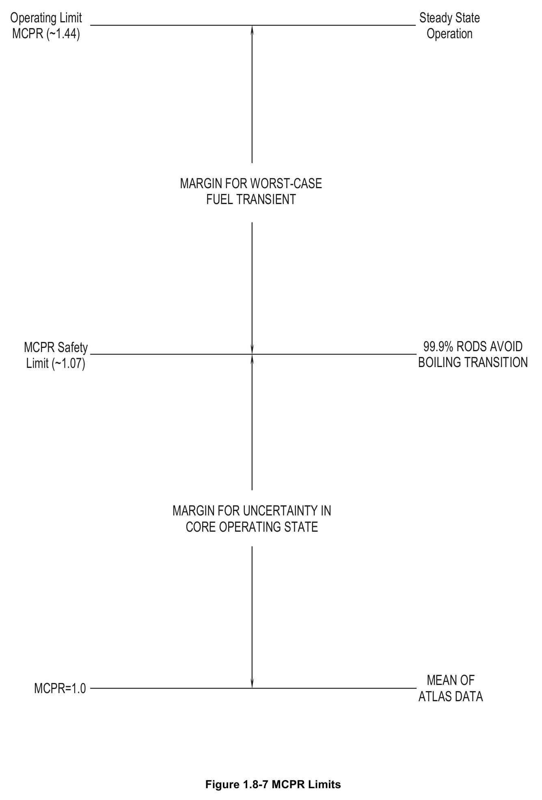

*MCPR Limits*

[Vector original (SVG, lossless): fig_1.8-7.svg](../figures/fig_1.8-7.svg)

<!-- labels/text on this figure page -->
Steady State Operating Limit Operation MCPR (~1.44)
MARGIN FOR WORST-CASE FUEL TRANSIENT
99.9% RODS AVOID MCPR Safety BOILING TRANSITION Limit (~1.07)
MARGIN FOR UNCERTAINTY IN CORE OPERATING STATE
MEAN OF MCPR=1.0 ATLAS DATA
Figure 1.8-7 MCPR Limits

<!-- p.35 -->
#### Figure 1.8-8

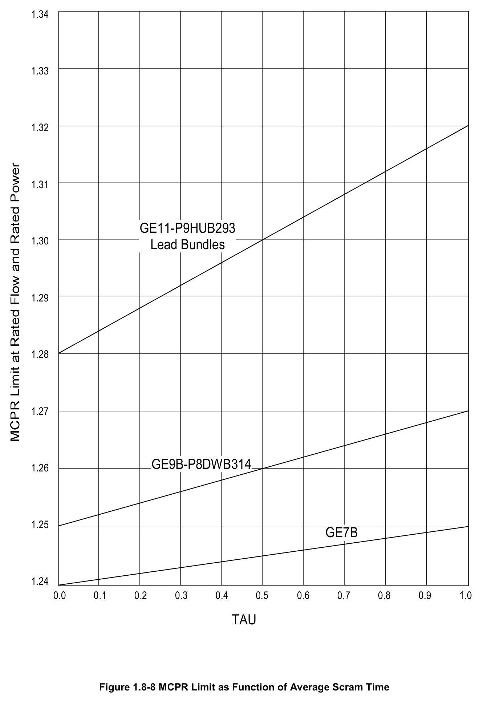

*MCPR Limit as Function of Average Scram Time*

[Vector original (SVG, lossless): fig_1.8-8.svg](../figures/fig_1.8-8.svg)

<!-- labels/text on this figure page -->
1.34
1.33
1.32
1.31
GE11-P9HUB293
1.30 Lead Bundles
1.29
1.28
1.27
GE9B-P8DWB314
1.26
1.25 GE7B
1.24 0.0 0.1 0.2 0.3 0.4 0.5 0.6 0.7 0.8 0.9 1.0
TAU
Figure 1.8-8 MCPR Limit as Function of Average Scram Time

<!-- p.36 -->
#### Figure 1.8-9

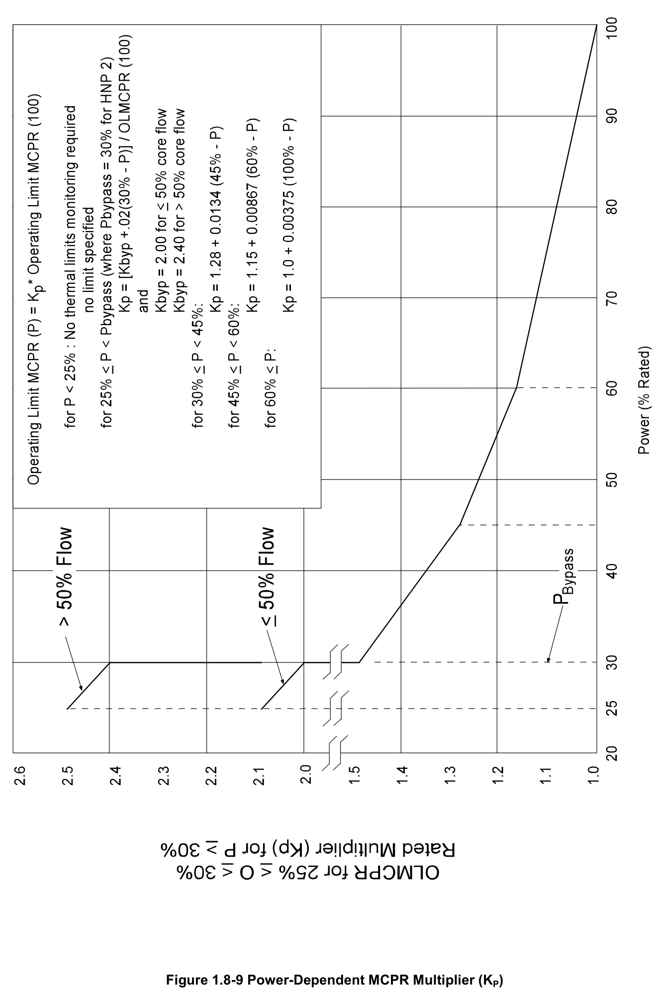

*Power-Dependent MCPR Multiplier (KP)*

[Vector original (SVG, lossless): fig_1.8-9.svg](../figures/fig_1.8-9.svg)

<!-- p.37 -->
#### Figure 1.8-10

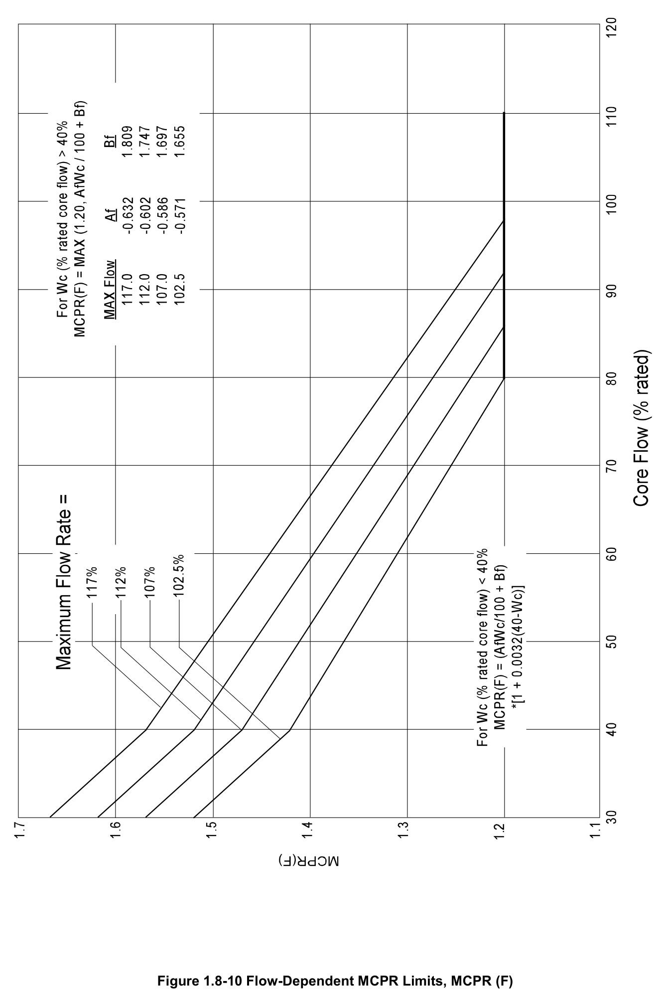

*Flow-Dependent MCPR Limits, MCPR (F)*

[Vector original (SVG, lossless): fig_1.8-10.svg](../figures/fig_1.8-10.svg)

<!-- p.38 -->
#### Figure 1.8-11

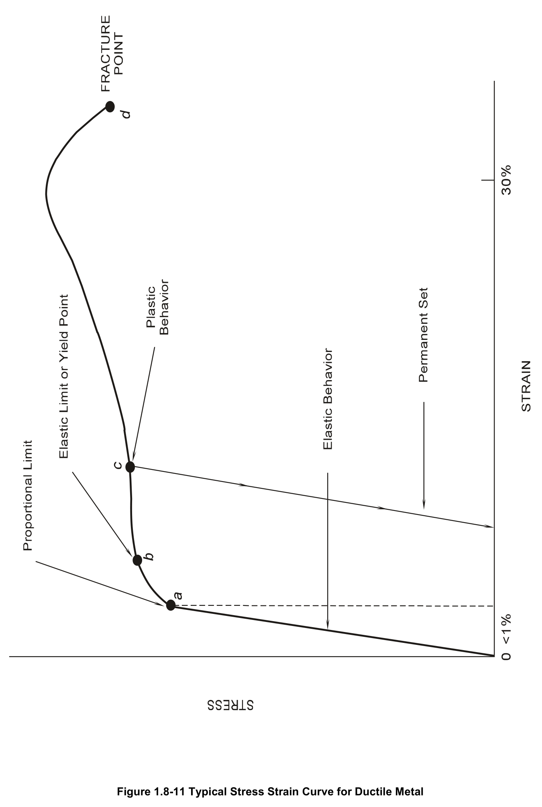

*Typical Stress Strain Curve for Ductile Metal*

[Vector original (SVG, lossless): fig_1.8-11.svg](../figures/fig_1.8-11.svg)

<!-- p.39 -->
#### Figure 1.8-12

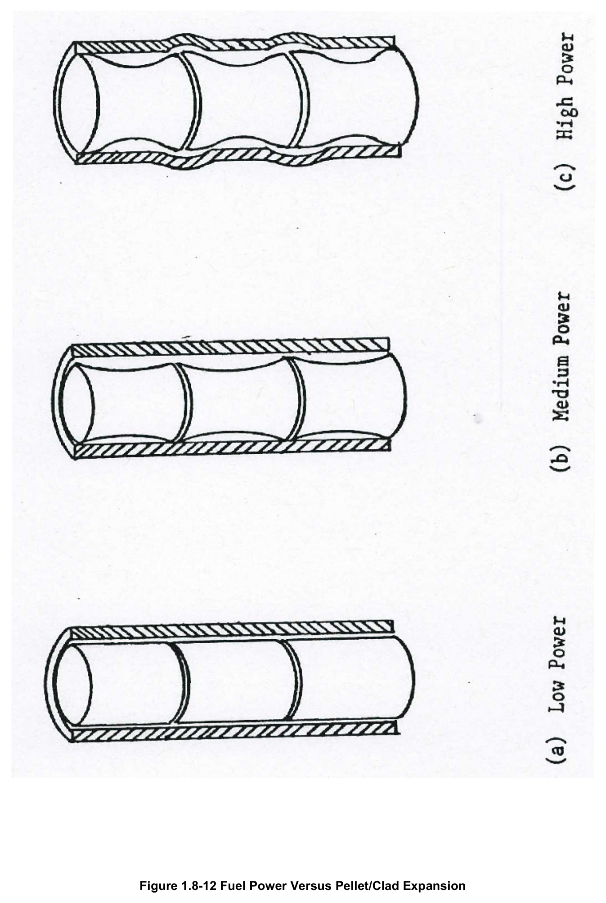

*Fuel Power Versus Pellet/Clad Expansion*

<!-- p.40 -->
#### Figure 1.8-13

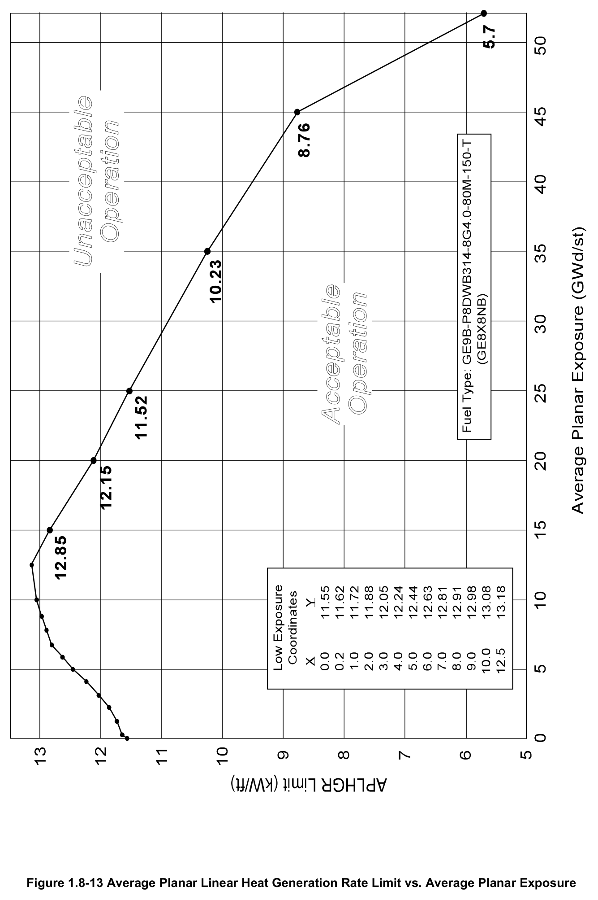

*Average Planar Linear Heat Generation Rate Limit vs. Average Planar Exposure*

[Vector original (SVG, lossless): fig_1.8-13.svg](../figures/fig_1.8-13.svg)

<!-- labels/text on this figure page -->
Figure 1.8-13 Average Planar Linear Heat Generation Rate Limit vs. Average Planar Exposure

<!-- p.41 -->
#### Figure 1.8-14

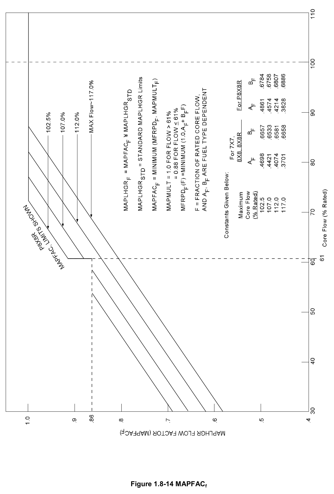

*MAPFACf*

[Vector original (SVG, lossless): fig_1.8-14.svg](../figures/fig_1.8-14.svg)

<!-- p.42 -->
#### Figure 1.8-15

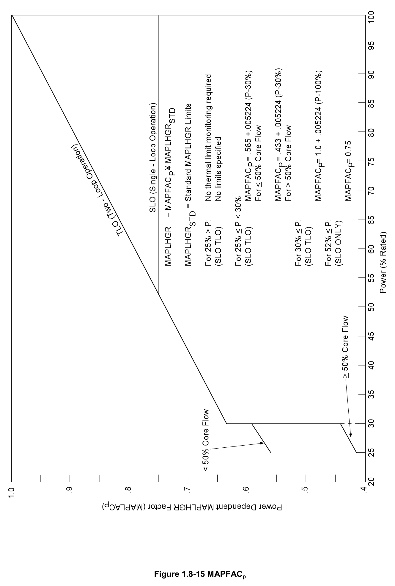

*MAPFACp*

[Vector original (SVG, lossless): fig_1.8-15.svg](../figures/fig_1.8-15.svg)

<!-- p.43 -->
#### Figure 1.8-16

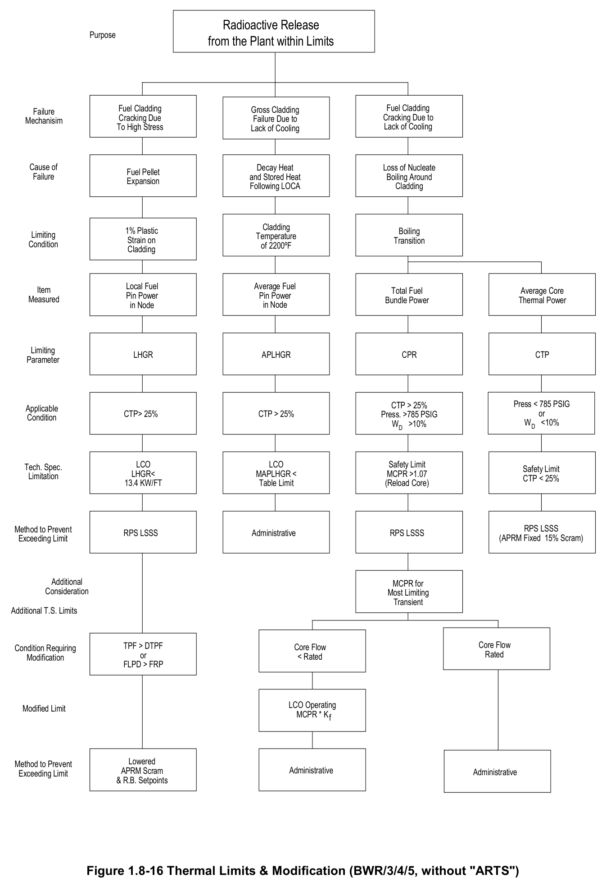

*Thermal Limits & Modification (BWR/3/4/5, without "ARTS")*

[Vector original (SVG, lossless): fig_1.8-16.svg](../figures/fig_1.8-16.svg)

<!-- labels/text on this figure page -->
Radioactive Release Purpose from the Plant within Limits
Fuel Cladding Fuel Cladding Gross Cladding Failure Cracking Due to Cracking Due Failure Due to Mechanisim Lack of Cooling Lack of Cooling To High Stress
Cause of Decay Heat Loss of Nucleate Fuel Pellet Failure and Stored Heat Boiling Around Expansion Following LOCA Cladding
Cladding 1% Plastic Boiling Limiting Temperature Strain on Transition Condition of 2200ºF Cladding
Local Fuel Average Fuel Item Average Core Total Fuel Pin Power Pin Power Measured Thermal Power Bundle Power in Node in Node
Limiting CTP LHGR APLHGR CPR Parameter
Press < 785 PSIG CTP > 25% Applicable or CTP> 25% CTP > 25% Press. >785 PSIG Condition WD <10% WD >10%
Safety Limit Tech. Spec.
LCO LCO Safety Limit MCPR >1.07 Limitation LHGR< MAPLHGR < CTP < 25%
(Reload Core)
13.4 KW/FT
Table Limit
RPS LSSS Method to Prevent RPS LSSS RPS LSSS Administrative
(APRM Fixed 15% Scram)
Exceeding Limit
Additional MCPR for Consideration Most Limiting Transient Additional T.S. Limits
Core Flow TPF > DTPF Core Flow Condition Requiring Rated or < Rated Modification FLPD > FRP
LCO Operating Modified Limit MCPR * K f
Lowered Method to Prevent Administrative Exceeding Limit APRM Scram Administrative & R.B. Setpoints
Figure 1.8-16 Thermal Limits & Modification (BWR/3/4/5, without "ARTS")

<!-- p.44 -->
#### Figure 1.8-17

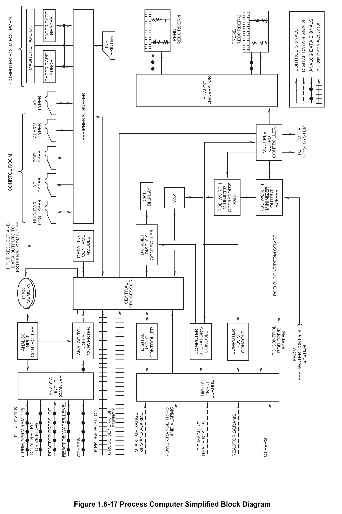

*Process Computer Simplified Block Diagram*

[Vector original (SVG, lossless): fig_1.8-17.svg](../figures/fig_1.8-17.svg)

<!-- p.45 -->
PAGE 1

PLANT NAME SEQUENCE NO 12 CORE PARAMETERS 3D MONICORE 7-JUL-1993 12:29 CALCULATED POWER MWT 3563. PERIODIC LOG 7-JUL-1993 12:42 PRINTED POWER MWE 1205.
CASE ID FMLS1930707122950 FLOW MLB/HR 86.871 CALC RESULTS RESTART FRFS1930707120850 FPAPDR 0.909 LPRM ABSOLUTE - FULL CORE SUBC BTU/LB 24.49 Keff 1.0000 PR PSIa 1034.3 XE WORTH % -2.48 LOAD LINE SUMMARY CORE MWD/sT 17029.7 XE/RATED 1.01 CORE POWER 99.6% CYCLE MWD/sT 5543.6 CORE FLOW 83.5% LOAD LINE 111.6% CORRECTION FACTOR: MFLCPR= 1.017 MFLPD= 1.000 MAPRAT= 0.998 OPTION: ARTS DUAL LOOP MANUAL FLOW MCPRLIM= 1.190

MOST LIMITING LOCATIONS (NON-SYMMETRIC)
MFLCPR LOC MFLPD LOC MAPRAT LOC PCRAT LOC 0.874 21-40 0.905 19-50- 4 0.892 41-12- 4 0.998 19-34-16 0.861 25-36 0.897 49-42- 5 0.889 51-22- 5 0.997 41-32-13 0.846 27-34 0.884 51-40- 5 0.887 49-42- 5 0.997 27-14-16 0.846 25-38 0.875 21-52- 4 0.878 51-44- 5 0.996 37-40-16 0.845 35-40 0.872 51-44- 5 0.878 21-10- 4 0.996 33-32-18 0.844 29-34 0.871 17-52- 5 0.871 17-10- 5 0.996 27-40-16 0.839 27-30 0.864 43-36- 5 0.863 43-26- 5 0.996 13-48-15 0.837 23-36 0.858 53-42- 5 0.852 51-26- 5 0.996 27-42-16 0.834 37-42 0.855 19-54- 4 0.849 43-44- 5 0.996 47-34-16 0.833 21-36 0.851 51-26- 5 0.837 39-40- 9 0.996 21-40-17

SEQ. A-2 C=MFLCPR D=MFLPD M=MAPRAT P=PCRAT *=MULTIPLE CORE AVE AXIAL NOTCH REL PW LOC 0.197 25 00 0.436 24 59 02 0.672 23 L 04 0.839 22 55 12 06 0.921 21 51 D 08 0.946 20 L 10 0.991 19 47 32 08 38 08 32 12 1.005 18 43 14 1.037 17 L 16 1.098 16 39

## 08 C 34 08 34 08
18 1.129 15 35 P 20 1.136 14 L 22 1.174 13 31 12 38 08 36 08 38 12 24 1.210 12 27 26 1.211 11 L 28 1.220 10 23 08 34 08 34 08 30 1.253 09 19 32 1.254 08 L 34 1.228 07 15 32 08 38 08 32 36 1.248 06 11 M 38 1.246 05 L 40 1.202 04 07 12 42 1.098 03

## 03 L L L L L L L
44 0.845 02 02 06 10 14 18 22 26 30 34 38 42 46 50 54 58 46 0.406 01

CORE AVERAGE RADIAL POWER DISTRIBUTION RING # 1 2 3 4 5 6 7 8 REL PW 1.011 1.251 1.162 1.212 1.106 1.149 1.014 0.652

Figure 1.8-18 LPRM Adaptive Monitor Case Output (Sample Output)

<!-- p.46 -->
#### Figure 1.8-19

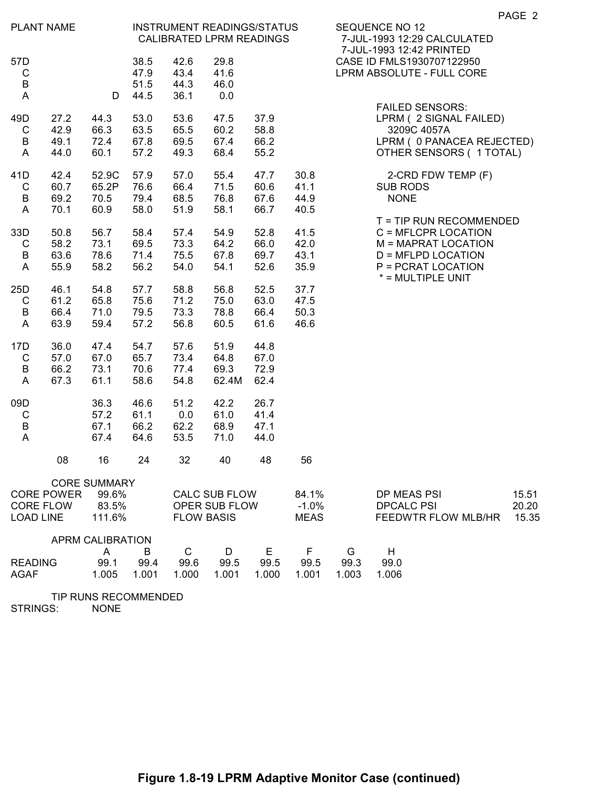

*LPRM Adaptive Monitor Case (continued)*

<!-- labels/text on this figure page -->
PAGE 2 PLANT NAME INSTRUMENT READINGS/STATUS SEQUENCE NO 12 CALIBRATED LPRM READINGS 7-JUL-1993 12:29 CALCULATED 7-JUL-1993 12:42 PRINTED 57D 38.5 42.6 29.8 CASE ID FMLS1930707122950 C 47.9 43.4 41.6 LPRM ABSOLUTE - FULL CORE B 51.5 44.3 46.0 A D 44.5 36.1 0.0 FAILED SENSORS:
49D 27.2 44.3 53.0 53.6 47.5 37.9 LPRM ( 2 SIGNAL FAILED)
C 42.9 66.3 63.5 65.5 60.2 58.8 3209C 4057A B 49.1 72.4 67.8 69.5 67.4 66.2 LPRM ( 0 PANACEA REJECTED)
A 44.0 60.1 57.2 49.3 68.4 55.2 OTHER SENSORS ( 1 TOTAL)
41D 42.4 52.9C 57.9 57.0 55.4 47.7 30.8 2-CRD FDW TEMP (F)
C 60.7 65.2P 76.6 66.4 71.5 60.6 41.1 SUB RODS B 69.2 70.5 79.4 68.5 76.8 67.6 44.9 NONE A 70.1 60.9 58.0 51.9 58.1 66.7 40.5 T = TIP RUN RECOMMENDED 33D 50.8 56.7 58.4 57.4 54.9 52.8 41.5 C = MFLCPR LOCATION C 58.2 73.1 69.5 73.3 64.2 66.0 42.0 M = MAPRAT LOCATION B 63.6 78.6 71.4 75.5 67.8 69.7 43.1 D = MFLPD LOCATION A 55.9 58.2 56.2 54.0 54.1 52.6 35.9 P = PCRAT LOCATION * = MULTIPLE UNIT 25D 46.1 54.8 57.7 58.8 56.8 52.5 37.7 C 61.2 65.8 75.6 71.2 75.0 63.0 47.5 B 66.4 71.0 79.5 73.3 78.8 66.4 50.3 A 63.9 59.4 57.2 56.8 60.5 61.6 46.6
17D 36.0 47.4 54.7 57.6 51.9 44.8 C 57.0 67.0 65.7 73.4 64.8 67.0 B 66.2 73.1 70.6 77.4 69.3 72.9 A 67.3 61.1 58.6 54.8 62.4M 62.4
09D 36.3 46.6 51.2 42.2 26.7 C 57.2 61.1 0.0 61.0 41.4 B 67.1 66.2 62.2 68.9 47.1 A 67.4 64.6 53.5 71.0 44.0
08 16 24 32 40 48 56
CORE SUMMARY CORE POWER 99.6% CALC SUB FLOW 84.1% DP MEAS PSI 15.51 CORE FLOW 83.5% OPER SUB FLOW -1.0% DPCALC PSI 20.20 LOAD LINE 111.6% FLOW BASIS MEAS FEEDWTR FLOW MLB/HR 15.35
APRM CALIBRATION A B C D E F G H READING 99.1 99.4 99.6 99.5 99.5 99.5 99.3 99.0 AGAF 1.005 1.001 1.000 1.001 1.000 1.001 1.003 1.006
TIP RUNS RECOMMENDED STRINGS: NONE
Figure 1.8-19 LPRM Adaptive Monitor Case (continued)

<!-- p.47 -->
#### Figure 1.8-20

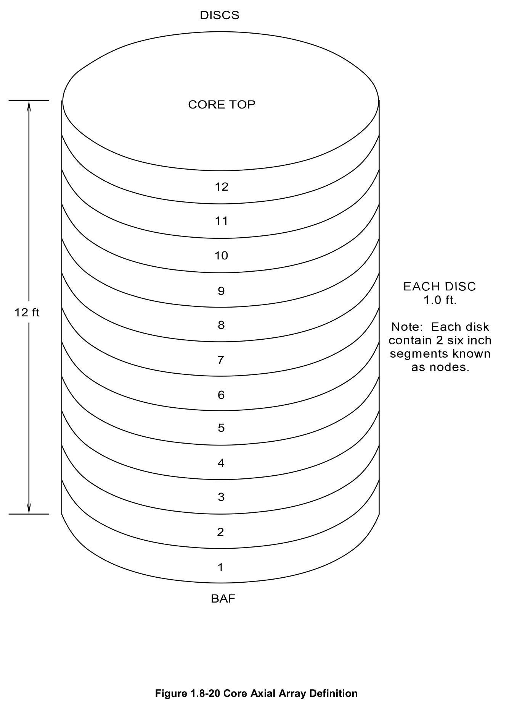

*Core Axial Array Definition*

[Vector original (SVG, lossless): fig_1.8-20.svg](../figures/fig_1.8-20.svg)

<!-- labels/text on this figure page -->
DISCS
CORE TOP
12
11
10
9
12 ft 8
7
6
5
4
3
2
1
BAF
Figure 1.8-20 Core Axial Array Definition

<!-- p.48 -->
#### Figure 1.8-21

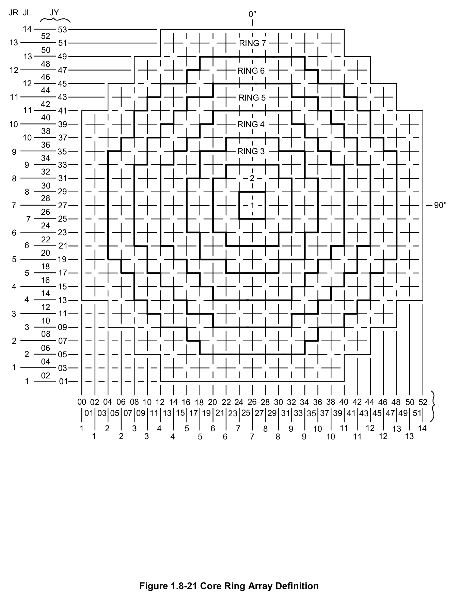

*Core Ring Array Definition*

[Vector original (SVG, lossless): fig_1.8-21.svg](../figures/fig_1.8-21.svg)

<!-- labels/text on this figure page -->
JR JL JY 0°
14 53 52 13 51 RING 7 50 13 49 48 12 47 RING 6 46 12 45 44 11 43 RING 5 42 11 41 40 10 39 RING 4 38 10 37 36 RING 3 9 35 34 9 33 32 2 8 31 30 8 29 28 90° 7 27 1 26 7 25 24 6 23 22 6 21 20 5 19 18 5 17 16 4 15 14 4 13 12 3 11 10 3 09 08 2 07 06 2 05 04 1 03 02 1 01
00 02 04 06 08 10 12 14 16 18 20 22 24 26 28 30 32 34 36 38 40 42 44 46 48 50 52 01 03 05 07 09 11 13 15 17 19 21 23 25 27 29 31 33 35 37 39 41 43 45 47 49 51
11 12 14 8 9 10 13 1 2 3 4 5 6 7 1 2 3 4 5 6 7 8 9 10 11 12 13
Figure 1.8-21 Core Ring Array Definition

