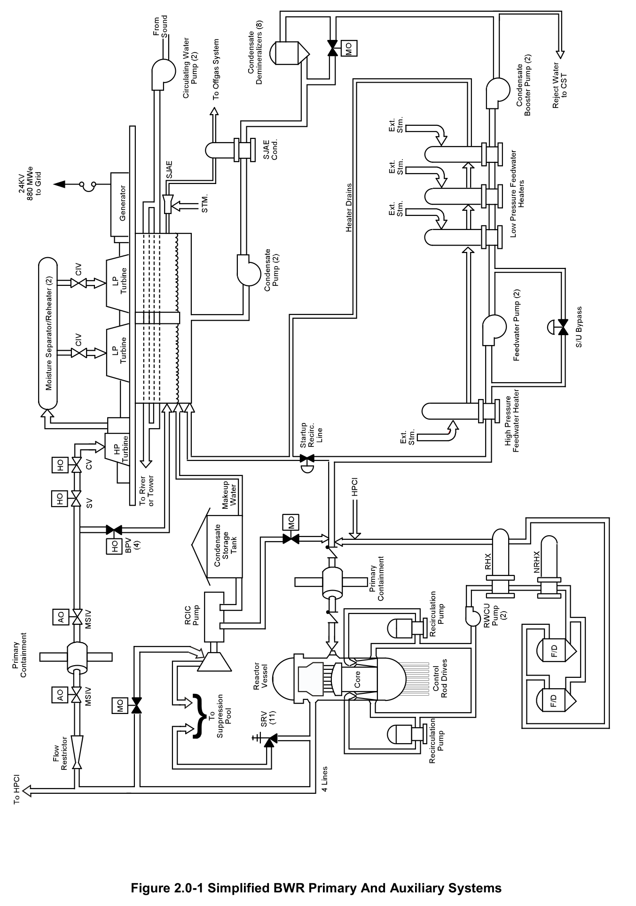
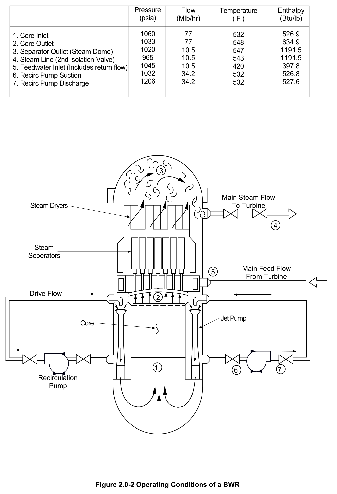

# 2.0 Primary Aux Systems

> Source: `2.0_Primary_Aux_Systems.pdf` (8 pages)
> GE (BWR) Systems Technology Manual — USNRC HRTD, Rev 09/11

---
<!-- p.1 -->
#### General Electric Systems Technology Manual
#### Chapter 2.0
#### BWR Primary and Auxiliary Systems
<!-- p.3 -->
TABLE OF CONTENTS

2.0 BWR PRIMARY AND AUXILIARY SYSTEMS......................................................... 1

2.0.1 Reactor Vessel System (Section 2.1) ................................................................. 1

2.0.2 Fuel and Control Rods System (Section 2.2) ..................................................... 1

2.0.3 Control Rod Drive System (Section 2.3) ............................................................ 1

2.0.4 Recirculation System (Section 2.4) .................................................................... 2

2.0.5 Main Steam System (Section 2.5) ...................................................................... 2

2.0.6 Condensate and Feedwater System (Section 2.6) ............................................. 2

2.0.7 Reactor Core Isolation Cooling System (Section 2.7) ........................................ 2

2.0.8 Reactor Water Cleanup System (Section 2.8).................................................... 2

LIST OF FIGURES

2.0-1 Simplified BWR Primary and Auxiliary Systems
2.0-2 Operating Conditions of a BWR

2.0-i USNRC HRTD

<!-- p.4 -->
2.0-ii USNRC HRTD

<!-- p.5 -->
### 2.0 BWR PRIMARY AND AUXILIARY SYSTEMS
The BWR primary and auxiliary systems are the ones which are immediately involved in the direct cycle BWR concept as part of the steam cycle, or else provide an auxiliary function for the direct cycle system. These systems are graphically displayed in Figure
2.0-1. The BWR direct steam cycle starts with the reactor vessel which is part of the reactor coolant pressure boundary and which contains the reactor core. The reactor core provides the heat source for steam generation and consists primarily of the nuclear fuel and control rods for regulating the fission process. The steam generated in the reactor vessel is routed to the steam loads and then condensed into water. The water is then purified, heated, and pumped back to the reactor vessel to again be heated.
Water from the reactor vessel is circulated through external pumping loops and then returned to the reactor vessel to provide forced circulation of flow through the reactor core. Reactor water is continuously purified to minimize impurities. Should the reactor become isolated from its main heat sink, an auxiliary system automatically maintains the reactor core covered with water. Typical reactor operating conditions are displayed in Figure 2.0-2. The BWR primary and auxiliary systems are briefly discussed in the paragraphs which follow.

#### 2.0.1 Reactor Vessel System (Section 2.1)
The Reactor Vessel System provides the following:

1. Houses the reactor core.
2. Serves as part of the reactor coolant pressure boundary.
3. Supports and aligns the fuel and control rods.
4. Provides a flow path for the circulation of coolant past the fuel.
5. Removes moisture from the steam exiting the reactor vessel.
6. Provides an internal floodable volume to allow for reflooding the core following a loss of coolant accident.
7. Limits downward control rod motion following a postulated failure of the control rod drive housing.

#### 2.0.2 Fuel and Control Rods System (Section 2.2)
The fuel generates energy from the nuclear fission reaction to provide heat for steam generation. The control rods control reactor power level, both axially and radially, to optimize core performance. They also provide adequate excess negative reactivity to shutdown the reactor from any normal operating or accident condition at the most reactive time in core life.

#### 2.0.3 Control Rod Drive System (Section 2.3)
The Control Rod Drive System makes gross changes in core reactivity by positioning the neutron absorbing control rods in response to Reactor Manual Control System
(RMCS) signals and rapidly inserts all control rods to shutdown the reactor in response to Reactor Protection System (RPS) signals.

2.0-1 USNRC HRTD

<!-- p.6 -->
#### 2.0.4 Recirculation System (Section 2.4)
The Recirculation System provides forced circulation of water through the reactor core, thereby allowing a higher power level to be achieved than with natural circulation alone.

#### 2.0.5 Main Steam System (Section 2.5)
The Main Steam System directs steam from the reactor vessel to certain safety related systems and selected balance of plant loads. The selected balance of plant loads include the main turbine, reactor feed pump turbines, and the steam jet air ejectors.
The safety related systems include the Reactor Core Isolation Cooling System, the High Pressure Coolant Injection System, and the safety/relief valves.

#### 2.0.6 Condensate and Feedwater System (Section 2.6)
The Condensate and Feedwater System condenses turbine exhaust or bypass steam, removes impurities, heats the feed water and delivers the water back to the reactor vessel at the required rate to maintain correct inventory. The feedwater piping also provides a means for the Reactor Water Cleanup (RWCU) System, the Reactor Core Isolation Cooling (RCIC) System, and the High Pressure Coolant Injection (HPCI)
System to discharge water to the reactor vessel.

#### 2.0.7 Reactor Core Isolation Cooling System (Section 2.7)
The Reactor Core Isolation Cooling (RCIC) System supplies high pressure makeup water to the reactor vessel when the reactor is isolated from the main condenser and/or the reactor feed pumps have been lost.

#### 2.0.8 Reactor Water Cleanup System (Section 2.8)
The Reactor Water Cleanup (RWCU) System maintains reactor water quality by removing corrosion products, fission products and other impurities that end up in the reactor coolant. The RWCU System also provides a path for the removal of reactor coolant from the reactor vessel during periods of reactor startup and shutdown.

2.0-2 USNRC HRTD

<!-- p.7 -->
#### Figure 2.0-1

*Simplified BWR Primary And Auxiliary Systems*

[Vector original (SVG, lossless): fig_2.0-1.svg](../figures/fig_2.0-1.svg)

<!-- p.8 -->
#### Figure 2.0-2

*Operating Conditions of a BWR*

[Vector original (SVG, lossless): fig_2.0-2.svg](../figures/fig_2.0-2.svg)

<!-- labels/text on this figure page -->
Pressure Flow Temperature Enthalpy
(psia) (Mlb/hr) ( F ) (Btu/lb)
1060 77 532 526.9
1. Core Inlet 1033 77 548 634.9
2. Core Outlet 1020 10.5 547 1191.5
3. Separator Outlet (Steam Dome)
965 10.5 1191.5 4. Steam Line (2nd Isolation Valve) 543 1045 10.5 420 397.8 5. Feedwater Inlet (Includes return flow)
1032 34.2 532 526.8 6. Recirc Pump Suction 1206 34.2 527.6 532 7. Recirc Pump Discharge
3
Main Steam Flow Steam Dryers To Turbine
4
Steam Seperators
Main Feed Flow 5 From Turbine
Drive Flow 2
Jet Pump Core
1 7 6 Recirculation Pump
Figure 2.0-2 Operating Conditions of a BWR

