# 2.1 Reactor Vessel

> Source: `2.1_Reactor_Vessel.pdf` (46 pages)
> GE (BWR) Systems Technology Manual — USNRC HRTD, Rev 09/11

---
<!-- p.1 -->
#### General Electric Systems Technology Manual
#### Chapter 2.1
#### Reactor Vessel System
<!-- p.3 -->
TABLE OF CONTENTS

2.1 REACTOR VESSEL SYSTEM ................................................................................. 1

2.1.1 Introduction ....................................................................................................... 2

2.1.2 System Description ........................................................................................... 2

2.1.3 Component Description ..................................................................................... 3

2.1.3.1 The Reactor Vessel .................................................................................... 3

2.1.3.2 Annulus Region Components .................................................................... 4

2.1.3.3 Lower Plenum Region ................................................................................ 6

2.1.3.4 Core Shroud Region Components ............................................................. 9

2.1.3.5 Moisture/Steam Separation ...................................................................... 12

2.1.3.6 Main Steam Outlet Penetrations .............................................................. 13

2.1.3.7 Vessel Head Penetrations ........................................................................ 13

2.1.3.8 Vessel External Components ................................................................... 14

2.1.4 System Features and Interfaces ..................................................................... 15

2.1.4.1 System Features ...................................................................................... 15

2.1.4.2 System Interfaces .................................................................................... 18

2.1.5 Summary ......................................................................................................... 20

2.1-i USNRC HRTD

<!-- p.4 -->
#### LIST OF FIGURES
2.1-1 Reactor Vessel Cutaway
2.1-2 Reactor Vessel Cutaway
2.1-3 Typical Feedwater Sparger
2.1-4 Jet Pump Assembly
2.1-5 Differential Pressure and Standby Liquid Control Line
2.1-6 Control Rod Guide Tube to Control Rod Drive Housing Attachment
2.1-7 Core Shroud
2.1-8 Core Plate
2.1-9 Fuel Cell Arrangement
2.1-10 Fuel Support Pieces
2.1-11 Core Spray Piping In Vessel
2.1-12 Shroud Head and Steam Separator Assembly
2.1-13 Steam Dryer Assembly
2.1-14 Vessel Support and Biological Shield Wall
2.1-15 Reactor Vessel Lateral Support
2.1-16 Reactor Vessel Closure Assembly
2.1-17 Reactor Vessel Insulation
2.1-18 Control Rod Drive Housing Support
2.1-19 Reactor Vessel Flow Path
2.1-20 Core Flooding Capability of Recirculation System
2.1-21 Standby Liquid Control Sparger Layout

2.1-ii USNRC HRTD

<!-- p.5 -->
### 2.1 REACTOR VESSEL SYSTEM
Learning Objectives:

1. Recognize the purposes of the reactor vessel system.

2. Recognize the purpose of each the following major reactor vessel components:
a. Jet pumps b. Control rod guide tubes c. Fuel support pieces and orifices d. Fuel assemblies e. Steam separator assembly f. Dryer assembly g. Main steam line penetrations h. Feedwater spargers i. Core shroud

3. Recognize the flow path order of the following reactor vessel components:
a. Jet pumps b. Control rod guide tubes c. Fuel support pieces and orifices d. Fuel assemblies e. Steam separator assembly f. Dryer assembly g. Main steam line penetrations h. Feedwater spargers

4. Identify whether the flow through each of the following components is water, steam or a mixture of both.
a. Jet pumps b. Control rod guide tubes c. Fuel support pieces and orifices d. Fuel assemblies e. Steam separator assembly f. Dryer assembly g. Main steam line penetrations h. Feedwater spargers

5. Recognize the reactor vessel components that are significant to ⅔ core coverage following a Loss Of Coolant Accident (LOCA).

6. Recognize how the reactor vessel system interrelates with the following systems:
a. Fuel and Control Rods System (Section 2.3)
b. Control Rod Drive System (Section 2.3)
c. Recirculation System (Section 2.4)

2.1-1 USNRC HRTD

<!-- p.6 -->
d. Main Steam System (Section 2.5)
e. Condensate and Feedwater System (Section 2.6)
f. Reactor Water Cleanup System (Section 2.8)
g. Reactor Vessel Instrumentation System (Section 3.1)
h. Neutron Monitoring Systems (Section 5)
i. Standby Liquid Control System (Section 7.4)
j. Core Spray System (Section 10.3)
k. Residual Heat Removal System (Section 10.4)

#### 2.1.1 Introduction
The purposes of the reactor vessel system are:
1. To house the reactor core.
2. To support and align the fuel and control rods.
3. To provide a flow path for the circulation of coolant past the fuel.
4. To remove moisture from the steam exiting the reactor vessel.
5. To provide an internal, refloodable volume to assure core cooling capability following a loss of coolant accident.
6. To serve as part of the reactor coolant boundary.
7. To limit downward control rod motion following a postulated failure of a control rod drive housing.

The functional classification of the Reactor Vessel System is that of a safety related system. It also contains a component, the control rod drive housing support structure, which is an engineered safety feature.

#### 2.1.2 System Description
The Reactor Pressure Vessel (RPV) assembly, shown in Figure 2.1-1, consists of the reactor vessel and its internal components including the core support structures, core shroud, steam separator assembly, steam dryer assembly, and jet pumps.

The reactor vessel system produces and supplies steam via four steam lines, for the operation of the main turbine and other plant auxiliary systems and components. The reactor vessel receives feedwater from the outlet of feedwater heaters and directs it through an internal flow path.

The RPV consists of a cylindrical shell with an integral hemispherical bottom head. The top head is also hemispherical in shape, but is removable to facilitate refueling operations. The lines that penetrate the reactor vessel and the vessel internal structures are discussed in later paragraphs of this section.

2.1-2 USNRC HRTD

<!-- p.7 -->
#### 2.1.3 Component Description
The major components of the RPV are best discussed when divided into several different categories:
1. The reactor vessel.
2. The annulus region components.
3. The lower plenum region components.
4. The core region components.
5. The above core region components.
6. The components external to the reactor vessel.

##### 2.1.3.1 The Reactor Vessel
The reactor vessel (Figures 2.1-1 and 2.1-2) is mounted vertically within the drywell and consists of a cylindrical pressure vessel of welded construction. The vessel is fabricated from a number of 3 to 7 inch thick manganese-molybdenum alloy steel plates. The vessel is designed, fabricated, tested, inspected, and stamped in accordance with American Society of Mechanical Engineers codes. The hemispherical top and bottom heads are fabricated to the same standards as the vessel shell.

The vessel shell and bottom head sections are clad with a 7/32" AISI Type 304 stainless steel weld overlay on the interior. The cladding is used to minimize corrosion which could adversely affect water clarity during refueling operations. The internal surface of the vessel head and the nozzle and nozzle weld zones are unclad except for those nozzles that mate to stainless steel piping systems.

The overall height of the reactor vessel is 70 feet with an inside diameter of 218 inches.
Vertical measurements are referenced to the vessel zero which is defined as the inside of the bottom head at the lowest point internal to the vessel.

The head and vessel flanges are fabricated from tempered nickel-chrome-moly ring forgings to provide the critical structural rigidity necessary for bolting the head to the vessel. The vessel head flange is attached to the vessel shell flange with 52 studs, nuts, and washers. The 6 inch diameter studs are 48" long, thread into the vessel flange and extend through the vessel head flange. Castellated nuts are threaded onto the studs. The weight of the assembled reactor vessel is 505 tons, 72 tons of which are the closure head (including studs, nuts and washers).

Two concentric 5/8" O-rings (Figure 2.1-16) are used to ensure a tight seal between the vessel head and the shell flange. The O-rings are made of silver plated inconel and are held in place with brackets which screw into two grooves machined into the underside of the vessel head flange. Any possible coolant leakage between the two O-rings is monitored by a leak detection system (Section 3.1).

2.1-3 USNRC HRTD

<!-- p.8 -->
##### 2.1.3.2 Annulus Region Components
The reactor vessel annulus region is the area inside the reactor vessel wall, outside the core shroud, and above the baffle plate. The components in this area are discussed in the paragraphs which follow (Figures 2.1-1, 2, 4, 5, 7, & 9).

###### 2.1.3.2.1 Feedwater Spargers
The reactor vessel is supplied with feedwater via four feedwater spargers (Figure 2.1-3)
located in the mixing section above the downcomer annulus at an elevation of 483½ inches. Feedwater flow enters the center of the spargers and is discharged radially inward toward the vessel to mix the cooler feedwater with the downcomer flow from the steam separators. End brackets attached to the vessel support the spargers, with jack bolts positioning the spargers away from the vessel wall. Each sparger is fitted to a vessel nozzle penetration and constructed to conform to the curvature of the vessel wall.

Each feedwater sparger consists of a thermal sleeve, a distribution header spanning 70º, and converging discharge nozzles. The thermal sleeve section is an essential part of the sparger which projects into the vessel nozzle bore. The thermal sleeve is intended to prevent the impingement of cold feedwater on the hot nozzle surface, thus minimizing the potential for crack formation and propagation. The distribution header is the central section of the feedwater sparger that directs the feedwater flow from the thermal sleeve to the converging discharge nozzles.

The converging discharge nozzles are welded to the top of the distribution header to ensure the thermal sleeve and distribution header remain full of water during all modes of reactor operation. The nozzles direct feedwater from the distribution header radially upward and inward. The relatively cool feedwater (~420°F) in the downcomer annulus region, sub cools the water flowing to the recirculation pumps' suctions and to the jet pumps to ensure adequate net positive suction head for these pumps.

###### 2.1.3.2.2 Surveillance Sample Holders
Three surveillance capsule baskets are located on the RPV inner wall around the periphery of the core at the core midplane. Their purpose is to permit monitoring of exposure and material properties of both tensile and impact specimens for evaluating radiation-induced changes in vessel and structural properties. The sample specimens are contained in specimen capsules which in turn are vertically contained in baskets suspended by holders mounted at 30, 120 and 270 degree azimuths. The surveillance baskets are installed in the reactor prior to initial startup, and removed permanently after exposure intervals varying from 1 to 32 years. The impact test specimens are used for checking shifts in the nil-ductility transition temperature. Tensile specimens are used for monitoring shifts in tensile properties.

2.1-4 USNRC HRTD

<!-- p.9 -->
A fourth basket contains a neutron dosimeter and is removed after one year of operation. The neutron dosimeter consists of iron, nickel, and copper wires. These will determine the radiation exposure received by the test specimens and hence the RPV.

###### 2.1.3.2.3 Recirculation Suction Penetrations
Two recirculation suction lines penetrate the reactor vessel at the 161.5 inch level.
These 28 inch diameter lines provide water from the vessel annulus region to the suction of the recirculation pumps.

###### 2.1.3.2.4 Recirculation Discharge Penetrations
The ten recirculation inlet penetrations are twelve inches in diameter each and route water from the recirculation pump discharge to the inlet driving nozzles of the jet pumps.
The inlet penetrations are located at the 178.5 inch elevation. The jet pumps provide forced flow of the coolant/moderator through the reactor core.

###### 2.1.3.2.5 Jet Pump Assemblies
The jet pump assemblies are installed in two semicircular groups of five jet pump assemblies in the downcomer annulus (Figure 2.1-4). Each assembly is composed of one inlet riser and two jet pumps. The assembly contains no moving parts. Each jet pump consists of an inlet mixer subassembly, and diffuser. The diffuser section is welded in position, while the inlet mixer subassembly is removable. The inlet mixer subassembly consists of a 180-degree return bend nozzle assembly ("rams head"), jet pump nozzle, suction inlet, and throat section. The inlet mixer subassembly is removable and is clamped to the top of the riser by a beam-bolt locking device. The inlet mixer subassembly's throat section has a slip fit with the diffuser. The diffusers and riser are integrally welded to the vessel shell. The jet pumps are provided to increase the total flow of water through the core while minimizing the flow external to the reactor vessel (Recirculation System, Section 2.4). Inlet riser pipes are used for each jet pump assembly to permit lowering the reactor recirculation inlet nozzles to below that of the active fuel region. This prevents any significant fast neutron exposure which could adversely change the mechanical properties of the nozzle penetrations and welds. Riser pipe brace arms provide lateral support for the upper end of the riser and allow vertical differential expansion between the riser and the reactor vessel during heatup or cooldown operations.

The mixing assemblies are braced to the inlet riser pipe just above the slip fit into the diffuser. The brace ring is welded to the riser and holds the mixing assembly in place with a sliding, tapered wedge and restrainer assembly.

2.1-5 USNRC HRTD

<!-- p.10 -->
The jet pump diffusers are welded to adapters which are first welded to the shroud support plate. Welding the smaller adapter to the shroud support plate first, aids in the alignment and welding of the diffusers.

Each jet pump is equipped with a pressure tap, located where the diffuser section is joined to the mixing section. Four jet pumps, two per group, have an additional pressure tap towards the end of the diffuser. These jet pumps, number JP5, JP10, JP15, and JP20 are called the calibrated jet pumps. The instrument piping from the twenty four pressure taps are routed through the two jet pump instrument nozzles of the RPV.

###### 2.1.3.2.6 Baffle Plate
The baffle plate shown in Figure 2.1-7, is a circular plate welded to the vessel wall. This support is designed to carry the weight of the shroud, shroud head, peripheral fuel elements, neutron sources, core plate, top guide, the steam separators and the jet pump diffusers. The baffle plate via the top guide and core plate also provides lateral support to the control rods, control rod guide tubes and the fuel assemblies. The baffle plate is sometimes referred to as the shroud support plate or the diffuser seal ring. The baffle plate is supported underneath by column members welded to the vessel bottom head. Besides supporting the core shroud, the baffle plate also separates the annulus
(reactor recirculation pump suction area) from the lower plenum (jet pump discharge)
region.

##### 2.1.3.3 Lower Plenum Region
The lower plenum region is the area inside the reactor vessel lower head, below the baffle plate, and below the core plate. The components in this region are discussed in the paragraphs which follow. The reactor vessel lower plenum region is illustrated in Figure 2.1-5.

###### 2.1.3.3.1 Bottom Head Penetrations
The reactor vessel bottom head, which is welded to the vessel shell, contains numerous penetrations which consist of:
1. A penetration for each control rod drive mechanism, 137 total.
2. A penetration for the bottom head drain to the Reactor Water CleanUp System
(RWCU).
3. A penetration for injection of the Standby Liquid Control (SLC) System.
4. A penetration for each Local Power Range Monitoring (LPRM) detector string, 31 total.
5. A penetration for each Intermediate Range Monitoring (IRM) detector, 8 total.
6. A penetration for each Source Range Monitoring (SRM) detector, 4 total.

2.1-6 USNRC HRTD

<!-- p.11 -->
###### 2.1.3.3.2 Bottom Head Drain
The bottom head drain line penetration (Fig. 2.1-19) directs flow to the RWCU, Section
2.8, to aid in the removal of suspended solids, provide a temperature measurement of water in the bottom head area, and to minimize cold water stratification in the bottom head area.

###### 2.1.3.3.3 Standby Liquid Control Line
The SLC line (Fig 2.1-21) serves a dual function within the reactor vessel:
1. to inject liquid control solution into the coolant stream,
2. and to sense the differential pressure across the core plate.

The line enters the reactor vessel at a point below the core plate as two concentric pipes. In the lower plenum, the two pipes separate. The inner pipe terminates inside the lower shroud with a perforated length below the core plate. It is used to sense the pressure below the core plate during normal operation and to provide an injection point for the liquid boron solution when required (SLC, Section 7.4). This location assures that good mixing and dispersion are facilitated. The use of the inner pipe also reduces the thermal shock to the vessel nozzle should SLC be actuated. The outer pipe terminates immediately above the core plate and senses the pressure in the region outside the fuel assembly channels.

###### 2.1.3.3.4 Control Rod Drive Housing
The Control Rod Drive (CRD) housings, shown in Figure 2.1-6, are extensions of the reactor vessel bottom head pressure boundary. The CRD housings are 14 feet in length and have the insert and withdrawal hydraulic lines welded to their lower flange. CRD housings provide vertical and lateral support for the CRD mechanisms (CRD, Section
2.3). Each CRD housing also transmits the weight of its four fuel assemblies, fuel support piece, CRD guide tube, CRD mechanism, and control rod blade to the reactor vessel bottom head. During construction, the CRD housings are inserted from the bottom of the vessel through the CRD stub tubes. Once inserted, the CRD housings are optically aligned through their respective core plate opening and welded to the stub tube. Following the installation of a CRD housing the CRD hydraulic insert and withdraw lines are permanently attached.

Located in the flange end of the CRD housing has a keyway which is used for locking the CRD thermal sleeve in place to prevent it from rotating. The thermal sleeve provides a bayonet lock type coupling device for the control rod guide tube.

2.1-7 USNRC HRTD

<!-- p.12 -->
###### 2.1.3.3.5 Control Rod Guide Tubes
Each control rod guide tube (Figure 2.1-6) is 11 inches in diameter and slightly over 13 feet in length. The top portion contains four 3 inch diameter holes to direct flow from the below core plate area up through the fuel assemblies. Lined up within these four holes are the flow orifices of the fuel support pieces. The bottom end of the guide tube is machined to mate with the CRD housing and is locked in place on top of the housing via its bayonet fitting to the CRD thermal sleeve.

The guide tube performs the following functions:
1. It guides the lower end of the control rod during rod movement.
2. It forms a cylinder around the velocity limiter portion of the control rod so it can retard the free fall velocity of the control rod during a rod drop accident (Sections 2.2 and 7.5).
3. It supports the orifice fuel support piece which in turn vertically supports the fuel.
4. It provides the coolant flow passage into the orifice fuel support piece.

During construction, the control rod guide tube is lowered through the core plate from the top of the reactor vessel. There are two lugs at the top of the guide tube. One lug is an alignment lug that is aligned with a pin on the core plate. This facilitates proper alignment with the fuel support piece. After the guide tube is set on its CRD housing, the CRD thermal sleeve is inserted upward into the CRD housing from below the reactor vessel, engaged with the guide tube, and rotated to lock the guide tube in place with the bayonet coupling. A locking key is then inserted into the keyway in the lower end of the CRD housing and also in the thermal sleeve preventing it from rotating and releasing the guide tube.

###### 2.1.3.3.6 Nuclear Instrumentation Incore Housings
The nuclear instrumentation's incore housings (Figures 2.1-1, 5 & 9) are welded extensions of the reactor vessel bottom head pressure boundary which provide for mounting of the incore nuclear instrumentation assemblies (SRMs, IRMs, and LPRMs).
The housings are welded to the reactor vessel bottom head and extend upward to the core plate. The housings prevent jet pump flow (core flow) impingement on the nuclear instrumentation assemblies in the below core plate area. This eliminates possible vibration damage to the nuclear instrument assemblies.

The housings are fabricated of stainless steel and are approximately 2 inches in diameter. During construction, the housings are inserted in from the bottom of the vessel, aligned with their respective opening in the core plate, and welded directly to the reactor vessel bottom head, Figure 2.1-5. They extend upward and terminate in a slip fit in the core plate approximately ½" below the top surface of the core plate.. All the incore housings are at approximately the same elevation after welding. Cross bracing is installed below the core plate which ties all the tubes together. This bracing is to eliminate vibration of the nuclear instrumentation assemblies. Each tube is perforated

2.1-8 USNRC HRTD

<!-- p.13 -->
at the lower end by 4 holes to provide a cooling water path for the nuclear instrumentation assemblies. These nuclear instrumentation assemblies are loaded into the tubes from the top of the vessel. The nuclear instrument assemblies extend upward and are secured in notches on the under side of the top guide, Figure 2.1-9.

##### 2.1.3.4 Core Shroud Region Components
The core shroud region is bounded at the bottom by the core plate, at the top by the shroud head, and circumferentially by the core shroud. The components of this region are discussed in the paragraphs which follow.

###### 2.1.3.4.1 Core Shroud
The core shroud, shown in Figure 2.1-7, is a two inch thick, cylindrical stainless steel assembly which surrounds the core. The shroud provides the following:
1. A barrier to separate or divide the upward core flow from the downward flow in the downcomer/annulus region.
2. A vertical and lateral support for the core plate, top guide and shroud head.
3. A floodable volume in the event of a Loss Of Coolant Accident (LOCA).
4. A mounting surface for the core spray spargers (Core Spray, Section 10.3).
5. A core discharge plenum, directing the steam water mixture into the steam separator assembly.

The core shroud is welded to and supported by the shroud support plate (baffle plate).
The upper surface is machined to provide a leak tight fit with the mating surface of the shroud head. Mounted inside the upper shroud, in the space between the top guide and the shroud head base, are the core spray spargers.

###### 2.1.3.4.2 Core Plate
The core plate (Figure 2.1-4, 5, 7 & 8) consists of a circular, horizontal stainless steel plate with vertical stiffener members below the horizontal plate. Tie rods serve to cross brace the stiffener members. The core plate contains the following:
1. 137 holes to accommodate the control rod guide tubes
2. 137 alignment pins to ensure proper guide tube and fuel support piece orientation
3. 12 holes for peripheral fuel support pieces 4. 43 incore guide tube holes for neutron instrumentation 5. 5 neutron source location holes.

The core plate acts as a partition to force the majority of the core flow into the control rod guide tubes, fuel support pieces and up through the fuel assemblies. The core plate also provides vertical support for the 12 peripheral fuel assemblies via their peripheral fuel support pieces. It provides lateral support for all of the orificed fuel support pieces, peripheral fuel support pieces, nuclear instrumentation, and neutron sources.

2.1-9 USNRC HRTD

<!-- p.14 -->
The core plate assembly is bolted to a ledge in the bottom area of the core shroud.
Alignment pins on the core plate engage slots in the shroud to correctly position the assembly before it is secured.

###### 2.1.3.4.3 Top Guide
The top guide (Figures 2.1-7 & 9) is set on a ledge near the top end of the shroud and is bolted in place. The top guide is formed by a series of stainless steel plates joined at right angles to form a matrix of square openings. Each central opening accommodates four fuel assemblies and one control rod (this is defined as a control cell). Along the periphery are smaller openings which accommodate the 12 peripheral fuel assemblies.
Cutouts are provided on the bottom edge of the top guide at the junction of the cross plates to support the top end of the neutron instrument assemblies and neutron source holders.

The top guide provides lateral support for the upper end of all fuel assemblies, neutron monitoring instrument assemblies, and the installed neutron sources.

###### 2.1.3.4.4 Orificed (Standard) Fuel Support Pieces
The orificed fuel support pieces (Figure 2.1-10) are four lobe stainless steel castings that support four fuel assemblies each. They are provided with orifice plates to assure proper coolant flow distribution to each fuel assembly. The fuel support pieces rest on top of the control rod guide tubes and are aligned with the same alignment pin used by the guide tube. Usage of the same alignment pin ensures that the orifices in the fuel support piece are lined up with the openings in the control rod guide tubes. The crucifix opening between the four lobes allows passage of the control rod blade.

The fuel support piece provides lateral alignment for the bottom end of its four fuel assemblies and transmits the weight of the fuel assemblies to the control rod guide tube. It also controls the amount of flow, via orifices (subsection 2.1.4.1.3), to each fuel assembly.

###### 2.1.3.4.5 Peripheral Fuel Support Pieces
The peripheral fuel support pieces (Figure 2.1-10) are located at the outer edge of the core and are used to support fuel assemblies not part of a control cell (not located adjacent to a control rod). Each peripheral fuel support piece supports one of the 12 peripheral fuel assemblies. Each peripheral fuel support piece incorporates a single orifice assembly which is designed to ensure proper coolant flow through the peripheral fuel bundle. The peripheral support pieces are welded to the core plate and are not removable. However, the flow orifice is spring loaded in the orifice assembly which can be removed during a refueling outage.

2.1-10 USNRC HRTD

<!-- p.15 -->
###### 2.1.3.4.6 Fuel Assemblies
The fuel assemblies (Figure 2.1-9) occupy most of the core region. The majority of the fuel assemblies (548) rest in the orificed fuel support pieces. The other 12 fuel assemblies rest in the peripheral fuel support pieces. The fuel assemblies contain uranium dioxide fuel pellets surrounded by zircalloy cladding (tubes). The fuel assemblies are the heat source of the plant and are discussed in detail in Fuel and Control Rods System (Section 2.2).

###### 2.1.3.4.7 Control Rods
The control rods (Figure 2.1-9) partially occupy space in the core region even when fully withdrawn. The 137 control rods enter the core from the bottom and consist of cruciform shaped blades which contain vertical neutron absorber rods along with solid plates of Hafnium (Hf). The neutron absorber rods contain boron (5B10) in B4C powder form. The control rods are used to control the nuclear reaction in the core and are discussed in detail in Fuel and Control Rods System (Section 2.2).

###### 2.1.3.4.8 Core Spray Line and Spargers
The two core spray lines (Figure 2.1-11) penetrate the reactor vessel at an elevation of 474 inches above vessel zero and 180° apart. Once inside the reactor vessel, each line tees and is routed 90° horizontally. The lines are directed downward along the vessel wall in the annulus region and then in to penetrate the upper core shroud just below the shroud head flange. After penetrating the shroud, each line again tees and proceeds around the interior of the shroud in two semicircular headers providing a full 360° of spray coverage.

Forty six spray nozzles are attached to each core spray header and adjusted to provide the correct spray distribution to all of the fuel assemblies. Routing of the header and supports is designed to accommodate thermal expansion and differential movement between the core spray line, the core shroud and the reactor vessel.

###### 2.1.3.4.9 Shroud Head
The shroud head (Figure 2.1-12) is hemispherical in shape with a flanged lower section.
The top of the shroud head contains the penetrations used to channel the steam/water mixture exiting the core to the welded steam separator standpipes. The periphery of the shroud head contains an array of bolts used to attach the shroud head to the upper edge of the shroud.

Installation of the shroud head and the integral steam separator assemblies is accomplished with the aid of two guide rods 180° apart. The upper end of the guide rods are secured to the reactor vessel wall and the lower end secured to the upper edge

2.1-11 USNRC HRTD

<!-- p.16 -->
of the shroud. The guide rods provide a method for guiding the shroud head into place during installation via two slotted guide brackets in the shroud head assembly. As the shroud head mates with the shroud, two alignment pins on the head fit into matching holes of the top of the shroud to provide exact alignment between the two components.
Following installation, the shroud head is bolted to the top of the upper shroud to form the core outlet plenum.

##### 2.1.3.5 Moisture/Steam Separation
Moisture or steam separation is accomplished internal to the reactor vessel via a steam separators and steam dryers. The steam separating components are discussed in the paragraphs which follow.

###### 2.1.3.5.1 Steam Separator Assembly
The steam separator assembly (Figure 2.1-12) increases the steam quality from the 10 to 13% at the core exit to > 90% prior to entry into the steam dryers. The separator assembly consists of 225 cyclone type separator assemblies.

The standpipes direct the steam/water mixture (core exit) to the steam separators. The separators are welded to the standpipes and are cross-braced to form a rigid structure to prevent vibration. Each is a centrifugal type separator. As steam flows into the separator, it flows through a stationary swirl vane which imparts rotation/inertia to the two phase fluid. The denser water is thrown radially out, by centrifugal force, forming a continuous flow of water against the inside wall of the inner pipe. Three flow paths return the water to the downcomer area.

###### 2.1.3.5.2 Steam Dryer Assembly
The steam dryer assembly (Figure 2.1-13) dries the wet steam coming out of the steam separators to greater than 99.9% quality. It also provides a seal between the wet steam area (steam exiting the separators) and the dry steam flowing out the main steam lines.
The seal is formed by the steam dryer assembly seal skirt extending down below the normal water level.

The dryers are a one piece fabricated assembly with no moving parts. The upper section of the assembly consists of steam dryer panels. Gaps between the panels permit steam flow to the main steam lines.

Wet steam is directed horizontally through the dryer panels. The steam is forced to make a series of rapid directional changes while traversing the panels. During these directional changes, the heavier droplets of entrained moisture are forced to the outer walls where moisture collection hooks on the edges catch and drain the liquid to collection troughs. The liquid is then directed by drainage tubes through the skirt into the reactor vessel annulus region.

2.1-12 USNRC HRTD

<!-- p.17 -->
Correct alignment of the steam dryer during installation is obtained with the use of the same guide rods used by the shroud head/steam separator assembly. Upward movement of the steam dryer assembly is restricted by steam dryer hold down brackets which are welded to the underside of the reactor vessel head.

##### 2.1.3.6 Main Steam Outlet Penetrations
Four main steam line nozzles, 24 inch diameter, are installed at the 640 inch level to direct steam out of the reactor vessel. The nozzles are offset. This non 90° angle of the steam lines allows the placement of more dryer panels in the vessel, while leaving an open flow area near each steam line (Main Steam System, Section 2.5).

##### 2.1.3.7 Vessel Head Penetrations
The reactor vessel head contains three penetrations (Figure 2.1-1) of which only two are normally used after completion of initial startup testing.

The 4" penetration, in the center is the head vent line and provides the dual function of venting noncondensible gases from the reactor vessel head area and providing a sensing line for shutdown level indication. During operation, at temperatures less than boiling, the noncondensible gases are vented to the drywell equipment drain sump through two motor operated valves. At temperatures above boiling, the vent is directed to the "A" main steam line through a motor operated valve (Main Steam, Section 2.5).

The 6" penetration, which is approximately 30 inches radially off center, is used by the Residual Heat Removal System (Section 10.4) for head spray. The head spray line sprays water from the RHR system into the upper head area to condense the steam remaining during vessel cooldown and vessel flood-up.

The other 6" penetration, which is also 30 inches radially off center, is used during the initial plant startup testing program. During initial startup testing numerous sampling and sensing lines are routed from various areas in the reactor vessel to instrument racks. These provide information such as:
• Vibration and strain measurements of internal components.
• Steam quality at various locations in the steam separators and dryers.

2.1-13 USNRC HRTD

<!-- p.18 -->
##### 2.1.3.8 Vessel External Components
Components external to the reactor vessel are discussed in the paragraphs which follow:

###### 2.1.3.8.1 Reactor Vessel Support Skirt
The support skirt (Figure 2.1-14) is welded at the top to the reactor vessel bottom head.
The support skirt is anchored at the bottom to the vessel support pedestal via a ring girder and anchoring bolts. The support skirt provides vertical support for the reactor vessel, internal components, fuel, control rods, and moderator.

###### 2.1.3.8.2 Reactor Vessel Pedestal
The composite steel and concrete reactor pedestal (Figure 2.1-14) provides vertical support for the reactor vessel. The pedestal is constructed of two concentric steel liners tied together by diaphragms with the annulus between the liners filled with concrete.
The support pedestal is constructed as an integral part of the drywell foundation. Steel anchor bolts, set in concrete, extend through a bearing plate and secure the ring girder.
The ring girder is then bolted to the reactor vessel support skirt.

###### 2.1.3.8.3 Biological Shield
The biological shield (Figure 2.1-14) is a cylindrical structure of high density concrete containing vertical and horizontal I-beam support columns. The biological shield has steel inner and outer skins. The biological shield permits drywell access for maintenance after reactor shutdown with a minimum radiation exposure to personnel. It extends the lifetime of drywell components, such as cable insulation, by minimizing radiation exposure and also limits neutron activation of components within the drywell, which would cause increased radiation exposure to personnel from the activated components. The biological shield also provides horizontal support (Fig. 2.1-15) for the upper end of the reactor vessel via 4 spring loaded turn buckles. Eight pairs of stabilizers make up the seismic truss that connects the shield wall to the containment wall. Differential expansion is accommodated by gibs on the containment wall which allow vertical movement.

###### 2.1.3.8.4 Vessel Insulation
The reactor vessel insulation (Figure 2.1-17) is an all metal reflective insulation having an average maximum heat transfer rate of approximately 80 Btu/hr-ft2 at the operating conditions of 550°F for the vessel and 130°F for the drywell atmosphere. The maximum insulation thickness is 4 inches for the upper head. There is 3½ inches on the cylindrical shell and nozzles and 3 inches on the bottom head. The insulation is designed for complete water submersion without insulating material loss, water contamination, or loss of insulation efficiency after draining and drying. The insulation

2.1-14 USNRC HRTD

<!-- p.19 -->
panels for the cylindrical shell of the reactor vessel are held in place by supports located at two elevations. The support brackets are welded to the vessel at 12 evenly spaced locations around the circumference. Provisions are made for removing some insulation for in-service inspection.

The reactor vessel upper head insulation is removed as a complete unit to facilitate head removal during a refueling outage.

###### 2.1.3.8.5 CRD Housing Support Structure
Located below the reactor vessel is the control rod drive housing support structure
(Figure 2.1-18). This structure prevents the ejection of a control rod in the unlikely event of a control rod drive housing failure while the reactor is pressurized. This structure consists of support beams bolted to brackets on the inside of the reactor pedestal. Hanger rods extend downward through spring washers from the support beams. Grid clamps, grid plates, and support bars are bolted to the hanger rods to vertically support the bottom end of each control rod drive mechanism and CRD housing. The installation provides approximately a 1 inch gap between bottom of the drive mechanism and the support steel when the reactor is cold. When the reactor is hot, this gap reduces to approximately ¼ inch due to differential expansion. The support structure will limit control rod drive mechanism and control rod blade movement in the outward direction should a CRD housing fail. The control rod drive housing support structure is an engineered safety feature.

#### 2.1.4 System Features and Interfaces
A short discussion of system features and interfaces this system has with other plant systems is given in the paragraphs which follow.

##### 2.1.4.1 System Features
A short discussion of this system's features is given in the paragraphs which follow.

###### 2.1.4.1.1 Reactor Vessel Flow Paths
During operation at rated power, the recirculation pumps and jet pumps provide forced flow of coolant through the core at a rate of 77.0 x 106 lb/hr. Approximately 90% of this flow enters the fuel assemblies while 10% bypasses the fuel. The water absorbs the heat energy of the fuel which increases the water temperature to the saturation value and boils a portion of the total core flow. The bypass water flows through the core interstitial (outside of the fuel channels) region. This area includes the area of the control rods, neutron monitoring detectors, and helps in the cooling of these other core components.

2.1-15 USNRC HRTD

<!-- p.20 -->
The steam and water mixture exiting the core is forced to pass through the steam separators and then the steam dryer assemblies. The removed water flows back to the annulus area while the steam exits the reactor vessel through the main steam lines.
Rated steam flow is 10.5 x 106 lb/hr. The incoming feedwater compensates for the mass exiting as steam. The feedwater flow is varied to maintain normal water level in the reactor vessel. The incoming feedwater temperature (well below saturation), serves to subcool the water in the annulus region providing adequate Net Positive Suction Head (NPSH) to the recirculation pumps and jet pumps.

Several auxiliary flow paths are also established during normal operation:
• The head vent valve, is open to vent non-condensible gases in the reactor vessel head area to main steam line 'A'.
• The CRD Hydraulic System supplies about 47 gpm of water to the reactor vessel as control rod drive mechanism cooling water flow.
• The Reactor Water Cleanup System continuously processes approximately 239 gpm of reactor water from the recirculation loops and reactor vessel bottom head. This water is returned to the reactor vessel via the feedwater lines.

The various reactor vessel flow paths are shown in Figure 2.1-19.

###### 2.1.4.1.2 Reactor Vessel Limitations
Whenever there is irradiated fuel in the reactor the reactor coolant system pressure should not be allowed to exceed 1375 psig. The reactor vessel is designed for an internal design pressure of 1250 psig. The applicable boiler codes allowing a 10% over design pressure condition during transients (i.e., 110% x 1250 psig = 1375 psig). The reactor coolant system pressure is measured at the reactor vessel steam dome.
Assuming the worst case scenario, that the entire reactor coolant system is full of water during an overpressure transient, the weight of the water must be taken into account.
Since pressure is measured off of the reactor vessel steam space the pressure limit must be decreased to allow for the static head associated with the water. For this reason the pressure limit is established at 1325 psig (versus 1375 psig) as displayed on control room indication.

In order to avoid excess thermal stresses across the 14" thick reactor vessel flange, the reactor coolant temperature should be limited to a maximum heatup or cooldown of 100°F in any one hour period.

To ensure that the reactor vessel will not behave in a brittle manner when stresses are applied, the vessel flange and head flange temperature must be greater than 70°F when reactor vessel head bolts are under tension.

2.1-16 USNRC HRTD

<!-- p.21 -->
###### 2.1.4.1.3 Flow Orificing
In a BWR, as power is increased, the amount of boiling (two phase flow) within a fuel assembly also increases. As two phase flow increases, increased resistance to flow occurs. An increase in the pressure drop across an individual fuel assembly will not change the overall core differential pressure. This increased individual flow resistance will cause a reduction in individual bundle flow. With a decrease in flow to the higher powered bundles, more flow will be forced through the lower powered bundles.

Both the four lobed and the peripheral fuel support pieces incorporate flow orifices.
These ensure a balanced flow for each fuel assembly. A flow orifice in the fuel support piece will cause a large pressure drop in comparison to the pressure drop internal to the bundle. With the majority of the pressure drop across the orifice any changes in two phase flow within individual fuel assemblies will cause insignificant changes in overall assembly differential pressure. This will balance the flow distribution between higher and lower powered fuel assemblies.

For the purpose of orificing, the core is divided into two zones. The central zone consists of only regular 4 bundle fuel support pieces and has smaller orifice sizes. The peripheral zone consists of both regular 4 bundle fuel support pieces and all the individual peripheral support pieces with larger orifice sizes.

###### 2.1.4.1.4 Core Floodability
The Emergency Core Cooling Systems and the reactor vessel are designed to ensure that the core can be adequately cooled following a LOCA.

The postulated worst case LOCA, with respect to core cooling, is a recirculation line break with the reactor at full power. During this case LOCA, the reactor vessel water level rapidly decreases uncovering the core. However, there are several systems that automatically provide makeup water to the reactor vessel within the core shroud. The level inside the shroud will increase until it reaches the level of the top of the jet pump mixing sections. The water then spills out of the jet pumps into the annulus area and out through the broken recirculation line. This elevation is approximately ⅔ of the height of the core.

If flooding of the reactor vessel is accomplished within the designed time frame, and if the level is maintained at the ⅔ core coverage point, the core will be adequately cooled and the integrity of the fuel cladding will be maintained. The lower ⅔ of the core will be cooled because it is submerged and the upper ⅓ of the core will be cooled by a mixture of steam and water flowing upward because of the boiling in the lower ⅔ of the core.

2.1-17 USNRC HRTD

<!-- p.22 -->
##### 2.1.4.2 System Interfaces
A short discussion of interfaces this system has with other plant systems is given in the paragraphs which follow.

Fuel and Control Rods System (Section 2.2)

The fuel and control rods are located in the core region and are vertically supported by reactor vessel components.

Control Rod Drive System (Section 2.3)

The CRD Hydraulic System provides cooling and hydraulic driving water to the control rod drive mechanisms mounted in the 137 CRD housings of the reactor vessel.

Recirculation System (Section 2.4)

The Recirculation System provides forced circulation of the reactor coolant to yield a higher power density than would be possible under natural circulation conditions.

Main Steam System (Section 2.5)

The four main steam lines provide a flow path for steam from the reactor vessel to the main turbine and other balance of plant steam load. The reactor head area is also vented to the Main Steam System.

Condensate and Feedwater System (Section 2.6)

The Condensate and Feedwater System provides high purity water to the reactor vessel to maintain a constant reactor vessel water level.

Reactor Water Cleanup System (Section 2.8)

The RWCU System maintains the reactor coolant at high purity and provides a means of draining water from the reactor vessel. Suction is taken from both recirculation loops and the bottom head drain, and returned through the feedwater system.

Reactor Vessel Instrumentation System (Section 3.1)

The reactor vessel level, pressure, and flow instrumentation uses instrument lines which penetrate the reactor vessel. Reactor vessel temperature instrumentation uses thermocouple pads at various vessel locations and at the bottom head drain.

2.1-18 USNRC HRTD

<!-- p.23 -->
Source Range Monitoring System (Section 5.1)

The SRM detectors and sources are located inside the reactor vessel.

Intermediate Range Monitoring System (Section 5.2)

The IRM detectors are located inside the reactor vessel.

Local Power Range Monitoring System (Section 5.3)

The LPRM detectors are located inside the reactor vessel core region.

Traversing Incore Probe System (Section 5.6)

The TIP detectors can be inserted into the reactor vessel core region.

Standby Liquid Control System (Section 7.4)

The SLC System injects a neutron absorbing solution (sodium pentaborate) into the reactor vessel to shutdown the reactor in the unlikely event of a failure of the CRD System. Injection is through the below core plate sparger.

Core Spray (CS) System (Section 10.3)

The CS System provides for low pressure spraying of the core in the event of a LOCA.
The water enters the reactor vessel via spray spargers located above the top guide.

Residual Heat Removal System (Section 10.4)

The Low Pressure Coolant Injection (LPCI) mode provides flooding water to the reactor vessel via the recirculation system discharge piping to cool the fuel in the event of a LOCA. The shutdown cooling mode provides for the removal of decay heat from the fuel during normal reactor shutdown conditions. Suction is taken from the recirculation loop suction piping and discharged back to a LPCI mode injection line and the head spray nozzle.

2.1-19 USNRC HRTD

<!-- p.24 -->
#### 2.1.5 Summary
Classification - Safety Related

Purposes:

1. To house the reactor core.
2. To support and align the fuel and control rods.
3. To provide a flow path for the circulation of coolant past the fuel.
4. To remove moisture from the steam exiting the reactor vessel.
5. To provide an internal, refloodable volume to assure core cooling capability following a LOCA.
6. To serve as part of the reactor coolant boundary.
7. To limit downward control rod motion following a postulated failure of a control rod drive housing.

Components - Reactor vessel; various penetrations; feedwater spargers; surveillance sample holders; jet pump assemblies; baffle plate; control rod drive housing; control rod guide tubes; core shroud; core plate; top guide; fuel support pieces; fuel assemblies;
control rods; incore housings and guide tubes; core spray spargers; shroud head; steam separator assembly; steam dryer assembly; support skirt; biological shield; CRD housing support structure; vessel insulation.

System Interfaces - Fuel and Control Rod System; Control Rod Drive System;
Recirculation System; Main Steam System; Condensate and Feedwater System;
Reactor Water Cleanup System; Reactor Vessel Instrumentation System; Source Range Monitoring System; Intermediate Range Monitoring System; Local Power Range Monitoring System; Traversing Incore Probe System; Standby Liquid Control System;
Core Spray System; Residual Heat Removal System.

2.1-20 USNRC HRTD

<!-- p.25 -->
#### Figure 2.1-1

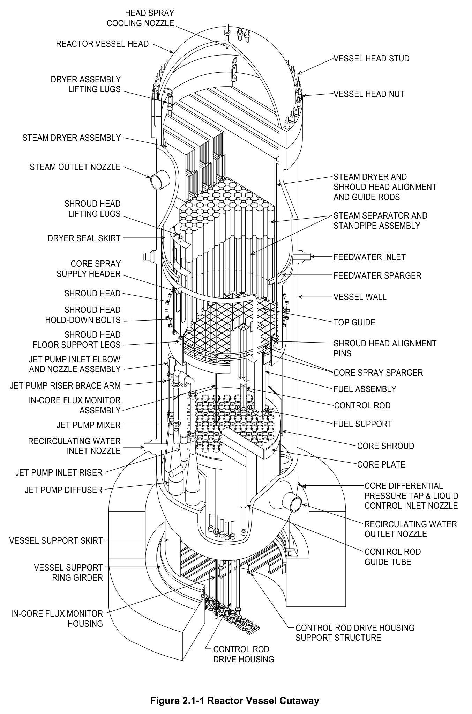

*Reactor Vessel Cutaway*

[Vector original (SVG, lossless): fig_2.1-1.svg](../figures/fig_2.1-1.svg)

<!-- labels/text on this figure page -->
HEAD SPRAY COOLING NOZZLE
REACTOR VESSEL HEAD
VESSEL HEAD STUD
DRYER ASSEMBLY LIFTING LUGS VESSEL HEAD NUT
STEAM DRYER ASSEMBLY
STEAM OUTLET NOZZLE STEAM DRYER AND SHROUD HEAD ALIGNMENT AND GUIDE RODS SHROUD HEAD LIFTING LUGS STEAM SEPARATOR AND STANDPIPE ASSEMBLY DRYER SEAL SKIRT
FEEDWATER INLET CORE SPRAY SUPPLY HEADER FEEDWATER SPARGER
SHROUD HEAD VESSEL WALL SHROUD HEAD HOLD-DOWN BOLTS TOP GUIDE SHROUD HEAD SHROUD HEAD ALIGNMENT FLOOR SUPPORT LEGS PINS JET PUMP INLET ELBOW AND NOZZLE ASSEMBLY CORE SPRAY SPARGER JET PUMP RISER BRACE ARM FUEL ASSEMBLY IN-CORE FLUX MONITOR CONTROL ROD ASSEMBLY FUEL SUPPORT JET PUMP MIXER
RECIRCULATING WATER CORE SHROUD INLET NOZZLE CORE PLATE JET PUMP INLET RISER CORE DIFFERENTIAL JET PUMP DIFFUSER PRESSURE TAP & LIQUID CONTROL INLET NOZZLE
RECIRCULATING WATER OUTLET NOZZLE VESSEL SUPPORT SKIRT CONTROL ROD GUIDE TUBE VESSEL SUPPORT RING GIRDER
IN-CORE FLUX MONITOR HOUSING CONTROL ROD DRIVE HOUSING SUPPORT STRUCTURE CONTROL ROD DRIVE HOUSING
Figure 2.1-1 Reactor Vessel Cutaway

<!-- p.26 -->
#### Figure 2.1-2

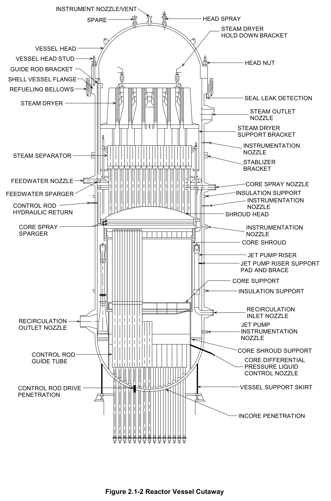

*Reactor Vessel Cutaway*

[Vector original (SVG, lossless): fig_2.1-2.svg](../figures/fig_2.1-2.svg)

<!-- labels/text on this figure page -->
INSTRUMENT NOZZLE/VENT
HEAD SPRAY SPARE STEAM DRYER HOLD DOWN BRACKET
VESSEL HEAD
VESSEL HEAD STUD HEAD NUT GUIDE ROD BRACKET
SHELL VESSEL FLANGE
REFUELING BELLOWS SEAL LEAK DETECTION STEAM DRYER STEAM OUTLET NOZZLE
STEAM DRYER SUPPORT BRACKET
INSTRUMENTATION NOZZLE STEAM SEPARATOR STABLIZER BRACKET
FEEDWATER NOZZLE CORE SPRAY NOZZLE INSULATION SUPPORT FEEDWATER SPARGER INSTRUMENTATION CONTROL ROD NOZZLE HYDRAULIC RETURN SHROUD HEAD
CORE SPRAY INSTRUMENTATION SPARGER NOZZLE CORE SHROUD
JET PUMP RISER JET PUMP RISER SUPPORT PAD AND BRACE
CORE SUPPORT
INSULATION SUPPORT
RECIRCULATION INLET NOZZLE RECIRCULATION JET PUMP OUTLET NOZZLE INSTRUMENTATION NOZZLE
CORE SHROUD SUPPORT CONTROL ROD CORE DIFFERENTIAL GUIDE TUBE PRESSURE LIQUID CONTROL NOZZLE
VESSEL SUPPORT SKIRT CONTROL ROD DRIVE PENETRATION
INCORE PENETRATION
Figure 2.1-2 Reactor Vessel Cutaway

<!-- p.27 -->
#### Figure 2.1-3

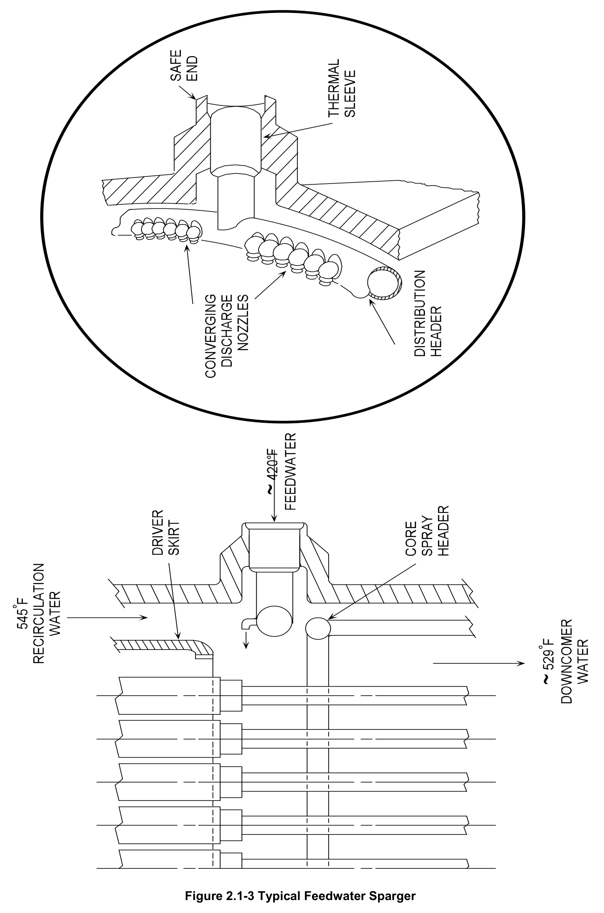

*Typical Feedwater Sparger*

[Vector original (SVG, lossless): fig_2.1-3.svg](../figures/fig_2.1-3.svg)

<!-- p.29 -->
#### Figure 2.1-4

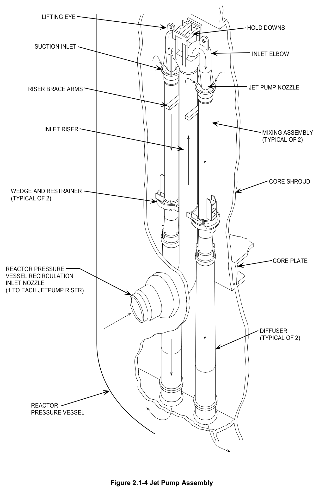

*Jet Pump Assembly*

[Vector original (SVG, lossless): fig_2.1-4.svg](../figures/fig_2.1-4.svg)

<!-- labels/text on this figure page -->
LIFTING EYE
HOLD DOWNS
SUCTION INLET INLET ELBOW
JET PUMP NOZZLE RISER BRACE ARMS
INLET RISER MIXING ASSEMBLY
(TYPICAL OF 2)
CORE SHROUD WEDGE AND RESTRAINER
(TYPICAL OF 2)
CORE PLATE REACTOR PRESSURE VESSEL RECIRCULATION INLET NOZZLE
(1 TO EACH JETPUMP RISER)
DIFFUSER
(TYPICAL OF 2)
REACTOR PRESSURE VESSEL
Figure 2.1-4 Jet Pump Assembly

<!-- p.30 -->
#### Figure 2.1-5

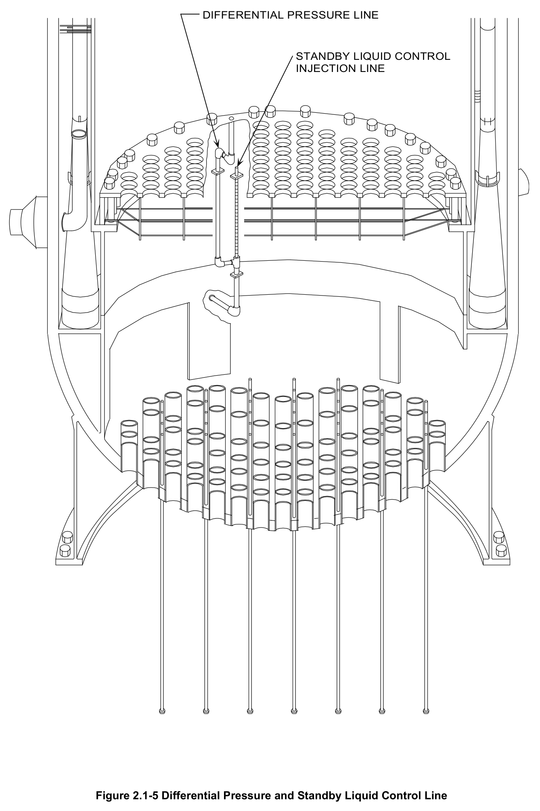

*Differential Pressure and Standby Liquid Control Line*

[Vector original (SVG, lossless): fig_2.1-5.svg](../figures/fig_2.1-5.svg)

<!-- labels/text on this figure page -->
DIFFERENTIAL PRESSURE LINE
STANDBY LIQUID CONTROL INJECTION LINE
Figure 2.1-5 Differential Pressure and Standby Liquid Control Line

<!-- p.31 -->
#### Figure 2.1-6

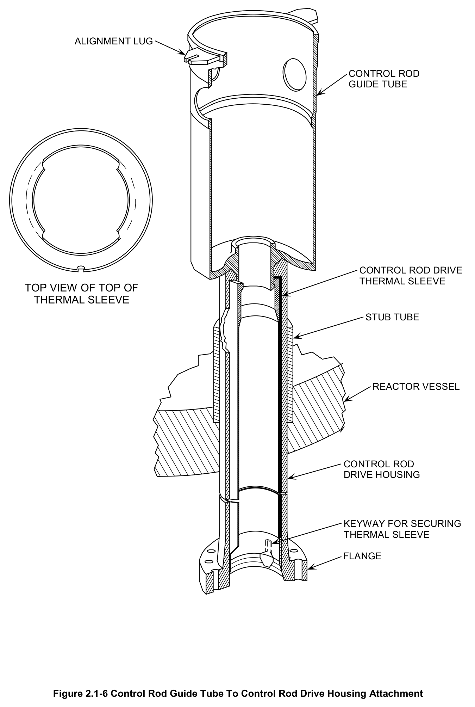

*Control Rod Guide Tube To Control Rod Drive Housing Attachment*

[Vector original (SVG, lossless): fig_2.1-6.svg](../figures/fig_2.1-6.svg)

<!-- labels/text on this figure page -->
ALIGNMENT LUG
CONTROL ROD GUIDE TUBE
CONTROL ROD DRIVE THERMAL SLEEVE TOP VIEW OF TOP OF THERMAL SLEEVE
STUB TUBE
REACTOR VESSEL
CONTROL ROD DRIVE HOUSING
KEYWAY FOR SECURING THERMAL SLEEVE
FLANGE
Figure 2.1-6 Control Rod Guide Tube To Control Rod Drive Housing Attachment

<!-- p.32 -->
#### Figure 2.1-7

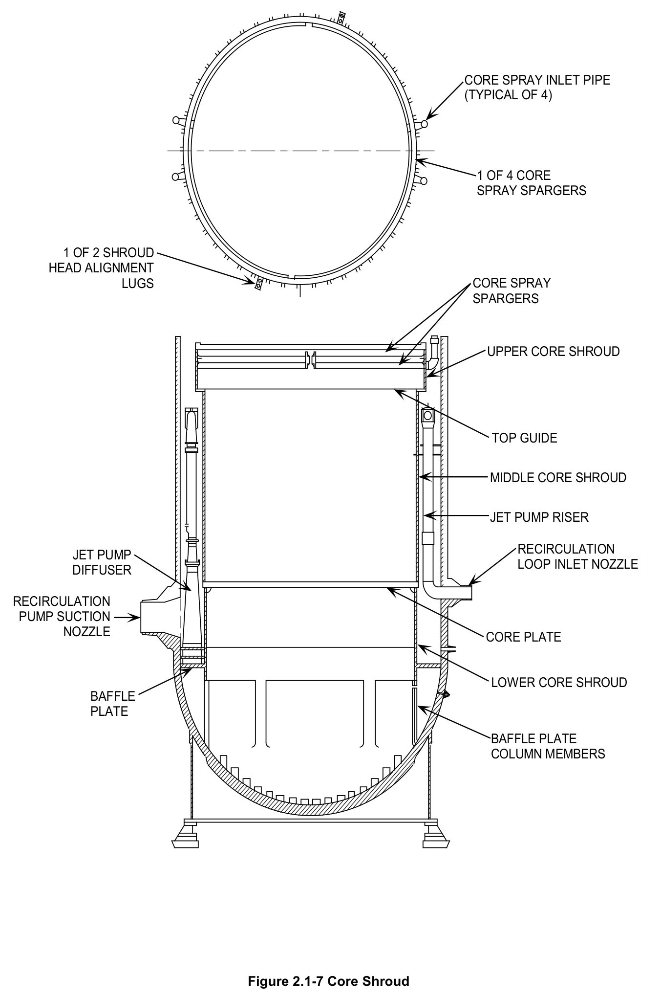

*Core Shroud*

[Vector original (SVG, lossless): fig_2.1-7.svg](../figures/fig_2.1-7.svg)

<!-- labels/text on this figure page -->
CORE SPRAY INLET PIPE
(TYPICAL OF 4)
1 OF 4 CORE
SPRAY SPARGERS
1 OF 2 SHROUD
HEAD ALIGNMENT CORE SPRAY LUGS SPARGERS
UPPER CORE SHROUD
TOP GUIDE
MIDDLE CORE SHROUD
JET PUMP RISER
RECIRCULATION JET PUMP LOOP INLET NOZZLE DIFFUSER
RECIRCULATION PUMP SUCTION NOZZLE CORE PLATE
LOWER CORE SHROUD BAFFLE PLATE
BAFFLE PLATE COLUMN MEMBERS
Figure 2.1-7 Core Shroud

<!-- p.33 -->
#### Figure 2.1-8

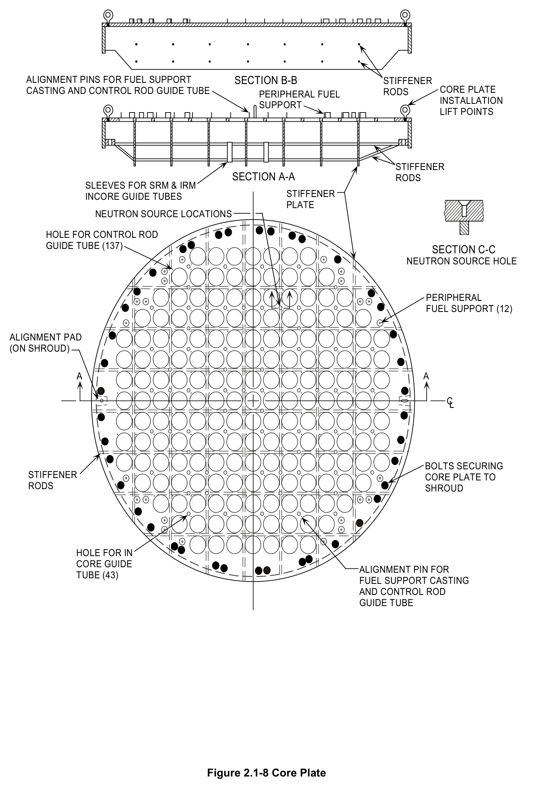

*Core Plate*

[Vector original (SVG, lossless): fig_2.1-8.svg](../figures/fig_2.1-8.svg)

<!-- labels/text on this figure page -->
ALIGNMENT PINS FOR FUEL SUPPORT SECTION B-B STIFFENER CORE PLATE CASTING AND CONTROL ROD GUIDE TUBE RODS PERIPHERAL FUEL INSTALLATION SUPPORT LIFT POINTS
STIFFENER SECTION A-A RODS SLEEVES FOR SRM & IRM STIFFENER INCORE GUIDE TUBES PLATE NEUTRON SOURCE LOCATIONS
HOLE FOR CONTROL ROD GUIDE TUBE (137)
SECTION C-C NEUTRON SOURCE HOLE
PERIPHERAL FUEL SUPPORT (12)
ALIGNMENT PAD
(ON SHROUD)
A A
CL
BOLTS SECURING STIFFENER CORE PLATE TO RODS SHROUD
HOLE FOR IN CORE GUIDE ALIGNMENT PIN FOR TUBE (43)
FUEL SUPPORT CASTING AND CONTROL ROD GUIDE TUBE
Figure 2.1-8 Core Plate

<!-- p.34 -->
#### Figure 2.1-9

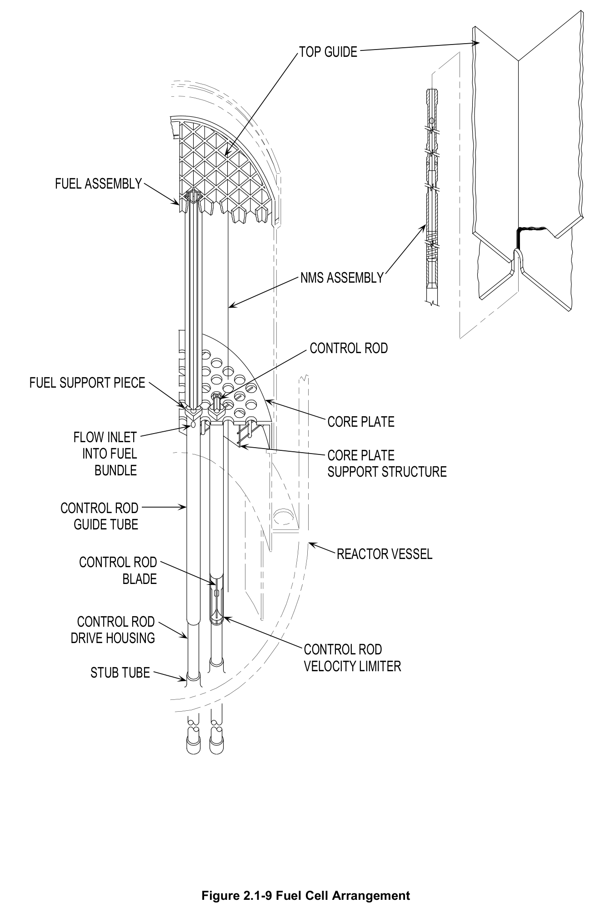

*Fuel Cell Arrangement*

[Vector original (SVG, lossless): fig_2.1-9.svg](../figures/fig_2.1-9.svg)

<!-- labels/text on this figure page -->
TOP GUIDE
FUEL ASSEMBLY
NMS ASSEMBLY
CONTROL ROD
FUEL SUPPORT PIECE
CORE PLATE FLOW INLET INTO FUEL CORE PLATE BUNDLE SUPPORT STRUCTURE
CONTROL ROD GUIDE TUBE
REACTOR VESSEL CONTROL ROD BLADE
CONTROL ROD DRIVE HOUSING CONTROL ROD VELOCITY LIMITER STUB TUBE
Figure 2.1-9 Fuel Cell Arrangement

<!-- p.35 -->
#### Figure 2.1-10

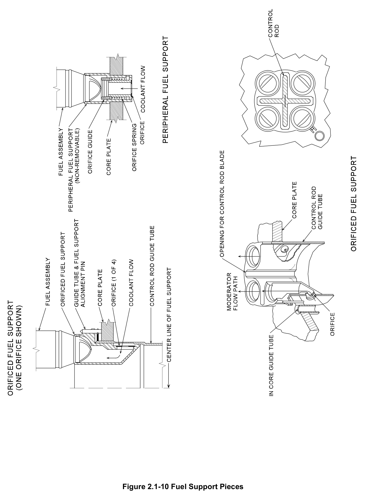

*Fuel Support Pieces*

[Vector original (SVG, lossless): fig_2.1-10.svg](../figures/fig_2.1-10.svg)

<!-- p.36 -->
#### Figure 2.1-11

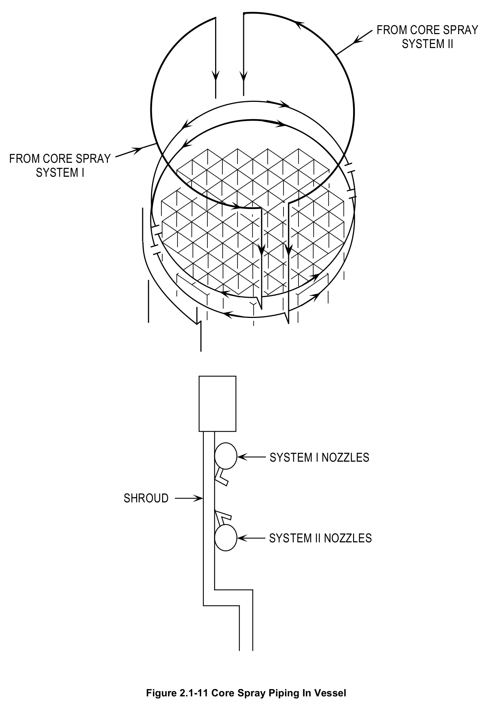

*Core Spray Piping In Vessel*

[Vector original (SVG, lossless): fig_2.1-11.svg](../figures/fig_2.1-11.svg)

<!-- labels/text on this figure page -->
FROM CORE SPRAY SYSTEM II
FROM CORE SPRAY SYSTEM I
SYSTEM I NOZZLES
SHROUD
SYSTEM II NOZZLES
Figure 2.1-11 Core Spray Piping In Vessel

<!-- p.37 -->
#### Figure 2.1-12

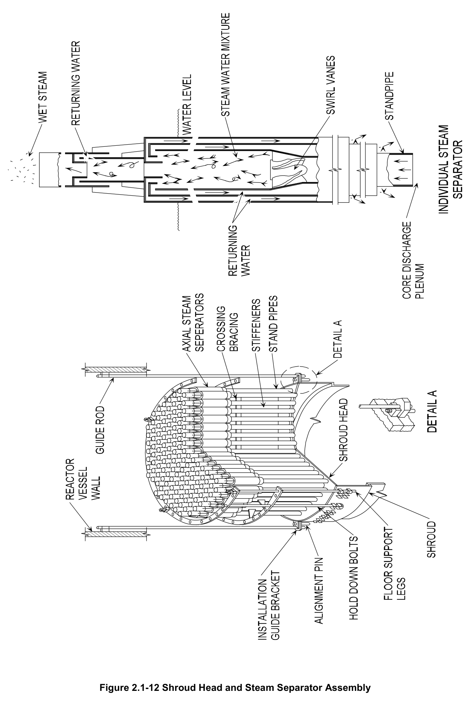

*Shroud Head and Steam Separator Assembly*

[Vector original (SVG, lossless): fig_2.1-12.svg](../figures/fig_2.1-12.svg)

<!-- p.38 -->
#### Figure 2.1-13

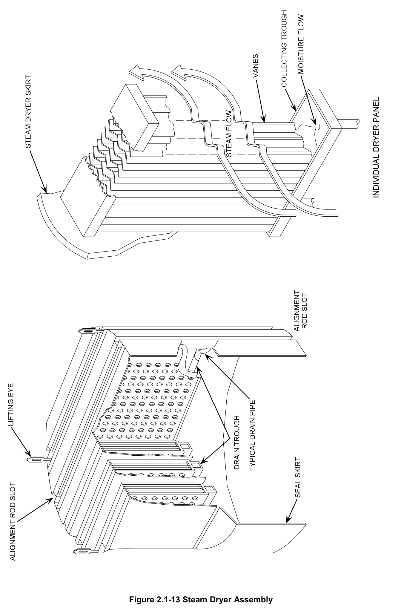

*Steam Dryer Assembly*

[Vector original (SVG, lossless): fig_2.1-13.svg](../figures/fig_2.1-13.svg)

<!-- p.39 -->
#### Figure 2.1-14

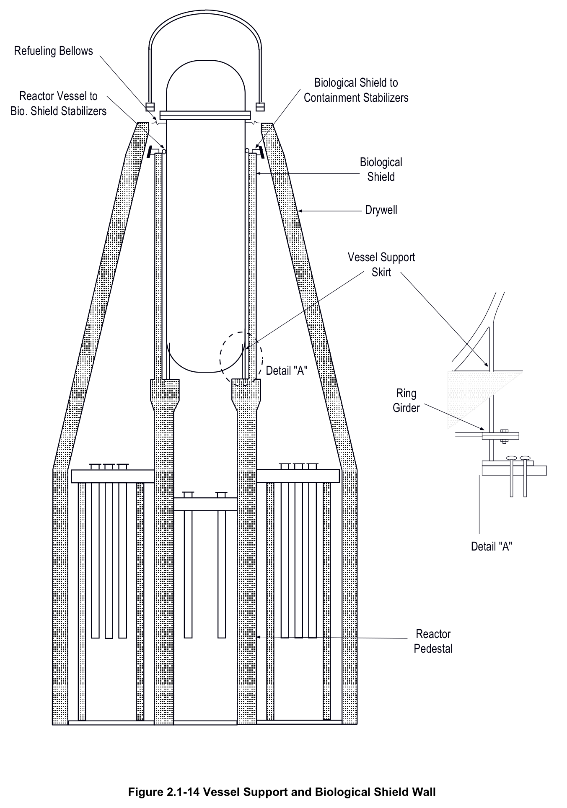

*Vessel Support and Biological Shield Wall*

[Vector original (SVG, lossless): fig_2.1-14.svg](../figures/fig_2.1-14.svg)

<!-- labels/text on this figure page -->
Refueling Bellows
Biological Shield to Reactor Vessel to Containment Stabilizers Bio. Shield Stabilizers
Biological Shield
Drywell
Vessel Support Skirt
Detail "A"
Ring Girder
Detail "A"
Reactor Pedestal
Figure 2.1-14 Vessel Support and Biological Shield Wall

<!-- p.40 -->
#### Figure 2.1-15

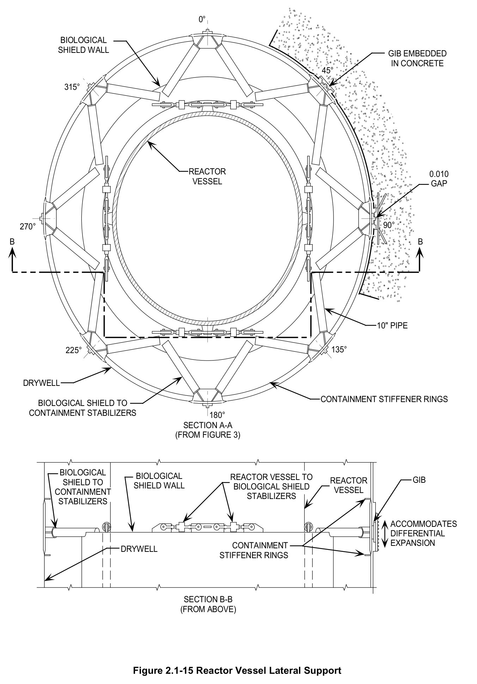

*Reactor Vessel Lateral Support*

[Vector original (SVG, lossless): fig_2.1-15.svg](../figures/fig_2.1-15.svg)

<!-- labels/text on this figure page -->
0°
BIOLOGICAL SHIELD WALL GIB EMBEDDED IN CONCRETE 45°
315°
REACTOR 0.010 VESSEL GAP
90° 270°
B B
10" PIPE
135° 225°
DRYWELL
CONTAINMENT STIFFENER RINGS BIOLOGICAL SHIELD TO CONTAINMENT STABILIZERS 180° SECTION A-A
(FROM FIGURE 3)
BIOLOGICAL BIOLOGICAL REACTOR VESSEL TO GIB SHIELD TO REACTOR SHIELD WALL BIOLOGICAL SHIELD VESSEL CONTAINMENT STABILIZERS STABILIZERS
ACCOMMODATES DIFFERENTIAL EXPANSION CONTAINMENT DRYWELL STIFFENER RINGS
SECTION B-B
(FROM ABOVE)
Figure 2.1-15 Reactor Vessel Lateral Support

<!-- p.41 -->
#### Figure 2.1-16

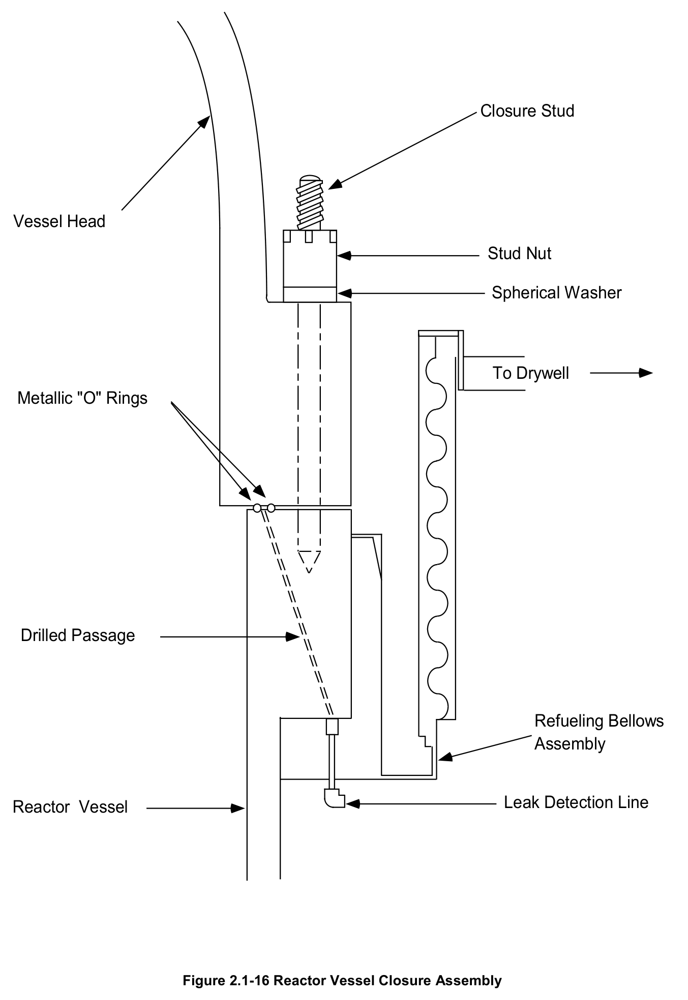

*Reactor Vessel Closure Assembly*

[Vector original (SVG, lossless): fig_2.1-16.svg](../figures/fig_2.1-16.svg)

<!-- labels/text on this figure page -->
Closure Stud
Vessel Head
Stud Nut
Spherical Washer
To Drywell Metallic "O" Rings
Drilled Passage
Refueling Bellows Assembly
Leak Detection Line Reactor Vessel
Figure 2.1-16 Reactor Vessel Closure Assembly

<!-- p.42 -->
#### Figure 2.1-17

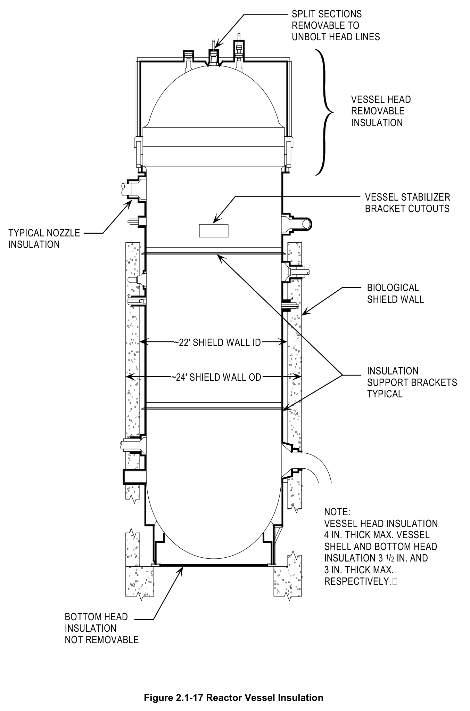

*Reactor Vessel Insulation*

[Vector original (SVG, lossless): fig_2.1-17.svg](../figures/fig_2.1-17.svg)

<!-- labels/text on this figure page -->
SPLIT SECTIONS REMOVABLE TO UNBOLT HEAD LINES
VESSEL HEAD REMOVABLE INSULATION
VESSEL STABILIZER BRACKET CUTOUTS
TYPICAL NOZZLE INSULATION
BIOLOGICAL SHIELD WALL
~22' SHIELD WALL ID
INSULATION ~24' SHIELD WALL OD SUPPORT BRACKETS TYPICAL
NOTE:
VESSEL HEAD INSULATION
4 IN. THICK MAX. VESSEL
SHELL AND BOTTOM HEAD INSULATION 3 1/2 IN. AND 3 IN. THICK MAX.
RESPECTIVELY.
BOTTOM HEAD INSULATION NOT REMOVABLE
Figure 2.1-17 Reactor Vessel Insulation

<!-- p.43 -->
#### Figure 2.1-18

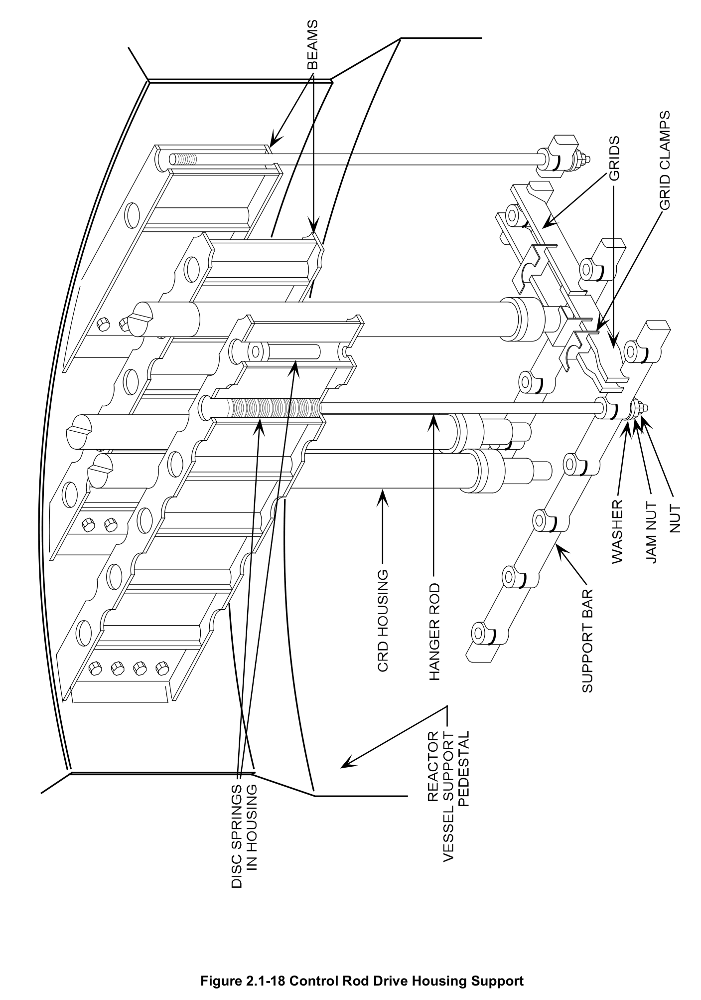

*Control Rod Drive Housing Support*

[Vector original (SVG, lossless): fig_2.1-18.svg](../figures/fig_2.1-18.svg)

<!-- p.44 -->
#### Figure 2.1-19

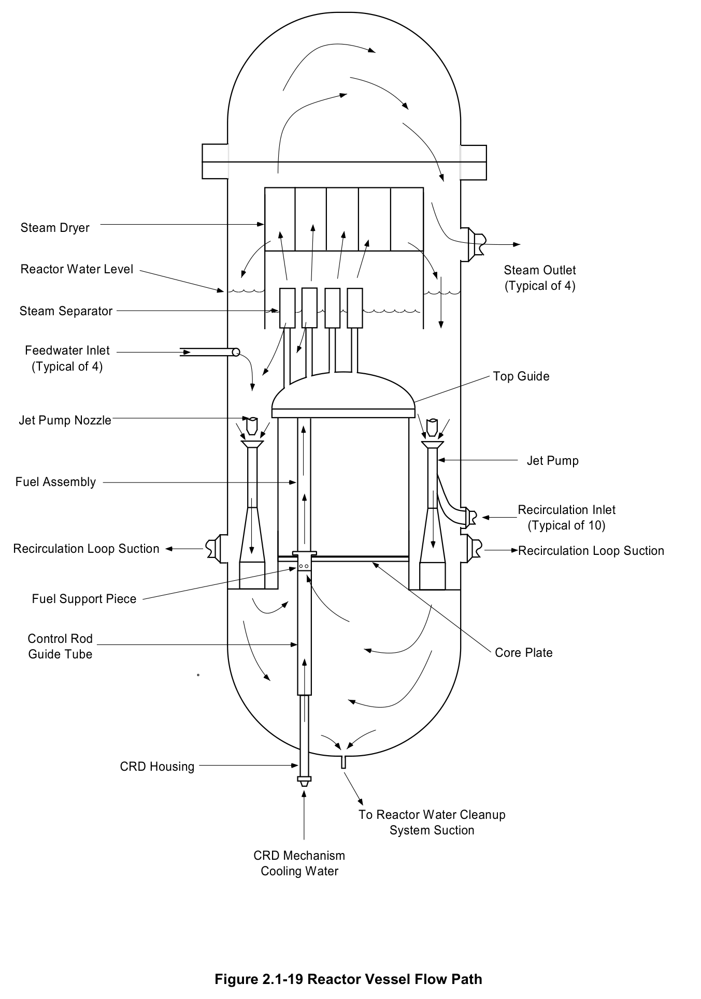

*Reactor Vessel Flow Path*

[Vector original (SVG, lossless): fig_2.1-19.svg](../figures/fig_2.1-19.svg)

<!-- labels/text on this figure page -->
Steam Dryer
Reactor Water Level Steam Outlet
(Typical of 4)
Steam Separator
Feedwater Inlet
(Typical of 4)
Top Guide
Jet Pump Nozzle
Jet Pump
Fuel Assembly
Recirculation Inlet
(Typical of 10)
Recirculation Loop Suction Recirculation Loop Suction
Fuel Support Piece
Control Rod Core Plate Guide Tube
CRD Housing
To Reactor Water Cleanup System Suction
CRD Mechanism Cooling Water
Figure 2.1-19 Reactor Vessel Flow Path

<!-- p.45 -->
#### Figure 2.1-20

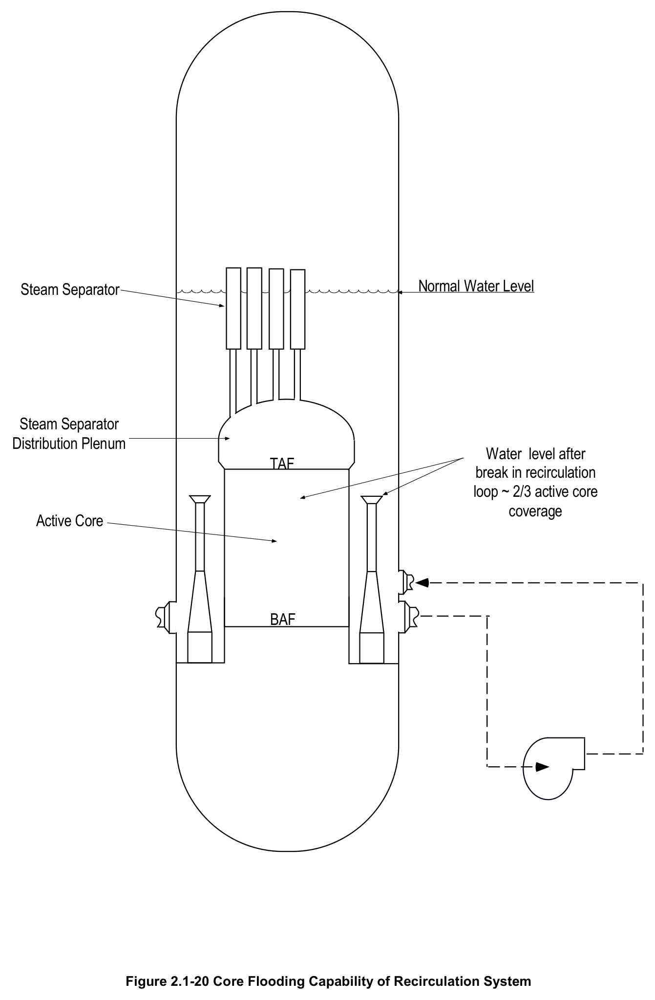

*Core Flooding Capability of Recirculation System*

[Vector original (SVG, lossless): fig_2.1-20.svg](../figures/fig_2.1-20.svg)

<!-- labels/text on this figure page -->
Normal Water Level Steam Separator
Steam Separator Distribution Plenum Water level after TAF break in recirculation loop ~ 2/3 active core coverage Active Core
BAF
Figure 2.1-20 Core Flooding Capability of Recirculation System

<!-- p.46 -->
#### Figure 2.1-21

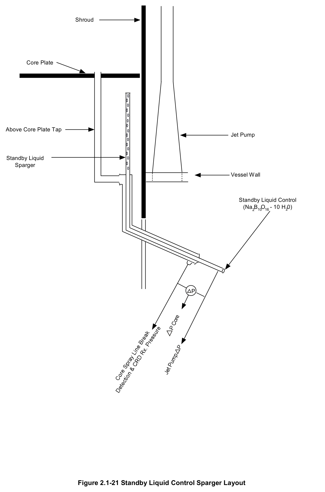

*Standby Liquid Control Sparger Layout*

[Vector original (SVG, lossless): fig_2.1-21.svg](../figures/fig_2.1-21.svg)

<!-- labels/text on this figure page -->
Shroud
Core Plate
Above Core Plate Tap Jet Pump
Standby Liquid Sparger
Vessel Wall
Standby Liquid Control
(Na B O - 10 H 0)
2 10 16 2
P
Figure 2.1-21 Standby Liquid Control Sparger Layout

