# 2.2 Fuel Control Rods

> Source: `2.2_Fuel_Control_Rods.pdf` (49 pages)
> GE (BWR) Systems Technology Manual — USNRC HRTD, Rev 09/11

---
<!-- p.1 -->
Fuel and Control Rods 304B Chapter 2.2 System y

<!-- p.2 -->
1.Recognize the purposes of the Objectives b.Control Rods a.Nuclear Fuel l R d following:
t

b C

<!-- p.3 -->
arrangements of the following fuel assembly
2. Summarize the function and physical d. Partial Length Fuel Rods Objectives g. Upper Tie Plate h. Lower Tie Plate j. Finger Springs b. Fuel Cladding k. Fuel Channel i. Fuel Spacers f. Water Rods a. Fuel Pellets c Fuel Rods c. Fuel Rods e. Tie-Rods components:

<!-- p.4 -->
arrangements of the following control rod
3. Summarize the function and physical Objectives g. Control Rod Guide Tube a. Control Rod Blades b. Control Rod Rollers l R d R ll c. Velocity limiter d. Spud Coupler f. Valve Disc components:
e. Lock Plug t

b C

<!-- p.5 -->
a. control rod guide tube to fuel support piece 4. Explain the following flow paths, including the 5. Explain the following characteristics of the Objectives a. fuel pellet composition b. enrichment variations c. burnable poisons purpose of that flow:
b. channel flow c. bypass flow reactor fuel:

<!-- p.6 -->
and recognize the mitigating strategies for those 6. Identify the common failure mechanisms of fuel 7. Explain why bottom entry control rods are used.
8. Explain the interrelationship that nuclear fuel l assemblies have with the following systems:
b. Refueling And Vessel Servicing System f

l

a. Reactor Pressure Vessel (RPV)
th t Objectives hi c. Fuel Transfer System l ti d. Spent Fuel Pool i t mechanisms.
th

l i

E

8

<!-- p.7 -->
9. Explain the interrelationship that the control rods b. Control Rod Drive System (CRD)
a. Reactor Pressure Vessel (RPV)
have with the following systems:
Objectives c. Fuel Transfer System e. Rod Worth Minimizer d. Spent Fuel Pool

<!-- p.8 -->
Fuel Assembly Purposes
• Distribution of water flow to the fuel assemblies and bypass regions
• Roller surface for control rods
• Fission Product Barrier
• Energy generation

<!-- p.9 -->
providing adequate shutdown margin to
• providing adequate shutdown margin to maintain the reactor sub-critical for all Minimizer (RWM) limits the reactivity Control Rod Purposes
• in conjunction with the Rod Worth
• flux distribution to optimize core effects of a dropped control rod
• reactor power control plant conditions performance

<!-- p.10 -->
• A channel that envelopes the fuel bundle cladding to form fuel rods (the fuel rods are sometimes referred to as “pins”)
• Fuel pellets enclosed in a Zircaloy Fuel Assembly
• Upper and lower tie plates • Upper and lower tie-plates
• Finger springs
• Fuel spacers

<!-- p.11 -->
• Fuel Support Piece – Lateral & vertical
• Weight translated to RPV bottom via i

Fuel Assembly RPV b tt
• Top Guide – Lateral Support control rod guide tube l t d t

W i ht t support

<!-- p.12 -->
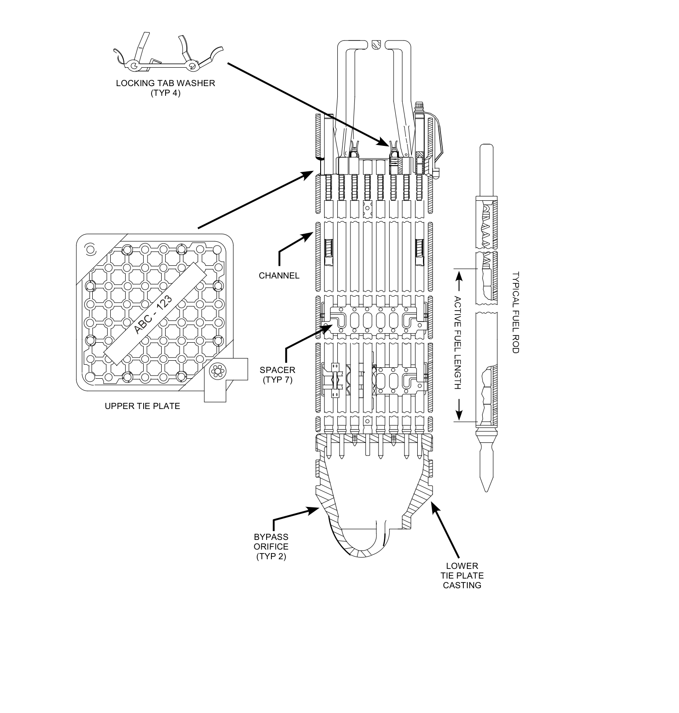

*figure on PDF page 12*

[Vector original (SVG, lossless): fig_page-12.svg](../figures/fig_page-12.svg)

<!-- labels/text on this figure page -->
TIE PLATE CASTING LOWER
CHANNEL SPACER (TYP 7)
BYPASS ORIFICE (TYP 2)
LOCKING TAB WASHER
(TYP 4)
UPPER TIE PLATE

<!-- p.13 -->
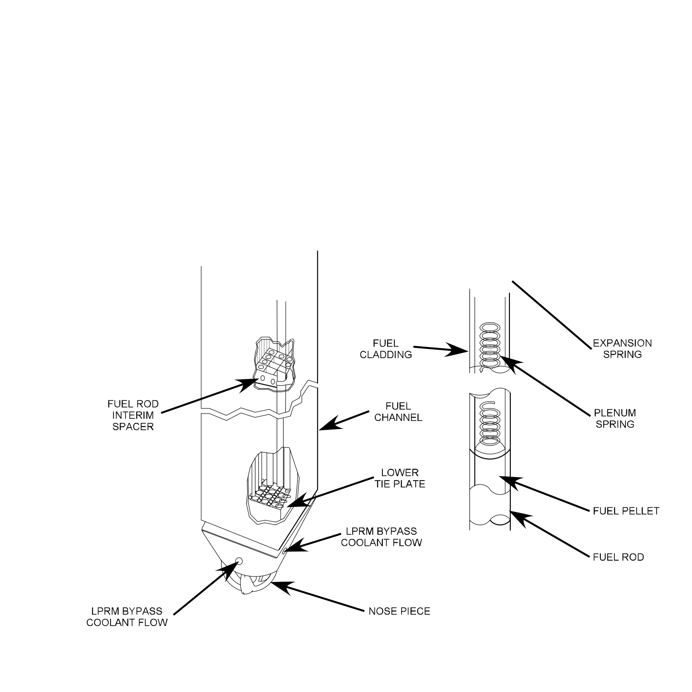

*figure on PDF page 13*

[Vector original (SVG, lossless): fig_page-13.svg](../figures/fig_page-13.svg)

<!-- p.14 -->
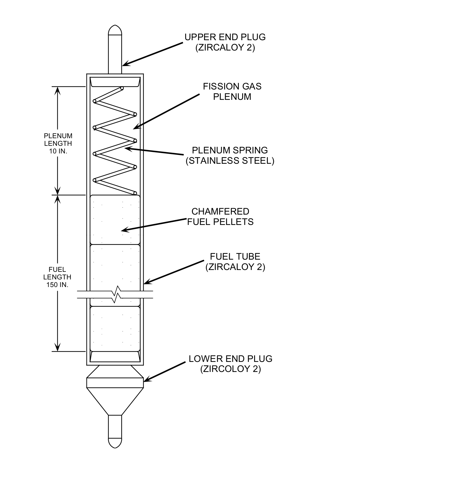

*figure on PDF page 14*

[Vector original (SVG, lossless): fig_page-14.svg](../figures/fig_page-14.svg)

<!-- labels/text on this figure page -->
(STAINLESS STEEL)
LOWER END PLUG PLENUM SPRING UPPER END PLUG
(ZIRCALOY 2)
FISSION GAS
(ZIRCOLOY 2)
FUEL TUBE
(ZIRCALOY 2)
FUEL PELLETS PLENUM CHAMFERED
PLENUM LENGTH LENGTH 150 IN.
10 IN.
FUEL

<!-- p.15 -->
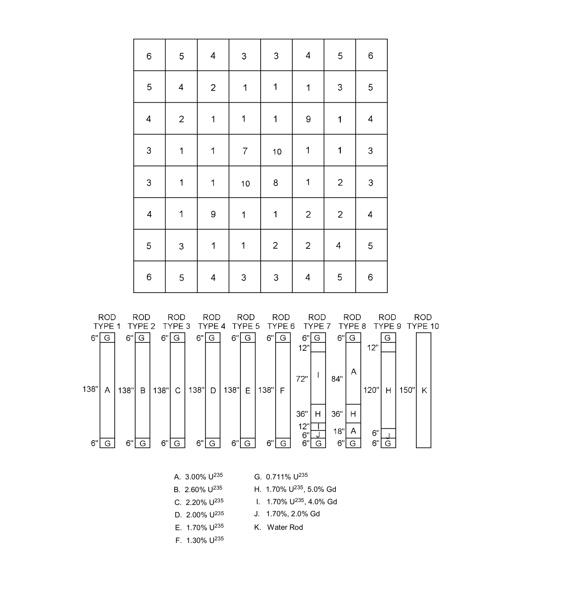

*figure on PDF page 15*

[Vector original (SVG, lossless): fig_page-15.svg](../figures/fig_page-15.svg)

<!-- labels/text on this figure page -->
1.70% U235, 4.0% Gd H. 1.70% U235, 5.0% Gd
1.70%, 2.0% Gd G. 0.711% U235 Water Rod
I. J. K.
A. 3.00% U235 C. 2.20% U235 D. 2.00% U235 E. 1.70% U235 F. 1.30% U235 B. 2.60% U235

<!-- p.16 -->
• A GE-14 fuel bundle (Figures 2.2-1 & 2) is GE-14 Fuel Bundle comprised of four types of rods:
–14 partial length fuel rods –70 standard fuel rods –8 fuel tie rods –2 Water rods d

l ti

8 f

<!-- p.19 -->
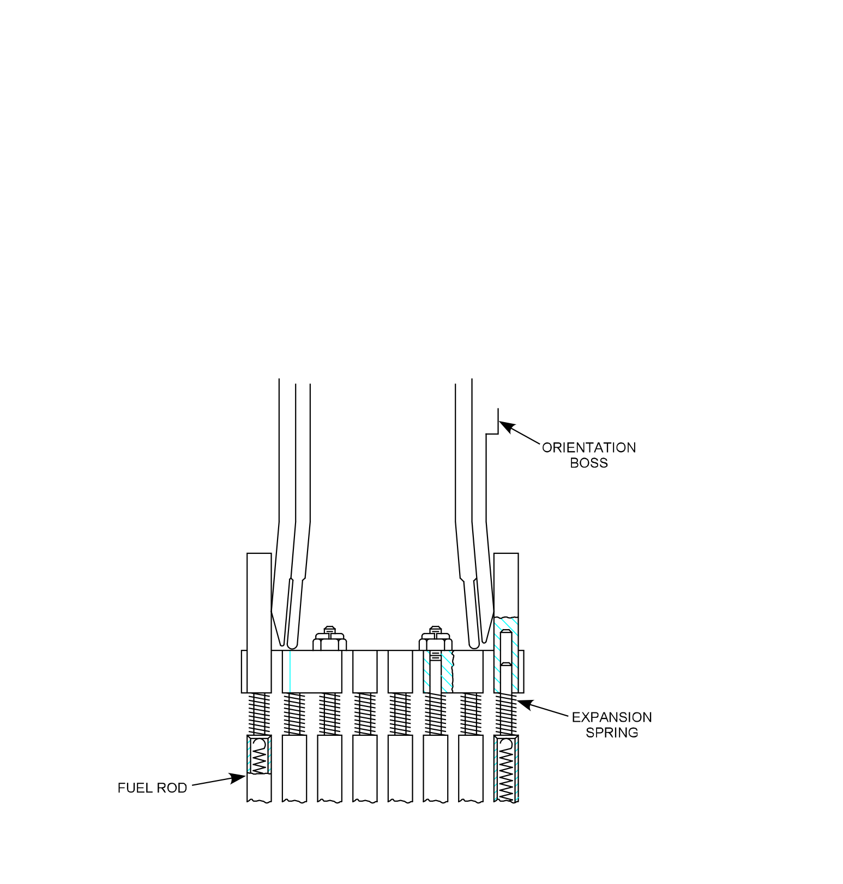

*figure on PDF page 19*

[Vector original (SVG, lossless): fig_page-19.svg](../figures/fig_page-19.svg)

<!-- p.21 -->
Piece Nose

Filter Filter

<!-- p.23 -->
Bearing surface for the control rod blade –Bearing surface for the control rod blade –Fuel rod protection during fuel handling
• A fuel channel (Figures 2.2-5 & 10) has coolant accident (LOCA) conditions –Acts as a heat sink during loss of –Improved fuel bundle rigidity Fuel Channel –Flow distribution several purposes:
rollers

<!-- p.24 -->
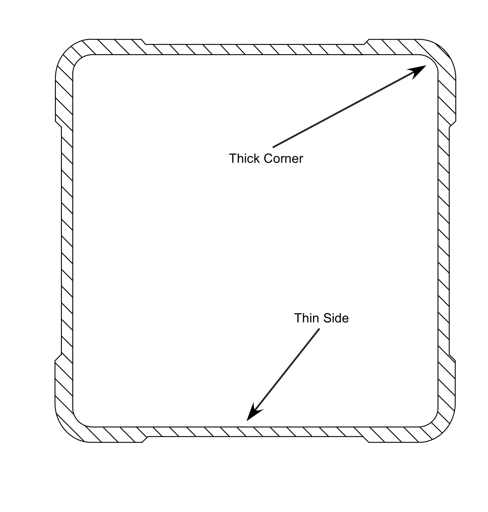

*figure on PDF page 24*

[Vector original (SVG, lossless): fig_page-24.svg](../figures/fig_page-24.svg)

<!-- p.25 -->
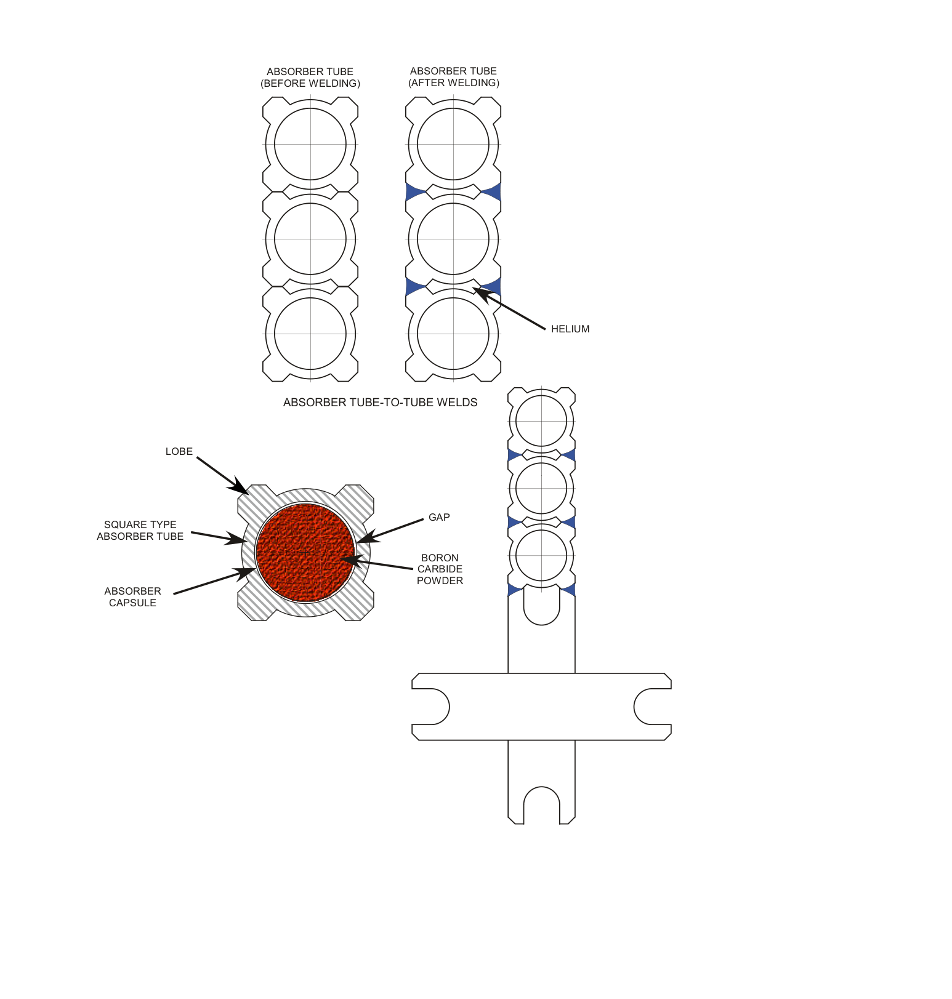

*figure on PDF page 25*

[Vector original (SVG, lossless): fig_page-25_2.svg](../figures/fig_page-25_2.svg)

<!-- labels/text on this figure page -->
HELIUM
(AFTER WELDING) ABSORBER TUBE ABSORBER TUBE-TO-TUBE WELDS CARBIDE POWDER BORON GAP
(BEFORE WELDING)
ABSORBER TUBE
LOBE ABSORBER TUBE SQUARE TYPE ABSORBER CAPSULE

<!-- p.26 -->
• Failure in one positioning device does not affect its control rod to prevent undesirable separation
• Rapid control rod insertion (scram) is locked to Rapid control rod insertion to avoid fuel damage • Prevents its control rod from withdrawing as a the operation of any other positioning device
• Supports and positions a control rod Control Rods result of a single malfunction result of a single malfunction

<!-- p.27 -->
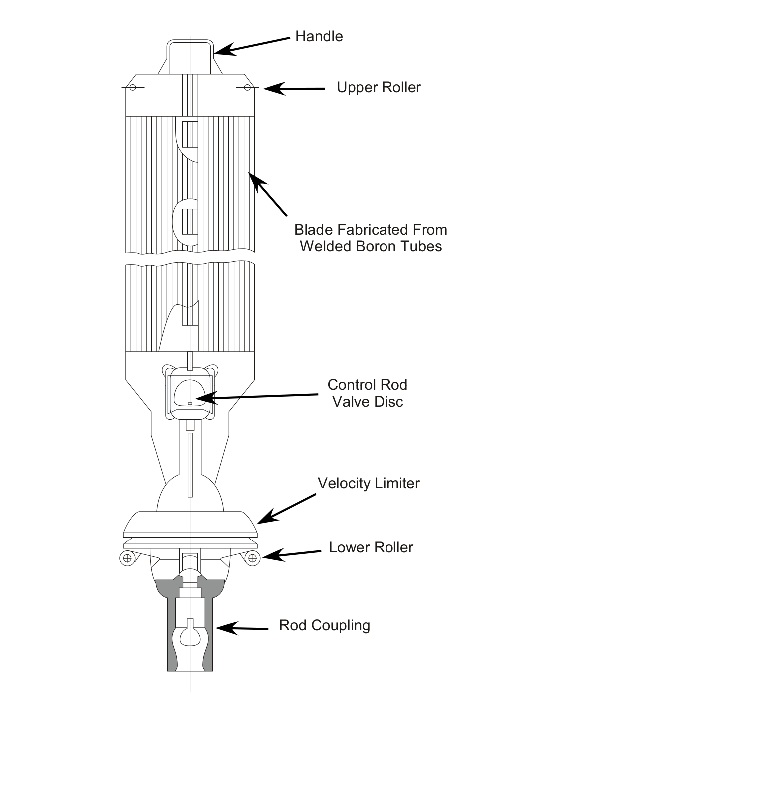

*figure on PDF page 27*

[Vector original (SVG, lossless): fig_page-27.svg](../figures/fig_page-27.svg)

<!-- labels/text on this figure page -->
Blade Fabricated From Welded Boron Tubes Upper Roller Velocity Limiter Lower Roller Control Rod Control Rod Valve Disc Rod Coupling Handle

<!-- p.28 -->
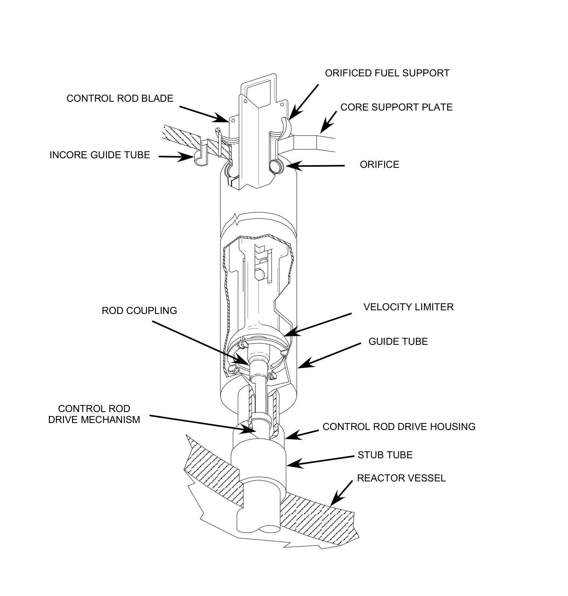

*figure on PDF page 28*

[Vector original (SVG, lossless): fig_page-28.svg](../figures/fig_page-28.svg)

<!-- labels/text on this figure page -->
CONTROL ROD DRIVE HOUSING VELOCITY LIMITER CORE SUPPORT PLATE ORIFICED FUEL SUPPORT REACTOR VESSEL GUIDE TUBE STUB TUBE ORIFICE
ROD COUPLING CONTROL ROD BLADE INCORE GUIDE TUBE DRIVE MECHANISM CONTROL ROD

<!-- p.29 -->
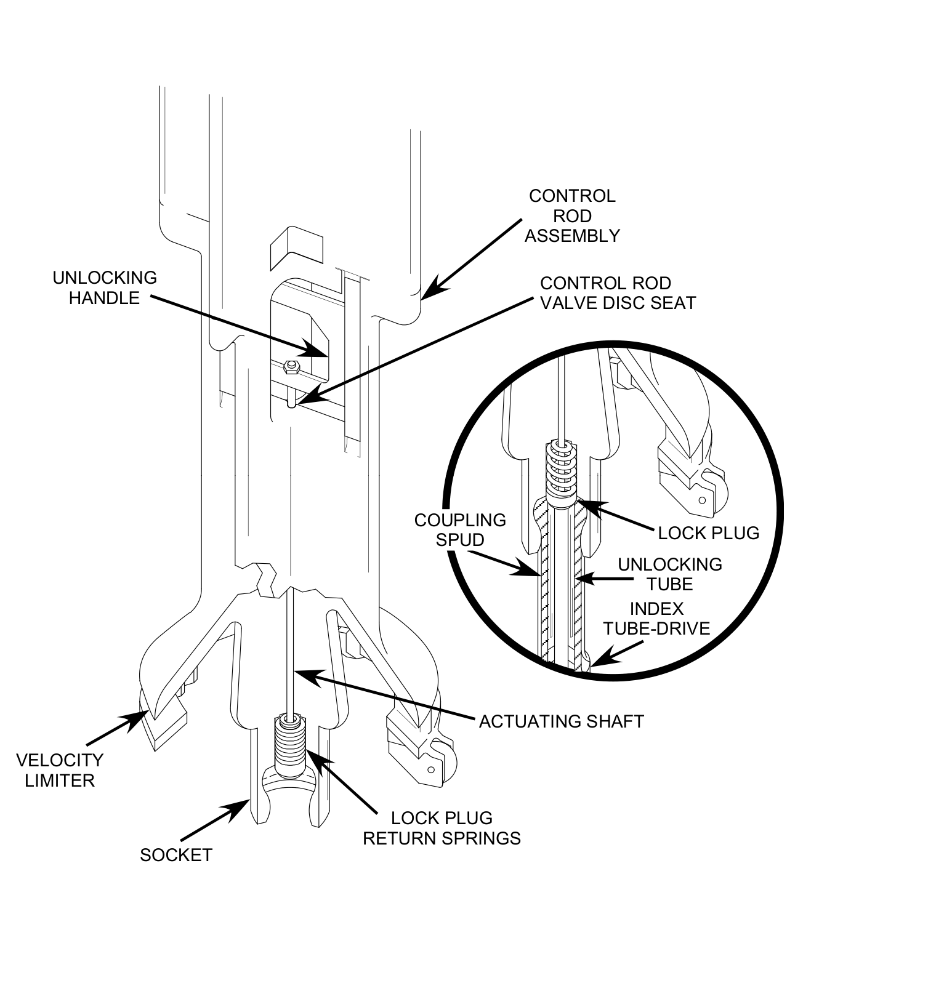

*figure on PDF page 29*

[Vector original (SVG, lossless): fig_page-29_2.svg](../figures/fig_page-29_2.svg)

<!-- labels/text on this figure page -->
LOCK PLUG UNLOCKING TUBE-DRIVE VALVE DISC SEAT TUBE INDEX CONTROL ROD ACTUATING SHAFT ASSEMBLY CONTROL ROD
RETURN SPRINGS COUPLING LOCK PLUG SPUD
SOCKET UNLOCKING HANDLE VELOCITY LIMITER

<!-- p.31 -->
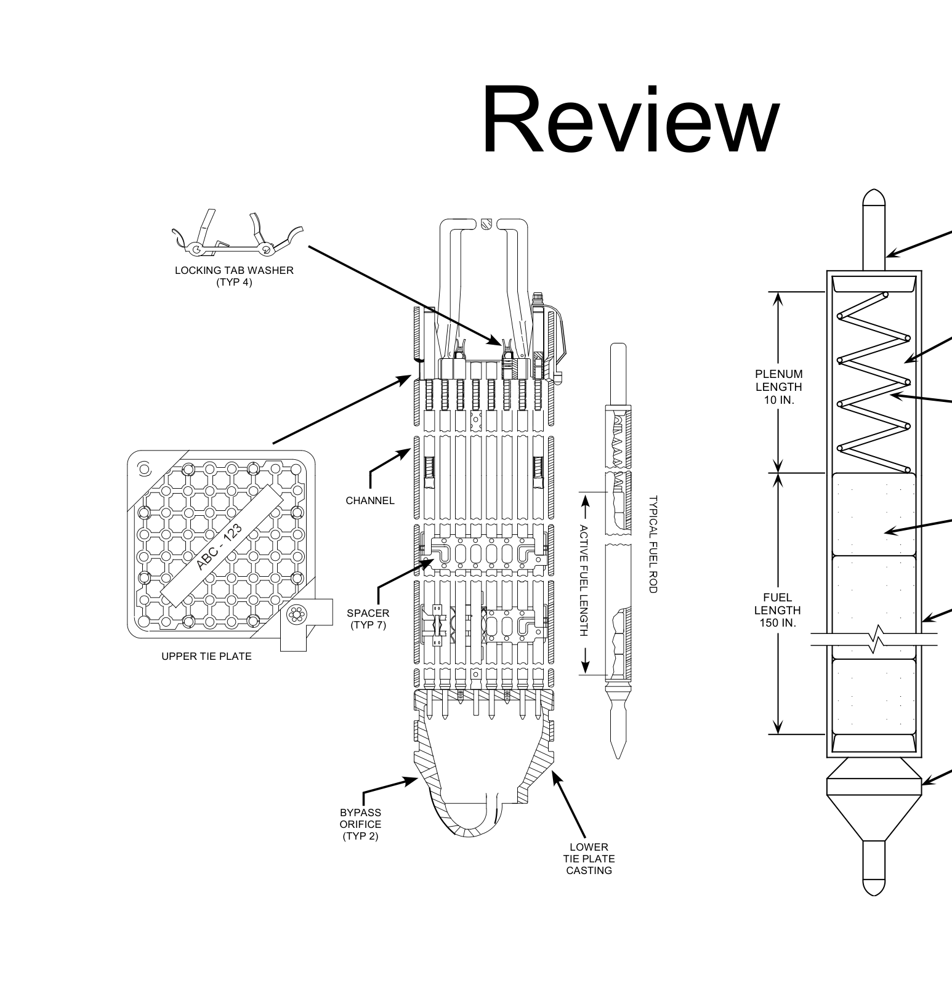

*figure on PDF page 31*

[Vector original (SVG, lossless): fig_page-31.svg](../figures/fig_page-31.svg)

<!-- labels/text on this figure page -->
(STAINLESS STEEL)
LOWER END PLUG PLENUM SPRING UPPER END PLUG
(ZIRCALOY 2)
FISSION GAS
(ZIRCOLOY 2) FUEL TUBE
(ZIRCALOY 2)
FUEL PELLETS PLENUM CHAMFERED
PLENUM LENGTH LENGTH 150 IN. 10 IN. FUEL Review TIE PLATE CASTING LOWER
CHANNEL SPACER (TYP 7)
BYPASS ORIFICE (TYP 2)
LOCKING TAB WASHER
(TYP 4)
UPPER TIE PLATE

<!-- p.32 -->
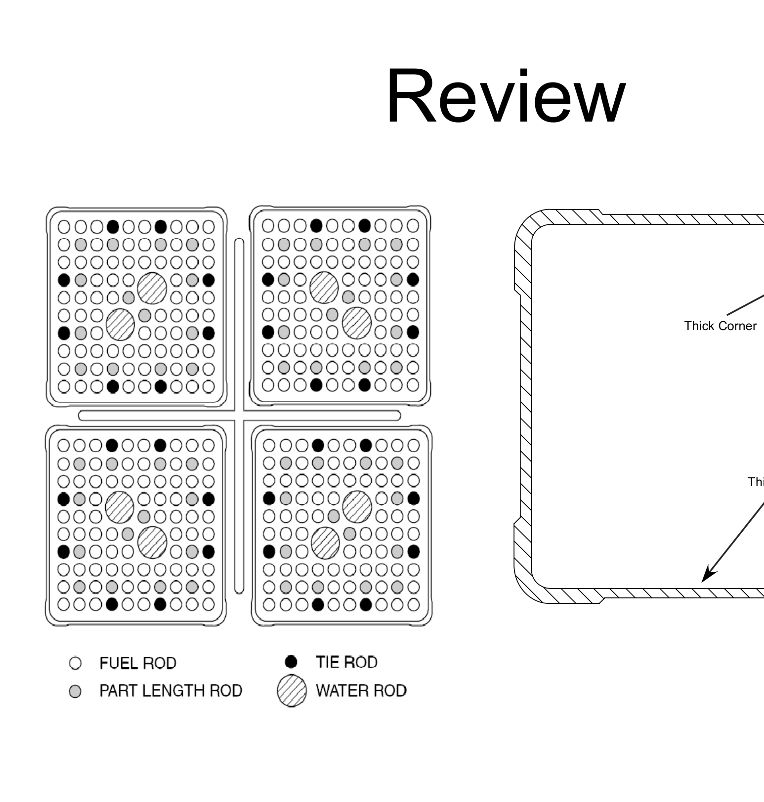

*figure on PDF page 32*

[Vector original (SVG, lossless): fig_page-32.svg](../figures/fig_page-32.svg)

<!-- p.33 -->
Review

<!-- p.34 -->
Review

Piece Nose

Filter

<!-- p.35 -->
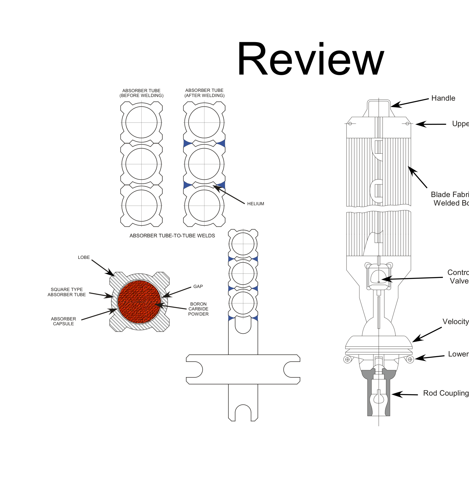

*figure on PDF page 35*

[Vector original (SVG, lossless): fig_page-35.svg](../figures/fig_page-35.svg)

<!-- labels/text on this figure page -->
Blade Fabricated From Welded Boron Tubes Upper Roller Velocity Limiter Lower Roller Control Rod Valve Disc Rod Coupling Handle
Review HELIUM
(AFTER WELDING) ABSORBER TUBE ABSORBER TUBE TO TUBE WELDS ABSORBER TUBE-TO-TUBE WELDS CARBIDE POWDER BORON GAP
(BEFORE WELDING)
ABSORBER TUBE
LOBE ABSORBER TUBE SQUARE TYPE ABSORBER CAPSULE

<!-- p.36 -->
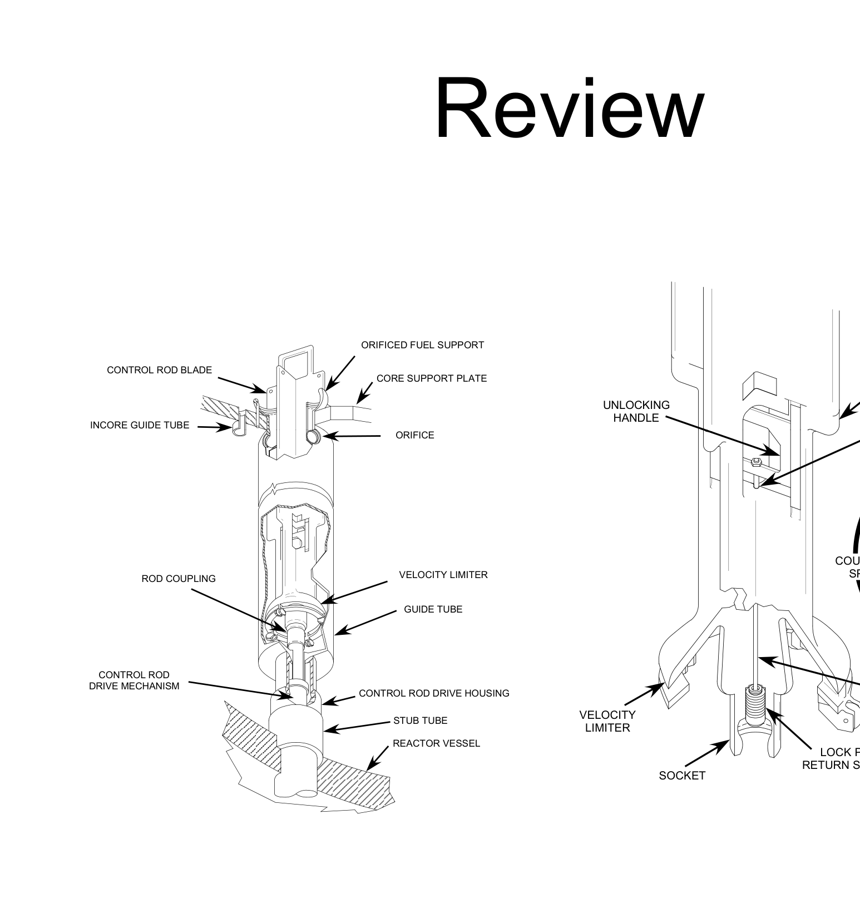

*figure on PDF page 36*

[Vector original (SVG, lossless): fig_page-36.svg](../figures/fig_page-36.svg)

<!-- labels/text on this figure page -->
LOCK PLUG UNLOCKING TUBE-DRIVE VALVE DISC SEAT TUBE INDEX CONTROL ROD ACTUATING SHAFT ASSEMBLY CONTROL ROD
RETURN SPRINGS COUPLING LOCK PLUG SPUD
SOCKET Review UNLOCKING HANDLE VELOCITY LIMITER
CONTROL ROD DRIVE HOUSING VELOCITY LIMITER ORIFICED FUEL SUPPORT CORE SUPPORT PLATE REACTOR VESSEL GUIDE TUBE STUB TUBE ORIFICE
ROD COUPLING CONTROL ROD BLADE INCORE GUIDE TUBE DRIVE MECHANISM CONTROL ROD

<!-- p.37 -->
Review

<!-- p.38 -->
• Allow maximum use of water as a neutron shield
• Axial power shaping to control local flux peaking
• Remain operable when the reactor vessel head
• Easier moisture removal and steam separation
• Limits reduced power production in upper core Bottom Entry Control Rods
• Less time remove and reinstall the reactor
• Yields a more optimum fuel burnup vessel head is removed

<!-- p.39 -->
• control rod guide tube to fuel support piece Flow Paths
• channel flow
• bypass flow

<!-- p.40 -->
Fuel Failure Mechanisms
• Pellet-clad-interaction (PCI)
• Foreign material intrusion
• Poor Water Quality
• Zircaloy-Hydriding

<!-- p.41 -->
• Refueling and Vessel Servicing System System Interfaces
• Fuel Transfer System
• Spent Fuel Pool
• RWM
• CRD
• RPV

<!-- p.42 -->
3. Explain why some of the system lines are heat 4. Identify the conditions that require initiation of verify initiation of the Standby Liquid Control 5. Identify the indications that can be used to
2. Explain how the system accomplishes its the Standby Liquid Control System.
1. Identify the system's purposes.
Objectives purposes.
System.
traced.
traced

<!-- p.43 -->
1.Recognize the purposes of the Objectives b.Control Rods a.Nuclear Fuel l R d following:
t

b C

<!-- p.44 -->
arrangements of the following fuel assembly
2. Summarize the function and physical d. Partial Length Fuel Rods Objectives g. Upper Tie Plate h. Lower Tie Plate j. Finger Springs b. Fuel Cladding k. Fuel Channel i. Fuel Spacers f. Water Rods a. Fuel Pellets c Fuel Rods c. Fuel Rods e. Tie-Rods components:

<!-- p.45 -->
arrangements of the following control rod
3. Summarize the function and physical Objectives g. Control Rod Guide Tube a. Control Rod Blades b. Control Rod Rollers l R d R ll c. Velocity limiter d. Spud Coupler f. Valve Disc components:
e. Lock Plug t

b C

<!-- p.46 -->
a. control rod guide tube to fuel support piece 4. Explain the following flow paths, including the 5. Explain the following characteristics of the Objectives a. fuel pellet composition b. enrichment variations c. burnable poisons purpose of that flow:
b. channel flow c. bypass flow reactor fuel:

<!-- p.47 -->
and recognize the mitigating strategies for those 6. Identify the common failure mechanisms of fuel 7. Explain why bottom entry control rods are used.
8. Explain the interrelationship that nuclear fuel l assemblies have with the following systems:
b. Refueling And Vessel Servicing System f

l

a. Reactor Pressure Vessel (RPV)
th t Objectives hi c. Fuel Transfer System l ti d. Spent Fuel Pool i t mechanisms.
th

l i

E

8

<!-- p.48 -->
9. Explain the interrelationship that the control rods b. Control Rod Drive System (CRD)
a. Reactor Pressure Vessel (RPV)
have with the following systems:
Objectives c. Fuel Transfer System e. Rod Worth Minimizer d. Spent Fuel Pool

<!-- p.49 -->
Are there any questions?

