# 2.3 Control Rod Drive

> Source: `2.3_Control_Rod_Drive.pdf` (37 pages)
> GE (BWR) Systems Technology Manual — USNRC HRTD, Rev 09/11

---
<!-- p.1 -->
#### General Electric Systems Technology Manual
#### Chapter 2.3
#### Control Rod Drive System
<!-- p.3 -->
TABLE OF CONTENTS

2.3 CONTROL ROD DRIVE SYSTEM ........................................................................... 1

2.3.1 Introduction .......................................................................................................... 2

2.3.2 System Description .............................................................................................. 2

2.3.3 Component Description ....................................................................................... 3

2.3.3.1 Water Sources ............................................................................................. 3

2.3.3.2 CRD Pumps and Related Components ....................................................... 4

2.3.3.3 Drive Water Filters and Strainers ................................................................ 4

2.3.3.4 Reactor Recirculation and RWCU Pump Cooling ........................................ 4

2.3.3.5 Flow Control Station .................................................................................... 4

2.3.3.6 Drive Water Pressure Control Station ......................................................... 5

2.3.3.7 Charging Water Header ............................................................................... 6

2.3.3.8 Exhaust Water Header ................................................................................ 6

2.3.3.9 Hydraulic Control Units ................................................................................ 7

2.3.3.10 Scram Discharge Volume ............................................................................ 8

2.3.3.11 Control Rod Drive Mechanism ..................................................................... 9

2.3.3.12 Position Indicating Probe ........................................................................... 12

2.3.4 System Features ............................................................................................... 12

2.3.4.1 Normal System Operation ......................................................................... 12

2.3.4.2 Scram Operation ....................................................................................... 13

2.3.4.3 Drifting Control Rod ................................................................................... 15

2.3.4.4 Uncoupled Control Rod ............................................................................. 15

2.3.5 System Interfaces .............................................................................................. 15

2.3.6 Summary ........................................................................................................... 16

LIST OF TABLES

2.3-1 Control Rod Position Indication .................................................................... 19

2.3-i USNRC HRTD

<!-- p.4 -->
#### LIST OF FIGURES
2.3-1 Control Rod Drive Hydraulic System
2.3-2 Hydraulic Control Unit
2.3-3 Scram Discharge Volume
2.3-4 CRDM
2.3-5 Enlarged Cutaway of Lower CRD
2.3-6 Control Rod Velocity Limiter and Coupling Mechanism
2.3-7 Control Rod Position Indication
2.3-8 Control Rod Drive Hydraulic System Insert Operation
2.3-9 CRDM Operation (Insert)
2.3-10 Control Rod Drive Hydraulic System Withdraw Operation
2.3-11 CRDM Operation (Withdraw)
2.3-12 Control Rod Drive Hydraulic System Reactor Scram
2.3-13 CRDM Operation (Scram)
2.3-14 Scram Pilot Air Header
2.3-15 Scram Time vs. Reactor Pressure

2.3-ii USNRC HRTD

<!-- p.5 -->
### 2.3 CONTROL ROD DRIVE SYSTEM
Learning Objectives:

1. Recognize the purposes of the control rod drive (CRD) system.

2. Recognize the function and operation of the following:
a. Strainers and filters b. CRD pumps c. Reactor recirculation pumps purge and cooling d. Reactor water cleanup (RWCU) pumps purge and cooling e. Flow control station f. Drive water pressure control station g. Charging water header h. Exhaust water header i. Hydraulic control units (HCUs)
j. Directional control valves k. Scram valves l. Scram accumulator m. Scram discharge volume

3. Recognize the function and operation of the following control rod drive (CRD)
mechanism components:
a. Outer tube and inner cylinder b. Collet assembly c. Index tube d. Drive piston e. Control rod drive coupling device (SPUD)
f. Piston tube g. Position indicating probe

4. Recognize the following CRD system flow paths:
a. Cooling and purge flow b. Accumulator charging flow c. Withdrawal flow d. Insertion flow e. Scram flow f. Settle flow

5. Recognize the purpose and function of the following CRDM components as they relate to coupling:
a. Blade socket b. Spud c. Lock plug

2.3-1 USNRC HRTD

<!-- p.6 -->
6. Recognize the indications of:
a. a drifting control rod b. an uncoupled control rod

7. Recognize how the Control Rod Drive system interfaces with the following systems:
a. Condensate and Feedwater System (Section 2.6)
b. Deleted c. Service and Instrument Air System (Section 11.6)
d. Fuel and Control Rods System (Section 2.2)
e. Reactor Manual Control System (Section 7.1)
f. Reactor Protection System (Section 7.3)
g. Recirculation System (Section 2.4)
h. Reactor Water Cleanup System (Section 2.8)

#### 2.3.1 Introduction
The purposes of the control rod drive (CRD) System are to:

• make changes in core reactivity by positioning control rods in response to the reactor manual control system (RMCS) signals.
• rapidly insert all control rods to shutdown the reactor in response to the reactor protection system (RPS) signals.
• provide cooling water to recirculation and reactor water cleanup (RWCU) pump seals

The functional classification of the CRD System is that of a safety related system because of the automatic shutdown (scram) capability. Portions of the CRD System not related to the scram function are classified as power generation equipment.

#### 2.3.2 System Description
The CRD System (Figure 2.3-1) primarily consists of:
• Control rod drive mechanisms (CRDMs)
• CRD pumps
• Hydraulic control units (HCUs)
• Pressure and flow control valves
• Directional control valves
• Stabilizing valves
• Filters and Strainers

The CRD source water is normally taken from the condenser hotwell reject line. It can also be taken from the condensate storage tank (CST). Normally one of the two CRD pumps is in operation while the other pump is maintained in standby. A portion of the pump discharge flow is diverted through a minimum flow bypass line to ensure pump

2.3-2 USNRC HRTD

<!-- p.7 -->
cooling. A flow control station downstream of the pumps maintains a constant system flow.

A drive water pressure control station is used to establish the pressure for normal CRD movement. When no rod movement is underway about 47 gpm of CRD flow is used to cool the CRD mechanisms. The CRD system also provides cooling water to the recirculation system pump seals and to the RWCU pump seals.

Control rods are inserted, withdrawn and scrammed using hydraulic control units
(HCUs). Provisions for inserting, withdrawing, and scramming of each CRD mechanism is accomplished with the use of an individual HCU for each control rod. Each HCU
(Figures 2.3-1 & 2.3-2) consists of:
• directional control valves
• scram valves
• a scram accumulator

#### 2.3.3 Component Description
The major components of the CRD System are discussed in the following paragraphs and illustrated in Figure 2.3-1.

##### 2.3.3.1 Water Sources
The normal water supply to the CRD system is taken from the condensate system demineralizer effluent, off the hot well reject line. The condensate filter/demineralizer effluent provides high quality, low oxygen content water. This minimizes the problems with intergranular stress corrosion cracking of the CRDM collet housing. When the condensate and feedwater system is shutdown, the CST provides an alternate suction source.

###### 2.3.3.1.2 Suction Filters
Suction filters are provided at the inlet to each CRD pump. The filters remove foreign particulates from the water prior to usage by the CRD pumps. Removing foreign particulates protects the pump seals, impellers, and other pump internals from excessive wear and damage.

###### 2.3.3.1.3 Suction Bypass Strainer
The bypass strainer is a replaceable cartridge Y type strainer used when the normal suction paths are not available. The bypass strainer protects the pumps from particles when the suction filters are isolated.

2.3-3 USNRC HRTD

<!-- p.8 -->
##### 2.3.3.2 CRD Pumps and Related Components
The CRD System utilizes two fully redundant motor driven centrifugal pumps rated at 200 gpm. Only one pump is normally in service, providing approximately 47 gpm flow.
The remaining pump is in standby status and requires operator action to start.

The CRD pumps are cooled by the reactor building closed loop cooling water
(RBCLCW) system.

A minimum flow line is provided for each CRD pump upstream of the discharge stop check valve. A restricting orifice limits the minimum flow to 20 gpm. The minimum flow line returns water to the CST. The 20 gpm is sufficient to prevent pump damage if the system flow is inadvertently stopped.

The pump motors receive power from the 4160V Emergency AC Power System.
• CRD Pump A from EDG “A” (Bus 101)
• CRD Pump B from EDG “B” (Bus 102)

##### 2.3.3.3 Drive Water Filters and Strainers
Two drive water filters are installed in parallel downstream of the CRD pumps to remove particulate prior to usage by the CRD system. The filters are redundant, with one filter normally in service at a time. Drive water strainers downstream of the filters protect the system should a filter cartridge fail.

##### 2.3.3.4 Reactor Recirculation and RWCU Pump Cooling
The recirculation system pump seals are supplied with cool, clean water from the CRD system to minimize the possibility of seal damage by foreign material. A flow of approximately 4 gpm is routed from downstream of the drive water filters to each recirculation pump.

The RWCU pumps are supplied with cool water from the CRD system to minimize seal failure on initial starting of the RWCU system.

##### 2.3.3.5 Flow Control Station
The flow control station consists of:
• a venturi flow element
• a transmitter
• a flow controller
• two air operated flow control valves (FCVs).

Only one of the two FCVs is in service at a time. A venturi flow element measures the system flow and develops a signal sent to a locally mounted flow transmitter. The flow

2.3-4 USNRC HRTD

<!-- p.9 -->
transmitter converts the hydraulic signal to an electrical signal. The electrical signal is transmitted to a flow controller and flow indicator in the control room. The flow controller can be operated in either the automatic or manual mode. In automatic operation the flow controller positions the FCV to maintain system flow at 47 gpm. In manual operation the operator adjusts flow using the manual pushbuttons on the flow controller.

The charging header connection is downstream of the flow element. Water supplied to the charging header during a scram or accumulator charging creates a high flow signal.
This causes the flow control valve to automatically close and divert water to the charging water header.

##### 2.3.3.6 Drive Water Pressure Control Station
The drive/cooling water pressure control station consists of:
• a manually adjusted motor operated valve
• two sets of stabilizing valves
• a manual bypass valve

The pressure control valve is a manually adjusted motor operated valve. It is adjusted from the control room to produce a drive water pressure of approximately 260 psig above reactor pressure.

The cooling water flow passes through the drive water pressure control valve and the stabilizing valves to the 137 hydraulic control units. From the HCU's the flow is sent to the CRD mechanisms.

Two stabilizing valve assemblies are installed in parallel. Each assembly consists of two solenoid operated valves. One of the two assemblies is in operation while the other remains in standby. Selection of the operational assembly is made from the control room via a pushbutton switch.

Both of the solenoid valves in the operating assembly are energized and open. Flow through open stabilizing valves bypasses the drive water pressure control valve. The flow through the insert stabilizing valves is set to correspond with the flow required for control rod insertion (approximately 4 gpm). Flow through the withdraw stabilizing valve corresponds to the flow required for withdrawal (approximately 2 gpm). Thus total flow is 6 gpm through both valves with no rod movement.

The solenoid valves are interconnected with the RMCS. The insert stabilizing valve deenergizes and closes when an insert signal is given to any control rod. The withdraw stabilizing valve de-energizes and closes when a withdraw signal is given. The flow through the stabilizing valves compensates for the flow through the drive water header.
Maintaining drive flow constant allows the drive water pressure to be stable during control rod movement. This allows control rod speed to be maintained constant.

2.3-5 USNRC HRTD

<!-- p.10 -->
A manual valve installed in parallel with the motor operated drive water pressure control valve. This manual valve permits isolation and maintenance of the motor-operated valve and/ or its controller.

##### 2.3.3.7 Charging Water Header
The charging water header takes water from the main water header between the flow element and the flow control valves. This water is then distributed to the water side of the 137 scram accumulators. The 137 scram accumulators normally "float" at the discharge pressure of the CRD pumps, approximately 1400 psig. During a scram condition the scram accumulators supply the initial motive force to push the control rods into the core. The resulting pressure decrease in the charging water header establishes a high flow condition for the CRD pump. The flow sensing element upstream of the charging water header detects this high flow and closes the flow control valve. This maximizes flow through the charging water header.

Several orifices connected in series, limits the flow in the charging water header during scram conditions to approximately 155 gpm. This feature coupled with the automatically closing of the FCV protects the CRD pump from runout. Total pump flow in a scram will be approximately 183 gpm broken down as follows:
• 155 gpm to the charging header
• 8 gpm to the recirculation seals
• 20 gpm minimum flow

Charging water header pressure is monitored by a pressure transmitter and displayed in the control room.

##### 2.3.3.8 Exhaust Water Header
The exhaust water header (Figure 2.3-1) provides a flow path for water expelled from the control rod drive mechanism during CRDM movement.

Water from normal control rod movement is sent to the non-moving control rod drive mechanisms via DCV 121. As a control rod is moved, the water is sent to the exhaust header via DCV 121 or 120. When the exhaust header pressurizes DCV 121 for the non moving control rods opens slightly. This relieves water from the exhaust header in to the 136 control rods that are not moving.

During a scram water is discharged from the CRDM through the scram outlet valve to the scram discharge volume. This creates a high differential pressure between the exhaust water header and the scram discharge header. This will cause the 121 directional control valves in other HCUs to slightly unseat and depressurize the exhaust header to well below drive water header pressure. This condition will cause a high differential pressure between the drive and exhaust pressure. Subsequent rod movement would have a large differential pressure across the CRDM drive piston that

2.3-6 USNRC HRTD

<!-- p.11 -->
would create excessive rod speeds. To prevent this, two pressure equalizing relief valves between the exhaust and cooling water header open to facilitate the rapid repressurization of the exhaust water header. This ensures the operation of the CRDMs at normal differential pressures after a scram signal is reset.

##### 2.3.3.9 Hydraulic Control Units
There are 137 HCUs, one for each control rod drive mechanism. They are located in the reactor building, divided into two approximately equal sets. Each HCU (Figure 2.3- 2) contains the hydraulic, electrical, and pneumatic equipment necessary to perform three specific functions:
• store the hydraulic energy in the accumulators and route that energy through the scram valves to insert the control rod
• route drive water through the solenoid operated directional control valves for normal control rod movement
• provide the cooling water flow path to the control rod drive mechanism

###### 2.3.3.9.1 Directional Control Valves
The purpose of the directional control valves (Figure 2.3-1 and 2.3-4) is to direct drive and exhaust water to allow for control rod movement. The directional control valves are solenoid operated valves that open and close on command from the RMCS. These RMCS signals provide the proper valve sequencing and duration for normal control rod movement.

###### 2.3.3.9.2 Scram Valves
The purpose of the scram valves is to control the flow of water necessary for rapid control rod insertion. The scram inlet and scram outlet valves are held in the closed position during reactor operation. The scram valves open by removing the air pressure from the valve operator and allowing spring force to push the valve open. When both scram valves open, the position switches illuminate a blue scram light, associated with that rod on the full core display in the main control room. The Reactor Protection system
(Section 7.3) controls the solenoid valves that open to remove the air pressure from the scram valves.

###### 2.3.3.9.3 Scram Accumulator
The scram accumulator (Figure 2.3-3) is a piston type water accumulator pressurized with nitrogen. Each HCU has one scram accumulator. Scram accumulators provide an independent source of stored energy to rapidly insert its associated control rod.

During normal operations the charging header pressure is approximately 1400 psig.
The charging water supply line to the scram accumulator has an in line check valve.

2.3-7 USNRC HRTD

<!-- p.12 -->
This check valve helps maintain accumulator pressure for a limited time if charging water header pressure is lost.

Upon initiation of a scram, the scram inlet and outlet valves open and the control rods are rapidly inserted into the core. The water side of the accumulator contains twice the amount of water needed to scram a control rod. A rupture disc in the instrument block set at 2000 psig protects the accumulator from over pressure.

The accumulator provides annunciation in the control room for accumulator trouble. The alarm is actuated if accumulator pressure is too low (940 psig) or if leakage (60cc) is sensed beneath the accumulator. An illuminated orange lamp on the full core display is provided for each control rod to indicate the affected accumulator(s). Visual inspection of the accumulator and checking the local alarm indications is done to determine which problem caused the alarm.

##### 2.3.3.10 Scram Discharge Volume
There are two scram discharge volumes (Figures 2.3-1 &3) located on opposite sides of the drywell. Each scram discharge volume consists of header piping connected to receive exhaust water from the HCUs. The purpose of the scram discharge volume is to receive and contain the exhaust water from the control rod drive mechanisms during a reactor scram. The scram discharge volume is sized to receive and contain approximately twice the volume of water discharged by the control rod drive mechanisms during a scram.

During normal operation, the scram discharge volume is empty (drained) and vented.
Both the vent and drains are connected to the reactor building equipment drain tank
(RBEDT).

During scram conditions, the solenoid valves de-energize removing air pressure from the vent and drain valve operators. This allows the valves to close under spring pressure. When the vent and drain valves shut, scram discharge water accumulates in the scram discharge volumes and instrument volumes. The vent and drain valves will become part of the reactor coolant pressure boundary and remain shut until the scram is reset.

Each instrument volume is equipped with multiple level instruments to monitor for water accumulation: The first level switch alarms to inform the control room operator that the instrument volume is filling from leakage of the scram outlet valves. If instrument volume water level increases to half full a second level switch actuates. This sends a rod withdraw block signal to the RMCS. Should water level continue to increase a scram signal is sent to the RPS system. This scram ensures a reactor scram while the discharge volume has sufficient capacity to accommodate the scram exhaust water.

2.3-8 USNRC HRTD

<!-- p.13 -->
##### 2.3.3.11 Control Rod Drive Mechanism
A control rod drive mechanism (CRDM) is a hydraulic locking piston assembly that uses water as the operating fluid (Figures 2.3-4 & 2.3-6). The CRDMs are mounted on the hemispherical bottom head of the reactor vessel. Each CRDM is directly coupled to its control rod by a coupling assembly. Movement of the CRDM is accomplished by applying drive water to one side of a piston and exhausting water from the other side.
The basic parts of a CRDM consist of:
• an outer tube
• an inner cylinder
• a collet locking mechanism
• a position indicating probe.

###### 2.3.3.11.1 Outer Tube and Inner Cylinder
The CRDMs (Figures 2.3-4 and 2.3-5) are connected to the reactor bottom head by a welded stub tube and flange assembly. A flange provides the means for mounting the CRDM to the CRD housing flange and connecting external piping.

Drilled passages in the flange route the drive water, cooling water and charging water utilized by the CRDM. When the CRDM is stationary, cooling water enters through the insert line attached to the flange. Cooling water flows through a cooling water orifice up between the thermal sleeve and outer tube and up past the seals in the drive piston.
The cooling water flow, approximately 0.25 - 0.34 gpm per drive, protects the various graphitar seals from high temperatures.

On control rod insertion drive water enters and follows the same porting path as the cooling water. The insert passages direct the driving water to the chamber below the drive piston. The withdraw passages channel water from the annulus formed by the outer tube and inner cylinder as well as the inside of the piston tube.

A ball check valve, located between the two water supply passages, ensures normal drive insert water is channeled to the bottom of the drive piston. The ball check valve also allows the reactor to supply a source of motive force to scram the CRDM, if normal scram pressure falls below reactor pressure.

###### 2.3.3.11.2 Collet Assembly
The collet assembly (Figure 2.3-4) is located in the collet housing in the upper annulus section between the outer tube and inner cylinder. The collet assembly consists of a:
• collet piston
• collet spring
• collet fingers
• guide cap.

2.3-9 USNRC HRTD

<!-- p.14 -->
The purpose of the collet assembly is to lock and hold the index tube at a selected position for an indefinite period of time. Six collet fingers are attached to the piston. The collet fingers engage the notches on the index tube. The guide cap provides a fixed camming surface. This surface guides the collet fingers upward and away from the index tube when pressure is applied under the collet piston.

A preload is placed on the collet piston by the collet spring. This preload must be overcome before the piston can be moved upward. Additionally, the weight of the control rod blade and CRDM moving parts must be overcome to allow the collet assembly to be actuated.

A brief insert signal is applied to move the index tube upward to relieve the weight on the collet fingers. This cams the collet fingers outward against the sloping lower surface of an index tube locking notch. Immediately a withdraw signal is applied. This applies pressure to the bottom of the collet piston overcoming the spring pressure. This will open the collet fingers outward against the guide cap. When the withdraw signal is removed spring pressure forces the collet piston assembly downward off the guide cap.
As the index tube settles downward the collet fingers snap into the next notch and lock the CRDM in place.

Unlocking is not required for CRDM insertion. The collet fingers are forced out of the locking notch as the index tube moves upward. The fingers grip the outside wall of the index tube and snap into the next lower locking notch for single notch insertion.

For scram insertion, the fingers ratchet into and out of each locking notch as the index tube moves upward to its inward travel limit. When scram pressure is removed, the index tube settles back from the limit of travel and locks to hold the control rod in the fully inserted position.

###### 2.3.3.11.3 Index Tube
The stainless steel index tube (Figure 2.3-11) is threaded at the top to accept the control rod coupling device (spud). The bottom of the index tube is threaded to the drive piston. The circumference of the index tube contains 25 machined notches.
Twenty-four of the twenty-five notches are spaced at equal intervals of 6 inches.

The uppermost surfaces of these notches are machined to engage the collet fingers, providing 24 increments (notches) at which a control rod may be positioned. The lower surfaces of the locking notches are beveled such that the collet fingers are forced outward during control rod insertion. The uppermost notch (fully withdrawn) on the index tube does not provide a locking surface. It serves only as an indentation for the collet fingers when the control rod is withdrawn to the backseat position.

When backseated, the control rod sits in the base of the control rod guide tube and the index tube/collet fingers are not supporting the weight of the CRD blade. When the

2.3-10 USNRC HRTD

<!-- p.15 -->
CRD is uncoupled from the CRDM, the index tube withdraws a small additional distance until the drive piston reaches its lower end stop.

###### 2.3.3.11.4 Drive Piston
The drive piston (Figure 2.3-4 and 2.3-7) provides the required surface area to apply drive or scram water pressure to accomplish rod movement. The drive piston is threaded to the lower end of the index tube and is contained within the annular space between the inner cylinder and piston tube. Travel of the drive piston is limited by positive end stops on both ends, with an additional hydraulic cushion provided at the upper end by a series of buffer orifices in the piston tube.

The effective area under the drive piston is greater than the effective area above the drive piston. This difference in piston areas provides for an insert force greater than a withdraw force under all operating conditions. Because of this difference in area, different flow rates for insertion and withdrawal of the CRDM are required. The required flow rates are approximately 2 gpm for withdrawal and 4 gpm for insertion.

Embedded in the lower end of the drive piston is a permanent magnet used to trigger position indicating reed switches that will be covered later in this chapter.

###### 2.3.3.11.5 Control Rod Coupling Device (Spud)
The control rod coupling device is most frequently referred to as a “spud”. The spud is threaded to the upper end of the movable index tube. The spud is a six-fingered cylindrical male fitting that connects to the control rod female fitting below the velocity limiter (Figure 2.3-6). A lock plug fits into the six-fingered spud to lock the spud and control coupling.

Uncoupling of a CRDM from the control rod is accomplished from above or below the core with the aid of special tools. Moving the lock plug upward allows the spud fingers to be compressed. This allows removing the physical connection between the control rod and the CRDM index tube.

###### 2.3.3.11.6 Piston Tube
The piston tube (Figure 2.3-4) performs three functions:

• Channels water to or from the top of the drive piston.
• Provides a hydraulic buffer during control rod scram insertion.
• Supports the upper and lower limit drive piston stops.

During rod withdrawal, water from the withdraw annulus is forced through orifices to move the drive piston downward. During normal rod insertion or scram, the flow is reversed through these orifices. During a scram the upward travel of the drive piston

2.3-11 USNRC HRTD

<!-- p.16 -->
closes off these orifices trapping water between the top of the drive piston and the bottom of the stop piston. This water creates a buffer action, decreasing the rate of drive piston travel as the upward movement closes off the orifices.

The stop piston is threaded to the top of the outer cylindrical section. It provides a seal between reactor vessel pressure and the area above the drive piston. It also functions as a positive end stop at the upper limit of the drive piston travel.

###### 2.3.3.11.7 Indicator Tube
The indicator tube (Figure 2.3-4) forms the innermost cylinder wall of the CRDM and forms the drywell to reactor vessel pressure boundary for the position indicating probe.

##### 2.3.3.12 Position Indicating Probe
The position indicating probe (Figure 2.3-8) consists of a dry cylindrical tube sealed at the top. This tube houses 53 position indicating reed switches and one thermocouple.
The reed switches are activated by the permanent magnet enclosed in the lower end of the drive piston. When the magnet encircles a reed switch, the switch closes to provide digital rod position information. This information is sent to the control room and to the process computer. Even numbered readouts (from 00 to 48) are provided at each latched drive position. Odd numbered readouts (from 01 to 47) are provided at the midpoints between latched positions. Thus indication is provided for each 3 inches of rod travel and whenever the CRD travel limits are reached. Table 2.3-1 provides the relationship between CRD probe switches, CRD position, and display information.

#### 2.3.4 System Features
A short discussion of system features and interfaces this system has with other plant systems is given in the following paragraphs.

##### 2.3.4.1 Normal System Operation
During normal power operation the CRD system is providing the following flow rates
• minimum flow for the pump (20 gpm)
• cooling water flow (47 gpm) to the 137 CRDM
• seal purge flow to the recirculation pump seals (8 gpm total)

The pumps maintain the drive header pressure at 260 psid and charging header pressure at approximately 1400 psig.

Rod movement is accomplished through the RMCS and the directional control valves.
These direct drive water to and exhaust water from the CRDM.

To insert a control rod (Figures 2.3-8 & 9), the RMCS first signals Directional Control Valves (DCVs) 121 and 123 to open. This places drive water pressure on the CRDM

2.3-12 USNRC HRTD

<!-- p.17 -->
under piston area and vents the top of the drive piston to the exhaust water header.
The RMCS also signals the insert stabilizing valve to close, redirecting 4 gpm of cooling water flow through DCV 123.

The exhaust water header is connected to DCVs 120 and 121 of all the CRDs. The shut 121 DCVs on the non moving HCUs act as relief valves. When the exhaust water header pressure increases exhaust water is routed to the above piston area of the nonmoving drives.

The CRDM being inserted now has approximately 260 psid across its drive piston, and the control rod inserts into the core. The index tube moves upward so that the collect fingers are just below the next lower index tube notch position. The RMCS then closes DCVs 121 and 123, opens the insert stabilizing valve, and DCV 120. This vents the under piston area allowing the drive to settle downward onto the collet fingers. The water vented from the under piston area pressurizes the exhaust header and is relieved through the DCV 121 valves. After a time period sufficient to allow the drive to settle on the collet fingers RMCS closes the DCV 120.

Withdraw motion (Figures 2.3-10 & 11) is more complicated because of the latching nature of the drive. The withdraw motion begins as an insert movement to lift the index tube of the CRDM off the collet fingers. This also cams the collet fingers out as they ride along the index tube. The RMCS then closes insert DCVs 121 & 123 and opens the insert stabilizing valve. Then the withdraw DCVs 120 and 122 are opened and the withdraw stabilizing valve is closed. DCV 122 valve opening applies pressure to the collet piston moving it upward forcing open the collet fingers against the guide cap. The drive is now moving out of the core. RMCS times the open condition of the withdraw DCVs until the drive has moved downward just past the original latch then closes DCV 122. After a time period sufficient to allow the drive to settle on the collet fingers RMCS closes the DCV 120.and the withdraw stabilizing valve is opened.

As on the insert movement, all water vented to the exhaust header is relieved to the over piston area of non-moving drives via their 121 valves.

##### 2.3.4.2 Scram Operation
RPS initiates CRD system scram operation (Figures 2.3-12, 2.3-13 and 2.3-14) upon detection of a potentially unsafe condition. The controls and valves used for normal CRDM movement are not required for the scram function. When a reactor scram is initiated by the RPS the scram pilot air header is isolated and depressurized. Spring pressure opens the inlet and outlet scram valves on each HCU and closes the scram discharge volume vent and drain valves. Pressure from the scram accumulator is applied to the area below the drive piston. The area above the piston piped to the scram discharge volume headers. The large differential pressure applied to the drive piston area drives the index tube and control rod rapidly in to the core. As the index tube nears the top of its stroke, the drive piston seals close off the piston tube buffer holes.

2.3-13 USNRC HRTD

<!-- p.18 -->
The number, size and spacing of the buffer holes in the CRD piston tube provide a gradual deceleration of index tube movement. Bellville washers in the top of the cylinder absorb the final inertia.

The scram discharge volume fills and pressurizes to reactor pressure within several seconds. This is due to the water displaced from the above piston area and the flow of water from the charging header. With the scram discharge volume vent and drain valves closed the scram discharge volume becomes part of the reactor vessel.

In addition to the 137 sets of scram pilot solenoid valves there are two backup scram solenoid valves. These valves are normally deenergized 125VDC valves. They energize at the same time the 125VAC valves deenergize. The backup scram valves control the air supply to the entire scram pilot air header. When energized the valves reposition isolating and venting the header. If any individual scram pilot valve fails to open venting of the scram air header should open them. This provides a redundant means of venting the scram air header and causing rod insertion. The overall time to insert the control rods will be longer as this method takes longer to vent the scram air header. Either backup scram valve can perform this function.

Each CRDM requires approximately 3 gallons of water for a scram. The water side of the scram accumulator holds approximately twice this volume. Thus the accumulator provides an adequate capacity for each CRD to complete a scram stroke regardless of reactor pressure. At high reactor pressures the accumulator provides the initial surge of water. As the accumulator discharges the pressure at the CRD will decrease to below reactor pressure. This causes the ball check valve (built into the CRDM) to shift its position and admit reactor water under the drive piston. Reactor pressure will supply the force required to complete the scram stroke.

In addition to both of the above methods used to vent the scram pilot header there is another totally independent RPS system. This system is called the Alternate Rod Insertion System (ARI) and it can isolate and depressurize the scram pilot air header.
ARI is a redundant reactivity control system required for all plants in accordance with 10CFR50. The system monitors reactor water level and pressure as trip inputs. The equipment used (sensors, valves, power supplies etc.) for ARI are totally independent from those used by RPS. When water level decreases to Level 2 (-38") or reactor pressures increases to 1120 psig, the following actions occur:
• two 125 VDC solenoid valves in the scram pilot air header open
• four dump valves isolate and vent the scram air header

This will depressurize the scram air header, causing the insertion of all 137 control rods.
ARI can also be initiated manually by the reactor operator in the control room.

Three of the six ARI valves are powered from Div 1, 125VDC supply, and the other three from Div 2, 125VDC supply.

2.3-14 USNRC HRTD

<!-- p.19 -->
##### 2.3.4.3 Drifting Control Rod
A drifting control rod is a rod moving without being commanded to move by the reactor operator via the RMCS. When this occurs, a rod drift alarm is received in the control room. This circuit is described in the RMCS chapter.

A control rod and index tube may drift out if the collet fingers have not properly engaged in the notch of the index tube. A drift inward may be caused by a leaky inlet or outlet scram valve or too high a cooling water pressure.

##### 2.3.4.4 Uncoupled Control Rod
A control rod may be uncoupled due to either a failure to correctly couple it initially or due to a mechanical coupling failure. The operator detects an uncoupled control rod by attempting to withdraw it past the full out position. If the control rod drive mechanism is withdrawn far enough to actuate the over travel reed switches, it is not coupled to the drive mechanism. When the over travel reed switches are actuated they generate an alarm in the control room.

#### 2.3.5 System Interfaces
Interfaces the Control Rod Drive System has with other plant systems are discussed in the following paragraphs.

Condensate and Feedwater System (Section 2.6)

The Condensate and Feedwater System reject line provides the preferred source of high quality water for the CRD System.

Condensate Transfer and Storage System (Section 11.6)

The Condensate Transfer and Storage System provides a backup supply of high quality water (the condensate storage tank) for the CRD System.

Station and Instrument Air System (Section 11.8)

Instrument air from the Service and Instrument Air System supplies high quality air to the CRD System air operated components.

Control Rods and Fuel System (Section 2.2)

The control rods are positioned within the reactor core by the CRD System.

2.3-15 USNRC HRTD

<!-- p.20 -->
Reactor Manual Control System (Section 7.1)

The RMCS controls the directional control valves (DCVs) to direct the hydraulic water forces of the CRD System to cause control rod motion. The RMCS controls the CRD System stabilizing valves to allow constant flow through the CRD System.

Reactor Protection System (Section 7.3)

The RPS provides signals to hold the scram valves shut. As long as the RPS is energized, both the Inlet and outlet scram valves remain closed.

Recirculation System (Section 2.4)

The Recirculation System receives cool, clean water from the CRD System for recirculation pump seal purge.

Reactor Water Cleanup System (Section 2.8)

The CRD system supplies cool, clean water to the reactor water cleanup pump seals for initial system startup.

Emergency AC Power System (Section 9.2)

The Emergency AC Power System supplies power to the CRD pumps A and B.

#### 2.3.6 Summary
Purposes:

1. To make changes in core reactivity by positioning control rods in response to RMCS signals.

2. To rapidly insert all control rods to shutdown the reactor in response to RPS signals.

Control rods are inserted, withdrawn and scrammed using hydraulic control units
(HCUs). Provisions for inserting, withdrawing, and scramming of each CRD mechanism is accomplished with the use of an individual HCU for each control rod. Each HCU
(Figures 2.3-1 & 2.3-2) consists of:
• directional control valves
• scram valves
• a scram accumulator

2.3-16 USNRC HRTD

<!-- p.21 -->
#### Table 2.3-1 Control Rod Position Indication
CRD Probe Inches From Full Rod Position Rod Position Switch number Insert Readout Display

S51
- 1¼ Green Light*, No Over travel readout beyond full in S52
- ⅜ Green Light* Normal full in, latched S00 0

## 00 Readout Normal full in,
latched S01 3

## 01 Readout ** Half way
between 00 and 02 S02 6

## 02 Readout Latched at 02
S48 144

## 48 Readout Normal full out,
latched S49 144 Red light* Normal full out, latched S50 146 Red light*, No Over travel readout, beyond full out Over travel annunciator

* Individual Red and Green lights are provided for each rod on the P-603 vertical section’s full core display. Red and green backlighting is also provided in the P-603’s four rod display.

** All odd position readouts are displayed as “- -“ in the P-603’s four rod display.

2.3-17 USNRC HRTD

<!-- p.22 -->
2.3-18 USNRC HRTD

<!-- p.23 -->
#### Figure 2.3-1

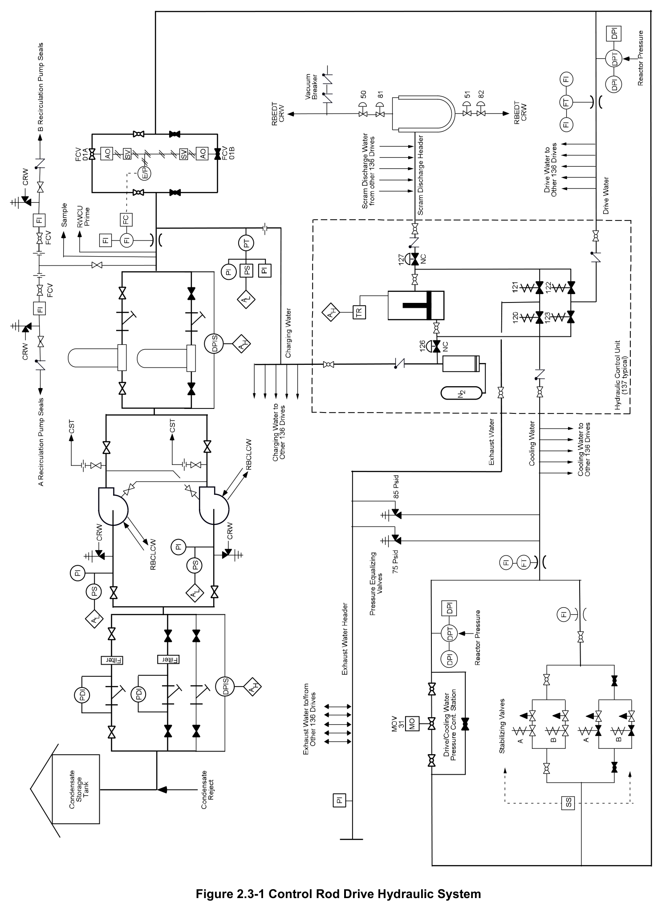

*Control Rod Drive Hydraulic System*

[Vector original (SVG, lossless): fig_2.3-1.svg](../figures/fig_2.3-1.svg)

<!-- p.24 -->
#### Figure 2.3-2

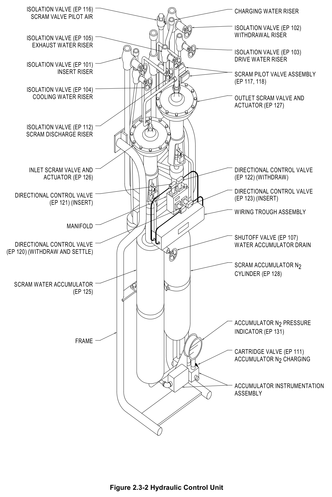

*Hydraulic Control Unit*

[Vector original (SVG, lossless): fig_2.3-2.svg](../figures/fig_2.3-2.svg)

<!-- labels/text on this figure page -->
ISOLATION VALVE (EP 116)
CHARGING WATER RISER SCRAM VALVE PILOT AIR
ISOLATION VALVE (EP 102)
WITHDRAWAL RISER ISOLATION VALVE (EP 105)
EXHAUST WATER RISER ISOLATION VALVE (EP 103)
DRIVE WATER RISER ISOLATION VALVE (EP 101)
INSERT RISER SCRAM PILOT VALVE ASSEMBLY
(EP 117, 118)
ISOLATION VALVE (EP 104)
COOLING WATER RISER OUTLET SCRAM VALVE AND ACTUATOR (EP 127)
ISOLATION VALVE (EP 112)
SCRAM DISCHARGE RISER
DIRECTIONAL CONTROL VALVE INLET SCRAM VALVE AND
(EP 122) (WITHDRAW)
ACTUATOR (EP 126)
DIRECTIONAL CONTROL VALVE DIRECTIONAL CONTROL VALVE
(EP 123) (INSERT)
(EP 121) (INSERT)
WIRING TROUGH ASSEMBLY
MANIFOLD
SHUTOFF VALVE (EP 107)
DIRECTIONAL CONTROL VALVE WATER ACCUMULATOR DRAIN
(EP 120) (WITHDRAW AND SETTLE)
SCRAM ACCUMULATOR N2 CYLINDER (EP 128)
SCRAM WATER ACCUMULATOR
(EP 125)
ACCUMULATOR N2 PRESSURE INDICATOR (EP 131)
FRAME
CARTRIDGE VALVE (EP 111)
ACCUMULATOR N2 CHARGING
ACCUMULATOR INSTRUMENTATION ASSEMBLY
Figure 2.3-2 Hydraulic Control Unit

<!-- p.25 -->
#### Figure 2.3-3

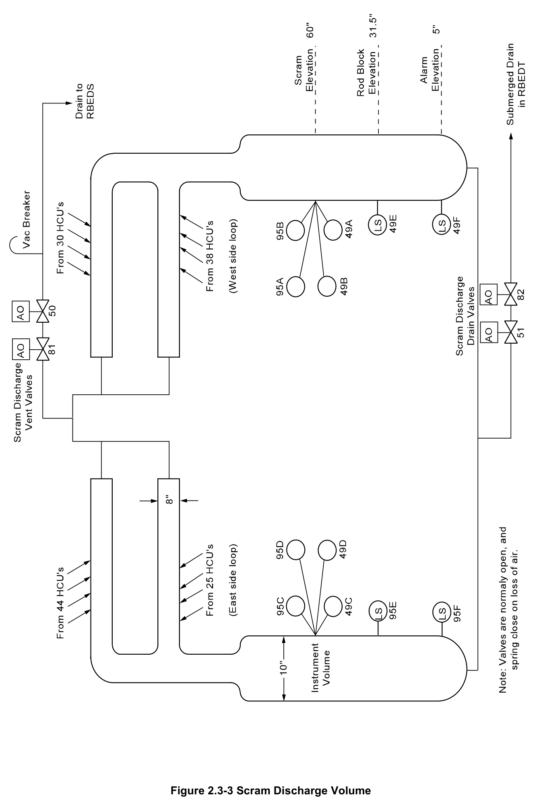

*Scram Discharge Volume*

[Vector original (SVG, lossless): fig_2.3-3.svg](../figures/fig_2.3-3.svg)

<!-- p.26 -->
#### Figure 2.3-4

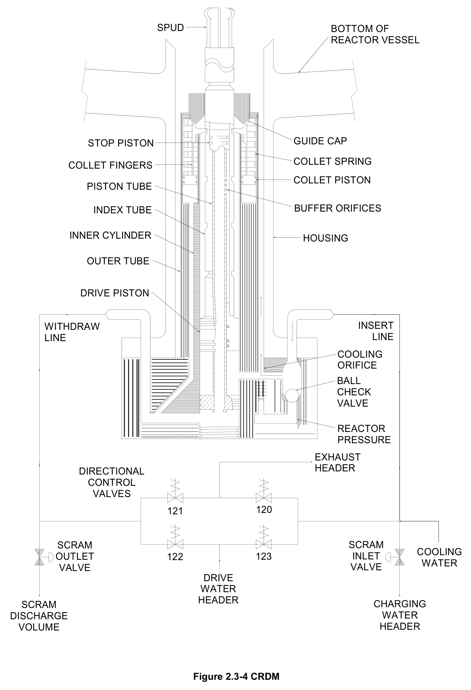

*CRDM*

[Vector original (SVG, lossless): fig_2.3-4.svg](../figures/fig_2.3-4.svg)

<!-- labels/text on this figure page -->
SPUD BOTTOM OF REACTOR VESSEL
GUIDE CAP STOP PISTON
COLLET SPRING COLLET FINGERS COLLET PISTON PISTON TUBE
BUFFER ORIFICES INDEX TUBE
INNER CYLINDER HOUSING
OUTER TUBE
DRIVE PISTON
INSERT WITHDRAW LINE LINE
COOLING ORIFICE BALL CHECK VALVE
REACTOR PRESSURE
EXHAUST HEADER DIRECTIONAL CONTROL VALVES 120 121
SCRAM SCRAM COOLING INLET 123 OUTLET 122 WATER VALVE VALVE DRIVE WATER HEADER CHARGING SCRAM WATER DISCHARGE HEADER VOLUME
Figure 2.3-4 CRDM

<!-- p.27 -->
#### Figure 2.3-5

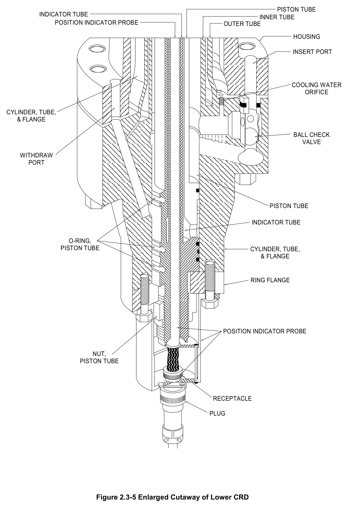

*Enlarged Cutaway of Lower CRD*

[Vector original (SVG, lossless): fig_2.3-5.svg](../figures/fig_2.3-5.svg)

<!-- labels/text on this figure page -->
PISTON TUBE INDICATOR TUBE INNER TUBE POSITION INDICATOR PROBE OUTER TUBE
HOUSING
INSERT PORT
COOLING WATER ORIFICE
CYLINDER, TUBE, & FLANGE
BALL CHECK VALVE
WITHDRAW PORT
PISTON TUBE
INDICATOR TUBE
O-RING, PISTON TUBE CYLINDER, TUBE, & FLANGE
RING FLANGE
POSITION INDICATOR PROBE
NUT, PISTON TUBE
RECEPTACLE
PLUG
Figure 2.3-5 Enlarged Cutaway of Lower CRD

<!-- p.28 -->
#### Figure 2.3-6

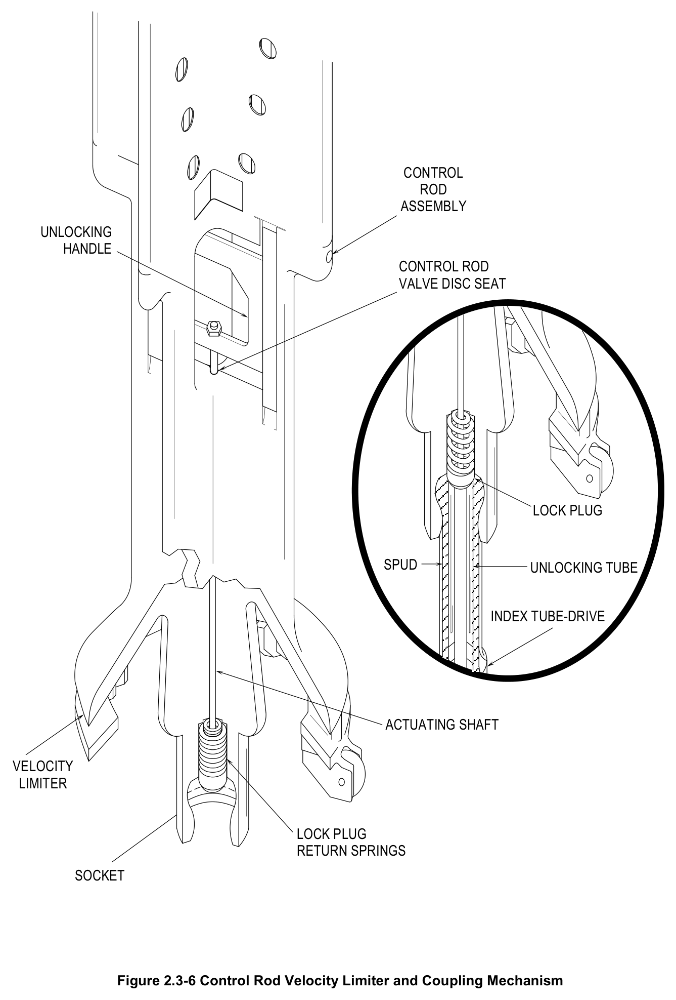

*Control Rod Velocity Limiter and Coupling Mechanism*

[Vector original (SVG, lossless): fig_2.3-6.svg](../figures/fig_2.3-6.svg)

<!-- labels/text on this figure page -->
CONTROL ROD ASSEMBLY
UNLOCKING HANDLE CONTROL ROD VALVE DISC SEAT
LOCK PLUG
SPUD UNLOCKING TUBE
INDEX TUBE-DRIVE
ACTUATING SHAFT
VELOCITY LIMITER
LOCK PLUG RETURN SPRINGS
SOCKET
Figure 2.3-6 Control Rod Velocity Limiter and Coupling Mechanism

<!-- p.29 -->
#### Figure 2.3-7

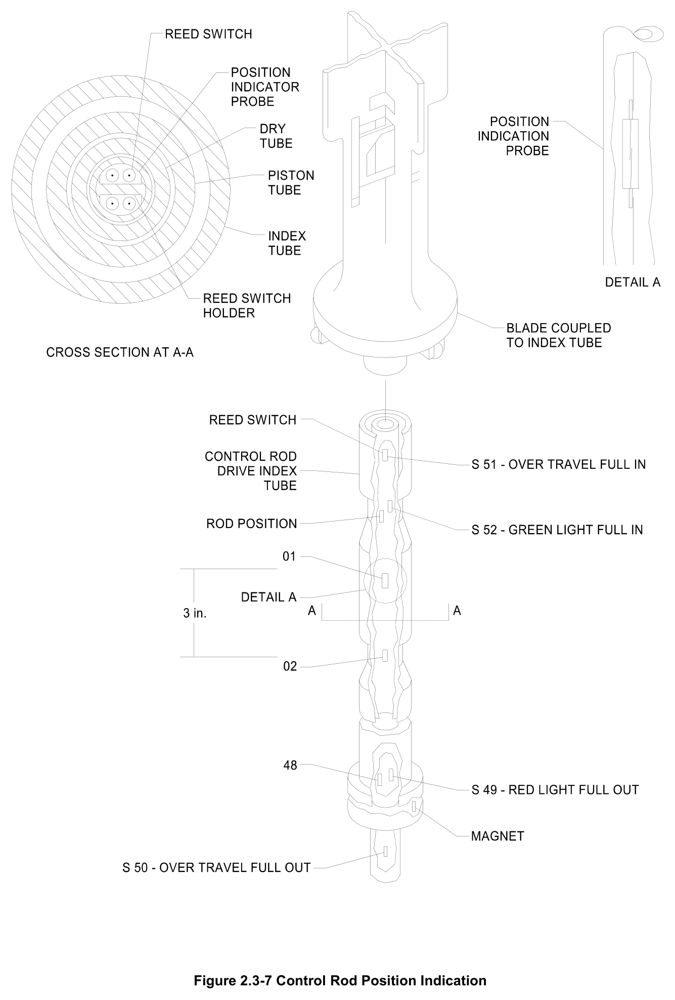

*Control Rod Position Indication*

[Vector original (SVG, lossless): fig_2.3-7.svg](../figures/fig_2.3-7.svg)

<!-- p.30 -->
#### Figure 2.3-8

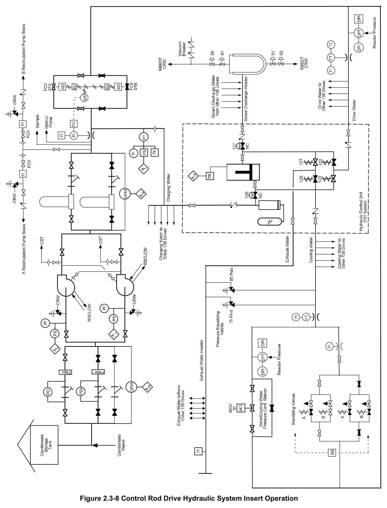

*Control Rod Drive Hydraulic System Insert Operation*

[Vector original (SVG, lossless): fig_2.3-8.svg](../figures/fig_2.3-8.svg)

<!-- p.31 -->
#### Figure 2.3-9

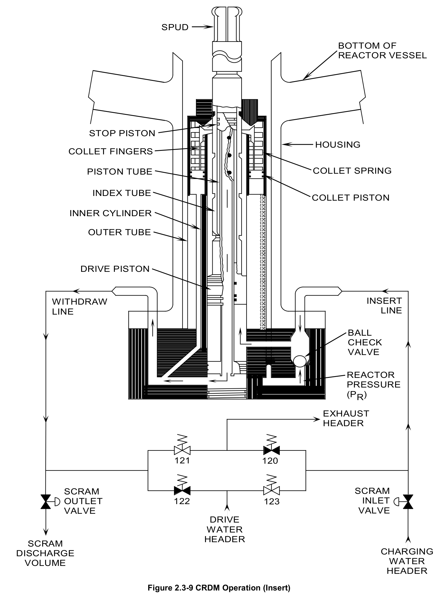

*CRDM Operation (Insert)*

[Vector original (SVG, lossless): fig_2.3-9.svg](../figures/fig_2.3-9.svg)

<!-- labels/text on this figure page -->
SPUD
BOTTOM OF REACTOR VESSEL
STOP PISTON HOUSING COLLET FINGERS
COLLET SPRING PISTON TUBE
INDEX TUBE COLLET PISTON
INNER CYLINDER
OUTER TUBE
DRIVE PISTON
INSERT WITHDRAW LINE LINE
BALL CHECK VALVE
REACTOR PRESSURE
(PR)
EXHAUST HEADER
121 120
SCRAM SCRAM INLET 122 OUTLET 123 VALVE VALVE DRIVE WATER HEADER SCRAM CHARGING DISCHARGE WATER VOLUME HEADER
Figure 2.3-9 CRDM Operation (Insert)

<!-- p.32 -->
#### Figure 2.3-10

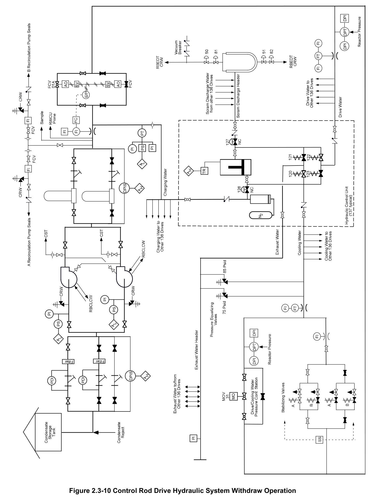

*Control Rod Drive Hydraulic System Withdraw Operation*

[Vector original (SVG, lossless): fig_2.3-10.svg](../figures/fig_2.3-10.svg)

<!-- p.33 -->
#### Figure 2.3-11

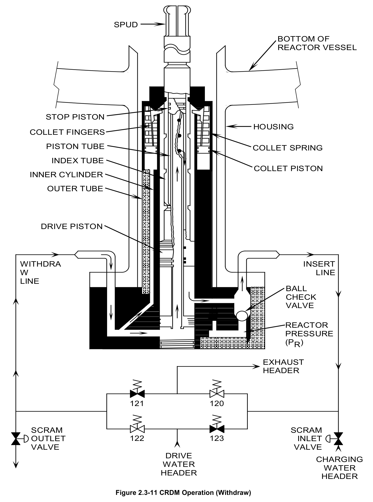

*CRDM Operation (Withdraw)*

[Vector original (SVG, lossless): fig_2.3-11.svg](../figures/fig_2.3-11.svg)

<!-- labels/text on this figure page -->
SPUD
BOTTOM OF REACTOR VESSEL
STOP PISTON HOUSING COLLET FINGERS
PISTON TUBE COLLET SPRING
INDEX TUBE COLLET PISTON INNER CYLINDER
OUTER TUBE
DRIVE PISTON
WITHDRA INSERT W LINE LINE BALL CHECK VALVE
REACTOR PRESSURE
(PR)
EXHAUST HEADER
121 120
SCRAM SCRAM 122 123 OUTLET INLET VALVE VALVE DRIVE CHARGING WATER WATER HEADER HEADER
Figure 2.3-11 CRDM Operation (Withdraw)

<!-- p.34 -->
#### Figure 2.3-12

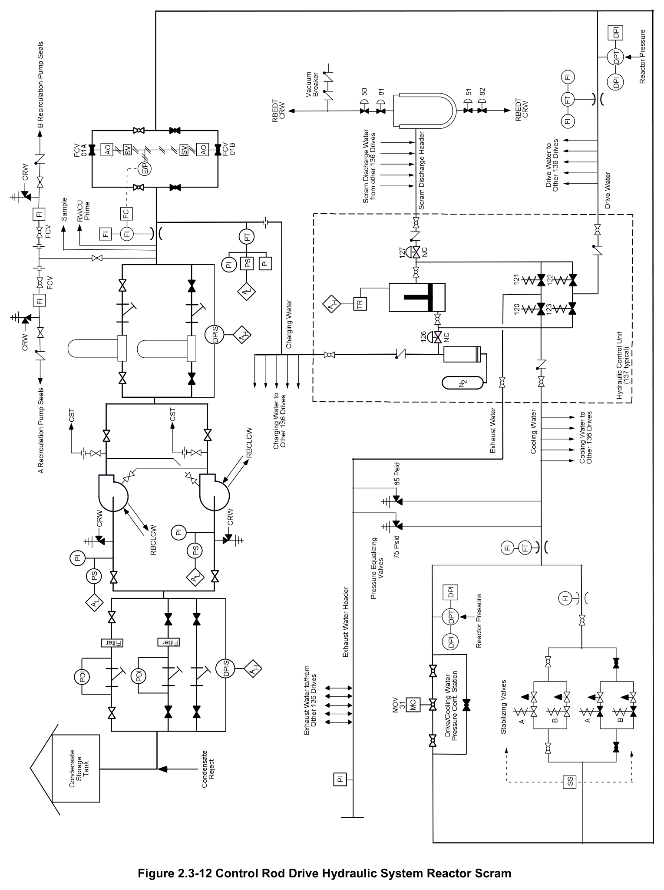

*Control Rod Drive Hydraulic System Reactor Scram*

[Vector original (SVG, lossless): fig_2.3-12.svg](../figures/fig_2.3-12.svg)

<!-- p.35 -->
#### Figure 2.3-13

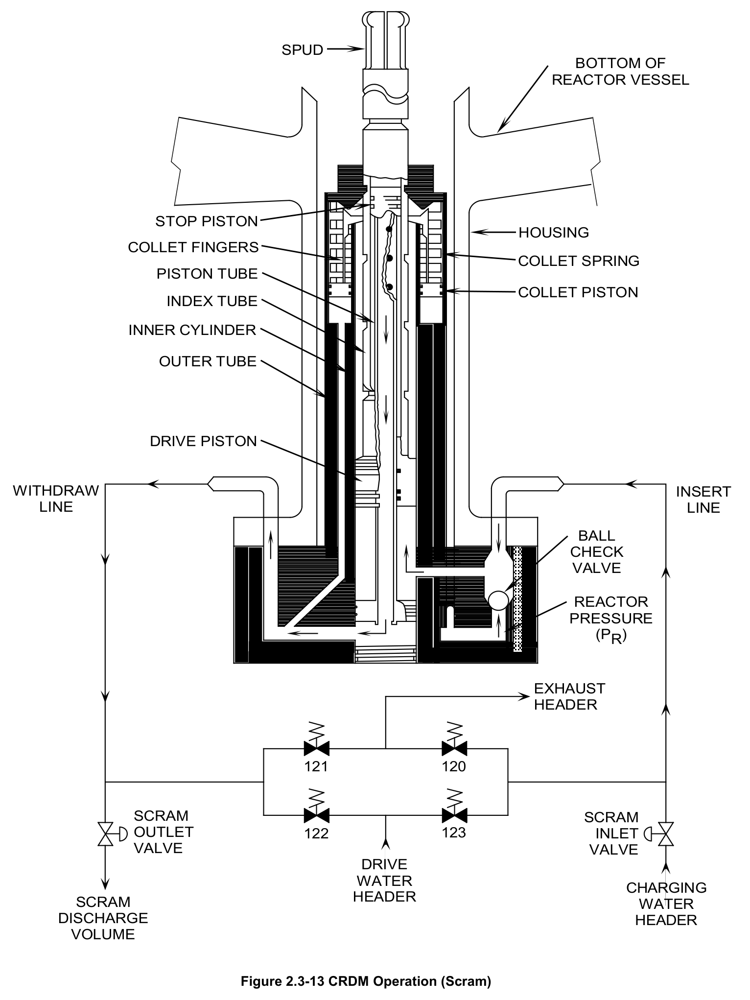

*CRDM Operation (Scram)*

[Vector original (SVG, lossless): fig_2.3-13.svg](../figures/fig_2.3-13.svg)

<!-- labels/text on this figure page -->
SPUD BOTTOM OF REACTOR VESSEL
STOP PISTON HOUSING COLLET FINGERS COLLET SPRING PISTON TUBE COLLET PISTON INDEX TUBE
INNER CYLINDER
OUTER TUBE
DRIVE PISTON
WITHDRAW INSERT LINE LINE
BALL CHECK VALVE
REACTOR PRESSURE
(PR)
EXHAUST HEADER
121 120
SCRAM SCRAM OUTLET 123 122 INLET VALVE VALVE DRIVE WATER CHARGING HEADER SCRAM WATER DISCHARGE HEADER VOLUME
Figure 2.3-13 CRDM Operation (Scram)

<!-- p.36 -->
#### Figure 2.3-14

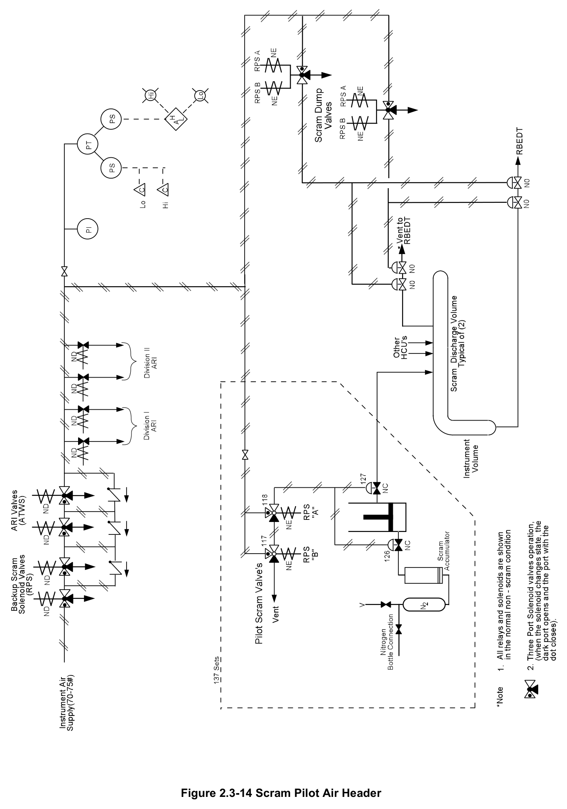

*Scram Pilot Air Header*

[Vector original (SVG, lossless): fig_2.3-14.svg](../figures/fig_2.3-14.svg)

<!-- p.37 -->
#### Figure 2.3-15

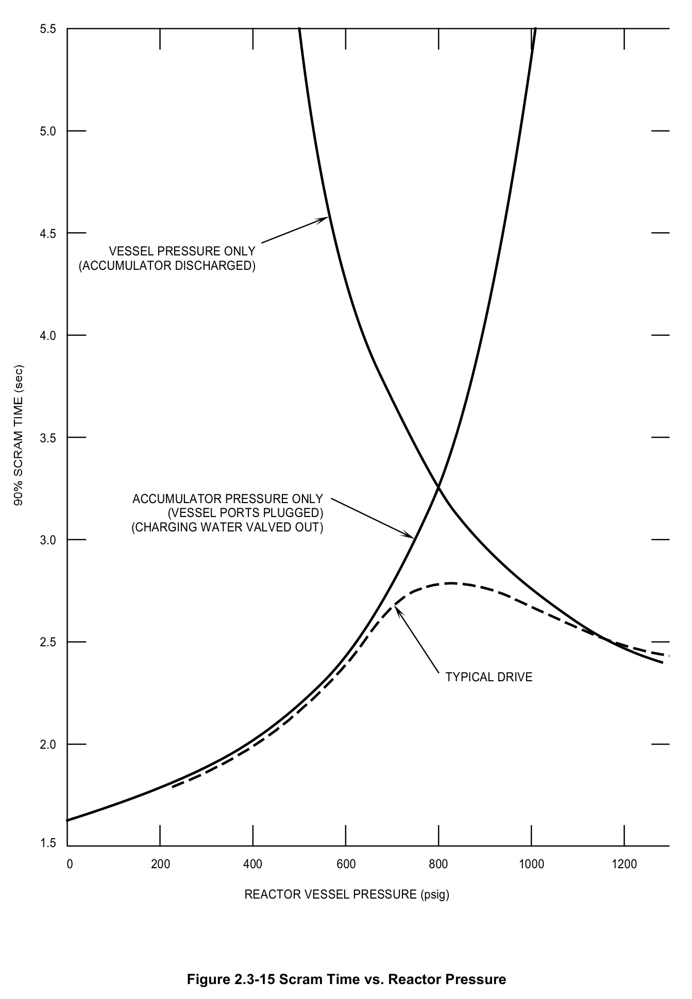

*Scram Time vs. Reactor Pressure*

[Vector original (SVG, lossless): fig_2.3-15.svg](../figures/fig_2.3-15.svg)

<!-- labels/text on this figure page -->
5.5
5.0
4.5 VESSEL PRESSURE ONLY
(ACCUMULATOR DISCHARGED)
4.0
3.5
ACCUMULATOR PRESSURE ONLY
(VESSEL PORTS PLUGGED)
(CHARGING WATER VALVED OUT)
3.0
2.5
TYPICAL DRIVE
2.0
1.5
0 200 400 600 800 1000 1200
REACTOR VESSEL PRESSURE (psig)
Figure 2.3-15 Scram Time vs. Reactor Pressure

