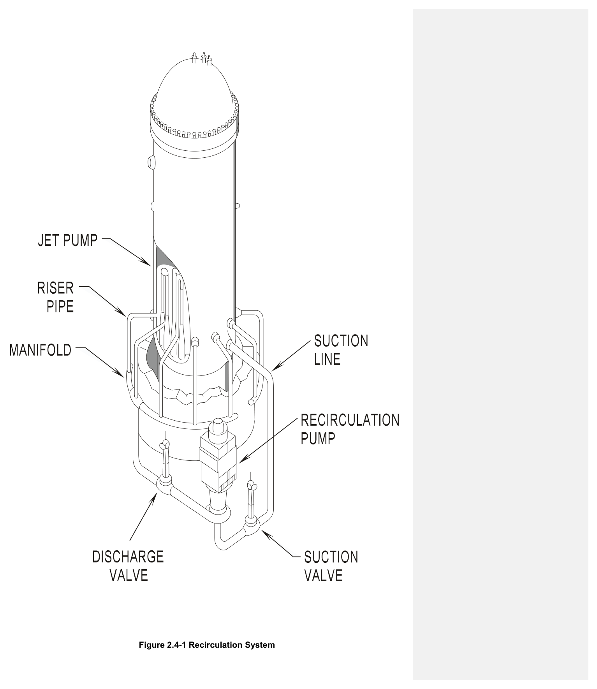
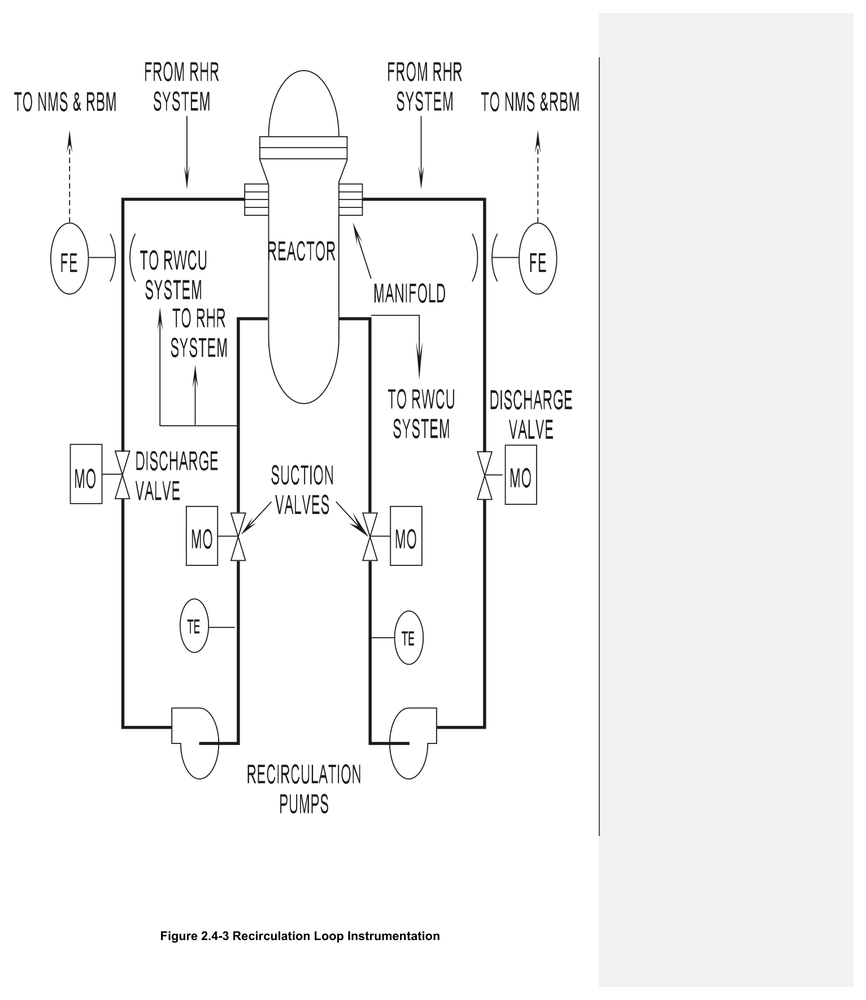
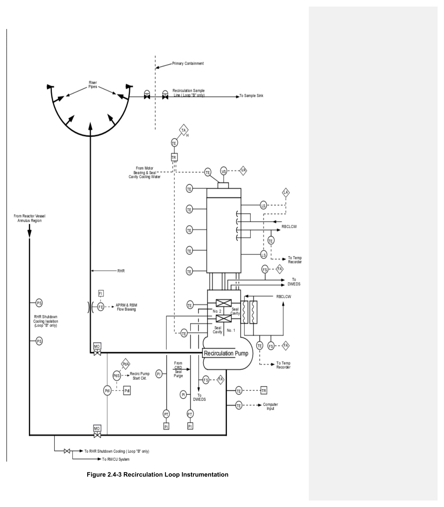
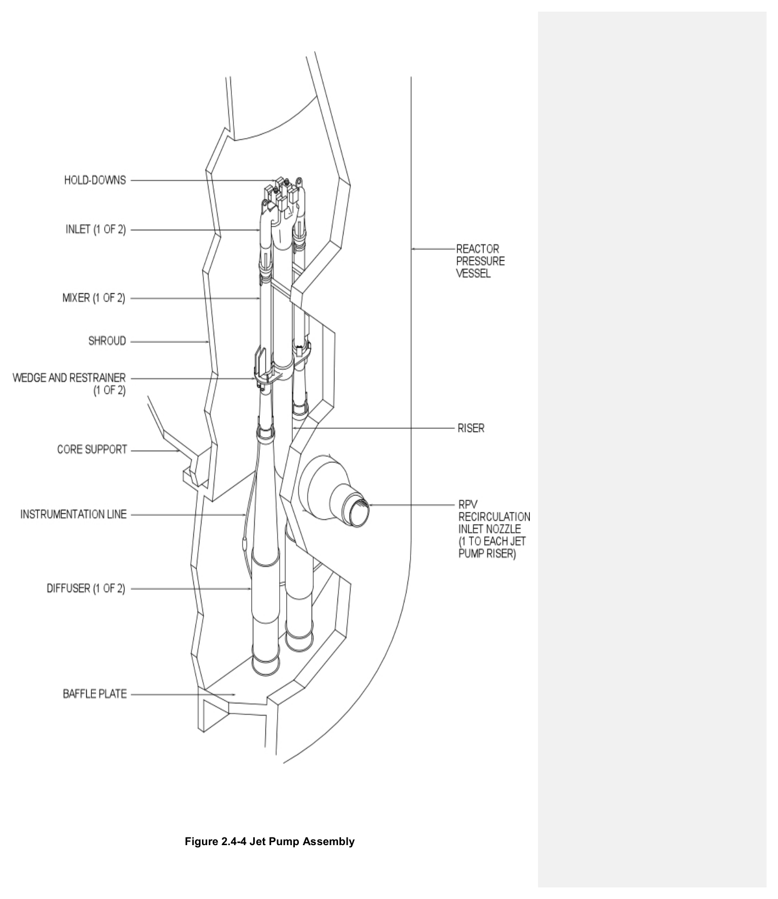
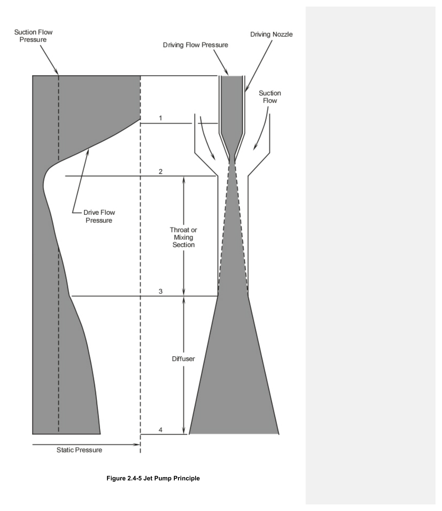
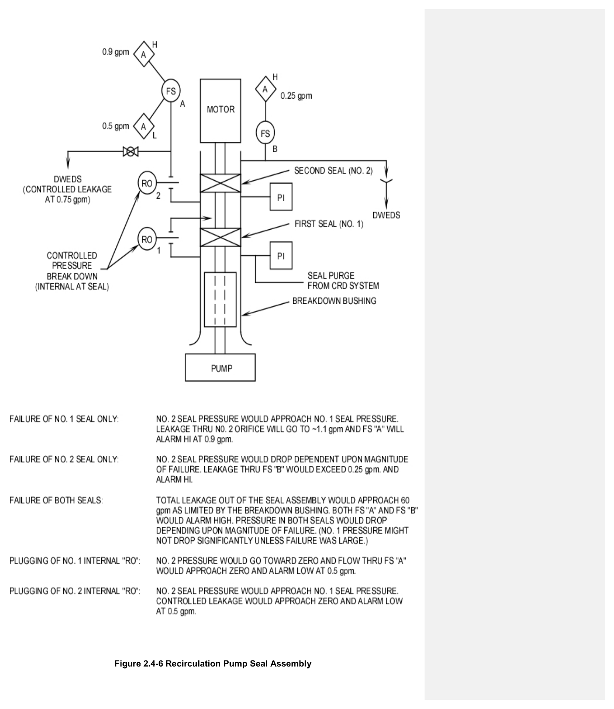

# 2.4 Recirculation

> Source: `2.4_Recirculation.pdf` (19 pages)
> GE (BWR) Systems Technology Manual — USNRC HRTD, Rev 09/11

---
<!-- p.1 -->
#### General Electric Systems Technology Manual
#### Chapter 2.4
#### Recirculation System
<!-- p.3 -->
TABLE OF CONTENTS

2.4 RECIRCULATION SYSTEM ..................................................................................... 1

2.4.1 Introduction .......................................................................................................... 1

2.4.2 System Description .............................................................................................. 2

2.4.3 Component Description ....................................................................................... 2

2.4.3.1 Recirculation Loop Suction Piping ................................................................ 2

2.4.3.2 Suction Isolation Valve ................................................................................. 3

2.4.3.3 Recirculation Pumps ..................................................................................... 3

2.4.3.4 Recirculation Pump Discharge Piping ........................................................... 4

2.4.3.5 Jet Pumps ..................................................................................................... 5

2.4.3.6 Reactor Water Sampling Line ....................................................................... 5

2.4.4 System Features ................................................................................................. 5

2.4.4.1 System Operation ......................................................................................... 5

2.4.4.2 Jet Pump Vibration ....................................................................................... 6

2.4.4.3 Recirculation Pump Seal Operation .............................................................. 6

2.4.5 System Interfaces ................................................................................................ 7

2.4.6 Summary ............................................................................................................. 8

2.4-i USNRC HRTD

<!-- p.4 -->
#### LIST OF FIGURES
2.4-1 Recirculation System
2.4-2 Recirculation Loops
2.4-3 Recirculation Loop Instrumentation
2.4-4 Jet Pump Assembly
2.4-5 Jet Pump Principle
2.4-6 Recirculation Pump Seal Assembly

2.4-ii USNRC HRTD

<!-- p.5 -->
### 2.4 RECIRCULATION SYSTEM
Learning Objectives:

1. Recognize the purposes of the reactor recirculation system.

2. Recognize the purpose, function and operation of the following reactor recirculation system components:
a. Suction isolation valves b. Recirculation pumps c. Recirculation Pump seals d. Discharge valves e. Jet Pumps f. Flow elements

3. Recognize the following recirculation system flow paths:
a. Recirculation flow through the external loops and the reactor vessel b. Seal purge and cooling flow from Control Rod Drive (CRD) System

4. Recognize the indications of recirculation pump shaft seal degraded performance.

5. Recognize how the recirculation system interfaces with the following systems:
a. Reactor Vessel System (Section 2.1)
b. Control Rod Drive System (Section 2.3)
c. Reactor Building Closed Loop Cooling Water System (Section 11.3)
d. Recirculation Flow Control System (Section 7.2)
e. Residual Heat Removal System (Section 10.4)
f. Liquid Radwaste Systems (Section 8.2)
g. Average Power Range Monitoring System (Section 5.4)
h. Rod Block Monitoring System (Section 5.5)
i. Reactor Water Cleanup System (Section 2.8)

#### 2.4.1 Introduction
The purposes of the Recirculation System are to provide:
• Forced circulation through the core
• A means of rapidly lowering reactor power either in the automatic or manual modes
• A location for other systems to communicate with the RPV

Forced circulation of water through the reactor core permits a higher acceptable reactor power than with only natural circulation. Locating other system connections on the recirculation system loops reduced the number of penetrations to the RPV.

2.4-1 USNRC HRTD

<!-- p.6 -->
The functional classification of the recirculation system is that of a power generation system. The Anticipated Transient Without Scram (ATWS) and the end of cycle Recirculation Pump Trips (RPTs) functions are safety related. These features and other interlocks and logic are described in Chapter 7.2 Recirculation Flow Control (RFC)
System. The instruments identified in this chapter are described in detail in Chapter 3.1 reactor vessel instrumentation system.

#### 2.4.2 System Description
The Recirculation System (Figures 2.4-1 & 2) consists of two separate and independent parallel pumping loops. Each loop consists of:
• a recirculation pump driven by a variable speed motor
• 10 jet pumps
• valves, piping and instrumentation.

The entire Recirculation System is located within the drywell. The jet pumps (Figure
2.4-4) are located inside the reactor vessel annulus between the core shroud and vessel wall. The recirculation pumps are external of the reactor pressure vessel and take water from the vessel annulus. Each recirculation pump discharges into its own manifold containing five risers. Each riser in turn penetrates the vessel and supplies the driving flow for two jet pumps. The action of the jet pump (Figures 2.4-4 & 2.4-5) mixes the high velocity (driving) water with the reactor (driven) water from the annulus area.
The mixture of driving and driven water enters the reactor vessel bottom head and is circulated through the core. Water from the moisture separators, steam dryers and the feedwater system returns to the annulus area forming the suction for both the jet pumps and recirculation pumps.

#### 2.4.3 Component Description
The components that make up the Recirculation System are discussed in the paragraphs which follow.

##### 2.4.3.1 Recirculation Loop Suction Piping
The two recirculation loops remove water from the reactor vessel downcomer annulus area approximately 180º apart. Each 28-inch recirculation pump suction line contains:
• a single 28-inch suction isolation valve
• a penetration to the RWCU system
• temperature elements (Figure 2.4-3)
• recirculation ΔP tap

Only the “B” recirculation suction line provides suction to the shutdown cooling mode of RHR operation. The shutdown cooling return is to either the “A” or “B” recirculation discharge lines.

2.4-2 USNRC HRTD

<!-- p.7 -->
RWCU takes suction from the recirculation pump suction lines and the reactor bottom head. RWCU returns the cleaned water to the RPV through connections to the reactor feedwater lines.

##### 2.4.3.2 Suction Isolation Valve
The recirculation system suction isolation valves are motor operated 28-inch gate valves used to isolate the recirculation pumps for maintenance. Each valve is individually controlled from the control room by a hand switch.

##### 2.4.3.3 Recirculation Pumps
A variable speed, single stage, vertically mounted centrifugal pump is provided in each recirculation loop with the suction and discharge lines welded to the pump casings. The recirculation pump speed can be varied from about 30% up to about 102%. The pumps are located below the reactor vessel to satisfy Net Positive Suction Head (NPSH)
requirements. Additionally, to help ensure the pumps have adequate NPSH, the recirculation pump speed is limited whenever:
• Feedwater water flow into the RPV is at or less than 20% of rated flow
• Reactor water level is below level 3

The recirculation pump motor windings and bearing oil are cooled by the RBCLCW.
The motor has a vibration sensor which alarms in the control room on high vibration.
The oil level in the motor bearings is monitored for level and alarms in the control room on low level.

Each recirculation pump is equipped with a dual mechanical shaft seal assembly
(Figure 2.4-6). Each assembly consists of two seals built into a cartridge that can be replaced without removing the motor from the pump. Each individual seal in the cartridge is designed for full pump design pressure, so that one seal can adequately limit leakage in the event that the other seal should fail. The pump shaft passes through a breakdown bushing in the pump casing to reduce leakage to approximately 60 gpm in the event of gross failure of both shaft seals. The cavity temperature and pressure of each seal are monitored to indicate seal performance and condition. The seals are cooled by the RBCLCW.

During normal operation, the two sets of seals share the sealing function of the assembly. This is possible because there is a pressure breakdown orifice internal to the seal cartridge. Each seal provides approximately 500 psid across its surface. The second seal cavity receives a small amount of flow through a pressure breakdown orifice. This staging flow allows the second seal to provide some of the pump sealing load. The second stage seal cavity is drained through another orifice to the drywell equipment drain sump.

2.4-3 USNRC HRTD

<!-- p.8 -->
The recirculation pumps, as well as piping and valves, are supported by hangers to avoid the use of expansion loops that would be required if the pumps were anchored.
The only locations where the piping is rigidly fixed is at the connections to the reactor vessel. At other places, the piping is free to expand and contract within the limits of the snubbers and hangers.

##### 2.4.3.4 Recirculation Pump Discharge Piping
Each 28-inch discharge pipe contains:
• a discharge isolation valve
• a flow measurement device (Figure 2.4-3)
• recirculation ΔP tap
• a penetration for RHR system injection
• a distribution manifold
• 5 riser pipes
• 10 jet pumps.

Each 22" distribution manifold directs the driving flow to five 12" jet pump riser pipes.
The jet pump riser pipes are connected to the reactor vessel recirculation inlet penetrations and to the jet pumps.

###### 2.4.3.4.1 Discharge Valves
Each recirculation loop contains a motor operated discharge valve located between the recirculation pump and the loop flow measurement device (Figure 2.4-3). The valve is remotely operated from the control room. The discharge valves are automatically jogged open on a pump startup by RFC. Additionally, the discharge valves close as part of the automatic initiation sequence for the Low Pressure Coolant Injection (LPCI)
mode of the RHR system to provide an emergency core cooling water flow path to the reactor vessel. Construction of the discharge valve is similar to the suction valve described earlier.

###### 2.4.3.4.2 Recirculation Flow Measurement
Individual recirculation loop flow is determined by using the relationship that flow is proportional to the square root of the differential pressure. Each recirculation loop contains a venturi (flow element) between the recirculation pump discharge valve and the distribution manifold (Figure 2.4-3).

By measuring the differential pressure created by the venturi, a reliable recirculation loop flow can be obtained for use by the following:
• Process computer
• APRM System
• RBM System

2.4-4 USNRC HRTD

<!-- p.9 -->
Recirculation flow is recorded and displayed in the control room for operator use. Each recirculation loop has one venturi flow detector which then supplies four flow transmitters.

###### 2.4.3.4.3 Discharge Manifold and Risers
The two 28-inch recirculation loops discharge line connects to its own 22-inch-diameter distribution manifold (Figures 2.4-1 & 2.4-2). Each manifold is a semicircular header which inputs to five 12-inch diameter jet pump risers spaced at equal intervals. Each riser supplies driving flow to two jet pumps. The jet pumps are located in the annular region between the core shroud and the reactor vessel wall. The risers penetrate the vessel below the active core region to minimize fast flux exposure to the penetration nozzles and welds. Excessive exposure could cause embrittlement of the vessel welds and result in nozzle cracking.

##### 2.4.3.5 Jet Pumps
Jet pumps (Figures 2.4-1, 2.4-4 & 2.4-5) are used in BWRs to increase the total core flow and yet minimize the external recirculation flow required to obtain the desired core flow. This reduces external pump and piping size requirements. The jet pump nozzles develop a high velocity, low pressure stream at the jet pump suction. Water is entrained in the downcomer area with the water driven through the jet pump nozzle by the recirculation pump. The combined driving and driven flows mix in the mixer section and flow into the diffuser. The diffuser increases the flow area which decreases the velocity and increases the pressure head. When the reactor is at full power, approximately onethird of the core flow comes directly from the recirculation pumps (driving flow). The remaining two-thirds of core flow is derived from the driven flow from the RPV annulus.

##### 2.4.3.6 Reactor Water Sampling Line
The sample line connects the 'B' recirculation loop distribution manifold to a sample sink outside of the drywell via inboard and outboard containment isolation valves. Sampling from the distribution manifold assures a representative sample of reactor water. The ¾
-inch recirculation loop sample line is provided to ensure an alternate means of sampling reactor water when the Reactor Water Cleanup (RWCU) System is not available.

#### 2.4.4 System Features
A short discussion of system features and interfaces this system has with other plant systems is given in the paragraphs which follow.

##### 2.4.4.1 System Operation
The recirculation pumps are started prior to control rod withdrawal for a plant startup.

2.4-5 USNRC HRTD

<!-- p.10 -->
Temperature elements located in the suction piping are used to determine if the differential temperature requirements are satisfied for pump starts, for heatup and cooldown rate determinations and for monitoring for normal system operations. Further discussion of this instrumentation is found in Chapter 7.2 recirculation flow control
(RFC) system.

Reactor recirculation pumps are normally operated at the same speed during power operation. Should one recirculation loop become inoperable, plant operation may continue as limited by the plant technical specifications (TSs). This is known as single recirculation loop operation.

##### 2.4.4.2 Jet Pump Vibration
When operating both recirculation pumps, a high flow difference between the two loops can cause flow reversal or oscillation of flows in the low flow loop. This reversal or oscillation can result in vibration of the jet pumps and riser braces. To minimize vibration and prevent fatigue, procedural controls are imposed. Recirculation pump speeds shall be within 5% of each other when core flow is equal to or greater than 70% of rated and within 10% when less than 70% as required per TS. During idle pump startup with the other pump in operation, it's also necessary to reduce the operating pump's speed to less than 50% prior to starting a pump to reduce or minimize these effects.

##### 2.4.4.3 Recirculation Pump Seal Operation
The recirculation pump seal assembly (Figure 2.4-6) is kept clean and cool by a seal purge provided by the CRD system. The seal purge reduces the possibility of seal damage by reducing the introduction and accumulation of foreign material. The seal temperature is reduced by the flow’s cooling effect. A flow of approximately 4 gpm is routed to each pump through a restricting orifice, flow regulator and flow indicator.
Approximately 0.75 gallons per minute flows through the seal cartridge as staging flow, while the remainder flows around the pump shaft and breakdown bushing into the impeller cavity. The seal purge increases seal life while reducing radioactive discharge to the Liquid Radwaste System.

Alarms are provided on the staging flow lines and seal leakoff lines to provide indication of seal failure. These alarms, together with the pressure indicators, allow the operator to analyze system failure. A flow switch in the seal staging line provides a high flow alarm at 0.9 gpm and a low flow alarm at 0.5 gpm. A second flow switch located on the second seal leakoff flow line (normally zero flow) alarms high at 0.25 gpm.

Failure of the inner (number 1) seal is indicated by a number 2 seal pressure increase to higher than normal and an increase in staging flow through the second orifice which causes a high flow alarm.

2.4-6 USNRC HRTD

<!-- p.11 -->
Failure of the outer (number 2) seal is indicated by number 2 seal pressure indication being lower than normal (depending on the extent of the failure), and the outer seal flow switch which detects leakage and alarms high along with the low flow alarm on the staging flow.

Failure of both seals is indicated by leakage past the outer seal resulting in a high flow alarm (leakage would be limited to approximately 60 gpm by the breakdown bushing)
and a pressure decrease in both seals which is dependent on the magnitude of the failure.

The recirculation pump seal cavity requires forced cooling due to the heat of the reactor water and the friction generated in the sealing surfaces. Cooling water, provided by RBCLCW, flows through a cooling jacket around the seal assembly.

#### 2.4.5 System Interfaces
The interfaces this system has with other plant systems are discussed in the paragraphs which follow.

Reactor Pressure Vessel System (Section 2.1)

The jet pumps are mounted in the reactor pressure vessel (RPV) annulus area. The jet pump riser pipes penetrate the RPV. The recirculation suction and discharge lines are very large vessel penetrations. The recirculation system provides forced flow of coolant through the core.

Control Rod Drive System (Section 2.3)

The CRD System provides seal purge and cooling water to the recirculation pump seals.

Reactor Building Closed Loop Cooling Water System (Section 11.1)

The RBCLCW System provides water to the recirculation system to cool the recirculation pump motor windings, bearings, and mechanical seals.

Recirculation Flow Control System (Section 7.2)

Recirculation pump speed is controlled by the RFC System. The RFC system also jogs the pump discharge valve open on pump start.

2.4-7 USNRC HRTD

<!-- p.12 -->
Residual Heat Removal System (Section 10.4)

The shutdown cooling mode of the RHR system takes water from the 'B' recirculation loop suction line and returns it to either loop discharge line to provide a decay heat removal capability. The low pressure coolant injection (LPCI) mode of the RHR system injects emergency core cooling water into the recirculation loop discharge piping between the discharge valve and reactor vessel. Both recirculation loop discharge valves receive an automatic close signal upon a LPCI initiation and low reactor pressure to ensure water introduction into the core.

Liquid Radwaste System (Section 8.2)

The liquid radwaste system processes the leakage from the pump seals and valves.

Average Power Range Monitoring System (Section 5.4)

Recirculation loop flow signals are used by the APRM System to provide flow bias protective trips.

Rod Block Monitoring System (Section 5.5)

The Rod Block Monitoring System uses recirculation loop flow to provide flow bias rod withdraw blocks.

Reactor Water Cleanup (RWCU) system

RWCU draws water from the recirculation pump suction lines.

#### 2.4.6 Summary
The Recirculation System (Figures 2.4-1 & 2) consists of two separate and independent parallel pumping loops. Each loop consists of:
• a recirculation pump driven by a variable speed motor
• 10 jet pumps
• valves, piping and instrumentation.

The entire Recirculation System is located within the drywell. The jet pumps (42.4-3)
are located inside the reactor vessel annulus, between the core shroud and vessel wall.
The recirculation pumps take water from the vessel annulus area and discharge into a manifold containing five risers per recirculation loop. Each riser in turn penetrates the vessel and supplies the driving flow for two jet pumps. The action of the jet pump
(Figures 2.4-4 & 2.4-5) mixes the high velocity (driving) water with the reactor (driven)
water from the annulus area. The mixture of driving and driven water enters the reactor vessel bottom head and is circulated through the core. Water from the moisture

2.4-8 USNRC HRTD

<!-- p.13 -->
separators, dryers and the feedwater system returns to the annulus area forming the suction for both the jet pumps and the recirculation pumps.

System Interfaces - Reactor Vessel System; Control Rod Drive System; Recirculation Flow Control System; Reactor Building Closed Cooling Water System; Residual Heat Removal System; Liquid Radwaste System; Average Power Range Monitoring System;
Rod Block Monitoring System.

2.4-9 USNRC HRTD

<!-- p.14 -->
#### Figure 2.4-1

*Recirculation System*

[Vector original (SVG, lossless): fig_2.4-1.svg](../figures/fig_2.4-1.svg)

<!-- p.15 -->
#### Figure 2.4-3

*Recirculation Loop Instrumentation*

[Vector original (SVG, lossless): fig_2.4-3.svg](../figures/fig_2.4-3.svg)

<!-- p.16 -->
#### Figure 2.4-3

*Recirculation Loop Instrumentation*

<!-- p.17 -->
#### Figure 2.4-4

*Jet Pump Assembly*

<!-- p.18 -->
#### Figure 2.4-5

*Jet Pump Principle*

<!-- p.19 -->
#### Figure 2.4-6

*Recirculation Pump Seal Assembly*

