# 2.5 Main Steam

> Source: `2.5_Main_Steam.pdf` (42 pages)
> GE (BWR) Systems Technology Manual — USNRC HRTD, Rev 09/11

---
<!-- p.1 -->
#### General Electric Systems Technology Manual
#### Chapter 2.5
#### Main Steam System
<!-- p.3 -->
TABLE OF CONTENTS

2.5 MAIN STEAM SYSTEM ............................................................................. 1

2.5.1 System Purposes ................................................................................................ 2

2.5.2 System Flowpaths ............................................................................................... 2

2.5.3 Component Description ....................................................................................... 3

2.5.3.1 Main Steam Lines ........................................................................................ 3

2.5.3.2 Reactor Head Vent ...................................................................................... 3

2.5.3.3 Safety/Relief Valves .................................................................................... 3

2.5.3.4 Flow Restrictors ........................................................................................... 4

2.5.3.5 MSIVs .......................................................................................................... 4

2.5.3.6 Steam Line Drains ....................................................................................... 6

2.5.3.7 Turbine Bypass Valves ................................................................................ 6

2.5.3.8 Turbine Stop Valves .................................................................................... 7

2.5.3.9 Turbine Control Valves ................................................................................ 7

2.5.3.10 Turbine ........................................................................................................ 7

2.5.3.11 Moisture Separators/Reheaters ................................................................... 8

2.5.3.12 Combined Intermediate Valves ................................................................... 9

2.5.3.13 Steam Seal System ..................................................................................... 9

2.5.4 System Features and Interfaces ........................................................................ 10

2.5.4.1 Normal Operation ...................................................................................... 10

2.5.4.2 Safety/Relief Valve Operation ................................................................... 10

2.5.4.3 System Interfaces ...................................................................................... 11

2.5.5 Summary ........................................................................................................... 13

2.5-i USNRC HRTD

<!-- p.4 -->
#### LIST OF FIGURES
2.5-1 Main Steam System
2.5-2 Main Steam System (Cont.)
2.5-3 Auxiliary Steam Headers
2.5-4 Main Steam Line Drains
2.5-5 Two Stage Target Rock Safety/Relief Valve (Closed)
2.5-6 Two Stage Target Rock Safety/Relief Valve (Open)
2.5-7 Main Steam Isolation Valve
2.5-8 Main Steam Isolation Valve (Open)
2.5-9 Main Steam Isolation Valve (Closed)
2.5-10 Safety/Relief Valve Arrangement
2.5-11 Moisture Separator Reheater
2.5-12 Steam Seal Supply System
2.5-13 Main Turbine Sealing Steam
2.5-14 Turbine Gland Seals
2.5-15 Feed Pump Turbine Seal Steam

2.5-ii USNRC HRTD

<!-- p.5 -->
### 2.5 MAIN STEAM SYSTEM
Learning Objectives:

1. Recognize the purposes of the Main Steam System.

2. Recognize the purpose, function and operation of the following major components:
a. Safety/Relief /Auto Depressurization Valves in each mode of operation b. Reactor Head Vent Valves c. Main Steam Line Flow Restrictors d. Main Steam Line Isolation Valves e. Turbine Bypass Valves f. Turbine Stop Valves g. Turbine Control Valves h. Main Turbine i. Combined Intermediate Valves j. Extraction Steam System k. Moisture Separator Reheaters l. Steam Seal System

3. Recognize the following flowpaths for the Main Steam system:
a. Safety/Relief /Auto Depressurization Valves b. Main Steam Line Flow Restrictors c. Main Steam Line Isolation Valves d. Turbine Bypass Valves e. Main Turbine f. Moisture Separator Reheaters

4. Recognize the plant parameters which will cause the following:
a. MSIV Closure b. SRV lift c. RPS bypass of main turbine scrams

5. Recognize how the Main Steam system interfaces with the following systems:
a. Reactor Vessel System (Section 2.1)
b. Recirculation Flow Control System (Section 7.2)
c. Reactor Protection System (Section 7.3)
d. Condensate and Feedwater System (Section 2.6)
e. Reactor Core Isolation Cooling System (Section 2.7)
f. High Pressure Coolant Injection System (Section 10.1)
g. Electro-Hydraulic Control System (Section 3.2)
h. Offgas System (Section 8.1)

2.5-1 USNRC HRTD

<!-- p.6 -->
i. Automatic Depressurization System (Section 10.2)
j. Feedwater Control System (Section 3.3)
k. Nuclear Steam Supply Shutoff System (Section 4.4)

#### 2.5.1 System Purposes
The purposes of the Main Steam System are
• To direct steam from the reactor vessel to the main turbine and other steam loads.
• To provide over pressure protection for the reactor vessel and reactor coolant system.
• To direct steam to safety systems.

The functional classification of the Main Steam System is that of a power generation system. Three components, however, are Engineered Safety Features, the Main Steam Isolation Valves (MSIVs), the Main Steam Line Flow Restrictors, and the Safety/Relief Valves (SRVs).

#### 2.5.2 System Flowpaths
The Main Steam (MS) System, shown in Figures 2.5-1, 2.5-2, 2.5.3, and 2.5-4, consists of four steam lines that originate at the reactor vessel. Within the drywell each steam line contains a number of SRVs that provide a flow path to the suppression pool for reactor coolant system over pressure protection, a steam flow restrictor to limit the loss of inventory in the event of a steam line rupture, and an inboard main steam isolation valve. The "A" steam line contains three additional penetrations to provide continuous venting of the reactor vessel head during reactor operation, a steam source to the Reactor Core Isolation Cooling (RCIC) System, and the High Pressure Coolant Injection
(HPCI) System.

The 4 main steam lines penetrate the drywell, traverse the reactor building in a shielded steam tunnel and in the turbine building combine at the pressure equalizing header.
From the pressure equalizing header, steam is directed to the Main Turbine, Bypass Valves (BPVs), Reactor Feed Pump Turbines (RFPTs), Steam Jet Air Ejectors (SJAEs), Radwaste Steam Generator, and the Steam Seal Evaporator.

Steam line drains are provided throughout the system to remove moisture from low points in the steam lines and to provide a method of equalizing pressure around the MSIVs. The steam line drain header leaves the Drywell via a motor operated isolation valve and a guard pipe, an outboard isolation valve and from there drains to the main condenser.

2.5-2 USNRC HRTD

<!-- p.7 -->
#### 2.5.3 Component Description
##### 2.5.3.1 Main Steam Lines
The main steam lines, shown in Figures 2.5-1, 2.5-2 and 2.5-4, are twenty-four inch diameter carbon steel pipes. The lines are welded to the reactor vessel shell area and have a design pressure and temperature of 1250 psig and 575ºF, respectively. The system design and arrangement incorporates seismic considerations and provisions to mitigate the consequences of postulated pipe failures.

The use of four steam lines, to control a flow of 10.5 x 106 lbm/hr of reactor steam, provides a limitation on the differential pressure across reactor vessel internals during a single steam line break. The steam dryer differential pressure is of particular concern because failure of the dryer could result in interference with MSIV closure and thus prevent isolation.

##### 2.5.3.2 Reactor Head Vent
As shown in Figure 2.5-1, a vent connection is provided on the top head of the reactor vessel. This serves to vent noncondensible gases from the upper vessel area during startup and normal operation. During operation at temperatures less than boiling, the noncondensible gases are vented to the drywell equipment drain sump. At temperatures above boiling, the vent is directed to the "A" main steam line.

##### 2.5.3.3 Safety/Relief Valves
The SRVs, Figures 2.5-5 and 2.5-6, prevent over pressurization of the nuclear process barrier from any abnormal operational transient. In addition to providing over pressure protection, seven (7) of the SRVs are also used by the Automatic Depressurization System (ADS, Section 10.2) to rapidly decrease reactor pressure during specific loss of coolant accidents. There are a total of eleven (11) SRVs, each with an approximate capacity of 815,000 lbm/hr at 1100 psig. These valves lift sequentially with four valves lifting at 1115 psig, four valves at 1125 psig and three valves at 1135 psig to provide vessel overpressure protection

The SRVs are located on each main steam line between the reactor vessel and the steam line flow restrictors. The SRVs have three modes of operation;
• The safety mode, the valve opens mechanically due to high pressure
• The manual mode where a switch in the control room ports nitrogen to the valve for opening.
• The ADS mode where a logic system opens 7 of the valves as part of the ECCS design.

The SRV discharge lines are arranged in such a manner as to provide an evenly distributed heat load in the suppression pool when a group of SRVs lift. This distribution

2.5-3 USNRC HRTD

<!-- p.8 -->
ensures adequate steam condensation on blowdown; i.e., no hot spots are generated in the pool.

Two vacuum breakers on each SRV discharge line serve to admit drywell atmosphere to the SRV discharge line. When the steam from the previously open SRV cools, a negative pressure is formed in the piping, drawing suppression pool water in to the discharge piping. The vacuum breakers open to vent this negative pressure after an SRV opening cycle.

Temperature and pressure elements are located in each SRV discharge tail pipe.
These sensors will actuate an annunciator in the control room if the tail pipe temperature exceeds 220ºF or if the tail pipe pressure is 25 psig or greater. This alerts the operator that an SRV is open or leaking.

The Target Rock two stage pilot operated SRV, Figures 2.5.5 and 2.5.6, consists of two principle assemblies: a pilot valve section and the main valve section. The pilot valve section (first stage) provides the pressure sensing and control element while the main valve (second stage) provides the pressure relief function. The first stage provides the means for remote actuation (ADS or manual) via the attached pneumatic actuator. The pilot valve is the pressure sensing member to which the stabilizer disc movement is coupled. The second stage consists of a large valve which includes the main valve disc, main valve chamber, main valve preload spring, and piston. For operation of the SRVs refer to Section 2.5.4.2.

##### 2.5.3.4 Flow Restrictors
The steam flow restrictors are a venturi type flow nozzle welded in each main steam line between the SRVs and the inboard MSIVs as shown in Figure 2.5-1. The flow restrictors are designed to limit steam line flow in a severed line to approximately 200% of rated flow for that steam line. By limiting the rate of steam flow; the loss of coolant from the reactor vessel, the differential pressure across the reactor vessel internals, and the rate of radioactivity release are limited.

The flow restrictors also provide flow signals to the Feedwater Control System (Section
3.3) and the Nuclear Steam Supply Shutoff System (Section 4.4). The flow restrictors, and the fast closure of the MSIVs, prevent uncovering the core and minimize the radioactive release following a steam line break.

##### 2.5.3.5 MSIVs
Each main steam line contains two redundant MSIVs welded in the steam line pipe as close as possible to the drywell penetration. The MSIVs, Figure 2.5-7, are "Y" pattern, pneumatic opening, spring and/or pneumatic closing valves designed to fail closed on loss of pneumatic pressure to the pneumatic actuator. The MSIVs are controlled by two solenoid operated pilot valves. The dual solenoids (A and B) are redundant in function

2.5-4 USNRC HRTD

<!-- p.9 -->
with either solenoid being capable of operating (opening) the valve. For reliability the A solenoids are 120 VAC divisional power and the B solenoids use 125 VDC divisional power. Further reliability is obtained by separating the divisional power between the inboard and outboard MSIVs. The inboard MSIVs A solenoids get power from the 120 VAC division 2 bus. The outboard MSIVs A solenoids get power from the 120 VAC division 1 bus. A separate solenoid operated pilot valve with an independent test switch is included for a manual test of slow closure of each isolation valve from the control room.

An accumulator, located close to each isolation valve, provides pneumatic pressure for the purpose of assisting in valve closure when both pilots are de-energized or in the event of failure of pneumatic supply pressure to the valves. The accumulator volume is adequate to provide full stroking of the valve through one-half cycle (open to close)
when the pneumatic supply to the accumulator has failed. The supply line to the accumulator is large enough to make up pressure to the accumulator at a rate faster than the valve operation bleeds pressure from the accumulator during valve opening or closure.

Each MSIV is equipped with position switches which provide open/closed indication to the control room and a signal to the Reactor Protection System (Section 7.3) scram trip circuit. To provide flexibility for testing, the MSIVs are arranged in the RPS logic, so that one of the four steam lines can be isolated without requiring a full reactor scram, assuming reactor power is low enough to limit the resultant pressure and steam flow increase.

The MSIV pneumatic supply system, shown in Figures 2.5-8 and 2.5-9 is piped in such a way that when one or both pilots are energized, the pneumatic actuator will open the valve. When both pilots are de-energized, as in an automatic closure or manual switch in the closed position, the accumulator pressure is switched to pressurize the opposite side of the pneumatic actuator and help the spring close the valve.

Pressure from the accumulator or the spring force is capable of independently closing the valve with the reactor vessel at full pressure. Thus, if one fails, the other should successfully close the valve. The accumulator volume is adequate to provide full stroking of the valve through one-half cycle (open to close) when supply air to the accumulator has failed.

The MSIV closure time of less than 5 seconds in conjunction with the steam line flow restrictors, limits the release of radioactive materials to the environment and vessel inventory loss. MSIV closure times must be greater than 3 seconds. This allows time for the RPS signal from the valve closure to initiate a reactor scram, minimizing the power and pressure transient from the valve closure.

2.5-5 USNRC HRTD

<!-- p.10 -->
The MSIVs are automatically closed upon receipt of any of the following isolation signals from the Nuclear Steam Supply Shutoff system (Section 4.4):
1. Reactor vessel low water level (Level 1).
2. Main steam line high radiation.
3. Main steam line high steam flow.
4. Main steam line low pressure (in RUN mode).
5. Main steam line area high temperature (Steam Tunnel).
6. Main steam line area high temperature (Turbine Building).
7. Main condenser low vacuum.
8. Main steam tunnel high delta T.

##### 2.5.3.6 Steam Line Drains
A drain line, shown in Figure 2.5-4, is connected to the low point of each main steam line both inside and outside the drywell. These drains minimize water build up in the steam lines by providing a path for this moisture to the main condenser. The containment inboard and outboard steam line drains are used to equalize pressure across the steam line isolation valves following main steam line isolation.

##### 2.5.3.7 Turbine Bypass Valves
There are four (4) turbine bypass valves (BPVs), Figure 2.5-2, which are used to bypass up to 25% of rated steam flow directly to the condenser. The BPVs work in conjunction with the turbine control valves to ensure a constant reactor pressure for a given reactor power level. Control or movement of the BPVs and turbine control valves is automatically accomplished by the Electro Hydraulic Control (EHC) System (Section
3.2).

The BPVs are located in a multi valve manifold with main steam entering at both ends of the manifold to provide a balanced flow to all of the BPVs. The BPVs are a hydraulic operated modulating valve, capable of controlling steam flow from zero to twenty-five percent of plant rated steam flow. During steam bypass operation (plant startup, shutdown, or transient conditions) the BPVs open sequentially.

During a plant startup, heating and loading of the turbine are accomplished by first establishing a flow of steam to the condenser through the BPVs and then transferring this flow to the turbine.

During a normal shutdown, steam is released to the main condenser through the BPVs to achieve the desired rate of reactor cooldown.

In the event of a turbine trip or load rejection bypass valves pass as much as 25 percent of the maximum turbine steam flow. This assists in minimizing the pressure and reactivity transient in the reactor vessel if the MSIVs are open.

2.5-6 USNRC HRTD

<!-- p.11 -->
##### 2.5.3.8 Turbine Stop Valves
There are four Turbine Stop Valves (TSVs) located just upstream of the turbine control valves as illustrated on Figure 2.5-2. The TSVs are normally open during turbine operation with a rapid closure capability, 0.1 seconds, upon detection of potentially unsafe turbine conditions. The four stop valves are equipped with a below seat equalizing header which is utilized during turbine startup operation. The #2 TSV contains an internal bypass valve which is used for turbine warming prior to startup and equalizing the pressure across the stop valves prior to opening.

If turbine load is greater than 30%, as sensed by first stage pressure, closure of the turbine stop valves, as sensed by the valve position limit switches, will produce a reactor scram. The reactor scram ensures the fuel does not exceed the MCPR Thermal Limit resulting from the positive reactivity insertion created by the void collapse when the TSVs close.

##### 2.5.3.9 Turbine Control Valves
The four turbine control valves are located between the TSVs and the turbine. The turbine control valves regulate the steam flow to the turbine, as controlled by the EHC System, in order to control reactor pressure during normal operation. The control valves also provide the throttle mechanism for rolling, synchronizing, and loading the turbine generator.

The control valves operate sequentially (partial arc) or in unison (full arc) via hydraulic fluid supplied from the EHC System. Each valve is equipped with a fast acting solenoid valve which will dump the hydraulic fluid supply, and fast close the turbine control valves in 0.2 seconds. To anticipate the resultant positive reactivity insertion created by the void collapse and protect the fuel cladding, the rapid control valve closure will cause a reactor scram, if turbine load is greater than 30%, as sensed by first stage pressure.
The scram signal originates from the hydraulic oil controlled by the fast acting solenoids.

##### 2.5.3.10 Turbine
The turbine is an 1800 rpm, tandem compound, four flow steam turbine, consisting of one High Pressure (HP) and two Low Pressure (LP) turbines. Steam is from the reactor, to the TSVs, through four lines with a cross connection near the TSVs to equalize pressure, temperature and flow (Figure 2.5.2). The steam then flows through the TSVs to another equalizing header (steam chest) and then to the control valves.

After passing through the control valves, the steam is directed to the center of the HP turbine where it flows to both ends. Some of the high pressure steam is redirected from the HP turbine to the 1st stage of reheat steam for the MSRs and to the 1st point (high pressure) feedwater heaters. The steam remaining after passing through the HP

2.5-7 USNRC HRTD

<!-- p.12 -->
turbine is exhausted to the moisture separator/reheaters which remove most of the entrained moisture and superheats the steam going to the LP turbines.

After exiting the moisture separator/reheaters the steam enters the Combined Intermediate Valves (CIVs) and then flows to the LP turbine casings. Steam enters each of the LP turbines in the middle of the turbine and is directed from the center to the dual exhausts, at either end. Extraction steam is removed from the LP turbines to supply the five low pressure feedwater heaters. This steam is removed symmetrically from each LP turbine to prevent uneven axial loading of the shaft from any one turbine or turbine stage.

Steam from the last stages of each LP turbine is exhausted to the main condenser via dual exhaust hoods. These exhaust hoods are maintained at a vacuum to ensure maximum energy is extracted from the steam and to prevent condensation of the steam which would cause erosion of the last stage turbine blades. Steam not only supplies the energy to move the turbine blades, but also provides a means to remove frictional heat from the turbine blades. At low steam flow rates, the last stages of the low pressure turbine can heat up causing the exhaust hood temperature to rise an excessive amount.
To cool the exhaust hood, an exhaust hood spray system automatically controls the temperature by spraying cool water from the condensate system on the hood (not onto the rotating blades).

Steam from the dual exhausts of the LP turbines is routed to the main condenser where it is cooled and condensed by circulating water (flowing through the condenser tubes)
and returned by the Condensate and Feedwater System to the reactor vessel.

##### 2.5.3.11 Moisture Separators/Reheaters
The moisture separator/reheaters, Figure 2.5-11, receive the exhaust steam from the HP turbine and remove about 98% of the moisture by passing the steam through a series of chevron type baffle plates. Second Stage HP turbine extraction steam is supplied to a first stage of steam reheat. Main steam is supplied to the second stage of the moisture separator/reheaters to add superheat to the steam prior to entering the LP turbines.

Condensate from the moisture separators drains into drain tanks, one for each separator, through the feedwater heaters and back to the condenser. The dried steam is piped through the combined intermediate valves, to the low pressure turbines. A relief valve is installed in the steam line upstream of each Combined Intermediate Valve
(CIV) to protect the low pressure piping if the CIVs should close and the turbine stop and control valves fail to close fully.

2.5-8 USNRC HRTD

<!-- p.13 -->
##### 2.5.3.12 Combined Intermediate Valves
There are four CIVs (Figure 2.5.-2) that are located as close as possible to the low pressure turbines. Each of these CIVs consists of an intercept valve and a stop valve, with both valves sharing a common seat. Both the intercept valve and the stop valve can travel through full stroke regardless of the position of the other valve.

The Stop valves are required on a turbine trip because the very large steam and water inventory trapped in the piping between the HP and LP turbines and in the moisture separator/reheaters could cause turbine overspeed. The intercept valves throttle steam flow to the LP turbines during overspeed conditions.

The intermediate stop valves are not positioning units. They are either open or closed and act as emergency valves in the manner of the main stop valves.

##### 2.5.3.13 Steam Seal System
The steam seal system prevents the entrance of air and noncondensible gases into the main condenser while also preventing the leakage of radioactive steam to the atmosphere. Use of nonradioactive sealing steam enables gland exhaust air to be exhausted to the atmosphere rather than processed to remove radioactive contamination.
The Steam Seal Evaporator, Figure 2.5-12, produces non-radioactive steam by boiling demineralized water using Third Point Extraction Steam or reduced pressure Main Steam as a heat source. The main Steam Seal header is maintained at about +4 psig by PCV-21, if the evaporator in not available for any reason the Steam Seal header can be supplied by an Auxiliary Boiler. From the Main Turbine Steam Seal header, Figure
2.5-13, a branch line supplies seal steam for the RFPTs and associated valves, Figure
2.5-15.

The steam seal leakoff is collected in the Gland Exhaust Header, Figure 2.5-13, which is maintained at 10 in. water vacuum to ensure that no steam leaks into the Turbine Building atmosphere. One of two Steam Packing Exhauster Blowers pull the steam/air mixture in the Gland Exhaust Header through the Seal Steam Condenser where the steam is condensed.

2.5-9 USNRC HRTD

<!-- p.14 -->
#### 2.5.4 System Features and Interfaces
A short discussion of system features and interfaces this system has with other plant systems is given in the paragraphs which follow.

##### 2.5.4.1 Normal Operation
During a unit startup, the MSIVs are open to allow the steam lines and equipment to heatup at the same rate as the reactor. The steam line drains are lined up to the main condenser to aid in moisture removal from the steam lines.
These drain paths are normally shifted to orificed lines after the main turbine has been placed in operation and significant steam flow is established through the main steam lines. When the steam line pressure increases above the EHC System pressure setpoint the BPVs will open to pass steam to the main condenser as necessary to control pressure.

With the BPVs controlling reactor pressure, when sufficient steam flow exists to place the turbine in operation, the turbine is warmed and loaded. When the turbine is loaded, the BPVs will close transferring pressure control to the turbine control valves. As reactor pressure increases, the TCVs open to increase turbine load. At rated operating conditions, reactor steam dome pressure is expected to be 1005 psig with approximately a 55 psig pressure drop across the steam piping and valves, resulting in a pressure of approximately 950 psig at the turbine control valve inlet.

##### 2.5.4.2 Safety/Relief Valve Operation
When the reactor is at operating pressure, below the setpoint of the SRV, the pilot valve is seated with system pressure acting on the stabilizer disc side (Figure 2.5-5). The second stage of the SRV has system pressure on both sides of the main valve piston with the main valve disc seated and held closed by the main valve preload springs. As the system pressure increases to the SRV setpoint (Figure 2.5-6), the pressure acting on the pilot valve produces a force great enough to overcome the opposing force of the setpoint adjustment spring thus lifting the pilot valve from its seat. As the pilot valve moves to full open, the stabilizer disc follows the pilot until the stabilizer is seated. With the pilot valve full open and the stabilizer disc seated, the area above the main valve piston is vented to the discharge piping via the main valve piston vent passage. This venting action creates a differential pressure across the main valve piston, system pressure below the piston and drywell pressure above, causing the main valve to open.
The main valve piston is sized such that the resultant opening force is greater than the combined spring load and hydraulic seating force. The stabilizer disc is designed to control the valve blowdown and reset pressure, by holding the pilot open until the proper reclosing pressure is reached. The stabilizer chamber is connected, by a passage, to the inlet side of the main valve. The stabilizer disc will seat when the pilot lifts. The differential pressure across the stabilizer disc is sufficient to hold the pilot open;
however, as system pressure decays, the differential pressure across the stabilizer disc

2.5-10 USNRC HRTD

<!-- p.15 -->
decreases until the setpoint adjustment spring becomes the controlling member causing the pilot valve to reseat.

Once the pilot valve has reseated, leakage of system fluid past the main valve piston and the stabilizer disc re-pressurizes the main valve preload chamber. When steam pressure equalizes across the main valve piston, the opening force is canceled and permits the main valve preload spring and hydraulic flow to force the main valve closed.
Once closed, the additional hydraulic seating force, due to system pressure acting on the main valve disc, seats the main valve tightly and prevents leakage.

In the manual mode of operation, pressure is applied to a pneumatic actuator (air or nitrogen) by energizing solenoid operated valves. The air actuator mechanically positions the pilot assembly to depressurize the top of the main valve piston causing the main valve to open. The solenoids are energized by switches located in the control room. This type of arrangement provides the control room operator with a means to operate any of the 11 SRVs. Seven of the eleven SRV solenoids can also be energized by actuation of the Automatic Depressurization System logic, (Section 10.2)

##### 2.5.4.3 System Interfaces
The interfaces this system has with other plant systems are discussed in the paragraphs which follow.

Reactor Vessel System (Section 2.1)

The Main Steam System delivers steam from the reactor vessel to the various steam loads, vents noncondensible gases from the reactor vessel head area, and provides over pressure protection for the reactor vessel.

Recirculation Flow Control System (Section 7.2)

The Main Steam System provides a turbine first stage pressure signal to the arm the End of Cycle -Recirculation Pump Trip above 30% main turbine load.

Reactor Protection System (Section 7.3)

The Reactor Protection System uses the MSIV closure, TSV closure, and TCV fast closure signals to initiate reactor scrams and preserve fuel cladding integrity.

The Main Steam System provides a turbine first stage pressure signal to the arm the TSV closure and TCV fast closure scrams above 30% main turbine load (as sensed by first stage pressure).

2.5-11 USNRC HRTD

<!-- p.16 -->
Condensate and Feedwater System (Section 2.6)

The RFPTs use steam from the outlet of the moisture separator/reheaters and/or steam line equalizing header as an energy source.
Extraction steam from the various main turbine high pressure and low pressure stages is used to heat the feedwater before it returns to the reactor.

Reactor Core Isolation Cooling System (Section 2.7)

The Reactor Core Isolation Cooling System uses steam from the 'A' steam line upstream of the MSIVs as the driving force for its turbine.

High Pressure Coolant Injection System (Section 10.1)

The High Pressure Coolant Injection System uses steam from the 'A' steam line upstream of the MSIVs as the driving force for its turbine.

Electro Hydraulic Control System (Section 3.2)

The EHC System controls the operation of the BPVs, TCVs and CIVs to control turbine speed, reactor pressure and turbine generator load.

Offgas System (Section 8.1)

The Offgas System uses main steam to drive the steam jet air ejectors and provide dilution steam to the off gas process flow. The off gas system provides the components needed to establish and maintain main condenser vacuum to support turbine operation.

Automatic Depressurization System (Section 10.2)

The Automatic Depressurization System (ADS) uses seven of the eleven SRVs to make up one of the four Emergency Core Cooling Systems (ECCS).

Feedwater Control System (Section 3.3)

The Feedwater Control System uses steam flow signals from the steam line flow restrictors as part of the three element level control network and for indication.

Nuclear Steam Supply Shutoff System (Section 4.4)

The Nuclear Steam Supply Shutoff System (NSSSS) isolates the Main Steam System when required and uses the steam line flow restrictors to develop the high steam flow signal for MSIV isolation.

2.5-12 USNRC HRTD

<!-- p.17 -->
#### 2.5.5 Summary
Purposes - To direct steam from the reactor vessel to the main turbine and other steam loads, provide over pressure protection for the reactor vessel, the reactor coolant system, and to direct steam to safety systems.

The main steam system provides the piping and valves to supply the steam loads for plant operation. These steam loads include the main turbine, RFPTs, SJAE, SSE and HPCI and RCIC. The MSIVs have the capability to automatically close to minimize the release of radioactive steam to the environment. SRVs can be opened manually, by reactor pressure or via the ADS logic to control reactor pressure.

2.5-13 USNRC HRTD

<!-- p.19 -->
#### Figure 2.5-1

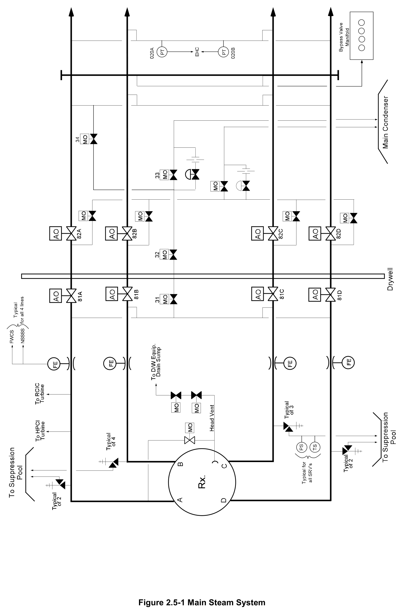

*Main Steam System*

[Vector original (SVG, lossless): fig_2.5-1.svg](../figures/fig_2.5-1.svg)

<!-- p.21 -->
#### Figure 2.5-2

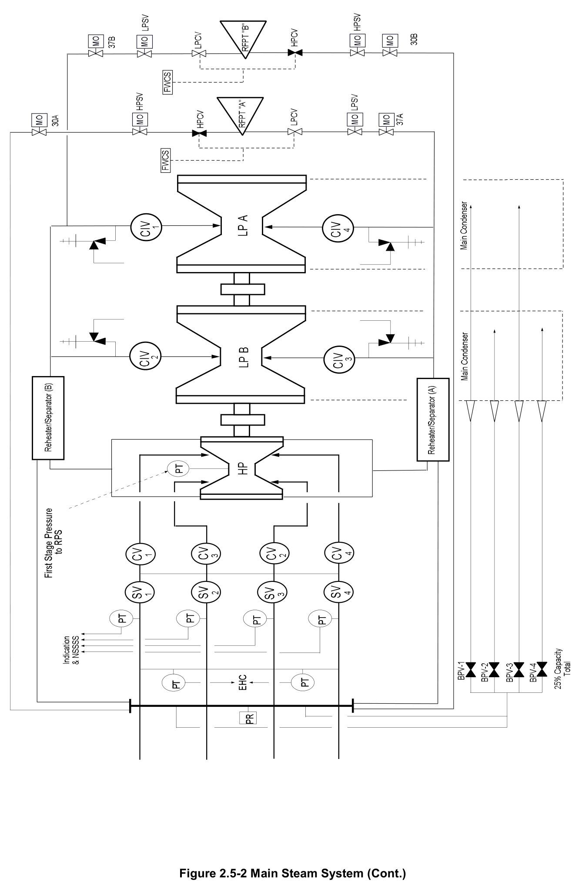

*Main Steam System (Cont.)*

[Vector original (SVG, lossless): fig_2.5-2.svg](../figures/fig_2.5-2.svg)

<!-- p.23 -->
#### Figure 2.5-3

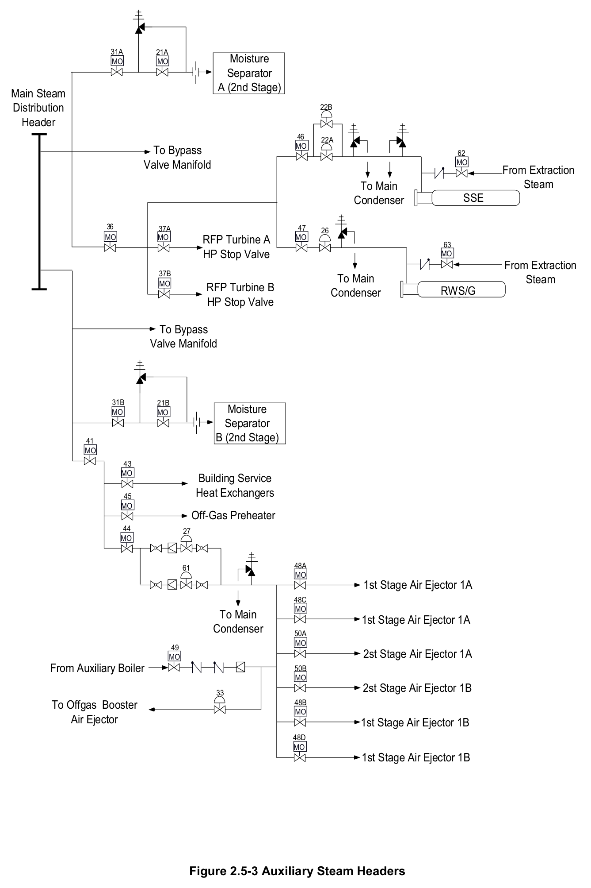

*Auxiliary Steam Headers*

[Vector original (SVG, lossless): fig_2.5-3.svg](../figures/fig_2.5-3.svg)

<!-- labels/text on this figure page -->
31A 21A Moisture MO MO Separator A (2nd Stage)
Main Steam Distribution 22B Header 46 22A MO To Bypass 62 Valve Manifold MO From Extraction Steam To Main SSE Condenser
36 37A 47 26 MO MO MO RFP Turbine A 63 HP Stop Valve MO From Extraction 37B To Main Steam MO RFP Turbine B RWS/G Condenser SSE HP Stop Valve
To Bypass Valve Manifold
31B 21B Moisture MO MO Separator B (2nd Stage)
41 MO
43 MO Building Service Heat Exchangers 45 MO Off-Gas Preheater 44 27 MO
48A 61 MO 1st Stage Air Ejector 1A 48C MO To Main 1st Stage Air Ejector 1A Condenser 50A MO 49 2st Stage Air Ejector 1A MO From Auxiliary Boiler 50B MO 2st Stage Air Ejector 1B 33 48B To Offgas Booster MO Air Ejector 1st Stage Air Ejector 1B
48D MO 1st Stage Air Ejector 1B
Figure 2.5-3 Auxiliary Steam Headers

<!-- p.25 -->
#### Figure 2.5-4

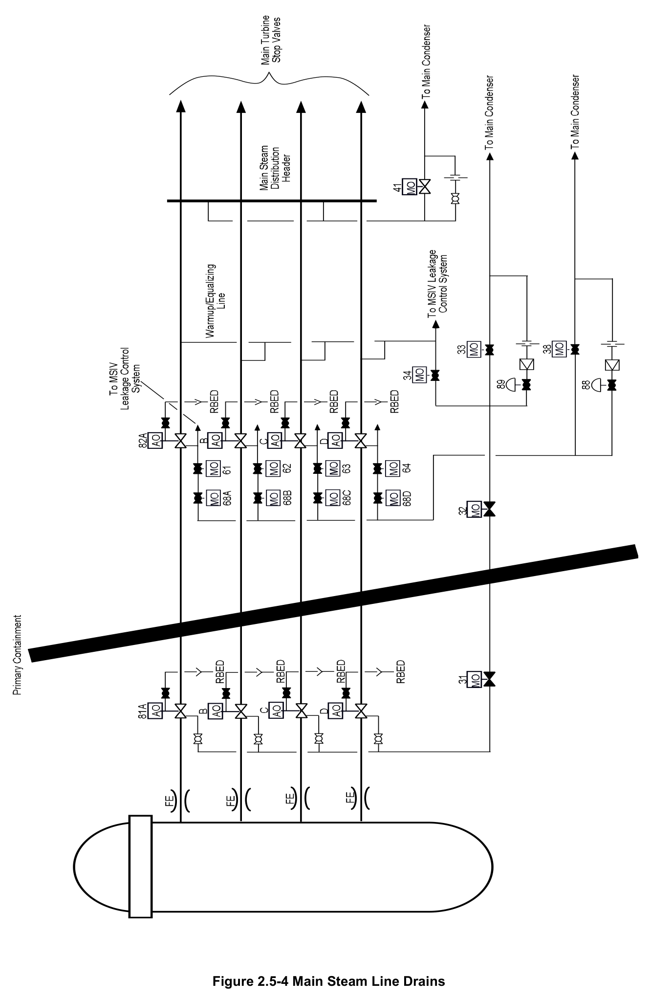

*Main Steam Line Drains*

[Vector original (SVG, lossless): fig_2.5-4.svg](../figures/fig_2.5-4.svg)

<!-- p.27 -->
#### Figure 2.5-5

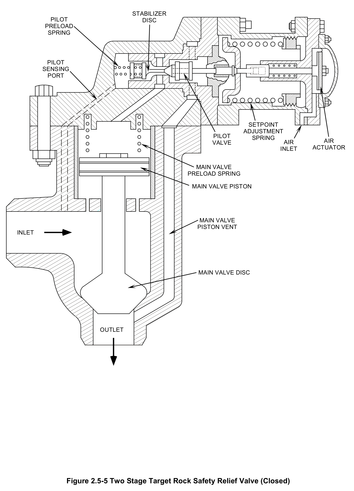

*Two Stage Target Rock Safety Relief Valve (Closed)*

[Vector original (SVG, lossless): fig_2.5-5.svg](../figures/fig_2.5-5.svg)

<!-- labels/text on this figure page -->
STABILIZER PILOT DISC PRELOAD SPRING
PILOT SENSING PORT
SETPOINT ADJUSTMENT PILOT SPRING AIR VALVE AIR ACTUATOR INLET
MAIN VALVE PRELOAD SPRING
MAIN VALVE PISTON
MAIN VALVE PISTON VENT INLET
MAIN VALVE DISC
OUTLET
Figure 2.5-5 Two Stage Target Rock Safety Relief Valve (Closed)

<!-- p.29 -->
#### Figure 2.5-6

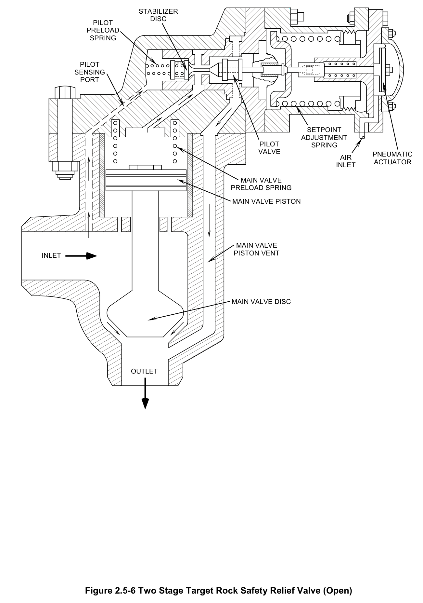

*Two Stage Target Rock Safety Relief Valve (Open)*

[Vector original (SVG, lossless): fig_2.5-6.svg](../figures/fig_2.5-6.svg)

<!-- labels/text on this figure page -->
STABILIZER DISC PILOT PRELOAD SPRING
PILOT SENSING PORT
SETPOINT ADJUSTMENT PILOT SPRING VALVE PNEUMATIC AIR ACTUATOR INLET
MAIN VALVE PRELOAD SPRING
MAIN VALVE PISTON
MAIN VALVE PISTON VENT INLET
MAIN VALVE DISC
OUTLET
Figure 2.5-6 Two Stage Target Rock Safety Relief Valve (Open)

<!-- p.31 -->
#### Figure 2.5-7

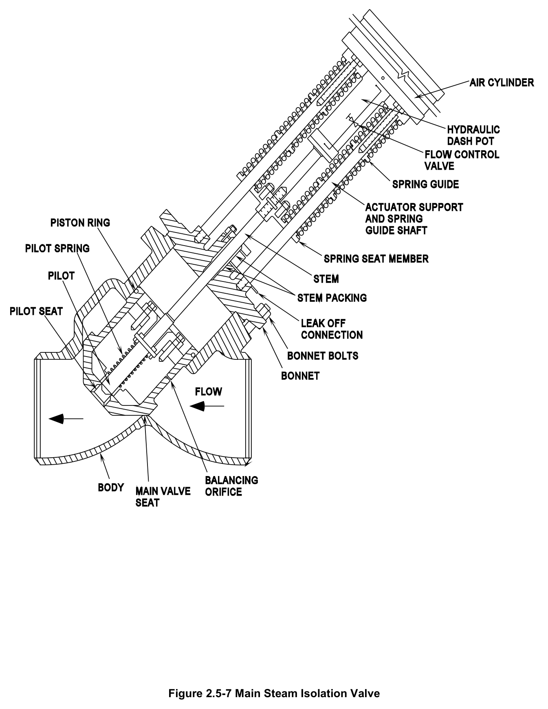

*Main Steam Isolation Valve*

[Vector original (SVG, lossless): fig_2.5-7.svg](../figures/fig_2.5-7.svg)

<!-- p.33 -->
#### Figure 2.5-8

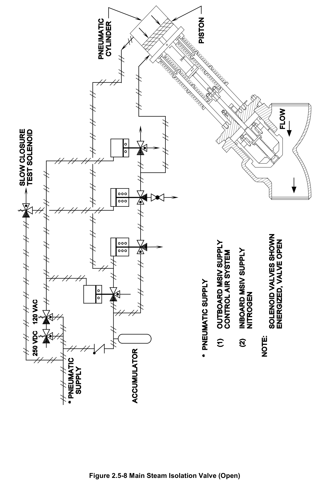

*Main Steam Isolation Valve (Open)*

[Vector original (SVG, lossless): fig_2.5-8.svg](../figures/fig_2.5-8.svg)

<!-- p.35 -->
#### Figure 2.5-9

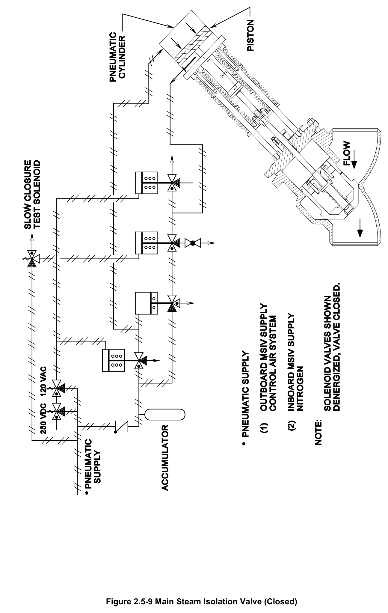

*Main Steam Isolation Valve (Closed)*

[Vector original (SVG, lossless): fig_2.5-9.svg](../figures/fig_2.5-9.svg)

<!-- p.37 -->
#### Figure 2.5-10

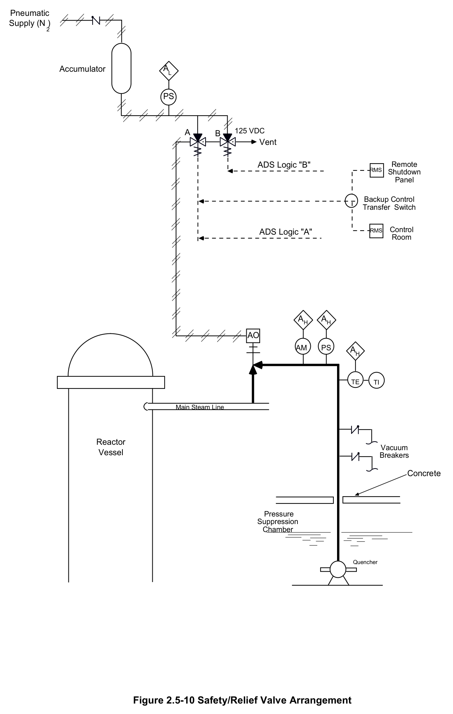

*Safety/Relief Valve Arrangement*

[Vector original (SVG, lossless): fig_2.5-10.svg](../figures/fig_2.5-10.svg)

<!-- labels/text on this figure page -->
Pneumatic Supply (N )
2
Accumulator AL
PS
A 125 VDC B Vent
ADS Logic "B" Remote RMS Shutdown Panel
Backup Control Transfer Switch
Control ADS Logic "A" RMS Room
AH AH
AO AM PS AH
TE TI
Main Steam Line
Reactor Vacuum Vessel Breakers
Concrete
Pressure Suppression Chamber
Quencher
Figure 2.5-10 Safety/Relief Valve Arrangement

<!-- p.38 -->
#### Figure 2.5-11

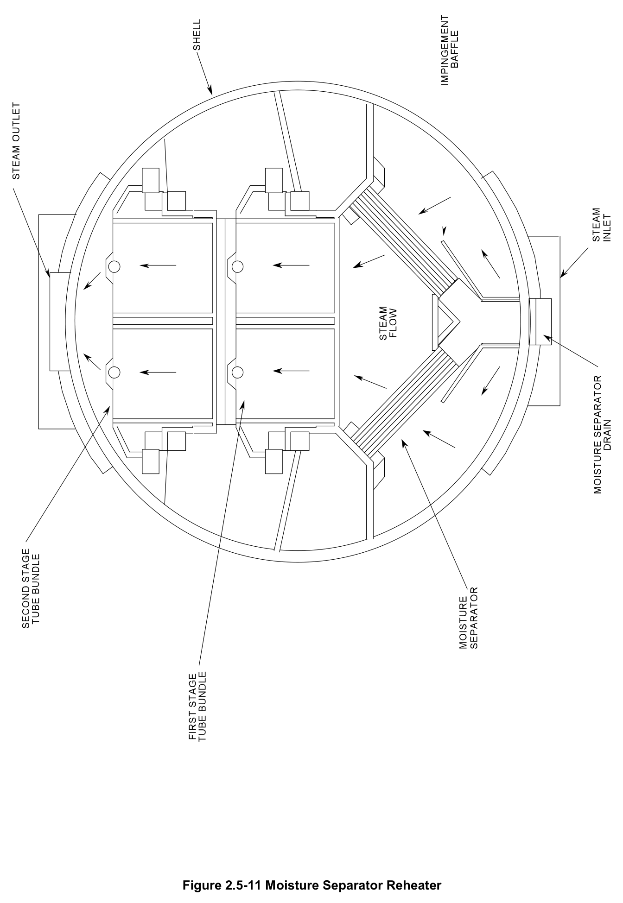

*Moisture Separator Reheater*

[Vector original (SVG, lossless): fig_2.5-11.svg](../figures/fig_2.5-11.svg)

<!-- p.39 -->
#### Figure 2.5-12

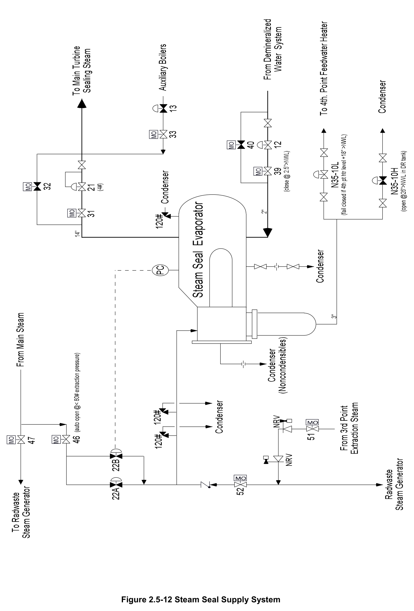

*Steam Seal Supply System*

[Vector original (SVG, lossless): fig_2.5-12.svg](../figures/fig_2.5-12.svg)

<!-- p.40 -->
#### Figure 2.5-13

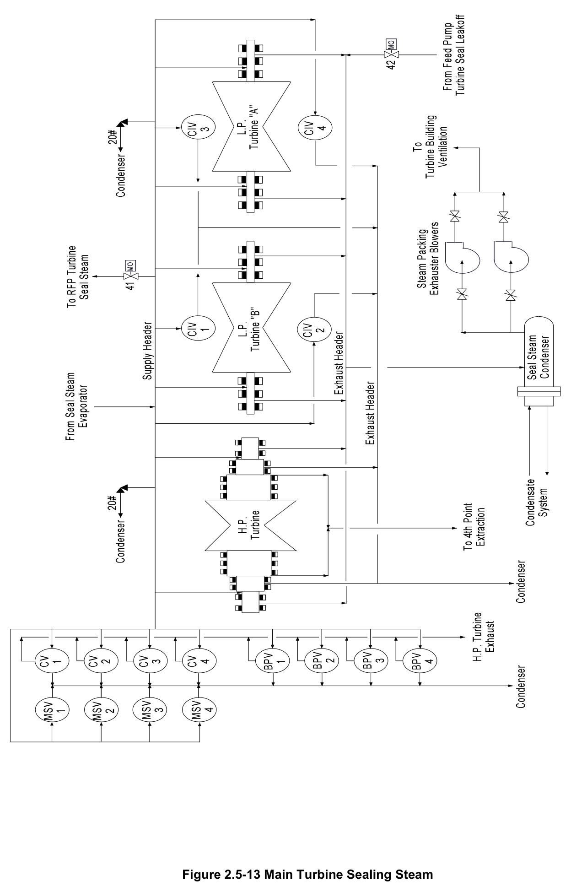

*Main Turbine Sealing Steam*

[Vector original (SVG, lossless): fig_2.5-13.svg](../figures/fig_2.5-13.svg)

<!-- p.41 -->
#### Figure 2.5-14

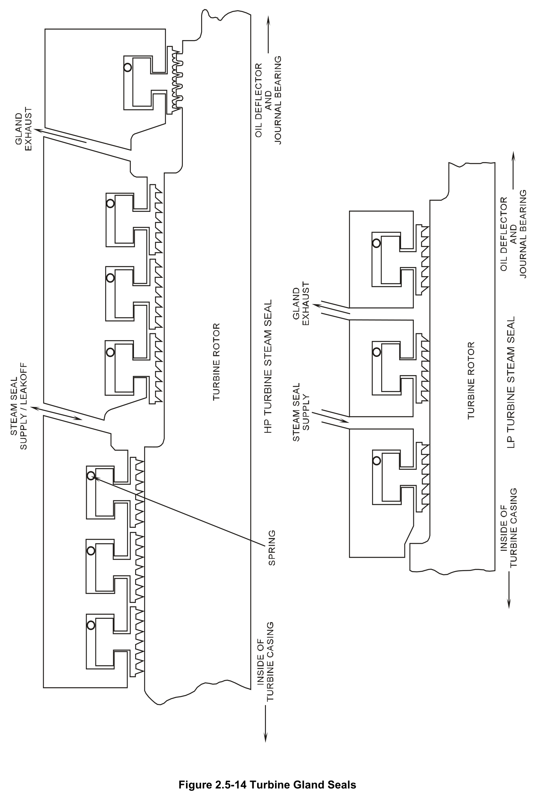

*Turbine Gland Seals*

[Vector original (SVG, lossless): fig_2.5-14.svg](../figures/fig_2.5-14.svg)

<!-- p.42 -->
#### Figure 2.5-15

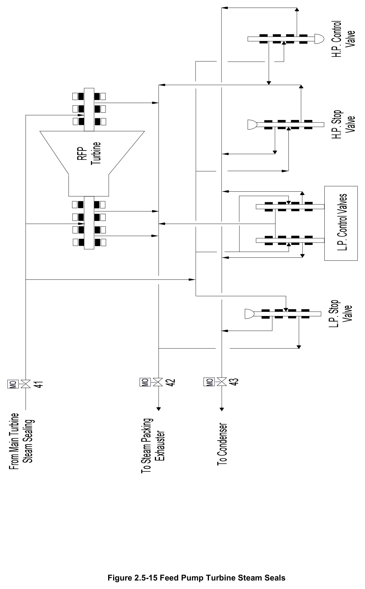

*Feed Pump Turbine Steam Seals*

[Vector original (SVG, lossless): fig_2.5-15.svg](../figures/fig_2.5-15.svg)

