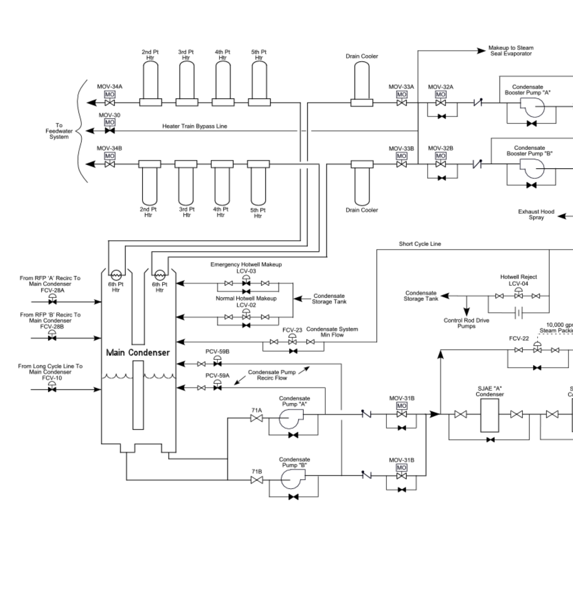
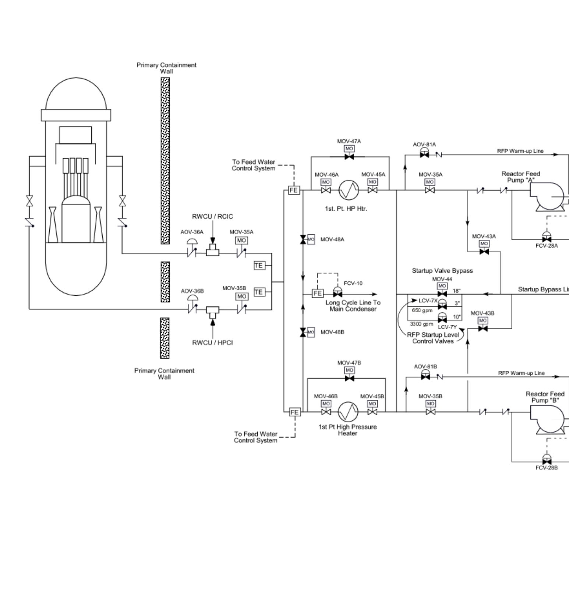
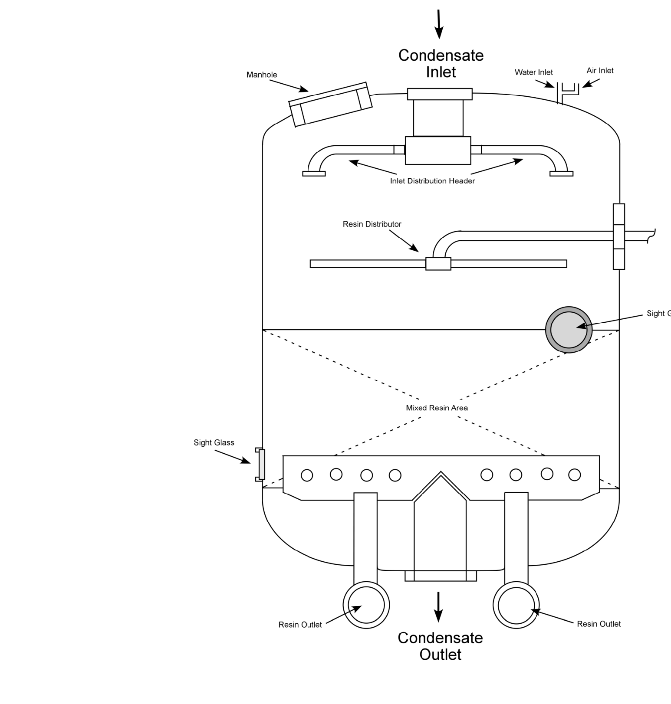
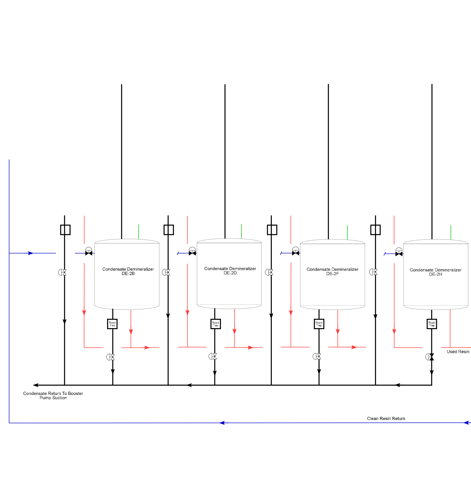
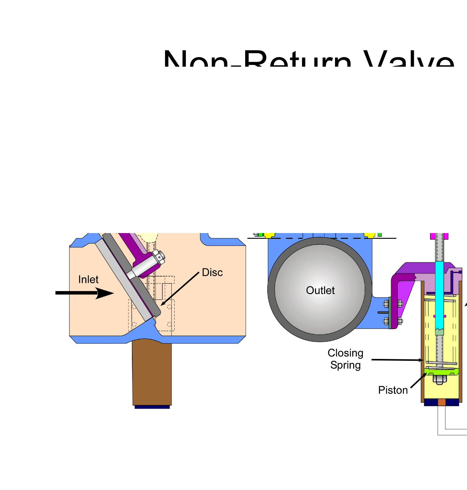
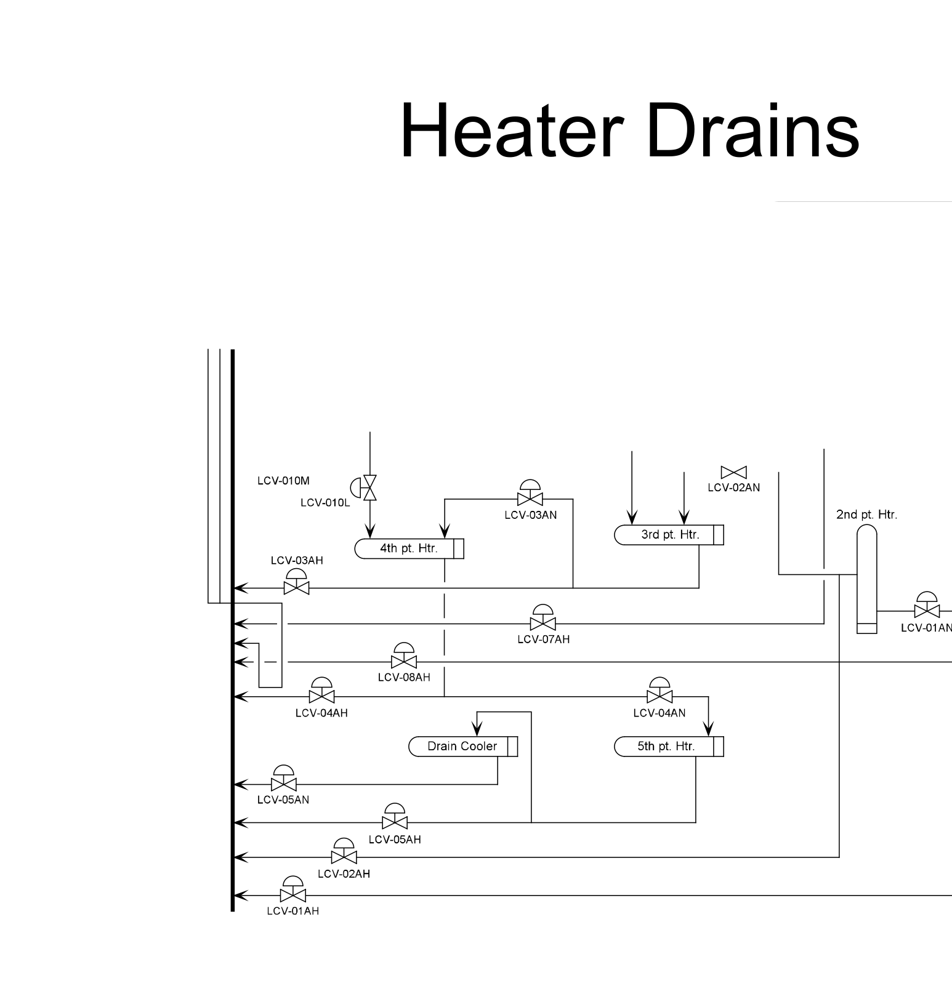
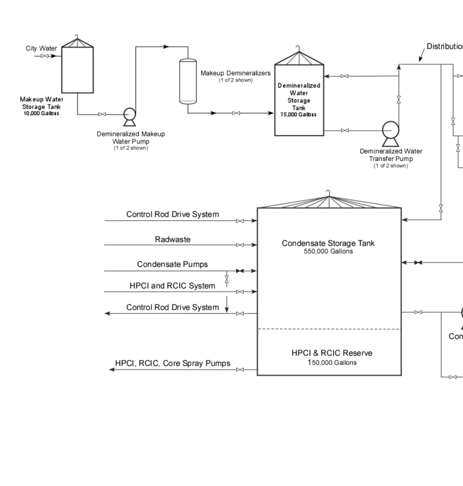

# 2.6 Condensate Feedwater

> Source: `2.6_Condensate_Feedwater.pdf` (47 pages)
> GE (BWR) Systems Technology Manual — USNRC HRTD, Rev 09/11

---
<!-- p.1 -->
Condensate & Feedwater GE BWR/4 Technology Course R-304B – 2.6

<!-- p.2 -->
Recognize the purpose, function and operation of the following Condensate and Feedwater system Identify the purposes of the Condensate and Objectives Steam Jet Air Ejector Condenser Condensate Booster Pumps Condensate Demineralizers Condensate Storage Tank Steam Packing Exhauster Main Condenser Hotwell major components: Feedwater system.
High Pressure Heaters Low Pressure Heaters Condensate Pumps Feedwater Pumps Main Condenser

a. b. c. d. e. g. h. k.
f. i. j.

1. 2.

<!-- p.3 -->
Condensate & Demineralized Makup Water System Describe the following flowpaths of the Condensate and Feedwater system:
Objectives Hotwell Level Control Exhaust Hood Spray Short Cycle Cleanup Long Cycle Cleanup Condensate System Condensate System Feedwater System

a. b. d. e. g. c.
f.
c

3.

<!-- p.4 -->
Condensate Booster Pump Low Suction Pressure Identify the purpose or function of the following Condensate and Feedwater Condensate Demineralizer High Temperature Condensate Demineralizer Resin Depletion l ti Feedwater Pump Low Suction Pressure Objectives D

i

R

li

System setpoints: i D

t

d

C

a. b. d. c.
b

4.

<!-- p.5 -->
Feedwater system interrelates with the Describe how the Condensate and High Pressure Coolant Injection System Reactor Core Isolation Cooling System following systems/components:
Objectives Reactor Water Cleanup System Feedwater Control System Control Rod Drive System Circulating Water System t

Main Steam System S l R d D i Offgas System t

C

a. b. d. e. g. h. c.
f.
b

5.

<!-- p.6 -->
Objective 1 Condensate & Feedwater
• Provide path to Reactor Vessel for :
System Purposes
• Remove Noncondensible Gases
• Pump Water to Reactor Vessel – High Pressure Coolant Injection – Rector Core Isolation Cooling – Reactor Water Cleanup
• Collect Steam Drains
• Condense Steam
• Preheat
• Purify • Purify

<!-- p.7 -->
Objective 2
• High Pressure Heaters
• Low Pressure Heaters • Low Pressure Heaters
• Condensate Booster System Major Components Condensate & Feedwater
• Feedwater Pumps
• Extraction Steam Demineralizers
• Condensate Pumps

• Steam Packing Exhauster
• Main Condenser Hotwell
• Steam Jet Air Ejector
• Condensate Storage
• Condensate Pumps
• Main Condenser P

Condenser t d Tank C

<!-- p.8 -->

*figure on PDF page 8*

<!-- p.9 -->

*figure on PDF page 9*

<!-- p.10 -->
Objective 2 – Steam Packing Exhauster – Feedwater Htr shell vents – Low Pressure Htr Drains – Minimum Recirculation – Air Ejector Condenser – Turbine Bypass – RFP Exhaust
• Heat Sink for:
– Pump flows Main Condenser Drains Flow

• Cooled by Circulating
• Divided Water Boxes
• Radial Flow Surface
• Collects LP Turbine
• Two Condensers Water System Condensers Condensers
• Deaerate Exhaust

<!-- p.12 -->
Objective 2
• Designed to retain water for minimum of – Nitrogen – 16 decay half-life - 7.11 seconds Main Condenser Hotwell
• Integral part of the Main Condenser – At minimum operating hotwell levels
• Connected by Equalizing lines
• Collects condensate two minutes

<!-- p.13 -->
Objective 2
• Provide adequate net positive suction head for Condensate Booster Pumps
• Capacity 12,153 gpm at ~ 200 psig Condensate Pumps i

200

t

it 12 153
• Two pumps C

<!-- p.14 -->
Objective 2
• Condense steam from first stage steam jet
• Condensate flows through both SJAE Steam Jet Air Ejector Condenser condensers condensers air ejectors

<!-- p.15 -->
Objective 2
• Condenses leak-off steam from turbine Steam Packing Exhauster Reactor Feed Pumps – Reactor Feed Pumps – Main Turbine seals

<!-- p.16 -->
Objective 2 Condensate Demineralizers
• High conductivity or high D/P requires
• 8 units total, 7 required for full power
• Maintain reactor water quality limits
• Remove dissolved and suspended it

lit li

• Ultrasonic resin cleaning • Purify steam cycle water t

resin replacement t

impurities M i t i

<!-- p.17 -->

*figure on PDF page 17*

[Vector original (SVG, lossless): fig_page-17.svg](../figures/fig_page-17.svg)

<!-- p.18 -->

*figure on PDF page 18*

[Vector original (SVG, lossless): fig_page-18.svg](../figures/fig_page-18.svg)

<!-- p.19 -->
Objective 2 Condensate Booster Pumps
• Provide adequate net positive suction
• Capacity 12,153 gpm at ~ 600 psig i

head for Reactor Feed Pumps 600 t

it 12 153
• Two pumps C

<!-- p.20 -->
Objective 2
• Feedwater flows through steam region on first
• Second pass through the water box portion of
• Drains cascade to a lower pressure heater Low Pressure Heaters
• Extraction steam used to heat feedwater g

• Two parallel heater string paths
• Increase Plant Efficiency g

the heater pass

<!-- p.22 -->
Objective 2
• Provide driving force to inject water into – High pressure steam from Main Steam Separator/Reheaters, normal supply – Low pressure steam from Moisture Feedwater Pumps
• 67% of system capacity each
• 14,000 gpm at ~ 1130 psig
• Two sets of control valves i
• Two steam driven pumps 1130 Equalizing Header t reactor vessel 14 000

<!-- p.25 -->
Objective 2
• Uses high pressure extraction steam from
• ~ 420°F Feedwater Injection temperature t High Pressure Heaters
• Last stage of feedwater heating t

ti

I j

t to reactor vessel d HP Turbine 420°F F

<!-- p.28 -->
Objective 2 Condensate Storage Tank
• Provides rejection source for hotwell
• Provides makeup supply to hotwell – High Pressure Coolant Injection
• 150,000 gallons dedicated for – Reactor Core Isolation Cooling
• Capacity - ~ 500,000 gallons li
• Typically located outdoors C

l ti

I

C

t

R

<!-- p.29 -->

*figure on PDF page 29*

<!-- p.30 -->

*figure on PDF page 30*

[Vector original (SVG, lossless): fig_page-30.svg](../figures/fig_page-30.svg)

<!-- p.31 -->
Extraction Steam

<!-- p.32 -->

*figure on PDF page 32*

[Vector original (SVG, lossless): fig_page-32_2.svg](../figures/fig_page-32_2.svg)

<!-- p.33 -->
Exhaust Hood Spray

<!-- p.34 -->
Objective 3
• Condensate Storage & Transfer System Condensate & Feedwater System Flowpaths
• Demineralizer Water System
• Hotwell Level Control
• Exhaust Hood Spray • Short Cycle Cleanup
• Condensate System
• Long Cycle Cleanup
• Feedwater System

<!-- p.35 -->

*figure on PDF page 35*

<!-- p.36 -->

*figure on PDF page 36*

<!-- p.37 -->

*figure on PDF page 37*

<!-- p.38 -->
• Condensate Booster Pump Low Suction
• Feedwater Pump Low Suction Pressure Condensate & Feedwater
• Condensate Demineralizer Resin System Setpoints • Condensate Demineralizer High Temperature Depletion Depletion Pressure

<!-- p.39 -->
Objective 4

Demineralizer High
• Resin melts ~ 150°F to 160°F Temperature
• Manually bypass
• >130°F

<!-- p.40 -->
Objective 4 Demineralizer Resin Depletion
• High Differential Pressure – 40 psig t – Typically requires resin replacement l – Typically requires cleaning i

i

• 0.1 µmho/cm ll

i

T

<!-- p.41 -->
Objective 4
• Condensate Booster Pump Low Suction Suction Pressure Trips – ‘A’ Pump time delay trip 20 seconds ‘B’ Pump time delay trip 45 seconds – B Pump time delay trip 45 seconds – ‘B’ Pump time delay trip 25 seconds – ‘A’ Pump time delay trip 8 seconds
• Feedwater Pump Low Suction – 250 psig – 35 psig

<!-- p.42 -->
Objective 5
• Main Steam System Coolant Injection Isolation Cooling
• High Pressure
• Offgas System
• Reactor Core System Interrelations System System

• Control Rod Drive
• Circulating Water
• Feedwater Level Cleanup System Control System
• Reactor Water System System y

<!-- p.43 -->
• Condensate Booster Pumps
• Condensate Demineralizers
• High Pressure Heaters
• Low Pressure Heaters Identify the purposes of the Condensate and
• Feedwater Pumps operation of the following Condensate and Feedwater system major components:
Recognize the purpose, function and Objective Review Steam Jet Air Ejector Condenser g Condensate Storage Tank Steam Packing Exhauster Main Condenser Hotwell Feedwater system.
Condensate Pumps Main Condenser

• • • • • •

1. 2.

<!-- p.44 -->
Describe the following flowpaths of the Objective Review Condensate and Feedwater system:
Condensate Storage and Transfer System Demineralizer Water System Hotwell Level Control Hotwell Level Control Exhaust Hood Spray Short Cycle Cleanup Long Cycle Cleanup Condensate System Feedwater System

• • • • • • • • •

3.

<!-- p.45 -->
Condensate Booster Pump Low Suction Pressure Identify the purpose or function of the following Condensate and Feedwater Condensate Demineralizer High Temperature Objective Review Condensate Demineralizer Resin Depletion l ti Feedwater Pump Low Suction Pressure D

i

R

li

System setpoints: i D

t

d

C

• • • •

4.

<!-- p.46 -->
Feedwater system interrelates with the Objective Review Describe how the Condensate and High Pressure Coolant Injection System Reactor Core Isolation Cooling System following systems/components:
Reactor Water Cleanup System Feedwater Control System Control Rod Drive System Circulating Water System t

Main Steam System S l R d D i Offgas System t

C

• • • • • • • •

5.

<!-- p.47 -->
Comments Questions t
- or – C

