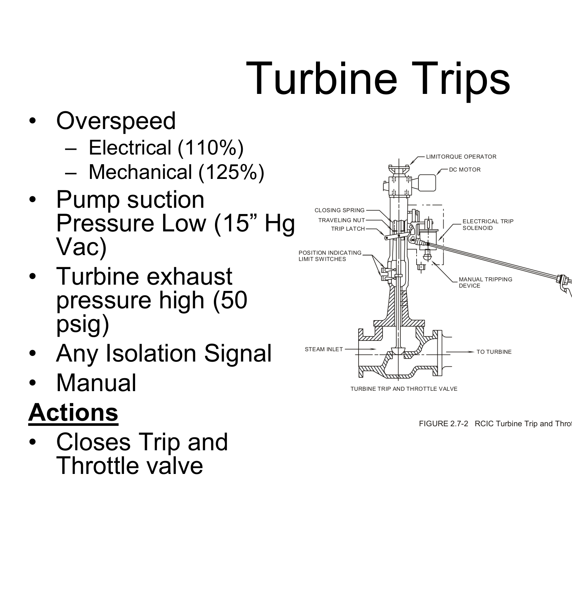

# 2.7 RCIC

> Source: `2.7_RCIC.pdf` (25 pages)
> GE (BWR) Systems Technology Manual — USNRC HRTD, Rev 09/11

---
<!-- p.1 -->
Reactor Core Isolation Cooling Chapter 2.7

<!-- p.2 -->
Identify the purpose of the Reactor Core Isolation Cooling (RCIC) system.
OBJECTIVES

1.

<!-- p.3 -->
2. Describe the purpose, function and operation of the Condensate Storage Tank Suction Valve following RCIC system major components:
OBJECTIVES Suppression Pool Suction Valve Turbine Trip and Throttle valve Steam Supply Isolation Valves Steam to Turbine Valve Turbine Governor valve Full Flow Test Valve Discharge Valve Line Fill System Flow Controller Oil System Oil System Turbine Pump

m.
a. b. d. e. g. h. c. k.
f. i. j. l.
f

<!-- p.4 -->
3. Describe the following flowpaths of the RCIC 4. Identify the RCIC System parameters which e. Barometric Condenser and Receiver OBJECTIVES a. Steam Supply and Exhaust c. Automatic Turbine Trip d. Suction Path Transfer affect the following: a. Automatic Initiation b. Automatic Isolation b. Injection Flow c. Test Flow d. Line Fill system:

<!-- p.5 -->
Describe how the RCIC system interrelates e. High Pressure Coolant Injection System Nuclear Steam Supply Shutoff System with the following systems/components:
c. Condensate and Feedwater System OBJECTIVES a. Condensate Storage Tank b. Main Steam System b. Main Steam System d. Suppression Pool f.

5.

<!-- p.6 -->
• the condensate and feedwater system is Provide makeup water to the reactor
• the main steam lines are isolated vessel for core cooling when:
Purpose

#### or
not available.

<!-- p.7 -->
– normally open to maintain the steam lines warmed and ready for RCIC
• All four of the RCIC steam line valves close if there is a RCIC
• The Outboard steam isolation (MOV 42) valve is DC powered
• The Inboard steam isolation valve (MOV 41) is A.C. powered
• The two steam warm up isolation valves (MOV 47 and MOV
• Both of the steam supply isolation valves open on a RCIC RCIC Components maintained open in the standby line up.
maintained open in the standby line up Steam Supply Isolation valves closed in the standby line up.
initiation signal.
isolation signal initiation.
48)
– –

<!-- p.8 -->
• The turbine trip and throttle valve (MOV 44) is upstream of • The steam supply shutoff valve (MOV 43) provides steam – The valve receives an open signal on a RCIC automatic initiation (isolation for the RCIC turbine in the standby condition.
– provides for rapid turbine tripping under various conditions. – can be used to throttle steam flow to the RCIC turbine if the RCIC Components 38") and automatically closes on Level 8 (+56.5").
• Valve is open in the standby condition Turbine Trip and Throttle Valve governor valve fails open.
Steam to Turbine Valve the governor valve

<!-- p.9 -->
standby condition to full load conditions within 30 seconds.
• The valve is opened by spring force and closed by RCIC – Designed to operate with a steam supply pressure ranging from
• The governor valve is controlled by an electro hydraulic
• The RCIC turbine is designed to accelerate from a cold • Turbine speed is controlled by varying the operating oil
• The RCIC turbine is a non-condensing Terry turbine RCIC Components pressure that is opposing the spring force.
turbine governor control oil pressure.
p

Turbine Governor Valve 150 psig to 1135 psig.
RCIC Turbine system. g

<!-- p.10 -->
• Oil is supplied to the turbine and pump bearings
• Oil is supplied to the governor valve as control
• In the normal operating speed range, a spring loaded pressure regulating valve recirculates
• A small gear pump is driven by the RCIC oil – This limits oil pressure to approximately 15 psig.
RCIC Components excess oil to the pump suction system worm gear.

#### RCIC Oil System
for lubrication oil.

<!-- p.11 -->
condenser is gravity drained to Clean Radwaste (CRW).
• The condensate pump cycles on high and low level signals
• Prevents leakage from the turbine shaft seals and turbine
• Steam leakage is collected in the barometric condenser
• May be manually started or it automatically starts on a – When the system is in standby, the barometric
• Non condensable gasses are exhausted to the RCIC Components suppression pool via the vacuum pump.
RCIC Barometric Condenser System when the system is in operation.
turbine trip throttle valve stem RCIC system initiation. exhaust casing drain.
governor valve stem turbine gland seals from the: from the:
– – –

<!-- p.12 -->
• The line fill pump takes suction from the RCIC CST
• A centrifugal pump designed to deliver 400 gpm to – Flow rate is equal to the boil off rate from the reactor 15
• Discharges at 40 psig to the RCIC discharge line – Prevents piping voids from forming that could cause – Minimizes the injection time for the RCIC pump Minimizes the injection time for the RCIC pump RCIC Components

#### RCIC Line Fill System
• Maintaining the piping full minutes after shutdown.

#### water hammer. RCIC pump
suction line the reactor

<!-- p.13 -->
• A full flow test line (shared by the HPCI System)
• A pump minimum flow line to the suppression – flow is distributed inside the reactor vessel by the
• RCIC injects into the 'A' feedwater line RCIC Components

#### RCIC Pump Discharge Paths
• A cooling line for turbine auxiliaries – The RCIC pump discharges through:
• the air operated check valve
• the system flow element feedwater spargers.
• the discharge valves pool

<!-- p.14 -->
• The exhaust line is protected from over pressure by a RCIC
• The RCIC turbine exhaust line routes steam from the RCIC – Prevent drawing suppression pool water into the line via a vacuum
• The space between the exhaust rupture diaphragms has
• The high exhaust pressure trip is backed up by rupture diaphragms which relieve pressure to the RCIC room.
created by condensation of steam in the line following RCIC turbine to the suppression pool below water level.
• Vacuum breakers are installed on the exhaust line pressure switches that initiate a RCIC isolation.
RCIC Components turbine trip on high exhaust pressure.
RCIC Turbine Exhaust Path operation.

<!-- p.15 -->
• The normal suction is from the CST on a line common with the HPCI System suction line.
• The suction swap from the CST to the RCIC Components
• The system can take suction from the:
– condensate storage tank (CST)
– High suppression pool level

#### RCIC Pump Suction Path
– suppression pool suppression pool – Low CST level

<!-- p.17 -->
– RCIC will cycle automatically between L2 and
• RCIC initiates automatically at Level2 – RCIC steam to Turbine valve (MOV 45)
RCIC steam to Turbine valve (MOV 45)
RCIC Auto Operation
(-38”) or via the manual initiation L8 with no operator action pushbutton on P603.
closes at Level 8

<!-- p.18 -->

*figure on PDF page 18*

[Vector original (SVG, lossless): fig_page-18_2.svg](../figures/fig_page-18_2.svg)

<!-- labels/text on this figure page -->
0399
MECHANICAL OVERSPEED TRIP DEVICE OVERSPEED TRIP LIMIT SWITCH LOCKOUT
RCIC Turbine Trip and Throttle Valve ELECTRICAL TRIP Turbine Trips MANUAL TRIPPING TO TURBINE LIMITORQUE OPERATOR SOLENOID DC MOTOR DEVICE DEVICE FIGURE 2.7-2 TURBINE TRIP AND THROTTLE VALVE CLOSING SPRING TRAVELING NUT TRIP LATCH POSITION INDICATING LIMIT SWITCHES STEAM INLET Pressure Low (15” Hg
• Any Isolation Signal – Mechanical (125%)
pressure high (50 – Electrical (110%)
• Turbine exhaust
• Closes Trip and
• Pump suction Throttle valve
• Overspeed
• Manual Actions psig)
Vac)

<!-- p.19 -->
• High Steam Line Differential Pressure (291”H2O,
• High Pressure between Rupture Discs (10 psig) • High Pressure between Rupture Discs (10 psig)
• Inbd and Outbd Steam Isolations close (41, 42,
• Steam Line Space High Temp (193 F)
• Steam Supply Pressure Low (57psig)
Isolations
• RCIC turbine trips 3 sec time delay)

#### • Manual Actions
47, 48)

<!-- p.20 -->
– RCIC supplied from “A” steam line upstream of – Steam drains are directed to Main Condenser
• Condensate and Feedwater (Section 2.6)
• High Pressure Coolant Injection (HPCI)
– Shared suction and test line from the CST – Water returns to vessel on FW line “A” System Interfaces • Main Steam System (Section 2.5)
– Back up to RCIC
(Section 10.1)
MSIVs

<!-- p.21 -->
– A secondary source of water and condenses

#### • Nuclear Steam Supply Shutoff System
– The primary source of water and test volume – The NSSSS provides signals to isolate the System Interfaces RCIC Steam supply isolation valves
• Suppression Pool

#### (Section 4.4)
steam
• CST

<!-- p.22 -->
1. Identify the purpose of the Reactor Core OBJECTIVE REVIEW Isolation Cooling (RCIC) system.

<!-- p.23 -->
2. Describe the purpose, function and operation of the following OBJECTIVE REVIEW Condensate Storage Tank Suction Valve Suppression Pool Suction Valve Turbine Trip and Throttle valve Steam Supply Isolation Valves RCIC system major components:
Steam to Turbine Valve Turbine Governor valve Barometric Condenser Turbine Exhaust valve Minimum Flow Valve Full Flow Test Valve Flow Controller Injection Valve Line Fill Pump Oil System Turbine t Pump Oil S

m.
a. b. c. d. e. g. h. k. n. o. p.
f. i. j. l.

<!-- p.24 -->
## 4. Identify the RCIC System parameters which
## 3. Describe the following flowpaths of the
OBJECTIVE REVIEW e. Barometric Condenser and Receiver a. Steam Supply and Exhaust c. Automatic Turbine Trip d. Suction Path Transfer

#### affect the following:
a. Automatic Initiation b. Automatic Isolation b. Injection Flow

#### HPCI system:
c. Test Flow d. Line Fill

<!-- p.25 -->
e. Nuclear Steam Supply Shutoff System OBJECTIVE REVIEW

## 5. Describe how the RCIC system
b. Condensate and Feedwater System

#### interrelates with the following
d. Condensate Storage Tank

#### systems/components:
Main Steam System a. Main Steam System c. Suppression Pool a

