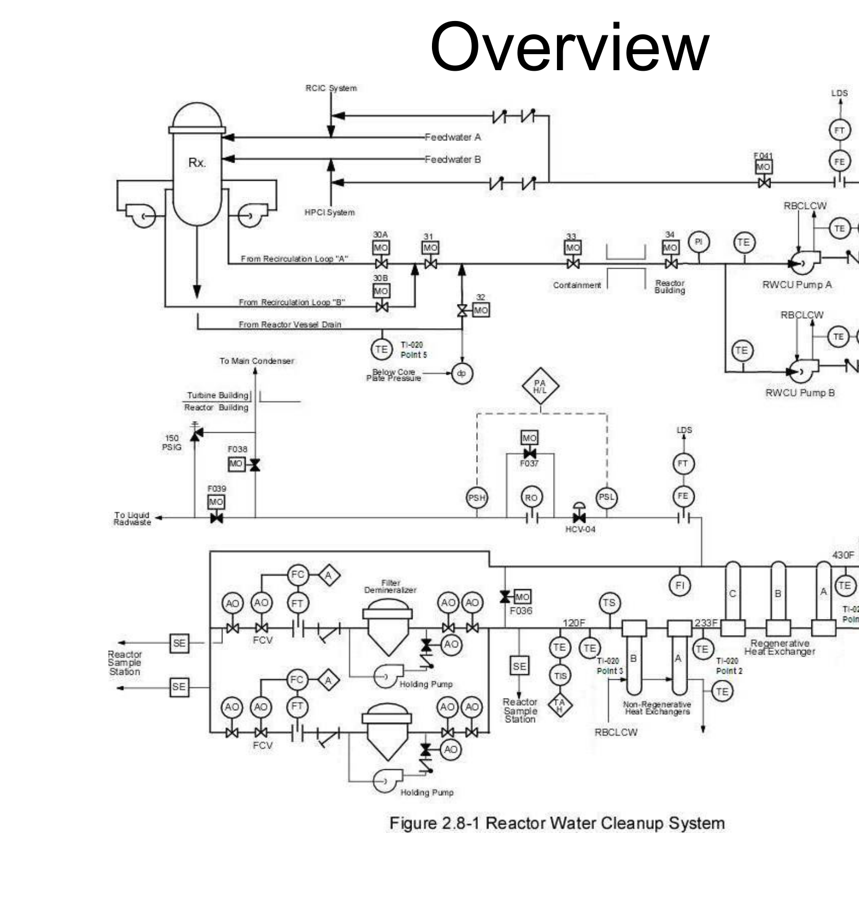
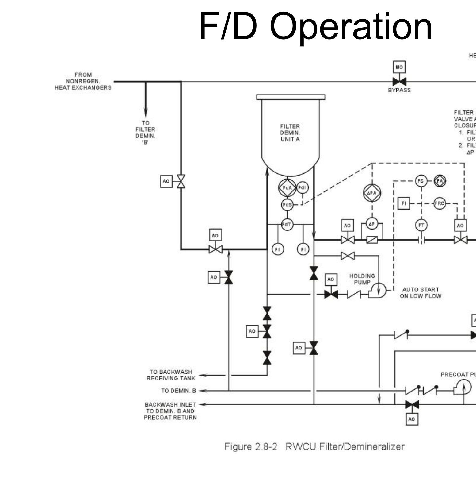
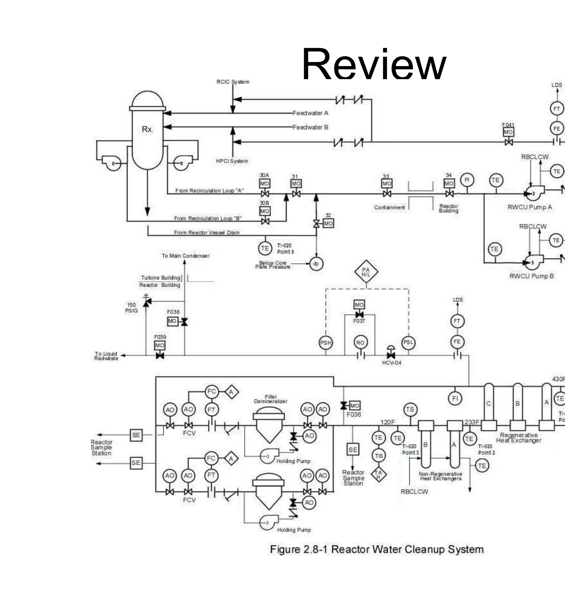
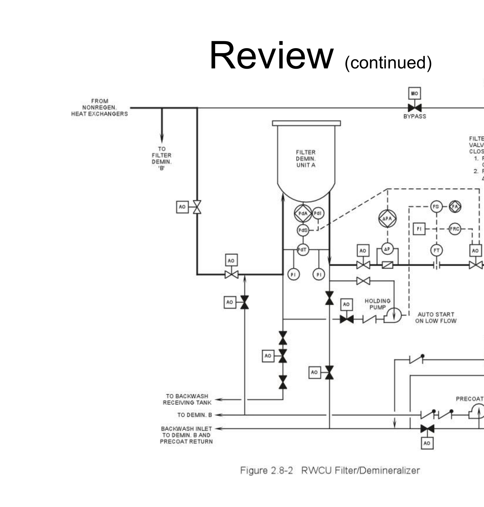

# 2.8 RW Cleanup

> Source: `2.8_RW_Cleanup.pdf` (37 pages)
> GE (BWR) Systems Technology Manual — USNRC HRTD, Rev 09/11

---
<!-- p.1 -->
Reactor Water Cleanup System (RWCU) )
304B Chapter 2.8
(

y

<!-- p.2 -->
2. Recognize the purpose, function and operation of the following
1. Identify the purposes of the reactor water cleanup system.
reactor water cleanup system major components:
Objectives filter demineralizer bypass valve (MOV-036)
non-regenerative heat exchangers Blowdown control valve (HCV-04)
system bypass valve (MOV-035)
orifice bypass valve (MOV-037)
regenerative heat exchangers filter demineralizer units RWCU outlet piping RWCU inlet piping RWCU pumps p

p

a. b. c. d. e. g. h.
f.
i. j.

<!-- p.3 -->
3. Describe the following flow paths of the reactor water cleanup system:
c. filter demineralizer operations Objectives b. blowdown operation ti a. normal operation d

bl

b

<!-- p.4 -->
e. Non-regenerative heat exchanger outlet high temperature (140°F)
c. RWCU system high differential flow (44 gallons for 45 seconds)
d. Main steam tunnel penetration area high temperature (175°F)
b. RWCU heat exchanger/pump area high temperature (155°F)
4. Identify the purpose or function of the following a. Low low reactor vessel water level (Level 2 at -38”) reactor water cleanup system setpoints:
Objectives (continued)
f. Standby liquid control system initiation

<!-- p.5 -->
d. reactor building closed loop cooling water system 5.Describe how the reactor water cleanup system e. nuclear steam supply shutoff system Objectives (continued)
interfaces with the following systems:
c. condensate and feedwater system h. liquid and solid radwaste systems g. standby liquid control system f. control rod drive system b. reactor vessel system a. recirculation system

<!-- p.6 -->
Objective 1 from the reactor vessel during startups from the reactor vessel during startups o Provides a method of removing water o Maintains reactor water quality by o Prevents excessive loss of water inventory from the reactor vessel o Limits the release of radioactive filtration and ion exchange material from containment Purposes and shutdowns RWCU:

<!-- p.7 -->

*figure on PDF page 7*

<!-- p.8 -->
Objective 2 close to isolate the portions of the RWCU
• Two motor operated valves automatically
• Suction from bottom head drain protects within the reactor vessel and buildup of suction side of each recirculation pump against thermal stratification of water
• RWCU system takes water from the insoluble material in bottom head.
p and from the bottom head drain.
system outside containment.
Inlet Piping

<!-- p.9 -->
Objectives 2 & 5
• Two 100% capacity pumps with rated flow
• One pump normally running with second
• RBCLCW system provides bearing and
• CRD system provides seal water RWCU Pumps of 207 gpm each pump in standby pump in standby seal cooling

<!-- p.10 -->
Objective 2 RWCU water returning to the reactor vessel
• RWCU water returning to the reactor vessel Regenerative Heat Exchangers minimizing thermal stresses on the return
• About 80% of the heat loss is recovered, regenerative heat exchangers, warming series cool RWCU water from 534°F to
• Three regenerative heat exchangers in flows through the shell side of the from 120°F to 430°F.
piping and nozzles.
233°F

<!-- p.11 -->
Objectives 2 & 5
• RBCLCW flows through the shell side of
• Two non-regenerative heat exchangers in series cool RWCU water from 233°F the non-regenerative heat exchangers Non-Regenerative Heat Exchangers

to 120°F

<!-- p.12 -->
Objectives 2 & 3
• Two filter demineralizer (F/D) units operate mho, or outlet to inlet conductivity reaches psid, outlet conductivity reaches 0.1 microinsolubles by filtration and solubles by ion
1.0, the F/D unit is removed from service • When pressure across a F/D reaches 20 in parallel use powdered resin to remove Filter Demineralizers for backwashing and precoating.
exchange.

<!-- p.13 -->
Objectives 2 & 3
• If flow through a F/D unit drops below 60 realign and the applicable holding pump through the F/D unit to prevent the resin Filter Demineralizers (continued)
gpm, air operated valves automatically automatically starts to recycle water automatically starts to recycle water from fall off the filter tubes.

<!-- p.14 -->
Objectives 2 & 5
• RWCU water leaves the F/D units, passes through the regenerative heat exchangers RCIC piping connected to feedwater line function as containment isolation valves.
RCIC piping connected to feedwater line and re-enters the reactor vessel via the
• Two check valves on each return line ‘A’ and the HPCI piping connected to Outlet Piping feedwater line ‘B.’

<!-- p.15 -->
Objective 2 promotes mixing within the reactor vessel, the regenerative heat exchangers and the the regenerative heat exchangers and the header connecting the RWCU pumps to protecting against thermal stratification. located on a cross-tie line between the
• A motor operated valve (MOV-035) is header returning system flow to the System Bypass Valve
• Opening the system bypass valve vessel.

<!-- p.16 -->
Objective 2 and pressure control during low power and RWCU to be used for reactor vessel level
• Opening the F/D bypass valve allows the located on a cross-tie line between the
• A motor operated valve (MOV-036) is inlet and outlet headers for the filter F/D Bypass Valve demineralizer (F/D) units.
demineralizer (F/D) units shut down conditions.

<!-- p.17 -->
Objective 2
• Opening the orifice bypass valve facilitates
• Opening the orifice bypass valve facilitates
• A motor operated valve (MOV-037) is restricting orifice in the blowdown line.
pressure (<60 psig) when differential located on a bypass line around the pressure does not provide sufficient blowdown operation at low reactor Orifice Bypass Valve blowdown flow.

<!-- p.18 -->
Objective 2 allows some or all of the RWCU system downstream pressure or low upstream diverted to the main condenser or the return flow to the reactor vessel to be
• HCU-04 automatically closes on high Blowdown Control Valve
• Opening the blowdown control valve
• A motor operated valve (HCU-04) is y

located in the blowdown line.
liquid radwaste system.
pressure

<!-- p.19 -->
Objectives 3 & 5 through the regenerative heat exchangers, exchangers, through both F/D units, back and through the RCIC/HPCI connections 90 gpm from each recirculation loop and moved by one RWCU pump through the regenerative and non regenerative heat 20 gpm from the bottom head drain are on both feedwater lines into the reactor regenerative and non-regenerative heat Normal Operation vessel.

<!-- p.20 -->
Objectives 3 & 5 main condenser (MOV-038) or to the liquid
• Blowdown flow rate is manually controlled flow can be diverted via a blowdown line
• Blowdown flow can be sent to either the • Some or all of the RWCU system return located between the F/D units and the Blowdown Operation regenerative heat exchangers.
radwaste system (MOV-039).
(HCV-04).

<!-- p.21 -->
Objective 3
• Blowdown flow rate may be limited by F/D vessel level about 1 inch every 4 minutes.
unit inlet temperature or reactor pressure.
shut downs may not match water added
• Low steaming rates during startups and Blowdown Operation (continued)
• CRD alone, at ~47 gpm, can increase
• CRD alone at ~47 gpm can increase via the CRD and other systems.

<!-- p.22 -->

*figure on PDF page 22*

<!-- p.23 -->
Objective 3 the F/D unit where it evenly coats the filter outlet line. The drain line connected to the the backwash receiving tank in radwaste.
inlet line is opened to slurry the resins to service. Air is used to dislodge the resin inlet line is opened to slurry the resins to tank is moved by the precoat pump into Condensate enters the F/D unit via the
• Precoat: Resin slurry from the precoat
• Backwash: F/D unit is removed from from the stainless steel filter tubes.
F/D Operation (continued)
tubes.

<!-- p.24 -->
Objective 4 Containment Isolation MOV-034 Outboard 9 9 9 9 9 9 9

System Isolations Inboard Containment MOV-033 Isolation 9 9 9 9 9

Non-Regen Outlet Hi RWCU Area Hi Temp MS Tunnel Hi Temp RWCU Diff Flow RWCU Diff. Flow SLC Initiation Level 2 Temp

<!-- p.25 -->
Objective 4 – Pump cooling water outlet temperature >195°F – Inboard isolation valve MOV-033 not fully open Component Trips & Interlocks
• RWCU pumps are de-energized by load – Outboard isolation valve MOV-034 not fully t f ll shed logic following an accident signal
• RWCU pumps automatically trip if:
MOV 034

l – Pump flow < 70 gpm l ti

d i

open O tb

<!-- p.26 -->
Objective 4 Component Trips & Interlocks
• RWCU holding pumps automatically Strainer differential pressure > 10 psid – Strainer differential pressure > 10 psid – F/D unit differential pressure > 30 psid – RWCU system flow < 60 gpm start if:

<!-- p.27 -->
Objective 4 Component Trips & Interlocks
• Blowdown flow controller HCV-004 – Downstream pressure > 140 psig Upstream pressure < 5 psig – Upstream pressure < 5 psig automatically closes if:

<!-- p.28 -->
Objective 5
• Reactor building closed loop cooling water – RBCLCW cools the RWCU pump bearings – RWCU takes water from the bottom head and seals and the non-regenerative heat – RWCU takes water from suction side of System Interfaces
• Reactor recirculation recirculation pumps
• Reactor vessel exchangers drain

<!-- p.29 -->
Objective 5 – RWCU return flow enters feedwater lines A – Liquid and solid radwaste receives RWCU – CRD provides RWCU pump seal flow – Main condenser can receive RWCU – Liquid radwaste can receive RWCU System Interfaces and B via RCIC and HPCI piping
• Condensate and feedwater
• Liquid and solid radwaste F/D backwashes • Control rod drive blowdown flow blowdown flow blowdown flow

<!-- p.30 -->
Objective 5 – NSSSS provides automatic closure signals to – SLC initiation provides automatic closure System Interfaces RWCU MOV-033 and MOV-034
• Nuclear steam supply shutoff signal to RWCU MOV-034
• Standby liquid control • Standby liquid control

<!-- p.31 -->

*figure on PDF page 31*

<!-- p.32 -->

*figure on PDF page 32*

<!-- p.33 -->
operation of major system components:
2.Recognize the purpose, function and
1.Identify the system's purposes.
d) non-regenerative heat exchangers h) filter demineralizer bypass valve c) regenerative heat exchangers Objectives j) blowdown control valve g) system bypass valve i) orifice bypass valve e) filter demineralizers f) outlet piping a) inlet piping b) pumps b) pumps

<!-- p.34 -->
3. Describe the system flow paths during:
c) filter demineralizer backwashing and pre-coating g p

g Objectives a) normal operation b) blowdown mode )

<!-- p.35 -->
e) non-regenerative heat exchanger outlet high 4.Identify the purpose or function of d) main steam tunnel penetration area high b) RWCU heat exchanger/pump area high f) standby liquid control system initiation c) RWCU space high differential flow Objectives (continued)
i) Blowdown line high/low pressures a) low low reactor water level h) RWCU system low flow g) RWCU pump low flow system setpoints:
temperature temperature temperature p

<!-- p.36 -->
5.Describe the system’s interfaces with d) reactor building closed loop cooling water Objectives (continued)
e) nuclear steam supply shutoff c) condensate and feedwater the following systems:
h) liquid and solid radwaste g) standby liquid control control rod drive b) reactor vessel a) recirculation f)

<!-- p.37 -->
Are there any questions?

