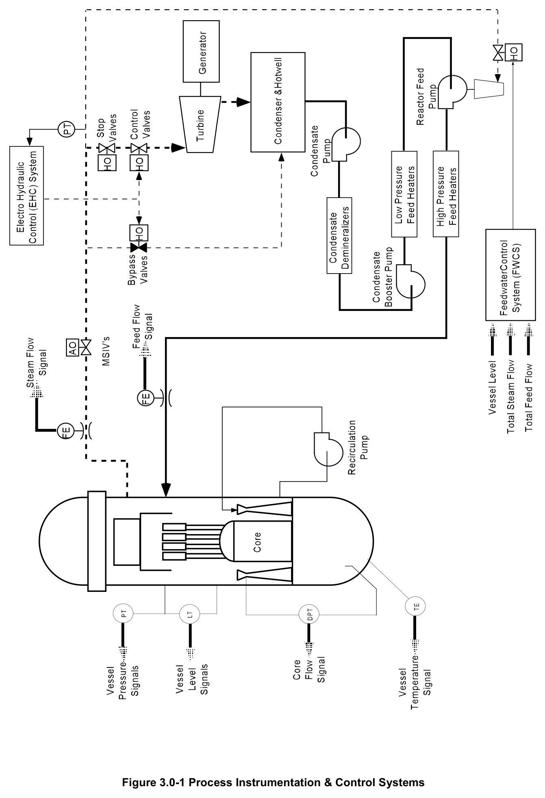
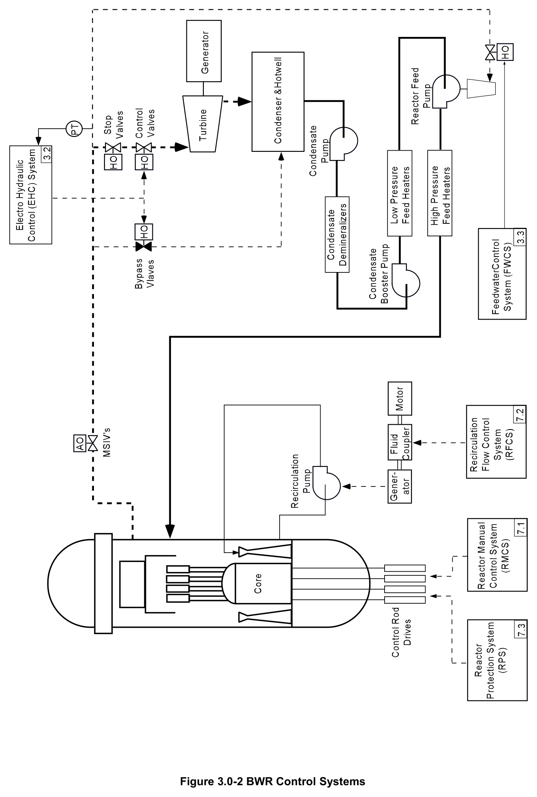

# 3.0 Process Instrumentation

> Source: `3.0_Process_Instrumentation.pdf` (8 pages)
> GE (BWR) Systems Technology Manual — USNRC HRTD, Rev 09/11

---
<!-- p.1 -->
#### General Electric Systems Technology Manual
#### Chapter 3.0
#### Process Instrumentation and Control Systems
<!-- p.3 -->
TABLE OF CONTENTS

3.0 PROCESS INTRUMENTATION AND CONTROL SYSTEMS ................................. 1

3.0.1 Reactor Vessel Instrumentation System (Section 3.1) ....................................... 1

3.0.2 Electro Hydraulic Control System (Section 3.2) ................................................. 1

3.0.3 Feedwater Level Control System (Section 3.3) .................................................. 1

3.0.4 Composite BWR Control Systems ..................................................................... 1

LIST OF FIGURES

3.0-1 Process Instrumentation and Control Systems
3.0-2 BWR Control Systems

3.0-i USNRC HRTD

<!-- p.4 -->
3.0-ii USNRC HRTD

<!-- p.5 -->
### 3.0 PROCESS INTRUMENTATION AND CONTROL SYSTEMS
The systems discussed in this chapter are those that have to do with process instrumentation or process control. The control systems used to alter reactor core reactivity are discussed in Chapter 7. The process instrumentation and control systems are shown in Figure 3.0-1 and include the following systems: the Reactor Vessel Instrumentation System, the Electro Hydraulic Control System, and the Feedwater Control System.

#### 3.0.1 Reactor Vessel Instrumentation System (Section 3.1)
The Reactor Vessel Instrumentation System provides information concerning reactor vessel water level, reactor vessel pressure, reactor vessel temperature, and core flow rate. This information is used for control and automatic trip functions.

#### 3.0.2 Electro Hydraulic Control System (Section 3.2)
The Electro Hydraulic Control System maintains a constant reactor pressure for a given reactor power level; controls the speed and load on the turbine generator, and provides protection for the main turbine.

#### 3.0.3 Feedwater Level Control System (Section 3.3)
The Feedwater Control System regulates the flow of feedwater to the reactor vessel in order to maintain reactor water level. The Feedwater Control System measures and uses total steam flow, total feedwater flow, and reactor vessel water level signals to carry out its function.

#### 3.0.4 Composite BWR Control Systems
Figure 3.0-2 shows a composite drawing of BWR control systems. In addition to the Electro Hydraulic Control System and Feedwater Control System, which are discussed in this chapter, some Chapter 7 reactivity control systems are also shown to assist in understanding overall plant response. The three Chapter 7 systems included in the drawing are the Reactor Manual Control System, the Recirculation Flow Control System, and the Reactor Protection System.

3.0-1 USNRC HRTD

<!-- p.6 -->
3.0-2 USNRC HRTD

<!-- p.7 -->
#### Figure 3.0-1

*Process Instrumentation & Control Systems*

[Vector original (SVG, lossless): fig_3.0-1.svg](../figures/fig_3.0-1.svg)

<!-- p.8 -->
#### Figure 3.0-2

*BWR Control Systems*

[Vector original (SVG, lossless): fig_3.0-2.svg](../figures/fig_3.0-2.svg)

