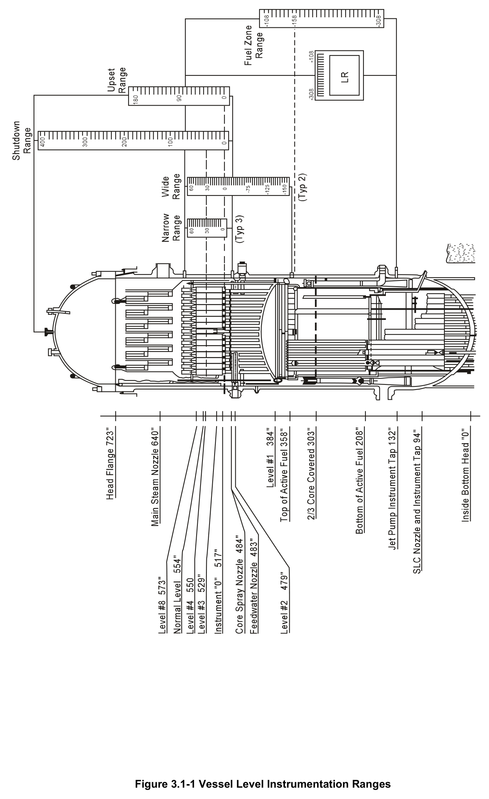
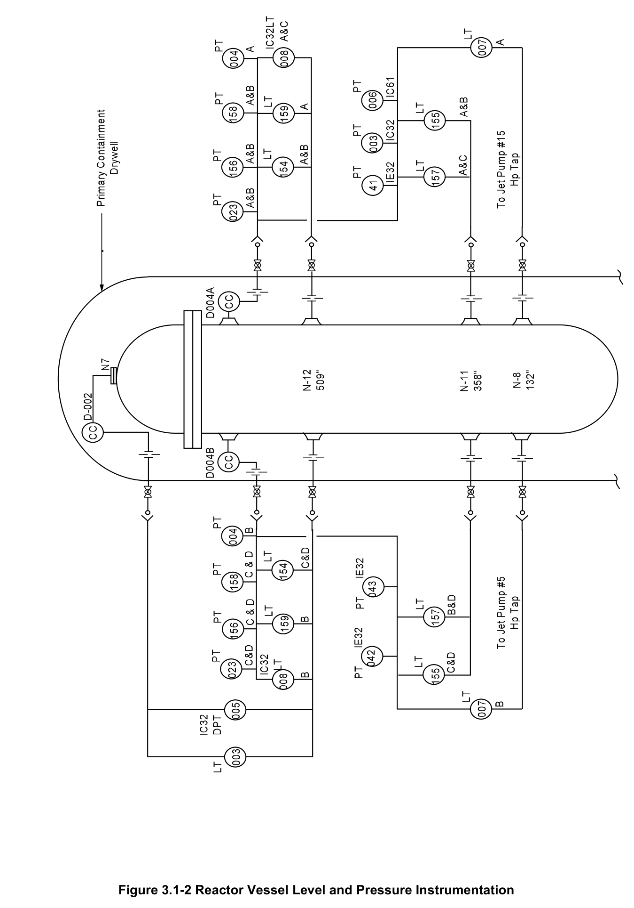
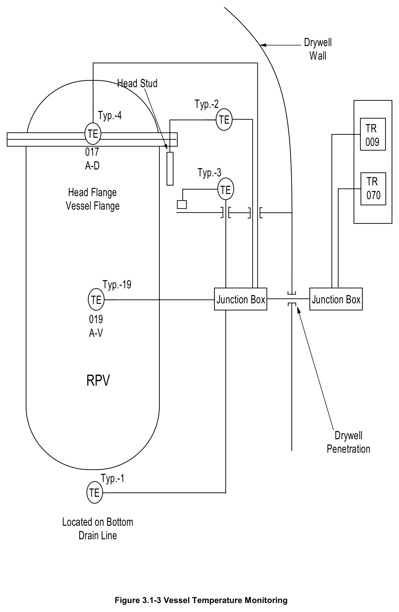
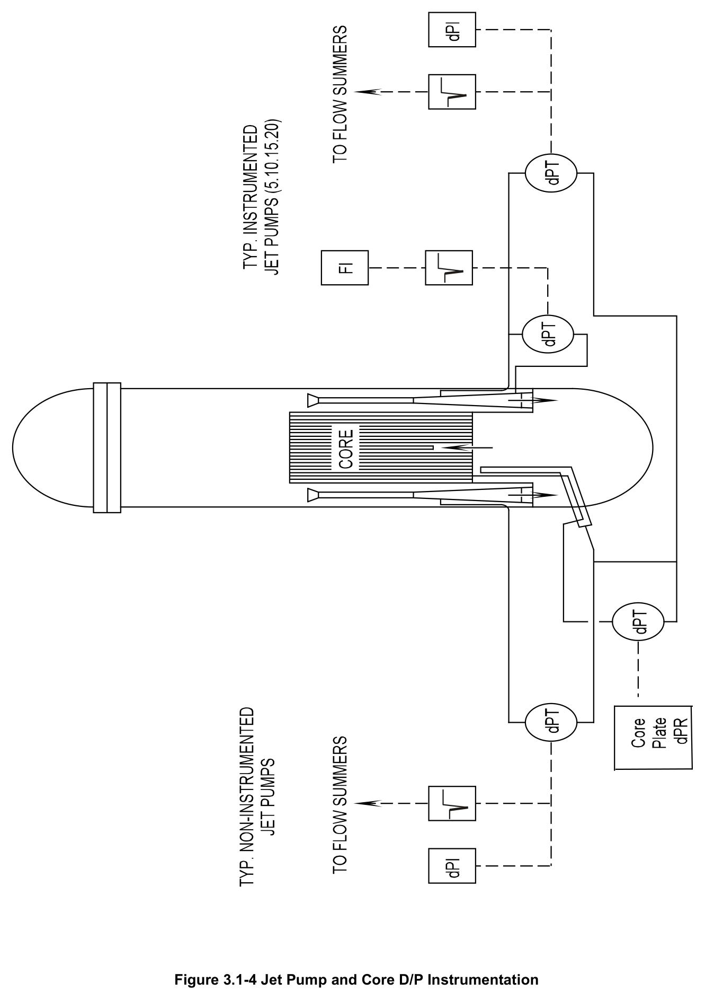
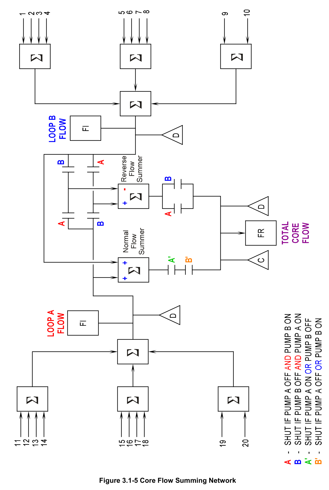
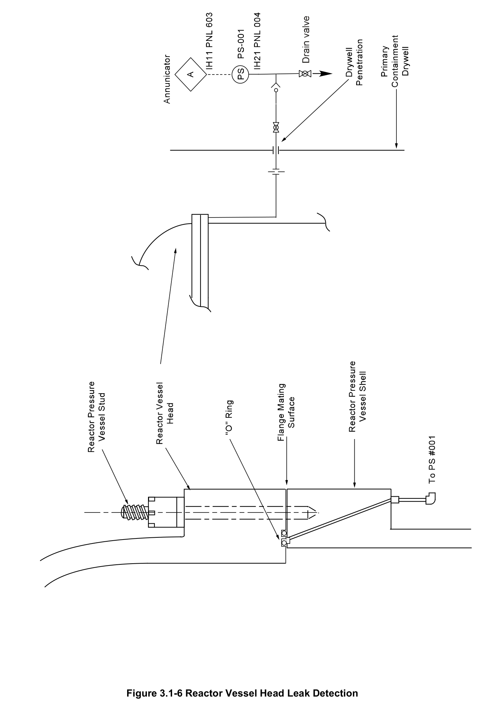

# 3.1 RV Instrumentation

> Source: `3.1_RV_Instrumentation.pdf` (33 pages)
> GE (BWR) Systems Technology Manual — USNRC HRTD, Rev 09/11

---
<!-- p.1 -->
#### General Electric Systems Technology Manual
#### Chapter 3.1
#### Reactor Vessel Instrumentation System
<!-- p.3 -->
TABLE OF CONTENTS

3.1 REACTOR VESSEL INSTRUMENTATION SYSTEM .............................................. 1

3.1.1 Introduction .......................................................................................................... 1

3.1.2 Component Description ....................................................................................... 3

3.1.2.1 Reactor Vessel Water Level Instrumentation ................................................ 3

3.1.2.2 Reactor Vessel Level Ranges ....................................................................... 4

3.1.2.3 Reactor Vessel Level Functions ................................................................... 5

3.1.2.4 Reactor Vessel Pressure .............................................................................. 7

3.1.2.5 Reactor Vessel Pressure Ranges ................................................................. 8

3.1.2.6 Reactor Vessel Pressure Functions .............................................................. 8

3.1.2.7 Reactor Vessel Temperature ........................................................................ 9

3.1.2.8 Reactor Core Flow Rate and Differential Pressure ....................................... 9

3.1.2.9 Vessel Flange Seal Leak Detection ............................................................ 10

3.1.3 System Features and Interfaces ........................................................................ 10

3.1.3.1 Reactor Core Flow rate With One Recirculation Pump in Service .............. 10

3.1.3.2 Jet Pump Flow Effect on Indication ............................................................. 11

3.1.4 System Interfaces .............................................................................................. 11

3.1.5 Summary ........................................................................................................... 12

LIST OF TABLES

3.1-1 Summary of Vessel Level Trips ......................................................................... 15

3.1-2 Summary of Reactor Pressure Setpoints ............................................................ 17

3.1-3 Narrow Range Level Interlocks ........................................................................... 19

3.1-4 Wide Range Level Interlocks .............................................................................. 21

3.1-5 Level Instrument Ranges and Calibration Conditions ......................................... 23

3.1-i USNRC HRTD

<!-- p.4 -->
#### LIST OF FIGURES
3.1-1 Vessel Level Instrumentation Ranges
3.1-2 Reactor Vessel Level and Pressure Instrumentation
3.1-3 Vessel Temperature Monitoring
3.1-4 Jet Pump and Core D/P Instrumentation
3.1-5 Core Flow Summing Network
3.1-6 Reactor Vessel Head Leak Detection

3.1-ii USNRC HRTD

<!-- p.5 -->
### 3.1 REACTOR VESSEL INSTRUMENTATION SYSTEM
Learning Objectives:

1. Recognize the purposes of the Reactor Vessel Instrumentation system.

2. Recognize the ranges and calibration conditions of the reactor vessel water level instrumentation.

3. Recognize the parameter setpoints and resultant actions listed in tables 3.1-1 and

4. Recognize the purpose and operation of the following reactor vessel instrumentation:
a. Reactor vessel temperature b. Core flow/differential pressure c. Vessel flange leak detection

5. Recognize how the Reactor Vessel Instrumentation system interfaces with the following systems:
a. Reactor Vessel System (Section 2.1)
b. Reactor Core Isolation Cooling System (Section 2.7)
c. Feedwater Control System (Section 3.2)
d. Nuclear Steam Supply Shutoff System (Section 4.4)
e. Recirculation Flow Control System (Section 7.2)
f. Reactor Protection System (Section 7.3)
g. Emergency Core Cooling Systems (Chapter 10)

#### 3.1.1 Introduction
The purpose of the Reactor Vessel Instrumentation System is to provide information on;
• reactor vessel water level
• reactor vessel pressure
• reactor vessel temperature
• core flow rate
• core differential pressure
• vessel flange O ring leakage

These parameters are monitored to allow safe plant operation and provide initiation, trip and isolation signals for various safety systems.

3.1-1 USNRC HRTD

<!-- p.6 -->
The functional classification of the Reactor Vessel Instrumentation System is that of a safety related system.

The Reactor Vessel Instrumentation System consists of several individual subsystems that monitor specific reactor parameters including:
• Reactor vessel water level
• Reactor vessel pressure
• Reactor vessel temperature
• Reactor core flow rate and differential pressure
• Reactor vessel flange seal leak detection

Reactor vessel water level is measured in the vessel downcomer annulus and displayed on five different ranges. Level is a controlling input for the Feedwater Control System
(FWCS). Level also provides initiation, isolation and protection signals, to the following systems;
• Reactor Core Isolation Cooling (RCIC) System
• Reactor Protection (RPS) System
• Nuclear Steam Supply Shutoff (NSSSS) System
• Recirculation Flow Control (RFC) System
• Emergency Core Cooling (ECCS) System (HPCI, ADS, CS and RHR)

Reactor vessel pressure is measured in the vessel steam space. Reactor pressure is displayed on both narrow and wide range pressure indicators. Reactor pressure provides initiation, isolation, and protection signals to:
• RPS
• NSSSS
• RFC System
• RCIC
• ECCS

Reactor Vessel shell temperature is measured by thermocouples attached to various points on the RPV. RPV shell temperatures are monitored to allow evaluation of thermal stress on the reactor vessel.

The plant power output capability is proportional to the ability to remove heat generated by the core. Accurate core coolant flow measurements are required to evaluate core thermal behavior. Since all core flow passes through the jet pumps, total core flow is measured by summing the individual jet pump flows.

Inner seal degradation between the vessel flange and head flange is measured by the flange seal leakage detection system.

3.1-2 USNRC HRTD

<!-- p.7 -->
#### 3.1.2 Component Description
The major components of each Reactor Vessel Instrumentation Subsystem are discussed in the following paragraphs.

##### 3.1.2.1 Reactor Vessel Water Level Instrumentation
During normal operation reactor water level is maintained approximately 17 feet above the top of the active fuel (Figure 3.1-1 and Figure 3.1-2). Maintaining an acceptable water level in the reactor vessel ensures that coolant is available to dissipate core heat.
Operating with level in the normal band also insures that the initial conditions for the plant accident analysis assumptions are valid.

Water level is measured in the reactor downcomer annulus. To measure this water level, two connections are made to the reactor vessel and connected to a differential pressure transmitter. One connection penetrates the reactor vessel in the steam volume area. This high pressure side penetration (reference leg) connects to a condensing chamber. This chamber is at approximately the same temperature as the surrounding drywell atmosphere. Steam entering the condensing chamber condenses on the inside of the chamber. The resulting condensation collects in the reference leg which connects to one side of a level transmitter. The reference leg maintains a relatively constant height of water for comparison to the variable leg. This height of water is maintained constant as excess water, condensed in the condensing pot, spills over back in to the reactor vessel.

The lower penetration (variable leg) enters the reactor vessel in the downcomer annulus region. This line connects to the low pressure side of the level transmitter. Reactor pressure is felt on both sides of the differential pressure detector and does not affect the measurement. Once it is filled, level in the reference leg should be constant. This allows changes in the variable leg to be reflected as changes in vessel level. Since the reference leg remains constant, changes in downcomer annulus water level produce a differential pressure proportional to reactor vessel water level.

The level transmitter converts this differential pressure signal to an electrical signal and transmits it to;
• control room indicators
• system initiation channels
• reactor protection system trip channels
• isolation system trip channels
• alarm trip signals

The instruments are calibrated to read the maximum level when there is zero differential pressure sensed by the transmitter (vessel level is high). The instruments will read

3.1-3 USNRC HRTD

<!-- p.8 -->
minimum level when the maximum differential pressure is sensed by the transmitter
(vessel level is low).

This system of level measurement does not make corrections for changes in reactor vessel or reference leg (Drywell) water temperature. Each instrument is calibrated at the vessel pressure and reference leg temperature in which the instrument will be used.
As changes in temperature affect the density of water, any deviation from the calibrated condition will affect instrument accuracy. Table 3.1-5 lists each instrument, the range of the instrument and the calibration conditions.

The relative vessel heights (level above vessel bottom head) of each of the steam and water penetrations are shown in Figure 3.1-1. Ranges of level indication and level functions are shown in Figure 3.1-1 and discussed in Section 3.1.3.

##### 3.1.2.2 Reactor Vessel Level Ranges
To ensure complete and accurate coverage of reactor vessel level five separate ranges of reactor vessel instrumentation are provided. The different ranges of level indication are as follows:
• Narrow range instrumentation,
• Upset range instrumentation,
• Wide range instrumentation,
• Shutdown range instrumentation,
• Fuel zone range instrumentation.

These ranges of level instrumentation are shown in Figure 3.1-1. All ranges of level instrumentation are referenced to an instrument zero. Instrument zero is 517 inches above the bottom head vessel zero. This instrument zero is referenced to the bottom of the steam dryer assembly skirt.

The 0" to +60" narrow range is used for indication during normal operation. The normal operating level, +37" is near the center of this range. This range provides control inputs to the Feedwater Control System (Section 3.3). The narrow range also provides trip inputs to the following;
• the Reactor Core Isolation Cooling System (Section 2.7)
• the Nuclear Steam Supply Shutoff System (Section 4.4)
• the Reactor Protection System (Section 7.3)
• the Recirculation Flow Control System (Section 7.2)
• the High Pressure Coolant Injection System (Section 10.1)
• the Automatic Depressurization System (Section 10.2).

The Feedwater Control System uses separate transmitters from the safety related systems; transmitters are listed in tables 3.1-3 and 3.1-4. The narrow range instruments are all calibrated for hot conditions (Table 3.1-5)

3.1-4 USNRC HRTD

<!-- p.9 -->
The -150" to +60" wide range provides indication in the control room for reactor transients. The wide range also provides trip inputs to the following
• the Reactor Core Isolation Cooling System (Section 2.7)
• the Nuclear Steam Supply Shutoff System (Section 4.4)
• the Reactor Protection System (Section 7.3)
• the Recirculation Flow Control System (Section 7.2)
• the High Pressure Coolant Injection System (Section 10.1)
• the Automatic Depressurization System (Section 10.2).
• the 4160V Emergency Distribution System (Section 9.2),
• the Core Spray System (Section 10.3)
• the Residual Heat Removal System (Section 10.4)

The wide range instruments are all calibrated for hot conditions (Table 3.1-5)

The 0" to +180" upset range measures levels above normal operating level and is used on transients. The upset range only supplies control room indication. The upset range instruments are all calibrated for hot conditions (Table 3.1-5)

The 0" to + 400" shutdown range measures level to the top of the vessel head and is used for indication during vessel flooding. The vessel is flooded primarily in support of refueling outages.
The shutdown range instruments are all calibrated for cold conditions (Table 3.1-5)

The -308" to -108" fuel zone ranges provide indication of level inside the shroud. This range provides coverage from the top to the bottom of the fuel. The fuel zone instruments are all calibrated for accident conditions (Table 3.1-5). This is the only instrument that measures actual water level inside the shroud. These instruments are inaccurate (upscale) when there is forced flow from either the RHR pumps or the recirculation pumps through the jet pumps

##### 3.1.2.3 Reactor Vessel Level Functions
The reactor vessel water level trip setpoints are commonly referred to as numbered levels. These levels and their elevation are referenced to the instrument zero. The actuation levels from the lowest to highest level are as follows;
• Level 8 (+56.5")
• Level 7 (+40.5")
• Level 5 (+37")
• Level 4 (+33.5")
• Level 3 (+12.5")
• Level 2 (-38")
• Level 1 (-132.5")

3.1-5 USNRC HRTD

<!-- p.10 -->
The reactor vessel level setpoints and their respective actions are listed in Table 3.1-1.
The bases for the various level setpoints are discussed in the following paragraphs.

###### 3.1.2.3.1 Level 8 Alarm & Trip (+56.5")
The following components are actuated at Level 8;
• Main turbine trip
• Reactor Feed Pump (RFP) turbine trip
• High Pressure Coolant Injection (HPCI) turbine trip
• Reactor Core Isolation Cooling (RCIC) turbine Steam Supply valve closure

These are tripped to protect them from carryover of moisture and subsequent damage to turbine blades. The tripping of the RFP, RCIC and HPCI turbines also prevent overfilling the reactor vessel.

###### 3.1.2.3.2 Level 7 Alarm (+40.5")
The high level alarm annunciates at the reactor vessel level at which moisture carryover will start to increase while operating at full power.

###### 3.1.2.3.3 Level 5 Normal Operating Level (+37")
The normal operating level is the setpoint at which the Feedwater Control System
(FWCS, Section 3.3) maintains reactor vessel water level. Reactor vessel water level should always be maintained between the high and low level alarms.

###### 3.1.2.3.4 Level 4 Alarm & Trip (+33.5")
The low water level alarm, Level 4, is the reactor vessel level at which steam carryunder begins affecting the core flow rate. Carryunder affects the core flow rate at full power due to the potential for recirculation and jet pump cavitation. A water level decrease to level 4, coincident with a RFP trip, causes the Reactor Recirculation pumps (Section 7.2) to runback. This recirculation runback reduces thermal power output to within the capacity of the remaining reactor feed pump.

###### 3.1.2.3.5 Level 3 Alarm & Trip (+12.5")
The low level scram function at Level 3 occurs while the water level is above the bottom of the dryer seal skirt. This provides protection against high moisture carryunder due to steam bypassing the dryer under its seal skirt. This level selection also ensures a reserve of coolant above the top of the active fuel to account for;
• decay heat boil off losses
• steam void collapse
• coolant losses from the reactor vessel following a loss of feedwater flow

3.1-6 USNRC HRTD

<!-- p.11 -->
The Level 3 setpoint is high enough to ensure reactor vessel water level will not decrease to Level 1 for most transients. This prevents initiation of the low pressure ECCS systems. ADS uses Level 3 as a confirmation signal to ensure that level is low.
This confirmation signal prevents the inadvertent initiation of ADS if a level channel fails low. A decrease of reactor vessel inventory to this level also causes the actuation of the NSSSS for some systems (Section 4.4). Level 3 also initiates a recirculation pump runback to 30%. This ensures the minimum NPSH requirements are met for the recirculation pumps and jet pumps.

###### 3.1.2.3.6 Level 2 Alarm & Trip (-38")
Level 2 is low enough so that RCIC and HPCI will not initiate after a reactor scram unless feedwater flow has been lost. The setpoint accounts for the normal level decrease due to steam void collapse following a scram. The setpoint is high enough for RCIC to recover reactor vessel water level, during a loss of feed flow, before reaching Level 1. The NSSSS isolations at Level 2 limit the loss of reactor coolant and the release of radioactive products to the atmosphere. NSSSS isolates selected systems in the event the low level was caused by a leak in those systems. The recirculation pumps are tripped at Level 2 to insert negative reactivity by void formation. The RPS system receives a signal to open the ARI valves at Level 2. Both the recirculation pump trip and ARI insert negative reactivity in the event the reactor did not scram at Level 3. The Reactor Building Standby Ventilation system (RBSVS) receives a start signal at Level 2.
This ensures any leakage in to the Reactor Building is filtered before being released to the atmosphere

###### 3.1.2.3.7 Level 1 Alarm & Trip (-132.5")
Level 1 is high enough above the top of the active fuel (-158 inches) to allow the low pressure ECCS systems to initiate and provide adequate core cooling. The Emergency Diesel Generators are started at Level 1 in the event offsite power is lost. A NSSSS Group I isolation takes place at Level 1 to isolate potential leakage sources. The Reactor Building Service Water System isolates all nonessential loads to maximize the flow available to safety related equipment.

##### 3.1.2.4 Reactor Vessel Pressure
Reactor Vessel Pressure is measured in the vessel steam dome. The pressure sensors are attached to the reference legs of the reactor vessel level instrument piping.
Pressure sensor output functions include local and remote indication. Pressure switches also provide a signal to protective devices for various functions.

3.1-7 USNRC HRTD

<!-- p.12 -->
##### 3.1.2.5 Reactor Vessel Pressure Ranges
Three ranges of reactor vessel pressure are used;
• Wide range instruments provide indication from 0 to 1500 psig
• Normal range instruments provide indication from 0 to 1200 psig
• Narrow range instrument provides indication of 850-1050 psig

##### 3.1.2.6 Reactor Vessel Pressure Functions
Reactor vessel pressure setpoints and their respective actions are listed in Table 3.1-2.
The bases for these setpoints are discussed in the following paragraphs.

###### 3.1.2.6.1 ATWS Initiations (1120 psig)
A reactor pressure of 1120 psig trips the recirculation pumps to insert negative reactivity by void formation. The same pressure setpoint initiates Alternate Rod Insertion (ARI) to shutdown the reactor. The ARI initiation is independent of the normal RPS actuations to prevent a single failure from shutting down the reactor on high pressure.

###### 3.1.2.6.2 High Pressure Scram (1043 psig)
At 1043 psig, RPS inserts a reactor scram to prevent reactor vessel over-pressurization.
This scram, in conjunction with safety/relief valve operation, provides sufficient margin to protect the reactor coolant pressure boundary.

###### 3.1.2.6.3 High Pressure Alarm (1025 psig)
This warns the operator that pressure is above normal operating pressure (1005 psig), and approaching the reactor scram setpoint.

###### 3.1.2.6.4 Emergency Core Cooling Systems Low Pressure Interlocks (465 and
338 psig)

The CS and RHR systems receive signals at these pressures to open there injection valves if an initiation signal is present. The injection valves are maintained closed prior to these pressures to prevent system over-pressurization.

###### 3.1.2.6.5 Recirculation Pump Discharge Valve Closure Interlock (310 psig)
The recirculation pump discharge valves are closed at this pressure. This ensures that RHR water flows into the reactor vessel on a recirculation suction line LOCA. Valve closure is delayed to this pressure to prevent exceeding the maximum differential pressure of 200 psi across the valve.

3.1-8 USNRC HRTD

<!-- p.13 -->
###### 3.1.2.6.6 Residual Heat Removal System Shutdown Cooling Interlock (125 psig)
The RHR Shutdown Cooling Suction Isolation valves will automatically close above 125 psig in the reactor vessel. This signal protects the RHR system low pressure piping.

##### 3.1.2.7 Reactor Vessel Temperature
The reactor vessel external metal temperature is monitored to provide temperature data for various parts of the reactor vessel. The temperature monitoring system is designed to map temperature gradients during vessel heat up and cooldown. The data is tracked by recorders in the reactor building and the control room.

A total of 37 thermocouples are mounted on the reactor vessel, vessel top head, vessel/head flange and vessel head studs. These provide the operator with temperature data to evaluate reactor vessel thermal stresses. Figure 3.1-3 shows the location of the sensors. The thermocouples are magnetically attached at all locations except the vessel head studs, which use probe-type thermocouples. Thermocouples are wired to the reactor building, where 12 locations are selected for recording. The reactor vessel flange and shell immediately below the flange temperatures are recorded in the control room. The welds in this vicinity are the most limiting of the reactor vessel with respect to thermal stress.

##### 3.1.2.8 Reactor Core Flow Rate and Differential Pressure
Core flow rate is measured by determining the total jet pump flow. All core flow, except CRD cooling water, passes through the jet pumps yielding a reasonably accurate core flow value.

Figure 3.1-4 shows the arrangement of the jet pump flow instrumentation. Two instrument arrangements are shown, one for instrumented and the other for the noninstrumented jet pumps. For the non instrumented jet pumps a differential pressure transmitter monitors the pressure difference between a tap on the jet pump diffuser and pressure below the core plate. The below core plate region of the vessel is common to all 20 jet pumps. The resulting differential pressure signal is representative of the jet pump diffuser differential pressure. This signal is displayed for each jet pump on panel 619 in the control room. The signal is also processed by a square root extractor to provide a signal representative of jet pump flow. These individual jet pump flows are summed as shown on Figure 3.1-5.

Each summing unit has 5 inputs, so the flows from the 10 jet pumps in each recirculation loop are summed to give a jet pump loop flow. The jet pump loop flows are displayed on panel 602 in the control room. Jet pump loop flows are summed to give a

3.1-9 USNRC HRTD

<!-- p.14 -->
total core flow, recorded in the control room on panel 603. The functioning of the two total flow summers is discussed in Section 3.1.3.

The instrumented jet pumps have an additional differential pressure transmitter. This transmitter monitors the pressure difference between the upper diffuser tap and a lower diffuser tap (Figure 3.1-4). Only the instrumented jet pumps have this lower diffuser tap.
This differential pressure signal is processed by a square root extractor, and displayed as individual jet pump flows on panel 602. These 4 jet pump diffusers are calibrated for flow prior to installation in the reactor vessel. The calibrated jet pumps are then used during startup testing to calibrate the remaining jet pumps.

The core differential pressure instrument is also shown on Figure 3.1-4. A differential pressure transmitter measures the difference between below core plate pressure and above core plate pressure. This signal is recorded as core differential pressure in the control room on panel 603. It should be noted that this is more correctly core plate differential pressure. It differs from actual core differential pressure by the static head of water in the core bypass region.

##### 3.1.2.9 Vessel Flange Seal Leak Detection
A connection is provided into the annulus between the two metallic o-rings used to seal the reactor vessel and head flanges. This connection permits detection of leakage from inside the reactor vessel past the inner O ring seal. The connection is piped to a pressure switch located in the reactor building. This pressure switch actuates a high pressure alarm in the control room at 600 psig

The system is designed to allow quantifying the amount of leakage past the O ring. If inner seal ring leakage is indicated an operator opens the instrument drain valve in the reactor building to depressurize the line. The valve is then reclosed and the leakage rate is determined by timing the period between the pressure alarms. Some plants have the ability to cycle the drain valve remotely from the control room.

#### 3.1.3 System Features and Interfaces
A short discussion of system features and interfaces this system has with other plant systems is given in the paragraphs which follow.

##### 3.1.3.1 Reactor Core Flow rate With One Recirculation Pump in Service
As discussed in Section 3.1.2.4, all core flow, except CRD cooling water, passes through the jet pumps. This is true only if both or no recirculation pumps are running. If only one recirculation pump is running its jet pumps will force reverse flow through the idle loop's jet pumps. To account for this idle loop's flow the core flow summing network shifts as shown in Figure 3.1-5. If only one recirculation pump is running the logic network disconnects the normal summer and connects another summer. This summer

3.1-10 USNRC HRTD

<!-- p.15 -->
subtracts the idle loop flow from the active loop flow providing a more representative indication of total core flow.

##### 3.1.3.2 Jet Pump Flow Effect on Indication
The variable legs of the level sensors for the fuel zone range (Figure 3.1-1 and Figure
3.1-2) actually sense pressure at the low pressure taps of jet pumps 5 and 15. These points are subject to jet pump discharge pressure in addition to the static level of the downcomer water. This additional pressure causes these sensors to indicate a higher than actual level whenever there is flow through the jet pumps. As the recirculation pumps are tripped at Level 2 there is no impact on accident level indication until the LPCI injection occurs which puts flow through the jet pumps.

#### 3.1.4 System Interfaces
A short discussion of the interfaces this system has with other plant systems is given in the following paragraphs.

Reactor Vessel System (Section 2.1)

The Reactor Vessel System is the sensing point for the various Reactor Vessel Instrumentation System sensors.

Reactor Core Isolation Cooling System (Section 2.7)

The RCIC System receives initiation, isolation, steam supply valve closure, and trip signals from the Reactor Vessel Instrumentation System.

Feedwater Control System (Section 3.2)

The FWCS receives vessel level signals for control and display from the Reactor Vessel Instrumentation System.

Nuclear Steam Supply Shutoff System (Section 4.4)

NSSSS receives vessel level and pressure isolation trip signals from the Reactor Vessel Instrumentation System.

Recirculation Flow Control System (Section 7.2)

The RFCS receives level signals for pump speed runbacks from the Reactor Vessel Instrumentation System. In addition vessel level and pressure trip signals are input into the ATWS Recirculation Pump trips.

3.1-11 USNRC HRTD

<!-- p.16 -->
Reactor Protection System (Section 7.3)

RPS receives level and pressure trip signals for the reactor scram and ATWS ARI functions from the Reactor Vessel Instrumentation System.

Emergency Core Cooling Systems (Chapter 10)

The Emergency Core Cooling Systems (ADS, CS, HPCI and LPCI) receive initiation, isolation, and trip signals from the Reactor Vessel Instrumentation System.

#### 3.1.5 Summary
The purpose of the Reactor Vessel Instrumentation System is to provide information on;
• reactor vessel water level
• reactor vessel pressure
• reactor vessel temperature
• core flow rate
• core differential pressure
• vessel flange O ring leakage

These parameters are monitored to allow safe plant operation and provide initiation, trip and isolation signals for safety systems. Tables 3.1.1 and 3.1.2 list the initiations and isolations from this system.

3.1-12 USNRC HRTD

<!-- p.17 -->
#### TABLE 3.1-1 Summary of Vessel Level Trips
Reactor Vessel Actions Level

Level 8 (+56.5") • Trip Main Turbine
• Trip Feedwater Pump Turbines
• Close RCIC Steam Supply Valve
• Trip HPCI Turbine

Level 7 (+40.5") • High Level Alarm

Level 5 (+37") • Normal Operating Level

Level 4 (+33.5") • Low Level Alarm
• Reactor Recirculation Pump Runback to 45% speed limiter (with concurrent loss of one Condensate, Condensate Booster, or Feedwater Pump)

Level 3 (+12.5") • Reactor Scram
• ADS Permissive signal for system actuation
• Reactor Recirculation Pump runback to 30% speed limiter
• RHR Isolation (Shutdown Cooling Mode) (NSSSS)

Level 2 (-38") • Initiate RCIC
• Initiate HPCI
• Trip Reactor Recirculation Pumps (ATWS-RPT)
• Initiate ATWS ARI
• Isolate RWCU System
• Isolate the Containment and selected Reactor Plant Systems via NSSSS
• Initiate RBSVS

Level 1 (-132") • Initiate RHR LPCI Mode
• Initiate Core Spray
• Start Emergency Diesel Generators
• Shut MSIVs
• ADS Actuation Logic Signal
• LOCA signal to Reactor Building Service Water System

3.1-13 USNRC HRTD

<!-- p.18 -->
3.1-14 USNRC HRTD

<!-- p.19 -->
#### TABLE 3.1-2 Summary of Reactor Pressure Setpoints
Reactor Vessel Actions Pressure

1120 psig
• Trips Reactor Recirculation Pumps
(ATWS-RPT)
• Initiates ATWS ARI

1043 psig
• High Pressure Reactor Scram

1025 psig
• High Pressure Alarm

1005
• Normal Operating Pressure

338 psig &
• Permissive for injection by RHR and CS,
(during a LOCA)
465 psig

310 psig
• Auto Closure Recirculation Pump Discharge Valves,(during a LOCA)

125 psig
• RHR Isolation (RHR Shutdown Cooling)

3.1-15 USNRC HRTD

<!-- p.20 -->
3.1-16 USNRC HRTD

<!-- p.21 -->
#### TABLE 3.1-3 Narrow Range Level Interlocks
Instrument Level Actuation and Logic Level 8 (+56.5")
Main Turbine Trip LT008 A, B, C RFPTs Trip 2 out of 3 High Level Trip Alarm LT008 A, B, C 1 out of 1

Level 7 (+40.5")
High Level Alarm LT008 A or B 1 out of 1

Level 4 (+33.5")
Low Level Alarm LT008 A or B 1 out of 1 Reactor Recirculation Pump Runback LT008 A or B to 45% speed limiter with concurrent 1 out of 1 loss of Condensate Pump, Condensate Booster Pump or Feed Pump

Level 3 (+12.5")
Reactor Scram LT154 A, B, C, D A or C AND B or D
(1 out of 2 twice)
NSSSS Isolation LT154 A, B, C, D
(RHR Shutdown Cooling) A and B (Inbrd)
C and D (Outbrd)
ADS Permissive LT159 A, B 1 out of 1 Reactor Recirculation Runback to 30% LT008 A or B* speed limiter 1 out of 1

*Input determined by Reactor Level Select Switch

3.1-17 USNRC HRTD

<!-- p.22 -->
3.1-18 USNRC HRTD

<!-- p.23 -->
#### TABLE 3.1-4 Wide Range Level Interlocks
Level Actuation Instrument and Logic

Level 8 (+56.5") RCIC Steam Supply Valve Closes LT157 A, B
(F045)
2 out of 2 HPCI Trip LT157 C, D 2 out of 2

Level 2 (-38")
HPCI Initiation LT157 A, B, C, D A and C OR B and D RCIC Initiation LT157 A, B, C, D A and C OR B and D Recirculation Pump Trip LT157 A, B, C, D
(ATWS-RPT)
RPT 3A A or C RPT 4A B or D ARI Valves Open ARI OA A and C ARI OB B and D RBSVS Initiation LT155 A, B, C, D A and B OR C and D

Level 1 (-132.5")
Group 1 Isolation LT155 A, B, C, D A and B OR C and D EDGs Start Signal LT157 A, B, C, D EDGs 101, 103 A and C EDGs 102, 103 B and D Initiate Core Spray LT157 A, B, C, D
(via bus loading program) EDGs 101, 103 A and C EDGs 102, 103 B and D Initiate LPCI LT157 A, B, C, D
(via bus loading program) EDGs 101, 103 A and C EDGs 102, 103 B and D Permissive Signal to ADS LT157 A, B, C, D A - A and C B - B and D LOCA Signal to Service Water LT157 A, B, C, D A and C OR B and D

3.1-19 USNRC HRTD

<!-- p.24 -->
3.1-20 USNRC HRTD

<!-- p.25 -->
#### Table 3.1-5 Reactor Level Instrument Ranges and Calibration
#### Conditions
Level Normal Operating Normal Operating Drywell Instrument Pressure Temperature Temperature

Narrow Range 1,035 psig 540ºF 135ºF
(0" to +60")

Wide Range 1,035 psig 540ºF 135ºF
(-150" to +60")

Shutdown Range 0 psig 120ºF 80ºF
(0" to +400")

Upset Range 1,035 psig 540ºF 135ºF
(0" to +180")

Fuel Zone * 0 psig 212ºF 212ºF
(-108" TO -308")

* No Jet Pump Flow

3.1-21 USNRC HRTD

<!-- p.27 -->
#### Figure 3.1-1

*Vessel Level Instrumentation Ranges*

[Vector original (SVG, lossless): fig_3.1-1.svg](../figures/fig_3.1-1.svg)

<!-- p.29 -->
#### Figure 3.1-2

*Reactor Vessel Level and Pressure Instrumentation*

[Vector original (SVG, lossless): fig_3.1-2.svg](../figures/fig_3.1-2.svg)

<!-- p.30 -->
#### Figure 3.1-3

*Vessel Temperature Monitoring*

[Vector original (SVG, lossless): fig_3.1-3.svg](../figures/fig_3.1-3.svg)

<!-- labels/text on this figure page -->
Drywell Wall
Head Stud
Typ.-2 Typ.-4 TE TR TE 009 017 A-D Typ.-3 TR TE Head Flange 070 Vessel Flange
Typ.-19 Junction Box Junction Box TE
019 A-V
RPV
Drywell Penetration
Typ.-1 TE
Located on Bottom Drain Line
Figure 3.1-3 Vessel Temperature Monitoring

<!-- p.31 -->
#### Figure 3.1-4

*Jet Pump and Core D/P Instrumentation*

[Vector original (SVG, lossless): fig_3.1-4.svg](../figures/fig_3.1-4.svg)

<!-- p.32 -->
#### Figure 3.1-5

*Core Flow Summing Network*

[Vector original (SVG, lossless): fig_3.1-5.svg](../figures/fig_3.1-5.svg)

<!-- p.33 -->
#### Figure 3.1-6

*Reactor Vessel Head Leak Detection*

[Vector original (SVG, lossless): fig_3.1-6.svg](../figures/fig_3.1-6.svg)

