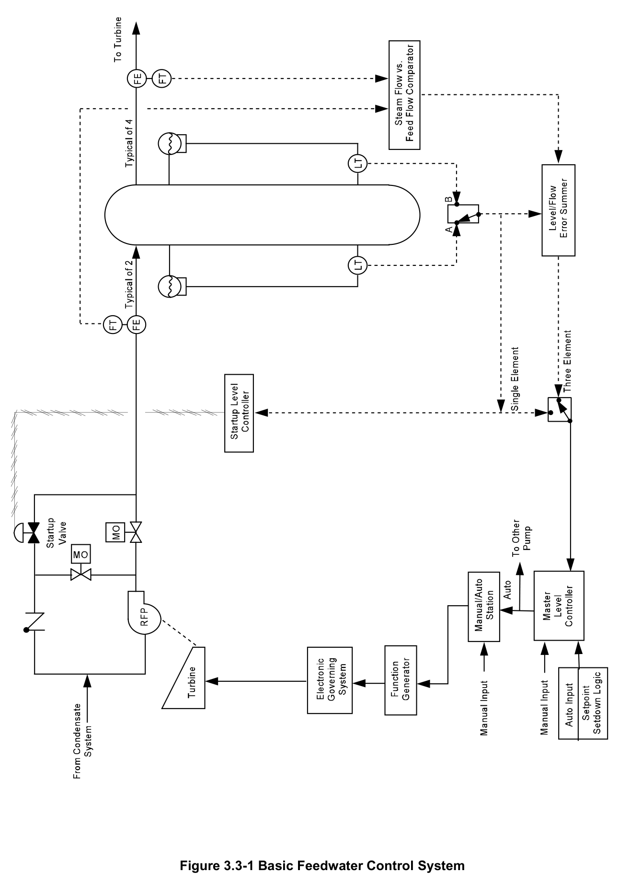
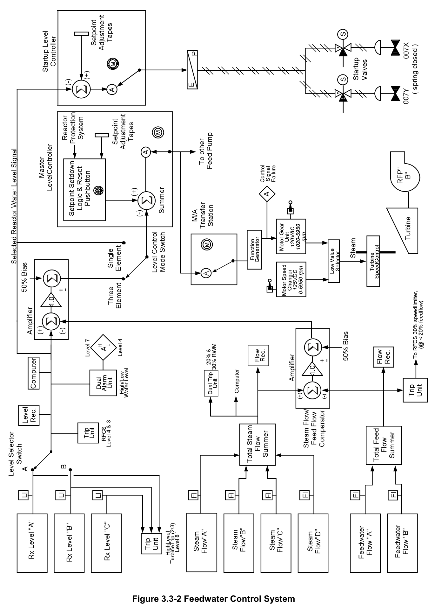
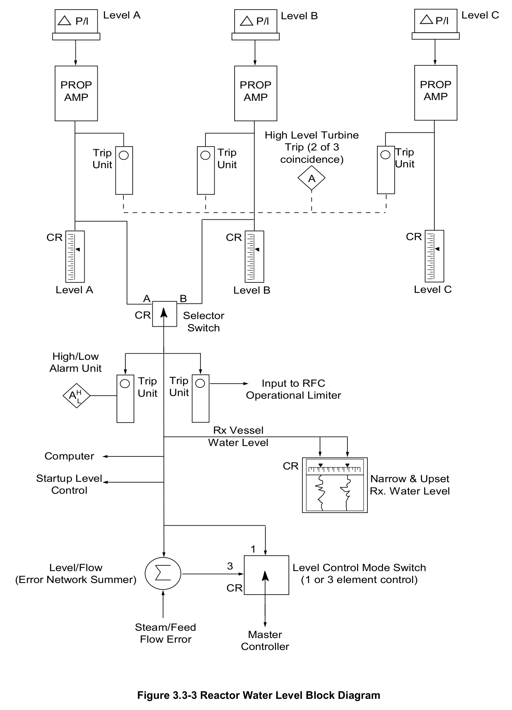
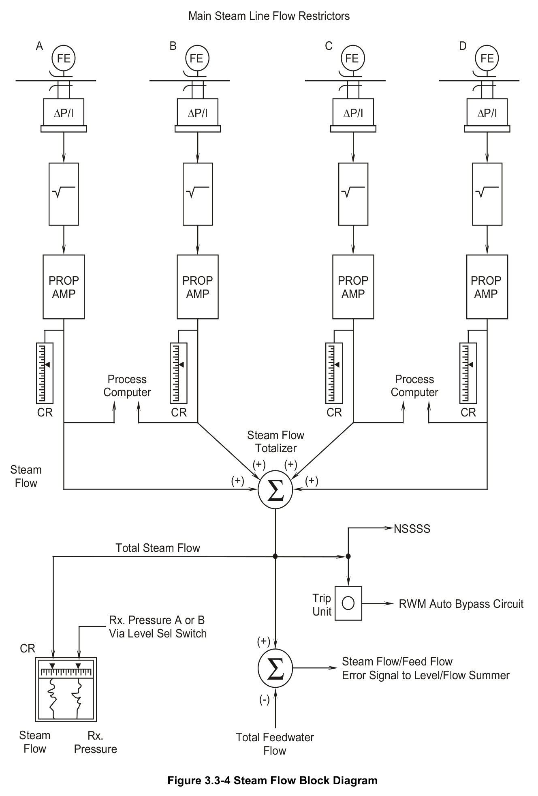
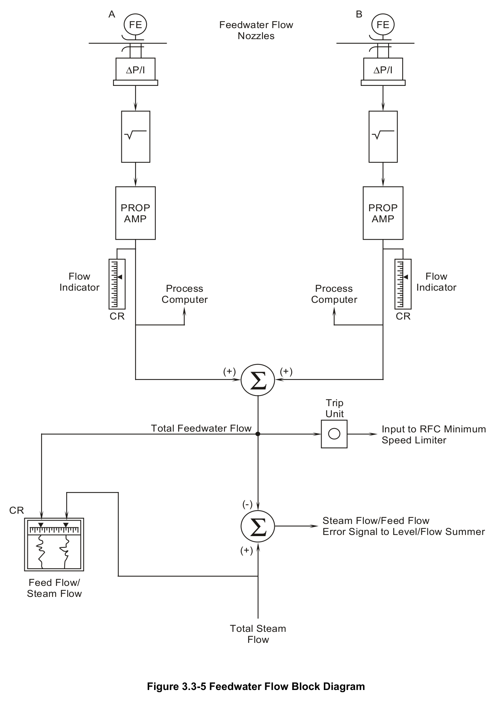
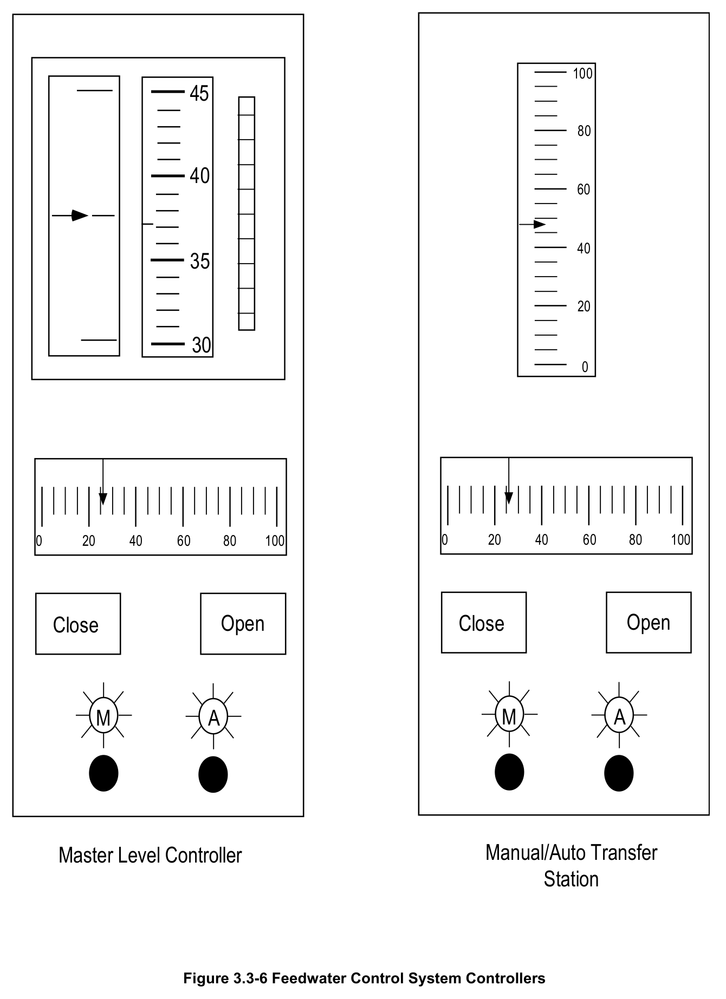
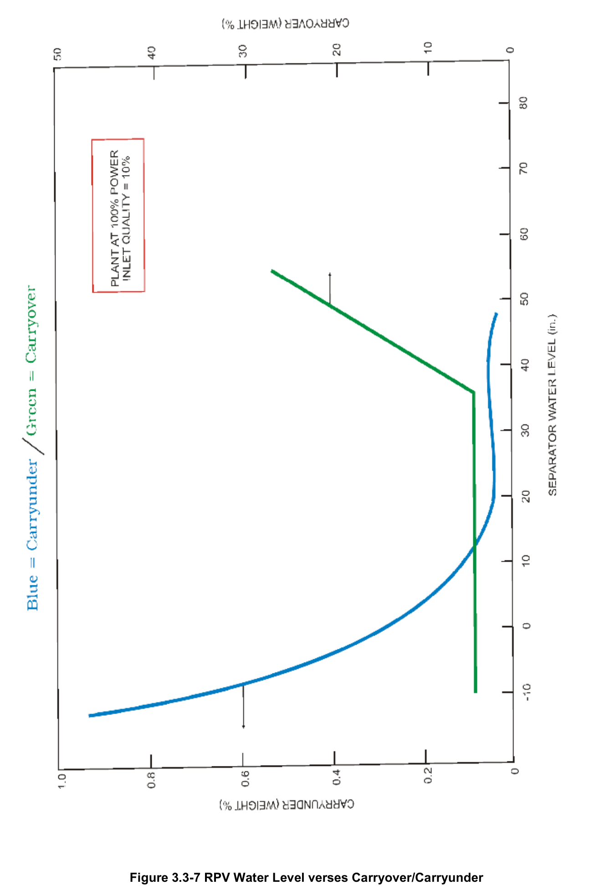
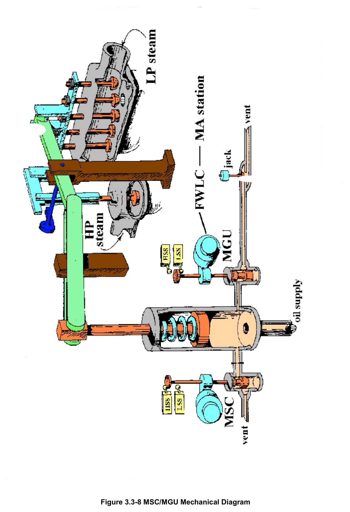

# 3.3 Feedwater Level Control

> Source: `3.3_Feedwater_Level_Control.pdf` (24 pages)
> GE (BWR) Systems Technology Manual — USNRC HRTD, Rev 09/11

---
<!-- p.1 -->
#### General Electric Systems Technology Manual
#### Chapter 3.3
#### Feedwater Control System
<!-- p.3 -->
TABLE OF CONTENTS

3.3 FEEDWATER CONTROL SYSTEM ......................................................................... 1

3.3.1 Introduction .......................................................................................................... 2

3.3.2 Component Description ....................................................................................... 3

3.3.2.1 Water Level Instrumentation ........................................................................ 3

3.3.2.2 Steam Flow Instrumentation ........................................................................ 4

3.3.2.3 Feedwater Flow Instrumentation ................................................................. 4

3.3.2.4 Steam Flow/Feed Flow Comparator (Figure 3.3-2) ..................................... 4

3.3.2.5 Reactor Level/Flow Error Network (Figure 3.3-2) ........................................ 4

3.3.2.6 Master Level Controller (Figures 3.3-2 and 3.3-6) ....................................... 5

3.3.2.7 Manual Auto Transfer Stations (Figures 3.3-2 and 3.3-6)............................ 6

3.3.2.8 Reactor Feed Pump Turbine Speed Controls .............................................. 6

3.3.2.9 Startup Level Control Valves and Startup Level Controller .......................... 7

3.3.2.10 Setpoint Setdown ........................................................................................ 8

3.3.3 System Operation ................................................................................................ 8

3.3.3.1 Vessel Level Control During Plant Startup .................................................. 8

3.3.3.2 Single Element Control of the Reactor Feed Pumps ................................... 9

3.3.3.3 Three Element Control of the Reactor Feed Pumps .................................... 9

3.3.3.4 Loss of Steam or Feedwater Flow Signals .................................................. 9

3.3.3.5 Loss of Level Signal .................................................................................. 10

3.3.4 System Interfaces .............................................................................................. 10

3.3.5 Summary ........................................................................................................... 11

3.3-i USNRC HRTD

<!-- p.4 -->
#### LIST OF FIGURES
3.3-1 Basic Feedwater Control System
3.3-2 Feedwater Control System
3.3-3 Reactor Water Level Block Diagram
3.3-4 Steam Flow Block Diagram
3.3-5 Feedwater Flow Block Diagram
3.3-6 Feedwater Control System Controllers
3.3-7 RPV Water Level verses Carryover/Carryunder
3.3-8 MSC/MGU Mechanical Diagram

3.3-ii USNRC HRTD

<!-- p.5 -->
### 3.3 FEEDWATER CONTROL SYSTEM
Learning Objectives:

1. Recognize the purposes of the Feedwater Control System.

2. Recognize what is meant by carryover and carryunder and the resultant adverse affects of each.

3. Recognize the purpose, function and operation of the following Feedwater Control system major components/inputs:
a. Water Level Instrumentation b. Steam Flow Instrumentation c. Feed Flow Instrumentation d. Steam Flow/Feed Flow Comparator e. Reactor Level/Flow Error Network f. Master Level Controller g. Manual/Auto Transfer Stations h. RFPT Speed Controller i. Startup Level Controller j. Setpoint Setdown

4. Given figure 3.3-2, evaluate how the system functions/responds to:
a. Plant startup level control b. Automatic single element level control c. Automatic three element level control d. Failure of any steam flow input signal e. Failure of any feed flow input signal f. Failure of any level input signal

5. Recognize how the Feedwater Control system interfaces with the following systems:
a. Reactor Vessel Instrumentation System (Section 3.1)
b. Main Steam System (Section 2.5)
c. Condensate and Feedwater System (Section 2.6)
d. Recirculation Flow Control System (Section 7.2)
e. Rod Worth Minimizer System (Section 7.5)
f. Reactor Protection System (Section 7.3)

3.3-1 USNRC HRTD

<!-- p.6 -->
#### 3.3.1 Introduction
The purposes of the Feedwater Control System (FWCS) are to:
• maintain proper vessel water level during various modes of plant operation
• provide alarms and indications related to vessel water level control
• provide protective tripping of the main and reactor feedpump turbines
• provide protection inputs to the recirculation flow control system
• provide control signal input to the Rod Worth Minimizer.

The functional classification of the FWCS is that of a power generation system.

The FWCS controls reactor water level in the optimal level range described in figure
3.3-7. Maintaining level high in this range minimizes the potential of carryunder.
Carryunder is a condition where steam exiting the steam separators has the potential to bypass the steam dryer via carryunder of the dryer skirt when RPV water level is too low. This can result in several complications:
• Higher moisture content steam to the main turbine resulting is accelerated erosion of turbine blades
• Higher temperature water in the RPV annulus resulting in recirculation pump and jet pump NPSH loss and the potential for cavitation.
• Higher temperature water entering the reactor core resulting in operation closer to thermal limitations (MCPR).

Maintaining water level low in the optimum range minimizes the potential for carryover.
Carryover is a condition where less moisture removal occurs in the steam separators due to the backpressure created by the water level outside the separator when RPV water level is too high. This results in a higher moisture entry to the steam dryer and ultimately a higher moisture concentration out of the dryer. As discussed above, moisture laden steam results in erosion damage to turbine blades.

During normal reactor operation, the level of the water in the reactor is controlled by a feedwater controller which receives inputs from reactor vessel water level, steam mass flow rate, and feedwater mass flow rate transmitters as shown in Figures 3.3-1 and 3.3-
2. The water level is measured by three independent sensors, each consisting of a differential pressure transmitter. Feedwater mass flow rate is measured by flow transmitters coupled across flow elements in each of the two feedwater lines. Total feedwater mass flow rate, as used by this system, is the sum of the signals from these two transmitters. Steam mass flow rate through each of the steam lines is measured by the differential pressure across the steam flow restrictors in each of the four steam lines.
The steam flow signals are summed before being used by the feedwater control circuit.

3.3-2 USNRC HRTD

<!-- p.7 -->
The Feedwater Control System, shown in Figures 3.3-1 and 3.3-2, regulates the reactor feed pump turbine speed through positioning control of the turbine steam control valves, thereby controlling the flowrate of water pumped through the reactor feed pumps. The Feedwater Control System also generates a control signal that can regulate the position of the startup flow control valves.

During steady state operation, feedwater mass flow rate matches steam mass flow rate and the water level is maintained stable at the operator selected setpoint. A change in steam mass flow is immediately sensed, and the system adjusts the rate of feedwater flow to balance the two mass flow rates, maintaining this desired water level. Reactor vessel water level, feedwater mass flow rate, and steam mass flow rates are recorded in the control room. High or low reactor vessel water levels are annunciated in the control room. The desired level in the reactor is constant over the range of 0 to 100% steam flow.

#### 3.3.2 Component Description
The major components of the Feedwater Control System are discussed in the paragraphs which follow.

##### 3.3.2.1 Water Level Instrumentation
Figure 3.3-3 shows a block diagram of the reactor vessel water instrumentation.
Reactor vessel water level is measured by three independent, differential pressure transmitters. The transmitters are connected to a reference column located in the drywell and a reactor vessel instrumentation variable tap on the reactor pressure vessel.
(Section 3.1). All three transmitters provide a narrow range level indication (0 to +60 inches above instrument zero).

All three level transmitters send signals to trip units which are then arranged in a twoout-of-three coincidence logic to generate a high water level turbine trip signal to the main turbine and both reactor feed pump turbines if RPV level reaches L8 (56.5 inches).

Only the A or B level transmitter may be used in the Feedwater Control System's logic.
The selection is made via the level selector switch. The selected level signal also feeds the level recorder on the P603 panel, a level analog input to the computer, the level/flow error summer, the startup valve level controller, the level control mode selector switch and two trip units. One of the trip units provides both high and low level annunciation at L7 (40.5 inches) and L4 (33.5 inches) respectively. The other provides an input to the low reactor vessel water level/feedwater pump interlock (operational limiter), in the Recirculation Flow Control System logic (Section 7.2).

3.3-3 USNRC HRTD

<!-- p.8 -->
##### 3.3.2.2 Steam Flow Instrumentation
Figure 3.3-4 shows a block diagram of the steam flow instrumentation. Steam flow is sensed as the differential pressure drop across the main steam line flow restrictor in each main steam line. The differential pressure signals are then sent through square root extractors to obtain four signals which are proportional to steam flow through its associated steam line. The individual steam line flows are then summed together to get the total steam flow signal.

The total steam flow signal is sent to a control room recorder, the steam flow/feed flow comparator, a trip unit (which is associated with the auto bypass of the Rod Worth Minimizer System (Section 7.5) functions and displays, the Nuclear Steam Supply Shutoff System (NSSSS, Section 4.4), and the steam leak detection summer.

##### 3.3.2.3 Feedwater Flow Instrumentation
Figure 3.3-5 shows a block diagram of the feedwater flow instrumentation. Feedwater flow is measured by venturi flow elements located in the two feedwater inlet lines to the reactor vessel. The differential pressure signals are then sent through square root extractors to obtain two signals which are proportional to feedwater flow through the associated feedwater line. The two individual line flows are then summed together to get the total feedwater flow signal.

The total feedwater flow signal is sent to a control room recorder, the steam flow/feed flow comparator, and a trip unit. The trip unit provides an interlock signal to the Recirculation Flow Control System (Section 7.2).

##### 3.3.2.4 Steam Flow/Feed Flow Comparator (Figure 3.3-2)
The steam flow summer output (positive algebraic sign) and feedwater flow summer output (negative algebraic sign) are sent to the steam flow/feed flow comparator. Its output (flow error) is biased such that when the steam flow and the feedwater flow are equal, the amplifier output is at 50%. When the steam flow exceeds the feedwater flow, the amplifier output is greater than 50%; and when the feedwater flow exceeds the steam flow, the amplifier output is less than 50%. The deviation of the amplifier output from steady state 50% condition is proportional to the rate of change of water inventory in the vessel. The flow error signal is sent to the reactor level/flow error network, where it is compared to the selected level signal.

##### 3.3.2.5 Reactor Level/Flow Error Network (Figure 3.3-2)
The algebraic signs within the reactor level/flow error network are such that when steam flow exceeds feedwater flow, the output signal (referred to as the modified level signal)

3.3-4 USNRC HRTD

<!-- p.9 -->
is less than the sensed level signal, and the need for additional feedwater flow is sensed. The reverse is true for high feedwater flow. Thus, an anticipatory signal is obtained which corrects for projected changes in level due to process flow changes.
This anticipatory signal then corrects feedwater flow to lessen the effect of changes on reactor level caused by a change in steam flow. During three element control, the modified level signal is provided as the input to the master controller.

The system can be calibrated to determine the significance that a sensed flow error will have on sensed level or the degree to which a level change is anticipated or responded to. This calibration is referred to as level dominance. The amount of level dominance within the Feedwater Control System can be adjusted by changing the bias signals at the steam flow/feed flow comparator and the reactor level/flow error network. Fully level dominant means that there is no anticipatory response and the 3 element control acts the same as single element control. The opposite is no level dominance resulting in wild level swings for even a small mismatch between feed flow and steam flow. The Shoreham system is calibrated such that a 25% feed flow/steam flow mismatch appears as a 12 inch level modification or restated, a 12 inch level error balances a 25% mismatch. This thumb rule will be handy later as we discuss transients and component failures.

##### 3.3.2.6 Master Level Controller (Figures 3.3-2 and 3.3-6)
The master level controller is provided to control feedwater flow during normal reactor power operation. The master controller has a provision for automatic as well as manual operation.

In the automatic mode, the system mode of operation (1 element or 3 element) is determined by the level control mode switch. The input signal (actual level for 1 element or modified level for 3 element) is compared to a level setpoint which is manually selected by the operator. The resulting error signal is amplified and sent to the master controller output.

In the manual mode the control error signal is isolated and the output signal is determined by the use of manual open and close pushbuttons located on the controller face.

Output of the master controller is directed to the individual reactor feed pump manual/auto transfer stations.

The master level controller is shown in Figure 3.3-6. The front panel of the controller contains a vertical setpoint scale, a vertical setpoint deviation display, a vertical setpoint adjustment thumbwheel, a horizontal output meter, manual open and close pushbuttons

3.3-5 USNRC HRTD

<!-- p.10 -->
and manual/auto transfer pushbuttons with indicator lights to show the selected mode of operation.

The vertical setpoint scale indicates the level setpoint chosen by the operator via the thumbwheel. The controller deviation meter indicates the difference between the level setpoint and the present input signal value. During normal operation the reactor vessel level is maintained at its setpoint, and the meter indicates zero deviation (meter pointer centered). If the input value is below the setpoint, the deviation meter indicates below center; and if the input value is above the setpoint, the deviation meter indicates above center. The output meter indicates the controller output signal from 0 to 100%.

##### 3.3.2.7 Manual Auto Transfer Stations (Figures 3.3-2 and 3.3-6)
The function of the two manual/auto transfer stations is to provide a flow demand signal which is used to control the speed of the respective RFPT. Transfer pushbuttons on the controller allow the operator to select automatic or manual modes of operation. In the manual mode, a flow demand signal is generated within the controller by using the manual open and close pushbuttons on the controller. The manual mode provides the operator with the capability of independently controlling the speed of each RFPT. In the automatic mode, the controllers receive the flow demand signal from the master level controller. The manual/auto transfer station output is sent to the RFPT speed controls via a function generator. The function generators make the master controller output signal linear with respect to each of the RFPT characteristics. The signals are then sent to the RFPT speed controls.

The manual/auto controller is shown in Figure 3.3-6. The front panel of the controller contains a vertical input meter, a horizontal output meter, manual/auto transfer pushbuttons with indicator lights to show the selected mode of operation, and manual open and close pushbuttons. The A RFPT controller has an additional vertical bias adjustment thumbwheel which allows adjustment of the A RFPT signal to balance the operation of both RFP’s when they are operating in parallel.

##### 3.3.2.8 Reactor Feed Pump Turbine Speed Controls
As can be seen in figures 3.3-2 and 3.3-8, reactor feed pump turbine speed is controlled by positioning the control valves for each RFPT based on signals developed by devices within the FWCS electronic circuitry. There are two devices, a Motor Gear Unit (MGU)
and a Motor Speed Changer (MSC), which send RFPT speed demand signals to the RFPT control valves via a low value selector. The low value selector may be an electronic gate as shown in figure 3.3-2 or as a hydraulic cylinder as shown in figure
3.3-8. Between the MSC and the MGU, the device calling for the lowest speed is in control of the turbine. In figure 3.3-8, both the MSC and MGU compete to drain oil from

3.3-6 USNRC HRTD

<!-- p.11 -->
this cylinder therefore the one draining the most oil is in control and therefore controlling at the lowest speed.

The MGU receives its input from the manual/auto transfer stations via the function generator and is normally the device controlling RFPT speed. This unit can control the RFPT over the range of 1020 rpm (low speed stop) and 5950 rpm (high speed stop).

The motor speed changer is a manual device which can control the RFPT over the range of 0 rpm (low speed stop) and 5950 rpm (high speed stop. The MSC is used to startup the RFPT and bring it to the point that the MGU takes control. The MSC is then positioned to its high speed stop (drain port closed) so that the MGU will have control over its entire speed range. The MSC can be used to control a RFPT in the event of a FWCS circuitry failure. The MSC controls for each of the reactor feed pump turbines are located in the control room on MCB-01L.

The MSC/MGU signal results in displacement of a hydraulic cylinder as shown in figure
3.2-8. Displacement of the hydraulic cylinder sequentially operates the RFPT control valves to throttle steam to the turbine.

##### 3.3.2.9 Startup Level Control Valves and Startup Level Controller
The startup level control valves (007X and 007Y) are 2 valves in parallel that throttle flow to the reactor pressure vessel. If the reactor feed pumps are not in service they are aligned to bypass the pumps. If the reactor feed pumps are in service they can be aligned in series with the pumps (low flow demand) or taken out of service (high flow demand). These valves are positioned by a demand signal from the startup level controller. The first valve to open from this demand signal is the 007X (3 inch valve)
which will pass up to 650 gpm. Then the 007Y (10 inch valve) opens to pass up to an additional 3300 gpm.

The startup level controller is operated in the same fashion as the master level controller previously discussed in paragraphs 3.3.2.6 and is shown on figures 3.3-2 and
3.3-6. In the automatic mode, reactor vessel water level is the input signal. The controller has a setpoint dial which allows the operator to set the level he wishes to maintain. Physically, the controller is identical to the master level controller. The controller output is sent to an Electro/Pneumatic (E/P) converter.

The E/P converter controls the air pressure to the startup valves 007X and 007Y. As the level in the vessel deviates from the setpoint, the E/P converter receives a signal from the startup level controller to vary the air pressure and position the valves accordingly. As level approaches setpoint, the rate of valve positioning will slow and eventually stabilize at a new valve position that allows the amount of flow necessary to maintain level.

3.3-7 USNRC HRTD

<!-- p.12 -->
##### 3.3.2.10 Setpoint Setdown
The Master Level Controller is equipped with a level setpoint setdown circuit. This circuit helps prevent a high level trip of the feedwater turbines following a scram. A void collapse due to the power decrease within the vessel will result in a decreased level without any actual change in vessel inventory. To prevent unneeded inventory replenishment by the feedwater system under these circumstances, the setpoint setdown circuit automatically lowers the level setpoint to 18" anytime a reactor scram signal on L3 (12.5 inches) occurs. This prevents an excessively high vessel level when the core voids return and the relatively cold feedwater heats up.

The decreased setpoint remains the level control circuit input until the setpoint setdown logic has been reset by the manual reset pushbutton located on panel P603.

#### 3.3.3 System Operation
The various alignments of system operation are discussed as follows with the use of figure 3.3-2.

##### 3.3.3.1 Vessel Level Control During Plant Startup
During periods of plant shutdown, level control is accomplished by Control Rod Drive Hydraulic System flow input to the reactor vessel (Section 2.3) and reject flow from the Reactor Water Cleanup System (Section 2.8). Backup input is provided by the condensate and condensate booster pumps via the startup valve being controlled by the startup level controller.

During plant startup until approximately 600 psig reactor vessel pressure, the system flow demand is low enough that the startup valves can function adequately, in manual, to maintain vessel level using the condensate and the condensate booster pumps.
Above ~600 psig these pumps do not have sufficient discharge head to inject into the reactor vessel so the reactor feedwater pumps must be used.

Initial rollup of the RFPT is accomplished by use of the MSC with the MGU set at its low speed stop of 1020 rpm. Once above 1020 RPM the RFPT control is transferred to the MGU and speed controlled manually to maintain pump discharge pressure above reactor pressure. At this point the flow demand is still so low that the startup valves must remain in series with the reactor feed pumps to control level. As more steam is taken from the reactor vessel for auxiliary loads on startup, flow demand will eventually be high enough that the startup valve control can be changed to the automatic mode on the startup level controller.

3.3-8 USNRC HRTD

<!-- p.13 -->
When the startup level controller demand signal approach 80%, RPV level control will be shifted to the reactor feed pumps in automatic single element control with the feed pump discharge valves opened. At this time the startup level controller is changed to the manual mode of operation and the startup valves closed.

When feedwater flow to the reactor vessel is approximately 25% the 1 or 3 element mode selector switch will be selected to 3 element control.

##### 3.3.3.2 Single Element Control of the Reactor Feed Pumps
The single element automatic control mode provides an alternative to the three element automatic control mode in case of a failure or malfunction in the feed flow/steam flow part of the control system. During this mode of operation, the master controller and the operating RFP(s) (both at full power) M/A transfer stations are in the automatic position.
The level signal selector switch is in the 1 element position. The level signal from the selected level sensor is compared to the desired level at the master level controller, and an output signal is sent to control the speed of the feed pump turbine. This mode of control is less responsive to changes in the water level because the anticipatory response provided by the feed flow/steam flow error signal is not available.

##### 3.3.3.3 Three Element Control of the Reactor Feed Pumps
In three element control, the sensed RPV water level input to the reactor level/flow error network will be modified by the magnitude of any mismatch between steam flow and feed flow. This modified level is anticipatory to a change in RPV water level and is compared to desired level in the Master Controller. From this point the output of the Master Controller is sent to the RFP’s as described above.

##### 3.3.3.4 Loss of Steam or Feedwater Flow Signals
The loss of one feedwater flow signal at 100% power will result in a high reactor water level trip of the Main and Reactor Feed Pump Turbines. The FWCS sees a 50% FF/SF mismatch that is anticipating a reduction in RPV water level. The modified level to the master controller will be approximately 24 inches less than actual level in an effort to raise feed flow before RPV level drops. As discussed earlier, this 50% mismatch can only be offset by RPV sensed level being 24 inches high (61) which is above L8 (56.5 inches). At L8 the main and reactor feed pump turbines trip which will result in a reactor scram on either L3 or turbine trip.
A loss of one steam line flow signal at 100% power causes the total steam flow signal, determined by the FWCS to decrease to 75%. This decrease is compensated for by the FWCS by decreasing feedwater flow. As level decreases, the feed/ steam flow error is eventually compensated for at a lower reactor water level. Below this lower level,

3.3-9 USNRC HRTD

<!-- p.14 -->
feedwater flow again increases to compensate for decreasing level. Eventually, the reactor plant stabilizes at a lower reactor vessel level and 100% steam and feedwater flow. Applying the same thumb rule, this 25% mismatch needs a 12 inch level error low to offset. This means that level will stabilize at approximately 25 inches.

Without operator action, a total loss of steam flow signal causes a reactor scram on low reactor water level.

##### 3.3.3.5 Loss of Level Signal
If the C level signal fails either upscale or downscale, there is no real effect on the FWCS. If the A or B level signal fails upscale or downscale, there can be either no effect or quite a large effect on the FWCS depending on whether that particular level signal was selected for control. If the failed level signal was not selected for control, there is no effect on the FWCS. In all 3 cases, an upscale failure does input to the 2 out of 3 level 8 trips of the Main Turbine and Reactor Feedpump Turbines.

If the level signal (A or B) selected for control fails upscale, the FWCS responds as if reactor water level were truly very high and decreases the RFPT speed to minimum.
This results in substantially less feedwater flow than is required to match the existing steam flow and causes reactor water level to decrease rapidly to the low level scram
(L3) setpoint (sensed by different instrumentation), at which point the reactor scrams to terminate the event.

If the level signal (A or B) selected for control fails downscale, the FWCS responds as if reactor water level were truly very low and increases the RFPT speed to maximum.
This results in substantially more feedwater flow than is required to match the existing steam flow and causes reactor water level to increase rapidly to the high level turbine trip (L8) setpoint.

In either case of failure, once the FWCS starts responding, a steam flow/feedwater flow mismatch is created. This mismatch tends to resist the action the FWCS is taking but the flow mismatch cannot overcome the level error associated with a failed level signal since the FWCS is a level dominant system.

#### 3.3.4 System Interfaces
A short discussion of interfaces this system has with other plant systems is given in the paragraphs which follow.

Reactor Vessel Instrumentation System (Section 3.1)

The Reactor Vessel Instrumentation System provides reactor vessel water level inputs to the FWCS.

3.3-10 USNRC HRTD

<!-- p.15 -->
Main Steam System (Section 2.5)

The Main Steam System steam flow restrictors provide the steam flow input to the FWCS. The main turbine receives a trip signal from the FWCS.

Condensate and Feedwater System (Section 2.6)

The feedwater flow elements provide the feedwater flow input to the FWCS. The FWCS controls the speed of the RFPTs, the position of the startup valve, and provides a trip signal to the RFPTs.

Recirculation Flow Control System (Section 7.2)

The FWCS provides the Recirculation Flow Control System with a water level interlock signal for the operational limiter and a total feedwater flow signal for the 30% limiter.

Rod Worth Minimizer System (Section 7.5)

The FWCS total steam flow signal is used to automatically bypass the Rod Worth Minimizer (RWM) System functions at higher power levels. The FWCS total steam flow signal is also used to control the RWM System displays at the low power alarm point.

Reactor Protection System (Section 7.5)

The reactor protection system provides a L3 signal to the FWCS Master Controller for the selection of setpoint setdown to 18 inches.

#### 3.3.5 Summary
Classification - Power generation system.

The purposes of the Feedwater Control System (FWCS) are to:
• maintain the proper vessel water level during various modes of plant operation
• provide alarms and indications related to vessel water level control
• provide protective tripping of the main and reactor feedpump turbines
• provide protection inputs to the recirculation flow control system
• provide initiation input to the Rod Worth Minimizer.

Components - reactor water level instrumentation; steam flow instrumentation; feed flow instrumentation; steam flow/feed flow comparator; reactor level/flow error network;
master level controller; M/A transfer stations; RFPT speed controller; startup level controller; startup level control valves.

3.3-11 USNRC HRTD

<!-- p.16 -->
System Interfaces - Reactor Vessel Instrumentation System; Main Steam System;
Condensate and Feedwater System; Recirculation Flow Control System; Rod Worth Minimizer System; Reactor Protection System.

3.3-12 USNRC HRTD

<!-- p.17 -->
#### Figure 3.3-1

*Basic Feedwater Control System*

[Vector original (SVG, lossless): fig_3.3-1.svg](../figures/fig_3.3-1.svg)

<!-- p.18 -->
#### Figure 3.3-2

*Feedwater Control System*

[Vector original (SVG, lossless): fig_3.3-2.svg](../figures/fig_3.3-2.svg)

<!-- p.19 -->
#### Figure 3.3-3

*Reactor Water Level Block Diagram*

[Vector original (SVG, lossless): fig_3.3-3.svg](../figures/fig_3.3-3.svg)

<!-- labels/text on this figure page -->
Level C Level B Level A P/l P/l P/l
PROP PROP PROP AMP AMP AMP
High Level Turbine Trip (2 of 3 Trip Trip Trip coincidence)
Unit Unit Unit A
CR CR CR
Level C Level A Level B A B CR Selector Switch
High/Low Alarm Unit Trip Trip Input to RFC Unit Unit AH Operational Limiter L
Rx Vessel Water Level Computer CR Startup Level Narrow & Upset Control Rx. Water Level
1
3 Level/Flow Level Control Mode Switch
(Error Network Summer)
(1 or 3 element control)
CR
Steam/Feed Master Flow Error Controller
Figure 3.3-3 Reactor Water Level Block Diagram

<!-- p.20 -->
#### Figure 3.3-4

*Steam Flow Block Diagram*

[Vector original (SVG, lossless): fig_3.3-4.svg](../figures/fig_3.3-4.svg)

<!-- labels/text on this figure page -->
Main Steam Line Flow Restrictors
A B C D FE FE FE FE
ΔP/I ΔP/I ΔP/I ΔP/I
PROP PROP PROP PROP AMP AMP AMP AMP
Process Process Computer Computer
CR CR CR CR
Steam Flow Totalizer
(+) (+)
Steam
(+) (+) Flow Σ
NSSSS Total Steam Flow
Trip RWM Auto Bypass Circuit Unit Rx. Pressure A or B Via Level Sel Switch
(+)
CR Σ Steam Flow/Feed Flow Error Signal to Level/Flow Summer
(-)
Steam Rx.
Total Feedwater Flow Pressure Flow
Figure 3.3-4 Steam Flow Block Diagram

<!-- p.21 -->
#### Figure 3.3-5

*Feedwater Flow Block Diagram*

[Vector original (SVG, lossless): fig_3.3-5.svg](../figures/fig_3.3-5.svg)

<!-- labels/text on this figure page -->
A B FE FE Feedwater Flow Nozzles
ΔP/I ΔP/I
PROP PROP AMP AMP
Flow Flow Indicator Indicator Process Process Computer Computer
CR CR
(+) (+)
Σ Trip Unit Total Feedwater Flow Input to RFC Minimum Speed Limiter
(-)
CR Σ Steam Flow/Feed Flow Error Signal to Level/Flow Summer
(+)
Feed Flow/ Steam Flow
Total Steam Flow
Figure 3.3-5 Feedwater Flow Block Diagram

<!-- p.22 -->
#### Figure 3.3-6

*Feedwater Control System Controllers*

[Vector original (SVG, lossless): fig_3.3-6.svg](../figures/fig_3.3-6.svg)

<!-- labels/text on this figure page -->
100 45
80
40 60
40 35
20
30 0
0 20 40 60 80 100 0 20 40 60 80 100
Open Open Close Close
M A M A
Manual/Auto Transfer Master Level Controller Station
Figure 3.3-6 Feedwater Control System Controllers

<!-- p.23 -->
#### Figure 3.3-7

*RPV Water Level verses Carryover/Carryunder*

<!-- p.24 -->
#### Figure 3.3-8

*MSC/MGU Mechanical Diagram*

