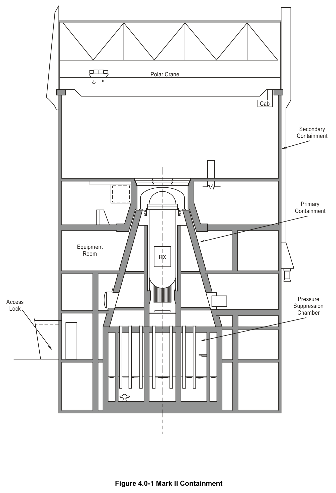
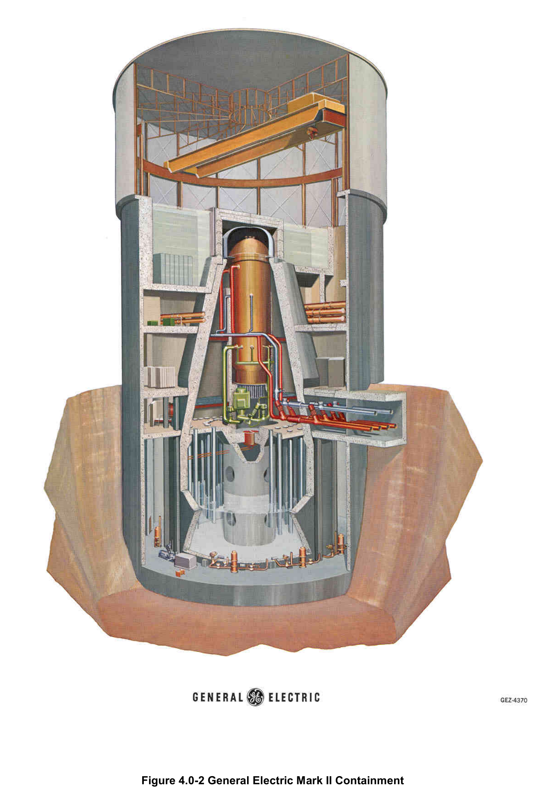

# 4.0 Containment Intro

> Source: `4.0_Containment_Intro.pdf` (8 pages)
> GE (BWR) Systems Technology Manual — USNRC HRTD, Rev 09/11

---
<!-- p.1 -->
#### General Electric Systems Technology Manual
#### Chapter 4.0
#### Containment Systems
<!-- p.3 -->
TABLE OF CONTENTS

4.0 CONTAINMENT SYSTEMS ................................................................................... 1

4.0.1 Primary Containment System (Section 4.1) ....................................................... 1

4.0.2 Secondary Containment System (Section 4.2)................................................... 1

4.0.3 Reactor Building Standby Ventilation System (Section 4.3) ............................... 1

4.0.4 Nuclear Steam Supply Shutoff System .............................................................. 1

LIST OF FIGURES

4.0-1 Mark II Containment 4.0-2 General Electric Mark II Containment

Rev 09/11 4.0-i USNRC HRTD

<!-- p.4 -->
Rev 09/11 4.0-ii USNRC HRTD

<!-- p.5 -->
### 4.0 CONTAINMENT SYSTEMS
The containment systems, shown in Figure 4.0-1, provide a multibarrier pressure suppression type of containment. The containment systems provide two distinct fission product barriers (the primary containment and the secondary containment) in addition to the other fission product barriers that already exist (fuel cladding and reactor coolant pressure boundary). The term "pressure suppression" comes from the fact that steam generated as a result of a loss of coolant accident is channeled to a suppression pool, where it is condensed. This suppresses the peak pressure that otherwise would be realized in the primary containment.

#### 4.0.1 Primary Containment System (Section 4.1)
The Primary Containment System contains fission products released from a loss of coolant accident (LOCA) so that off site radiation dose limits specified in 10 CFR 100 are not exceeded; provides a heat sink for certain safety related equipment; and provides a source of water for Emergency Core Cooling Systems and the Reactor Core Isolation Cooling System.

#### 4.0.2 Secondary Containment System (Section 4.2)
The Secondary Containment System minimizes the ground level release of radioactive material following an accident and provides the containment boundary when the primary containment is not intact.

#### 4.0.3 Reactor Building Standby Ventilation System (Section 4.3)
The Reactor Building Standby Ventilation System processes the secondary containment atmosphere prior to release under accident conditions; provides a means of venting the primary containment; and performs leak tests of the secondary containment.

#### 4.0.4 Nuclear Steam Supply Shutoff System
The Nuclear Steam Supply Shutoff System (NSSSS) isolates the primary and secondary containments during accident conditions to limit the release of radioactive materials to within 10 CFR 100 limits.

Rev 09/11 4.0-1 USNRC HRTD

<!-- p.6 -->
Rev 09/11 4.0-2 USNRC HRTD

<!-- p.7 -->
#### Figure 4.0-1

*Mark II Containment*

[Vector original (SVG, lossless): fig_4.0-1.svg](../figures/fig_4.0-1.svg)

<!-- labels/text on this figure page -->
Polar Crane
Cab
Secondary Containment
Primary Containment
Equipment Room RX
Pressure Access Suppression Lock Chamber
Figure 4.0-1 Mark II Containment

<!-- p.8 -->
#### Figure 4.0-2

*General Electric Mark II Containment*

