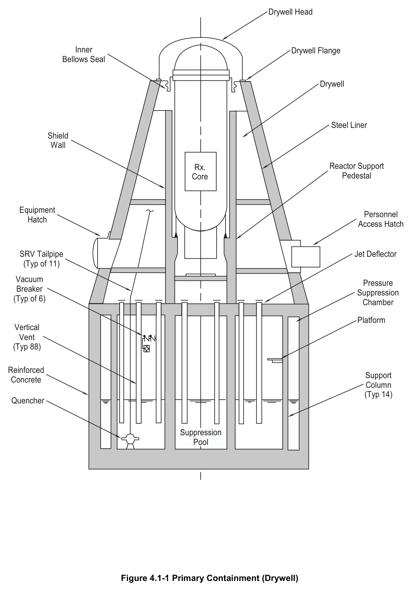
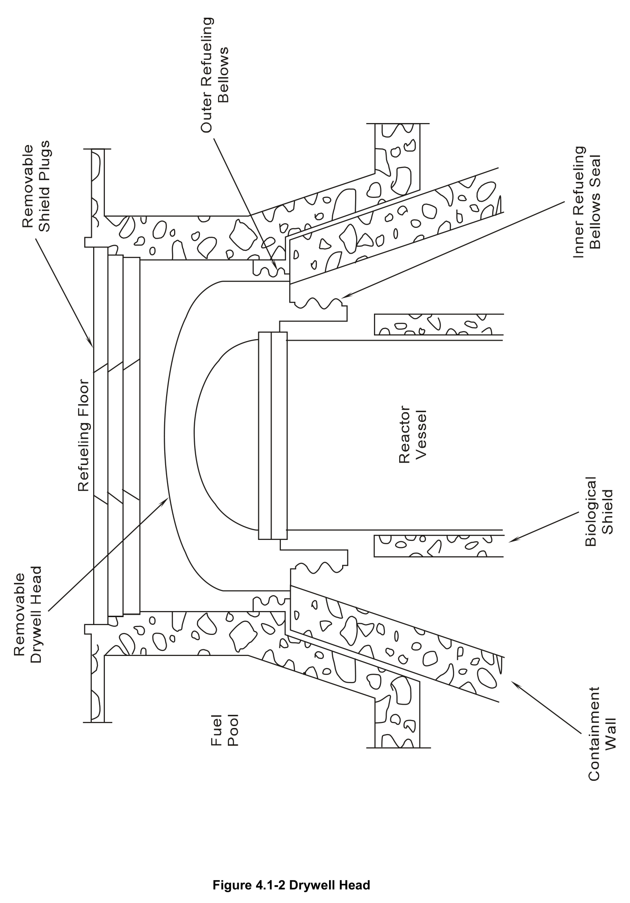
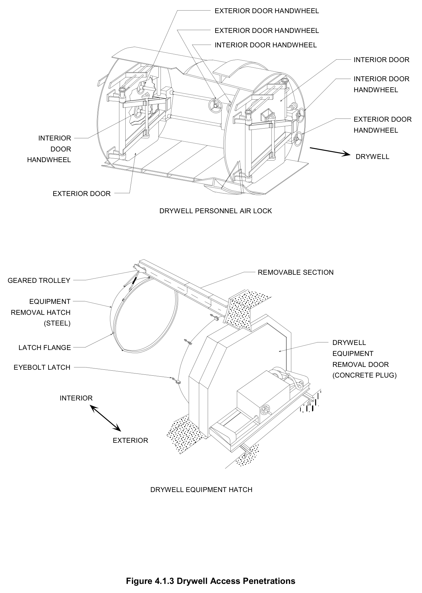
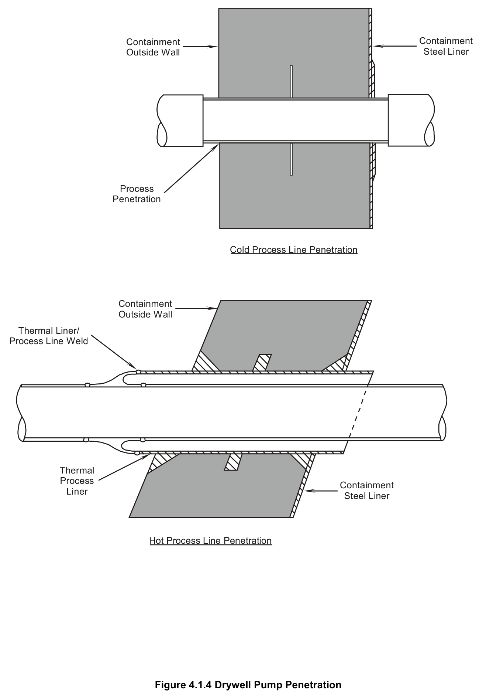
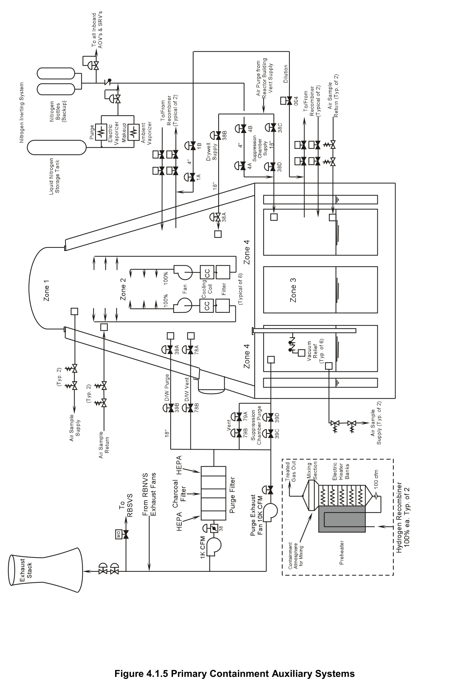
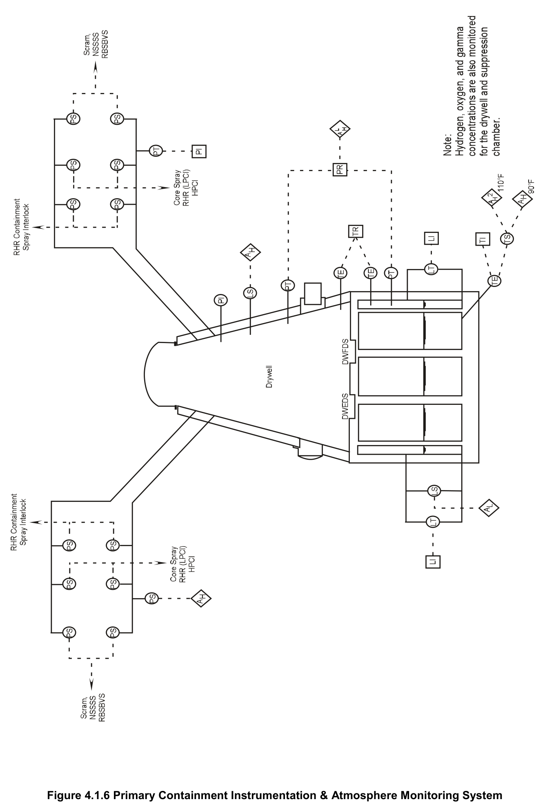

# 4.1 Primary Containment

> Source: `4.1_Primary_Containment.pdf` (32 pages)
> GE (BWR) Systems Technology Manual — USNRC HRTD, Rev 09/11

---
<!-- p.1 -->
#### General Electric Systems Technology Manual
#### Chapter 4.1
#### Primary Containment System
<!-- p.3 -->
TABLE OF CONTENTS

4.1 PRIMARY CONTAINMENT SYSTEM .................................................................... 1

4.1.1 Introduction ........................................................................................................ 2

4.1.2 Component Description ...................................................................................... 3

4.1.2.1 Drywell ......................................................................................................... 3

4.1.2.2 Suppression Chamber ................................................................................. 4

4.1.2.3 Interconnecting Vents .................................................................................. 4

4.1.2.4 Primary Containment Auxiliary Systems ...................................................... 5

4.1.3 System Features and Interfaces ........................................................................ 8

4.1.3.1 Primary Containment Operability ................................................................. 8

4.1.3.2 Normal Operation ........................................................................................ 9

4.1.3.3 Containment Heat Removal ........................................................................ 9

4.1.3.4 Containment Response To A LOCA .......................................................... 10

4.1.3.5 Suppression Pool Temperature Monitoring ............................................... 11

4.1.3.6 System Isolation ........................................................................................ 12

4.1.3.7 10CFR50 Appendix J Testing .................................................................... 12

4.1.4 Summary .......................................................................................................... 14

LIST OF TABLES

4.1-1 Primary Containment Design Basis ................................................................... 17

4.1-2 Primary Containment Design Summary .............................................................. 19

4.1-3 LOCA Chronology ............................................................................................... 21

Rev 09/11 4.1-i USNRC HRTD

<!-- p.4 -->
#### LIST OF FIGURES
4.1-1 Primary Containment (Drywell)
4.1-2 Drywell Head 4.1-3 Drywell Access Penetrations

#### 4.1.4 Drywell Pipe Penetrations
4.1-5 Primary Containment Auxiliary Systems 4.1-6 Primary Containment Instrumentation & Atmosphere Monitoring

Rev 09/11 4.1-ii USNRC HRTD

<!-- p.5 -->
### 4.1 PRIMARY CONTAINMENT SYSTEM
Learning Objectives:

1. Recognize the purposes of the Primary Containment System.

2. Recognize the purpose, function and operation of the following:
a. Drywell b. Suppression chamber / Pool c. Interconnecting vents d. Drywell air cooling system e. Primary containment purge system f. Containment inerting system g. Containment combustible gas control system

3. Recognize the following primary containment system flowpaths:
a. Interconnecting vents & vacuum relief b. Drywell cooling c. Containment inerting d. Containment purge e. Containment combustible gas control

4. Recognize the various types of containment penetrations and how they perform their containment isolation function.

5. Recognize the primary containment response to a major Loss of Coolant Accident
(LOCA).

6. Recognize how the Primary Containment system interfaces with the following:
a. Main Steam System (Section 2.5)
b. Reactor Core Isolation Cooling System (Section 2.7)
c. Secondary Containment System (Section 4.2)
d. Reactor Building Standby Ventilation System (Section 4.3)
e. Nuclear Steam Supply Shutoff System (Section 4.4)
f. Emergency Core Cooling Systems (Section 10)

Rev 09/11 4.1-1 USNRC HRTD

<!-- p.6 -->
#### 4.1.1 Introduction
The purposes of the Primary Containment System are to:
• contain fission products released from a LOCA
• limit radiation dose within the standards specified in 10CFR100
• condense steam released from the Reactor Pressure Vessel (RPV) or piping inside the containment
• to provide a heat sink for certain safety related equipment
• to provide a source of water for Emergency Core Cooling System (ECCS) and the RCIC system.

The functional classification of the Primary Containment System (PCS) is that of a safety related system. Its regulatory classification is that of an Engineered Safety Feature (ESF) system.

The PCS consists of several major components (Figure 4.1-1) including the:
• drywell, which surrounds the RPV and the recirculation loops
• suppression chamber, which stores a large body of water called the suppression pool
• interconnecting vertical vent network between the drywell and suppression chamber

Ancillary systems augment the PCS. Cooling systems are provided to remove heat from the drywell atmosphere and suppression pool under normal and accident conditions. During normal operations the primary containment is filled with nitrogen gas and pressurized to approximately one psig above atmospheric pressure.

A high energy process system piping failure within the drywell will release reactor water and steam into the drywell. The resulting increase in drywell pressure forces a mixture of drywell atmosphere, steam and water through the interconnecting vents into the pool of water stored in the suppression chamber. The steam condenses in the suppression pool, resulting in a pressure reduction in the drywell. Drywell atmosphere (air or nitrogen) that is transferred to the suppression chamber pressurizes the chamber and is subsequently vented back to the drywell via vacuum breakers to equalize the pressure between the two structures. The drywell and suppression chamber arrangement is referred to as a pressure suppression containment.

In addition to LOCA steam, the suppression pool also serves as a heat sink for steam discharged by the:
• Safety/Relief Valves (SRVs)
• RCIC turbine
• HPCI system turbine.

The suppression pool also serves as the primary source of water for the:
• Low Pressure Coolant Injection (LPCI) mode of the RHR system
• CS system

Rev 09/11 4.1-2 USNRC HRTD

<!-- p.7 -->
and as the backup source of water for the:
• HPCI system
• RCIC system.

The design bases of the primary containment are listed in Table 4.1-1 and some typical specifications are given in Table 4.1-2.

During the course of an accident, containment isolation valves are automatically closed to ensure that radioactive materials are kept within the primary containment boundary.

#### 4.1.2 Component Description
The major components of the PCS are discussed in the paragraphs which follow.

##### 4.1.2.1 Drywell
The purposes of the drywell are to:
• contain the steam released from a LOCA
• direct LOCA leakage to the suppression chamber
• minimize radioactive material leakage from the primary containment boundary

The drywell (Figure 4.1-1) is a steel lined pressure vessel shaped in the form of a truncated cone. The top head closure is made with a double tongue and a groove seal which permits periodic checks for tightness without pressurizing the entire vessel. Bolts hold the top head in position when primary containment integrity is required to be maintained. The drywell is reinforced with concrete except where personnel airlocks, equipment hatches and the drywell head are located. The reinforcements provide additional shielding and resistance to deformation and buckling. Shielding over the top of the drywell is provided by removable, segmented, reinforced concrete shield plugs.

Seal assemblies are installed between the reactor vessel and primary containment and between the primary containment and fuel pool (Figure 4.1-2). These bellows type seals form a water tight barrier which permits flooding the volume above the reactor vessel during refueling operations.

One 7 ft diameter double door personnel air lock and a 10 ft diameter bolted equipment hatch are provided for access to the drywell (Figure 4.1-3). A smaller diameter personnel airlock is provided for emergency passage. The locking mechanisms on each air lock door are designed so that a tight seal will be maintained when the doors are subjected to internal pressure. The doors are mechanically interlocked so that one door may be operated only if the opposite door is closed and locked. Hand-wheels are provided inside and outside each end of the airlock which can be used to open or close either door. The door seals are designed to allow periodic testing for leakage. Access

Rev 09/11 4.1-3 USNRC HRTD

<!-- p.8 -->
to the equipment hatch requires the removal of a concrete plug. The equipment hatch is bolted with a double seal arrangement.

Process piping and electrical lines that pass through the containment wall are fitted with leak tight penetrations welded to the containment liner (Figure 4.1-4). Two types of process line penetrations are utilized. Hot process line penetrations are used for penetrations containing hot or variable temperature fluids that require thermal expansion capabilities. Cold process line penetrations are used for penetrations containing cold or relatively constant temperature fluids.

Primary containment isolation valves are provided on all process penetrations. The design function of those valves is to provide isolation of the containment in the event of an accident.

##### 4.1.2.2 Suppression Chamber
The suppression chamber (Figure 4.1-1) consists of a right circular cylinder shaped steel pressure vessel which contains a large body of water called the suppression pool.
The purposes of the suppression pool are as follows:
• minimize the release of radioactive materials from the primary containment boundary
• condense steam released from a LOCA
• serve as a heat sink for SRV discharge steam
• provide a source of water for the ECCSs and RCIC system
• serve as a heat sink for HPCI and RCIC turbine exhaust steam

The suppression chamber is located directly beneath the drywell. Vertical support and seismic loading is transmitted to the reinforced foundation slab of the reactor building.
Design features of the suppression chamber are listed in Table 4.1-2. Access to the suppression chamber is provided through two 36 inch manways, each of which has a double gasket bolted cover. Both manways are normally bolted shut and are opened only during plant shutdown when primary containment is not required to be operational.

Providing a barrier between the drywell and the suppression chamber is the drywell floor. It is a circular reinforced concrete slab that is supported by the reactor pedestal and 14 concrete columns. Floor penetrations include 88 interconnecting downcomer vent pipes and 11 SRV tail pipes. The floor is designed to withstand a 30 psid downward differential pressure and a 5.5 psid upward differential pressure. Two circumferential floor seals are provided between the primary containment and drywell floor. Each seal is pressurized and maintained with 60 psig nitrogen supplied from the plant nitrogen supply system.

##### 4.1.2.3 Interconnecting Vents
An interconnecting vent network is provided between the drywell and suppression chamber to channel the steam and water mixture from a LOCA to below the surface of

Rev 09/11 4.1-4 USNRC HRTD

<!-- p.9 -->
the suppression pool. Eighty eight vent pipes (23.25" inside diameter) extend vertically downward from the upper surface of the drywell floor into the suppression chamber.
The end of the vent pipes exhaust 8 ft below the suppression pool minimum water level.
This method of steam condensing allows the primary containment to be designed to contain a LOCA within a relatively small volume. Six of the vents have vacuum breakers which allow non-condensable gases to be vented back to the drywell.

During a LOCA, steam condensation lowers drywell pressure below the suppression chamber pressure. A pair of vacuum breakers are installed in six of the interconnecting vents. They actuate to vent non-condensable gases from the suppression chamber to the drywell whenever suppression chamber pressure exceeds drywell pressure by 0.25 psid. This limits the upward force on the drywell floor to a maximum of 3 psid. The suppression chamber to drywell vacuum breakers are remotely tested using air cylinder actuators.

##### 4.1.2.4 Primary Containment Auxiliary Systems
There are numerous primary containment auxiliary systems, each with a specific function. These auxiliary systems can be seen in Figure 4.1-5 and are discussed in the paragraphs which follow.

###### 4.1.2.4.1 Drywell Air Cooling System
During normal plant operation there is a closed atmosphere within the drywell and suppression chamber. Since the reactor vessel is located within the drywell, heat must be continuously removed from the drywell atmosphere. Drywell average temperature is maintained less than 135ºF by operating from one to eight drywell cooling units. Each cooling unit consists of a motor driven fan which forces the existing drywell atmosphere
(either nitrogen gas or air) past a cooling coil heat exchanger which is cooled by the Reactor Building Closed Loop Cooling Water (RBCLCW) system The drywell air cooling system isolates during accident conditions to prevent compromising primary containment integrity.

Limiting the maximum drywell atmospheric temperature ensures proper operation of:
• motors
• valves
• sensors
• instrument and electrical cables
• gasket materials or sealants

###### 4.1.2.4.2 Primary Containment Purge System
The purpose of the primary containment purge system is to provide the means for supplying influent air to and for effluent atmosphere to be removed from the drywell and suppression chamber. The Reactor Building Normal Ventilation System (RBNVS)

Rev 09/11 4.1-5 USNRC HRTD

<!-- p.10 -->
supplies filtered and tempered fresh air to the primary containment purge system for air purge and continuous ventilation which permits personnel access and occupancy during periods of reactor shutdown and refueling/maintenance operations. Normally, purge air is discharged at 10,000 scfm using the purge exhaust fan.

The drywell/suppression chamber purge or vent exhaust air is removed by the primary containment purge system and discharged to either the
• station ventilation exhaust stack via the RBNVS
• elevated release point atop the reactor building via the Reactor Building Standby Ventilation System (RBSVS).

When excess radiation is detected, purge exhaust is accomplished by directing 1,000 scfm air flow through a purge filter and purge filter exhaust fan. The purge filter consists of an initial HEPA filter, a charcoal filter, and a final HEPA filter that are designed to reduce contamination and radioactive iodine in the exhaust to acceptable levels prior to release. The purge exhaust filter and fan may also be used to vent excess pressure from the primary containment. Pressure may increase as heatup of the drywell atmosphere occurs during plant startup or by normal operation of pneumatically operated valves and/or minor instrument air/nitrogen leakage.

###### 4.1.2.4.3 Containment Inerting System
The purpose of the containment inerting system is to create and maintain an inerted atmosphere of nitrogen gas inside the primary containment during normal power operation. Also, it supplies all inboard pneumatically operated equipment in the primary containment thus precluding the addition of any oxygen to the containment atmosphere through component operation or leakage. The inerting system is capable of reducing the oxygen concentration in the drywell and suppression chamber from a normal concentration of 21 percent to less than 4 percent (by volume) within 10 hours. An inerted atmosphere prevents an explosive mixture of hydrogen and oxygen from forming following a LOCA. Post LOCA hydrogen can be produced from radiolytic decomposition of water and/or the Zircaloy-water reaction listed below:

high temp Zr 2 H O ZrO 2 H heat + ⎯ ⎯→ ⎯ + + 2 2 2

The containment inerting system consists of a nitrogen (N2) purge supply and a N2 makeup supply. The N2 purge supply is a large capacity subsystem that is used to create the initial inerted atmosphere in the primary containment. It consists of:
• a 11,000 gallon liquid nitrogen storage tank
• an electric vaporizer (to convert the liquid nitrogen to a gaseous state)
• associated valves and piping to deliver nitrogen to the primary containment.

Nitrogen gas is added to the primary containment through the purge supply at a rate of 1000 scfm while simultaneously discharging primary containment atmosphere to either

Rev 09/11 4.1-6 USNRC HRTD

<!-- p.11 -->
the RBNVS exhaust vent or to the RBSVS. The initial operation continues until the primary containment oxygen concentration is lowered to less than 4%.

Following the initial inerting of the containment subsequent N2 additions are required.
The nitrogen makeup supply will be required to compensate for temperature changes, leakage and lowering of the slight positive pressure in the primary containment. The makeup supply shares the liquid nitrogen storage tank, but has its own smaller capacity vaporizer to deliver nitrogen gas at a rate of 100 scfm.

###### 4.1.2.4.4 Containment Combustible Gas Control System
The Containment Combustible Gas Control (CCGC) system is designed to monitor and control the concentration of combustible gases in the primary containment subsequent to a LOCA with postulated high hydrogen generation rates. It has the capability for:
• measuring the oxygen and hydrogen concentration in the primary containment
• mixing the atmospheres in the drywell and suppression chamber
• controlling gas concentrations to <5% by volume of oxygen without reliance on purging of the primary containment

Subsystems of the CCGC System include:
• primary containment hydrogen and oxygen analyzers
• containment atmosphere mixers
• hydrogen and oxygen recombiners
• N2 dilution

Redundant hydrogen and oxygen sampling subsystems are available to measure the amounts of hydrogen and oxygen in the containment during normal or LOCA conditions.
Representative samples are assured because of uniform mixing of the containment atmosphere by the:
• Drywell Air Cooling System during normal plant operations
• Containment Spray System during LOCA conditions.

A containment atmosphere mixing subsystem consists of the containment spray mode of the RHR System. It is initiated approximately 600 seconds after the occurrence of a postulated accident. Containment spray would be directed to the drywell and suppression chamber in an intermittent or continuous manner to induce turbulence to ensure a well mixed atmosphere. The spill-out of steam and water through the broken pipe also creates a large degree of turbulence that promotes mixing of the entrained hydrogen and oxygen. The natural convection currents arising as a result of temperature differences between the containment atmosphere and walls will also promote good mixing and prevent hydrogen and oxygen stratification.

The hydrogen and oxygen recombiner subsystem consists of two 100% capacity thermal recombiners that are designed to combine hydrogen with oxygen to maintain hydrogen concentration below 5% following a postulated LOCA. Water vapor formed as

Rev 09/11 4.1-7 USNRC HRTD

<!-- p.12 -->
a result of the reaction is directed to the suppression chamber. The system flowrate is at least 60 scfm with an operating reaction chamber temperature of 1300ºF. The recombiners are located in the reactor building. Following a LOCA the system is aligned to the primary containment and placed into service approximately 48 hours following the accident.

As a backup to the recombiners, a nitrogen dilution subsystem is available to control the concentration of combustible gases in the primary containment. The subsystem receives N2 from the primary containment N2 inerting system and then directs N2 gas to the containment. Nitrogen addition to the primary containment will increase containment pressure. If containment pressure approaches 24 psig a purge will be initiated to the reactor building using the containment purge filter system. Venting continues until containment pressure has been reduced to atmospheric.

Following a LOCA the nitrogen dilution system would be operated manually as necessary to keep the oxygen concentration <5% or the hydrogen concentration <4% in each volume.

#### 4.1.3 System Features and Interfaces
A short discussion of system features and interfaces this system has with other plant systems is given in the paragraphs which follow.

##### 4.1.3.1 Primary Containment Operability
Primary containment operability must be maintained at all times when the reactor is critical or moderator temperature is greater than 200ºF and fuel is in the reactor vessel Technical Specifications (TS) Modes 1, 2 and 3. The isolation devices for the penetrations in the primary containment boundary are a part of the containment leak tight barrier. To maintain this leak tight barrier:
• All penetrations required to be closed during accident conditions are either:
ƒ Capable of being closed by an OPERABLE automatic containment isolation system or ƒ Closed by manual valves, blind flanges, or de-activated automatic valves secured in their closed positions, except as provided in TS Limiting Condition for Operation (LCO) 3.6.1.3, "Primary Containment Isolation Valves (PCIVs),"
• The primary containment air lock is OPERABLE, except as provided in TS LCO
3.6.1.2, "Primary Containment Air Lock,"
• All equipment hatches are closed
• The pressurized sealing mechanism associated with a penetration is operable, except as provided in TS LCO 3.6.1.1

Rev 09/11 4.1-8 USNRC HRTD

<!-- p.13 -->
##### 4.1.3.2 Normal Operation
Normal operation of the primary containment system is a condition in which:
• primary containment is operable.
• the primary containment atmosphere has been inerted with nitrogen gas
• the containment N2 inerting system makeup supply is in service
• the drywell cooling system is operating and removing heat from the drywell atmosphere
• all other influent and effluent lines to the primary containment atmosphere are isolated.

Numerous parameters are monitored to ensure proper performance of the primary containment and supporting systems. The parameters include:
• containment pressure
• temperature
• radiation level
• hydrogen concentration
• oxygen concentration
• humidity
• suppression pool water level
• suppression pool water temperature
• drywell identified and unidentified leakage

The sensors for many of these parameters are illustrated on Figure 4.1-6.

##### 4.1.3.3 Containment Heat Removal
There are two operational modes of the RHR system that provide containment heat removal capability:
• suppression pool cooling
• containment spray

Suppression pool cooling is used whenever suppression pool temperature is unusually high. Containment spray is used when the operator desires to reduce primary containment pressure subsequent to a LOCA.

In the suppression pool cooling mode, the RHR system pumps suppression pool water through the RHR heat exchangers. The reactor building service water (RBSW) system is the heat exchanger’s heat sink. The RHR system then pumps the suppression pool water back to the suppression pool.

In the containment spray mode, the RHR System pumps suppression pool water through the RHR heat exchangers and delivers the cool water to containment spray rings mounted in the drywell and suppression chamber. The water spray condenses steam and reduces containment pressure and temperature.

Rev 09/11 4.1-9 USNRC HRTD

<!-- p.14 -->
##### 4.1.3.4 Containment Response To A LOCA
The Design Basis Accident (DBA) LOCA is a complete circumferential break of a recirculation system 28 inch pump suction line. This accident results in worst case peak drywell pressure and temperature conditions. Table 4.1-3 illustrates the Primary Containment response to the DBA. Results are based on the assumption that the reactor and primary containment are at limiting operating conditions immediately preceding the accident. A brief explanation of the accident chronology is given in the following paragraphs.

t = 0 seconds

The postulated line break occurs and the drywell immediately pressurizes. A reactor scram is initiated by vessel low water level. An additional scram signal and containment isolation occurs when drywell pressure reaches 1.69 psig. The Main Steam Isolation Valves (MSIVs) receive closure signals from level 1 reactor vessel water level and main steam line high radiation and are expected to be fully closed 3.5 seconds later.

t = 0.53 seconds

The drywell pressurization is sufficient to cause the interconnecting vents to be cleared of water. The drywell nitrogen atmosphere and steam blow down through the vertical interconnecting vents and into the suppression pool. The steam condenses in the suppression pool which suppresses the drywell peak pressure. Drywell to suppression chamber differential pressure reaches a maximum value of 22.6 psid.

t = 9.26 seconds

Drywell pressure peaks at 46.0 psig (293.5ºF saturation temperature), the time during which vessel blowdown changes from a liquid only to a two-phase mixture. This condition is assumed to occur when vessel level drops to the elevation of the recirculation suction line. Non-condensable gases discharged into the suppression pool during the blowdown period end up in the free air volume of the suppression chamber which results in an increase of suppression chamber pressure to approximately 34 psig.
As LOCA steam is condensed in the suppression pool, drywell pressure decreases and stabilizes about 38 psig and suppression pool temperature reaches approximately 136ºF.

t = 30.0 seconds

CS and LPCI begin pumping water into the reactor vessel. The injected water removes decay heat and stored heat from the core and transports that heat out of the reactor vessel in the form of hot water. The hot water leaves the reactor via the broken recirculation loop, collects on the drywell floor, and then flows into the suppression

Rev 09/11 4.1-10 USNRC HRTD

<!-- p.15 -->
chamber via the downcomer pipes. Thus, a closed loop is formed with low pressure ECCS pumping water from the suppression pool to the reactor vessel, water returns to the suppression pool from the broken loop, and the process is repeated.

t = 57.7 seconds

Drywell pressure equals reactor pressure which terminates blowdown from the reactor.
Shortly thereafter, drywell pressure has decreased to the point that suppression chamber pressure exceeds it by 0.25 psid. This causes the suppression chamber to drywell vacuum breakers to open and vent non-condensable gases into the drywell which equalizes the drywell and suppression chamber pressures.

t = 179.5 seconds

The reactor vessel is reflooded to the level of the recirculation loops. Water level inside the core shroud is expected to be at or above two-thirds (⅔) core height.

t = 600 seconds

It is assumed that the RHR System is realigned from the LPCI Mode to the containment spray mode. Suppression pool water is pumped by the RHR pump, through the RHR heat exchanger, and then delivered to the containment spray headers in the suppression chamber. Suppression pool heat is rejected to the RHR heat exchangers lowering primary containment temperature and pressure. The containment spray system delivers approximately five percent of its flow to the suppression chamber for cooling and steam condensation. If necessary to control primary containment pressure, the containment spray mode of the RHR System can be aligned to spray cooled suppression pool water into the drywell and/or suppression chamber atmospheres.

##### 4.1.3.5 Suppression Pool Temperature Monitoring
Suppression pool temperature monitoring is provided to supply the control room operator with accurate indication of local water temperatures. The temperature monitoring logic consists of two divisions of 12 temperature elements each. All detectors in each division are divided equally between four quadrants of the pool
(Figure 4.1-6). Additionally, 16 of 24 elements are located one foot below pool surface and the remaining 8 are located two feet below the surface. An accurate bulk temperature can be calculated with this type of arrangement.

The signals from all individual temperature elements are displayed on one of four recorders located on control room panel 1H11*PNL-PCM. When the temperature as measured at the two foot level reaches 90ºF, an alarm is annunciated in the control room. If water temperature as measured at the one foot level increases to 110ºF, an additional alarm will actuate to alert the operator of a continuing problem.

Rev 09/11 4.1-11 USNRC HRTD

<!-- p.16 -->
##### 4.1.3.6 System Isolation
Certain primary containment auxiliary systems valves are closed automatically as part of the Group 9 isolation logic of the nuclear steam supply shutoff system (NSSSS). The automatic closure signals for that group include:
• high drywell pressure (greater than 1.69 psig)
• reactor vessel Level 2 (less than -38 inches)
• reactor building refueling floor ventilation exhaust radiation high (above 35 mR/hr)
• reactor building differential pressure low (less than 0.35 in. H2O below atmosphere).

This group can also be initiated manually from the control room. The Group 9 valves affected by the Nuclear Steam Supply Shutoff System (NSSSS) isolation signals are listed below.

AOV-001 A,B Drywell Inerting (4" valve)
AOV-004 A,B Suppression Chamber Inerting (4" valve)
AOV-038 A,B Purge Air to Drywell (18" valve)
AOV-038 C,D Purge Air to Suppression Chamber (18" valve)
AOV-039 A,B Purge Air from Drywell (18" valve)
AOV-039 C,D Purge Air from Suppression Chamber (18" valve)
AOV-078 A,B Vent Line - Drywell (6" valve)
AOV-079 A,B Vent Line - Suppression (6" valve)

4.1.3.7 10CFR50 Appendix J Testing

One of the conditions of all operating licenses is that primary reactor containments shall meet the containment leakage test requirements established in 10CFR50 Appendix J.
These test requirements provide for preoperational and periodic verification of the leaktight integrity of the:
• Primary reactor containment
• Systems and components which penetrate containment

The purposes of the tests are to assure that:
• leakage through the primary reactor containment and systems and components penetrating primary containment shall not exceed allowable leakage rate values as specified in the technical specifications or associated bases
• periodic surveillance of reactor containment penetrations and isolation valves is performed so that proper maintenance and repairs are made

These test requirements may also be used for guidance in establishing appropriate containment leakage test requirements and test periodicity in technical specifications or associated bases for other types of nuclear power reactors.

There are three types of test required per 10CFR50 Appendix J:

Rev 09/11 4.1-12 USNRC HRTD

<!-- p.17 -->
• Type A tests are intended to measure the primary containment overall integrated leakage rate after the containment is ready for operation and at periodic intervals thereafter. The Type A test requires that the containment be pressurized to a specified pressure. The containment leak tightness is determined by the reduction in the containment pressure over a specified period of time.
• Type B tests are intended to detect local leaks and to measure leakage across each pressure-containing or leakage-limiting boundary for the following reactor containment penetrations:
ƒ Containment penetrations whose design incorporates resilient seals, gaskets or sealant compounds ƒ Piping penetrations fitted with expansion bellows ƒ Electrical penetrations fitted with flexible metal seal assemblies.
ƒ Air lock door seals, including door operating mechanism penetrations which are part of the containment pressure boundary ƒ Doors with resilient seals or gaskets except for seal-welded doors
• Type C tests are intended to measure containment isolation valve leakage rates.
The containment isolation valves included are those that:
ƒ Provide a direct connection between the inside and outside atmospheres of the primary reactor containment under normal operation, such as purge and ventilation, vacuum relief and instrument valves ƒ Are required to close automatically upon receipt of a containment isolation signal in response to controls intended to effect containment isolation ƒ Are required to operate intermittently under post-accident conditions ƒ Are in main steam and feedwater piping and other systems which penetrate containment of direct-cycle boiling water power reactors

##### 4.1.3.8 System Interfaces
Interfaces between the Primary Containment System and other plant systems are discussed in the following paragraphs.

Main Steam System (Chapter 2.5)

The suppression pool serves as a heat sink for SRV discharge steam.

Reactor Core Isolation Cooling System (Chapter 2.7)

The suppression pool serves as a heat sink for the RCIC turbine exhaust steam and as an alternate water source for the RCIC pump.

Secondary Containment (Chapter 4.2)

RBNVS can be used to supply fresh air to the primary containment and is capable of receiving any atmosphere vented from the primary containment via the primary containment purge system. Additionally, the secondary containment may serve as the

Rev 09/11 4.1-13 USNRC HRTD

<!-- p.18 -->
containment when primary containment integrity is not operable such as during refueling.

Reactor Building Standby Ventilation System (Chapter 4.3)

The RBSVS can be aligned to vent the drywell and/or suppression chamber.

Nuclear Steam Supply Shutoff System (Chapter 4.4)

Several primary containment isolation valves are automatically closed as part of the NSSSS Group 9 isolation logic.

High Pressure Coolant Injection System (Chapter 10.1)

The suppression pool serves as a heat sink for the HPCI turbine exhaust steam and as an alternate water source for the HPCI pump.

Core Spray System (Chapter 10.3)

The suppression pool serves as the water source for the CS System pumps and receives CS pumps test line return water.

Residual Heat Removal System (Chapter 10.4)

The suppression pool serves as the water source for the RHR pumps in low pressure coolant injection, suppression pool cooling, and containment spray modes. In addition, the suppression pool cooling mode can be used to reject unwanted suppression pool heat whereas the containment spray mode can be used to lower primary containment pressure and temperature following an accident. The suppression pool also receives RHR test line return water.

#### 4.1.4 Summary
The purposes of the Primary Containment System are to:
• contain fission products released from a LOCA
• limit radiation dose within the standards specified in 10 CFR 100
• condense steam released from the RPV or piping inside the containment
• to provide a heat sink for certain safety related equipment
• to provide a source of water for ECCS and the RCIC system.

Rev 09/11 4.1-14 USNRC HRTD

<!-- p.19 -->
The functional classification of the PCS is that of a safety related system. Its regulatory classification is that of an ESF system.

The PCS consists of several major components (Figure 4.1-1) including the:
• drywell, which surrounds the reactor vessel and recirculation loops
• suppression chamber, which stores a large body of water (the suppression pool)
• interconnecting vent network between the drywell and suppression chamber.

Ancillary systems augment the PCS. Cooling systems are provided to remove heat from the drywell atmosphere and suppression pool under normal and accident conditions. During normal operations the primary containment is filled with nitrogen gas and pressurized to approximately one psig above atmospheric pressure.

A high energy process system piping failure within the drywell, will release reactor water and steam into the drywell. The resulting increase in drywell pressure forces a mixture of drywell atmosphere, steam, and water through the vents into the pool of water stored in the suppression chamber. The steam condenses in the suppression pool, resulting in a pressure reduction in the drywell. Drywell atmosphere (air or nitrogen) that is transferred to the suppression chamber pressurizes the chamber and is subsequently vented back to the drywell via vacuum breakers to equalize the pressure between the two structures. The drywell and suppression chamber arrangement is referred to as a pressure suppression containment.

In addition to LOCA steam, the suppression pool also serves as a heat sink for steam discharged by the:
• SRVs
• RCIC turbine
• HPCI system turbine.

The suppression pool also serves as the:
• primary source of water for the LPCI mode of the RHR system
• primary source of water for the CS system
• backup source of water for the HPCI system
• backup source of water for the RCIC system

The design bases of the primary containment are listed in Table 4.1-1 and some typical specifications are given in Table 4.1-2.

During the course of an accident, containment isolation valves are automatically closed to ensure that radioactive materials are kept within the primary containment boundary.

Rev 09/11 4.1-15 USNRC HRTD

<!-- p.20 -->
Rev 09/11 4.1-16 USNRC HRTD

<!-- p.21 -->
#### TABLE 4.1-1 Primary Containment Design Basis
1. The Primary Containment System shall have the capability to withstand the peak transient pressure which could occur due to the postulated loss of coolant accident; i.e., a mechanical failure of the reactor primary system equivalent to the circumferential rupture of one of the main recirculation pipes.

2. The containment design basis for metal-water reactions and other chemical reactions subsequent to the postulated loss of coolant accident shall be consistent with the performance objectives of the reactor emergency core cooling systems.

3. The Primary Containment System shall have the capability to maintain its functional integrity indefinitely after the postulated loss of coolant.

4. The containment design shall be adequate to permit filling the primary containment vessel with water above the reactor core.

5. The Primary Containment System shall be designed to provide means to rapidly condense the steam portion of the flow from the postulated rupture of a recirculation line so that the peak transient pressure shall be substantially less than containment design pressure.

6. The Primary Containment System shall be designed to provide means to conduct the flow from postulated pipe ruptures to the pressure suppression pool, to distribute such flow uniformly throughout the pool and to limit pressure differentials between the drywell and the pressure suppression chamber during the various post accident cooling modes.

7. The Primary Containment System shall have the capability of limiting leakage during and following the postulated accident to values which are substantially less than leakage rates which would result in off site doses approaching the reference doses in 10 CFR 100.

8. The Primary Containment System shall have the capability to conduct periodically such leakage tests as may be appropriate to confirm the integrity of the containment at the peak transient pressure resulting from the postulated accident.

9. The Primary Containment System shall have the capability to withstand jet forces associated with the flow from the postulated rupture of any pipe within the containment.

10. The Primary Containment System shall provide the capability for rapid closure or isolation of all pipes or ducts which penetrate the primary containment by means which provide a containment barrier in such pipes or ducts as effective as is required to maintain leakage within permissible limits.

11. The primary containment shall have the capability of being purged with nitrogen to reduce and maintain the containment atmosphere to less than 4 percent oxygen.

Rev 09/11 4.1-17 USNRC HRTD

<!-- p.22 -->
Rev 09/11 4.1-18 USNRC HRTD

<!-- p.23 -->
#### TABLE 4.1-2 Primary Containment Design Summary
Drywell

Internal Design Pressure 48 psig

Vacuum Design Pressure 10 psia

Design Temperature (at 296̊F 48 psig)

30 psid Drywell Floor Design △P 192,500 ft3 Free Air Volume

Max. Allowable Leak Rate 0.5 %volume /day
(at 46 psig)

Suppression Chamber

Internal Design Pressure 48 psig

Vacuum Design Pressure 10 psia

Design Temperature 225̊F

Free Air Volume 134,000 ft3 a. at high water level 138,500 ft3 b. at low water level

Water Volume 81,385 ft3 a. at high water level 76,870 ft3 b. at low water level

Max. Allowable Leak Rate 0.5 %volume /day
(at 46 psig)

Rev 09/11 4.1-19 USNRC HRTD

<!-- p.24 -->
Rev 09/11 4.1-20 USNRC HRTD

<!-- p.25 -->
#### TABLE 4.1-3 LOCA Chronology
Event Time (Secs.)

Interconnecting vents Cleared 0.53

0.53 Max. Drywell Floor △P (22.6 psid)

MSIVs Closed
3.5

Blowdown Changes to Two Phase 9.26

Peak Drywell Pressure (46 psig)
9.26

Initiation of ECCS 30.0

End of Blowdown (DW press. = RX 57.7 press.)

Vessel Reflooded (to level of recirc.
179.5 line)
Containment Spray & RHR Heat 600 Exchanger Initiated

Rev 09/11 4.1-21 USNRC HRTD

<!-- p.27 -->
#### Figure 4.1-1

*Primary Containment (Drywell)*

[Vector original (SVG, lossless): fig_4.1-1.svg](../figures/fig_4.1-1.svg)

<!-- labels/text on this figure page -->
Drywell Head
Inner Drywell Flange Bellows Seal
Drywell
Steel Liner Shield Wall
Reactor Support Rx.
Pedestal Core
Equipment Personnel Hatch Access Hatch
SRV Tailpipe Jet Deflector
(Typ of 11)
Vacuum Pressure Breaker Suppression
(Typ of 6)
Chamber
Platform Vertical Vent
(Typ 88)
Reinforced Support Concrete Column
(Typ 14)
Quencher
Suppression Pool
Figure 4.1-1 Primary Containment (Drywell)

<!-- p.28 -->
#### Figure 4.1-2

*Drywell Head*

[Vector original (SVG, lossless): fig_4.1-2.svg](../figures/fig_4.1-2.svg)

<!-- p.29 -->
#### Figure 4.1.3

*Drywell Access Penetrations*

[Vector original (SVG, lossless): fig_4.1.3.svg](../figures/fig_4.1.3.svg)

<!-- labels/text on this figure page -->
EXTERIOR DOOR HANDWHEEL
EXTERIOR DOOR HANDWHEEL
INTERIOR DOOR HANDWHEEL
INTERIOR DOOR
INTERIOR DOOR HANDWHEEL
EXTERIOR DOOR HANDWHEEL INTERIOR DOOR DRYWELL HANDWHEEL
EXTERIOR DOOR
DRYWELL PERSONNEL AIR LOCK
REMOVABLE SECTION GEARED TROLLEY
EQUIPMENT REMOVAL HATCH
(STEEL)
DRYWELL LATCH FLANGE EQUIPMENT REMOVAL DOOR EYEBOLT LATCH
(CONCRETE PLUG)
INTERIOR
EXTERIOR
DRYWELL EQUIPMENT HATCH
Figure 4.1.3 Drywell Access Penetrations

<!-- p.30 -->
#### Figure 4.1.4

*Drywell Pump Penetration*

[Vector original (SVG, lossless): fig_4.1.4.svg](../figures/fig_4.1.4.svg)

<!-- labels/text on this figure page -->
Containment Containment Steel Liner Outside Wall
Process Penetration
Cold Process Line Penetration
Containment Outside Wall
Thermal Liner/ Process Line Weld
Thermal Process Containment Liner Steel Liner
Hot Process Line Penetration
Figure 4.1.4 Drywell Pump Penetration

<!-- p.31 -->
#### Figure 4.1.5

*Primary Containment Auxiliary Systems*

[Vector original (SVG, lossless): fig_4.1.5.svg](../figures/fig_4.1.5.svg)

<!-- p.32 -->
#### Figure 4.1.6

*Primary Containment Instrumentation & Atmosphere Monitoring System*

[Vector original (SVG, lossless): fig_4.1.6.svg](../figures/fig_4.1.6.svg)

