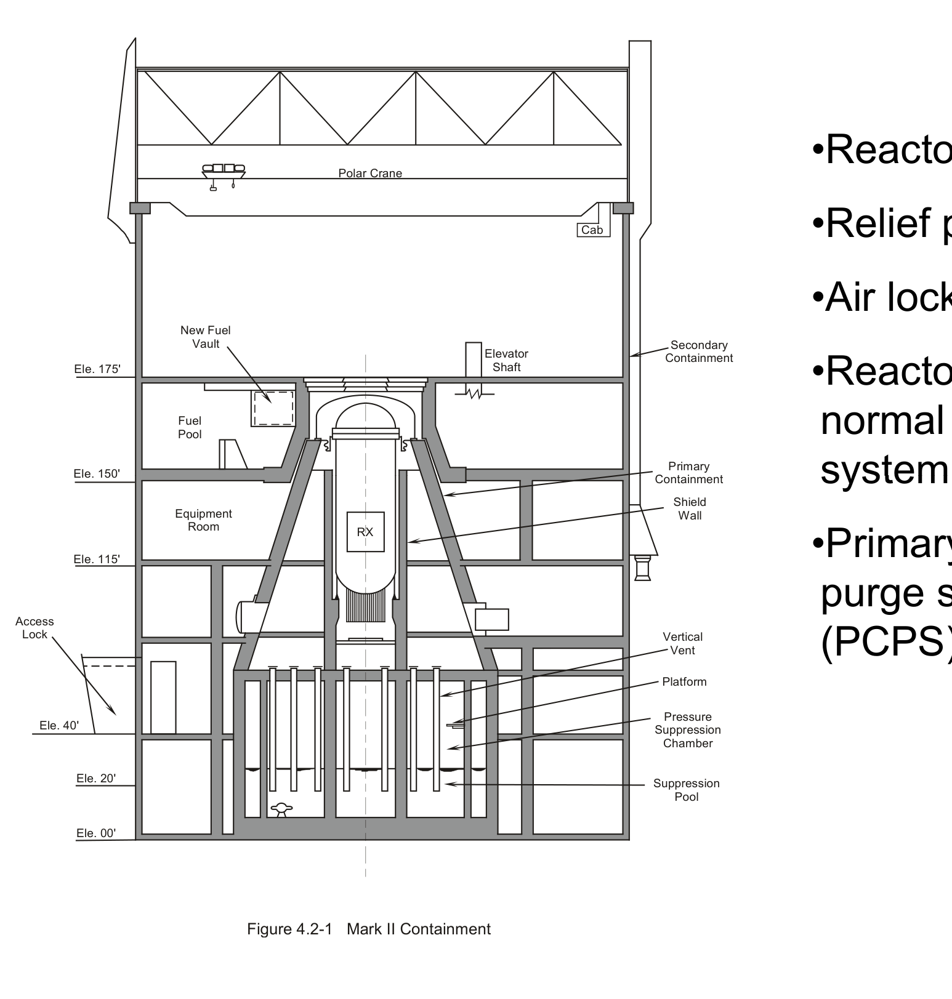
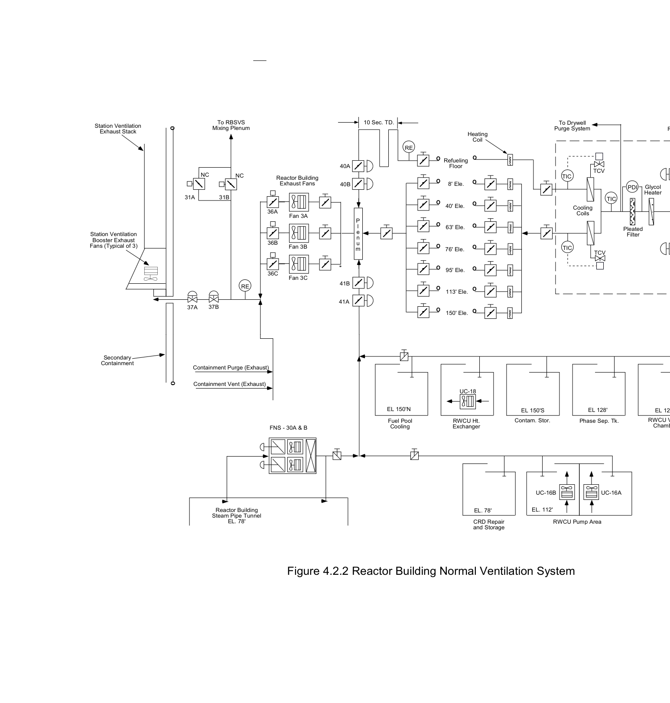
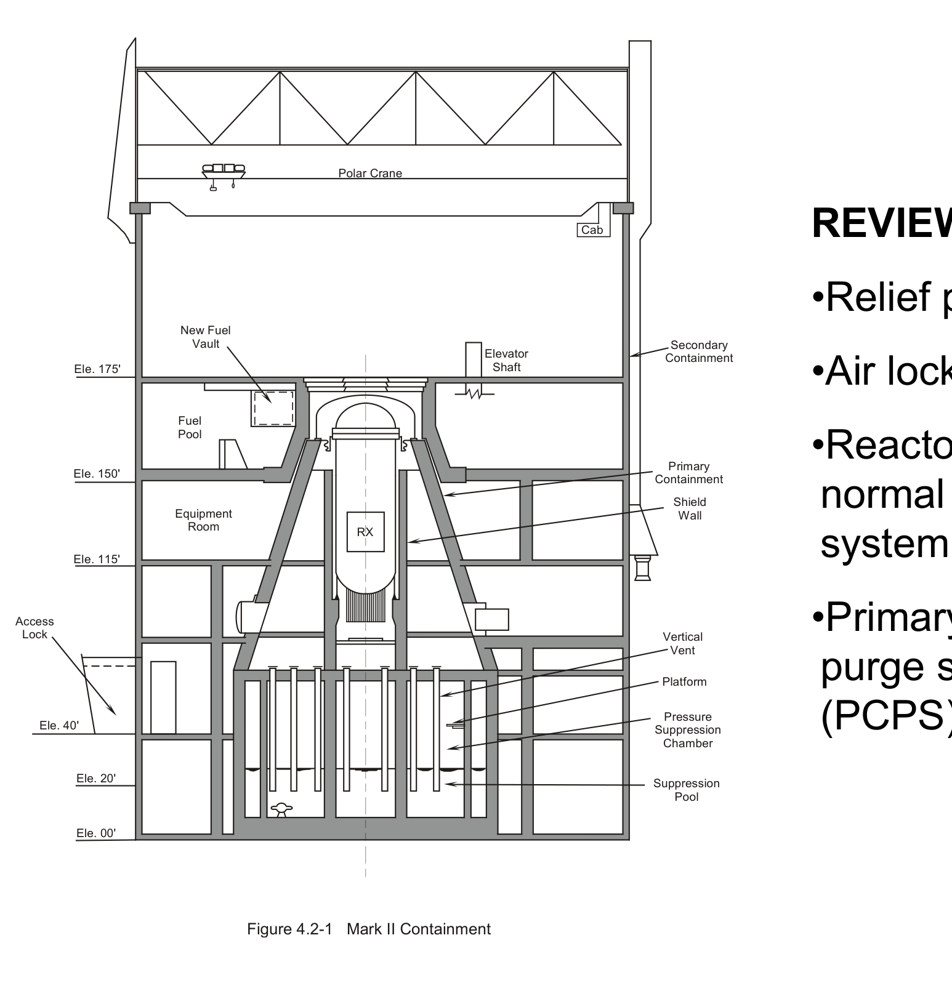
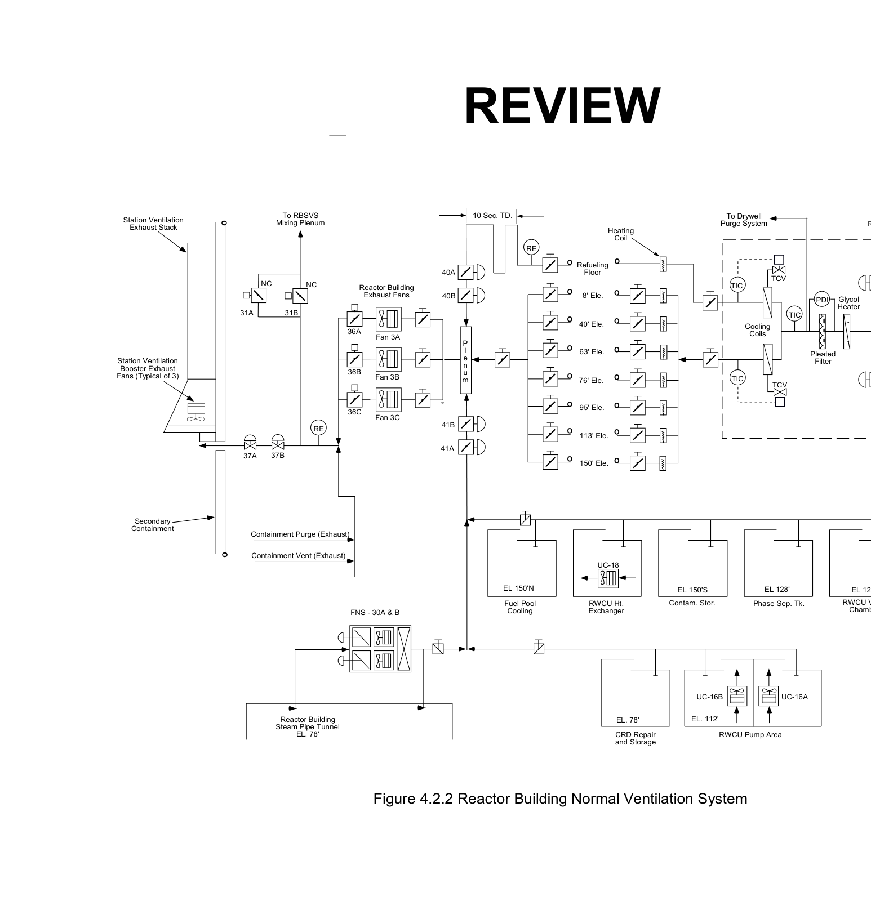

# 4.2 Secondary Containment

> Source: `4.2_Secondary_Containment.pdf` (27 pages)
> GE (BWR) Systems Technology Manual — USNRC HRTD, Rev 09/11

---
<!-- p.1 -->
Secondary Containment 304B Chapter 4.2 System y

<!-- p.2 -->
Reactor building normal ventilation system isolation following secondary containment features:
Explain the function and operation of the Primary containment purge system Identify the system's purposes.
Objectives valves and dampers Unit area coolers Reactor building Relief panels Airlocks

a. b. d. e. c.
f.
1. 2.

<!-- p.3 -->
b. Purge vent & exhaust from primary containment 5. Define secondary containment integrity.
3. List the conditions that will isolate the reactor building normal ventilation 4. Explain the following flow paths:
a. Air transfer through the RBNVS p Objectives g

system (RBNVS).
p

<!-- p.4 -->
6. Summarize the response of secondary 7. Describe how secondary containment containment equipment response to c. Nuclear Steam Supply Shutoff System b. Reactor Building Standby Ventilation a. Primary Containment System interrelates to the following:
Objectives y

accident conditions.
System

<!-- p.5 -->
#### Figure 4.2-1

*Figure 4.2-1*

[Vector original (SVG, lossless): fig_4.2-1.svg](../figures/fig_4.2-1.svg)

<!-- labels/text on this figure page -->
•Primary containment normal ventilation
•Reactor building system (RBNVS) system (RBNVS)
•Reactor building purge system
•Relief panels
•Air locks
(PCPS)
Containment Secondary t Containment Suppression Suppression Pressure Chamber Primary Platform Shield Vertical Wall Pool Vent t i
C
Cab
Elevator Shaft Mark II Containment Polar Crane RX
Figure 4.2-1
Equipment New Fuel Room Vault Fuel Pool
Ele. 175' Ele 150' Ele. 115' Ele. 150 Ele. 20' Ele. 00' Ele. 40' Access Lock

<!-- p.6 -->
drywell or suppression chamber are open.
– to provide primary containment when the radioactive material following an accident radioactive material following an accident – minimize the ground level release of
• The purposes of the Secondary Purpose Containment System are:

<!-- p.7 -->
drywell or suppression chamber are open
• Serves as primary containment when Reactor Building
• Encloses primary containment
• Blowout panels
• Concrete

<!-- p.8 -->
• the reactor building exterior metal siding.
• turbine building blowout panels
• main steam tunnel relief vents Relief panels

<!-- p.9 -->
doors is equipped with rubber weather strip interlocked so that only one of the pair may doors is equipped with rubber weather-strip Entry to and exit from the reactor building equipment air locks. Each pair of access are through double door personnel and type seals. The doors are electrically Airlocks be opened at a time.

<!-- p.10 -->

*figure on PDF page 10*

[Vector original (SVG, lossless): fig_page-10.svg](../figures/fig_page-10.svg)

<!-- labels/text on this figure page -->
RBSVS PDIC 43A PDIC 43B For 35B 35A
PDC 11
Reactor Building Supply Fans PCD 11A PCD 11B RWCU Valve Chamber EL 128' Heater Glycol Pleated PDI Filter
UC-16A Phase Sep. Tk.
TIC EL 128' TCV TCV RWCU Pump Area Cooling Purge System Coils To Drywell Figure 4.2.2 Reactor Building Normal Ventilation System TIC TIC
UC-16B EL. 112' Contam. Stor.
EL 150'S
CRD Repair and Storage EL. 78' Heating Coil RWCU Ht. Exchanger º º º º º º º º UC-18 113' Ele. 150' Ele.
Refueling 8' Ele. 40' Ele. 63' Ele. 76' Ele. 95' Ele. Floor º º º º º º º º
RE Fuel Pool EL 150'N Cooling 10 Sec. TD.
m P l e n u
40A 40B 41B 41A
Reactor Building Exhaust Fans Fan 3A Fan 3C FNS - 30A & B Fan 3B 36A 36B 36C Containment Purge (Exhaust)
Containment Vent (Exhaust)
Steam Pipe Tunnel Reactor Building Mixing Plenum RE EL. 78' NC To RBSVS 31B 37B NC
37A 31A
Station Ventilation Station Ventilation Fans (Typical of 3) Exhaust Stack Booster Exhaust Containment Secondary

<!-- p.11 -->
• heating and air conditioning supply units with
• differential pressure controlled dampers
• manually positioned ventilation louvers RBNVS
• controls and instrumentation.
The RBNVS consists of:
• three exhaust fans
• distribution ducts two supply fans
• unit coolers

<!-- p.12 -->
Sub-Atmospheric Pressure
• Pressure control dampers
• Prevents out-leakage
• - 1.5 inch ΔP

<!-- p.13 -->
RBNVS Supply Flow
• Pressure Control Dampers
• Heaters & coolers
• Distribution ducts
• Intake louver
• Supply fans

<!-- p.14 -->
RBNVS Exhaust Flow
• Station ventilation exhaust duct
• Exhaust plenum
• Exhaust fans
• Refuel area

<!-- p.15 -->
• RBSVS/Control Room Air Conditioning Chilled Water System cooling water Area Unit Coolers
• Some are safety-related
• Auto-initiation
• Local

<!-- p.16 -->
– a high efficiency particulate absolute (HEPA)
Primary Containment Purge
• De-inerts primary containment to allow
• Primary Containment Purge System normal personnel access – a charcoal adsorber
(PCPS)
– a fan filter filter

<!-- p.17 -->
required (i.e.; the reactor is critical or moderator
• when activities are being performed that have a temperature is >212F and fuel is in the reactor Secondary Containment Integrity
• when fuel handling operations are in progress
• all times that primary containment integrity is
• The operational conditions that require that secondary containment integrity must be potential for draining the reactor vessel.
within the secondary containment maintained include:
(

vessel)

<!-- p.18 -->
• Secondary containment pressure is less than or equal to Secondary Containment Integrity
• At least one door in each access opening is closed.
• RBNVS automatic isolation valves are operable or
• All containment penetration seal mechanisms are
• Secondary containment leakage rates are within
• All equipment hatches are closed and sealed.
deactivated in the closed position.
• reactor building is intact
-1.5 inch H2O gauge.
1 5 inch H2O gauge
• RBSVS is operable.
specified limits.
operable.

<!-- p.19 -->
Operations
• System Isolation
• Infrequent
• Normal

<!-- p.20 -->
• Reactor vessel low low level (Level 2, -38 Refuel area exhaust ventilation radiation
• Refuel area exhaust ventilation radiation • Vent/purge exhaust ventilation radiation
• Reactor Building low ΔP (> -0.30" H2O) • RBSVS initiation signal, multiple inputs.
• High drywell pressure high (>1.69 psig)
Isolation Signals high (>5.4 x 105 cpm)
high (>35 mR/hr)
inches)

<!-- p.21 -->
• Primary Containment System (Chapter
• Nuclear Steam Supply Shutoff System
• Reactor Building Standby Ventilation
• Emergency AC Power (Chapter 9.2)
System Interfaces System (Chapter 4 3) System (Chapter 4.3)
(Chapter 4.4)
4.1)

<!-- p.22 -->
#### Figure 4.2-1

*Figure 4.2-1*

[Vector original (SVG, lossless): fig_4.2-1_2.svg](../figures/fig_4.2-1_2.svg)

<!-- labels/text on this figure page -->
•Primary containment normal ventilation
•Reactor building system (RBNVS)
purge system
•Relief panels
•Air locks REVIEW
(PCPS)
Containment Secondary t Containment Suppression Suppression Pressure Chamber Primary Platform Shield Vertical Wall Pool Vent t i
C
Cab
Elevator Shaft Mark II Containment Polar Crane RX
Figure 4.2-1
Equipment New Fuel Room Vault Fuel Pool
Ele. 175' Ele 150' Ele. 115' Ele. 150 Ele. 20' Ele. 00' Ele. 40' Access Lock

<!-- p.23 -->

*figure on PDF page 23*

[Vector original (SVG, lossless): fig_page-23_2.svg](../figures/fig_page-23_2.svg)

<!-- labels/text on this figure page -->
RBSVS PDIC 43A PDIC 43B For 35B 35A
PDC 11
Reactor Building Supply Fans PCD 11A PCD 11B RWCU Valve Chamber EL 128' Heater Glycol Pleated PDI Filter
UC-16A Phase Sep. Tk.
TIC EL 128' TCV TCV RWCU Pump Area Cooling Purge System Coils To Drywell Figure 4.2.2 Reactor Building Normal Ventilation System TIC TIC
UC-16B EL. 112' Contam. Stor.
EL 150'S REVIEW CRD Repair and Storage EL. 78' Heating Coil RWCU Ht. Exchanger º º º º º º º 150' Ele. º UC-18 Refueling 113' Ele 113 Ele. 8' Ele. 40' Ele. 63' Ele. 76' Ele. 95' Ele.
Floor
º º º º º º º º
RE Fuel Pool EL 150'N Cooling 10 Sec. TD.
m P l e n u
40A 40B 41B 41A
Reactor Building Exhaust Fans Fan 3A Fan 3C FNS - 30A & B Fan 3B 36A 36B 36C Containment Purge (Exhaust)
Containment Vent (Exhaust)
Steam Pipe Tunnel Reactor Building Mixing Plenum RE EL. 78' NC To RBSVS 31B 37B NC
37A 31A
Station Ventilation Station Ventilation Fans (Typical of 3) Exhaust Stack Booster Exhaust Containment Secondary

<!-- p.24 -->
Reactor building normal ventilation system isolation following secondary containment features:
Explain the function and operation of the Primary containment purge system Identify the system's purposes.
Objectives valves and dampers Unit area coolers Reactor building Relief panels Airlocks

a. b. d. e. c.
f.
1. 2.

<!-- p.25 -->
b. Purge vent & exhaust from primary containment 5. Explain what constitutes the secondary 6. Define secondary containment integrity.
3. List the conditions that will isolate the reactor building normal ventilation 4. Explain the following flow paths:
a. Air transfer through the RBNVS p Objectives containment barriers.
g

system (RBNVS).
p

<!-- p.26 -->
7. Summarize the response of secondary 8. Describe how secondary containment containment equipment response to c. Nuclear Steam Supply Shutoff System b. Reactor Building Standby Ventilation a. Primary Containment System interrelates to the following:
Objectives y

accident conditions.
System

<!-- p.27 -->
Are there any questions?

