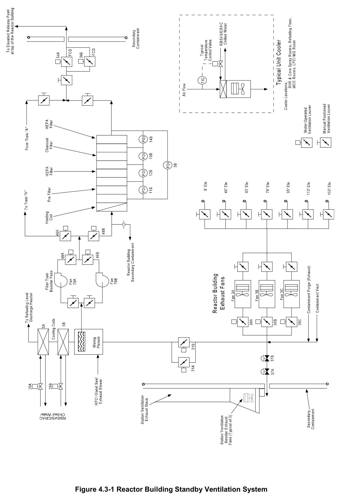

# 4.3 RB Standby Ventilation

> Source: `4.3_RB_Standby_Ventilation.pdf` (13 pages)
> GE (BWR) Systems Technology Manual — USNRC HRTD, Rev 09/11

---
<!-- p.1 -->
#### General Electric Systems Technology Manual
#### Chapter 4.3
#### Reactor Building Standby Ventilation System
<!-- p.3 -->
TABLE OF CONTENTS

4.3 REACTOR BUILDING STANDBY VENTILATION SYSTEM .................................... 1

4.3.1 Introduction .......................................................................................................... 1

4.3.2 Component Description ....................................................................................... 2

4.3.2.1 Reactor Building Exhaust Fans ................................................................... 2

4.3.2.2 Mixing Plenum ............................................................................................. 2

4.3.2.3 Cooling Coils ............................................................................................... 3

4.3.2.4 Filter Train Booster Fans ............................................................................. 3

4.3.2.5 Heating Coil ................................................................................................. 3

4.3.2.6 Prefilter ........................................................................................................ 3

4.3.2.7 High Efficiency Particulate Air (HEPA) Filter ............................................... 3

4.3.2.8 Charcoal Filter ............................................................................................. 4

4.3.2.9 Downstream HEPA Filter ............................................................................. 4

4.3.2.10 Flow Control Dampers ................................................................................. 4

4.3.2.11 Area Unit Coolers ........................................................................................ 4

4.3.3 System Features and Interfaces .......................................................................... 5

4.3.3.1 Normal Operation ........................................................................................ 5

4.3.3.2 Automatic Initiation ...................................................................................... 5

4.3.3.3 Inspection and Testing ................................................................................ 6

4.3.3.4 System Interfaces ........................................................................................ 6

4.3.4 Summary ............................................................................................................. 7

LIST OF FIGURES

4.3-1 Reactor Building Standby Ventilation System

Rev 09/11 4.3-i USNRC HRTD

<!-- p.5 -->
### 4.3 REACTOR BUILDING STANDBY VENTILATION SYSTEM
Learning Objectives:

1. Recognize the purposes of the Reactor Building Standby Ventilation System (RBSVS).

2. Recognize the purpose, function and operation of the following RBSVS major components:
a. Reactor building exhaust fans b. Mixing plenum c. Cooling coils d. Filter train booster fans e. Heating coils f. Prefilter g. HEPA filters h. Charcoal filter i. Downstream HEPA filter j. Flow control dampers

3. Describe the flowpath of the RBSVS during the following:
a. Routine operations.
b. Accident conditions

4. Recognize the plant conditions that will cause the Reactor Building Standby Ventilation System (RBSVS) to initiate.

5. Describe how the Reactor Building Standby Ventilation system interfaces with the following systems:
a. Primary Containment System (Section 4.1)
b. Secondary Containment System (Section 4.2)
c. High Pressure Coolant Injection System (Section 10.1)

#### 4.3.1 Introduction
The purposes of the Reactor Building Standby Ventilation System are to process exhaust air from the secondary containment under accident conditions in order:
• to limit radiation doses to less than 10CFR100 limits,
• to maintain a negative pressure in the secondary containment upon loss of the normal ventilation system,
• to perform secondary containment leak tests, and
• to purge the primary containment.

The functional classification of the RBSVS is that of a safety related system. Its regulatory classification is that of an Engineered Safety Feature (ESF).

The RBSVS (Figure 4.3-1) operates independent of but in conjunction with the Reactor Building Normal Ventilation System (RBNVS) described in Chapter 4.2. The RBSVS

Rev 09/11 4.3-1 USNRC HRTD

<!-- p.6 -->
consists of a suction duct network, two filter trains with fans, and a discharge vent. The suction duct removes air from the RBNVS exhaust duct, upstream of the secondary containment air exhaust isolation valves. It also draws air from the HPCI gland exhaust line via the mixing plenum when the HPCI is running. Each filter train contains a heater to provide humidity control, and banks of particulate and charcoal filters to remove particulate matter and halogens. Both trains share a pair of booster fans which move containment air through the processing system and out the elevated release point for discharge. The fans and filter trains are located inside the Reactor Building.

Each RBSVS train must be operable whenever:
• reactor coolant temperature is ≥212°F
• during a refueling outage when handling irradiated fuel
• during core alterations
• when operations are in progress having a potential to drain the reactor vessel.

Either train is rated for 100% capacity and is capable of producing and maintaining the secondary containment at a pressure of -0.25 inch water.

#### 4.3.2 Component Description
The major components of the Reactor Building Standby Ventilation System are discussed in the paragraphs which follow.

##### 4.3.2.1 Reactor Building Exhaust Fans
The three Reactor Building Exhaust Fans are each 45,000 scfm, motor driven vane axial fans which are powered from the 480 VAC Emergency Busses. They normally exhaust from the Secondary Containment to the Station Ventilation Exhaust Stack.

During the RBSVS operation, at least one exhaust fan remains running to draw air from the refueling floor downward and through the equipment hatch openings and the deck grating, to the ventilation exhaust duct inlets at each floor level. Exhaust fan discharge is redirected from the stack to a mixing plenum.

##### 4.3.2.2 Mixing Plenum
The Mixing Plenum acts as the collection point for all containment air that is picked up by the Reactor Building Exhaust Fans from the exhaust ducts located on all levels of the Reactor Building. Within the plenum, all air is mixed by means of internal baffles. The majority of air leaves the mixing plenum and is directed to a ring header located above the refueling floor, where it is discharged through diffusers. Some air is removed from the mixing plenum by a Filter Train Booster Fan and discharged to one of two 100% capacity filter trains.

Rev 09/11 4.3-2 USNRC HRTD

<!-- p.7 -->
##### 4.3.2.3 Cooling Coils
Two 100% capacity cooling coils, located in series, cool the large volume of air in the Secondary Containment. Most of containment air entering the mixing plenum exits through cooling coils to the distribution ducts located on the refueling floor. Each cooling coil is cooled by the Reactor Building Standby Ventilation System Control Room Air Conditioning Chilled Water System. The combination of cooling coils and the area unit coolers help to maintain the reactor building at a negative pressure by cooling the containment atmosphere.

##### 4.3.2.4 Filter Train Booster Fans
Two Filter Train Booster Fans are each 1235 scfm, motor driven centrifugal fans that are powered from 480VAC Emergency Busses. Air is drawn from the mixing plenum and discharged through a common header to the filter trains. Only one fan and filter is required for RBSVS operation.

Flow divides at the inlet of each filter train. Air at 1190 scfm enters the filter train for processing while 45 scfm is diverted to Reactor Building Secondary Containment via a fixed orifice. 30 scfm of the 1190 scfm leaving the filter train flows backward through the inactive filter train to remove decay heat in its charcoal filter. This cooling air also exits through the fixed orifice located at the standby filters inlet returning to the secondary containment atmosphere.

##### 4.3.2.5 Heating Coil
The air stream entering the filtration system is heated by an electric heater that is regulated by a temperature controller to maintain prefilter influent flow at < 70 percent relative humidity. Charcoal adsorption efficiency is reduced if the relative humidity exceeds 70 percent. Each heater is powered from the same Emergency AC power source as its associated Filter Train Booster Fan.

##### 4.3.2.6 Prefilter
The prefilter is located downstream of the electric heating coil. It is constructed of a replaceable, dry type, extended fiberglass media. The prefilter is designed to remove atmospheric dust and particulate matter with at least 85 percent efficiency, thereby extending the life of the downstream high efficiency particulate air filters.

##### 4.3.2.7 High Efficiency Particulate Air (HEPA) Filter
Immediately following the prefilter and upstream of the charcoal filter is HEPA filter bank. The HEPA filter is 99.97 percent efficient at removing particles 0.3 microns or larger in diameter. It removes particulate which could enter the filter train from the

Rev 09/11 4.3-3 USNRC HRTD

<!-- p.8 -->
mixing plenum thus ensuring charcoal filter adsorber efficiency and protection from fouling. The HEPA filter bank is constructed of fiberglass media.

##### 4.3.2.8 Charcoal Filter
Located downstream of the HEPA filter bank is the Charcoal Filter. The charcoal adsorber is impregnated with iodine and has a minimum design adsorption efficiency of 99.9 percent removal of elemental iodines [5 percent of which is in the form of methyl iodide (CH3I) when operating at 90 percent humidity and 77ºF.

##### 4.3.2.9 Downstream HEPA Filter
A second HEPA filter bank is downstream of the charcoal adsorber bed. It has the same design parameters as the upstream HEPA filter. This filter provides redundancy in the event of any damage to the first HEPA filter. Also, it prevents any charcoal fines originating in the charcoal adsorber from exiting the discharge plenum and being carried out the elevated release point.

##### 4.3.2.10 Flow Control Dampers
Flow control dampers MOV-34A&B modulate as necessary to maintain system design exhaust flow at 1160 scfm to the elevated release point regardless of how many fans and filters are in operation. This flow rate is equivalent to the maximum design inleakage created with the secondary containment internal pressure at -0.25 inch H2O in combination with the external containment surface pressure created by a 30 mph wind.

##### 4.3.2.11 Area Unit Coolers
Two redundant sets of four unit coolers each are provided in areas of high heat gain such as RHR/Core Spray Area and Refueling Level Area. These area unit coolers start when the RBSVS is initiated. Along with the coolers, the associated Temperature Control Valves (TCVs) modulate as necessary to control temperature. The unit coolers are discussed in greater detail in Chapter 4.2.

Rev 09/11 4.3-4 USNRC HRTD

<!-- p.9 -->
#### 4.3.3 System Features and Interfaces
A short discussion of system features and interfaces with other plant systems is given in the paragraphs which follow.

##### 4.3.3.1 Normal Operation
During normal plant operation, the RBSVS is shutdown and in a standby mode. It is capable of being started manually or automatically. The RBSVS can process air flow from the following areas or components:
• Refueling Area
• All Reactor Building elevations (except designated Contaminated Areas)
• Drywell
• Suppression Chamber
• HPCI gland exhaust

##### 4.3.3.2 Automatic Initiation
Control logic for the RBSVS automatically starts all filter trains upon receipt of an accident signal. Once started, all trains continue running until secured manually.
Should one train fail, the remaining train will continue to provide design flow. The RBSVS automatically starts if any of the following conditions exist:
• Drywell pressure high (≥1.69 psig)
• Low Reactor Water Level (Level 2, -38 inches)
• Refuel area exhaust radiation high (≥35 mR/hr)
• Containment vent/purge exhaust duct rad high (>5.4 x 105 cpm)
• Reactor Building ΔP low (-0.30 inch H2O after a 30 second time delay)
• Loss of power to Normal 480V or 4160V AC Buses
• RBNVS supply or exhaust isolation valve fails closed
• Reactor Building Supply Air Conditioning Unit valve closes.

When initiated, the RBSVS performs the following functions:
• Isolates the Secondary Containment by closing the RBNVS exhaust isolation valves
(AOV-37A&B) and the supply isolation valves (AOV-35A&B).
• Trips the operating RBNVS supply fans. (The two normally running Reactor Building Exhaust Fans continue operating and act as recirculation fans for the entire Secondary Containment volume. One exhaust fan is not required and is soon secured.)
• Closes the Primary Containment Purge/Vent Supply and Exhaust Isolation Valves, if open.
• Closes the Refueling Area and Contaminated Area Exhaust Dampers.
• Opens the RBSVS Mixing Plenum inlet valves such that 43,765 scfm of air will be circulated through the RBSVS cooling coils discharging to the refueling level air

Rev 09/11 4.3-5 USNRC HRTD

<!-- p.10 -->
discharge header. The remaining 1235 scfm is redirected to the suction of the filter train booster fans.
• Filter Train Booster Fans start and their associated discharge dampers open, filter train inlet dampers open, and filter train flow control dampers modulate to maintain flow at 1160 scfm to the elevated release point.
• All RBSVS area unit coolers start.

With the RBSVS aligned and operating, the Secondary Containment is maintained at a ≤-0.25 inch H2O pressure by modulation of the filter train flow control dampers (MOD- 34A&B). The Reactor Building atmosphere is cooled as it recirculates through the RBSVS Cooling Coils and the Area Unit Coolers in the RHR/Core Spray Pump rooms, the refueling floor, the Motor Control Center rooms, and the LPCI MG Set rooms.

The RBSVS Filter Trains, in conjunction with the large amount of containment internal recirculation air flow, provides holdup, mixing, and dilution of airborne radioactive contaminants. It also minimizes the release of radioactivity to the environment by maintaining a negative pressure in the secondary containment and filtering the exhaust air prior to release.

##### 4.3.3.3 Inspection and Testing
The Secondary Containment Integrity verification requires that the Reactor Building be intact. This is determined by operating the RBSVS while the RBNVS is isolated, adjusting the discharge air flow to 1160 scfm, and verifying reactor building pressure to be greater than 0.25 inches of water gauge below the pressure outside the building.

The RBSVS trains and fans are arranged so that one train and its associated fan can be serviced or tested while the redundant train is ready to operate. Upon receipt of an accident signal Secondary Containment isolates, the RBSVS train being tested will shut down, isolate and the redundant train will start automatically.

##### 4.3.3.4 System Interfaces
Interfaces between the RBSVS and other plant systems are discussed in the following paragraphs.

Primary Containment System (Chapter 4.1)

The RBSVS can be used to purge atmosphere from either the drywell or suppression chamber.

Rev 09/11 4.3-6 USNRC HRTD

<!-- p.11 -->
Secondary Containment System (Chapter 4.2)

The RBSVS automatically starts and takes suction from the Secondary Containment under accident conditions in order to maintain the Secondary Containment at a negative pressure. The RBSVS is also used to test for Secondary Containment integrity.

High Pressure Coolant Injection System (Chapter 10.1)

The HPCI System gland exhaust blower discharges to the RBSVS' Mixing Plenum for processing and release of noncondensible gases. The HPCI auto initiation signals
(≥1.69 psi Drywell Pressure or Level 2) also initiate the RBSVS. For manual initiation of HPCI the RBSVS must be manually started, also.

#### 4.3.4 Summary
Classification - Safety related system; engineered safety feature system.

Purpose - To process secondary containment atmosphere prior to release under accident conditions; to maintain a sub-atmospheric pressure in the secondary containment relative to the environment outside the building; to provide a means for purging the primary containment; to perform leak tests of the secondary containment.

Components - Reactor building exhaust fans; mixing plenum; booster fans; electric heater; prefilter; HEPA filters; charcoal filter; flow control dampers; area unit coolers.

System Interfaces - Primary Containment System; Secondary Containment System;
Process and Area Radiation Monitoring System; High Pressure Coolant Injection System.

Rev 09/11 4.3-7 USNRC HRTD

<!-- p.12 -->
Rev 09/11 4.3-8 USNRC HRTD

<!-- p.13 -->
#### Figure 4.3-1

*Reactor Building Standby Ventilation System*

[Vector original (SVG, lossless): fig_4.3-1.svg](../figures/fig_4.3-1.svg)

