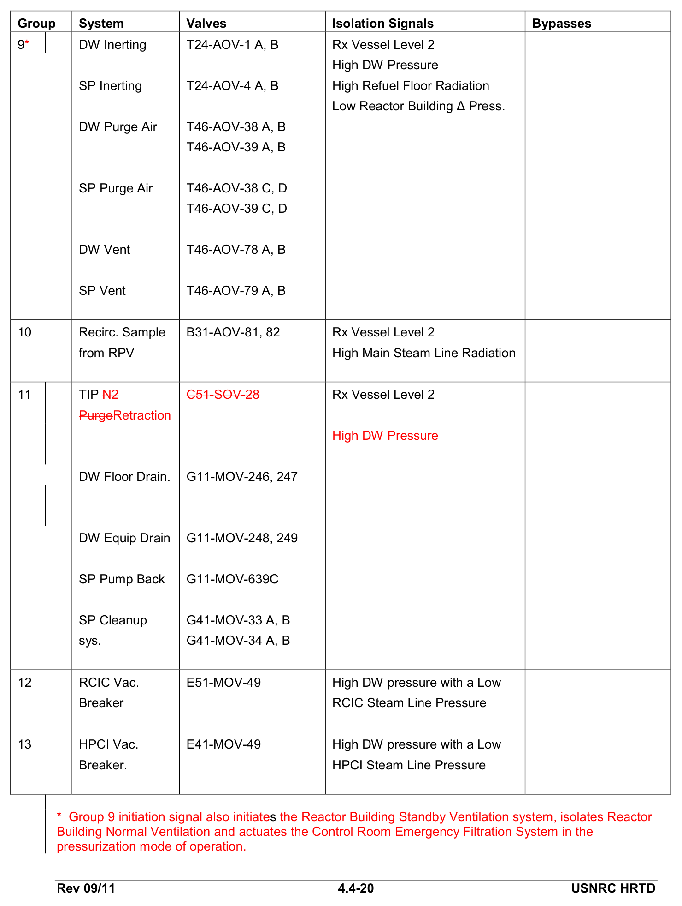
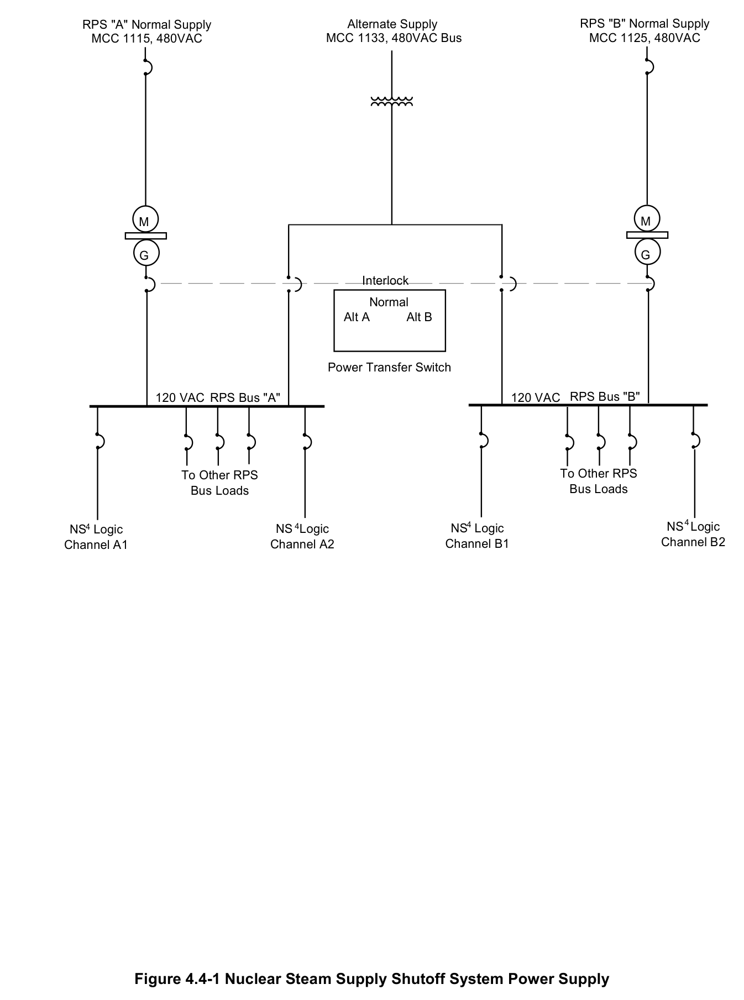
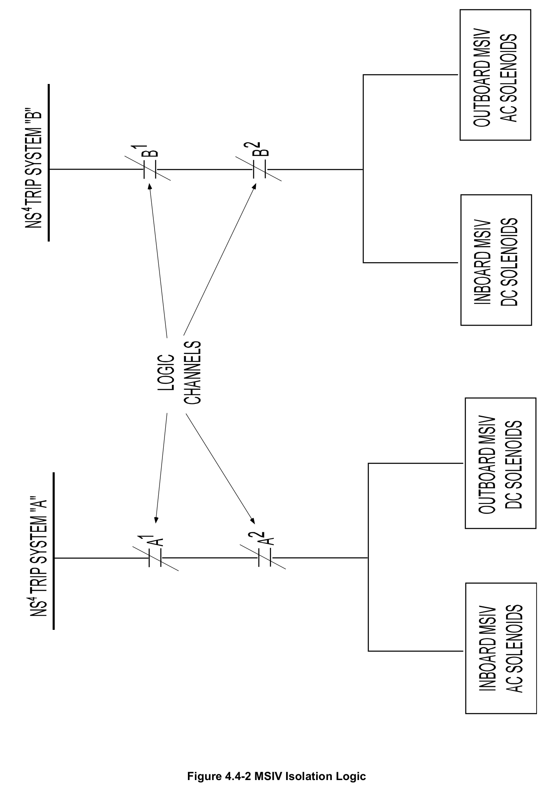
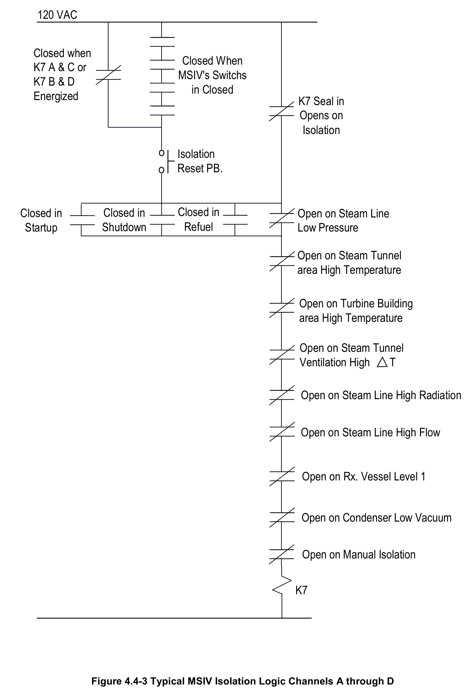
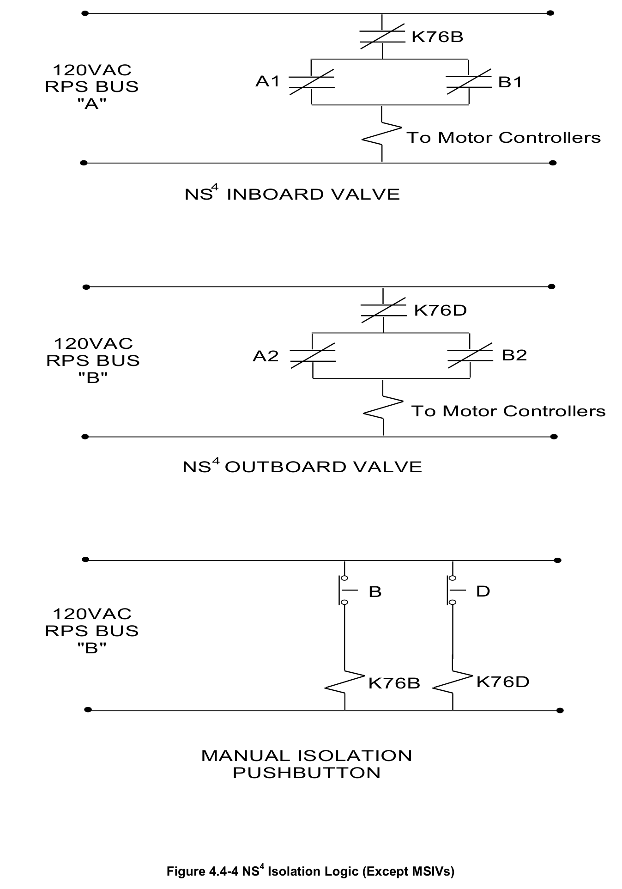
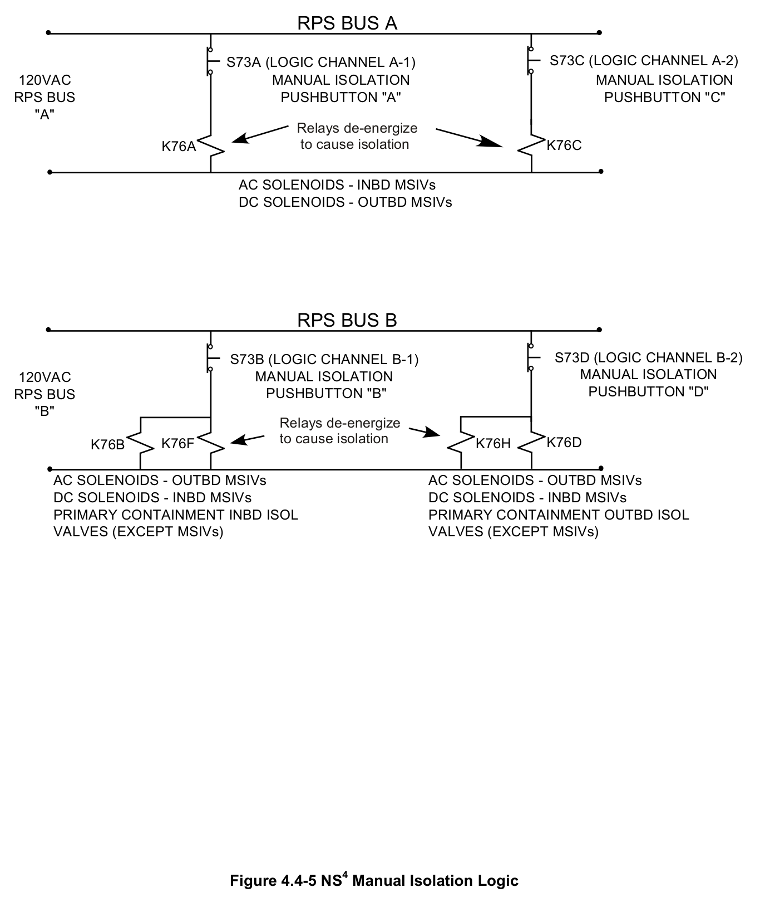
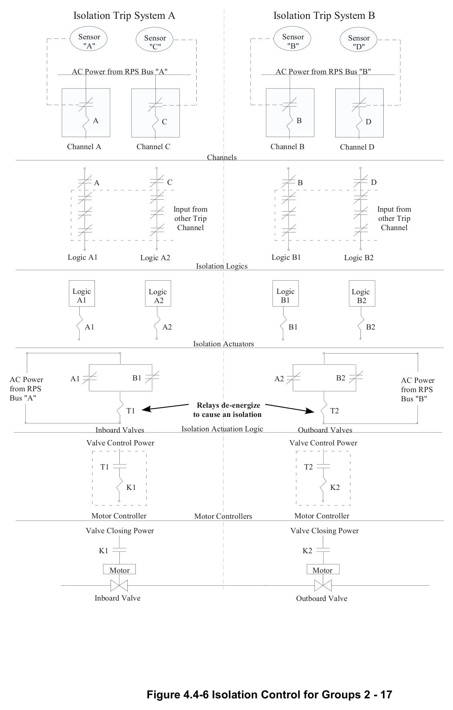
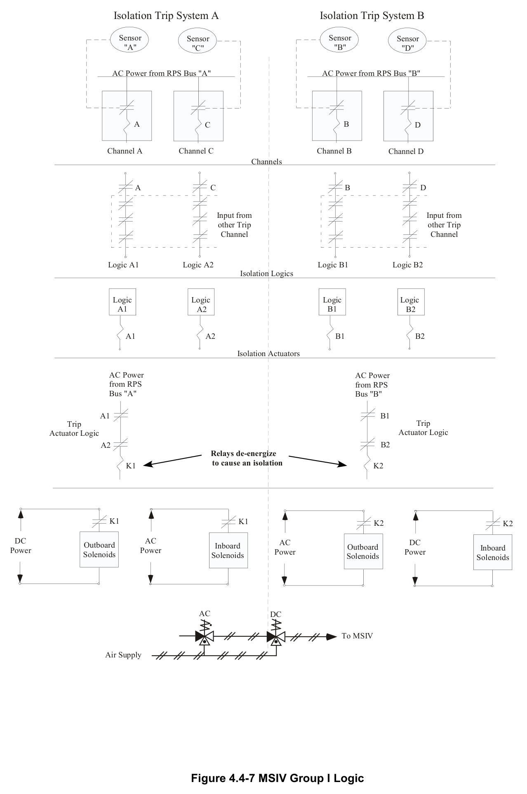

# 4.4 NSSS Shutoff

> Source: `4.4_NSSS_Shutoff.pdf` (35 pages)
> GE (BWR) Systems Technology Manual — USNRC HRTD, Rev 09/11

---
<!-- p.1 -->
#### General Electric Systems Technology Manual
#### Chapter 4.4
#### Nuclear Steam Supply Shutoff System
<!-- p.3 -->
TABLE OF CONTENTS

4.4 NUCLEAR STEAM SUPPLY SHUTOFF SYSTEM .................................................. 1

4.4.1 Introduction .......................................................................................................... 2

4.4.2 Component Description ....................................................................................... 3

4.4.2.1 Sensors......................................................................................................... 3

4.4.2.2 Trip Circuit .................................................................................................... 4

4.4.2.3 Power Supplies ............................................................................................. 4

4.4.2.4 Isolation Valves ............................................................................................. 5

4.4.2.5 Isolation Groups ............................................................................................ 5

4.4.3 System Features and Interfaces ........................................................................ 11

4.4.3.1 Manual Isolation .......................................................................................... 11

4.4.3.2 Automatic Isolation ..................................................................................... 12

4.4.3.3 Isolation Reset ............................................................................................ 12

4.4.3.4 System Interrelations .................................................................................. 13

4.4.4 Summary ........................................................................................................... 14

LIST OF TABLES

4.4-1 NSSSS AUTOMATIC ISOLATIONS ................................................................... 15

4.4-2 NSSSS MANUAL ISOLATIONS ......................................................................... 23

Rev 09/11 4.4-i USNRC HRTD

<!-- p.4 -->
LIST OF FIGURES

4.4-1 Nuclear Steam Supply Shutoff System Power Supply 4.4-2 MSIV Isolation Logic 4.4-3 Typical MSIV Isolation Logic Channels A through D 4.4-4 NS4 Isolation Logic (Except MSIVs)
4.4-5 NS4 Manual Isolation Logic 4.4-6 Isolation Control for Groups 2 - 17 4.4-7 MSIV Group I Logic

Rev 09/11 4.4-ii USNRC HRTD

<!-- p.5 -->
### 4.4 NUCLEAR STEAM SUPPLY SHUTOFF SYSTEM
Learning Objectives:

1. Recognize the purposes of the Nuclear Steam Supply Shutoff system (NSSSS).

2. Recognize the purpose, function, and operation of the following NSSSS system major components:
a. Sensors b. Trip circuits c. Power Supplies d. Isolation valves e. Isolation groups

3. Recognize the purpose of each of the group isolation signals.

4. Recognize the plant conditions that result in a Group 1 isolation.

5. In regards to Group 1 isolations, recognize:
a. Which isolation signal can be bypassed b. How an isolation signal can be reset c. How the system can be manually isolated

6. Recognize how the Nuclear Steam Supply Shutoff system interfaces with the following systems:
a. Main Steam System (Section 2.5)
b. Reactor Water Cleanup System (Section 2.8)
c. Recirculation System (Section 2.4)
d. Residual Heat Removal System (Section 10.4)
e. Reactor Protection System (Section 7.3)
f. Primary Containment System (Section 4.1)
g. Secondary Containment System (Section 4.2)
h. Reactor Core Isolation Cooling System (Section 2.7)
i. High Pressure Coolant Injection System (Section 10.1)
j. Liquid Radwaste System (Section 8.2)
k. Post Accident Sampling System l. Service and Instrument Air System (Section 11.6)
m. Reactor Building Closed Loop Cooling System (Section 11.3)

Rev 09/11 4.4-1 USNRC HRTD

<!-- p.6 -->
#### 4.4.1 Introduction
The purpose of the Nuclear Steam Supply Shutoff System (NSSSS) is to isolate systems connected to;
• the primary coolant,
• the primary containment
• the secondary containment

These are isolated during accident conditions to prevent the release of radioactive materials to the environment in excess of 10 CFR 100 limits.

The functional classification of the NSSSS is that of a safety related system. Its regulatory classification is that of an engineered safety feature (ESF) system.

The NSSSS uses the following components to affect the isolations of valves penetrating the primary containment or reactor coolant systems;
• sensors
• power supplies
• trip circuits
• logic channels
• switches
• transmitters
• remotely operated valve closing mechanisms

Redundant sensors and component physical separation ensure that no single failure in NSSSS system causes or prevents an isolation. The NSSSS logic system and sensors are normally energized. A loss of power to the sensor will cause the isolation signal.
Loss of power to the NSSSS logic will initiate the isolation.

Local sensor elements provide input signals to the NSSSS from the following;
• containment systems
• reactor vessel instrumentation system
• reactor protection system
• main steam system
• condensate and feedwater system
• standby liquid control system
• process and area radiation monitoring systems
• individual system leak detection parameters (system temperatures and flows)

The information provided by these sensors provides isolation signals to the various systems. This results in the selective isolation of the systems based upon indications of a leak. This method is preferred versus completely isolating both the primary containment and the reactor coolant system.

Rev 09/11 4.4-2 USNRC HRTD

<!-- p.7 -->
## 10 CFR-50 Appendix A provides specific requirements for piping systems. Systems
that penetrate the primary containment and interface directly with the primary containment atmosphere or the reactor coolant system must contain two isolation valves. One isolation valve is located inside (inboard) the primary containment. The second isolation valve is located outside (outboard) the primary containment, as close to the containment wall as practical. These isolation valves must be locked closed or equipped with devices for automatic closure.

The NSSSS is divided into 17 basic isolation "groups". Group 1 consists of Main Steam Isolation Valves (MSIVs). MSIV isolation logic is provided to control the loss of coolant from the reactor vessel and the release of radioactive materials to the environment.
Groups 2 through 17 include the following systems;
• Primary Containment
• Secondary Containment
• Main Steam line drains
• Reactor Water Cleanup,
• High Pressure Coolant Injection
• Reactor Core Isolation Cooling
• Residual Heat Removal
• Reactor Building Closed Loop Cooling Water
• Radwaste
• Post Accident Sampling System (PASS).

#### 4.4.2 Component Description
The major components of the nuclear steam supply shutoff system are discussed in the following paragraphs.

##### 4.4.2.1 Sensors
Sensors utilized by the NSSSS are instruments belong to other plant systems. These sensors measure;
• Reactor water level,
• Main steam line radiation
• Various system flow rates or differential flow rates
• Various system pressures
• Various area and process radiation signals
• Various area temperatures or differential temperatures
• Drywell pressure
• Standby Liquid Control system initiation
• RWCU non regenerative heat exchanger inlet temperature

Rev 09/11 4.4-3 USNRC HRTD

<!-- p.8 -->
These sensors then provide input to the NSSSS logic networks to cause system (group)
isolations.

##### 4.4.2.2 Trip Circuits
A trip circuit is an arrangement of sensors and associated components which evaluate plant parameters. The trip circuits produce discrete trip outputs when the logic is satisfied. Two separate and independent trip circuits are used in the NSSSS logic. The components within one trip circuit must maintain electrical and physical separation from the components in the other trip circuit. Components are powered such that a loss of power causes trip circuit actuation.

The NSSSS logic, for the MSIV (Group 1) isolation (Figure 4.4-2) is arranged in a oneout-of-two-taken-twice manner. This logic is shown in the energized (normal operation)
state, the contacts will open to de-energize the isolation relays. The logic is composed of two trip circuits (A and B). Trip circuit A consists of channels A1 & A2 whereas trip circuit B consists of channels B1 & B2. A full NSSSS group 1 isolation is defined as a concurrent trip of both trip circuits A & B. This scheme requires at least one channel in each trip circuit to trip, to close all the valves in Group 1. A ½ group isolation is a trip of only one trip circuit. This satisfies part of the isolation logic for a particular valve group but will not cause valve motion.

Group's 2 - 17 isolation logic, (Figure 4.4-4), is arranged with channels A1 & B1 in trip circuit A and channels A2 & B2 in trip circuit B. This logic is again shown in the energized (normal operation) state and the relays must be de-energized to cause an isolation. Channels A1 & B1 are associated with the inboard isolation valves. Channels A2 & B2 are associated with the outboard isolation valves. These groups use a dual trip circuit consisting of a two-out-of-two logic, also called an inboard-outboard logic. This logic requires both channels of a trip circuit to trip before initiating closure of the corresponding isolation valve.

##### 4.4.2.3 Power Supplies
Power for the trip circuits of the NSSSS is supplied from the Reactor Protection System
(RPS) motor-generator sets via 120 VAC RPS busses A & B
(Figure 4.4-1). The trip logic for each isolation group de-energizes to initiate an isolation.

The isolation valves receive power from emergency power sources. Power for the operation of two valves in the same process line is fed from different power sources. In some cases, one valve will be powered from an AC emergency bus and the other by

Rev 09/11 4.4-4 USNRC HRTD

<!-- p.9 -->
DC from the station batteries. In other cases, the 2 isolation valves will be separately powered from divisionally separated AC emergency busses.

##### 4.4.2.4 Isolation Valves
There are three classes of isolation valves. These classes depend on the degree to which there process lines penetrate the reactor coolant boundary or communicate with primary containment. Regulatory requirements for each valve class are located in 10 CFR 50, App A, Criterions 55,56, and 57.

Class A valves (Criterion 55) are in process lines which penetrate the primary containment and communicate with the reactor vessel or coolant boundary. Two isolation valves are required on these lines, one inside and one outside the primary containment.

Class B valves (Criterion 56) are in process lines which penetrate the primary containment and communicate with its atmosphere. The general design criterion states that one valve will be located on each side of the primary containment.

Class C valves (Criterion 57) are in pipelines that penetrate the primary containment, but do not communicate with the reactor vessel or reactor coolant boundary and are not open to the primary containment. One valve outside the primary containment is provided for each line.

To limit radiological releases or maintain core coverage, class A and B valves are closed upon receipt of a trip signal. Isolation valves for class A, B, and C process lines penetrating the primary containment boundary are listed in Table 4.4-1.

##### 4.4.2.5 Isolation Groups
The NSSSS logic is divided into 17 discrete groups. The valve groups function to isolate the reactor coolant pressure boundary and primary containment atmosphere.
Also isolated are some closed loop systems that penetrate the primary containment that are not in direct contact with either the primary containment or reactor coolant system.
Table 4.4-1 provides a list of valve groups, the affected system, the specific valve(s)
that are closed, the isolation signal(s) and associated isolation bypasses. The isolation groups are listed and described in the following paragraphs:

Groups 1 & 14 Main Steam System

Isolation Group 1 consists of Main Steam Isolation Valves (MSIVs) and Group 14 is the main steam line drain valves. These groups control the loss of coolant from the reactor

Rev 09/11 4.4-5 USNRC HRTD

<!-- p.10 -->
vessel and the release of radioactive materials to the environment. The NSSSS Groups 1 & 14 logic responds to signals that indicate;
• a breach of the Reactor Coolant Pressure Boundary (RCPB)
• a breach of the fuel cladding
• a failure of the Electro Hydraulic Control (EHC) System
• a loss of the primary heat sink (main condenser).

Each main steam line develops a steam flow signal by measuring the differential pressure across the steam line flow restrictor. This signal is converted to a signal that is proportional to steam flow. Excessive flow (>134%) through a steam line is indicative of a break in that line. There are four steam line flow sensors per line, one each for trip channels A1, A2, B1 and B2. If either the A1 or A2 and B1 or B2 sensors indicate a high flow in one steam line all MSIVs will close.

Leakage sensing devices also provide control inputs from system temperature elements. These detect high steam line area temperatures in the steam tunnel or turbine building (>155˚F). A main steam line tunnel differential temperature high
(>50˚F) will also initiate an isolation signal. By placing temperature elements in these spaces, small steam leaks inside and outside the secondary containment are rapidly detected. This allows isolation before the steam line high flow reaches the large break setpoint.

The reactor low water level isolation, Level 1(-132.5 inches), is high enough to ensure enough water remains in the reactor vessel to cover the fuel. This setpoint also allows the emergency core cooling systems time to provide adequate core cooling for large main steam line breaks. Water level is sensed by four level transmitters which send analog signals to the NSSSS trip units.

The low steam line pressure isolation signal (>825 psig) is sensed by four pressure transmitters, one located on each steam line. These transmitters are located just upstream of the turbine stop valves. The low pressure isolation is bypassed when the reactor mode switch is not in RUN mode. This allows the plant to startup, heatup, and pressurize the reactor with the MSIVs open. If steam line pressure decreases during power operation, the most probable cause is a malfunction in the Electro Hydraulic Control System (EHC, Chapter 3.2). The isolation on low steam line pressure prevents a rapid reactor vessel depressurization. A rapid depressurization can create an excessive reactor cooldown or operation at a high power - low pressure condition (CPR safety limit consideration).

Main steam line high radiation (>3 X normal background radiation) will initiate a main steam isolation. Four radiation detectors send signals to process radiation monitoring system trip units. These detectors are located near the main steam lines in the steam tunnel. The detectors are positioned to ensure each monitors the radiation level of all

Rev 09/11 4.4-6 USNRC HRTD

<!-- p.11 -->
four of the steam lines. The radiation levels reaching 3 times the normal full power background value indicates a gross failure of the fuel barriers. This initiates a trip signal, sent to the NSSSS logic, to isolate the main steam lines. Due to changes in BWR chemistry control and as part of scram frequency reduction, many plants have disabled this steam line isolation.

A loss of the reactor's normal heat sink occurs when main condenser vacuum is lost or reduced. To preclude possible over pressurization of the condenser, the MSIVs are closed when a low vacuum condition (8.5 " Hg) is sensed. This condition can be bypassed when the following conditions are met;
• Low Vacuum Bypass switches are in Bypass
• Turbine Stop valves are closed
• Reactor Mode Switch is not in RUN.

Group 2 RHR, Core Spray, Instrument Air, N2 Purge for TIP and Radiation Monitoring

Isolation Group 2 consists of the following systems;
• Drywell Radiation Monitoring subsystem
• Instrument Air to the Suppression Chamber
• N2 Purge for TIP
• Core Spray test line
• RHR Containment Spray valves
• RHR test line return to suppression chamber

Group 2 valves close in response to a drywell high pressure or low reactor vessel water
(Level 1).

Groups 3 & 4 Reactor Water Cleanup System

Isolation Groups 3 & 4 consists of the Reactor Water Cleanup (RWCU) System suction inboard and outboard valves respectively. The majority of the RWCU system isolations signals are symptomatic of an RWCU system leak. A Standby Liquid Control (SLC)
System initiation signal or high temperature upstream of the filter/demineralizers also isolates the RWCU system.

Two reactor water level (Level 2) signals are sent to each RWCU isolation logic channel. If both level signals in a single logic channel are tripped an isolation signal is sent to the valve associated with that channel. This isolation eliminates a possible source of leakage that is indicated by the decreasing reactor water level.

Rev 09/11 4.4-7 USNRC HRTD

<!-- p.12 -->
RWCU system differential flow is determined by comparing the difference between RWCU system inlet flow to the sum of the RWCU system outlet flows.. Three outlet flows make up this signal;
• drain flow to the main condenser
• drain flow to the radwaste system
• RWCU return flow to the feedwater system

High RWCU differential flow indicates that water is leaking out of the system. If a high differential flow is sensed and maintained for more than 45 seconds, the RWCU system will isolate. The 45 second time delay prevents inadvertent isolations due to operational lineups changes or starting / stopping RWCU pumps.

The RWCU system heat exchanger and pump room areas are monitored for high area temperatures. A high temperature in these areas indicates a potential leak from the RWCU system and the system is isolated.

An outboard valve isolation signal is generated if there is a high RWCU nonregenerative heat exchanger (NRHX) outlet temperature. This parameter is indicative of high drain flow or low cooling water flow to the nonregenerative heat exchanger. It is not indicative of a breach of system integrity, therefore only one valve in the RWCU system is closed.
This isolation is to protect the RWCU filter demineralizer resin.

An outboard valve isolation signal is generated if the Standby Liquid Control (SLC)
system is initiated. The system is isolated to prevent it from removing the neutron absorber from the reactor vessel water. As with the NRHX high temperature, only the RWCU outboard isolation valve is closed under this condition.

Group 5 RHR Shutdown Cooling (SDC) Mode

Isolation Group 5 consists of Residual Heat Removal (RHR) System valves including the following;
• shutdown cooling suction valves from the recirculation system
• RHR injection line shutdown cooling return valves to the recirculation system
• RHR head spray line valves to the reactor pressure vessel.

Isolation of these valves is initiated by low reactor vessel water level (Level 3) or reactor pressure greater than or equal to 125 psig. Level 3 isolates the RHR SDC lines to remove a potential source of leakage. The reactor pressure isolation signal is used to protect the low pressure RHR piping.

Rev 09/11 4.4-8 USNRC HRTD

<!-- p.13 -->
Groups 6 & 15 Reactor Core Isolation Cooling (RCIC) System

The RCIC steam line inboard valves E51-MOV 041 & 047 and outboard valves E51- MOV 042 & 048 are closed by the Group 6 and Group 15 logic. The isolation signals are as follows;
• RCIC steam line flow high
• RCIC steam supply pressure low
• RCIC turbine exhaust diaphragm pressure high
• RCIC equipment area temperature high.

All of these conditions are indicative of a system leak and RCIC is isolated to remove the source of leakage.

Groups 7 & 16 High Pressure Coolant Injection (HPCI) System

The HPCI System steam line inboard valves (E41-MOV 041 & 047) and outboard valves (E41-MOV 042 & 048) are closed by the Group 7 and 16 logic. Group 16 also isolates the HPCI suction valve from the suppression pool (E41-MOV 032). The isolation signals are as follows;
• HPCI steam line flow high
• HPCI steam supply pressure low
• HPCI turbine exhaust diaphragm pressure high
• HPCI equipment area temperature high.

All of these conditions are indicative of a system leak and HPCI is isolated to remove the source of leakage.

Group 8 Reactor Building Closed Loop Cooling Water System

Reactor Building Closed Loop Cooling Water (RBCLCW) System valves are closed by the Group 8 logic. All the RBCLCW primary containment isolation valves and drywell unit coolers isolation valves are closed. Isolation signals include;
• high drywell pressure
• low reactor vessel water level (Level 1)
• RBCLCW head tank level low-low.

This isolation removes a potential leakage path from the Primary Containment

Rev 09/11 4.4-9 USNRC HRTD

<!-- p.14 -->
Group 9 Primary Containment Purge and N2 Inerting Systems

The primary containment purge and N2 inerting systems valves are normally maintained closed during power operation. If open, the valves will close if conditions exist which would indicate any of the following;
• reactor coolant pressure boundary leak
• a fuel handling accident inside the secondary containment
• the inability of the Reactor Building Normal Ventilation System (RBNVS) to maintain a negative reactor building pressure

The Reactor Building Standby Ventilation System (RBSVS) will also actuate to filter leakage prior to it reaching the environment. The control room emergency filtration system will start in the pressurization mode to keep radioactive effluents from entering the control room atmosphere. Initiation signals for group 9 include the following;
• high drywell pressure
• low reactor vessel water level (Level 2)
• refueling floor ventilation exhaust radiation high
• reactor building low differential pressure

All group 9 actions are intended to remove a leakage path to the environment or to ensure air is filtered prior to it reaching personnel.

Group 10 Sample Coolant from Reactor Pressure Vessel

Reactor coolant water samples are normally obtained via the RWCU system. The recirculation loop B riser distribution header provides sampling capability when the RWCU system is unavailable. This line is isolated by a low reactor vessel water level
(Level 2) and a main steam line high radiation (3 X normal background). Level 2 isolates the reactor water sample line to remove a potential source of RPV leakage. A sudden increase of main steam line radiation level is indicative of gross fuel cladding failure. As sampling could increase radiation levels in accessible areas, the reactor water sample line is isolated on a main steam line high radiation signal.

Group 11 Drywell Equipment/Floor Drain System and N2 Purge for TIP Retraction SignalSystem

Group 11 is isolated to reduce the leakage paths for radioactive materials from the primary containment during accident conditions. The following systems are isolated
• DW Equipment drains
• Drywell Floor drains
• TIP system N2 purge receives a retraction signal and when each probe is fully retracted, the associated ball valve will close

Rev 09/11 4.4-10 USNRC HRTD

<!-- p.15 -->
The Group 11 isolation valves will close if there is a high drywell pressure or low reactor vessel water level (Level 2).

Groups 12 & 13 RCIC & HPCI Vacuum Breakers

The RCIC/HPCI vacuum breaker isolation valves (E51-MOV 049 / E41-MOV 049) are closed by the Group 12 and 13 logic. The isolation signals are RCIC/HPCI steam supply pressure low coincident with a high drywell pressure. This will complete the isolation of the RCIC/HPCI system from primary containment. Isolating the vacuum breakers removes a leakage path from the primary containment.

Group 17 Post Accident Sampling System (PASS)

The PASS system can obtain samples from the reactor and the primary containment.
The PASS sample supply and return lines are isolated to remove a potential release path from containment. These lines automatically isolate upon receipt of low reactor vessel water level (Level 3) or high drywell pressure.

#### 4.4.3 System Features and Interfaces
A short discussion of system operation, features, and interfaces with other plant systems is given in the following paragraphs.

##### 4.4.3.1 NSSSS Manual Isolations
There are four manual isolation pushbutton switches, one for each logic channel
(Figures 4.4-4 and 4.4-5). Operation of a manual isolation pushbutton requires two separate actions by the operator. First, the switch is armed by rotating the switch surrounding the pushbutton. Secondly, the pushbutton is depressed to initiate the isolation function. This switch design prevents inadvertent operation of the switches during plant operation. Selective isolation is achieved by arming and depressing the appropriate combinations of the manual pushbuttons as illustrated on Table 4.4-2.

The HPCI and RCIC systems are each provided with their own manual isolation pushbutton switches. The pushbuttons are operated similar to those above but are active only if the HPCI or RCIC system has received an automatic/manual initiation signal. Once activated, onlythe outboard the outboard steam supply valve and its warmup bypass valve will close for its respective system. Operation of these systems is addressed in greater detail in their respective manual chapters.

Rev 09/11 4.4-11 USNRC HRTD

<!-- p.16 -->
##### 4.4.3.2 Automatic Isolation
The MSIV logic (Figures 4.4-2, 4.4-3, and 4.4-7) relay logic is shown in the normal/energized condition. The relays must be de-energized for the isolation to occur.
The logic is divided into four individual logic channels A1, A2, B1, and B2, also referred to as channels A, C, B, and D respectively. Channels A1 & A2 are assigned to trip circuit A and B1 & B2 to trip circuit B. Tripping channel A1 or A2 will cause deenergization of the A pilot solenoids for the inboard MSIVs and B pilot solenoids for the outboard MSIVs. A trip of channel B1 or B2 will cause de-energization of the A solenoids for the outboard MSIVs and B solenoids for the inboard MSIVs. Both of the MSIV pilot solenoids must deenergize to close the MSIVs. This type of trip logic is referred to as a one-out-of-two-taken-twice scheme.

NSSSS Groups 2 - 17 relay logic (Figures 4.4-4 and 4.4-6) is shown in the normal/energized condition. The relays must be de-energized for the isolations to occur. Groups 2-17 have different channels assigned to the trip circuits than the MSIVs.
Channels A1 & B1 are assigned to trip circuit A and channels A2 & B2 to trip circuit B.
This logic arrangement results in an inboard isolation if channels A1 and B1 trip. An outboard isolation will occur if channels A2 and B2 are tripped. This inboard-outboard logic also referred to as a two-out-of-two logic scheme.

##### 4.4.3.3 Isolation Reset
Once an isolation is initiated, the valve(s) continue to close, even if the condition that caused the isolation is restored to normal. The operator must manually reset the isolation logic and then reposition valve control switches in the control room.

Two isolation reset pushbutton switches are provided in the control room to reset isolations after the initiating signals have cleared. For Groups 2 through 17, Pushbutton A resets the valve closure relay logic circuits for all inboard isolation valves. Pushbutton B is used to reset the outboard isolation valves. The HPCI and RCIC systems are each provided with their own isolation reset switch. To reset a Group 1 (MSIV) isolation the following is needed;
• the initiating signal must be cleared
• all MSIV control switches must be in the CLOSE position
• both A and B reset pushbuttons must be depressed.

Rev 09/11 4.4-12 USNRC HRTD

<!-- p.17 -->
##### 4.4.3.4 System Interrelations
The NSSSS interrelates with various plant systems as described in the paragraphs that follow.

Main Steam System (Section 2.5)

The NSSSS isolates the Main Steam System when Group 1 and 14 logic are satisfied.

Reactor Water Cleanup System (Section 2.8)

The NSSSS isolates the RWCU System when Groups 3 or 4 logic are satisfied.

Recirculation System (Section 2.4)

The NSSSS isolates the Recirculation System sample line when Group 10 logic is satisfied.

Residual Heat Removal System (Section 10.4)

The NSSSS isolates portions of the RHR System when Groups 2 or 5 logic are satisfied.

Reactor Protection System (Section 7.3)

The NSSSS receives trip system and logic power from RPS Buses A & B.

Primary Containment System (Section 4.1)

The NSSSS isolates the drywell purge lines, drywell pressure bleed off vent lines, and primary containment inerting system when the Group 9 logic is satisfied.

Secondary Containment (Section 4.2)

A NSSSS Group 9 isolation signal will initiate the Reactor Building Standby Ventilation system, isolates Reactor Building Normal Ventilation and actuates the Control Room Emergency Filtration System in the pressurization mode of operation.

Reactor Core Isolation Cooling System (Section 2.7)

The RCIC steam line inboard and outboard steam line isolation valves are actuated by Group 6 and Group 15 logic. The RCIC vacuum breaker isolation valve is closed by the Group 12 logic.

Rev 09/11 4.4-13 USNRC HRTD

<!-- p.18 -->
High Pressure Coolant Injection System (Section 10.1)

The HPCI System steam line valves and the suppression pool suction valve are actuated by Group 7 and 16 logic. The HPCI vacuum breaker isolation is closed by the 13 logic.

Liquid Radwaste System (Section 8.2)

The NSSSS Group 11 logic isolates the Drywell Equipment and Floor Drain System lines that penetrate the Primary Containment.

Service and Instrument Air System (Section 11.8)

The NSSSS isolates the IA system line to the suppression chamber when the Group 2 logic is satisfied.

Reactor Building Closed Loop Cooling Water System (Section 11.3)

The NSSSS Group 8 logic isolates the RBCLCW valves for the Primary Containment and the isolation valves for all the drywell unit coolers.

#### 4.4.4 Summary
Purpose - To isolate the primary and secondary containments during accident conditions, preventing the release of radioactive materials to the environment in excess of 10 CFR 100 limits.

The NSSSS system uses various sensors to feed in to trip circuits to initiate system isolations. These trip circuits are arranged in two different logic schemes. The Group 1 logic uses a 1 of 2 taken twice logic scheme to close the MSIVs. Groups 2-14 17 use an inboard outboard logic scheme to close valves in various systems. Systems are isolated based upon various parameters including reactor water level and pressure, drywell pressure and area temperatures that are indicative of a leak.

Rev 09/11 4.4-14 USNRC HRTD

<!-- p.19 -->
#### TABLE 4.4-1 NSSSS AUTOMATIC ISOLATIONS
Group System Valves Isolation Signals Bypasses

## 1 INBD MSIV B21-AOV-81 A,B,C,D Rx Vessel Level 1
OTBD MSIV B21-AOV-82 A,B,C,D High DW pressure Low Steam Line pressure Mode switch not in High Steam Line Flow RUN High Steam Line Radiation
(removed in majority of BWRs)

Low Condenser Vacuum

Vacuum bypass sw. in High Steam Tunnel area Temp. Bypass & TSV's closed High Steam Tunnel Δ Temp. & Mode Switch not in High Turbine Bldg area Temp. RUN

## 2 CNTMT/DW D11-MOV-32 A, B Rx Vessel Level 1
rad. monitoring. D11-MOV-33 A, B High DW pressure

RHR DW Cont. E11-MOV-38 A, B Spray E11-MOV-39 A, B,

RHR SP Cont. E11-MOV-41 A, B Spray

RHR SP test E11-MOV-40 A, B return E11-MOV-42 A, B

CS Test line E21-MOV-35 A, B IA to SP Chamber P50-MOV-104,106

N2 Purge for C51-SOV-028 TIP

## 3 INBD RWCU G33-MOV-33 Rx Vessel Level 2
High system Δ flow (45 sec TD)
High HX / Pump area Temp.

Rev 09/11 4.4-15 USNRC HRTD

<!-- p.20 -->
Rev 09/11 4.4-16 USNRC HRTD

<!-- p.21 -->
Group System Valves Isolation Signals Bypasses

## 4 OTBD RWCU G33-MOV-34 Rx Vessel Level 2
High system Δ flow (45 sec TD)
High HX / Pump area Temp.
SLC System Initiation High NRHX outlet temp.

## 5 RHR SDC Isol. E11-MOV-47, 48 Rx Vessel Level 3
from RPV High Rx Pressure for SDC RHR SDC E11-MOV-81 A, B operation (125 psig)
disch. to Recirc.

RHR Head E11-MOV-53, 54 Spray to RPV

## 6 RCIC Steam E51-MOV-41, 47 RCIC Steam line High Flow
Line INBD. Isol.
RCIC Steam Supply Low Pressure RCIC High Area Temperature RCIC Exhaust Diaphragm High Pressure

## 7 HPCI Steam E41-MOV-41, 47 HPCI Steam line High Flow
Line INBD. Isol.
HPCI Steam Supply Low Pressure HPCI High Area Temperature HPCI Exhaust Diaphragm High Pressure

## 8 RBCLCW Isol. P42-MOV-147, 148 High DW pressure
Rx Vessel Level 1 RBCLW to DW P42-MOV-232, 233, Low RBCLCW Expansion Tank coolers 244, 235, 237, 238, Level 239, 240

RBCLW from P42-MOV-231, 236 DW coolers

Rev 09/11 4.4-17 USNRC HRTD

<!-- p.22 -->
Rev 09/11 4.4-18 USNRC HRTD

<!-- p.23 -->
Rev 09/11 4.4-19 USNRC HRTD

<!-- p.24 -->

*figure on PDF page 24*

[Vector original (SVG, lossless): fig_page-24_2.svg](../figures/fig_page-24_2.svg)

<!-- labels/text on this figure page -->
Group System Valves Isolation Signals Bypasses 9* DW Inerting T24-AOV-1 A, B Rx Vessel Level 2 High DW Pressure SP Inerting T24-AOV-4 A, B High Refuel Floor Radiation Low Reactor Building Δ Press.
DW Purge Air T46-AOV-38 A, B T46-AOV-39 A, B
SP Purge Air T46-AOV-38 C, D T46-AOV-39 C, D
DW Vent T46-AOV-78 A, B
SP Vent T46-AOV-79 A, B
10 Recirc. Sample B31-AOV-81, 82 Rx Vessel Level 2
from RPV High Main Steam Line Radiation
11 TIP N2 C51-SOV-28 Rx Vessel Level 2
PurgeRetraction High DW Pressure
DW Floor Drain. G11-MOV-246, 247
DW Equip Drain G11-MOV-248, 249
SP Pump Back G11-MOV-639C
SP Cleanup G41-MOV-33 A, B G41-MOV-34 A, B sys.
12 RCIC Vac. E51-MOV-49 High DW pressure with a Low
Breaker RCIC Steam Line Pressure
13 HPCI Vac. E41-MOV-49 High DW pressure with a Low
Breaker.
HPCI Steam Line Pressure
* Group 9 initiation signal also initiates the Reactor Building Standby Ventilation system, isolates Reactor Building Normal Ventilation and actuates the Control Room Emergency Filtration System in the pressurization mode of operation.
Rev 09/11 4.4-20 USNRC HRTD

<!-- p.25 -->
Rev 09/11 4.4-21 USNRC HRTD

<!-- p.26 -->
Group System Valves Isolation Signals Bypasses

## 14 Main. Steam B21-MOV-31 Rx Vessel Level 1
Drains B21-MOV-32 High DW pressure B21-MOV-61 Low Steam Line pressure Mode switch not in B21-MOV-62 RUN B21-MOV-63 High Steam Line Radiation B21-MOV-64 High Steam Line Flow Low Condenser Vacuum Vacuum bypass sw. in Bypass & TSV's closed & Mode Switch not in RUN High Steam Tunnel area Temp.
High Steam Tunnel Δ Temp.
High Turbine Bldg area Temp.

## 15 RCIC OTBD. E51-MOV-42, 48 RCIC Steam Line High Flow
Steam. Line.
RCIC Steam Supply Low Pressure RCIC High Area Temperature RCIC Exhaust Diaphragm High Pressure

## 16 HPCI OTBD E41-MOV-42, 48 HPCI Steam Line High Flow
HPCI Steam Supply Low Steam. Line.
Pressure HPCI SP E41-MOV-32 HPCI High Area Temperature HPCI Exhaust Diaphragm High Suction Pressure

## 17 PASS Rx B21-SOV-313 A, B Rx Vessel Level 3
Sample High DW Pressure

PASS DW Atm. T48-SOV-126 A, B Sample T48-SOV-128 A, B

PASS SP Atm. T48-SOV-127 A, B sample T48-SOV-129 A, B

PASS sample E11-SOV-168, 169 returns T48-SOV-130, 131

Rev 09/11 4.4-22 USNRC HRTD

<!-- p.27 -->
Rev 09/11 4.4-23 USNRC HRTD

<!-- p.28 -->
#### TABLE 4.4-2 NSSSS MANUAL ISOLATIONS
* MANUAL PUSHBUTTON RESULTANT ISOLATIONS COMBINATIONS

A Nothing

All inboard valves close (except B MSIVs)

C Nothing

All outboard valves close (except D MSIVs)

- All MSIVs close
- All inboard or outboard valves close A or C and B or D
(depending whether PB 'B' or 'D' was depressed)

A and C Nothing

B and D All inboard and outboard valves
(except MSIVs)

* Assumes the isolation reset pushbuttons are depressed prior to proceeding to the next pushbutton or combination of pushbuttons.

Rev 09/11 4.4-24 USNRC HRTD

<!-- p.29 -->
#### Figure 4.4-1

*Nuclear Steam Supply Shutoff System Power Supply*

[Vector original (SVG, lossless): fig_4.4-1.svg](../figures/fig_4.4-1.svg)

<!-- labels/text on this figure page -->
RPS "B" Normal Supply Alternate Supply RPS "A" Normal Supply MCC 1133, 480VAC Bus MCC 1125, 480VAC MCC 1115, 480VAC
M M
G G
Interlock
Normal Alt A Alt B
Power Transfer Switch
120 VAC RPS Bus "B" 120 VAC RPS Bus "A"
To Other RPS To Other RPS Bus Loads Bus Loads
4 NS Logic NS Logic 4 NS Logic 4 NS Logic 4 Channel B2 Channel B1 Channel A2 Channel A1
Figure 4.4-1 Nuclear Steam Supply Shutoff System Power Supply

<!-- p.30 -->
#### Figure 4.4-2

*MSIV Isolation Logic*

[Vector original (SVG, lossless): fig_4.4-2.svg](../figures/fig_4.4-2.svg)

<!-- p.31 -->
#### Figure 4.4-3

*Typical MSIV Isolation Logic Channels A through D*

[Vector original (SVG, lossless): fig_4.4-3.svg](../figures/fig_4.4-3.svg)

<!-- labels/text on this figure page -->
120 VAC
Closed when Closed When K7 A & C or MSIV's Switchs K7 B & D in Closed Energized K7 Seal in Opens on Isolation
Isolation Reset PB.
Closed in Closed in Closed in Open on Steam Line Shutdown Refuel Startup Low Pressure
Open on Steam Tunnel area High Temperature
Open on Turbine Building area High Temperature
Open on Steam Tunnel Ventilation High T
Open on Steam Line High Radiation
Open on Steam Line High Flow
Open on Rx. Vessel Level 1
Open on Condenser Low Vacuum
Open on Manual Isolation
K7
Figure 4.4-3 Typical MSIV Isolation Logic Channels A through D

<!-- p.32 -->
#### Figure 4.4-4

*NS4 Isolation Logic (Except MSIVs)*

[Vector original (SVG, lossless): fig_4.4-4.svg](../figures/fig_4.4-4.svg)

<!-- labels/text on this figure page -->
K76B
120VAC A1 B1 RPS BUS "A"
To Motor Controllers
4 NS INBOARD VALVE
K76D
120VAC B2 A2 RPS BUS "B"
To Motor Controllers
4 NS OUTBOARD VALVE
D B 120VAC RPS BUS "B"
K76D K76B
MANUAL ISOLATION PUSHBUTTON
Figure 4.4-4 NS4 Isolation Logic (Except MSIVs)

<!-- p.33 -->
#### Figure 4.4-5

*NS4 Manual Isolation Logic*

[Vector original (SVG, lossless): fig_4.4-5.svg](../figures/fig_4.4-5.svg)

<!-- labels/text on this figure page -->
RPS BUS A
S73C (LOGIC CHANNEL A-2)
S73A (LOGIC CHANNEL A-1)
120VAC MANUAL ISOLATION MANUAL ISOLATION RPS BUS PUSHBUTTON "A" PUSHBUTTON "C" "A" Relays de-energize to cause isolation K76C K76A
AC SOLENOIDS - INBD MSIVs DC SOLENOIDS - OUTBD MSIVs
RPS BUS B
S73D (LOGIC CHANNEL B-2)
S73B (LOGIC CHANNEL B-1)
MANUAL ISOLATION 120VAC MANUAL ISOLATION PUSHBUTTON "D" RPS BUS PUSHBUTTON "B" "B" Relays de-energize to cause isolation K76F K76H K76D K76B
AC SOLENOIDS - OUTBD MSIVs AC SOLENOIDS - OUTBD MSIVs DC SOLENOIDS - INBD MSIVs DC SOLENOIDS - INBD MSIVs PRIMARY CONTAINMENT INBD ISOL PRIMARY CONTAINMENT OUTBD ISOL VALVES (EXCEPT MSIVs)
VALVES (EXCEPT MSIVs)
Figure 4.4-5 NS4 Manual Isolation Logic

<!-- p.34 -->
#### Figure 4.4-6

*Isolation Control for Groups 2 - 17*

[Vector original (SVG, lossless): fig_4.4-6.svg](../figures/fig_4.4-6.svg)

<!-- labels/text on this figure page -->
Isolation Trip System A Isolation Trip System B
Sensor Sensor Sensor Sensor "A" "C" "B" "D"
AC Power from RPS Bus "A" AC Power from RPS Bus "B"
A B C D
Channel A Channel C Channel B Channel D Channels
C D A B
Input from Input from other Trip other Trip Channel Channel
Logic A1 Logic A2 Logic B1 Logic B2 Isolation Logics
Logic Logic Logic Logic A1 B1 A2 B2
A1 A2 B1 B2
Isolation Actuators
A2 B2 AC Power AC Power A1 B1 from RPS from RPS Bus "A" Bus "B" Relays de-energize T1 T2 to cause an isolation
Inboard Valves Isolation Actuation Logic Outboard Valves Valve Control Power Valve Control Power
T1 T2
K1 K2
Motor Controller Motor Controllers Motor Controller
Valve Closing Power Valve Closing Power
K1 K2
Motor Motor
Inboard Valve Outboard Valve
Figure 4.4-6 Isolation Control for Groups 2 - 17

<!-- p.35 -->
#### Figure 4.4-7

*MSIV Group I Logic*

[Vector original (SVG, lossless): fig_4.4-7.svg](../figures/fig_4.4-7.svg)

<!-- labels/text on this figure page -->
Isolation Trip System A Isolation Trip System B
Sensor Sensor Sensor Sensor "A" "B" "C" "D"
AC Power from RPS Bus "A" AC Power from RPS Bus "B"
A C B D
Channel A Channel C Channel B Channel D Channels
C D A B
Input from Input from other Trip other Trip Channel Channel
Logic A1 Logic A2 Logic B1 Logic B2 Isolation Logics
Logic Logic Logic Logic A1 B1 A2 B2
A1 A2 B1 B2
Isolation Actuators
AC Power AC Power from RPS from RPS Bus "A" Bus "B"
B1 A1 Trip Trip Actuator Logic Actuator Logic B2 A2 Relays de-energize to cause an isolation K1 K2
K1 K1 K2 K2
DC AC AC DC Outboard Inboard Outboard Inboard Power Power Power Power Solenoids Solenoids Solenoids Solenoids
AC DC
To MSIV
Air Supply
Figure 4.4-7 MSIV Group I Logic

