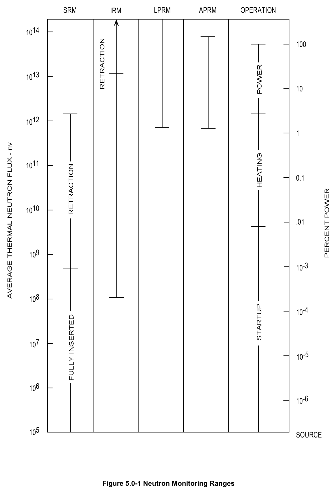
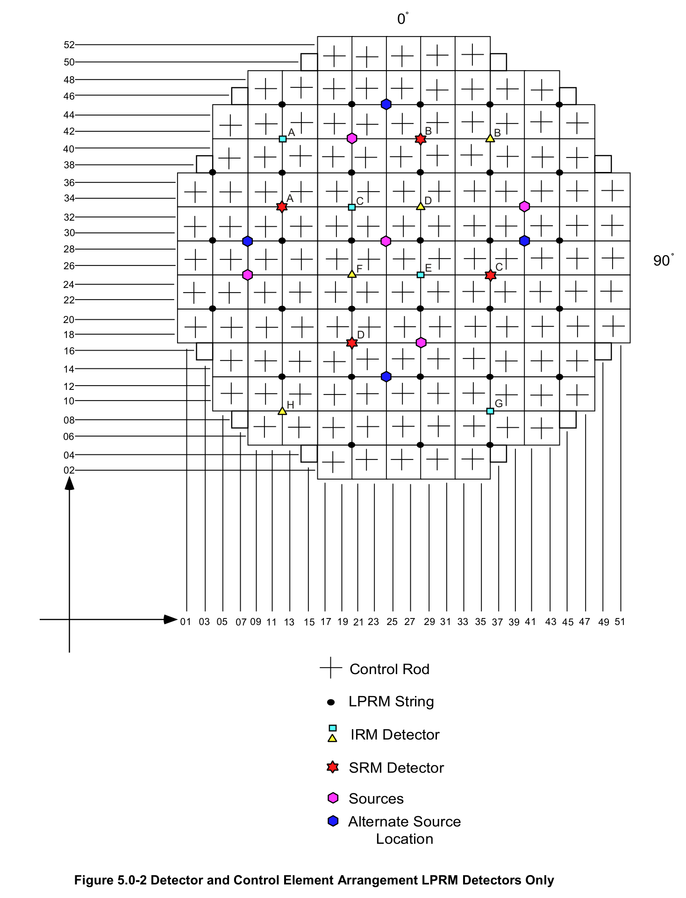
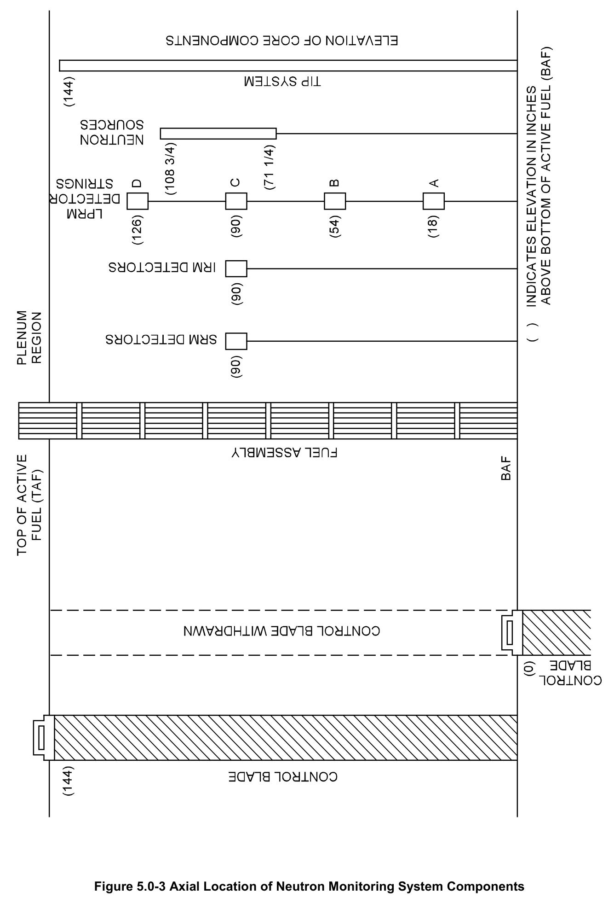
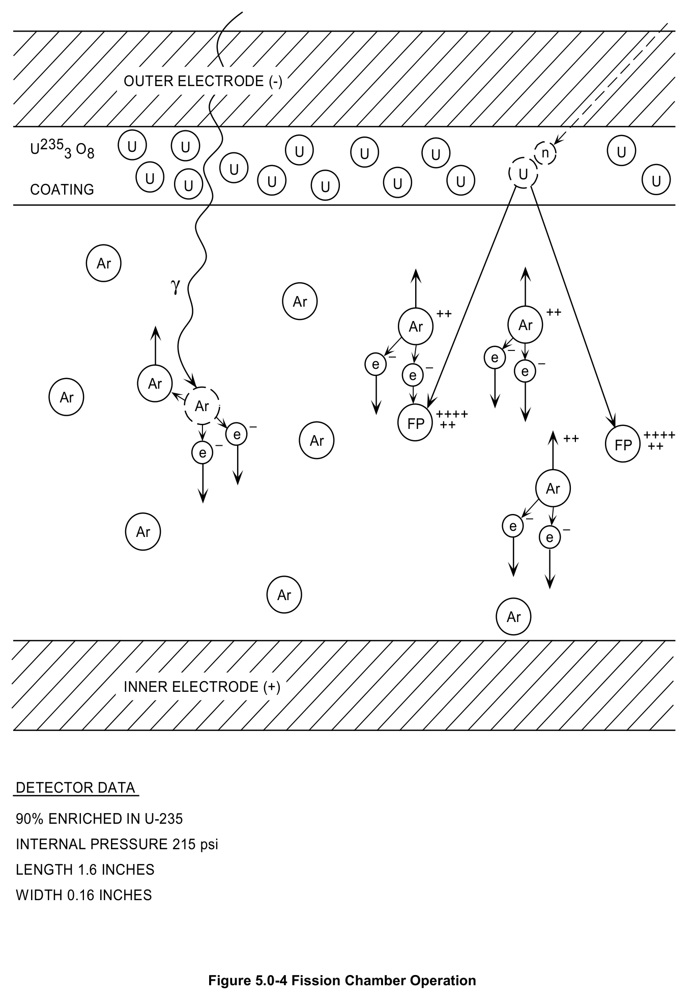
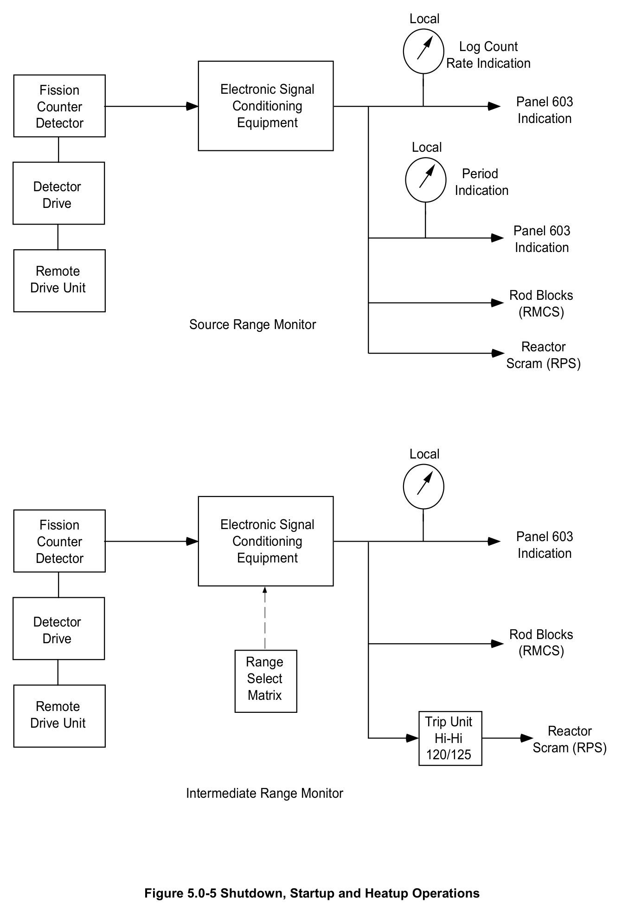
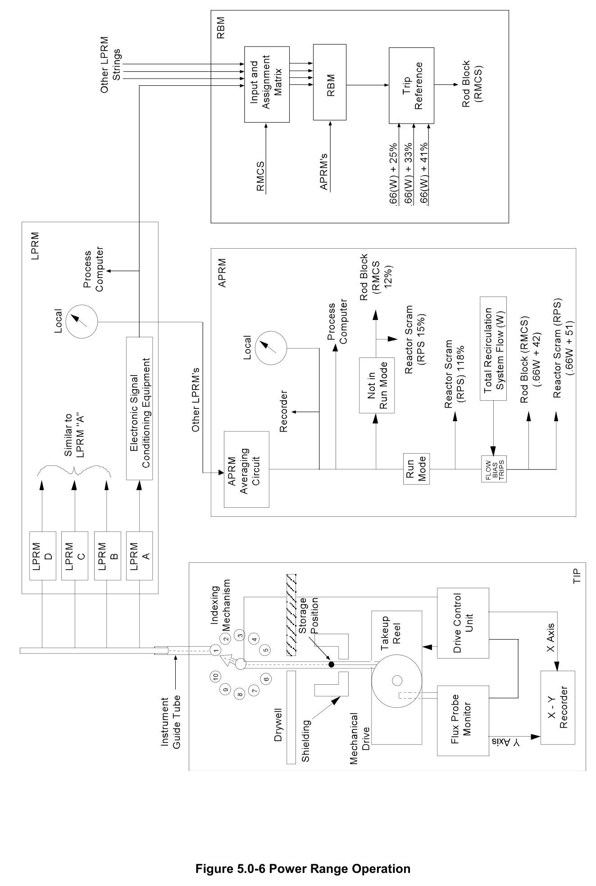

# 5.0 Neutron Monitoring Intro

> Source: `5.0_Neutron_Monitoring_Intro.pdf` (13 pages)
> GE (BWR) Systems Technology Manual — USNRC HRTD, Rev 09/11

---
<!-- p.1 -->
#### General Electric Systems Technology Manual
#### Chapter 5.0
#### Neutron Monitoring Systems
<!-- p.3 -->
TABLE OF CONTENTS

5.0 NEUTRON MONITORING SYSTEMS ..................................................................... 1

5.0.1 Source Range Monitoring System (Section 5.1) ............................................... 1

5.0.2 Intermediate Range Monitoring System (Section 5.2) ....................................... 2

5.0.3 Local Power Range Monitoring System (Section 5.3) ....................................... 2

5.0.4 Average Power Range Monitoring System (Section 5.4) .................................. 2

5.0.5 Rod Block Monitor System (Section 5.5) ........................................................... 3

5.0.6 Traversing Incore Probe System (Section 5.6) .................................................. 3

Rev 09/11 5.0-i USNRC HRTD

<!-- p.4 -->
#### LIST OF FIGURES
5.0-1 Neutron Monitoring System Ranges 5.0-2 Detector and Control Element Arrangement LPRM Detectors Only 5.0-3 Axial Location Of Neutron Monitoring System Components 5.0-4 Fission Chamber Operation 5.0-5 Shutdown, Startup and Heatup Operations 5.0-6 Power Range Operation

Rev 09/11 5.0-ii USNRC HRTD

<!-- p.5 -->
### 5.0 NEUTRON MONITORING SYSTEMS
The purposes of the Neutron Monitoring System (NMS) are to monitor reactor core neutron flux and provide indication during all modes of reactor operation, and to provide trip signals to the Reactor Protection System (RPS) and the Reactor Manual Control System (RMCS).

The safety objective of the Neutron Monitoring System is to detect conditions in the core that threaten the overall integrity of the fuel barrier due to excessive power generation and provide signals to the Reactor Protection System (RPS), so that release of radioactive material from the fuel cladding does not occur.

The power generation objective of the Neutron Monitoring System is to provide information for the efficient, expedient operation and control of the reactor. Specific power generation objectives of the Neutron Monitoring System are to detect conditions that could lead to local fuel damage and to provide signals that can be used to prevent such damage, so that plant availability is not reduced.

The Neutron Monitoring System consists of a collection of six major systems:

Source Range Monitoring (SRM) System
(Section 5.1)
Intermediate Range Monitoring (IRM) System (Section 5.2)
Local Power Range Monitoring (LPRM) System (Section 5.3)
Average Power Range Monitoring (APRM) System (Section 5.4)
Rod Block Monitoring (RBM) System
(Section 5.5)
Traversing Incore Probe (TIP) System
(Section 5.6)

Figure 5.0-1 illustrates the relationship among the NMS individual systems as a function of core power/flux and operating conditions. Figure 5.0-2 illustrates the radial distribution and Figure 5.0-3 the axial distribution of the incore detectors of these systems. Figure 5.0-4 illustrates in block diagram form the systems used during shutdown, startup, and heatup operation and Figure 5.0-5 depicts the systems used during power operation.

#### 5.0.1 Source Range Monitoring System (Section 5.1)
The Source Range Monitoring (SRM) System calculates neutron flux for display and initiation of rod withdrawal blocks from shutdown conditions to where the neutron flux overlaps the intermediate range.

The SRM System consists of four separate and independent channels located at different radial incore locations, as shown in Figure 5.0-2. Each channel consists of a miniature fission chamber detector, a detector drive assembly and the necessary

Rev 09/11 5.0-1 USNRC HRTD

<!-- p.6 -->
electronic signal conditioning equipment to process the fission detectors output for display and trip functions.

#### 5.0.2 Intermediate Range Monitoring System (Section 5.2)
The Intermediate Range Monitoring (IRM) System provides neutron flux information from the upper portion of the source range to the lower portion of the power range. In addition to monitoring neutron flux, the IRM System provides trip signals to preserve the integrity of the fuel cladding.

The IRM System consists of eight separate and independent channels. Each channel consists of a miniature fission chamber detector, a detector drive assembly and the necessary electronic signal conditioning equipment to process the fission detector output for display and trip functions. The eight IRM detectors are located in the reactor core region at different radial locations as shown in Figure 5.0-2.

#### 5.0.3 Local Power Range Monitoring System (Section 5.3)
The Local Power Range Monitoring (LPRM) System provides signals proportional to local neutron flux at various radial and axial incore locations for use by the Process Computer, Average Power Range Monitoring and Rod Block Monitoring Systems.

The LPRM System (Figure 5.0-5) consists of 124 stationary incore fission chamber detectors and electronic signal conditioning equipment. The LPRM detectors are arranged in 31 radially located assemblies, with each assembly containing four detectors spaced at three foot intervals. This type of detector arrangement provides uniform coverage of both radial and axial core flux distribution.

#### 5.0.4 Average Power Range Monitoring System (Section 5.4)
The Average Power Range Monitoring (APRM) System calculates core average neutron flux for various display and functions to preserve the integrity of the fuel cladding.

The APRM System is composed of six APRM channels (A through F). Each channel receives signals from two systems for calculations: the LPRM detectors provide local neutron flux signals for averaging, and the recirculation system provides recirculation loop flows for flux bias scram and rod block settings (Figure 5.0-5).

Each APRM channel averages selected LPRM signals to produce an average core thermal flux signal. The average core thermal flux signal is calibrated to read in percent core thermal power. The selected LPRM signals ensure a good radial and axial power distribution sampling for an accurate percent core thermal power calculation. Typically

Rev 09/11 5.0-2 USNRC HRTD

<!-- p.7 -->
a plant of the size and type discussed in this manual has six APRM channels with 17 or 14 LPRM detector inputs.

#### 5.0.5 Rod Block Monitor System (Section 5.5)
The Rod Block Monitoring (RBM) monitors local thermal power by computing local thermal flux in the vicinity of a control rod to be withdrawn, and compares it to the core average thermal power. Rod withdraw movement is then blocked if local power becomes excessive to prevent local fuel damage.

The RBM System consists of two separate and independent channels, A and B. Each channel monitors the local thermal flux during selection and movement of a control rod, and generates trip signals to actuate rod withdraw blocks when the monitored thermal flux exceeds preset limits. The RBM accomplishes this function by averaging the selected LPRM inputs (local neutron flux) and applying the resultant signal to trip circuits for comparison with flow bias trip points. As long as the selected LPRM average is less than the flow bias trip points no rod withdrawal blocks will be applied.

#### 5.0.6 Traversing Incore Probe System (Section 5.6)
The Traversing Incore Probe (TIP) System provides a means of measuring axial neutron flux over 31 fixed locations in the core. The measured axial neutron flux is used to calibrate the Local Power Range Monitor detectors and to update the process computer.

The TIP System, Figure 5.0-5, consists of four independent neutron detection units.
Each unit contains a miniature fission chamber (probe) connected to a flexible drive cable that is driven by a motor operated drive mechanism. Operation of the drive mechanism causes the fission chamber to be inserted or retracted from the reactor core, within a TIP guide tube. The four TIP machines are divided between the 31 LPRM assemblies with one common LPRM assembly connected to all four TIPs for cross calibration. The output signal from the TIP channel may be used to plot an axial flux profile on an X-Y recorder and/or provide flux distribution signal into the process computer for LPRM calibration data.

Rev 09/11 5.0-3 USNRC HRTD

<!-- p.8 -->
#### Figure 5.0-1

*Neutron Monitoring Ranges*

[Vector original (SVG, lossless): fig_5.0-1.svg](../figures/fig_5.0-1.svg)

<!-- labels/text on this figure page -->
SRM IRM LPRM APRM OPERATION
1014 100
1013 10
1012 1
1011 0.1
1010 .01
109 10-3
108 10-4
107 10-5
106 10-6
105 SOURCE
Figure 5.0-1 Neutron Monitoring Ranges

<!-- p.9 -->
#### Figure 5.0-2

*Detector and Control Element Arrangement LPRM Detectors Only*

[Vector original (SVG, lossless): fig_5.0-2.svg](../figures/fig_5.0-2.svg)

<!-- labels/text on this figure page -->
0
52
50
48 46
44 B 42 A B 40 38
36 A C D 34
32 30 28 90 26 F E C 24 22
20 D 18 16
14
12 10 G H 08
06
04 02
01 03 05 07 09 11 13 15 17 19 21 23 25 27 29 31 33 35 37 39 41 43 45 47 49 51
Control Rod
LPRM String
IRM Detector
SRM Detector
Sources Alternate Source Location
Figure 5.0-2 Detector and Control Element Arrangement LPRM Detectors Only

<!-- p.10 -->
#### Figure 5.0-3

*Axial Location of Neutron Monitoring System Components*

[Vector original (SVG, lossless): fig_5.0-3.svg](../figures/fig_5.0-3.svg)

<!-- p.11 -->
#### Figure 5.0-4

*Fission Chamber Operation*

[Vector original (SVG, lossless): fig_5.0-4.svg](../figures/fig_5.0-4.svg)

<!-- labels/text on this figure page -->
OUTER ELECTRODE (-)
U2353 O8 U U U U U U n U U U U U U U U U COATING
Ar γ Ar ++ ++ Ar Ar
e e e e Ar Ar Ar FP ++++ ++ e FP ++++ ++ Ar ++ e
Ar
e Ar e
Ar Ar
INNER ELECTRODE (+)
DETECTOR DATA
90% ENRICHED IN U-235
INTERNAL PRESSURE 215 psi
LENGTH 1.6 INCHES
WIDTH 0.16 INCHES
Figure 5.0-4 Fission Chamber Operation

<!-- p.12 -->
#### Figure 5.0-5

*Shutdown, Startup and Heatup Operations*

[Vector original (SVG, lossless): fig_5.0-5.svg](../figures/fig_5.0-5.svg)

<!-- labels/text on this figure page -->
Local
Log Count Rate Indication
Electronic Signal Fission Panel 603 Conditioning Counter Indication Equipment Detector
Local
Period Detector Indication Drive
Panel 603 Indication
Remote Drive Unit Rod Blocks
(RMCS)
Source Range Monitor
Reactor Scram (RPS)
Local
Electronic Signal Fission Panel 603 Conditioning Counter Indication Equipment Detector
Detector Rod Blocks Drive
(RMCS)
Range Select Matrix Remote Trip Unit Drive Unit Reactor Hi-Hi Scram (RPS)
120/125
Intermediate Range Monitor
Figure 5.0-5 Shutdown, Startup and Heatup Operations

<!-- p.13 -->
#### Figure 5.0-6

*Power Range Operation*

[Vector original (SVG, lossless): fig_5.0-6.svg](../figures/fig_5.0-6.svg)

