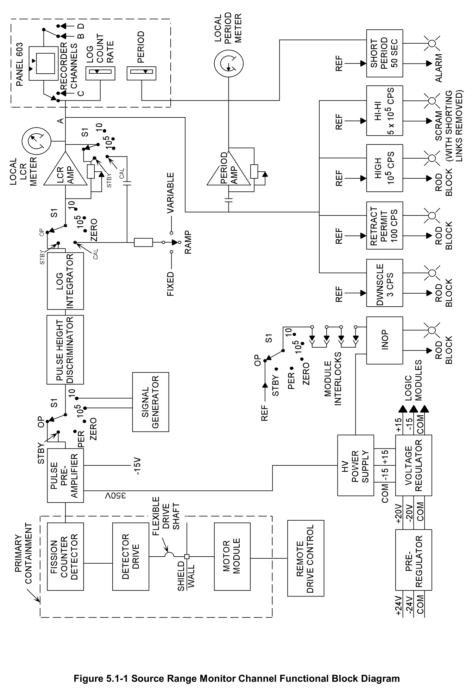
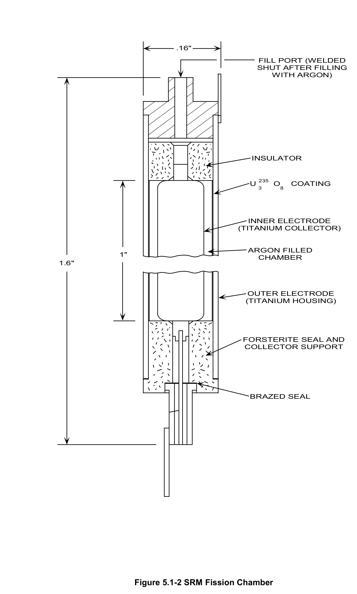
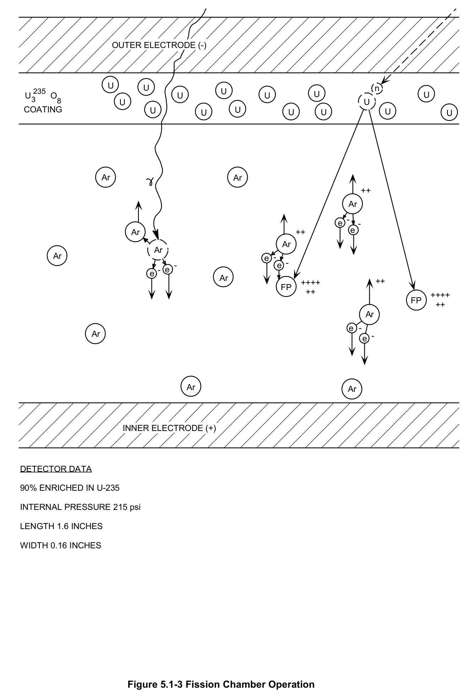
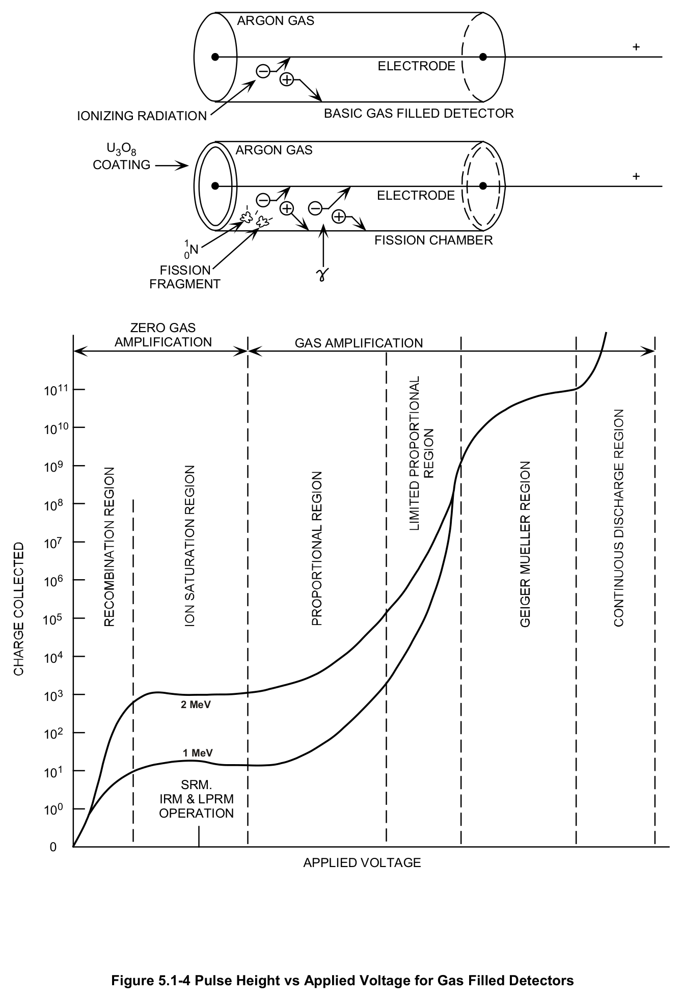
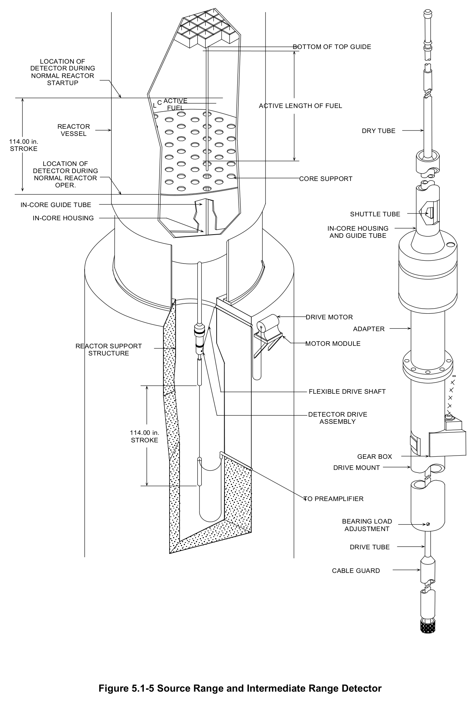
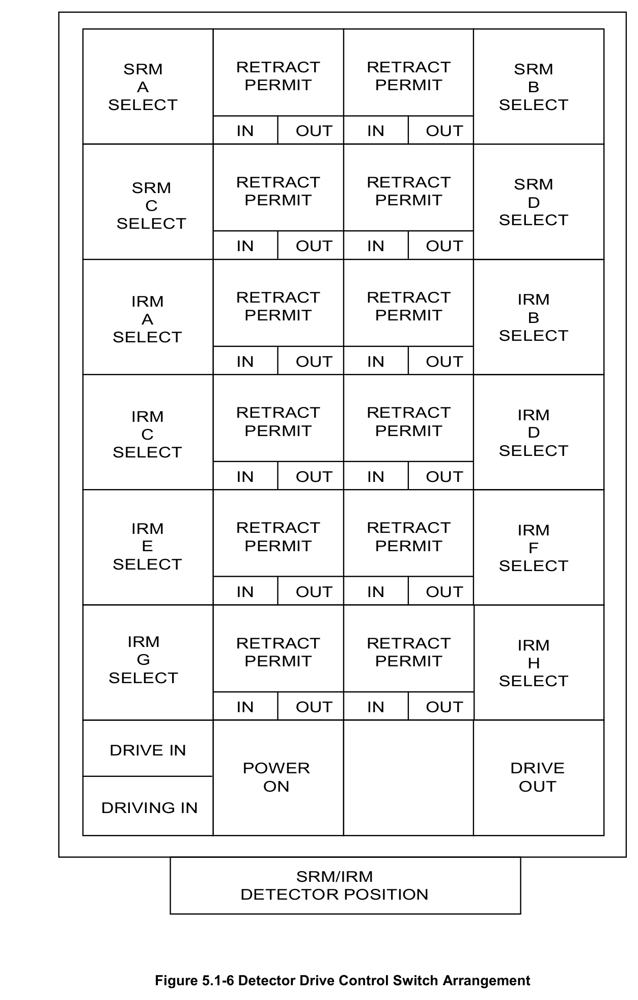
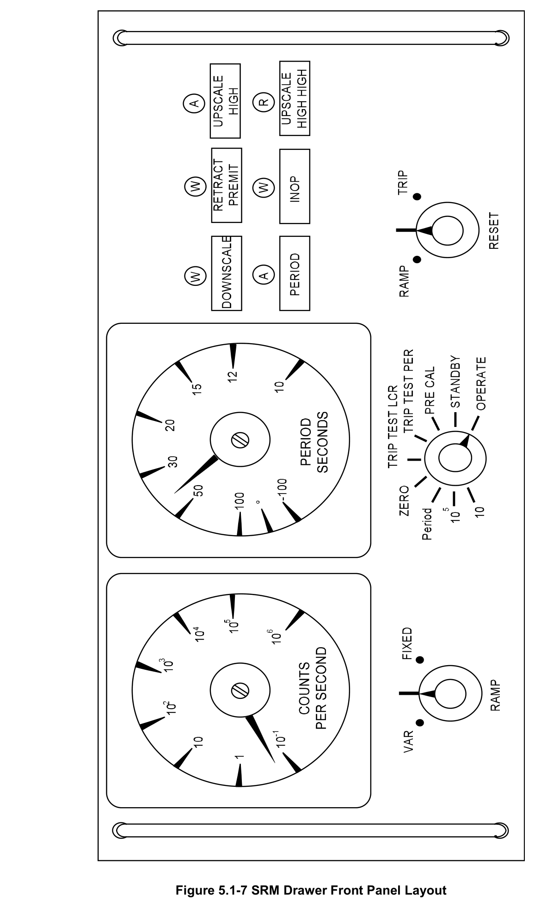
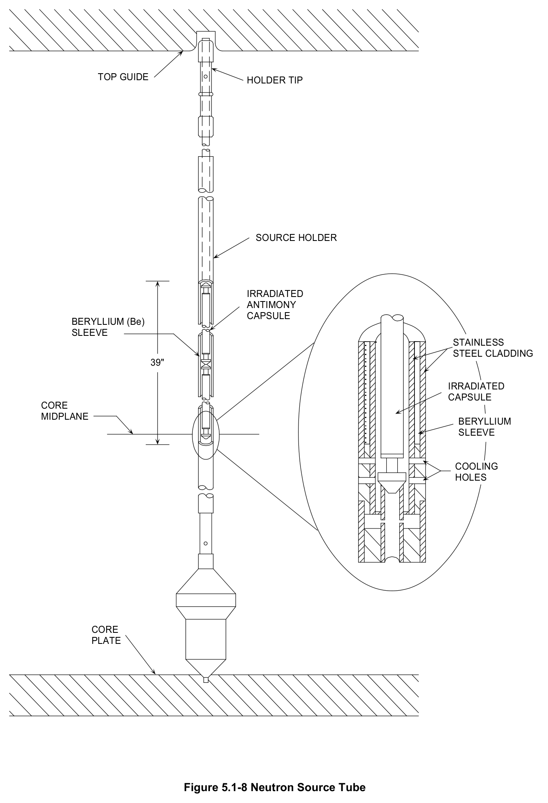
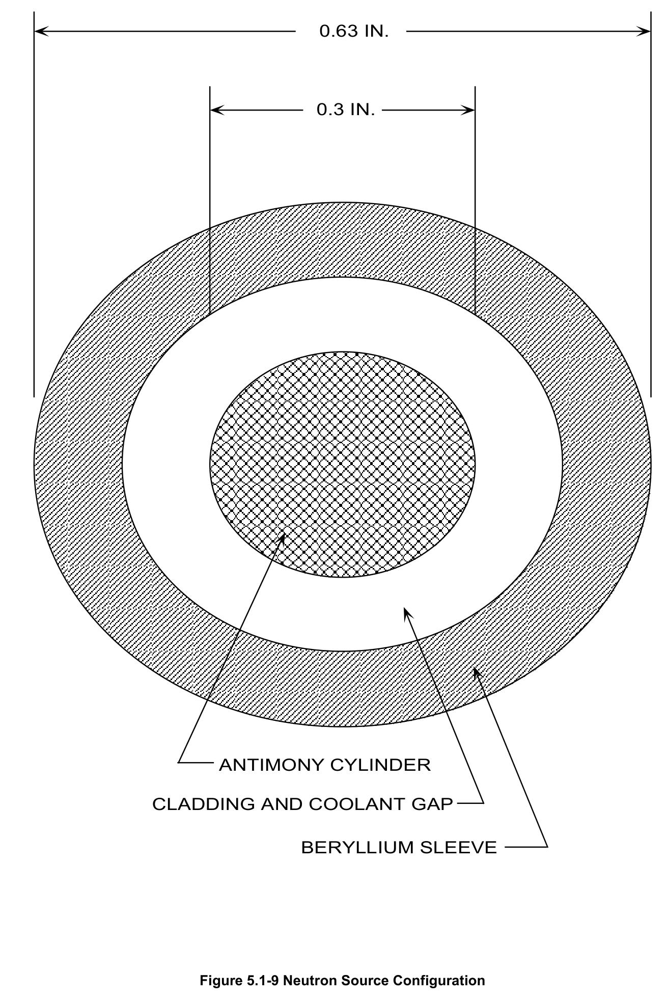
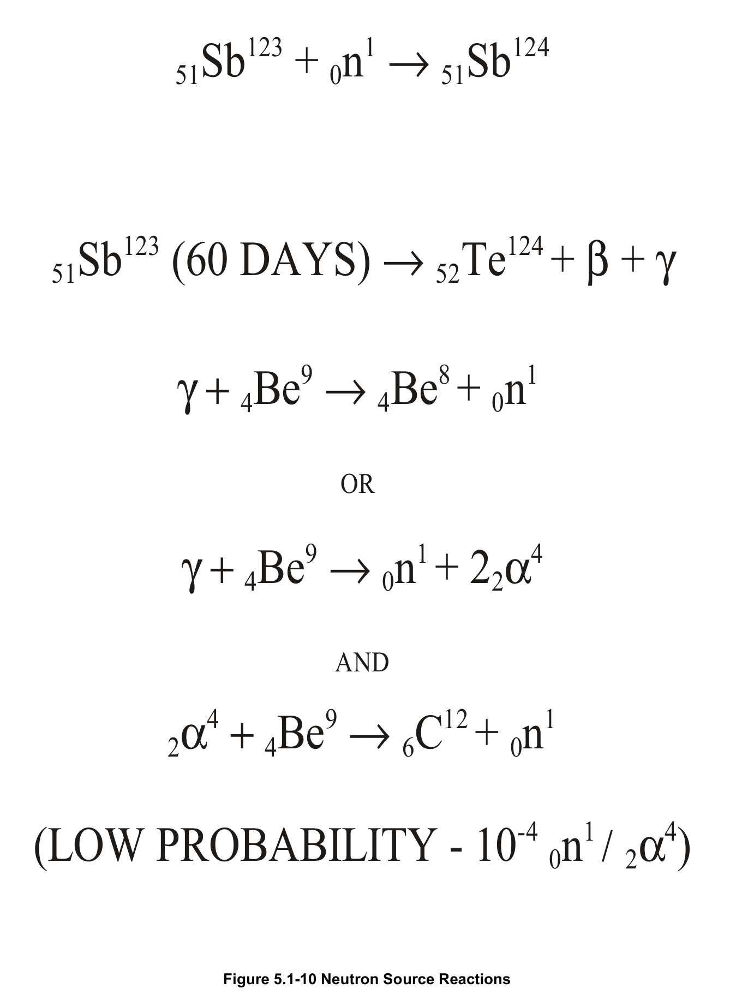

# 5.1 Source Range

> Source: `5.1_Source_Range.pdf` (28 pages)
> GE (BWR) Systems Technology Manual — USNRC HRTD, Rev 09/11

---
<!-- p.1 -->
#### General Electric Systems Technology Manual
#### Chapter 5.1
#### Source Range Monitor System
<!-- p.3 -->
TABLE OF CONTENTS

5.1 SOURCE RANGE MONITOR SYSTEM ................................................................... 1

5.1.1 Introduction ........................................................................................................ 1

5.1.2 Component Description ...................................................................................... 2

5.1.2.1 Fission Chamber Detector ........................................................................... 2

5.1.2.2 Detector Insert and Retract Mechanism ...................................................... 2

5.1.2.3 SRM Circuitry .............................................................................................. 3

5.1.3 System Features and Interfaces ........................................................................ 5

5.1.3.1 Detector Operation ...................................................................................... 5

5.1.3.2 Rod Blocks .................................................................................................. 7

5.1.3.3 Scram .......................................................................................................... 7

5.1.3.4 SRM Drawers .............................................................................................. 8

5.1.3.5 Initial Fuel Loading ...................................................................................... 8

5.1.3.6 Source Neutrons ......................................................................................... 9

5.1.3.7 System Interfaces ...................................................................................... 11

5.1.4 Summary .......................................................................................................... 11

LIST OF TABLES

5.1-1 SRM INTERLOCKS AND TRIPS ....................................................................... 13

Rev 09/11 5.1-i USNRC HRTD

<!-- p.4 -->
#### LIST OF FIGURES
5.1-1 Source Range Monitoring Channel Functional Block Diagram 5.1-2 SRM Fission Chamber 5.1-3 Fission Chamber Operation 5.1-4 Pulse Height vs Applied Voltage for Gas Filled Detectors 5.1-5 Source Range and Intermediate Range Detector 5.1-6 Detector Drive Control Switch Arrangement 5.1-7 SRM Drawer Front Panel Layout 5.1-8 Neutron Source Tube 5.1-9 Neutron Source Configuration 5.1-10 Neutron Source Reactions

Rev 09/11 5.1-ii USNRC HRTD

<!-- p.5 -->
### 5.1 SOURCE RANGE MONITOR SYSTEM
Learning Objectives:

1. Recognize the purposes of the Source Range Monitoring (SRM) System.

2. Recognize the purpose, function and operation of the following SRM major components:
a. Fission Chamber Detector b. Log Count Rate Meter c. Period Meter d. Trip Units e. Bypass Switch f. Detector Insert and Retract Mechanism

3. Recognize how the SRM system discriminates gamma flux from neutron flux.

4. Recognize the plant response to the following SRM signals, when the trips are bypassed and the reason for the trips:
a. Upscale High Trip b. Upscale High Alarm c. Downscale d. Inoperable SRM e. Period Alarm f. Retract Not Permitted

5. Recognize how the Source Range Monitoring system interfaces with the following systems:
a. Reactor Protection System (Section 7.3)
b. Reactor Manual Control System (Section 7.1)
c. Intermediate Range Monitoring System (Section 5.2)

#### 5.1.1 Introduction
A purpose of the SRM system is to monitor neutron flux for display. The SRM system also provides control rod blocks and reactor scrams. The SRM is operational from shutdown conditions up through an overlap with the Intermediate Range Monitor (IRM).
The functional classification of the SRM system is that of a power generation system.

The SRM system consists of four channels. Each channel monitors and calculates local neutron flux levels within the core. Each channel consists of a fission chamber detector, a detector drive assembly and the necessary electronic equipment for display and trip functions.

Rev 09/11 5.1-1 USNRC HRTD

<!-- p.6 -->
The electronic equipment consists of signal conditioning pulse preamplifiers located in the reactor building and gamma discriminators, amplifiers, meters, recorders and trip units located in the control room. The control room meters display reactor power as count rate and reactor period in seconds. The trip units provide rod withdraw block signals to prevent outward movement unless the proper SRM detector position and count rate signals are present. The trip units can also provide scram signals when in service during refueling.

#### 5.1.2 Component Description
The major components of the SRM system are shown in Figure 5.1-1 and are discussed in the following paragraphs.

##### 5.1.2.1 Fission Chamber Detector
The neutron flux is detected by four fission chambers (detectors) arranged radially and axially as shown in Figures 5.0-2 and 5.0-3. The detectors provide an output that consists of energy pulses. The output pulse rate and pulse energy are dependent upon the events causing the pulses.

The SRM fission chambers (Figures 5.1-2 and 5.1-3) are approximately one inch in length and 0.16 inches in diameter. The case and collector are fabricated from titanium and insulated from one another by a non-conducting material called forsterite. The inner surface of the casing is coated with highly enriched (90% U235) uranium oxide
(U308) to a thickness of several mils. Total weight of U308 in the tube is approximately 6.00 milligrams. The inner volume between the casing and the center electrode is pressurized with argon, an inert noble gas, to 14.5 atmospheres (213 psia).

##### 5.1.2.2 Detector Insert and Retract Mechanism
The detector insert and retract mechanism (Figure 5.1-5) is used to position each SRM detector within a dry tube which extends from the bottom of the reactor vessel up into the reactor core. The mechanism allows the detector to be positioned at any level from 18 inches above the core midplane to 30 inches below the bottom of active fuel. When the detector is being used during the initial stages of reactor startup, it is fully inserted.
As the reactor power level is increased, the detector may be retracted. This prolongs the life of the detector by decreasing the detector's neutron exposure.

The complete insert and retract system consists of the mechanical components required to drive each of the SRM detectors and the switching circuits which allow the operator to control the insertion and retraction of each detector. The detector is movable through 120 inches of travel, at a speed of 36 inches per minute.

Rev 09/11 5.1-2 USNRC HRTD

<!-- p.7 -->
The driving components of the insert and retract mechanism (Figure 5.1-5) consist of a motor module, a flexible drive shaft, and a detector drive assembly. The driving power is supplied by an electric motor located in the motor module. The motor module output shaft is coupled to the flexible drive shaft which transmits the output power from the motor module to the gear box of the detector drive assembly. A sprocket gear, mounted on the gear box output shaft, drives a machined drive tube.

The insert and retract mechanism is controlled from the Panel 603 in the control room.
The detector can be stopped at any position within its full range of motion, but only the "Full In" and "Full Out" positions have indication, Figure 5.1-6.

##### 5.1.2.3 SRM Circuitry
The SRM circuitry, Figure 5.1-1, performs a number of functions. The circuit will amplify the pulses to gain a high signal to noise ratio prior to transmission to the control room.
It then eliminates the gamma pulses while passing the neutron event pulses. It then conditions the signal to display seven decades of power and develops alarms, rod withdraw blocks and scrams to ensure safe, controlled reactor operation.

###### 5.1.2.3.1 Pulse Preamplifier
The output pulses of each SRM detector are applied by a pulse preamplifier which provides current amplification and impedance matching for the cable used to connect the preamplifier to the remainder of the SRM circuitry.

The pulse preamplifiers are located immediately outside of the drywell and as close to the detectors as possible. Close placement of the pulse preamplifier ensures amplification of the detector output pulse and not cable noise. Without the amplification of the very small detector pulse signal, the signal would be indistinguishable from noise.
Even with the amplification, arc welding in the vicinity of the cable can cause erroneous signals to be received in the control room.

###### 5.1.2.3.2 Pulse Height Discriminator
The pulse height discriminator eliminates the gamma event pulses while passing the pulses caused by the neutron events. By eliminating the gamma pulses, the remaining pulses will be indicative of the thermal flux. The pulse height discriminator accomplishes this by means of an adjustable threshold pulse height. Most pulses from fission fragments exceed the threshold setting and are passed, while most pulses from gammas are lower in magnitude and are blocked. The output signals from the pulse height discriminator are then input to the logarithmic integrator.

Rev 09/11 5.1-3 USNRC HRTD

<!-- p.8 -->
###### 5.1.2.3.3 Logarithmic Integrator
The logarithmic integrator takes the output signal from the pulse height discriminator and produces a DC current output which is directly proportional to the common logarithm of the count rate.

Because of the wide range of neutron flux values encountered during reactor startup operation, the neutron count rate level is displayed on a logarithmic scale. It would be difficult to display the seven decades of the source range (10-1 cps to 106 cps) on a conventional linear meter.

The logarithmic scaling provides indication with an equal amount of deflection for each decade. This indication enables the operator to observe trends in count rate with a fair amount of accuracy. A linear scale with seven decades of information would be impossible to read in the lower regions unless the indicating meter was extremely large in size.

###### 5.1.2.3.4 Log Count Rate Amplifier
The Log Count Rate (LCR) amplifier provides a DC voltage output suitable for driving the local and remote meters. The LCR amplifier output is also applied to the period circuit and to four of the six trip circuits.

###### 5.1.2.3.5 Period Circuit
During low power operation, the rate at which the neutron count rate increases is of importance to the operator. Since neutron flux is proportional to reactor power, the rate at which neutron flux is increasing is the same as the rate that reactor power is increasing. For example, the SRM count rate increasing from 1 x 103cps to 1 x 104cps indicates that reactor power has increased by a factor of 10.

The time rate of change of power is called the reactor period and is defined as the amount of time required for power to change by a factor of "e" (where "e" is the natural log base, 2.71828…). Knowledge of the reactor period enables the operator to monitor and effectively control the rate of change of power.

The circuit in the SRM channel which provides a voltage analog of reactor period is a differentiating period amplifier that receives input from the LCR amp. The output of the period circuit is inversely proportional to the rate of change of the input count rate. The faster the rate of change, the smaller the reactor period. The output from the period circuit is directed to local and remote meters and displayed in seconds.

Rev 09/11 5.1-4 USNRC HRTD

<!-- p.9 -->
If the pulse rate starts increasing, the meter (Figure 5.1-7) deflects in the clockwise direction indicating a shorter reactor period. Conversely, if the pulse rate decreases, the period meter deflects in the counter clockwise direction indicating a negative period.

###### 5.1.2.3.6 Trip Units
The trip units provide alarm and protective functions in the form of rod blocks and/or scrams when the input signal exceeds a trip setpoint. There are three dual trip units in each SRM channel. Each dual trip unit contains two independent trip circuits. One of the trip circuits monitors when the drawer is inoperative. Two monitor downscale count rate level trips. Two monitor upscale count rate level trips and the sixth circuit monitors reactor period.

###### 5.1.2.3.7 Output Meters
Each SRM channel is equipped with log count rate and period meters which provide information to the operator at both the P-603 panel and at the SRM instrument drawers
(Figure 5.1-7). In addition, two of the four SRM channels' count rates ("A or C" and "B or D") are selected as input to a recorder on the P-603 panel (as shown in Figure 5.1-1).

###### 5.1.2.3.8 Bypass
A four position bypass switch, located on the P-603 panel, allows the operator to bypass the trip functions of one of the four SRM channels during operation for maintenance or in case of a failure.

The SRM trips are automatically bypassed when the reactor mode switch is in the "RUN" position or when (depending upon which function) power has increased sufficiently on the IRMs.

#### 5.1.3 System Features and Interfaces
A short discussion of system features and interfaces this system has with other plant systems is given in the paragraphs which follow.

##### 5.1.3.1 Detector Operation
Under normal operating conditions, a high voltage (about 350 VDC) is applied between the inner electrode and the case (outer electrode). This potential causes the inner electrode to be positive with respect to the outer electrode (Figure 5.1-3). When ionizing radiation enters the cylinder it creates a finite number of ion pairs in the argon gas. Ions are formed as a result of high energy particles stripping away electrons from the argon atoms. Under the influence of the high voltage applied, the positive ions

Rev 09/11 5.1-5 USNRC HRTD

<!-- p.10 -->
migrate toward the case and the negative ions (primarily electrons) migrate toward the center/positive electrode. The result is that some of the electrons and positive ions are collected and are seen in the detector circuitry as small electrical pulses.

The amount of charge and thus the magnitude of the electrical pulse is dependent on the voltage applied to the detector. Higher voltages result in larger forces to the ionized gas atoms. This will cause them to accelerate to the electrodes faster than at a lower voltage. Figure 5.1-4 is a graph of the collected charge, given an exposure to an amount of ionizing radiation, over a full range of voltage.

If the voltage were low there would be only a small quantity of charge collected at each electrode. The ion pairs would recombine before they reach the electrodes (Figure 5.1- 4). With increasing voltage, the ions move more rapidly with less recombination resulting in a larger charge being collected. Since the amount of charge collected is susceptible to variations in voltage the Recombination Region is of little use in neutron fission detection instruments.

In the Ion Saturation Region, if the applied voltage were continually increased, no additional charge would be collected. This is because all of the ion pairs that are formed are being collected. The charge collected is a function of the number of ion pairs formed in the gas. Different types of nuclear radiation have different specific ionization properties. The number of ion pairs formed by a particular type of radiation passing through a medium may be many times greater than those formed by another type of radiation passing through the same medium. This is the reason for the upper and lower curves in Figure 5.1-4. The upper curve shows the pulse collected for an incident radiation of 2 MeV while the lower curve shows the pulse of a 1 MeV. This region of the curve is termed the Ion Saturation Region or the Ionization Region. Since the pulse size is dependent upon the energy of the radiation and not susceptible to voltage variations, it has been selected for operation of incore nuclear instrumentation.

Neutrons are of primary interest in the incore instruments. However, since they have no charge, they have an extremely low probability of ionizing the argon gas. To better detect neutrons, the fission chamber is coated on the inner surface with a uranium oxide compound (U308). Thermal neutrons entering the detector have finite probability of causing the U235 atoms to fission. The result is that two or more high energy, charged fission fragments moving in the argon gas within the detector causing ionization of the gas (Figure 5.1-3). The ions are collected, and a small electrical charge pulse can be observed.

Ionization of the argon gas may also be caused by gamma radiation. The amplitude of the pulse is proportional to the number of ion pairs produced and is a function of the energy of the ionizing radiation. The fission fragments cause a significantly larger pulse

Rev 09/11 5.1-6 USNRC HRTD

<!-- p.11 -->
than the gamma radiation. This results in neutron pulses being significantly larger than the gamma pulses. This characteristic allows the gamma pulses to be filtered.

When the neutron flux reaches the saturation point of the detectors, they are retracted from the core. The detector retraction increases the detector life and extends the range of the monitor. With the detectors retracted and the reactor operating at normal power levels, the SRM count rate indicates full scale. The period indication shows neutron activity, and any sudden increase or decrease of neutron activity in the reactor is reflected by the SRM period even though the SRMs are not measuring the full neutron activity of the core.

##### 5.1.3.2 Rod Blocks
During startup, the SRMs provide rod block signals to the Reactor Manual Control System (RMCS) to prevent rod withdrawal during certain conditions. These conditions along with the appropriate bypasses are listed on Table 5.1-1.

Rod blocks are also generated if any SRM detector is not at its fully inserted position with the SRM's count rate below 100 cps (Retract Level Permissive). This rod block is automatically bypassed when all IRM range switches are on range 3 or above. This assures no control rod may be withdrawn unless the SRM detectors are inserted far enough into the core to sufficiently indicate neutron flux or power level is high enough to be monitored by the IRMs.

The downscale rod block of 3 cps assures no control rod is withdrawn unless the count rate sufficient to distinguish it from stray electronic noise. This rod block is automatically bypassed when its associated IRM range switches are on range 3 or above.

The upscale rod block of 1 x 105 cps assures no control rod is withdrawn without proper neutron flux indications. This rod block is automatically bypassed when its associated IRM range switches are on range 8 or above.

The SRM inoperative rod block assures that no control rod is withdrawn unless proper neutron monitoring capability is available (i.e., all SRM channels are in service or properly bypassed).

##### 5.1.3.3 Scram
During fuel loading operations, the SRMs can provide scram signals to the Reactor Protection System (RPS). The SRM circuitry (when the shorting links are removed)
provides a high-high and inoperative trip scram signals. These conditions along with the appropriate bypasses are listed on Table 5.1-1.

Rev 09/11 5.1-7 USNRC HRTD

<!-- p.12 -->
During some reactor plant conditions such as performance of core alterations (e.g., fuel loading), it is desirable to scram the reactor if any one signal from any of the Neutron Monitoring System (NMS) instrumentation indicates an abnormally high power level
(high neutron flux), or inoperable conditions, including signals from the Source Range Monitor (SRM) System. This extra precaution will protect personnel by preventing an inadvertent power excursion when the reactor vessel head has been removed. In order to affect this mode of operation of the NMS logic, a set of shorting links which normally disable the SRM scram function, are removed from the RPS logic circuit. Removal of the shorting links reconfigures the RPS circuitry to initiate a full reactor scram on any one of eighteen NMS signals. The NMS portion of the RPS circuitry is in a noncoincident mode of operation when the shorting links have been removed.

##### 5.1.3.4 SRM Drawers
The four SRM drawers, (Figure 5.1-7), are located in segregated metal panels in the control room. Each drawer contains the following:
• a pulse height discriminator,
• a logarithmic integrator,
• a log count rate amplifier,
• a period circuit,
• a trip units,
• a count rate meter,
• a reactor period meter,
• a mode switch,
• a ramp switch, and
• a reset switch.

The mode switch has nine positions which allow for operating mode changes in an SRM channel for maintenance or calibration. The ramp switch supplies signals for channel calibration. The reset switch is used to reset the seal in lights for the individual trip units and to reset the ramp generator during period calibration. The alarm lights mounted on the front of each SRM drawer seal in when illuminated at preset condition. Even if the condition clears, the light remains illuminated until manually reset.

##### 5.1.3.5 Initial Fuel Loading
To ensure adequate monitoring of the neutron flux level during fuel loading operation, a neutron detector device which can be placed at various radial locations in the core may be required.

As the fuel is loaded into the reactor the core size increases. The incore SRM detectors may not be sufficiently sensitive enough or not be in the proper location to adequately monitor the neutron flux levels. Under these conditions, four movable detectors called

Rev 09/11 5.1-8 USNRC HRTD

<!-- p.13 -->
Fuel Loading Chambers (FLCs) or dunking chambers (as they are called) may be substituted for the normal SRM detectors. The FLCs are mounted inside dummy fuel assemblies to facilitate movement with standard fuel handling equipment. The output from the FLCs can be routed to the SRM preamplifiers via connections in place on the refueling floor. The FLC outputs will replace the normal SRM detector input.

The dunking chamber or FLC is different from the fission chamber used in the standard SRM detector. Since neutron levels are very low, more sensitivity is required. More sensitivity is designed into the FLC by providing a larger detector surface area, utilizing a boron-10 (5B10) coating and operating the FLC in the proportional region of radiation detector operation.

As fuel is loaded into the reactor, neutron flux level increases because of subcritical multiplication. When the normal SRM detectors are reading at least 3 cps, the fuel loading chambers can be removed and normal SRM detectors re-connected to their channels and placed back in service.

##### 5.1.3.6 Source Neutrons
After sufficient power operation there will be neutrons available from various sources other than thermal fission in the reactor. They make it possible to see the approach to criticality on the SRMs. A power (neutron flux) increase can be seen on the SRMs as the control rods are withdrawn. If there were no sources present, the SRMs would not be sensitive enough to detect a positive, increasing period until the power was significantly higher. By the time the power was high enough to indicate on the SRMs, the period could be very short and a startup accident could occur.

###### 5.1.3.6.1 Natural Sources of Neutrons
Natural sources include spontaneous fission of uranium and plutonium, the photoneutron source

2 1 1 γ + H → H + n , 1 1 0

and an alpha reaction with oxygen-18

4 18 21 1 α + O → Ne + n .
2 8 10 0

These sources are insignificant or nonexistent for a new core's initial startup so additional sources must be installed in the core.

Rev 09/11 5.1-9 USNRC HRTD

<!-- p.14 -->
###### 5.1.3.6.2 Installed Sources
The most common operational source used is an irradiated antimony

Sb 123 n 1 Sb 124 , + → 51 0 51

source in a beryllium sleeve.

The Sb124 will produce a high energy gamma

Sb 124 Te 124 − ⎯ ⎯ ⎯ ⎯ → + β + γ 52 60 2. Days 51

which is capable of initiating beryllium-neutron and alpha-beryllium-neutron reactions:

Be 9 2 1 n 1 and 4 Be 9 C 12 n 1 γ + → α + α + → + 4 2 0 2 4 6 0

Due to the timeliness of the antimony decay (60.2 days), a high degree of accuracy must be incorporated into the order and delivery dates of the irradiated antimony source. Other sources can be Po-Be, Ra-Be, Pu-Be, or Am-Be.

Five neutron sources are initially installed in the reactor core to provide a background level for the SRM channels. Without the background neutron level, the actual neutron count rate would be below the indicating range of the SRMs. In this condition, the reactor could be taken critical without any indication of neutron level. Should positive reactivity continue to be added in this situation, excessively short reactor periods could result without the operator knowing. To preclude this unsafe condition, arising from a reactor startup below source range indication, the neutron sources are installed in the initial core. These sources are mounted in tubes, shown in Figure 5.1-8, between the core plate and top guide.

The antimony-beryllium source, shown in Figure 5.1-9, is two antimony pins encapsulated in stainless steel within a beryllium sleeve. The source neutron reactions are shown in Figure 5.1-10. This source has a 60 day half life and is kept irradiated by core flux during normal operations. Core source locations are shown on Figure 5.0-2.

After a reactor has been operated for an entire cycle the startup sources are no longer needed. In addition, the source holders are not designed for multiple cycles at high exposures. Therefore, the installed sources are usually removed at the end of first full cycle of operation. Normally there is sufficient neutron population from the exposed fuel assemblies to maintain SRM count rates above 3 counts per second.

Rev 09/11 5.1-10 USNRC HRTD

<!-- p.15 -->
##### 5.1.3.7 System Interfaces
The interfaces this system has with other plant systems are discussed in the paragraphs which follow.

Reactor Protection System (Section 7.3)

The Reactor Protection System (RPS) receives SRM detector signals (when the shorting links are removed) in order to generate a scram.

Reactor Manual Control System (Section 7.1)

The Reactor Manual Control System receives input signals from the SRM trip units to generate the rod blocks listed in Table 5.1-1.

Intermediate Range Monitoring System (Section 5.2)

The Intermediate Range Monitoring (IRM) System provides automatic bypassing of SRM rod blocks based on IRM range switch position.

Emergency AC Power System (Section 9.2)

The Emergency AC Power System supplies power to operate the SRM detector drive mechanism.

DC Power System (Section 9.4)

The 24 volt DC Power System provides power to the SRM System.

#### 5.1.4 Summary
Purpose - To monitor neutron flux for display. To provide control rod block and reactor scram signals.

Components - Detectors; detector drive mechanisms; pulse pre-amplifiers; pulse height discriminators; log integrator; log count rate amplifier; period circuit; trip units; readout equipment.

System Interfaces - Reactor Manual Control System; Reactor Protection System;
Intermediate Range Monitoring System; Standby Auxiliary Power System.

Rev 09/11 5.1-11 USNRC HRTD

<!-- p.16 -->
Rev 09/11 5.1-12 USNRC HRTD

<!-- p.17 -->
#### TABLE 5.1-1 SRM Interlocks and Trips
ALARM SRM CHASSIS P-603 PANEL ANNUNCIATOR ACTION AUTO BYPASS OR TRIP SETPOINT INDICATION (2) INDICATION (2)
(1)

Scram when SRM Bypassed When UPSCALE Trip UPSCALE Trip (A- Shorting Upscale ≤5 x 105 cps Shorting Links
(Red Light) (A-D) D)
Links
(High-High)
Installed Removed

Both associated(3)
SRM Upscale or SRM Rod IRMs above range 7;
UPSCALE Alarm or UPSCALE Alarm or INOP ≤ 1 x 105 cps Upscale Withdrawal or SRM Bypassed or INOP (A-D) INOP (A-D) Rod Withdrawal
(High)
Block Mode SW in RUN Block

Both associated IRMs SRM Rod above range 2; or SRM DOWNSCALE DOWNSCALE (A- DOWNSCALE Withdrawal SRM Bypassed or ≥ 3 cps Downscale
(White Light) (A-D) D) Rod Withdrawal Block Mode SW in RUN Block

Rod Both associated(3)
Withdrawal IRMs above range 7;
Block or SRM Bypassed or SRM Upscale or Mode SW in RUN INOP (White Light) UPSCALE Alarm or INOP SRM INOP (4)
(A-D) INOP (A-D) Rod Withdrawal Scram when Block shorting Bypassed when links shorting links installed removed

PERIOD PERIOD SRM Period >50 sec (Amber Light) (Amber Light) SRM PERIOD
(A-D) (A-D)

SRM DETECTOR RETRACT Both associated IRMs RETRACT RETRACT NOT Rod PERMIT Retract Not above range 2; or >100 cps PERMIT PERMITTED Withdrawal
(Green Light) (A- Permitted SRM Bypassed
(A-D) Rod Withdrawal Block D)
or Mode SW in RUN Block

Bypasses all trip SRM Bypass BYPASSED BYPASS functions of SRM Bypassed Switch (5) (White Light) (A-D)
when bypassed.

Notes for Table 5.1-1:

1. All trips automatically reset when the trip condition is cleared. Trip indicators on the SRM chassis must be manually cleared.

2. Panel 603 trip status lights and annunciators are bypassed when the reactor mode switch is in the run position.

3. Associated IRMs and APRMs:
SRM CH. IRM CH. APRM CH.
A A, E A,E B B, F B,F C C, G C,E D D, H D,F

Rev 09/11 5.1-13 USNRC HRTD

<!-- p.18 -->
4. Produced by: (a) SRM mode switch not in operate, (b) High voltage low (<95% normal), (c) Module unplugged

5. Only one SRM channel can be bypassed using the bypass switch.

Rev 09/11 5.1-14 USNRC HRTD

<!-- p.19 -->
#### Figure 5.1-1

*Source Range Monitor Channel Functional Block Diagram*

[Vector original (SVG, lossless): fig_5.1-1.svg](../figures/fig_5.1-1.svg)

<!-- p.20 -->
#### Figure 5.1-2

*SRM Fission Chamber*

[Vector original (SVG, lossless): fig_5.1-2.svg](../figures/fig_5.1-2.svg)

<!-- labels/text on this figure page -->
.16"
FILL PORT (WELDED SHUT AFTER FILLING WITH ARGON)
INSULATOR
U 235 O8 COATING 3
INNER ELECTRODE
(TITANIUM COLLECTOR)
ARGON FILLED 1" CHAMBER
1.6"
OUTER ELECTRODE
(TITANIUM HOUSING)
FORSTERITE SEAL AND COLLECTOR SUPPORT
BRAZED SEAL
Figure 5.1-2 SRM Fission Chamber

<!-- p.21 -->
#### Figure 5.1-3

*Fission Chamber Operation*

[Vector original (SVG, lossless): fig_5.1-3.svg](../figures/fig_5.1-3.svg)

<!-- labels/text on this figure page -->
OUTER ELECTRODE (-)
U U n U 235 O8 U U U U U 3 U U COATING U U U U U U U
Ar Ar ++ Ar
e e Ar ++ Ar Ar Ar
- e
e
-
- e e Ar ++++ ++ FP ++ ++++ FP ++ Ar e - Ar
e
Ar Ar
INNER ELECTRODE (+)
DETECTOR DATA
90% ENRICHED IN U-235
INTERNAL PRESSURE 215 psi
LENGTH 1.6 INCHES
WIDTH 0.16 INCHES
Figure 5.1-3 Fission Chamber Operation

<!-- p.22 -->
#### Figure 5.1-4

*Pulse Height vs Applied Voltage for Gas Filled Detectors*

[Vector original (SVG, lossless): fig_5.1-4.svg](../figures/fig_5.1-4.svg)

<!-- labels/text on this figure page -->
ARGON GAS
+ ELECTRODE
BASIC GAS FILLED DETECTOR IONIZING RADIATION
U3O8 ARGON GAS COATING + ELECTRODE
FISSION CHAMBER 1N 0 FISSION FRAGMENT
ZERO GAS AMPLIFICATION GAS AMPLIFICATION
1011
1010
109
108
107
106
105
104
103
2 MeV
102
1 MeV
101 SRM.
IRM & LPRM 100 OPERATION
0 APPLIED VOLTAGE
Figure 5.1-4 Pulse Height vs Applied Voltage for Gas Filled Detectors

<!-- p.23 -->
#### Figure 5.1-5

*Source Range and Intermediate Range Detector*

[Vector original (SVG, lossless): fig_5.1-5.svg](../figures/fig_5.1-5.svg)

<!-- labels/text on this figure page -->
BOTTOM OF TOP GUIDE
LOCATION OF DETECTOR DURING NORMAL REACTOR STARTUP
C ACTIVE L ACTIVE LENGTH OF FUEL FUEL
REACTOR DRY TUBE VESSEL 114.00 in.
STROKE
LOCATION OF DETECTOR DURING NORMAL REACTOR CORE SUPPORT OPER.
IN-CORE GUIDE TUBE SHUTTLE TUBE IN-CORE HOUSING IN-CORE HOUSING AND GUIDE TUBE
DRIVE MOTOR
ADAPTER
MOTOR MODULE REACTOR SUPPORT STRUCTURE
FLEXIBLE DRIVE SHAFT
DETECTOR DRIVE ASSEMBLY
114.00 in.
STROKE
GEAR BOX
DRIVE MOUNT
TO PREAMPLIFIER
BEARING LOAD ADJUSTMENT
DRIVE TUBE
CABLE GUARD
Figure 5.1-5 Source Range and Intermediate Range Detector

<!-- p.24 -->
#### Figure 5.1-6

*Detector Drive Control Switch Arrangement*

[Vector original (SVG, lossless): fig_5.1-6.svg](../figures/fig_5.1-6.svg)

<!-- labels/text on this figure page -->
RETRACT RETRACT RETRACT SRM PERMIT SRM PERMIT PERMIT A B SELECT SELECT IN OUT IN OUT IN OUT
RETRACT RETRACT RETRACT PERMIT SRM SRM PERMIT PERMIT D C SELECT SELECT IN OUT IN OUT IN OUT
RETRACT RETRACT PERMIT RETRACT IRM IRM PERMIT PERMIT B A SELECT SELECT IN OUT IN OUT IN OUT
RETRACT RETRACT PERMIT RETRACT IRM IRM PERMIT PERMIT D C SELECT SELECT IN OUT IN OUT IN OUT
RETRACT IRM RETRACT RETRACT PERMIT IRM PERMIT PERMIT E F SELECT SELECT IN OUT IN OUT IN OUT
RETRACT IRM RETRACT PERMIT RETRACT IRM G PERMIT PERMIT H SELECT SELECT IN OUT IN OUT IN OUT
DRIVE IN POWER DRIVE ON OUT DRIVING IN
SRM/IRM DETECTOR POSITION
Figure 5.1-6 Detector Drive Control Switch Arrangement

<!-- p.25 -->
#### Figure 5.1-7

*SRM Drawer Front Panel Layout*

[Vector original (SVG, lossless): fig_5.1-7.svg](../figures/fig_5.1-7.svg)

<!-- p.26 -->
#### Figure 5.1-8

*Neutron Source Tube*

[Vector original (SVG, lossless): fig_5.1-8.svg](../figures/fig_5.1-8.svg)

<!-- labels/text on this figure page -->
TOP GUIDE HOLDER TIP
SOURCE HOLDER
IRRADIATED ANTIMONY CAPSULE BERYLLIUM (Be)
SLEEVE STAINLESS STEEL CLADDING 39"
IRRADIATED CAPSULE CORE MIDPLANE BERYLLIUM SLEEVE
COOLING HOLES
CORE PLATE
Figure 5.1-8 Neutron Source Tube

<!-- p.27 -->
#### Figure 5.1-9

*Neutron Source Configuration*

[Vector original (SVG, lossless): fig_5.1-9.svg](../figures/fig_5.1-9.svg)

<!-- labels/text on this figure page -->
0.63 IN.
0.3 IN.
ANTIMONY CYLINDER
CLADDING AND COOLANT GAP
BERYLLIUM SLEEVE
Figure 5.1-9 Neutron Source Configuration

<!-- p.28 -->
#### Figure 5.1-10

*Neutron Source Reactions*

<!-- labels/text on this figure page -->
51Sb123 + 0n1 →51Sb124
51Sb123 (60 DAYS) →52Te124+ β + γ
γ + 4Be9 →4Be8+ 0n1
OR
γ + 4Be9 →0n1+ 22α4
AND 2α4 + 4Be9 →6C12+ 0n1
(LOW PROBABILITY - 10-4 0n1/ 2α4)
Figure 5.1-10 Neutron Source Reactions

