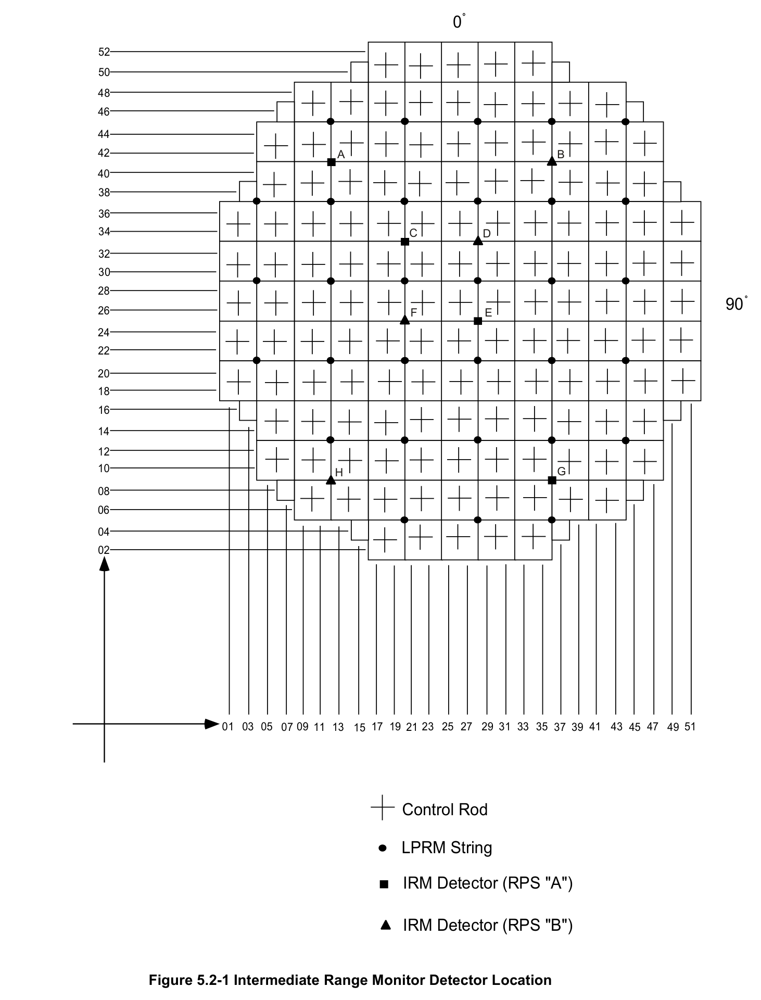
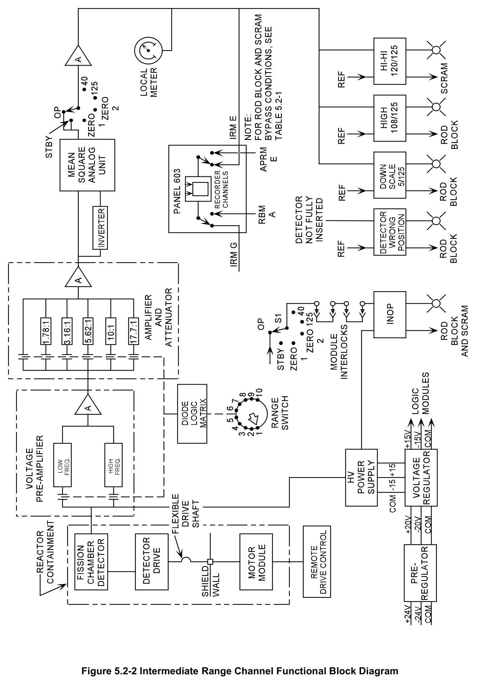
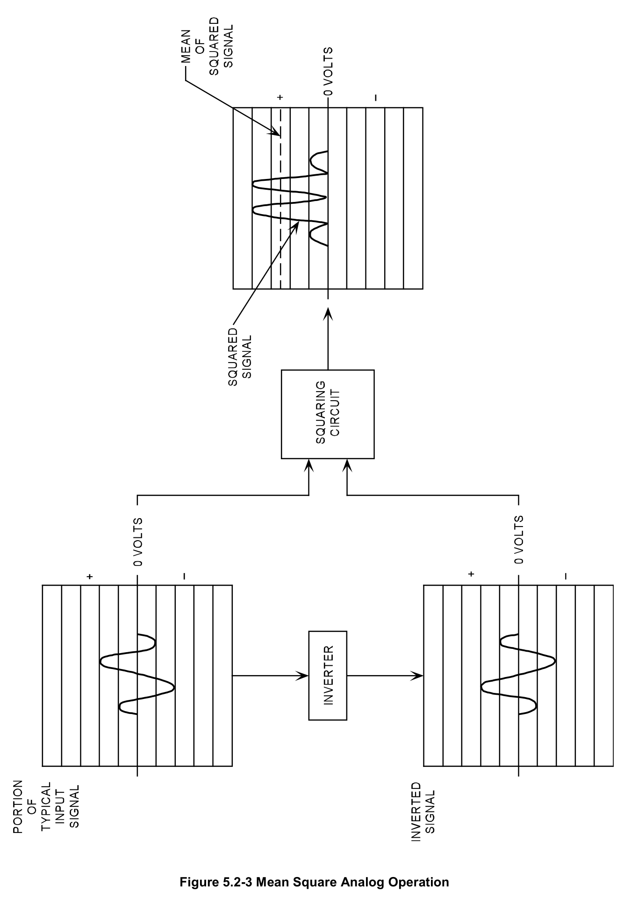
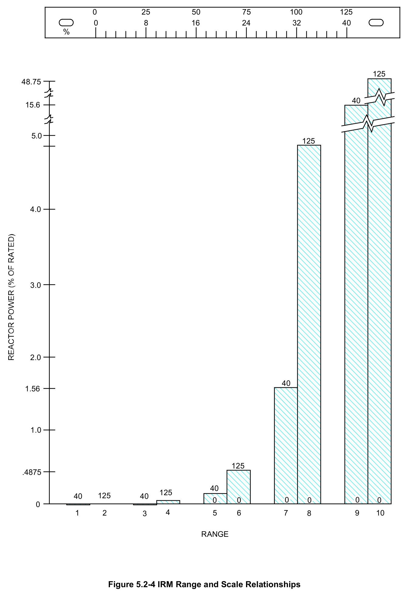
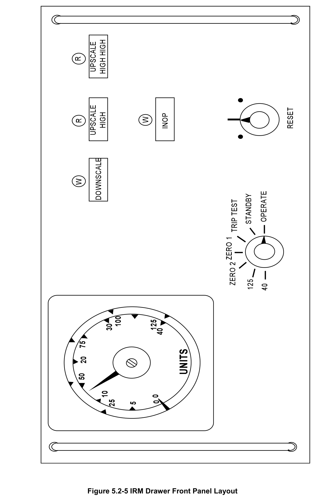
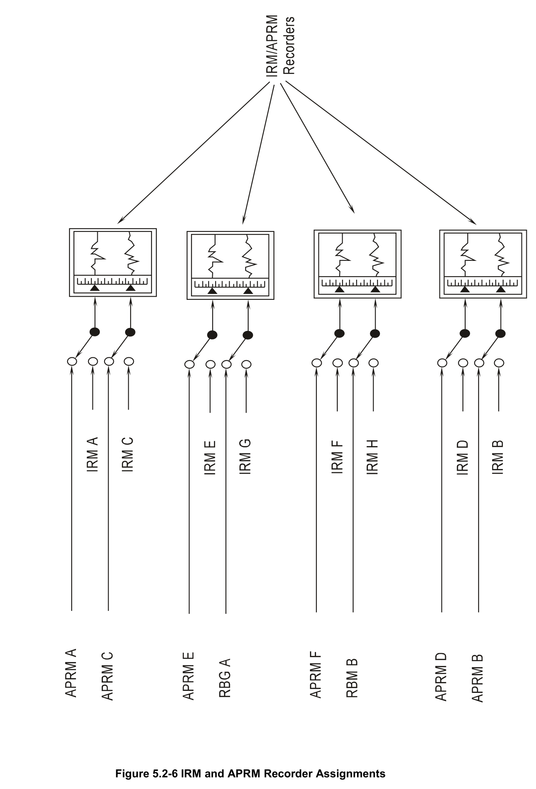

# 5.2 Intermediate Range

> Source: `5.2_Intermediate_Range.pdf` (18 pages)
> GE (BWR) Systems Technology Manual — USNRC HRTD, Rev 09/11

---
<!-- p.1 -->
#### General Electric Systems Technology Manual
#### Chapter 5.2
#### Intermediate Range Monitor System
<!-- p.3 -->
TABLE OF CONTENTS

5.2 INTERMEDIATE RANGE MONITOR SYSTEM ........................................................ 1

5.2.1 Introduction .......................................................................................................... 1

5.2.2 Component Description ....................................................................................... 2

5.2.2.1 Detector ....................................................................................................... 2

5.2.2.2 Detector Insert and Retract Mechanism ...................................................... 2

5.2.2.3 Voltage Preamplifier .................................................................................... 2

5.2.2.4 Amplifier and Attenuation Unit ..................................................................... 3

5.2.2.5 Diode Logic Matrix ....................................................................................... 3

5.2.2.6 Inverter ........................................................................................................ 4

5.2.2.7 Mean Square Analog Unit ........................................................................... 4

5.2.2.8 Operational Amplifier ................................................................................... 4

5.2.2.9 Trip Units ..................................................................................................... 4

5.2.2.10 Bypass Switch ............................................................................................. 4

5.2.3 System Features and Interfaces .......................................................................... 5

5.2.3.1 Rod Blocks and Scrams .............................................................................. 5

5.2.3.2 IRM Recorders and Display Lights .............................................................. 5

5.2.3.3 Operation During Startup ............................................................................. 5

5.2.3.4 System Interfaces ........................................................................................ 6

5.2.4 Summary ............................................................................................................. 6

LIST OF TABLES

5.2-1 IRM INTERLOCKS AND TRIPS .......................................................................... 7

Rev 09/11 5.2-i USNRC HRTD

<!-- p.4 -->
#### LIST OF FIGURES
5.2-1 Intermediate Range Monitor Detector in Core Location 5.2-2 Intermediate Range Monitoring Channel Functional Block Diagram 5.2-3 Mean Square Analog Operation 5.2-4 IRM Range and Scale Relationships 5.2-5 IRM Drawer Front Panel Layout 5.2-6 IRM/APRM Recorder Assignments

Rev 09/11 5.2-ii USNRC HRTD

<!-- p.5 -->
### 5.2 INTERMEDIATE RANGE MONITOR SYSTEM
Learning Objectives:

1. Recognize the purposes of the Intermediate Range Monitoring (IRM) System.

2. Recognize the purpose, function and operation of the following IRM major components:
a. Fission Chamber Detector b. Range Switches c. IRM Recorder d. Trip Units e. Bypass Switch f. Detector Insert and Retract Mechanism

3. Recognize how the IRM system discriminates gamma flux from neutron flux.

4. Recognize the plant response to the following IRM signals, when the trips are bypassed and the reason for the trips:
a. Upscale High Trip b. Upscale High Alarm c. Downscale d. Inoperable IRM e. IRM detector not fully inserted

5. Recognize how the Intermediate Range Monitoring system interfaces with the following systems:
a. Reactor Protection System (Section 7.3)
b. Reactor Manual Control System (Section 7.1)
c. Average power range monitor system (Section 5.4)
d. Source Range Monitoring System (Section 5.1)

#### 5.2.1 Introduction
The purposes of the Intermediate Range Monitoring (IRM) System are to:
• provide neutron flux indications from the upper portion of the source range to the lower portion of the power range
• provide scram signals to RPS to preserve the integrity of the fuel cladding
• provide rod block signals to the RMCS to preserve the integrity of the fuel cladding

The functional classification of the IRM System is that of a safety related system.

Rev 09/11 5.2-1 USNRC HRTD

<!-- p.6 -->
The IRM System consists of eight independent channels. Each IRM channel includes:
• a miniature fission detector
• electronic signal conditioning equipment
• readout equipment
• trip units
• a mechanical retraction mechanism

The eight fission chamber detectors are located at different radial core locations as shown in Figure 5.2-1.

The fission chamber detector signal is received by the voltage preamplifier. The preamplifier amplifies the detector signal and selects the correct frequency. The preamplifier signal is then sent to the control room. The amplifier, attenuator and mean square analog units condition the detector signal for use by the trip units and indicators.

#### 5.2.2 Component Description
The major components of the IRM system are shown in Figure 5.2-2 and are discussed in the following paragraphs. Several components in the IRM System are similar to components in the SRM System.

##### 5.2.2.1 Detector
The detectors used for the IRM channels are basically the same as the SRM detectors discussed in Section 5.1. The IRM detectors have the following differences:
• a lower argon pressure
• a lower uranium content
• a closer spacing between the cathode and anode

The closer spacing permits operation at higher thermal neutron flux levels with an operating voltage of 100 volts. As with the SRM detectors, the IRM detectors are retractable to preserve detector life. The IRM detectors are withdrawn when overlap is achieved with the Average Power Range Monitoring (APRM) System.

##### 5.2.2.2 Detector Insert and Retract Mechanism
The IRM detector insert and retract mechanisms are identical to the SRM detector insert and retract mechanisms discussed in Section 5.1.

##### 5.2.2.3 Voltage Preamplifier
The voltage preamplifier conditions the signal from the detector for input to the IRM electronics drawer. It converts the varying DC signal to an AC voltage signal and

Rev 09/11 5.2-2 USNRC HRTD

<!-- p.7 -->
selectively amplifies the signal. High voltage is supplied to the fission chamber detector through the voltage preamplifier. This high voltage signal comes from a power supply in the IRM electronics drawer in the control room. A filter in series with the high voltage supply reduces signal loss. In addition the filter provides isolation of the detector output signal from the power supply.

Two independent channels of amplification are used in the voltage preamplifier. These independent channels of amplification operate one at a time. This allows optimization of the preamplifier response. This optimization ensures that the output of the preamplifier is representative of actual reactor power. The range selector switches control the gain and bandwidth response of the preamplifier. The range selector switches are discussed in section 5.2.2.5.

##### 5.2.2.4 Amplifier and Attenuation Unit
The AC signal from the voltage preamplifier is applied to the amplifier and attenuator unit in the IRM drawer. This unit provides six discrete gain ranges by switching the amount of attenuation in the signal path. The attenuation is selected so that there will be a factor of 10 output difference between alternate IRM ranges. If an IRM channel is reading 40 on range 1 it will read 4 on range 3 and 0.4 on range 5. If an IRM channel is reading 100 on range 6 it will read 10 on range 8 and 1.0 on range 10. Each setting of the range switch closes a set of contacts in the preamplifier and in the amplifier and attenuator module. These contacts are closed by outputs from the diode logic matrix.
The input signal is routed from one of the two amplifier stages in the preamplifier through one of six attenuation paths. With the range switch on range 1, the preamplifier signal is applied to the amplifier stage with no attenuation. With the range switch set to range 2, the preamplifier signal is attenuated by a factor of 1.78. Successively larger values of attenuation are switched into the signal path from ranges 3 through 6. For ranges 7 through 10, the preamplifier input signal is applied from the second amplifier stage. No attenuation and attenuation ratios of 1.78, 3.16, and 5.62 are switched into the signal path. The combination of six attenuation ratios and two amplifier gain ranges makes for 12 ranges of measurement. As only 10 ranges are used a mechanical stop on the range switch prevents switch movement above range 10.

##### 5.2.2.5 Diode Logic Matrix
The range switch position determines the output of the diode logic matrix. The diode logic matrix has two outputs. The first one controls the contacts in the preamplifier frequency section. The second one controls the amount of attenuation in the amplifier attenuator. The diode logic matrix controls the detector signal conditioning and attenuation before the signal reaches the operator's indication.

Rev 09/11 5.2-3 USNRC HRTD

<!-- p.8 -->
##### 5.2.2.6 Inverter
The inverter is located between the amplifier and attenuator unit output and the mean square analog unit input. The inverter conditions the amplifier and attenuator output signal for use by the mean square analog unit. The inverter (Figure 5.2-3) module amplifies the input signal and produces two equal amplitude outputs of opposite polarity.
The inverter ensures the mean square analog circuit will always receive a positive input signal.

##### 5.2.2.7 Mean Square Analog Unit
The mean square analog unit (Figure 5.2-3) produces an analog signal directly proportional to the core neutron flux. The mean square analog unit receives two input signals. One signal is from the inverter and the second signal is from the amplifier and attenuator unit. A squaring circuit squares both input signals to produce a positive polarity output signal. As the neutron signal from the detector is much larger than the gamma signal it will receive the largest amplification when squared. Squaring both the neutron and gamma signals from the detector makes the gamma signal so small that it can be disregarded. The averaging circuit receives the signal from the squaring circuit and produces the mean (average) of this squared signal. The mean value is then sent to the operational amplifier.

##### 5.2.2.8 Operational Amplifier
The operational amplifier provides the required output to drive the displays and trip units. Individual IRM displays are provided on the control room front panel recorders shared with the APRMs. Indications are also displayed on the associated IRM drawers in the control room back panels. The even IRM ranges (2, 4, 6, 8, and 10) utilize the 0- 125% scale, while the odd ranges use the 0-40 scale.

##### 5.2.2.9 Trip Units
The trip units used by the IRM channels are identical to those used by the SRMs, The IRM channel trip setpoints are listed in Table 5.2-1.

##### 5.2.2.10 Bypass Switch
The RPS system (Section 7.3) IRM inputs are bypassed whenever the associated IRM bypass switch is placed in that detector position. The switch arrangement ensures only one IRM channel for each RPS division can be bypassed at a time. IRM channels A, C, E, and G have one bypass switch and provide trip inputs to RPS channel A. IRM channels B, D, F, and H have a second bypass switch and provide trip inputs to RPS channel B.

Rev 09/11 5.2-4 USNRC HRTD

<!-- p.9 -->
The bypass switches also bypass the rod withdrawal block inputs to the Reactor Manual Control System (Section 7.1).

#### 5.2.3 System Features and Interfaces
A short discussion of system features and the interfaces this system has with other plant systems is given in the following paragraphs.

##### 5.2.3.1 Rod Blocks and Scrams
The IRM system provides rod blocks and scrams to prevent fuel damage. These trips, along with their bypasses, are listed in Table 5.2-1.

##### 5.2.3.2 IRM Recorders and Display Lights
The eight (8) IRM channels are displayed on four (4) two pen recorders on panel 603.
The IRM's share these recorders with the APRM and RBM channels. Selection of which input is displayed is through the use of the select switches shown in Figure 5.2-6.
Each IRM channel also has indications displayed on an IRM instrument drawer shown in Figure 5.2-5.

Each IRM channel has a group of lights associated with various trip functions listed in Table 5.2-1. These are located on panel 603 above the IRM range switches and on the IRM instrument drawer.

##### 5.2.3.3 Operation During Startup
During reactor startup and the approach to criticality reactor power is monitored by the SRM system. When the SRM count rate is between 104 and 105 cps, the IRM channels should be on scale on range one. When the IRMs are on scale the SRM detectors are incrementally withdrawn maintaining their count rate between 102 and 105 cps. As reactor power approaches 75/125 of scale, the operator places the IRM range switch on the next higher range. The IRM readings should be maintained between 25/125 and 75/125 to avoid rod withdraw blocks (upscale or downscale). In the intermediate range the reactor power, although displayed on a linear scale (0-125), is increasing exponentially. This results in the indication appearing to accelerate on the upper end of the scale with a constant reactor period. On range 8 of the IRMs the APRM system indication begins to come on scale. Once the APRMs are well on scale (5-10% power)
the reactor mode switch is placed in the run position. The IRM detectors are then fully withdrawn from the core region.

Rev 09/11 5.2-5 USNRC HRTD

<!-- p.10 -->
##### 5.2.3.4 System Interfaces
The interfaces this system has with other plant systems are discussed in the following paragraphs.

Reactor Protection System (Section 7.3)

The RPS receives scram signals for IRM Upscale Hi and INOP from the IRM System.

Reactor Manual Control System (Section 7.1)

The RMC System receives rod block signals for IRM Hi, INOP, detector not fully inserted and downscale from the IRM System.

Emergency Distribution System (Section 9.2)

The Emergency Distribution System supplies power to operate the IRM detector drive mechanism.

Source Range Monitoring System (Section 5.1)

The SRM System receives signals from IRM range switch position. These signals automatically bypass the SRM rod blocks.

#### 5.2.4 Summary
The purposes of the Intermediate Range Monitoring (IRM) System are to;
• provide neutron flux indications from the upper portion of the source range to the lower portion of the power range
• provide scram signals to RPS to preserve the integrity of the fuel cladding
• provide rod block signals to the RMCS to preserve the integrity of the fuel cladding

The IRM System consists of eight independent channels. Each IRM channel includes;
• a miniature fission detector
• electronic signal conditioning equipment
• readout equipment
• trip units
• a mechanical retraction mechanism

Rev 09/11 5.2-6 USNRC HRTD

<!-- p.11 -->
#### TABLE 5.2-1 IRM Interlocks and Trips
ALARM or SETPOINT IRM CHASSIS Panel 603 ANNUNCIATOR ACTIO(5) AUTO TRIP(1)
INDICATION INDICATION (4)
BYPASS
(2) (3)
Mode Sw. in RUN with companion IRM UPSCALE UPSCALE Trip APRM NOT UPSC TR or TRIP or INOP IRM Upscale Trip ≤120 of 125 Scram
(Red Light)
Downscale INOP(A-H) (A or E, B or F, C or
(High scram) Scale
(A-H)
or Bypass G, D or H)
Switch in bypass Mode Sw. in RUN UPSCALE Alarm Rod Withdraw UPSC IRM Upscale ≤ 108 of 125 or Bypass IRM UPSCALE
(Amber Light)
Block Alarm Alarm (High) Scale Switch in bypass
(A-H)
Mode Sw. in RUN, IRM Rod Withdraw IRM on range 1, ≤ 5 of 125 DOWNSCALE DNSC IRM Downscale DOWNSCALE Block or Bypass Scale (White Light)
Switch in bypass Rod Withdraw Mode Sw. in RUN IRM UPSCALE Block with companion INOP UPSC TR TRIP or INOP -------------- APRM NOT IRM INOP (6) (White Light)
or INOP (A-H) (A/E, B/F, C/G, D Scram Downscale
(A-H)
or H)
or Bypass Switch in bypass Mode Sw. in RUN IRM Detector Detector not Rod Withdraw or Bypass not fully inserted full in block Switch in bypass Bypasses all Bypass Bypassed (White Bypass trip functions IRM Bypassed Switch Light) (A-H)
of the IRM
(7)
bypassed.

NOTES FOR TABLE 5.2-1

1. All trips signals automatically reset when the trip condition is cleared. Trip indicators on the IRM chassis must be manually reset.
2. The trip status lights on the IRM drawer front panel operate regardless of mode switch position.
3. Operation of all Panel 603 trip status lights is bypassed with the mode switch in the run position.
4. All IRM annunciators are bypassed with the mode switch in the run position.
5. IRM retraction produces a rod block except when the mode switch is in the run position or the channel is bypassed.
6. This is produced by the following:
a. IRM mode switch not in operate b. High voltage low (<80 VDC)
c. Module unplugged 7. Only one IRM in each channel (A or B) may be bypassed.

Rev 09/11 5.2-7 USNRC HRTD

<!-- p.12 -->
Rev 09/11 5.2-8 USNRC HRTD

<!-- p.13 -->
#### Figure 5.2-1

*Intermediate Range Monitor Detector Location*

[Vector original (SVG, lossless): fig_5.2-1.svg](../figures/fig_5.2-1.svg)

<!-- labels/text on this figure page -->
0
52
50
48
46
44
42 A B
40
38
36 34 C D
32 30
28 90 26 F E
24 22
20 18
16
14
12 10 G H 08
06
04 02
01 03 05 07 09 11 13 15 17 19 21 23 25 27 29 31 33 35 37 39 41 43 45 47 49 51
Control Rod
LPRM String
IRM Detector (RPS "A")
IRM Detector (RPS "B")
Figure 5.2-1 Intermediate Range Monitor Detector Location

<!-- p.14 -->
#### Figure 5.2-2

*Intermediate Range Channel Functional Block Diagram*

[Vector original (SVG, lossless): fig_5.2-2.svg](../figures/fig_5.2-2.svg)

<!-- p.15 -->
#### Figure 5.2-3

*Mean Square Analog Operation*

[Vector original (SVG, lossless): fig_5.2-3.svg](../figures/fig_5.2-3.svg)

<!-- p.16 -->
#### Figure 5.2-4

*IRM Range and Scale Relationships*

[Vector original (SVG, lossless): fig_5.2-4.svg](../figures/fig_5.2-4.svg)

<!-- labels/text on this figure page -->
0 25 50 75 100 125 0 8 16 24 32 40 %
125 48.75
40 15.6
5.0 125
4.0
3.0
2.0
40
1.56
1.0
125 .4875
40 125 40 125 40 0 0 0 0 0 0 0 1 2 3 4 5 6 7 8 9 10
RANGE
Figure 5.2-4 IRM Range and Scale Relationships

<!-- p.17 -->
#### Figure 5.2-5

*IRM Drawer Front Panel Layout*

[Vector original (SVG, lossless): fig_5.2-5.svg](../figures/fig_5.2-5.svg)

<!-- p.18 -->
#### Figure 5.2-6

*IRM and APRM Recorder Assignments*

[Vector original (SVG, lossless): fig_5.2-6.svg](../figures/fig_5.2-6.svg)

