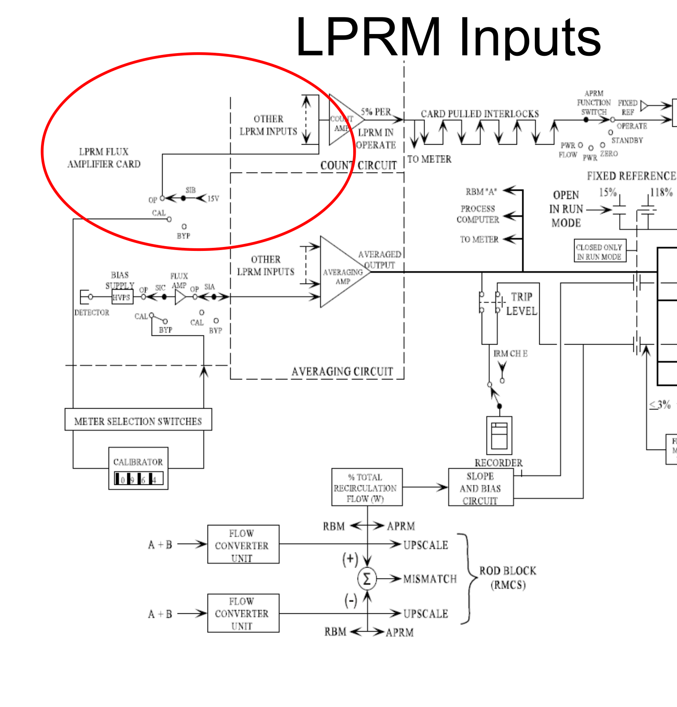
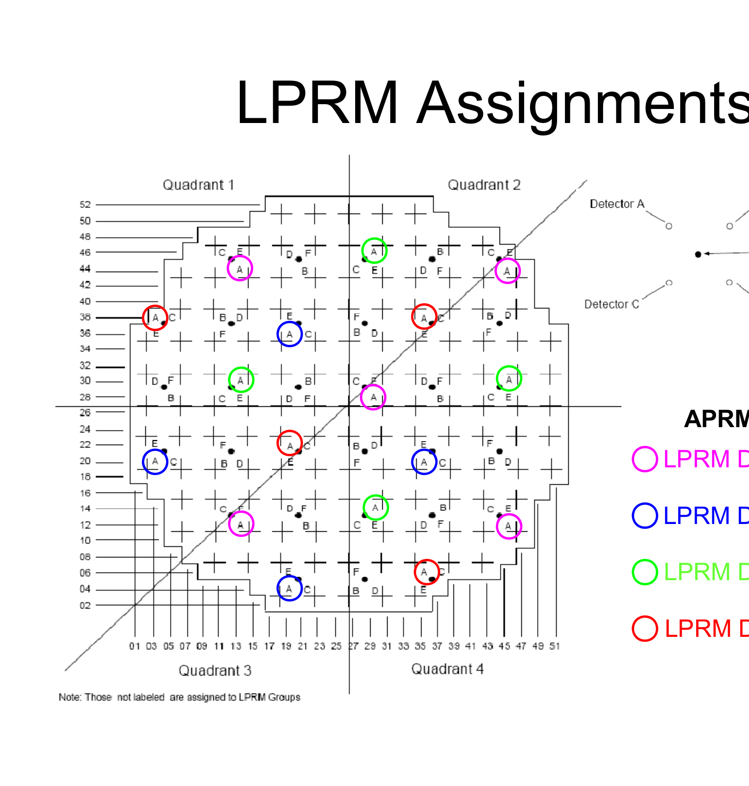
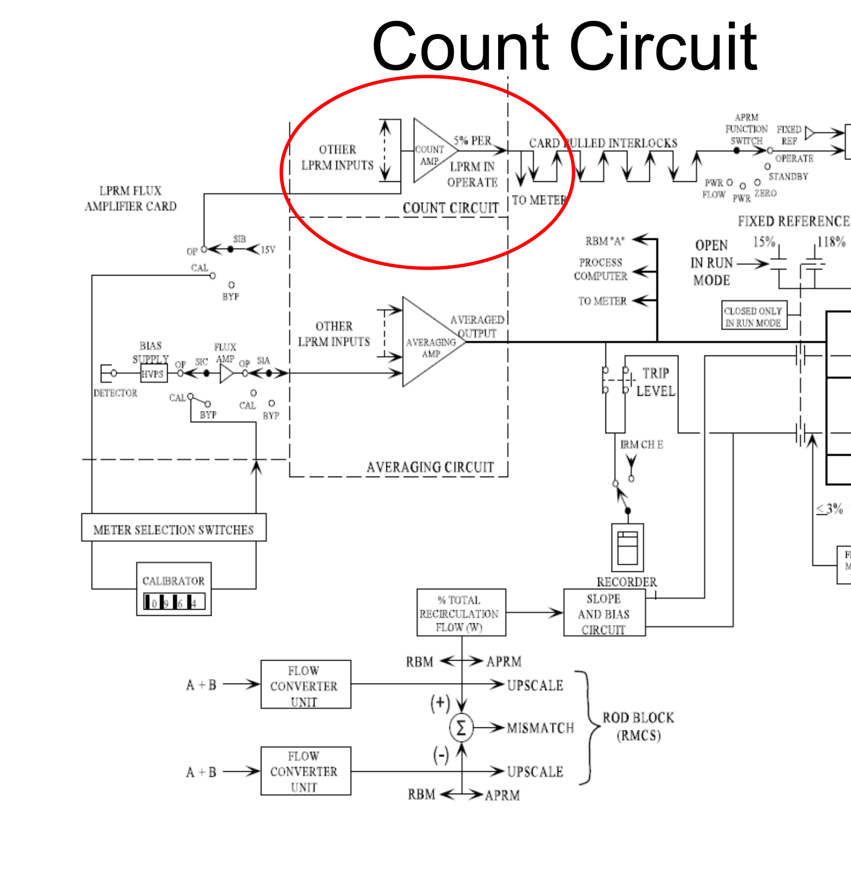
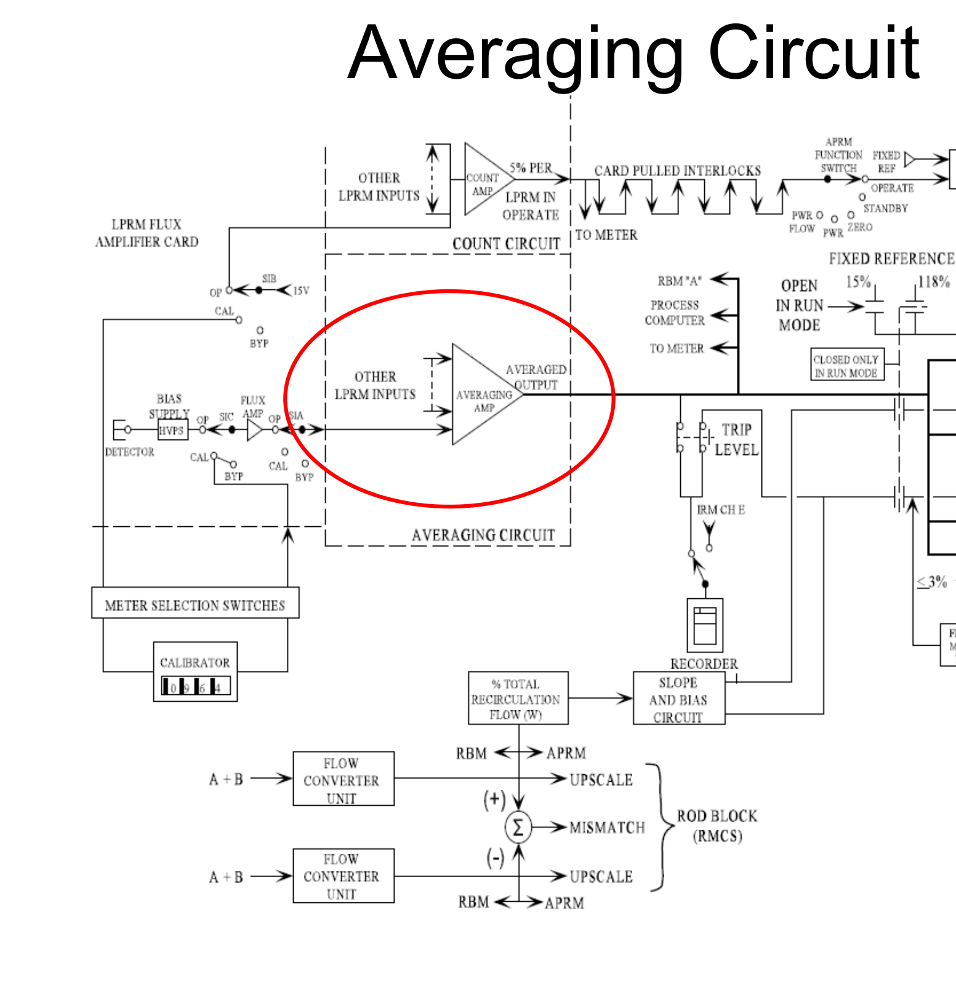
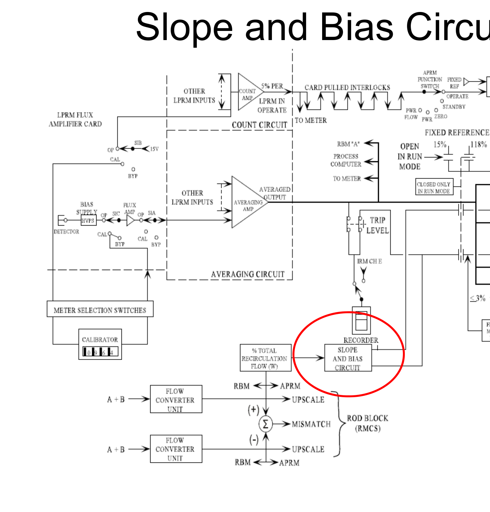
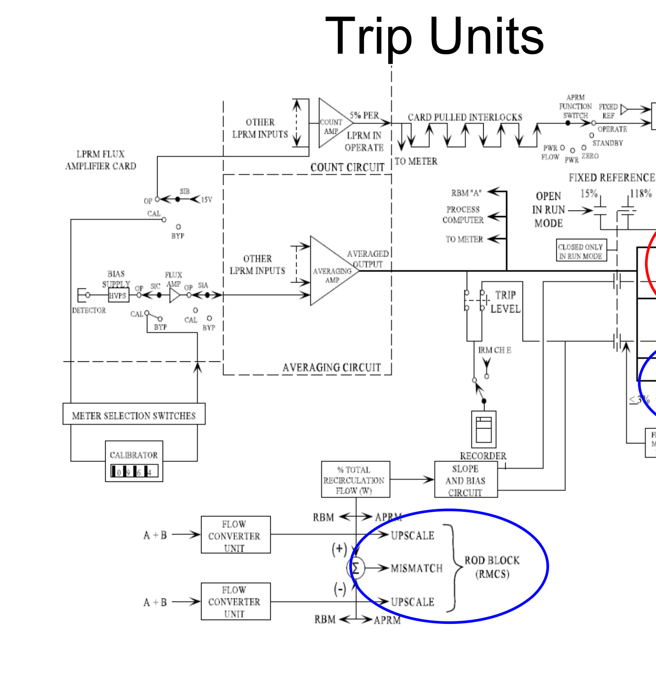

# 5.4 Average Power Range

> Source: `5.4_Average_Power_Range.pdf` (24 pages)
> GE (BWR) Systems Technology Manual — USNRC HRTD, Rev 09/11

---
<!-- p.1 -->
Monitoring System (APRM) )
Average Power Range
( 304B Chapter 5.4 y

g

<!-- p.2 -->
operation of major system components: operation of major system components:
2.Recognize the purpose, function and
1.Identify the purposes of the APRM Objectives d) slope and bias circuit c) averaging circuit a) LPRM inputs b) count circuit e) trip units system.

<!-- p.3 -->
trips, when the trips are bypassed and the reason for generated by this system, the action caused by the 4. Identify the assignment of LPRM detectors to the
3. List the protective trips (scrams and rod blocks)
Objectives (continued)
5. Explain the system’s interfaces with:
c. Local Power Range Monitoring System a. Reactor Manual Control System e. Rod Block Monitoring System d. Reactor Protection System b. Recirculation System g

the trips.
APRMs y

<!-- p.4 -->
Objective 1 block signals to preserve fuel cladding o Provide reactor scram and control rod The APRM system has two purposes:
o Monitor the core thermal power level Purposes

integrity

<!-- p.5 -->
Overview

<!-- p.6 -->

*figure on PDF page 6*

<!-- p.7 -->

*figure on PDF page 7*

[Vector original (SVG, lossless): fig_page-7_2.svg](../figures/fig_page-7_2.svg)

<!-- labels/text on this figure page -->
Objective 4 LPRM Detector Level D LPRM Detector Level C LPRM Detector Level B LPRM Detector Level A APRM Channel A:
LPRM Assignments

<!-- p.8 -->

*figure on PDF page 8*

<!-- p.9 -->

*figure on PDF page 9*

<!-- p.10 -->

*figure on PDF page 10*

<!-- p.11 -->

*figure on PDF page 11*

[Vector original (SVG, lossless): fig_page-11.svg](../figures/fig_page-11.svg)

<!-- p.12 -->
Objective 3

Protective Trips

<!-- p.13 -->
Scram Signals NOT in Run

<!-- p.14 -->
Rod Block Signals NOT in Run

<!-- p.15 -->
Scram Signals in Run

<!-- p.16 -->
Rod Block Signals in Run

<!-- p.17 -->
Objective 5

System Interfaces

<!-- p.18 -->
block signals to preserve fuel cladding o Provide reactor scram and control rod o Monitor the core thermal power level
1.Identify the system's purposes.
Review Objectives integrity

<!-- p.19 -->
operation of major system components:
a) LPRM inputs – each APRM channel receives 14 operable LPRM inputs to an APRM channel and
2.Recognize the purpose, function and or 17 inputs from LPRM detectors at diverse provides a rod block signal on fewer than 11 axial and radial locations in the reactor core c) averaging circuit – averages the inputs of b) count circuit – determines the number of Review Objectives operable LPRM detectors

<!-- p.20 -->
d) slope and bias circuit - adjusts APRM control rod operation of major system components:
block and reactor scram trip setpoints based on e) trip units – provides rod block signals to RMCS
2.Recognize the purpose, function and total recirculation flow when the reactor mode Review Objectives and scram signals to RPS switch is in Run

<!-- p.21 -->
3. List the protective trips generated by Review Objectives (continued)
the APRM system

<!-- p.22 -->
Review Objectives (continued)
4. Identify the assignment of LPRM detectors to the APRMs

<!-- p.23 -->
5. Explain the system’s interfaces with:
Review Objectives (continued)
c) local power range monitoring system b) recirculation flow control system a) reactor manual control system e) rod block monitoring system d) reactor protection system t

ti

t

t

d)

<!-- p.24 -->
Are there any questions?

