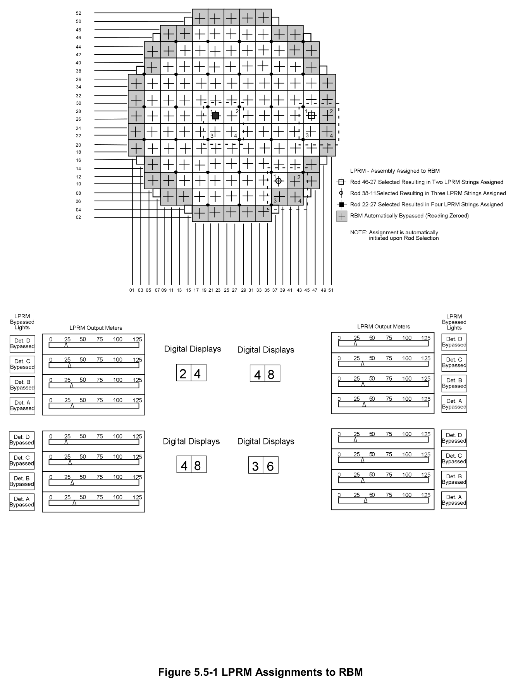
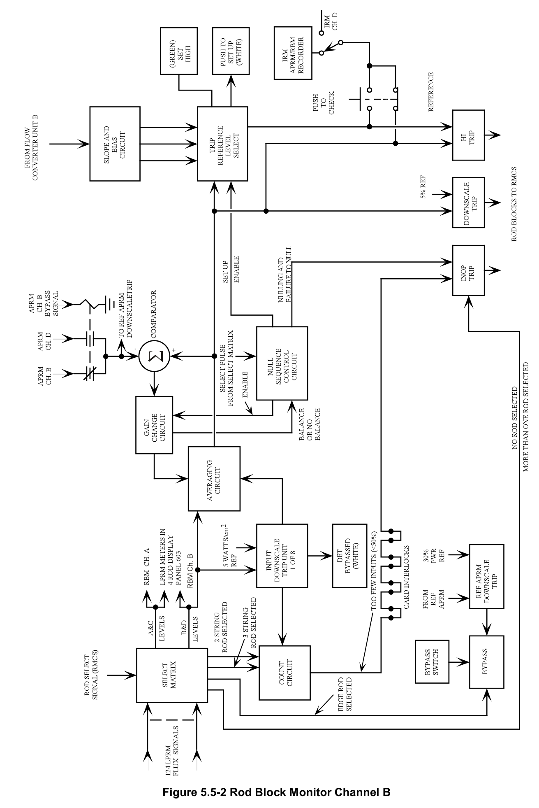
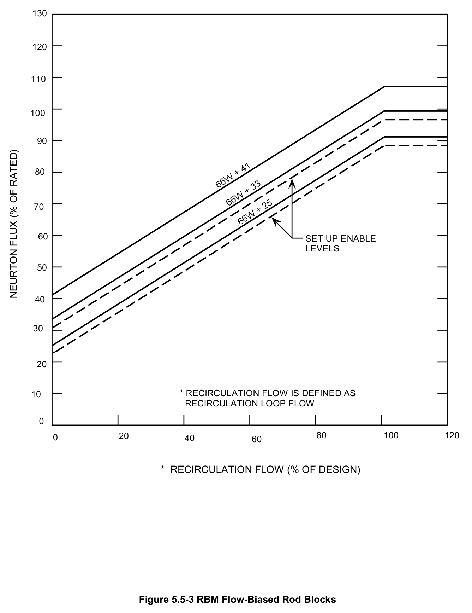
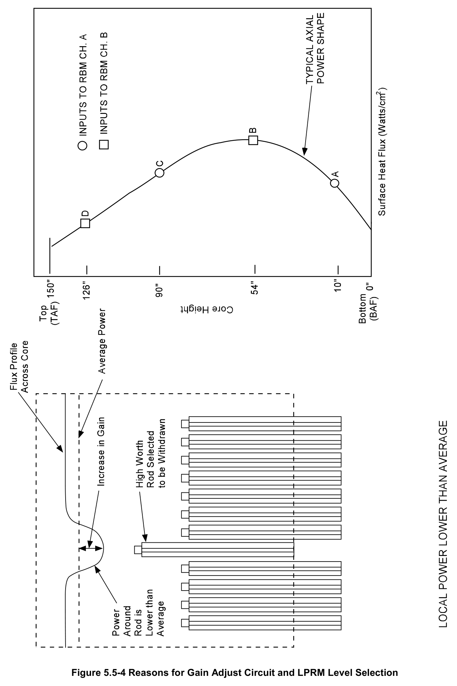
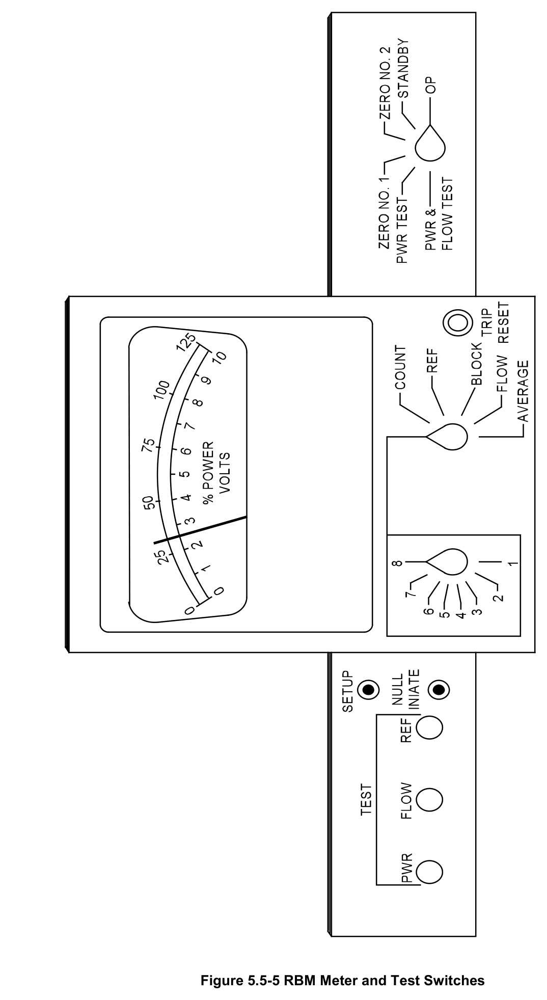
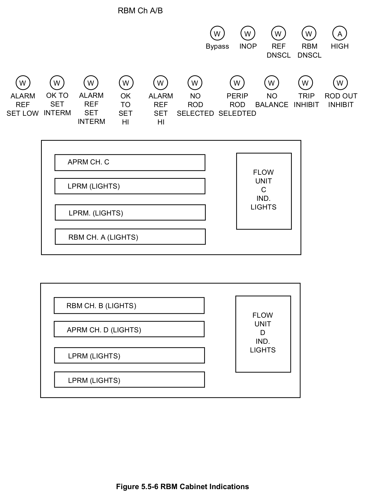

# 5.5 Rod Block

> Source: `5.5_Rod_Block.pdf` (25 pages)
> GE (BWR) Systems Technology Manual — USNRC HRTD, Rev 09/11

---
<!-- p.1 -->
#### General Electric Systems Technology Manual
#### Chapter 5.5
#### Rod Block Monitoring System
<!-- p.3 -->
TABLE OF CONTENTS

5.5 ROD BLOCK MONITORING SYSTEM .................................................................... 1

5.5.1 Introduction .......................................................................................................... 1

5.5.2 Component Description ....................................................................................... 2

5.5.2.1 Select Relay Matrix (Figure 5.5-2) ................................................................ 2

5.5.2.2 Count Circuit (Figure 5.5-2) .......................................................................... 3

5.5.2.3 Gain Change Circuit (Figure 5.5-2) ............................................................... 3

5.5.2.4 Averaging Circuit (Figure 5.5-2) .................................................................... 4

5.5.2.5 Slope and Bias Circuit (Figure 5.5-2) ............................................................ 4

5.5.2.6 Trip Reference Level Select Circuit (Figure 5.5-2) ........................................ 4

5.5.3 System Features and Interfaces (Table 5-5-1) .................................................... 5

5.5.3.1 Central Rod Withdrawal Above 30 Percent Power ....................................... 5

5.5.3.2 Edge Control Rod Withdrawal Above 30 Percent Power .............................. 7

5.5.3.3 Any Control Rod Withdrawal Below 30 Percent Power ................................. 7

5.5.3.4 System Interfaces ......................................................................................... 7

5.5.4 Summary ............................................................................................................. 8

LIST OF TABLES

5.5-1 RBM INTERLOCKS AND TRIPS ......................................................................... 9

Rev 09/11 5.5-i USNRC HRTD

<!-- p.4 -->
#### LIST OF FIGURES
5.5-1 LPRM Assignments to RBM 5.5-2 RBM Channel "B" 5.5-3 RBM Flow Biased Rod Blocks 5.5-4 Reasons for Gain Adjust Circuit & LPRM Level Selection 5.5-5 RBM Meter and Test Switches 5.5-6 RBM Cabinet Indicators

Rev 09/11 5.5-ii USNRC HRTD

<!-- p.5 -->
### 5.5 ROD BLOCK MONITORING SYSTEM
Learning Objectives:

1. Recognize the purposes of the Rod Block Monitor (RBM) system.

2. Recognize the purpose, function, and operation of the following RBM system components:
a. Select relay matrix b. Count circuit c. RBM recorder d. Averaging circuit e. Slope and bias circuit f. Trip unit g. Bypass switch

3. Recognize when the RBM system is automatically bypassed.

4. Recognize the plant response to the following RBM signals, when the trips are bypassed and the reason for the trips:
a. Upscale b. Downscale c. Inoperable

5. Recognize how the Rod Block Monitor system interfaces with the following systems:
a. Local Power Range Monitoring System (Section 5.3)
b. Recirculation System (Section 2.4)
c. Reactor Manual Control System (Section 7.1)
d. Average Power Range Monitoring System (Section 5.4)

#### 5.5.1 Introduction
The purposes of the rod block monitoring (RBM) system are to monitor local and overall power levels around a selected control rod and to prevent fuel damage by preventing control rod withdrawal that could cause a violation of core thermal limits, specifically the Minimum Critical Power Ratio (MCPR). The functional classification of the RBM system is that of a power generation system.

The RBM system consists of two separate and independent channels. Each channel monitors the local neutron flux during selection and movement of a control rod. Each channel will generate a rod withdraw block signal to the reactor manual control system
(RMCS) when the monitored neutron flux exceeds preset limits. The RMCS will impose

Rev 09/11 5.5-1 USNRC HRTD

<!-- p.6 -->
a rod withdraw block when a signal is received from one or both RBM channels with reactor core power greater than 30 percent of rated. If the operator is continuously withdrawing a control rod, the RMCS will over-ride that request and stop control rod movement at the next notch position.

The RBM accomplishes this function by averaging the selected local power range monitor (LPRM, Section 5.3) inputs and comparing the results with flow-biased trip points. As long as the RBM readings remain less than the flow biased trip points, no rod withdrawal block signals will be sent to the RMCS.

#### 5.5.2 Component Description
The major components of the RBM system are discussed in the following paragraphs and are shown in block diagram form in Figure 5.5-2. Figure 5.5-5 shows the RBM back panel meter and its test switches. Figure 5.5-6 shows the back panel indicator lights for a RBM channel. Table 5.5-1 lists the trip signals generated by the RBM system along with conditions under which the trip signals are bypassed.

##### 5.5.2.1 Select Relay Matrix (Figure 5.5-2)
The RBM select relay matrix receives a rod select signal from the reactor manual control system (RMCS, Section 7.1). The select relay matrix uses the selected control rod signal to automatically assign the adjacent LPRM strings. Figure 5.5-1 illustrates how the LPRM strings are assigned. When control rod 46-27 (the open square in the figure) is selected, the two LPRM strings to the upper left and lower left are assigned.
When control rod 38-11 (the open circle) is selected, the three LPRM strings to the upper left, lower left, and upper right are assigned. And when control rod 22-27 (the solid square) is selected, the four LPRM stings to the upper left, lower left, upper right, and lower right are assigned. The A and C level LPRM detectors from the assigned LPRM strings are input to RBM channel A while the B and D level LPRM detectors are input to RBM channel B (Figure 5.5-4).

The select relay matrix also determines the LPRM detectors indicated on the four rod display (bottom portion of Figure 5.5-1). Control rod 22-27 is at notch position 24 in Figure 5.5-1 with control rods 26-27 at notch position 48, 22-23 at notch position 48, and 26-23 at notch position 36. The four detector readings from LPRM string 20-29 appear to the upper left, the four detector readings from LPRM string 28-29 appear to the upper right, the four detector readings from LPRM string 20-21 appear to the lower left, and the four detector readings from LPRM string 28-21 appear to the lower right of the four rod display.

The select relay matrix directs the flux amplifier signals from the assigned LPRM detectors to RBM channels A and B in addition to the RBM/LPRM indicators on the

Rev 09/11 5.5-2 USNRC HRTD

<!-- p.7 -->
reactor control console. The LPRM flux amplifier signals are displayed on the LPRM meters in proper orientation with respect to the selected control rod.

##### 5.5.2.2 Count Circuit (Figure 5.5-2)
The count circuit is provided to ensure that at least half of the detectors from the assigned LPRM strings are operable. When a control rod is selected with 4 LPRM strings assigned to it, the count circuit requires at least four LPRM detectors to be operable for each RBM channel because the available number of LPRM detectors per RBM channel is 8. Similarly, when a control rod is selected with 3 LPRM strings assigned to it, the count circuit requires at least 3 LPRM detectors to be operable for each RBM channel. The count circuit considers an LPRM detector to be operable when it is not bypassed and is reading above 5 watts/cm2. If fewer than the required number of LPRM detectors are operable, an RBM channel will be inoperable because it will not have sufficient inputs to reliably monitor local power levels. This condition results in a RBM channel inoperable trip and a control rod withdrawal block signal to the reactor manual control system.

The count circuit is bypassed when an edge control rod is selected. This condition results in an automatic bypass of the RBM system. Figure 5.5-1 indicates those control rods considered edge rods.

##### 5.5.2.3 Gain Change Circuit (Figure 5.5-2)
When a non-edge control rod is initially selected, a signal from the RBM select relay matrix causes the core power level from the reference average power range monitor
(APRM A or C for RBM channel A; APRM B or D for RBM channel B) to be compared to the average local power level from the assigned LPRM strings (level A and C detectors for RBM channel A; level B and D detectors for RBM channel B).

When the average of the local power levels equals or exceeds the ARPM reading, a gain of 1.0 is applied. But when the average of the local power levels is less than the ARPM reading, a gain greater than 1.0 will be applied to the average local power levels determined by the RBM averaging circuit. This ensures that a selected control rod in a depressed local neutron flux region of the reactor core is conservatively limited in its outward movement.

Figure 5.5-4 shows why the gain change is applied when local power levels are less than the core power level. The RBM and APRM readings are both averages of multiple LPRM detectors. When the readings from LPRM detectors in the assigned strings around the selected control rod (e.g., RBM readings) are less than the core-wide LPRM readings (e.g., APRM readings), the local power level is depressed. Withdrawal of the control rod from that region could add sufficient positive reactivity to inflict localized

Rev 09/11 5.5-3 USNRC HRTD

<!-- p.8 -->
overpower conditions without causing the core-wide power level to increase to the point where the APRM system imposes a rod block or scram signal. The RBM system applies a gain change in such circumstances to avoid a localized power depression from masking an undesired significant power rise in response to a control rod withdrawal and delaying the application of a mitigating control rod block signal.

Once calculated, the gain remains constant despite control rod movements, recirculation flow changes, and other core power changes. The gain is only recalculated when the next non-edge control rod is selected. For example, if the local power levels average 40 and the reference APRM reads 50 when a control rod is initially selected, the gain change circuit will determine the gain to be 1.25 (i.e., 50/40). If the selected control rod is withdrawn one or more notches such that the local power levels now average 50 and the reference APRM still reads 50, the RBM system will continue to apply the 1.25 gain factor unless the control rod is de-selected and reselected.

##### 5.5.2.4 Averaging Circuit (Figure 5.5-2)
The averaging circuit in each RBM channel averages the operable LPRM detector inputs and applies the appropriate factor from the gain change circuit. Figure 5.5-2 shows the averaging circuit in RBM channel B. The output from the averaging circuit is provided to the trip reference level select circuit.

##### 5.5.2.5 Slope and Bias Circuit (Figure 5.5-2)
The slope and bias circuit determines the setpoints for three control rod block settings based on the recirculation flow rate. These flow-biased setpoints are shown in Figure 5.5-3 and Table 5.5-1.

The low rod block setting is calculated using the equation 0.66 * W + 25, where W is the percent of recirculation loop flow. The intermediate rod block setting uses the equation 0.66 * W + 33. The normal rod block setting uses the equation 0.66 * W + 41.

The RBM system receives the recirculation loop flow signal (e.g., the W term) from the recirculation system’s flow instrumentation in the recirculation loop piping.

Similar to the reasons used in the flow-biased APRM rod block and scram setpoints
(Section 5.4), the flow-biased RBM settings ensure protections provided at rated power are maintained when core flow (and thus core power) is reduced.

##### 5.5.2.6 Trip Reference Level Select Circuit (Figure 5.5-2)
When a non-edge control rod is selected, the RBM trip reference level select circuit compares the gain-adjusted output from the averaging circuit to the three flow-biased

Rev 09/11 5.5-4 USNRC HRTD

<!-- p.9 -->
outputs from the slope and bias circuit (Figure 5.5-3) and selects the next higher setting to impose a control rod block. The trip reference level select circuit will send a trip signal to the RMCS that result in a control rod withdraw block when this setting is exceeded. In addition, the trip reference level select circuit can provide indications that the RBM settings can be set-up to a higher level or are set at the highest level.

The lower two flow-biased settings are “soft” settings. When the gain-adjusted output from the averaging circuit rises to within 2 percent of the low rod block or intermediate rod block setting, the trip reference level select circuit will illuminate a white “push to setup” pushbutton light on control room panel 603. By depressing the “push to setup” pushbutton, the operator can bump the RBM setting up to the next higher setting.

The normal rod block setting, the highest of the three flow-biased settings, is a “hard” setting in that the operator cannot bump it to a higher setpoint. When the normal rod block setting is in effect, the trip reference level select circuit will illuminate a green “set high” indicator light on control room panel 603.

#### 5.5.3 System Features and Interfaces (Table 5-5-1)
A short discussion of system features and interfaces this system has with other plant systems is given in the paragraphs which follow.

##### 5.5.3.1 Central Rod Withdrawal Above 30 Percent Power
When the reference APRM channels are reading greater than 30% power and the operator selects a control rod not on the edge of the reactor core (see Figure 5.5-1 for indication of edge control rod locations), the gain change circuit of the RBM system determines the gain to be applied using the local powers from the assigned LPRM strings to the core average power. To better understand the operation of the RBM system, assume the following conditions upon selection of a central control rod:

• Recirculation loop flow: 50% of rated
• APRM reading 50%
• Local power reading 40%

The gain change circuit calculates a gain of 1.25 based on the ratio of the APRM reading to the local reading from the assigned LPRM strings (50/40).

The slope and bias circuit calculates rod block settings of 57%, 65%, and 73% based on the recirculation loop flow (i.e., W = 50).

Rev 09/11 5.5-5 USNRC HRTD

<!-- p.10 -->
The gain adjusted reading output from the averaging circuit would be 50%, below the lowest of the rod block settings from the slope and bias circuit. Thus, the selected control rod could be withdrawn with no rod block signaled by the RBM system.

Assume the selected control rod is withdrawn and the readings from the assigned LPRM strings increase to an average of 44%. By multiplying the new LPRM signal by the fixed gain of 1.25, the gain adjusted reading output from the averaging circuit would increase to 55%. By being within 2 percent of the low rod block setting (the lowest dotted line in Figure 5.5-3), a white “push to setup” light would illuminate. The operator could bump the controlling RBM setpoint to the intermediate setting by pressing a button.

Assume the operator does not manually bump up to the intermediate rod block setting and continues to withdraw the same control rod. When the detectors in the assigned LPRM strings produce an average signal of approximately 46%, the RBM will send a rod block signal to the RMCS to prevent further withdrawal of the selected control rod.
If the operator is moving the control rod in the continuous withdrawal mode, the RMCS will over-ride that mode and stop the control rod withdrawal at the next notch position.

The operator has two options available to remove the RBM control rod block:
1. Depress the appropriate RBM channel “push to setup” pushbutton to manually bump up to the intermediate rod block settings.
2. De-select and re-select the control rod to recalculate the gain and restore margin to the low rod block settings.

Assume the operator invokes the first option. By depressing the appropriate set-up pushbutton the rod block is cleared. The control rod is again withdrawn until the intermediate rod block setting (65%) is reached and another rod block signal is sent by the RBM system to the RMCS. The readings from the assigned LPRM strings would be approximately 52% (1.25 x 52% = 65%).

The operator would have the same options, with the first option allowing the operator to manually bump the RBM setpoints up to the normal rod block settings (73% in this example).

Assume the operator again invokes the first option to clear the RBM rod block. The operator withdraws the same control rod. When the readings from the assigned LPRM strings reach 58% the RBM would indicate 73% (1.25 x 58% = 73%) which is the third and final rod block setting.

The first option is no longer available to the operator because the RBM channels are applying the highest of three available rod block settings. To continue withdrawing the

Rev 09/11 5.5-6 USNRC HRTD

<!-- p.11 -->
same control rod, the operator must attempt the second option to clear the RBM rod block.

As indicated in Table 5.5-1 and Figure 5.5-2, the RBM system will send a control rod block signal to the RMCS if either of two other conditions exist. When the average of the LPRM inputs to a RBM channel is less than 5 percent, the RBM channel is downscale.
If its panel switch is not in Operate, its module is unplugged, it fails to null after a nonedge control rod is selected, or it has fewer than 50 percent of the LPRM inputs operable, a RBM channel is inoperable. Either of these conditions will send a control rod withdraw block signal to the RMCS.

##### 5.5.3.2 Edge Control Rod Withdrawal Above 30 Percent Power
When a control rod located on the edge of the reactor core (see Figure 5.5-1 for indication of edge control rod locations) with the reference APRMs reading greater than 30 percent is selected, the RBM system is automatically bypassed. Analyses of edge control rod withdrawals above 30 percent power have concluded that their low reactivity worth cannot cause overpower conditions resulting in fuel damage.

##### 5.5.3.3 Any Control Rod Withdrawal Below 30 Percent Power
When any control rod is selected with the reference APRMs reading less than 30 percent, the RBM system is automatically bypassed. Analyses of control rod withdrawals below 30 percent power have concluded that the MCPR limit cannot be violated.

##### 5.5.3.4 System Interfaces
The interfaces this system has with other plant systems are discussed in the paragraphs which follow.

Local Power Range Monitoring System (Section 5.3)

The RBM system receives indications of reactor power from the LPRM detectors in the assigned strings surrounding the control rod selected for movement.

Average Power Range Monitoring System (Section 5.4)

The RBM system uses readings from APRM channels to determine the gain factors applied to local power indications.

The RBM system also uses readings from APRM channels to determine when to automatically bypass the system at low reactor power levels (<30 percent).

Rev 09/11 5.5-7 USNRC HRTD

<!-- p.12 -->
Reactor Manual Control System (Section 7.1)

The RMCS provides a signal to the RBM system for the selected control rod. The RBM system uses this input to determine the assigned LPRM strings.

The RMCS receives signals from the RBM system to generate the rod blocks listed in Table 5.5-1.

Recirculation System (Section 2.4)

The recirculation system provides the total recirculation loop flows signal (W) used by the RBM system slope and bias circuit to calculate the three rod block settings.

#### 5.5.4 Summary
Purpose - To monitor average power around a selected control rod and to limit control rod movement to prevent local fuel damage.

Components - Selection matrix; count circuit; gain change circuit; averaging circuit;
slope and bias circuit; trip reference level select circuit.

System Interfaces - Local Power Range Monitoring System; Average Power Range Monitoring System; Reactor Manual Control System; Recirculation System.

Rev 09/11 5.5-8 USNRC HRTD

<!-- p.13 -->
#### TABLE 5.5-1 RBM INTERLOCKS AND TRIPS
ALARM or TRIP SETPOINT ANNUNCIATOR ACTION AUTO BYPASS

APRM Reference Low Level (30% .66W + 41 Rod Withdraw Power)
.66W + 33 RBM UPSCALE Block Signal to or RBM Upscale .66W + 25 /INOP RMCS Edge Rod % Power Selected

APRM Reference Low Level (30% Rod Withdraw Power)
RBM Downscale 5% Power RBM Downscale Block Signal to or RMCS Edge Rod Selected

APRM Reference Low Level (30% Rod Withdraw Power)
RBM UPSCALE RBM INOP (1)
Block Signal to or /INOP RMCS Edge Rod Selected

Bypass Switch RBM Bypassed on Panel 603
(2)

1. Produced by:
a. Local panel mode switch not in operate.
b. Module unplugged.
c. Less than required number at LPRM inputs.
d. RBM fails to null.

2. Only one RBM may be bypassed.

Rev 09/11 5.5-9 USNRC HRTD

<!-- p.15 -->
#### Figure 5.5-1

*LPRM Assignments to RBM*

[Vector original (SVG, lossless): fig_5.5-1.svg](../figures/fig_5.5-1.svg)

<!-- labels/text on this figure page -->
52
50
48 46
44 42
40 38
36 34
32 30 2 1 2 28 1 26
24 3 4 3 4 22
20 18 16
14 1 2 12 10
08 3 4 06
04 02
01 03 05 07 09 11 13 15 17 19 21 23 25 27 29 31 33 35 37 39 41 43 45 47 49 51
Figure 5.5-1 LPRM Assignments to RBM

<!-- p.17 -->
#### Figure 5.5-2

*Rod Block Monitor Channel B*

[Vector original (SVG, lossless): fig_5.5-2.svg](../figures/fig_5.5-2.svg)

<!-- p.19 -->
#### Figure 5.5-3

*RBM Flow-Biased Rod Blocks*

[Vector original (SVG, lossless): fig_5.5-3.svg](../figures/fig_5.5-3.svg)

<!-- labels/text on this figure page -->
130
120
110
100
90
80
70
60 SET UP ENABLE LEVELS
50
40
30
20
* RECIRCULATION FLOW IS DEFINED AS 10 RECIRCULATION LOOP FLOW
0 80 100 120 0 20 40 60
* RECIRCULATION FLOW (% OF DESIGN)
Figure 5.5-3 RBM Flow-Biased Rod Blocks

<!-- p.21 -->
#### Figure 5.5-4

*Reasons for Gain Adjust Circuit and LPRM Level Selection*

[Vector original (SVG, lossless): fig_5.5-4.svg](../figures/fig_5.5-4.svg)

<!-- p.23 -->
#### Figure 5.5-5

*RBM Meter and Test Switches*

[Vector original (SVG, lossless): fig_5.5-5.svg](../figures/fig_5.5-5.svg)

<!-- p.25 -->
#### Figure 5.5-6

*RBM Cabinet Indications*

[Vector original (SVG, lossless): fig_5.5-6.svg](../figures/fig_5.5-6.svg)

<!-- labels/text on this figure page -->
RBM Ch A/B
W W W W A
Bypass INOP REF RBM HIGH DNSCL DNSCL
W W W W W W W W W W
OK TO ALARM ALARM OK ALARM NO PERIP NO TRIP ROD OUT REF SET REF TO REF ROD ROD BALANCE INHIBIT INHIBIT SET LOW INTERM SET SET SET SELECTED SELEDTED INTERM HI HI
APRM CH. C FLOW UNIT LPRM (LIGHTS)
C IND.
LIGHTS LPRM. (LIGHTS)
RBM CH. A (LIGHTS)
RBM CH. B (LIGHTS)
FLOW UNIT APRM CH. D (LIGHTS)
D IND.
LIGHTS LPRM (LIGHTS)
LPRM (LIGHTS)
Figure 5.5-6 RBM Cabinet Indications

