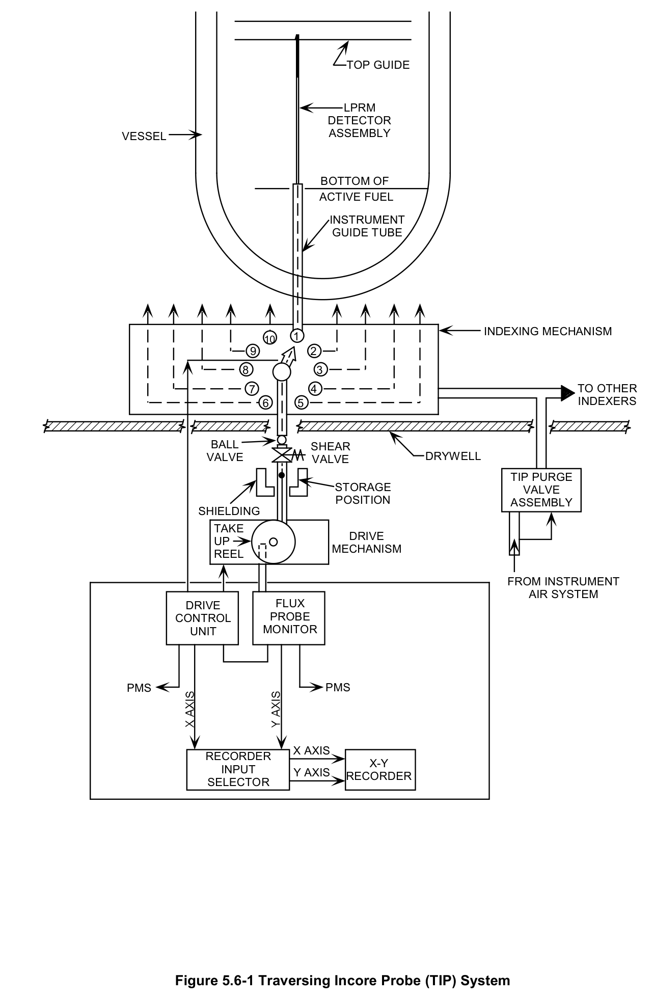
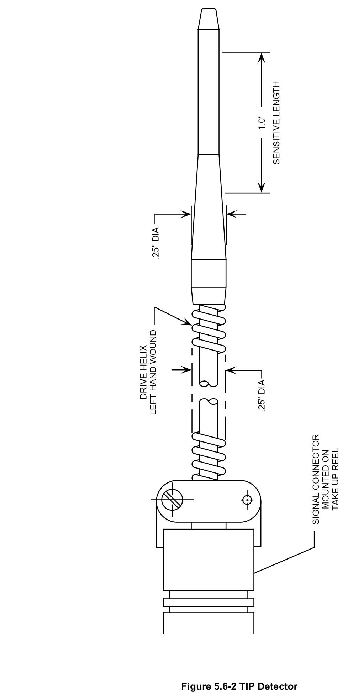
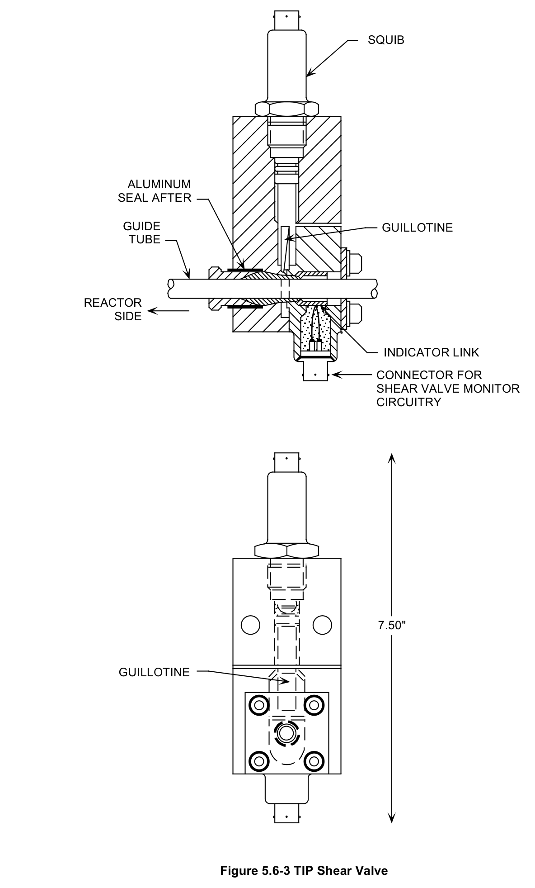
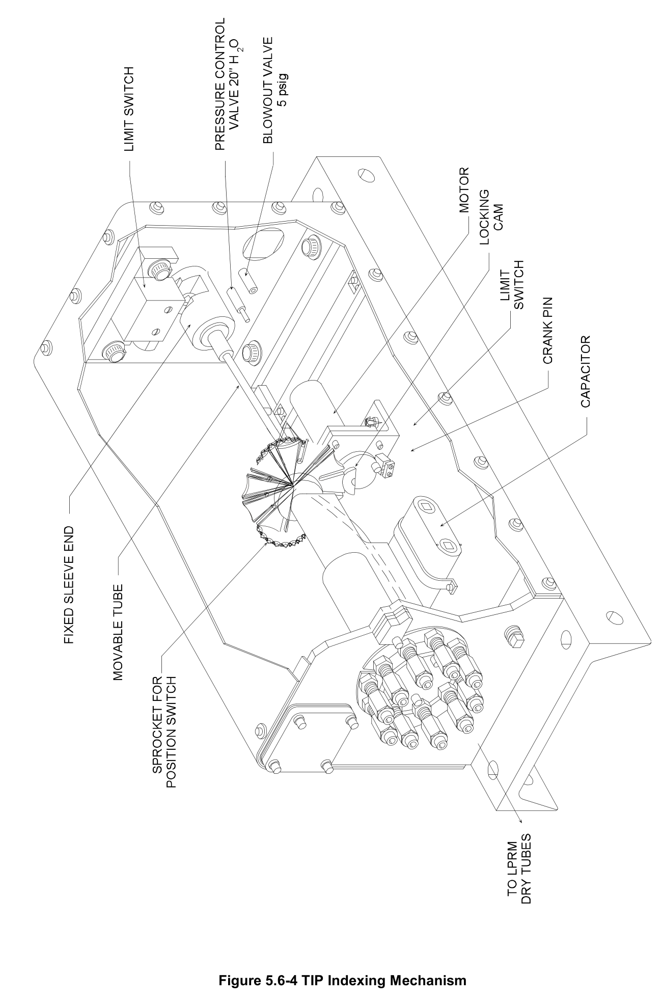
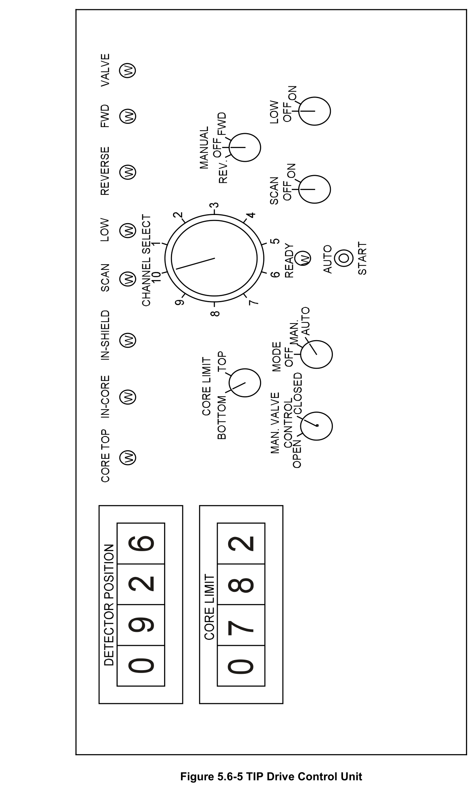
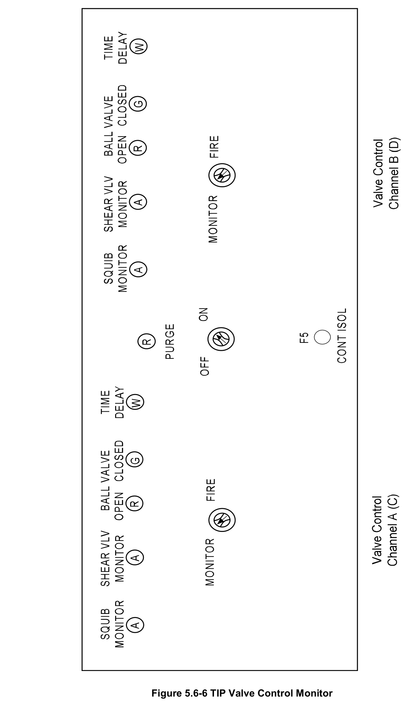
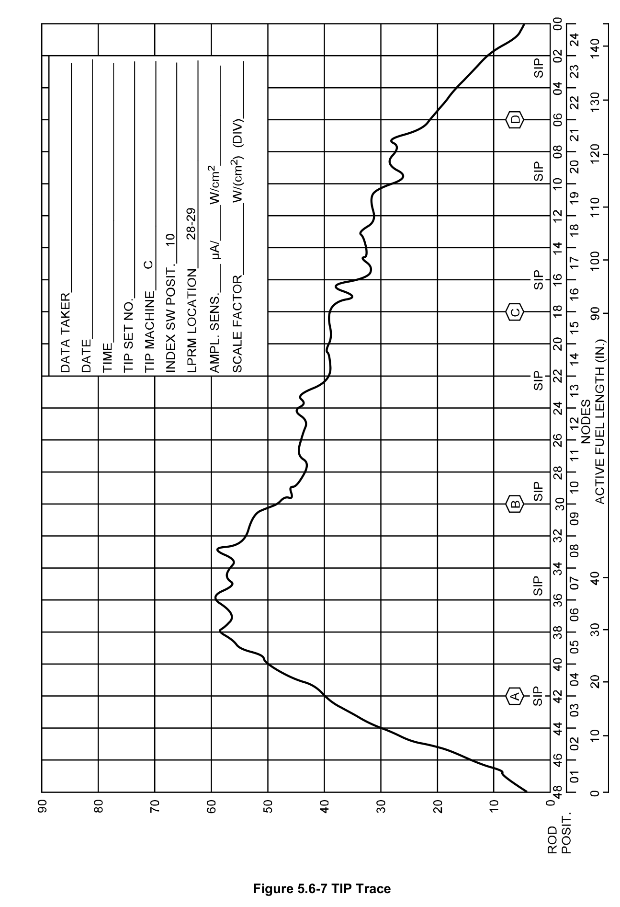

# 5.6 TIP

> Source: `5.6_TIP.pdf` (20 pages)
> GE (BWR) Systems Technology Manual — USNRC HRTD, Rev 09/11

---
<!-- p.1 -->
#### General Electric Systems Technology Manual
#### Chapter 5.6
#### Traversing Incore Probe System
<!-- p.3 -->
TABLE OF CONTENTS

5.6 TRAVERSING INCORE PROBE SYSTEM .............................................................. 1

5.6.1 Introduction .......................................................................................................... 1

5.6.2 Component Description ....................................................................................... 2

5.6.2.1 TIP Detectors ................................................................................................ 2

5.6.2.2 Storage Locations ......................................................................................... 2

5.6.2.3 Drive Mechanisms ........................................................................................ 2

5.6.2.4 Ball and Shear Valves .................................................................................. 3

5.6.2.5 Indexing Mechanisms ................................................................................... 3

5.6.2.6 TIP Purge System ......................................................................................... 4

5.6.3 System Features and Interfaces .......................................................................... 4

5.6.3.1 System Operation ......................................................................................... 4

5.6.3.2 System Interfaces ......................................................................................... 6

5.6.4 Summary ............................................................................................................. 7

LIST OF TABLES

5.6-1 TIP Detector and Drive Cable Characteristics ..................................................... 9

Rev 09/11 5.6-i USNRC HRTD

<!-- p.4 -->
#### LIST OF FIGURES
5.6-1 Traversing Incore Probe (TIP) System 5.6-2 TIP Detector 5.6-3 TIP Shear Valve 5.6-4 TIP Indexing Mechanism 5.6-5 TIP Drive Control Unit 5.6-6 TIP Valve Control Monitor 5.6-7 TIP Trace

Rev 09/11 5.6-ii USNRC HRTD

<!-- p.5 -->
### 5.6 TRAVERSING INCORE PROBE SYSTEM
Learning Objectives:

1. Recognize the purpose of the Traversing Incore Probe (TIP) System.

2. Recognize the purpose, function and operation of the following TIP system major components:
a. TIP detectors b. storage locations c. drive mechanisms d. ball and shear valves e. indexing mechanisms f. TIP purge system

3. Recognize how the TIP system interfaces with the following systems:
a. Local Power Range Monitoring System (Section 5.3)
b. Process Computer System (Thermal Limits, Section 1.8)
c. Nuclear Steam Supply Shutoff System (Section 4.4)

#### 5.6.1 Introduction
The purpose of the TIP System is to provide a means of obtaining the axial and radial neutron flux distribution within the reactor core. The functional classification of the TIP System is that of a power generation system.

The TIP system (Figure 5.6-1) consists of four neutron detectors. Each detector contains a miniature fission chamber (probe) connected to a flexible drive cable that is moved by a motor operated drive mechanism. During normal reactor operation, the probes are fully withdrawn from the reactor core, the reactor vessel, and the primary containment and are stored in shielded chambers located in the reactor building.
Periodically, the TIP system is manually operated to insert the probes into the reactor core through tubes inside the local power range monitor (LPRM) strings. As a probe is withdrawn from the top to the bottom of the reactor core region, signals indicative of neutron flux levels are sent to a chart recorder and/or the process computer that reflect the axial power shape at that location. Running TIP detectors through all 31 LPRM string locations gathers axial power shape information in all radial positions. The TIP detectors are returned to storage locations in the reactor building after data collection is completed.

The TIP data, either from a single LPRM string location or from all LPRM string locations, is used to recalibrate the LPRM detectors. The TIP data is also used by the

Rev 09/11 5.6-1 USNRC HRTD

<!-- p.6 -->
process computer to calculate the power distribution within the reactor core and determine whether thermal limits are being satisfied.

#### 5.6.2 Component Description
The major components of the TIP system are illustrated in Figure 5.6-1 and discussed in the following sections.

##### 5.6.2.1 TIP Detectors
Each of the four TIP detectors (Table 5.6-1 and Figure 5.6-2) is a fission chamber with characteristics similar to a LPRM detector. Each TIP detector is constructed of titanium, and has an internal coating of uranium enriched to over 90% U235. The detector is pressurized with argon gas at 91.5 cm Hg. The active portion of the detector assembly is about 0.2" outer diameter by 1" long.

Each TIP detector is connected to a triaxial cable (Table 5.6-1 and Figure 5.6-2) about ¼ inches in diameter and 140 feet long. The outer sheath of the drive cable has a helical wrap to facilitate coupling with the motor drive mechanism. This helical wrap of carbon steel provides a low friction means of driving the detector and also protects the signal cable. This cable is lubricated with molybdenum disulfite, a dry lubricant.

TIP detectors A, B, C and D allow all 31 LPRM strings to be scanned. All four TIP detectors can access the common LPRM string (core location 28-29) one at a time for normalization across all four detectors. Each TIP detector can then also uniquely access 7 or 8 other LPRM strings.

##### 5.6.2.2 Storage Locations
When not in use, the TIP detectors reside in storage locations in the reactor building just outside of the drywell (primary containment) wall. Because of the internal uranium oxide coating, TIP detectors become highly radioactive after only a short exposure to neutron flux in the reactor core. Shielding is provided at the storage locations to minimize radiation levels in the adjacent areas.

##### 5.6.2.3 Drive Mechanisms
Each TIP detector has an individual drive mechanism. The drive mechanisms are located near the TIP detector storage locations in the reactor building. The AC motor operated drive mechanisms move the TIP detectors from their storage locations to the top of the nuclear instrument tubes within the reactor core and back. The drive mechanism can move the TIP detector at high speed (60 feet/minute) between the

Rev 09/11 5.6-2 USNRC HRTD

<!-- p.7 -->
storage location and bottom of reactor core and low speed (7.5 feet/minute) while in the core region.

The drive mechanisms are operated from drive control units (Figure 5.6-5 illustrates one of the four identical drive control units) at a back panel in the main control room. Both automatic and manual modes of operation can be initiated from these units. Selection of the LPRM string to be traversed is also made at each drive control unit by a 10 position channel selector switch. The drive control unit displays various TIP system parameters. These parameters include detector position in inches from the indexing mechanism, direction and speed of detector travel, mode of operation, and status of information flow to the process computer (i.e., scan in progress).

##### 5.6.2.4 Ball and Shear Valves
Each TIP detector has a ball valve with a solenoid operator that can be controlled automatically by the detector’s position or manually by the operator. The ball valve can automatically open when the TIP detector leaves its storage location and automatically close when the TIP detector is fully retracted back into its storage location.
Alternatively, the operator can manually open and close the ball valve from the drive control unit in the main control room (Figure 5.6-5). The ball valve provides the normal isolation of the primary containment penetration used by the TIP tube. The ball valve has a fail-safe spring that closes the valve if the power supply to its solenoid is lost.

Each TIP detector is also equipped with a shear valve (Figure 5.6-3) as a backup to the ball valve. An explosive squib can be triggered from the TIP valve control monitor
(Figure 5.6-6) in the main control room to seal off the reactor side of the tube. The shear valve is designed to cut through the TIP cable, but it may not slice through the TIP detector itself. Operation of the squib valve is manual and is only actuated when drywell isolation is required and the ball valve cannot be closed to isolate the primary containment penetration. The shear valve is powered by the 125 volt DC battery power supply to ensure the containment isolation capability is retained should the normal AC power supply for the TIP system be lost.

The ball and shear valves are located in the reactor building between the TIP detector storage locations and the drywell wall (Figure 5.6-1).

##### 5.6.2.5 Indexing Mechanisms
Each TIP detector has an indexing mechanism (Figures 5.6-1 and 5.6-4) located inside primary containment on the opposite side of the drywell wall from the TIP storage locations and drive mechanisms. The indexing mechanisms determine which TIP guide tubes (i.e., LPRM strings) the TIP detectors enter. The drive control units in the main

Rev 09/11 5.6-3 USNRC HRTD

<!-- p.8 -->
control room (Figure 5.6-5) are used to re-position the indexing mechanism to the desired in-core locations.

Channel number 10 of each indexing mechanism connects to a 4-way connector that permits all four TIP detectors to scan (one at a time) the LPRM string in the center of the core (28-29). This common channel allows all four TIP detectors to be crosscalibrated and the TIP scanned values to be normalized by the process computer. All other channels connect the indexing mechanisms to unique LPRM string locations.

By locating the indexing mechanisms inside the drywell, the number of containment penetrations is minimized – only four penetrations are required for the TIP detectors instead of 34 (30 for the non-common LPRM strings and 4 for each TIP detector to access the common LPRM string).

##### 5.6.2.6 TIP Purge System
To prevent moisture and humidity from rusting the drive cable and deteriorating the guide path lubricant and cable insulations, the TIP guide tubes and indexing mechanisms are constantly purged by nitrogen. Nitrogen is used because the indexing mechanisms and TIP guide tubes are located inside the normally inerted drywell.
Nitrogen to the indexing mechanisms passes through a purge assembly which reduces the nitrogen pressure and regulates nitrogen flow to a maximum of 140 scfd. The TIP guide tubes are purged via flow through the indexing mechanisms.

The drive mechanisms are constantly purged by dry air from the instrument air system.
The air pressure is reduced to 5 psig and flow is controlled to each drive mechanism at
1.5 scfh.

#### 5.6.3 System Features and Interfaces
A short discussion of system features and interfaces this system has with other plant systems is given in the paragraphs which follow.

##### 5.6.3.1 System Operation
The TIP system is normally in a standby configuration with all four TIP detectors in their storage locations. The process computer uses the axial and radial flux/power readings from the LPRMs and the overall reactor thermal power from a heat balance calculation to determine fuel bundle, fuel node, and fuel pin powers.

Periodically, the TIP system is used to scan all LPRM string locations to update the process computer’s database of power shapes. The process computer uses curvefitting routines to fill in the gaps between the four axial LPRM detector readings it gets

Rev 09/11 5.6-4 USNRC HRTD

<!-- p.9 -->
for each of the 31 LPRM strings. A full TIP scan allows the process computer to more accurately curve-fit the LPRM data. Control rod pattern adjustments, which tend to affect axial power shapes more significantly than power changes by recirculation flow rate changes, can trigger the need for full TIP scans.

LPRM sensitivity changes over time due to depletion of uranium within the detectors.
The LPRM detectors are a mixture of detectors installed during the most recent refueling outage and detectors installed one or more outages ago. Even the sensitivity of LPRM detectors installed in the reactor core at the same time varies based on the relative power levels of their in-core locations. A full TIP scan allows the process computer to calculate calibration data for the LPRM detectors.

The TIP system is also used to scan individual LPRM string locations between full scans. For example, when an individual LPRM detector fails and is bypassed, or is repaired and returned to service, a TIP scan of that LPRM string helps the process computer better handle the change in LPRM data it receives.

When a minor control rod pattern adjustment is made (perhaps the insertion of a group of four control rods to improve margins to thermal limit or withdraw of a group of control rods to compensate for fuel depletion), the TIP system may be used to scan LPRM strings near the control rods to update the axial power shapes stored in the process computer.

A TIP detector is operated from its drive control unit (Figure 5.6-5) at a back panel in the main control room. The MODE switch is placed in the manual or automatic position. In automatic, the AUTO START pushbutton is depressed. In manual, the MANUAL switch is placed in the forward direction. The TIP detector moves in slow speed from its storage location to the indexing mechanism. The CHANNEL SELECT knob is used to select the appropriate LPRM string to scan. The TIP detector moves in fast speed from the indexing mechanism through the nuclear instrument tube for the selected LPRM string. The TIP detector speed automatically shifts to slow speed upon reaching the bottom of the reactor core region and stops upon reaching the core top location. When the process computer is ready to receive information, the white SCAN light illuminates and the operator initiates withdrawal of the TIP detector. The TIP detector moves in slow speed until reaching the core bottom limit. The SCAN light extinguishes and the TIP detector moves at fast speed back to the indexing mechanism. If additional scans are required, the CHANNEL SELECT knob is re-positioned; otherwise the TIP detector is withdrawn back to its storage location.

A chart recorder at the back panel in the main control room enables the power shape to be plotted as a TIP detector is withdrawn from the reactor core region. Figure 5.6-7 illustrates the axial power shape traced by TIP machine C as it scanned channel 10
(LPRM string 28-29). The left side of the chart is core bottom. The four LPRM detector

Rev 09/11 5.6-5 USNRC HRTD

<!-- p.10 -->
positions are indicated on the chart. The A level LPRM detector is located 18 inches above core bottom equivalent to control rod notch position 42. The seven fuel bundle spacers (SIP) are shown at their 18 inch separation positions.

If high drywell pressure (>1.69 psig) occurs, the TIP detectors automatically retract to their storage locations and the ball valves close to isolate the primary containment penetrations. If normal AC power is lost, DC power allows the shear valves to be manually closed from the valve control unit (Figure 5.6-6) if necessary to isolate the primary containment penetrations.

##### 5.6.3.2 System Interfaces
The interfaces the TIP system has with other systems are discussed in the following paragraphs.

Local Power Range Monitoring System (Section 5.3)

The TIP system is used to calibrate LPRM system detectors. The TIP tube is housed inside the LPRM assembly.

Process Computer (Section 6.1)

During a scan, the TIP system provides the process computer with the LPRM string location along with 144 pairs of data (axial position in the core and the corresponding neutron flux reading for each inch of active core height). The process computer uses this information when it calculates the power distribution within the reactor core and checks conformance with thermal limits. The process computer also uses the TIP data when determining adjustments needed to LPRM calibrations to compensate for uranium depletion and changes in detector sensitivity.

Service and Instrument Air System (Section 11.6)

The service and instrument air system supplies dry instrument to purge the TIP tubing and indexing mechanisms inside the drywell during outages when inerting is not required. The service and instrument air system supplies instrument air to purge the TIP tubing and drive mechanisms outside the drywell at all times.

Nuclear Steam Supply Shutoff System (Section 4.4)

The nuclear steam supply shutoff system provides a signal of high drywell pressure (>
1.69 psig) that automatically retracts all TIP detectors to their storage locations and closes the ball valves if normal AC power is available.

Rev 09/11 5.6-6 USNRC HRTD

<!-- p.11 -->
Containment Inerting System (Section 4.1)

The containment inerting system supplies nitrogen to purge the TIP tubing and indexing mechanisms inside the drywell during reactor operation.

#### 5.6.4 Summary
Classification - Power generation system

Purpose - To provide a means of obtaining core power distribution.

Components - Detectors; storage locations; drive mechanisms; ball and shear valves;
indexing mechanisms; purge system.

System Interfaces - LPRM system; process computer; service and instrument air system; nuclear steam supply shutoff system; containment inerting system.

Rev 09/11 5.6-7 USNRC HRTD

<!-- p.12 -->
Rev 09/11 5.6-8 USNRC HRTD

<!-- p.13 -->
TABLE 5.6-1 TIP Detector and Drive Cable Characteristics

Detector

Construction material Titanium Coating material (neutron sensitive) Uranium Insulating material Forsterite Filling gas Argon Outside diameter 0.180 inch Active length
1.0 inch 4.8 x 10-18 amp/nv ± 50% Neutron sensitivity in BWR 3 x 10-14 amp/R/h max Gamma sensitivity
2.8 x 1013 to 2.8 x 1014 Neutron flux operating range Life (defined as 50% reduction in 1021 nv neutron sensitivity)
Operating voltage (detector polarizing) 100 VDC Resistance - Collector - to shaft at 100 1 x 109 ohms (minimum) VDC at room temperature and at 50% relative humidity

Detector Drive Cable

Type Triaxial Helical wrap Carbon Steel Sheath Stainless steel Inner conductor Stainless steel (tungsten carbide coated)
Insulating material Magnesia Length 140 feet Outside diameter 0.256 (+0.00/-0.002) inc Operating environment Less than 50% 6080 F relative humidity temperature Not less than 1019 nv Exposure life

Rev 09/11 5.6-9 USNRC HRTD

<!-- p.14 -->
#### Figure 5.6-1

*Traversing Incore Probe (TIP) System*

[Vector original (SVG, lossless): fig_5.6-1.svg](../figures/fig_5.6-1.svg)

<!-- labels/text on this figure page -->
TOP GUIDE
LPRM DETECTOR ASSEMBLY VESSEL
BOTTOM OF ACTIVE FUEL
INSTRUMENT GUIDE TUBE
INDEXING MECHANISM 1 10 9 2 8 3 TO OTHER 7 4 INDEXERS 6 5
BALL SHEAR DRYWELL VALVE VALVE
TIP PURGE STORAGE VALVE POSITION ASSEMBLY SHIELDING TAKE DRIVE UP MECHANISM REEL
FROM INSTRUMENT AIR SYSTEM DRIVE FLUX PROBE CONTROL UNIT MONITOR
PMS PMS
X AXIS RECORDER X-Y INPUT Y AXIS RECORDER SELECTOR
Figure 5.6-1 Traversing Incore Probe (TIP) System

<!-- p.15 -->
#### Figure 5.6-2

*TIP Detector*

[Vector original (SVG, lossless): fig_5.6-2.svg](../figures/fig_5.6-2.svg)

<!-- p.16 -->
#### Figure 5.6-3

*TIP Shear Valve*

[Vector original (SVG, lossless): fig_5.6-3.svg](../figures/fig_5.6-3.svg)

<!-- labels/text on this figure page -->
SQUIB
ALUMINUM SEAL AFTER
GUIDE GUILLOTINE TUBE
REACTOR SIDE
INDICATOR LINK
CONNECTOR FOR SHEAR VALVE MONITOR CIRCUITRY
7.50"
GUILLOTINE
Figure 5.6-3 TIP Shear Valve

<!-- p.17 -->
#### Figure 5.6-4

*TIP Indexing Mechanism*

[Vector original (SVG, lossless): fig_5.6-4.svg](../figures/fig_5.6-4.svg)

<!-- p.18 -->
#### Figure 5.6-5

*TIP Drive Control Unit*

[Vector original (SVG, lossless): fig_5.6-5.svg](../figures/fig_5.6-5.svg)

<!-- p.19 -->
#### Figure 5.6-6

*TIP Valve Control Monitor*

[Vector original (SVG, lossless): fig_5.6-6.svg](../figures/fig_5.6-6.svg)

<!-- p.20 -->
#### Figure 5.6-7

*TIP Trace*

[Vector original (SVG, lossless): fig_5.6-7.svg](../figures/fig_5.6-7.svg)

