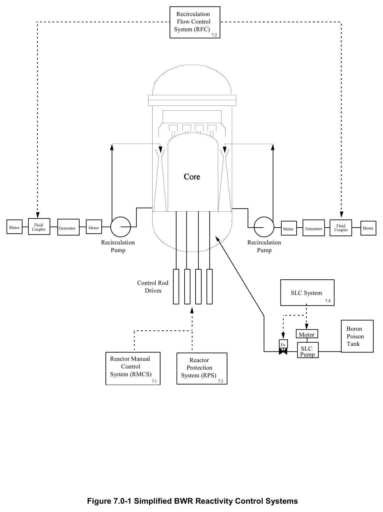

# 7.0 Reactivity Control Intro

> Source: `7.0_Reactivity_Control_Intro.pdf` (7 pages)
> GE (BWR) Systems Technology Manual — USNRC HRTD, Rev 09/11

---
<!-- p.1 -->
#### General Electric Systems Technology Manual
#### Chapter 7.0
#### Reactivity Control Systems
<!-- p.3 -->
TABLE OF CONTENTS

7.0 REACTIVITY CONTROL SYSTEMS ........................................................................ 1

7.0.1 Reactor Manual Control System (Section 7.1) ................................................... 1

7.0.2 Recirculation Flow Control System (Section 7.2) ............................................... 1

7.0.3 Reactor Protection System (Section 7.3) ........................................................... 1

7.0.4 Standby Liquid Control System (Section 7.4) ..................................................... 1

7.0.5 Rod Worth Minimizer (Section 7.5) .................................................................... 1

LIST OF FIGURES

7.0-1 Simplified BWR Reactivity Control Systems

Rev 09/11 7.0-i USNRC HRTD

<!-- p.5 -->
### 7.0 REACTIVITY CONTROL SYSTEMS
The systems described in this chapter are used to control the core reactivity under normal, abnormal, and emergency conditions. The systems used to control core reactivity are shown in simplified form in Figure 7.0-1.

#### 7.0.1 Reactor Manual Control System (Section 7.1)
The Reactor Manual Control System provides rod movement control signals to the control rod drive system, to vary core power level and power distribution.

#### 7.0.2 Recirculation Flow Control System (Section 7.2)
The Recirculation Flow Control System provides a means for control of core power level, over a limited range, by controlling recirculation system flow, which in turn determines the flow rate of water through the reactor core.

#### 7.0.3 Reactor Protection System (Section 7.3)
The Reactor Protection System automatically initiates a rapid reactor shutdown (scram)
by inserting control rods, to preserve the integrity of the fuel cladding and reactor coolant pressure boundary.

#### 7.0.4 Standby Liquid Control System (Section 7.4)
The Standby Liquid Control system injects a neutron absorbing poison solution into the reactor vessel to shutdown the reactor, independent of any control rod movement, and maintains the reactor subcritical as the plant is cooled to maintenance temperature.

#### 7.0.5 Rod Worth Minimizer (Section 7.5)
The Rod Worth Minimizer (RWM) serves as a backup to procedural controls to limit control rod worth during startup and low power operation. This helps limit the reactivity addition rate in the event of a control rod drop accident.

Rev 09/11 7.0-1 USNRC HRTD

<!-- p.6 -->
Rev 09/11 7.0-2 USNRC HRTD

<!-- p.7 -->
#### Figure 7.0-1

*Simplified BWR Reactivity Control Systems*

[Vector original (SVG, lossless): fig_7.0-1.svg](../figures/fig_7.0-1.svg)

<!-- labels/text on this figure page -->
Recirculation Flow Control System (RFC)
7.2
Fluid Fluid Motor Generator Motor Generator Motor Coupler Motor Coupler
Recirculation Recirculation Pump Pump
Control Rod Drives SLC System
7.4
Boron Motor Poison Tank Ex SLC Pump Reactor Manual Reactor Control Protection System (RMCS) System (RPS)
7.1 7.3
Figure 7.0-1 Simplified BWR Reactivity Control Systems

