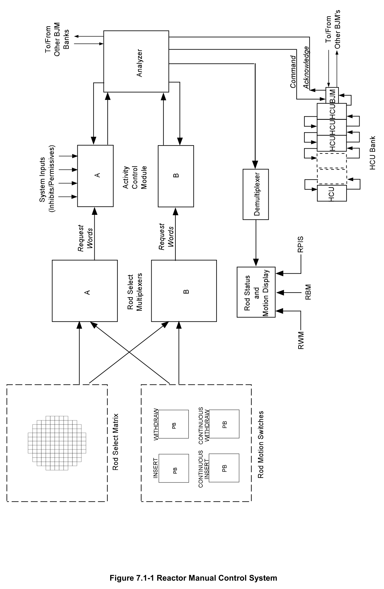
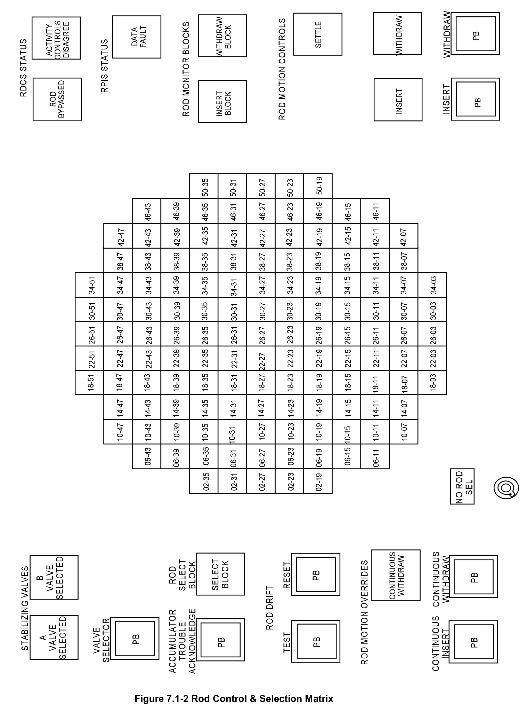
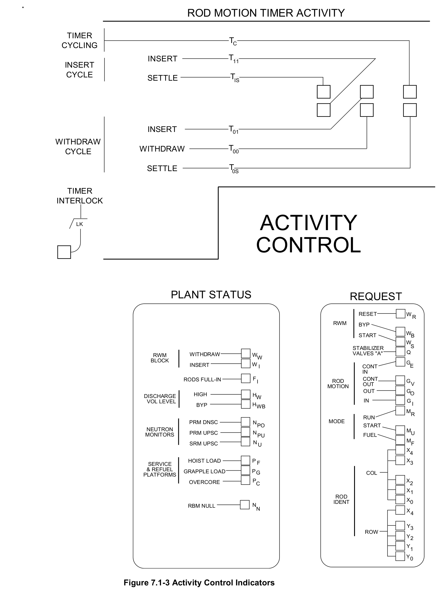
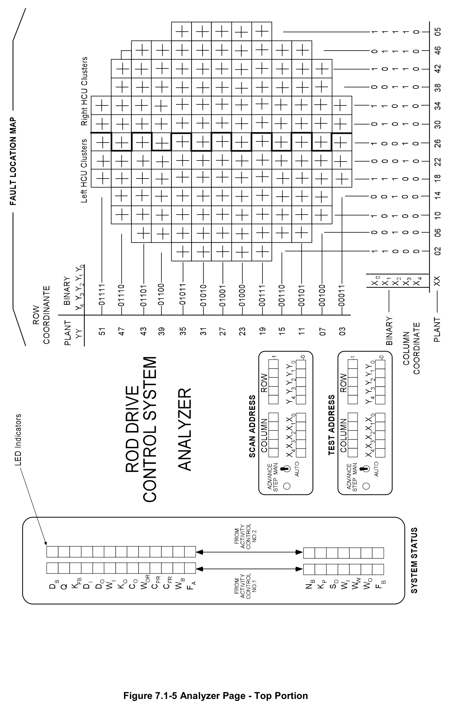
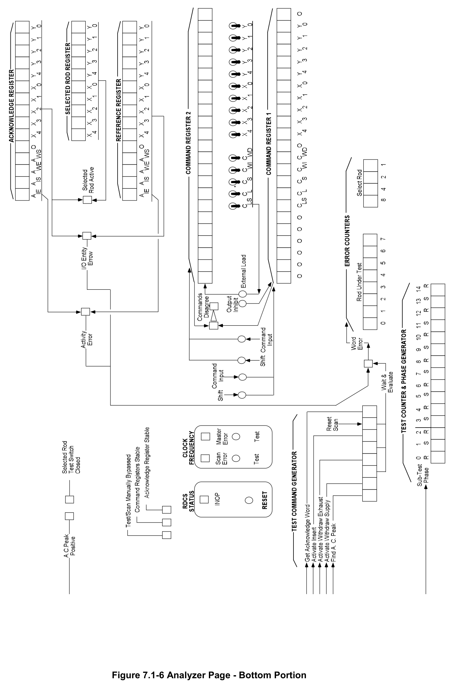
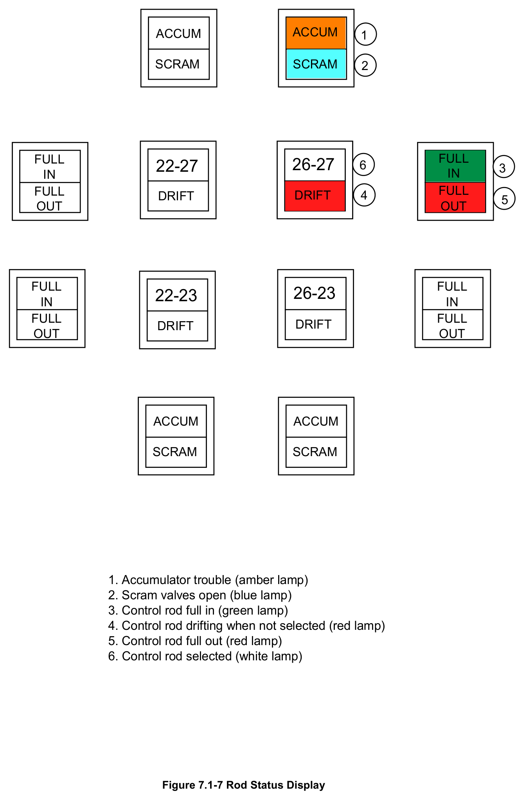

# 7.1 Reactor Manual Control

> Source: `7.1_Reactor_Manual_Control.pdf` (29 pages)
> GE (BWR) Systems Technology Manual — USNRC HRTD, Rev 09/11

---
<!-- p.1 -->
#### General Electric Systems Technology Manual
#### Chapter 7.1
#### Reactor Manual Control System
<!-- p.3 -->
TABLE OF CONTENTS

7.1 REACTOR MANUAL CONTROL SYSTEM .............................................................. 1

7.1.1 Introduction ........................................................................................................ 1

7.1.2 Component Description ...................................................................................... 2

7.1.2.1 Rod Select Module ...................................................................................... 2

7.1.2.2 Branch Junction Modules ............................................................................ 3

7.1.2.3 Rod Drive Control Cabinet ........................................................................... 4

7.1.2.4 Display Memory Module .............................................................................. 7

7.1.2.5 Test Signal Generator ................................................................................. 7

7.1.2.6 Rod Position Information System ................................................................ 8

7.1.3 System Features and Interfaces ........................................................................ 8

7.1.3.1 Normal Operation ........................................................................................ 8

7.1.3.2 Rod Block Functions and Bases ................................................................ 11

7.1.3.3 Rod Bypass ............................................................................................... 14

7.1.3.4 Control Rod Coupling Check ..................................................................... 14

7.1.3.5 Interfaces ................................................................................................... 15

7.1.4 Summary .......................................................................................................... 16

LIST OF TABLES

7.1-1 CONTROL ROD BLOCKS ................................................................................. 17

Rev 09/11 7.1-i USNRC HRTD

<!-- p.4 -->
#### LIST OF FIGURES
7.1-1 Reactor Manual Control System 7.1-2 Rod Control and Selection Matrix 7.1-3 Activity Control Indicators 7.1-4 Analyzer Page Indicators 7.1-5 Analyzer Page - Top Portion 7.1-6 Analyzer Page - Bottom Portion 7.1-7 Rod Status Display

Rev 09/11 7.1-ii USNRC HRTD

<!-- p.5 -->
### 7.1 REACTOR MANUAL CONTROL SYSTEM
Learning Objectives:

1. Recognize the purposes of the Reactor Manual Control System (RMCS).

2. Recognize the purpose function and operation of the following Reactor Manual Control System major components:
a. Rod Select Module b. Rod Drive Control Cabinet c. Rod Position Information System (RPIS)

3. Recognize component response, including sequence, when using the following RMCS push buttons:
a. Insert b. Withdraw c. Continuous withdraw d. Continuous insert

4. Recognize the plant conditions that will generate a rod block signal to RMCS.

5. Recognize how the Reactor Manual Control System interfaces with the following systems:
a. Control Rod Drive System (Section 2.3)
b. Refueling and Vessel Servicing (Section 11.8)
c. Neutron Monitoring System (Section 5)
d. Rod Worth Minimizer System (Section 7.5)

#### 7.1.1 Introduction
The purposes of the Reactor Manual Control System (RMCS) are:

1. To provide control signals to Control Rod Drive (CRD) system for normal rod movement.

2. To prevent control rod movement during potentially unsafe conditions.

The RMCS provides the means for the operator to move control rods to change core reactivity to control reactor power level and neutron flux distribution.

The functional classification of the RMCS is that of a power generation system.

Rev 09/11 7.1-1 USNRC HRTD

<!-- p.6 -->
The RMCS (Figure 7.1-1) consists of the following electronic circuitry
• switches
• indicators
• alarm devices

This circuitry is necessary for manipulating the control rods in the core, and for the surveillance of the associated equipment. To prevent operator errors, reactor core performance and control rod positions are constantly monitored by system components.
These components either give an alarm demanding operator attention or completely block control rod movement until the error has been corrected. The RMCS includes interlocks that inhibit control rod movement under certain plant conditions. This does not include any of the circuitry or devices used to automatically or manually scram the reactor.

The RMCS is a special purpose, fixed program computer that transmits information in the form of digital signals over a single conducting path shared cable. The information is assembled into data words that are directed to parts of the system. These data words result in some required action or display of system status. The RMCS signals are generated in duplicate by two separate and independent channels. The duplication prevents a fault inspired command that could result in improper or unwanted control rod movement. The two independently generated signals are compared to ensure identical commands were generated. If the two signals are not identical an alarm is sounded along with indication to alert the operator of the comparison discrepancy.

#### 7.1.2 Component Description
The major components of the RMCS are discussed in the paragraphs that follow.

##### 7.1.2.1 Rod Select Module
The Rod Select Module is located in the center of the reactor control panel and is illustrated on Figure 7.1-2. The Rod Select Module contains the pushbutton array where the operator chooses the control rod to move and two identical transmitter cards.
One transmitter card scans the pushbutton array, senses any button depressed by the operator, and codes that button's coordinates into an identification number for transmission. The second transmitter card does an identical operation using the second contact pair in the button and a second independent lamp. If the system is working correctly, two lamps will light under the button selected. The rod motion request and system status selections are assembled into the REQUEST word. The REQUEST word is transmitted to the following systems:
• the Rod Drive Control System
• the Rod Position Information System
• the Neutron Monitoring System.

Rev 09/11 7.1-2 USNRC HRTD

<!-- p.7 -->
###### 7.1.2.1.1 Rod Motion Switches
The rod motion switches, shown in Figure 7.1-2, consists of four control pushbuttons.
These pushbuttons are INSERT, WITHDRAW, CONTINUOUS WITHDRAW, and CONTINUOUS INSERT. The INSERT pushbutton, when momentarily depressed, causes the selected rod to insert one notch. When the INSERT pushbutton is depressed and held in that position the control rod inserts continuously until the pushbutton is released.

The WITHDRAW pushbutton, when depressed, causes the selected rod to withdraw one notch. When the WITHDRAW pushbutton is held depressed along with the CONTINUOUS WITHDRAW pushbutton, the selected rod is continuously withdrawn.
The CONTINUOUS WITHDRAW pushbutton does nothing if it is the only button depressed.

The CONTINUOUS INSERT pushbutton, when depressed, causes continuous insertion of the selected rod independent of the normal rod motion timing circuits. No settle function is included with the CONTINUOUS INSERT pushbutton. This allows the selection of another control rod without waiting for the CRD timer to complete its cycle.
This type of feature is helpful when the control rods need to be inserted as quickly as possible without using the scram function of the Reactor Protection System.

###### 7.1.2.1.2 Rod Drift Test and Reset Pushbuttons
If any control rod is detected at an odd position, and is not actively being moved with the rod timing circuit, a rod drift alarm illuminates for that control rod. Along with the individual rod drift alarm light, a common audible and visual annunciator actuates to alert the control room operator of the unrequested rod movement. During normal rod movement, the drift alarm is bypassed on the selected rod while the automatic sequence timer is cycling. The rod drift RESET pushbutton is provided to reset the drift alarm, not the drift condition.

Testing of the drift circuitry is performed by depressing the TEST pushbutton while performing a rod movement. The drift alarm then actuates when the control rod passes an odd position reed switch.

##### 7.1.2.2 Branch Junction Modules
The HCUs are arranged in two banks, one on the east side and one on the west side of the reactor building. Each bank is comprised of five clusters consisting of six to fifteen HCUs. Each cluster contains one Branch Junction Module (BJM), for a total of ten clusters and ten BJMs. The first BJM in the bank receives the command word from the analyzer and passes it on, until all five BJMs in each bank are linked together. The BJMs also receive power for the directional control valve solenoids from the power module and distribute it to the HCUs.

Rev 09/11 7.1-3 USNRC HRTD

<!-- p.8 -->
The BJM is an enclosure mounted at the end of a cluster of HCUs. The BJM serves as:
• a mechanical termination point for cables arriving from the control room and adjoining branch junction modules,
• a housing for voltage regulating transformer,
• and as a mounting place for a branch amplifier card.

The branch amplifier card contains a power supply and logic circuitry for the following functions:
• Receiving command words and transmitting them to the down stream branch junction modules.
• Receiving acknowledge words from the downstream branch junction modules.
• Merging acknowledge words originating within its hydraulic control unit cluster and transmitting them to the upstream branch junction module or Rod Drive Control Cabinet.
• Sensing the phase and magnitude of the AC power supplying its HCU cluster and adding this data to the acknowledge words originating with the cluster

##### 7.1.2.3 Rod Drive Control Cabinet
The Rod Drive Control Cabinet is the heart of the Rod Drive Control System. The cabinet contains four major sections. At the top of the cabinet are two identical Activity Control Sections. In the middle is an Analyzer section and below it is the Power section.

All incoming signals enter the cabinet in duplicate, with one member of each pair connected to each of the Activity Control sections. In the Activity Control section the signals are processed in duplicate and the results sent to the Analyzer section. In the Analyzer section the inputs are checked to ensure that the signals are identical, and if they are, one signal is sent on to the transponders and the other signal retained as a reference. If the signals do not agree, the error is noted and the system tries again.
The trials continue until agreement is found or until an error count limit is reached, the system is disabled and the fault annunciated.

The Power section contains the power module which is capable of disconnecting the power to the system should the self test subsystem in the analyzer determine that some malfunction has occurred.

Each Activity Control section is in an electrically isolated box, as is the Analyzer section.
The separate boxes make it highly unlikely that the failure of a single component in one section would produce a failure in the others.

Rev 09/11 7.1-4 USNRC HRTD

<!-- p.9 -->
###### 7.1.2.3.1 Activity Control Module
The Activity Control Module receives selected plant status data and operator requests from the Rod Select Matrix and Rod Motion switches. It also receives rod position data from the Rod Position Information System (RPIS). If conditions allow, the activity control module generates the rod motion command and HCU identification signal to send to the Analyzer.

Selected plant status data includes inputs from the following systems:
• Neutron Monitoring System
• Scram Discharge Instrument Volume
• Recirculation System flow converters
• Rod Worth Minimizer (RWM)
• RPIS
• and the Refueling and Service Platform.

The Activity Control Module consists of two identical control sections. Each of the Activity Control sections contains the following components:
• an input isolator card
• an activity control card
• and a rod motion timer card

7.1.2.3.1.1 Input Isolator Card

The input isolator card electrically isolates the signals coming from outside the cabinet.

7.1.2.3.1.2 Activity Control Card

The main function of the Activity Control Card is to monitor the present state of the plant to determine if the rod motion requested is permissible. If the requested rod motion is permissible, the activity control card will activate its associated rod motion timer card.
The timer card cycles through a fixed pattern of timing signals which cause rod motion.
The activity control card will add the command code from the rod motion timer card to the rod identity. This combination of signals is transferred as a COMMAND word to the analyzer card. A similar process occurs in the other activity control section.

7.1.2.3.1.3 Rod Motion Timer Card

The rod motion timer card produces a precise sequence of time intervals, spanning about 10 seconds, designed to move a control rod one notch. Inserting a rod requires a different sequence of intervals than withdrawing a rod. Circuitry contained in the timer card prevents trying to move a rod and IN and OUT at the same time. It also prevents the timing sequence from being interrupted.

Rev 09/11 7.1-5 USNRC HRTD

<!-- p.10 -->
###### 7.1.2.3.2 Analyzer
The Analyzer contains an analyzer card and a fault map card. The analyzer compares the data from the two channels of the Activity Control Modules and generates command signals to the appropriate equipment if the two signals are identical. If the two signals differ in any way, the analyzer produces a rod block signal and illuminates the activity control disagree light on the operator's center control room panel. If both signals agree, the analyzer stores one signal and transmits the other as a COMMAND word to the Branch Junction Modules (BJM). The COMMAND word contains an HCU identification signal and the signals to operate the directional control valves in the CRD system. In addition, the analyzer sends information to the Rod Status and Motion Display for the appropriate status displays.

7.1.2.3.2.1 Analyzer Card

The analyzer card is the master control element in the system. It compares the signals from the two activity control sections for equivalency before using them to control the rest of the system. It also causes the system to process operator REQUEST words, SCAN words, and SELF TEST words in an alternating predetermined sequence.
ACKNOWLEDGE words being returned to the cabinet from the transponders are received by the analyzer and compared to the expected response to determine if an error has occurred. If so, the analyzer will remember the error and continue with the program. If a sufficiently large number of errors are found indicators will light on the fault map (indicating the BJM or transponder in fault) and the system will stop.

7.1.2.3.2.2 Fault Map Card

The fault map card contains an array of light emitting diodes laid out as a map of the reactor core. Should the self test program discover a fault associated with any of the transponders, it will light the corresponding spot on the fault map. The fault map card also contains two counters, the scan ident counter and test ident counter.

The scan ident counter advances one count at a time and sends a scan request out through the system. When the entire core has been scanned once and is ready to start again, the self test counter advances one step to test a transponder. A new scan then starts and proceeds until the core again has been scanned. When this is finished, a second transponder will be self tested. This process continues until all rods have been checked by the self test program and then it starts all over again. This process is repeated indefinitely.

###### 7.1.2.3.3 Power Section
The power section comprises the AC power junction box which supplies AC power for the Rod Drive Control System. A power gate controls power to the remote parts of the system and contact power supply.

Rev 09/11 7.1-6 USNRC HRTD

<!-- p.11 -->
The power gate consists of two large silicon controlled rectifiers mounted on heat sinks in the Rod Drive Control Cabinet. The purpose of the power gate is to transfer 120 VAC to the array of transponders located on the HCUs.

As long as a signal is received from the analyzer portion of the Rod Drive Control cabinet, the power gate will continue to supply power. If the analyzer encounters a problem in the system the following actions occur:
• the signal to the power gate is dropped
• the two silicon rectifiers turned off, disconnecting all power to the HCU clusters.

This prevents failures in the system from causing a control rod to move.

##### 7.1.2.4 Display Memory Module
The display memory module receives multiplexed information from the Analyzer and RPIS. The information is used to control the full core display and the 4-rod display indication. In addition the display memory module routes scram time test information from the HCUs to a multipoint scram time recorder.

##### 7.1.2.5 Test Signal Generator
The control room operator requests control rod motion using the appropriate pushbuttons. Normal rod movement command is the operator follow mode. The Analyzer also has a test signal generator. This generates test signals for the scan and the self test modes of operation.

The scan mode is a data gathering mode. The test signal generator initiates a rod selection signal and sends it to both activity module channels. Each channel forms a command signal that includes only the HCU identity. This command signal is sent along the same path as the operator follow mode. The system processes the command signal the same as in the operator follow mode. However, the transponder response is different. Selected HCU status data from the transponder is transmitted back to the analyzer comparator as an acknowledgment. The analyzer adds all rod drive system status data to the acknowledge word and retransmits it for display.

The self test mode is a diagnostic and evaluation mode used by the system to detect internal faults. The test signal generator of the analyzer initiates a rod identity and a specific motion control signal. This signal is sent to both channels of activity module where a command signal (motion command and HCU identity) is formed. This command signal is processed exactly as in the two previous modes. Mechanical operation of the HCU directional control valves does not occur. This is because in actual operation a series of repetitive control signals is needed to allow valve operation.
Electrical operation is verified through the acknowledge word. Discrepancies are

Rev 09/11 7.1-7 USNRC HRTD

<!-- p.12 -->
annunciated to the operator. A suspected fault causes the system to automatically run a series of rechecks.

In addition to the self test mode, the system can be tested manually through the use of local pushbutton controls to verify the self test function reliability.

##### 7.1.2.6 Rod Position Information System
The RPIS is used to obtain control rod position data. The position information is provided to the operator, to the Performance Monitoring System (PMS), and to the RMCS display.

For the purpose of providing position information, each CRD contains a stationary position indicator probe consisting of 53 reed switches. The 25 even control rod notch positions (00-48) are detected by switches spaced at intervals of 6 inches. Halfway between each of the even position switches are 24 additional switches used to determine when the rod is at an odd position. The four remaining switches are used to detect the rod at the full in, full out, overtravel in, and overtravel out positions. A magnet attached to the Control Rod Drive Mechanism (CRDM) index tube closes a reed switch in the probe assembly, when the CRDM passes the reed switch.

#### 7.1.3 System Features and Interfaces
A short discussion of system features and interfaces this system has with other plant systems is given in the paragraphs which follow.

##### 7.1.3.1 Normal Operation
The Reactor Manual Control System, during normal conditions, is continuously cycling through three modes of operation:
• Operator Follow Control Mode (OF)
• Scan Mode (S)
• Self Test Mode (ST)

Once power is applied to the system, the analyzer continually cycles through its prescribed sequence. This sequence consists of the OF, S, and ST modes which are grouped in a certain testing sequence. The system cycles ST-OF through seven counts of the test generator. During one OF mode, the operator generated demand (if any) is generated, and the self test command is transmitted to the transponders.

After completing seven counts, the test generator then counts eight, whereupon a scan is made of all rods (OF-S). Scanning is performed in a square matrix with the scan progressing from left to right, top to bottom. Following the scan mode, the analyzer now goes back to ST-OF. During this portion of the sequence, the analyzer is receiving the acknowledge words from the HCU that was just tested in the self test mode. This

Rev 09/11 7.1-8 USNRC HRTD

<!-- p.13 -->
describes a complete test cycle for one rod. Normally three test cycles are conducted for each rod. If errors are encountered, it is possible that up to 14 such tests will be conducted. The normal three test cycles per rod is conducted for all rods, requiring approximately 20 seconds to test all rods.

###### 7.1.3.1.1 Operator Control Mode
The Operator Control Mode starts with the operator, who uses manual pushbuttons to make a rod selection. The operator then depresses the appropriate rod motion request button(s). The control rod select multiplexers transform the selection and motion requests into two binary request words for transmission to its related activity control.
This information also back lights the selected rod's pushbutton and full core display identification. This provides the operator with an initial verification that the signal is being processed correctly.

Both Activity Control units receive the request word, sent by its respective multiplexer.
In addition, the activity control modules are monitoring plant status for rod block conditions. If plant status is such that rod blocks are not imposed, then the activity control circuitry will initiate operation of the rod motion timer card. This card produces a fixed (approximately ten seconds) program sufficient to move a rod one notch in or out when delivered to the appropriate transponder. Both activity control modules then send a combined identification and motion signal to the analyzer.

The command words from each activity control are compared as they enter the analyzer. If the command words agree in the analyzer one of the signals will be transmitted to all of the transponders on the hydraulic control units while the other is retained as a reference command word. If the command words for some reason do not agree, nothing will be transmitted and the operator will receive the "Activity Control Disagree" light. In addition an annunciator will alarm indicating the Reactor Manual Control System is inoperable. This condition will cause the system to stall and must be cleared by using the reset pushbutton on the analyzer.

If the command signals do agree, one signal is transmitted to the BJMs as the command word while the other is retained as a reference. The selected transponder receives the command word from its BJM and an immediate acknowledgement is returned to the analyzer, along with HCU status for comparison. If there is any discrepancy between the command and activity, or between the identity of the addressed rod and the responding rod the analyzer interrupts its signal and secures power to all HCUs.

If no discrepancies are found, then the transponder will operate the HCU solenoid valves as described in the following sections.

Rev 09/11 7.1-9 USNRC HRTD

<!-- p.14 -->
7.1.3.1.1.1 Rod Withdrawal

Once the WITHDRAW pushbutton is depressed the rod insert light will illuminate for a little less than one second. During this time the 121 and 123 valves are energized to insert the rod. Movement of the rod into the core removes the static load from the CRDM's collet fingers. Following the small movement inward power is removed from the insert directional control valves and is supplied to the withdrawal directional control valves (120 & 122). This forces the collet fingers against the guide cap, away from the index tube, and also drives the control rod out of the core. The rod moves out of the core for approximately a second and a half past the collet fingers. The drive signal is then removed and the rod is allowed to settle down onto the next notch. The settle function is accomplished by removing power to the 122 valve but leaving the 120 valve open for an additional 6 seconds.

7.1.3.1.1.2 Rod Insertion

Rod insertion is the same as the initial portion of the withdrawal sequence. The 121 and 123 valves remain open for over three seconds allowing the control rod to insert past the collet fingers for the nest notch. After roughly a second and a half the settle function initiates. This opens the 120 valve for approximately six seconds allowing the rod to settle on the collet fingers.

7.1.3.1.1.3 Continuous Withdrawal

Continuous withdrawal is accomplished by depressing both the CONTINUOUS WITHDRAW and the WITHDRAW pushbuttons at the same time. The sequence begins the same as the withdraw sequence above, except the timing circuit remains in the withdrawal configuration once the 120 and 122 valves open. This allows the control rod to continue to drive out of the core. Once either the CONTINUOUS WITHDRAW or the WITHDRAW pushbutton is released the timing circuit continues as before allowing the rod to settle.

7.1.3.1.1.4 Continuous Insertion

Continuous insertion is accomplished by depressing either the INSERT or CONTINUOUS INSERT pushbutton and holding it in the depressed position.
Depressing and holding the INSERT pushbutton will allow the timing circuit to pause during the insertion portion of its cycle. The control rod will continue to insert as long as the INSERT pushbutton is depressed. Once released the timing circuit will continue with its normal functioning allowing the rod to settle on the next notch.

Depressing the CONTINUOUS INSERT pushbutton bypasses the timer function to energize the 121 and 123 valves. These valves will remain open as long as the CONTINUOUS INSERT pushbutton is depressed. Once the CONTINUOUS INSERT pushbutton is released the 121 and 123 valves close. The control rod will not have any

Rev 09/11 7.1-10 USNRC HRTD

<!-- p.15 -->
settle function and may stop between notches. Stopping between notches will cause a ROD DRIFT alarm and annunciation. With CONTINUOUS INSERT the timing circuit has not been initiated another control rod may be selected immediately.

###### 7.1.3.1.2 Scan Mode
In the scan mode, the system is being used for gathering data. In this mode, control starts at the analyzer instead of the operator. The analyzer generates a rod identification number and sends it to each of the activity controls in a form known as a mode request. The activity in turn, generates a command word, with no valve control signal associated. The transmission path is the same as that described in the operator mode. In addition to its identification, the acknowledge word will contain the following status data from the HCU:
• Accumulator pressure and level
• Scram test switch position
• Scram valve positions
• Directional control valve status (open/closed)

The analyzer receives the information sent from the transponder and retransmits this information in the form of a status word to the Display Memory Module. The status word will be de-multiplexed, stored in memory, and used to illuminate the various display elements of the full core display.

###### 7.1.3.1.3 Self Test Mode
Self test is a diagnosis and evaluation mode, whose control also starts at the analyzer.
When called for in the operating cycle, the analyzer generates a rod selection signal and valve control signal. These signals are transmitted as discussed above in the other two modes.

The analyzer is programmed such that the valve control signals will cause all four directional control solenoid valves to energize. The solenoids are only energized long enough to check for continuity, thus preventing rod motion. The acknowledge word that returns to the analyzer for comparison is checked to see if the correct transponder replies and the correct driver circuit responds to the signals called.

##### 7.1.3.2 Rod Block Functions and Bases
Each of the rod block function and its bases associated with the function are discussed below. Additionally, these rod blocks are given in Table 7.1-1.

###### 7.1.3.2.1 SRM Inoperative Trip
Ensures a control rod is not withdrawn unless proper neutron monitoring capability is available and all SRM channels are either in service or properly bypassed. This rod

Rev 09/11 7.1-11 USNRC HRTD

<!-- p.16 -->
withdrawal block is automatically bypassed when IRMs are selected to above range seven or when the reactor mode switch is in the RUN position.

###### 7.1.3.2.2 SRM Downscale Trip
This ensures that a control rod is not withdrawn unless the SRM count rate is above the minimum prescribed low neutron flux monitoring level. The rod withdrawal block is automatically bypassed when IRMs are selected to above range 2.

###### 7.1.3.2.3 SRM Wrong Position Trip
This ensures that no control rod is withdrawn unless all SRM detectors are either fully inserted or have a count rate greater than 100 counts per second. This ensures that they are positioned properly to provide the operator with neutron flux level information.
This rod withdrawal block is automatically bypassed when the associated IRMs are above range two or when the reactor mode switch is in the RUN position.

###### 7.1.3.2.4 IRM Upscale Alarm Trip
This ensures that a control rod is not withdrawn unless the IRM equipment is properly ranged up during a reactor startup.

###### 7.1.3.2.5 IRM Inoperative Trip
This ensures that no control rod is withdrawn unless proper neutron monitoring is available with all IRM channels in service or properly bypassed.

###### 7.1.3.2.6 IRM Downscale Trip
This ensures that no control rod is withdrawn unless the neutron flux is being properly monitored. This rod block prevents the continuation of a reactor startup if the operator ranges the IRM up too far for the existing flux level.

###### 7.1.3.2.7 IRM Wrong Position Trip
This ensures that no control rod is withdrawn unless all IRM detectors are fully inserted.

###### 7.1.3.2.8 APRM Upscale Alarm Trip
This rod block is provided to avoid conditions that would require action by the Reactor Protection System (RPS). The APRM upscale alarm trip setting is selected to initiate a rod block before the APRM upscale scram setpoint is reached. This APRM upscale alarm trip has a fixed setpoint of 12% reactor power when the reactor mode switch is not in the RUN position. When the mode switch is in the RUN position, the setpoint is flow biased by Recirculation System loop flow.

Rev 09/11 7.1-12 USNRC HRTD

<!-- p.17 -->
###### 7.1.3.2.9 APRM Inoperative Trip
This ensures that a control rod is not withdrawn unless the APRM channels are either in service or properly bypassed.

###### 7.1.3.2.10 APRM Downscale Trip
This ensures that no control rod is withdrawn during power range operation unless the APRM channels are operating properly or are correctly bypassed. All unbypassed APRMs must be above their downscale setpoint with the mode switch in the RUN position.

###### 7.1.3.2.11 APRM Flow Unit Upscale Trip
This ensures that no control rod is withdrawn with the reactor mode switch in the RUN position unless the Recirculation flow units are operating properly. The flow units are necessary to provide the flow biased rod withdraw block and scram trips for the APRM system.

###### 7.1.3.2.12 APRM Flow Unit Comparator Trip
This ensures that no control rod is withdrawn with the reactor mode switch in the RUN position unless the difference between the outputs of the recirculation flow converters is within limits.

###### 7.1.3.2.13 APRM Flow Unit Inoperative Trip
This ensures that no control rod is withdrawn with the reactor mode switch in the RUN position unless the recirculation flow converters are in service.

###### 7.1.3.2.14 RPIS Failure Trip
This ensures that rod position indication is available before any control rod can be withdrawn.

###### 7.1.3.2.15 Scram Discharge Instrument Volume High Level Trip
This blocks control rod withdrawal unless enough capacity is available in the scram discharge volume to accommodate a scram. The setting is selected to initiate a rod block well in advance of that level which produces a scram.

Rev 09/11 7.1-13 USNRC HRTD

<!-- p.18 -->
###### 7.1.3.2.16 Scram Discharge Instrument Volume High Level Scram Trip Bypassed
This blocks control rod withdrawal while the scram discharge volume high water level scram function is bypassed. This rod block is disabled when the reactor mode switch is in either the STARTUP or RUN positions because these positions disable the scram bypass.

###### 7.1.3.2.17 Rod Worth Minimizer
The Rod Worth Minimizer provides both insert and withdrawal blocks to the RMCS. The insert block is initiated by the occurrence of three control rods inserted beyond the specific insert limits (insert errors) delineated in the control rod pull sequence. The withdrawal block is initiated by any one control rod withdrawn beyond its specific withdrawal limit (withdrawal error) delineated in the control rod pull sequence.

###### 7.1.3.2.18 Refueling Interlock Trips
These rod withdraw blocks ensure that no control rod is withdrawn when the fuel in the core might be in an unusual geometry or refueling is in progress.

##### 7.1.3.3 Rod Bypass
Only one control rod can be bypassed at a time and the bypassed control rod cannot be moved. The control rod is bypassed using the toggle switches on the analyzer section of the rod Drive Control Cabinet. When a bypassed control rod is selected, the rod bypassed light on the rod control and selection matrix will illuminate.

##### 7.1.3.4 Control Rod Coupling Check
Because of the severe consequences of a rod drop accident, each time a control rod is withdrawn to its full out (notch 48) position, a coupling check is performed. This is accomplished by the operator attempting to withdraw the rod past position 48. If the drive and blade are uncoupled, the CRDM will go to the OVERTRAVEL out reed switch position. The operator receives an audible alarm and loss of the digital position display for that control rod. If the control rod blade is coupled to the CRDM, it is physically impossible for the CRDM index tube's permanent magnet to close the OVERTRAVEL out reed switch. If a control rod is found to be uncoupled, procedures require the operator to insert the rod in an attempt to couple it.

Rev 09/11 7.1-14 USNRC HRTD

<!-- p.19 -->
##### 7.1.3.5 Interfaces
A short discussion of interrelations between this system and other plant systems is given in the paragraphs that follow.

Control Rod Drive System (Section 2.3)

The RMCS energizes the directional control valves (120, 121, 122 and 123) within the Control Rod Drive Hydraulic (CRDH) System allowing control rods to move. The RMCS also controls the CRDH System stabilizing valves to allow constant flow through the CRDH System during rod motion. The reed switches within the CRDM are used by the RPIS. The scram discharge instrument volume has level instrumentation which causes a rod withdraw block if the instrument volume is partially full. Various CRDH parameters are displayed on Rod Interface System equipment.

Source Range Monitor System (Section 5.1)

The SRM System provides upscale, inoperative, downscale, and wrong position trips which cause rod withdraw blocks.

Intermediate Range Monitor System (Section 5.2)

The IRM System provides upscale, inoperative, downscale, and wrong position trips which cause rod withdraw blocks.

Local Power Range Monitor System (Section 5.3)

The LPRM System provides local power level indication around the control rod selected for movement.

Average Power Range Monitor System (Section 5.4)

The APRM System provides APRM upscale (fixed and flow biased), inoperative, and downscale trips and APRM flow unit upscale, comparator difference, and inoperative trips which cause rod withdraw blocks.

120V AC Power System (Section 9.3)

The RMCS is supplied 120 VAC uninterruptible power from divisions 1 and 2.

Rod Worth Minimizer System (Section 7.5)

The Rod Worth Minimizer provides both insert and withdrawal blocks to the RMCS.

Rev 09/11 7.1-15 USNRC HRTD

<!-- p.20 -->
Refueling and Vessel Servicing Equipment (Section 11.9)

The RMCS has various interlocks with the refueling equipment.

#### 7.1.4 Summary
The purposes of the Reactor Manual Control System (RMCS) are:
1. To provide control signals to Control Rod Drive (CRD) system for normal rod movement.
2. To prevent control rod movement during potentially unsafe conditions.

The RMCS provides the means for the operator to move control rods to change core reactivity to control reactor power level and neutron flux distribution.

Rev 09/11 7.1-16 USNRC HRTD

<!-- p.21 -->
#### TABLE 7.1-1 Control Rod Blocks
Function Setpoint Bypassed

Outputs from Activity Controls A & B do RDCS Activity Disagree Never not match Command and Acknowledge words RDCS Analyzer Failure Never disagree Routine System Self Testing Response RDCS Inoperative Never Failure Recirc Flow Unit High < 108/125 of Scale Never < 10% mismatch between flow units, Recirc Flow Unit Inop Switch out of operate, or module Never unplugged Scram Instrument < 18 gal of water (30.5 inches)
Never Volume High Scram Inst. Vol. Switch In Bypass Never Rod Select Power Off Never <30% or Edge Rod Block Monitor High Flow biased < 0.66W + (25, 33, 41)% rod selected Switch not in op, Module unplugged, <30% or Edge Rod Block Monitor Inop while nulling, <50% inputs, or >1 rod rod selected selected Rod Worth Minimizer > 20% Total Three insert errors OR RWM Inop Insert Block Steam Flow Rod Worth Minimizer > 20% Total One withdrawal error OR RWM Inop Withdrawal Block Steam Flow As per NMS NMS Withdraw Blocks Chapters 5.1-5.4 Refueling Platform Withdraw Blocks

Rev 09/11 7.1-17 USNRC HRTD

<!-- p.22 -->
Rev 09/11 7.1-18 USNRC HRTD

<!-- p.23 -->
#### Figure 7.1-1

*Reactor Manual Control System*

[Vector original (SVG, lossless): fig_7.1-1.svg](../figures/fig_7.1-1.svg)

<!-- p.24 -->
#### Figure 7.1-2

*Rod Control & Selection Matrix*

[Vector original (SVG, lossless): fig_7.1-2.svg](../figures/fig_7.1-2.svg)

<!-- p.25 -->
#### Figure 7.1-3

*Activity Control Indicators*

[Vector original (SVG, lossless): fig_7.1-3.svg](../figures/fig_7.1-3.svg)

<!-- labels/text on this figure page -->
ROD MOTION TIMER ACTIVITY
TIMER TC CYCLING T11 INSERT INSERT CYCLE TIS SETTLE
T01 INSERT WITHDRAW T00 WITHDRAW CYCLE
T0S SETTLE
TIMER INTERLOCK ACTIVITY LK CONTROL
PLANT STATUS REQUEST
RESET W R RWM BYP W START B W S STABILIZER Q VALVES "A" RWM WITHDRAW W W BLOCK G INSERT W I CONT E IN F RODS FULL-IN CONT ROD G I OUT V MOTION OUT G O HIGH H DISCHARGE W IN G VOL LEVEL I BYP H WB M R RUN MODE PRM DNSC NPO START NEUTRON M PRM UPSC N MONITORS U FUEL PU M N U SRM UPSC F X 4 X HOIST LOAD P F 3 SERVICE & REFUEL GRAPPLE LOAD P G COL PLATFORMS X OVERCORE P 2 C X 1 ROD X IDENT 0 NN RBM NULL X 4
Y 3 ROW Y 2 Y 1 Y 0
Figure 7.1-3 Activity Control Indicators

<!-- p.26 -->
FAULT LOCATION MAP LED Indicators

ROW COORDINANTE D S Q PLANT BINARY K YY Y Y Y Y Y FS 4 3 2 1 0 Left HCU Clusters Right HCU Clusters D I D

## 51 O 01111
W I 47 01110 K ROD DRIVE O C O CONTROL SYSTEM 43 01101 W OR C PR 39 01100 C FR W ANALYZER 35 01011 B F A 31 01010

27 01001

FROM FROM 23 01000 ACTIVITY ACTIVITY CONTROL CONTROL SCAN ADDRESS NO.1 NO.2 19 00111 COLUMN ROW ADVANCE
-1 STEP MAN.
15 00110 X X X X X Y Y Y Y Y 4 3 2 1 0 4 3 2 1 0 AUTO 11 00101 -0 N B 07 00100 K P TEST ADDRESS S D 03 00011 W COLUMN ROW ADVANCE I
-1 W STEP MAN.
W W X X X X X Y Y Y Y Y O 4 3 2 1 4 1 0 0 3 2 X 1 0 1 0 1 0 1 0 1 0 1 0 1 F AUTO 0
-0 0 0 1 0 1 0 1 X 1 0 0 1 0 1 B BINARY 1 X 0 1 1 1 1 0 0 0 0 1 1 1 1 2 COLUMN X 0 0 0 0 0 1 1 1 1 1 1 1 1

## 3 SYSTEM STATUS
COORDINATE X 0 0 0 0 0 0 0 0 0 0 0 0 0 4

02 06 10 14 18 22 26 30 34 38 42 46 05 PLANT XX

ACKNOWLEDGE REGISTER

AIE A A A O X X X X X Y Y Y Y Y IS WE WS 4 3 2 1 0 4 3 2 1 0

Selected Rod A.C.Peak SELECTED ROD REGISTER Test Switch Positive Closed Activity I/O Entity Selected Error Errow Rod Active X X X X X Y Y Y Y Y 4 3 2 1 0 4 3 2 1 0

REFERENCE REGISTER Test/Scan Manually Bypassed Command Registers Stable A A A A O X X X X X Y Y Y Y Y IE IS WE WS 4 3 2 1 0 4 3 2 1 0 Acknowledge Register Stable

RDCS CLOCK COMMAND REGISTER 2 STATUS FREQUENCY Commands Disagree Command INOP Scan Master Shift Error Input Error Output Inhibit External Load C C C C C X X X X X Y Y Y Y Y WI WD 4 3 2 1 0 4 3 2 1 0 LS L S Test Test Shift Command RESET COMMAND REGISTER 1 Input

TEST COMMAND GENERATOR O O O O O O C C C C C O X X X X X Y Y Y Y Y O LS L S WI WD 4 3 2 1 0 4 3 2 1 0 Get Acknowledge Word Activate Insert Activate Withdraw Exhaust Activate Withdraw Supply Reset Find A. C. Peak Scan

ERROR COUNTERS Word Error Rod Under Test Select Rod

Wait & 0 1 2 3 4 5 6 7 8 4 2 1 Evaluate

TEST COUNTER & PHASE GENERATOR

Sub-Test 0 1 2 3 4 5 6 7 8 9 10 11 12 13 14 Phase R S R S R S R S R S R S R S R

Figure 7.1-4 Analyzer Page Indicators

<!-- p.27 -->
#### Figure 7.1-5

*Analyzer Page - Top Portion*

[Vector original (SVG, lossless): fig_7.1-5.svg](../figures/fig_7.1-5.svg)

<!-- p.28 -->
#### Figure 7.1-6

*Analyzer Page - Bottom Portion*

[Vector original (SVG, lossless): fig_7.1-6.svg](../figures/fig_7.1-6.svg)

<!-- p.29 -->
#### Figure 7.1-7

*Rod Status Display*

[Vector original (SVG, lossless): fig_7.1-7.svg](../figures/fig_7.1-7.svg)

<!-- labels/text on this figure page -->
ACCUM ACCUM ACCUM 1
SCRAM SCRAM SCRAM 2
FULL FULL FULL 26-27 22-27 6 3 IN IN IN FULL FULL FULL DRIFT 4 DRIFT DRIFT 5 OUT OUT OUT
FULL FULL 26-23 22-23 IN IN FULL FULL DRIFT DRIFT OUT OUT
ACCUM ACCUM
SCRAM SCRAM
1. Accumulator trouble (amber lamp)
2. Scram valves open (blue lamp)
3. Control rod full in (green lamp)
4. Control rod drifting when not selected (red lamp)
5. Control rod full out (red lamp)
6. Control rod selected (white lamp)
Figure 7.1-7 Rod Status Display

