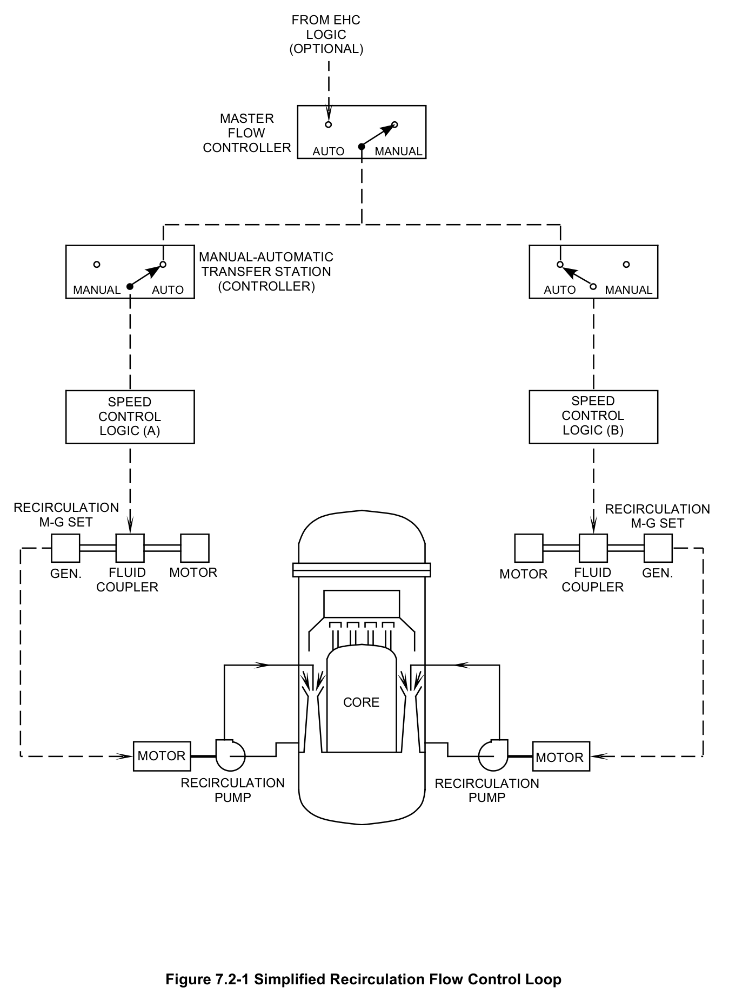
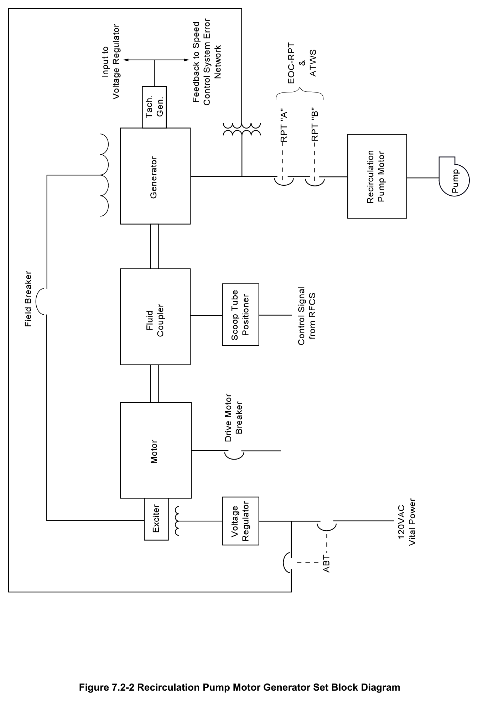
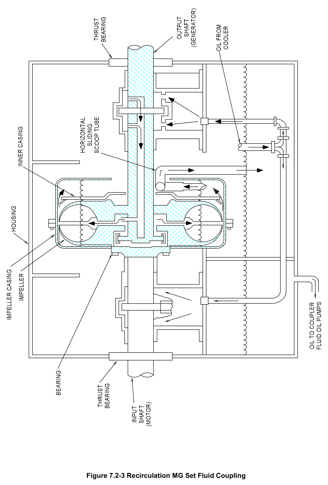
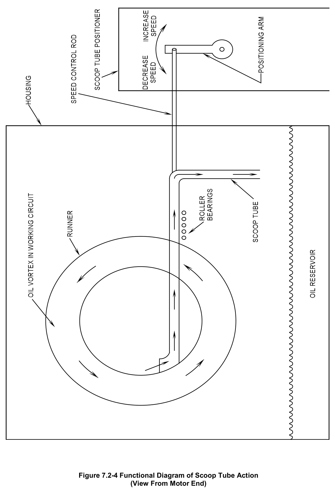
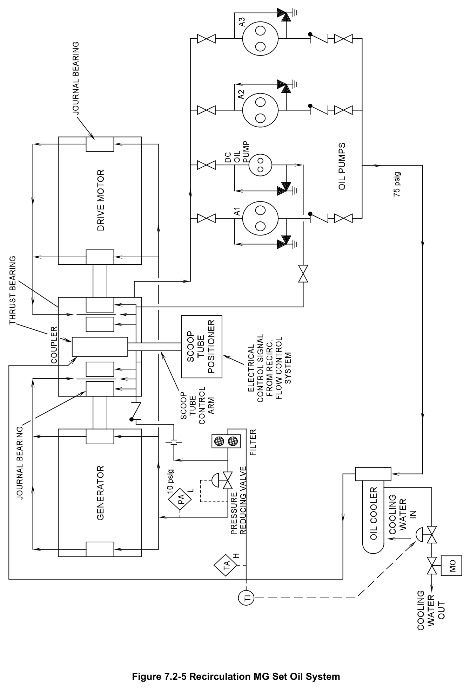
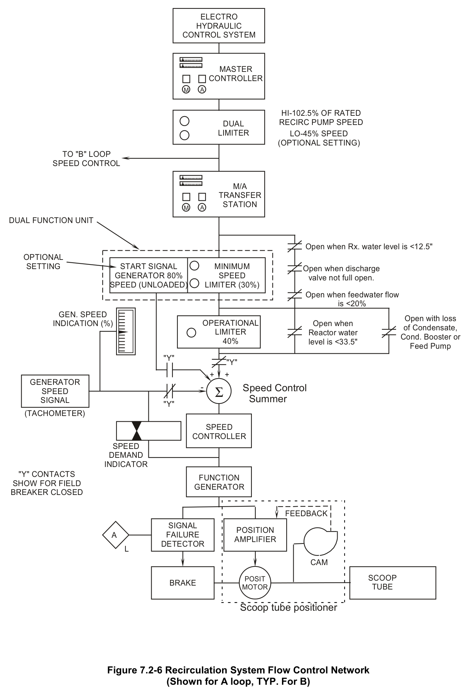
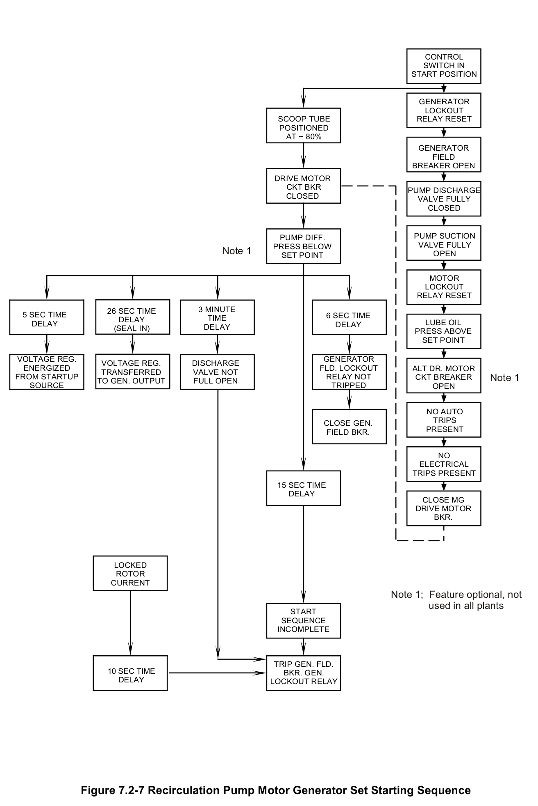
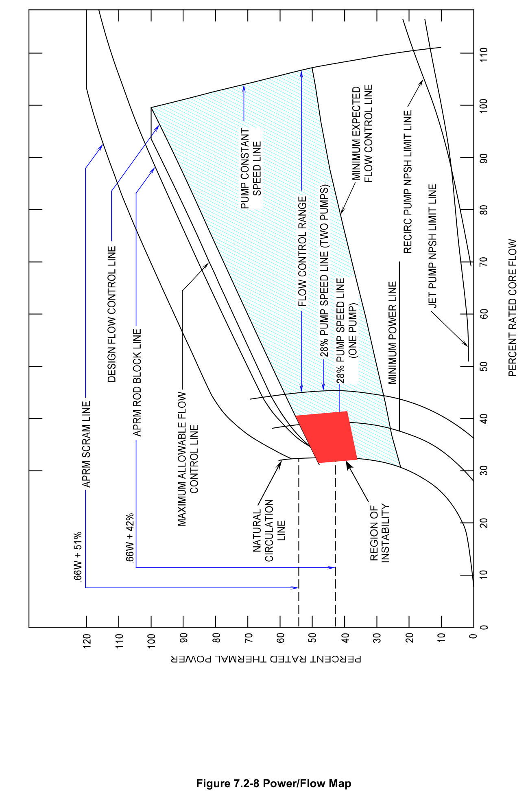

# 7.2 Recirc Flow Control

> Source: `7.2_Recirc_Flow_Control.pdf` (24 pages)
> GE (BWR) Systems Technology Manual — USNRC HRTD, Rev 09/11

---
<!-- p.1 -->
#### General Electric Systems Technology Manual
#### Chapter 7.2
#### Recirculation Flow Control System
.

<!-- p.3 -->
TABLE OF CONTENTS

7.2 RECIRCULATION FLOW CONTROL SYSTEM ....................................................... 1

7.2.1 Introduction ........................................................................................................ 2

7.2.2 System Description ............................................................................................ 2

7.2.3 Component Description ...................................................................................... 2

7.2.3.1 Recirculation Motor Generator Set .............................................................. 2

7.2.3.2 Oil System ................................................................................................... 5

7.2.3.3 Recirculation Pump Speed Control Logic .................................................... 5

7.2.4 System Features ................................................................................................ 8

7.2.4.1 Recirculation Pump Start ............................................................................. 8

7.2.4.2 Power/Flow Map .......................................................................................... 9

7.2.5 System Interfaces ............................................................................................ 11

7.2.6 Summary .......................................................................................................... 11

Rev 09/11 7.2-i USNRC HRTD

<!-- p.4 -->
#### LIST OF FIGURES
7.2-1 Simplified Recirculation Flow Control Loop 7.2-2 Recirculation Pump Motor Generator Set Block Diagram 7.2-3 Recirculation M. G. Set Fluid Coupling 7.2-4 Functional Diagram of Scoop Tube Action (View From Motor End)
7.2-5 Recirculation MG Set Oil System 7.2-6 Recirculation System Flow Control Network (Shown for A Loop, TYP. For B)
7.2-7 Recirculation Pump Motor Generator Set Starting Sequence 7.2-8 Power/Flow Map (Typical)

Rev 09/11 7.2-ii USNRC HRTD

<!-- p.5 -->
### 7.2 RECIRCULATION FLOW CONTROL SYSTEM
Learning Objectives:

1. Recognize the purpose of the recirculation flow control system.

2. Recognize the purpose, function and operation of the following recirculation flow control system major components:
a. Master controller b. Dual limiter c. M/A transfer station d. Start signal generator e. Minimum speed limiter f. Operational limiter g. Scoop tube h. Drive motor i. Fluid coupler j. Generator k. Recirculation pump trip breakers

3. Recognize the plant conditions which will result in the following:
a. Drive motor breaker trips 1) EOC/RPT 2) ATWS/RPT 3) Pump discharge valve 4) Pump suction valve b. Recirculation pump trip (RPT) breakers 1) EOC/RPT 2) ATWS/RPT c. Minimum speed limiter d. Operational limiter

4. Given a power to flow map and specific plant conditions, recognize the operating point and evaluate how it will change with the following core reactivity changes:
a. Recirculation/Core Flow b. Control rod position c. Xenon and Samarium poison concentrations d. Feedwater temperature

5. Recognize how the Recirculation Flow Control system interfaces with the following systems:
a. Recirculation System (Section 2.4)
b. Main Steam System (Section 2.5)

Rev 09/11 7.2-1 USNRC HRTD

<!-- p.6 -->
c. Feedwater Control System (Section 3.3)
d. Condensate and Feedwater System (Section 2.6)
e. Reactor Vessel Instrumentation System (Section 3.1)
f. Reactor Building Closed Loop Cooling Water System (Section 11.3)

#### 7.2.1 Introduction
The purpose of the Recirculation Flow Control (RFC) System is to control the rate of recirculation system flow through the reactor core. Controlling the flowrate allows controlling reactor power over a limited range.

The functional classification of the RFC System is that of a power generation system.

#### 7.2.2 System Description
The recirculation flow control system (Figure 7.2-1) consists of two motor driven variable speed generator sets and the speed control logic needed to vary the generator speed.
The motor driven variable speed generators provide the power to drive the recirculation pump motors. Varying generator speed will vary its output frequency and voltage thus varying the speed of the recirculation pump. Varying recirculation pump speed results in a change in core flow rate and core power.

#### 7.2.3 Component Description
The major components of the recirculation flow control system are discussed in the paragraphs which follow.

##### 7.2.3.1 Recirculation Motor Generator Set
The recirculation motor generator set (Figure 7.2.2) consists of a drive motor, fluid coupler, generator, and auxiliary equipment to support recirculation pump operation.

###### 7.2.3.1.1 Drive Motor
The recirculation motor generator set drive motor is a constant speed 7000 horsepower motor. The drive motor supplies the fluid coupler with motive force through a constant speed input shaft. In addition the drive motor provides the motive force for the M/G generator exciter. The drive motor will automatically trip upon any of the following conditions:
• Main turbine trip while operating at > 30% turbine load (EOC-RPT)
• 1120 psig RPV pressure or RPV water level at Level 2 (-38 inches) (ATWS-RPT)
• Recirculation pump discharge valve not full open (3 minute time delay for pump startup).

Rev 09/11 7.2-2 USNRC HRTD

<!-- p.7 -->
• Recirculation pump suction valve not full open
• Generator electrical protection lockout
• Drive motor breaker electrical protection lockout
• Undervoltage on motor power supply 4 kilovolt bus
• Motor generator set lube oil pressure low
• Motor generator set lube oil temperature high

###### 7.2.3.1.2 Fluid Coupler
The fluid coupler (Figures 7.2-2, 7.2-3 and 7.2-4.) consists of the following:
• an input shaft that is connected to the impeller
• a runner that is connected to the output shaft
• a scoop tube
• a fluid coupler housing that encloses the fluid coupler and act as an oil reservoir

The fluid coupler transmits a portion of the drive motor torque to the generator shaft.
The amount of torque that is transmitted to the generator is determined by the coupling between the drive motor and the generator. This coupling is determined by the amount of oil in the fluid coupler. The quantity of oil in the fluid coupler is regulated by the positioning of a device called a "scoop tube". The greater the quantity of oil in the fluid coupler, the greater the coupling between the drive motor and the generator. Oil is fed into the circuit continuously by the M/G oil system via drilled passage in the generator shaft. By positioning the scoop tube to remove more oil from the circuit, the generator speed will be reduced due to less torque being transmitted. The drive motor shaft drives an impeller which forces oil against a runner. The runner is attached to the generator shaft. Therefore, the scoop tube position determines the torque transmitted to the generator and thus the generator and recirculation pump speed. The scoop tube locks in position (lockup) on:
• lube oil low pressure
• lube oil high temperature
• drive motor 4 KV bus under-voltage
• loss of power to the speed control loop.
• Manually at panel P602

###### 7.2.3.1.3 Generator
The M/G set generator (Figure 7.2-2) is a synchronous generator driven at variable speed by the fluid coupler. Generator excitation is controlled to establish a main generator output of 70 volts/hz. During unit startup the voltage regulation circuit receives field power from an external 120 vac power source. During normal operation this power comes from the output of the main generator. In either case, the voltage regulator uses input from the tachometer generator to vary the exciter field strength.
The exciter output is provided to the main generator field via the field breaker resulting

Rev 09/11 7.2-3 USNRC HRTD

<!-- p.8 -->
in the 70 volts/hz output of the main generator. The 70 volts/hz relationship is maintained to prevent recirculation pump motor overheating damage caused by excessive current flow.

Generator protection lockouts are listed below:
• Generator Neutral ground voltage high
• Generator overcurrent
• Generator instantaneous differential overcurrent
• Generator loss of field
• Exciter field undervoltage
• Exciter field overcurrent

Upon receiving a generator lockout, the drive motor breaker and the field breaker trip open.

The main generator output is connected to the associated recirculation pump motor through the Recirculation Pump Trip (RPT) breakers. (Figure 7.2-2)

###### 7.2.3.1.4 Recirculation Pump Trip Breakers
There are 2 normally closed recirculation pump trip (RPT) breakers between the generator output and the recirculation pump motor (Figure 7.2-2). Tripping the drive motor breakers has a delayed reduction in core flow caused by motor generator set inertia. The RPT breakers are tripped in the event of conditions that require a more immediate reduction in core flow. One breaker is tripped by the ‘A’ division of the EOC- RPT or ATWS-RPT logics while the other is tripped by the ‘B’ division.

The EOC-RPT circuit provides an automatic rapid trip of the recirculation pumps on a main turbine trip or load rejection, if greater than 30% turbine load. The RPT and the drive motor breakers are all tripped. The purpose of this RPT pump trip is to ensure the MCPR safety limit is not violated due the pressure and power transient resulting from a turbine trip/load rejection coincident with a failure of the turbine steam bypass valves.

The ATWS-RPT refers to a plant transient that should have resulted in a reactor scram, and for some reason the scram function does not occur. To lessen the effects of an ATWS event, and quickly reduce reactor power to within SRV capacity, negative reactivity must be added to the reactor core by another means. The means chosen is to trip the recirculation pumps, which rapidly adds negative reactivity due to a sudden increase in steam voiding in the core area as core flow decreases. The setpoints for ATWS-RPT are reactor pressure at 1120 psig or reactor water level at Level 2 (-38").
Upon reaching either setpoint, the recirculation RPT breakers and motor generator set drive motor breakers are tripped.

Rev 09/11 7.2-4 USNRC HRTD

<!-- p.9 -->
##### 7.2.3.2 Oil System
Each recirculation M/G set oil system (Figure 7.2-5) consists of the following:
• three ac motor driven pumps
• one emergency dc motor driven pump
• an oil cooler
• an oil reservoir

The lower casing of the fluid coupler serves as the system's oil reservoir. The oil is normally pumped by two of the ac motor driven pumps through the oil cooler. The majority of the oil flows directly to the fluid coupler for use as working oil. The remainder is directed to the M/G set bearings through an oil filter. The oil cooler is cooled by reactor building closed loop cooling water.

Should oil pressure entering the fluid coupler decrease below 30 psig, the standby AC pump will automatically start to restore pressure. If pressure remains below 30 psig for 6 seconds, the M/G set drive motor breaker will trip. The emergency dc motor driven pump will start as pressure drops to 20 psig and supply oil to the fluid coupler bearings only.

##### 7.2.3.3 Recirculation Pump Speed Control Logic
Figure 7.2-6 is a simplified block diagram of the recirculation flow control logic. The principle of operation is to set a desired pump speed and measure the actual speed.
These speed signals are compared and produce a control signal used to position the scoop tube to obtain the desired pump speed. The components performing this function are discussed in the paragraphs which follow.

###### 7.2.3.3.1 Master Flow Controller
The master flow controller provides the means of controlling both recirculation motor generator sets from a single controller. The output of the master flow controller is directed to the dual limiter.

In the manual mode of operation, the controller output is varied from 0 to 102.5% speed demand by depressing the controller open/close pushbuttons.

In the automatic mode of operation the Electro Hydraulic Control (EHC) system input is the desired main generator load demand signal resulting in a controller output to raise or lower speed demand. Only one utility, Commonwealth Edison, is licensed to be operated in the automatic mode. All other BWR utilities operate in master manual mode or individual loop control.

Rev 09/11 7.2-5 USNRC HRTD

<!-- p.10 -->
###### 7.2.3.3.2 Dual Limiter
The output of the master controller is routed through the dual speed limiter. This limits the speed demand from the master controller to a maximum of 102.5% of rated speed and a minimum of 45% speed. The output of this dual limiter is routed to the input of each manual-automatic transfer station. The 45-102.5% speed control range is the flow control range for normal plant power maneuvering of approximately 60 to 100% power

###### 7.2.3.3.3 Manual-Automatic Transfer Station Controllers
The manual-automatic (M/A) transfer station controllers provide the means of controlling their respective motor generator sets only. Similar to the master controller, the manual automatic transfer stations contain two modes of operation, manual and automatic.

In the automatic mode, pump speed is controlled by the output of the master controller via the dual limiter. In this mode, the output demand indication of the M/A transfer station(s) will equal the output demand indication of the master controller. The automatic mode is the normal mode for routine power maneuvering between 60 and 100% power.

The manual mode of operation is typically used during plant startup and maneuvering up to approximately 60% power. In this mode pump speeds are adjusted individually from 0 to 102.5% speed demand using open/close pushbuttons on the M/A transfer station controllers.

###### 7.2.3.3.4 Speed Limiters
The output of the manual-automatic transfer station controller is routed through two speed limiters.

The first limiter (minimum speed limiter) limits recirculation pump speed to a maximum of 30% if any of the following occur:
• the respective pump discharge valve is not full open
• reactor water level less than Level 3 (12.5 inches)
• feedwater flow is less than 20%

This limiter prevents overheating of the recirculation pumps with the discharge valve not full open (low flow conditions). It also prevents cavitation problems for the recirculation pumps and jet pumps at low feedwater flow rates and low RPV water level (low net positive suction head.) The 20% feedwater flow runback has a 15 second time delay to prevent spurious runbacks when operating near the setpoint. Once the minimum speed limiter is in effect, it must be manually reset. The reset is performed via pushbuttons on panel 602 next to the manual-automatic transfer stations.

Rev 09/11 7.2-6 USNRC HRTD

<!-- p.11 -->
The second limiter (operational limiter) limits the maximum recirculation pump speed demand to less than 40% when both of the following conditions are met:
• a low reactor water level condition at Level 4 (33.5 inches)
• any one of the 6 condensate and feedwater system pumps being out of service

This limitation ensures that continued plant operation remains within the capacity of the remaining condensate and feedwater system pumps. This limiter is bypassed whenever level is normal or if all Condensate, Condensate Booster, and Reactor Feed Pumps are in service. Once the operational limiter is in effect, it must be manually reset. The reset is performed via pushbuttons on panel 602 next to the manualautomatic transfer stations.

###### 7.2.3.3.5 Speed Control Summer
The speed control summer, during normal operation, compares the speed demand signal to the actual generator speed. It then develops an error signal which is sent to the speed controller. The magnitude of the error signal is limited to about 8% of the control band.

###### 7.2.3.3.6 Start Signal Generator
The start signal generator provides a signal to the error limiting network to position the scoop tube properly for recirculation M/G set startup. This signal is set for approximately 80% unloaded generator speed to provide adequate breakaway torque for the recirculation pump. This signal is in control when the generator field breaker is open. It is immediately removed when the generator field breaker closes.

###### 7.2.3.3.7 Speed Controller
The speed controller establishes and maintains a speed demand signal in accordance with the error signal received from the speed control summer.

###### 7.2.3.3.8 Function Generator
The function generator corrects the speed demand signal from the speed controller to account for the system's non-linearities. It provides a linear relationship between the signal input to the master controller and recirculation flow. The function generator output is sent to a signal failure detector and the scoop tube positioner through an amplifier.

Rev 09/11 7.2-7 USNRC HRTD

<!-- p.12 -->
###### 7.2.3.3.9 Scoop Tube Positioner
The scoop tube positioner converts the electrical input signal from the function generator to a mechanical scoop tube position. The positioner compares the input signal to actual scoop tube position as developed by a cam operated position transmitter. The positioner has both electrical and mechanical high speed stops. These stops limit the maximum torque transferred to the generator, thus limiting recirculation pump speed.

###### 7.2.3.3.10 Signal Failure Detector
The normal input-output signal of all of the control devices ranges from 10 to 50 milliamps. Loss of signal input to the positioner is monitored by the signal failure detector. If the monitored signal decreases to 1 milliamp the scoop tube motor is locked in place by an electrically operated break. This function is referred to as a scoop tube lockup.

Following a scoop tube lockup, the reason for the lockup must be corrected and then the lockup must be manually reset. Prior to resetting the lockup, the speed demand signal must be matched to the actual scoop tube position. This prevents a large process and power change when resetting. The operator is provided with a percent speed demand indicator. This indicates the difference in speed demand at the speed controller output and generator speed

#### 7.2.4 System Features
A short discussion of system features this system has are given in the paragraphs which follow.

##### 7.2.4.1 Recirculation Pump Start
Figure 7.2-7 describes the initial requirements and sequence of events occurring on a recirculation M/G set start. When the control switch is placed in the start position, the drive motor breaker closes if all of the start permissives are satisfied.

Upon drive motor start, the drive motor and generator are accelerated to approximately 80% unloaded speed. Note on Figure 7.2-6 that when the field breaker is open, the following occur:
• the speed control system input to the summer is replaced by the start signal generator
• feedback from the tachometer is removed.

Rev 09/11 7.2-8 USNRC HRTD

<!-- p.13 -->
This serves to position the scoop tube to the 80% unloaded position. Excitation is applied from the 120 VAC source to the M/G set exciter 5 seconds after the drive motor breaker is closed.

Since the recirculation pump trip (RPT) breakers are normally closed, the pump motor is directly coupled to the generator output. Thus the recirculation pump starts when the generator field breaker closes. With the M/G set running at approximately 80% unloaded speed, the field breaker closes 6 seconds after the drive motor breaker closure. The resulting generator output applies the necessary breakaway torque for the recirculation pump. Once the field breaker is closed, excitation will shift to the generator output following a 26 second time delay.

The 15 second incomplete sequence timer allows time for the pump to rotate and develop greater than 4 psid. As soon as 4 psid is reached, the incomplete sequence timer is de-energized and the timer resets. If the pump does not generate greater than 4 psid in 15 seconds, the incomplete sequence timer trips the generator lockout relay.
The lockout relay trips both the drive motor breaker and generator field breaker. When the generator field breaker is closed, the speed control circuits are returned to normal.
The M/G set and pump will runback to the limiter value of 30% with the discharge valve closed.

The final event that occurs in the startup sequence is the jogging open of the recirculation pump discharge valve. This valve is jogged open to limit the reactivity transient that will occur as core flow rises with valve opening. If the valve is not fully open within three minutes, the drive motor breaker trips open. The not full open trip is to prevent pump overheating/cavitation damage resulting from excessive run times at low flow conditions.

##### 7.2.4.2 Power/Flow Map
The power/flow map (Figure 7.2-8) is a plot of percent core thermal power versus percent of total core flow for various operating conditions. The power/flow map contains information on expected system performance. Brief descriptions of the curves on a typical power/flow map are given in the paragraphs which follow.

###### 7.2.4.2.1 Natural Circulation Line
Although contrary to normal operating procedure, the natural circulation line demonstrates that without forced circulation, core flow will still rise with reactor power.
As reactor power is increased by control rod withdrawal, core flow increases due to the change in moderator density and steam formation (voids) within the core region. The colder (more dense) water in the downcomer region coupled with the less dense water in the core region promotes this natural circulation core flow. Subsequent to initial core

Rev 09/11 7.2-9 USNRC HRTD

<!-- p.14 -->
operation, decay heat will continue to promote natural circulation flow long after reactor shutdown.

###### 7.2.4.2.2 Pump Minimum Speed Line
Startup operations of the plant are normally commenced with both recirculation pumps running at minimum speed. Similar to the natural circulation described above, as control rods are withdrawn and power rises, the resulting thermal driving head will result in a rise in core flow. The power to flow map has curves representing both two pump and single pump minimum flow.

###### 7.2.4.2.3 Design Flow Control Line
This line is defined by the control rod withdraw pattern which results in being at 100% core thermal power and 100% core flow, assuming equilibrium xenon conditions.
Reactor power should parallel this line for recirculation flow changes with a fixed control rod pattern.

###### 7.2.4.2.4 Pump Constant Speed Line
This line illustrates the change in core flow associated with a power reduction from 100% power and 100% core flow while maintaining a constant recirculation pump speed.

###### 7.2.4.2.5 Minimum Expected Flow Control Line
This line represents the flow control line for plant startup in which the recirculation pump speed is increased above minimum speed as soon as the 20% feedwater interlock is cleared.

###### 7.2.4.2.6 Region of Instability
This dark shaded area of the Power/Flow Map represents a higher probability of core thermal hydraulic instability. Thermal hydraulic instability is a condition of power oscillations resulting from plant operation in a low flow and high power configuration.
Generally, intentional operation in this area is not permitted.

Rev 09/11 7.2-10 USNRC HRTD

<!-- p.15 -->
#### 7.2.5 System Interfaces
The interrelations this system has with other plant systems are discussed in the paragraphs which follow.

Recirculation System (Section 2.4)

The recirculation flow control system regulates the speed of the recirculation pumps.
Pump suction and discharge valve positions are sensed for pump start permissive interlocks.

Main Steam System (Section 2.5)

The Main Steam System provides the trip input signals for the EOC-RPT circuit (SVs, CVs and 1st stage turbine pressure).

Feedwater Control System (Section 3.3)

The Net Positive Suction Head (NPSH) interlock (<20% total feedwater flow) is provided by the Feedwater Control System.

Condensate and Feedwater System (Section 2.6)

The Condensate and Feedwater System provides the bypass for the 40% speed limiter
(RFPs, Condensate Booster Pumps, and Condensate Pumps).

Reactor Vessel Instrumentation System (Section 3.1)

The Reactor Vessel Instrumentation System provides the reactor vessel high pressure and low-low water level ATWS-RPT signals. As well as the Level 3 and Level 4 inputs into the 30% minimum speed limiter and the 40% operational limiter.

Reactor Building Closed Loop Cooling Water System (Section 11.3)

The Reactor Building Closed Loop Cooling Water (RBCLC) System provides cooling water to the recirculation motor generator set lube oil system.

Rev 09/11 7.2-11 USNRC HRTD

<!-- p.16 -->
#### 7.2.6 Summary
Classification - Power generation system

Purpose - To control the rate of recirculation system flow through the reactor core, thus controlling reactor power over a limited range.

Components - The recirculation flow control system (Figure 7.2-1) consists of two motor driven variable speed generator sets and the speed control logic needed to vary the generator speed.

System Interfaces -Recirculation System; Main Steam System; Feedwater Control System; Condensate and Feedwater System; Reactor Vessel Instrumentation System;
Reactor Building Closed Loop Cooling Water System.

Rev 09/11 7.2-12 USNRC HRTD

<!-- p.17 -->
#### Figure 7.2-1

*Simplified Recirculation Flow Control Loop*

[Vector original (SVG, lossless): fig_7.2-1.svg](../figures/fig_7.2-1.svg)

<!-- labels/text on this figure page -->
FROM EHC LOGIC
(OPTIONAL)
MASTER FLOW CONTROLLER AUTO MANUAL
MANUAL-AUTOMATIC TRANSFER STATION
(CONTROLLER)
MANUAL AUTO AUTO MANUAL
SPEED SPEED CONTROL CONTROL LOGIC (B)
LOGIC (A)
RECIRCULATION RECIRCULATION M-G SET M-G SET
FLUID MOTOR FLUID GEN. MOTOR GEN.
COUPLER COUPLER
CORE
MOTOR MOTOR
RECIRCULATION RECIRCULATION PUMP PUMP
Figure 7.2-1 Simplified Recirculation Flow Control Loop

<!-- p.18 -->
#### Figure 7.2-2

*Recirculation Pump Motor Generator Set Block Diagram*

[Vector original (SVG, lossless): fig_7.2-2.svg](../figures/fig_7.2-2.svg)

<!-- p.19 -->
#### Figure 7.2-3

*Recirculation MG Set Fluid Coupling*

[Vector original (SVG, lossless): fig_7.2-3.svg](../figures/fig_7.2-3.svg)

<!-- p.20 -->
#### Figure 7.2-4

*Functional Diagram of Scoop Tube Action*

[Vector original (SVG, lossless): fig_7.2-4.svg](../figures/fig_7.2-4.svg)

<!-- p.21 -->
#### Figure 7.2-5

*Recirculation MG Set Oil System*

[Vector original (SVG, lossless): fig_7.2-5.svg](../figures/fig_7.2-5.svg)

<!-- p.22 -->
#### Figure 7.2-6

*Recirculation System Flow Control Network*

[Vector original (SVG, lossless): fig_7.2-6.svg](../figures/fig_7.2-6.svg)

<!-- labels/text on this figure page -->
ELECTRO HYDRAULIC CONTROL SYSTEM
MASTER CONTROLLER
A M
HI-102.5% OF RATED RECIRC PUMP SPEED DUAL LIMITER LO-45% SPEED
(OPTIONAL SETTING)
TO "B" LOOP SPEED CONTROL
M/A TRANSFER STATION A M
DUAL FUNCTION UNIT
Open when Rx. water level is <12.5" OPTIONAL SETTING START SIGNAL MINIMUM Open when discharge GENERATOR 80% SPEED valve not full open.
SPEED (UNLOADED) LIMITER (30%)
Open when feedwater flow is <20% GEN. SPEED Open with loss OPERATIONAL INDICATION (%) Open when of Condensate, LIMITER Reactor water Cond. Booster or 40% level is <33.5" Feed Pump "Y" "Y" + + GENERATOR
- Speed Control Σ SPEED Summer SIGNAL "Y"
(TACHOMETER)
SPEED CONTROLLER SPEED DEMAND INDICATOR "Y" CONTACTS FUNCTION SHOW FOR FIELD GENERATOR BREAKER CLOSED
FEEDBACK SIGNAL POSITION A FAILURE AMPLIFIER DETECTOR L
CAM
SCOOP POSIT BRAKE TUBE MOTOR
Scoop tube positioner
Figure 7.2-6 Recirculation System Flow Control Network
(Shown for A loop, TYP. For B)

<!-- p.23 -->
#### Figure 7.2-7

*Recirculation Pump Motor Generator Set Starting Sequence*

[Vector original (SVG, lossless): fig_7.2-7.svg](../figures/fig_7.2-7.svg)

<!-- labels/text on this figure page -->
CONTROL SWITCH IN START POSITION
GENERATOR LOCKOUT RELAY RESET SCOOP TUBE POSITIONED AT ~ 80% GENERATOR FIELD BREAKER OPEN
DRIVE MOTOR CKT BKR PUMP DISCHARGE CLOSED VALVE FULLY CLOSED
PUMP SUCTION PUMP DIFF.
VALVE FULLY PRESS BELOW Note 1 OPEN SET POINT
MOTOR LOCKOUT RELAY RESET
3 MINUTE 26 SEC TIME
5 SEC TIME
6 SEC TIME TIME
DELAY LUBE OIL DELAY DELAY DELAY (SEAL IN)
PRESS ABOVE SET POINT
GENERATOR VOLTAGE REG.
VOLTAGE REG. DISCHARGE FLD. LOCKOUT ALT DR. MOTOR ENERGIZED TRANSFERRED VALVE NOT RELAY NOT CKT BREAKER Note 1 FROM STARTUP TO GEN. OUTPUT FULL OPEN TRIPPED OPEN SOURCE
NO AUTO TRIPS CLOSE GEN.
PRESENT FIELD BKR.
NO ELECTRICAL TRIPS PRESENT
15 SEC TIME
DELAY CLOSE MG DRIVE MOTOR BKR.
LOCKED ROTOR CURRENT Note 1; Feature optional, not used in all plants START SEQUENCE INCOMPLETE
TRIP GEN. FLD.
10 SEC TIME
BKR. GEN.
DELAY LOCKOUT RELAY
Figure 7.2-7 Recirculation Pump Motor Generator Set Starting Sequence

<!-- p.24 -->
#### Figure 7.2-8

*Power/Flow Map*

[Vector original (SVG, lossless): fig_7.2-8.svg](../figures/fig_7.2-8.svg)

