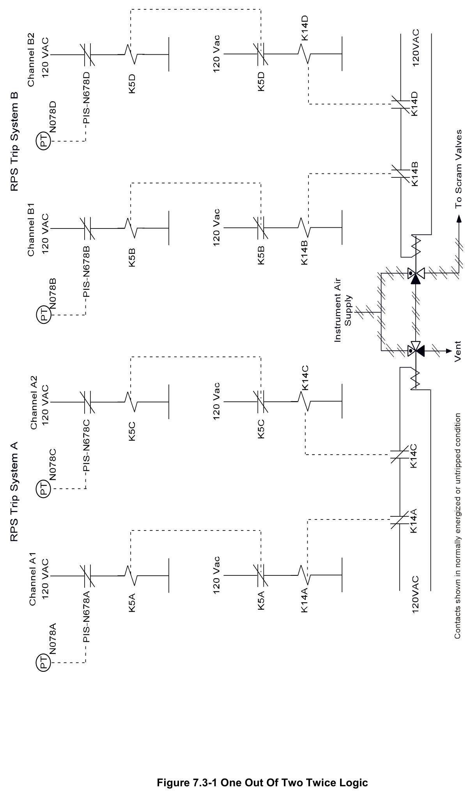
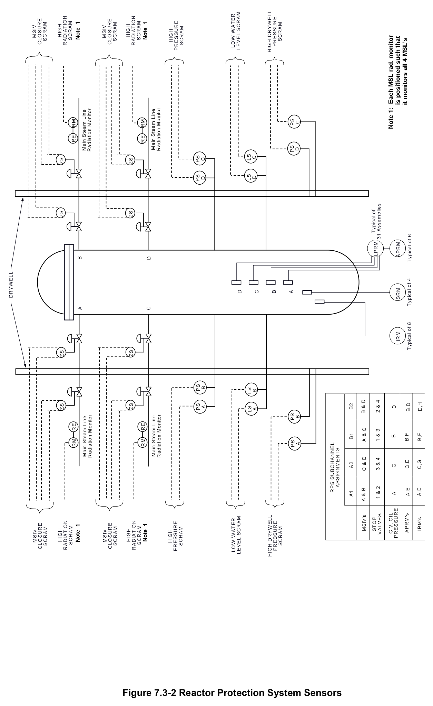
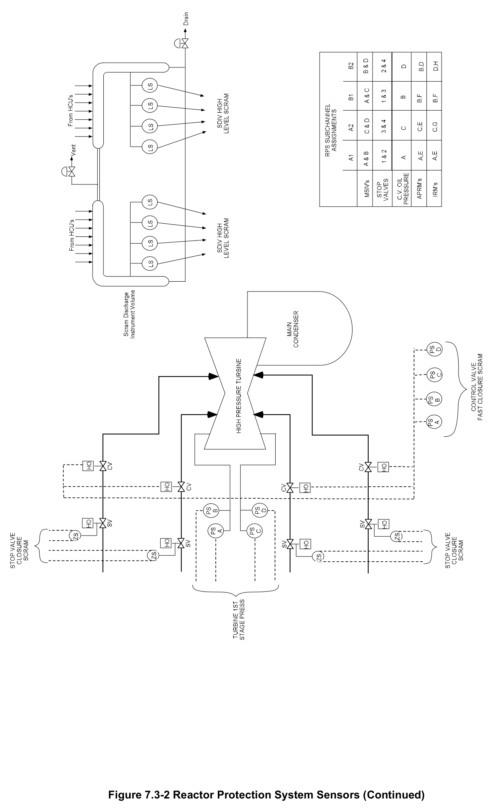
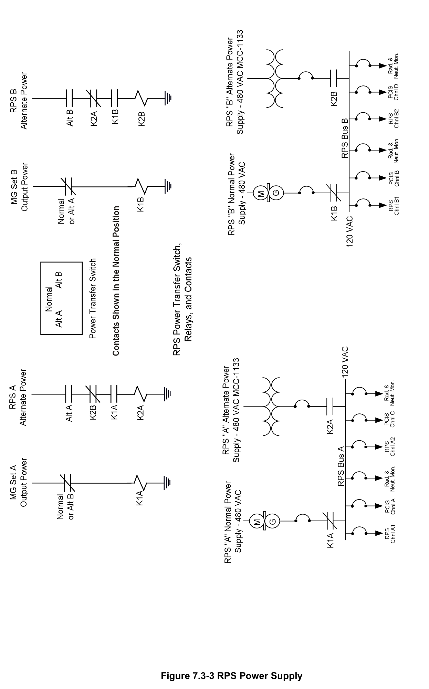
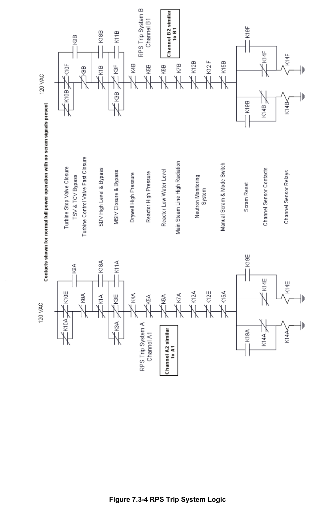
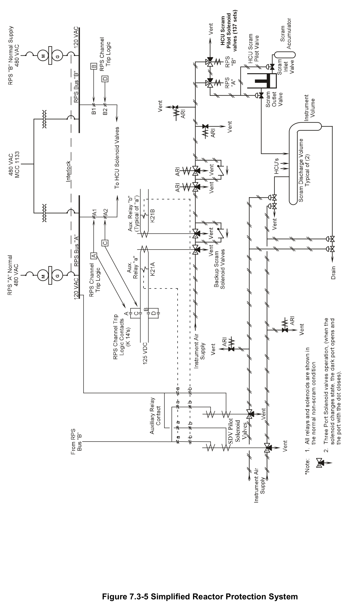
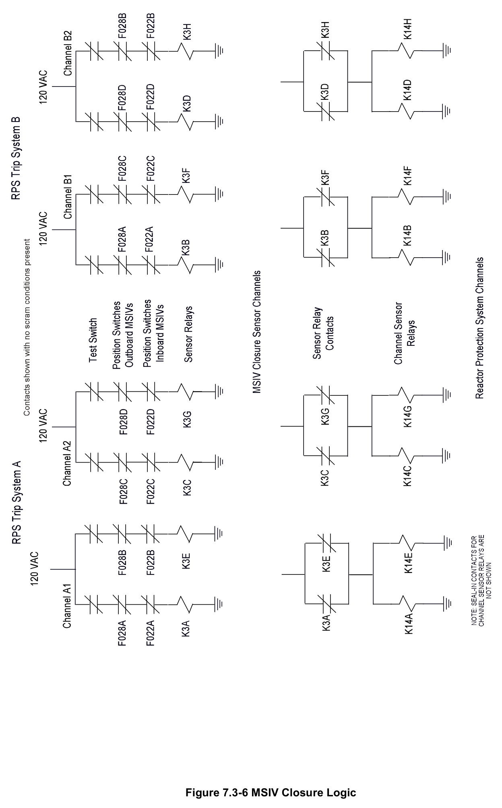
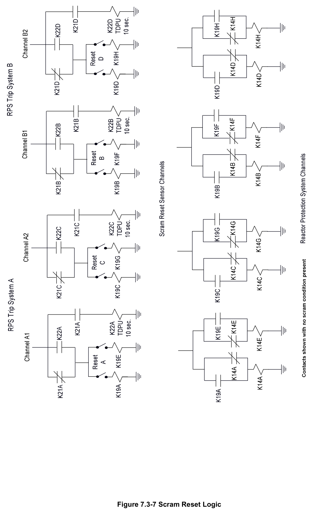
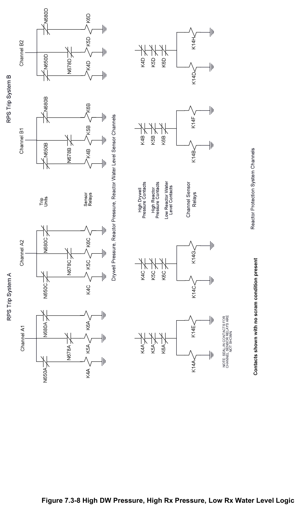

# 7.3 Reactor Protection

> Source: `7.3_Reactor_Protection.pdf` (33 pages)
> GE (BWR) Systems Technology Manual — USNRC HRTD, Rev 09/11

---
<!-- p.1 -->
#### General Electric Systems Technology Manual
#### Chapter 7.3
#### Reactor Protection System
<!-- p.3 -->
TABLE OF CONTENTS

7.3 REACTOR PROTECTION SYSTEM ........................................................................ 1

7.3.1 Introduction .................................................................................................... 2

7.3.2 Component Description ................................................................................. 3

7.3.2.1 Power Supplies (Figure 7.3-3) ......................................................... 3

7.3.2.2 Scram Logic .................................................................................... 3

7.3.2.3 Scram Reset Time Delay................................................................. 4

7.3.2.4 Scram Air Header ............................................................................ 4

7.3.2.5 Hydraulic Control Unit (HCU) Scram Pilot Solenoid Valves............. 5

7.3.2.6 Scram Discharge Volume (SDV) Scram Pilot Solenoid Valves ....... 5

7.3.2.7 Backup Scram Solenoid Valves ...................................................... 6

7.3.2.8 Alternate Rod Insertion (ARI) Solenoid Valves ................................ 6

7.3.3 System Features............................................................................................ 6

7.3.3.1 RPS Operating Modes .................................................................... 6

7.3.3.2 Scram Functions and Bases ............................................................ 7

7.3.4 System Interfaces ........................................................................................ 14

7.3.5 Summary ..................................................................................................... 15

LIST OF TABLES

7.3-1 REACTOR PROTECTION SCRAM SIGNALS .................................................. 17

7.3-1 REACTOR PROTECTION SCRAM SIGNALS (CONTINUED) .......................... 19

Rev 09/11 7.3-i USNRC HRTD

<!-- p.4 -->
#### LIST OF FIGURES
7.3-1 One Out Of Two Twice Logic 7.3-2 Reactor Protection System Sensors 7.3-2 Reactor Protection System Sensors (Continued)
7.3-3 RPS Power Supply 7.3-4 RPS Trip System Logic 7.3-5 Simplified Reactor Protection System 7.3-6 MSIV Closure Logic 7.3-7 Scram Reset Logic 7.3-8 High DW Pressure, High Rx Pressure, Low Rx Water Level Logic

Rev 09/11 7.3-ii USNRC HRTD

<!-- p.5 -->
### 7.3 REACTOR PROTECTION SYSTEM
Learning Objectives:

1. Recognize the purposes of the Reactor Protection System (RPS).

2. Recognize the purpose function and operation of the following RPS components:
a. Motor generator sets b. Alternate power supply c. Power transfer switch d. One of two twice de-energized to function scram logic e. Scram reset time delay f. Scram air header g. HCU scram pilot solenoid valves h. SDV scram pilot solenoid valves i. Backup scram solenoid valves j. Alternate Rod Insertion (ARI) solenoid valves k. Mode switch

3. Recognize how a scram signal results in control rod insertion.

4. Recognize what plant conditions will cause Alternate Rod Insertion (ARI) system actuation.

5. Recognize how the system will respond to:
a. loss of power b. loss of air

6. Recognize which plant parameters will cause an RPS actuation, the reason for each trip and when the trip may be bypassed.

7. Recognize how the Reactor Protection system interfaces with the following systems:
a. Control Rod Drive System (Section 2.3)
b. Reactor Manual Control System (Section 7.1)
c. Reactor Recirculation System (Section 2.4)
d. Neutron Monitoring System (Section 5)
e. Main Steam System (Section 2.5)
f. Primary Containment System (Section 4.1)
g. Reactor Vessel Instrumentation System (Section 3.1)
h. Service and Instrument Air System (Section 11.6)
i. Nuclear Steam Supply Shutoff System (Section 4.4)

Rev 09/11 7.3-1 USNRC HRTD

<!-- p.6 -->
#### 7.3.1 Introduction
Title 10 of the code of federal regulations (10CFR), the station operating license and station technical specifications define the acceptable conditions for plant operation and the requirements for scram protection which ultimately protects the health and safety of the public. Station Technical Specifications contains Safety Limits (SL) which, if not violated, ensure the integrity of the fuel, reactor coolant system pressure boundary and primary containment barriers thus protecting the public from radiological releases exceeding 10CFR100. Station Technical Specifications further defines Limiting Safety System Settings (LSSS) which are setpoints on those parameters such that violations of the safety limits are prevented.

The purposes of the RPS are to:
• monitor critical plant parameters during all plant operating modes and
• initiate a reactor scram when a LSSS is reached such that:
o fuel cladding integrity remains intact o the reactor coolant system pressure boundary remains intact o primary containment integrity remains intact o inadvertent criticality is avoided.

The functional classification of the RPS is that of a safety related system. Its regulatory classification is a reactor trip system.

The RPS includes the motor generator power supplies with associated control and indicating equipment, sensors, relays, bypass circuitry and switches that cause rapid insertion of control rods (scram) to shut down the reactor.

The RPS is a fail safe system, composed of two independent trip systems, A and B, each made up of two channels (Figure 7.3-1). Trip system A consists of scram channels A1 and A2 while trip system B consists of scram channels B1 and B2. Each scram channel's logic receives inputs from at least one independent sensor monitoring each of the critical parameters shown in Figure 7.3-2. A trip occurring in any trip logic(s)
of trip system A, together with a trip occurring in any logic(s) of trip system B, results in a reactor scram. Note that a trip of one trip system, with the other trip system not tripped, does not cause a reactor scram.

The automatic trip logic of the RPS is arranged for the most part in a one-out-of-twotwice logic. The logic remains energized in the non-scram condition. Deenergizing the two trip systems initiates a reactor scram by venting air from the control rod drive scram valves causing the control rods to be inserted into the core.

Rev 09/11 7.3-2 USNRC HRTD

<!-- p.7 -->
#### 7.3.2 Component Description
The major components of the RPS are described in the paragraphs which follow.

##### 7.3.2.1 Power Supplies (Figure 7.3-3)
The RPS power supply system provides electrical power to:
• The RPS logic system
• The Primary Containment Isolation System (PCIS or NSSSS) logic
• The Process Radiation Monitoring System
• The Neutron Monitoring System.

###### 7.3.2.1.1 Motor Generator Sets
The two RPS buses receive power from independent divisional power supplies through high inertia RPS motor generator (MG) sets. The high inertia is provided to each of the MG sets by a flywheel. The flywheel will maintain voltage and frequency within 5% of rated values for a minimum of 2 seconds following a total loss of power to the drive motor. This prevents a momentary electrical supply problem to the MG set from resulting in a reactor scram.

###### 7.3.2.1.2 Alternate Power Supply Transformer
The two RPS buses have alternate power supplied from a single nonessential power transformer that is provided for maintenance periods on one of the motor generator sets.

###### 7.3.2.1.3 Power Transfer Switch
The power transfer switch is used to connect each divisional RPS distribution bus to the respective motor generator set or the alternate power transformer. To ensure against supplying both RPS buses from the single alternate source, an interlock is provided
(Figure 7.3-3) that will not allow both alternate supply breakers to be closed at the same time. This interlock also prevents powering an RPS bus from both the MG set and the alternate power supply concurrently. Transfer between power supplies is a break before make transfer resulting in momentary de-energization of the respective RPS bus.

##### 7.3.2.2 Scram Logic
The RPS is arranged in a one-out-of-two-twice deenergized to function logic scheme.
Each trip system is completely independent of the other. The RPS logic, Figure 7.3-1 and 7.3-4, consists of two separately powered trip systems. Each trip system contains two trip channel logics. The trip logics of system A are designated channels A1 and A2 and both receive at least one input signal from the same monitored parameter; both trip

Rev 09/11 7.3-3 USNRC HRTD

<!-- p.8 -->
channels are identical. Thus, any monitored parameter supplying an automatic trip signal has a minimum of four sensors.

An out of tolerance sensor in either scram channel A1 or A2 causes a trip in system A.
A trip condition in system A deenergizes the A scram valve solenoid for all 137 control rod HCU’s. This condition is called a half scram. Likewise, any sensor in trip system B out of tolerance (trip condition) causes a half scram. To produce a full reactor scram, both trip systems, A and B, must be in the trip (deenergized) condition.

In addition, two methods are provided for manually causing a reactor scram. Four pushbuttons are provided in the control room (one pushbutton per channel), each of which will deenergize its respective channel when pushed. Deenergizing one channel in each trip system causes a manually actuated reactor scram. Placing the reactor mode switch into the "SHUTDOWN" position will also cause a manually actuated reactor scram by de-energizing all four RPS channels.

The hydraulic control units (HCUs) for the 137 control rods are physically located in two groups on opposite sides of the reactor building. To provide electrical separation and to minimize current requirements through contacts and relays, the scram solenoids and their respective control rods are arranged into four scram groups. Scram group status for both RPS divisions is given by white lamps located on the control room panels P603, P609 and P611.

Note that on a loss of electrical power a reactor scram will be initiated. This is a fail safe feature of the RPS.

##### 7.3.2.3 Scram Reset Time Delay
Once a scram has occurred and the condition causing the scram has been corrected, a manual reset is required to return the RPS and CRD System to a normal, pre-scram condition.

Three conditions are necessary to reset a scram signal:
1. The scram signal(s) must all be cleared or bypassed
2. Ten seconds must have elapsed since the scram was initiated
3. The reset switch must be momentarily placed in both reset positions.

The 10 second time delay function is provided to allow the slowest control rods to be fully inserted into the reactor core before a scram can be reset. This time delay does not apply on a single channel trip (½ scram), since there is no control rod motion.

##### 7.3.2.4 Scram Air Header
When no full scram condition is present, the scram air header (Figure 7.3-5) is normally pressurized from the plant instrument air system to maintain the HCU scram inlet and

Rev 09/11 7.3-4 USNRC HRTD

<!-- p.9 -->
outlet valves closed against spring force and the SDV vent and drain valves open against spring force. Operation of the scram pilot solenoids, backup scram valves and alternate rod insertion valves isolates the instrument air header supply and vents the scram air header to cause the scram to occur.

Note that on a loss of air a reactor scram will be initiated. This is a fail safe feature of the RPS.

##### 7.3.2.5 Hydraulic Control Unit (HCU) Scram Pilot Solenoid Valves
Each of the 137 control rods is equipped with two scram solenoid valves as shown in Figure 7.3-5. These valves are normally in an energized, untripped condition and control the air supply to the control rod drive scram inlet and outlet valves.

When a half scram signal is provided, either the RPS division A or B solenoid deenergizes resulting in isolating air through that solenoid and venting the air downstream of it. As can be seen in Figure 7.3-5, the opposite division solenoid is still in position to supply scram air header pressure to the scram inlet and outlet valves therefore no rod motion occurs.

The scram inlet and outlet valves open with spring force and close (normal position)
with air pressure. The scram inlet valve controls the scram water provided to the control rod drive by the scram accumulator. The scram outlet valve aligns the top of the control rod drive piston to the scram discharge volume. A reactor scram is initiated when both HCU scram pilot solenoid valves are de-energized, venting the air from the scram valves. When spring force overcomes the air pressure, the scram inlet and outlet valves open. Opening of the scram inlet valve allows the stored energy of the scram accumulator to be felt on the bottom of the drive piston. Opening of the scram outlet valve aligns the top of the drive piston with the scram discharge volume. With 1500 psig of water pressure below the drive piston and atmospheric pressure above the drive piston, a large differential pressure forces the control rod rapidly into the core.

##### 7.3.2.6 Scram Discharge Volume (SDV) Scram Pilot Solenoid Valves
Two solenoid valves function in much the same way as the HCU scram pilot solenoid valves to close the SDV vent and drain valves on a full scram signal.

These solenoid valves (Figure 7.3-5) are normally energized by RPS and upon a full scram condition are de-energized to vent the air holding the SDV vent and drain valves open. Closing these valves on a full scram is necessary to isolate leakage from the reactor vessel to the scram discharge volume from the reactor building atmosphere.
Restated, a full scram results in extending the reactor coolant pressure boundary from the HCU (scram outlet valve) to the scram discharge volume vent and drain valves.

Rev 09/11 7.3-5 USNRC HRTD

<!-- p.10 -->
##### 7.3.2.7 Backup Scram Solenoid Valves
In addition to the scram pilot solenoid valves, there are two DC backup scram solenoid valves which provide a second means of controlling the air supply to the scram valves for all control rods and the SDV vent and drain valves. The DC solenoid for each backup scram valve is normally de-energized. The backup scram valves are energized
(to independently vent the air headers) when both trip system A and trip system B are de-energized.

Figure 7.3-5 shows that when the solenoid for each backup scram valve is energized, the backup scram valves vent the air supply for all scram valves. This action initiates insertion of every control rod, regardless of the action of the individual scram pilot valves.

##### 7.3.2.8 Alternate Rod Insertion (ARI) Solenoid Valves
In response to the ATWS rule (10CFR-50.62) six DC powered solenoid valves are provided to redundantly depressurize the scram air header. These valves are divisionally separated with 3 assigned to the ‘A’ division and 3 assigned to ‘B’, and their logic is independent of RPS. Any condition resulting in a high reactor pressure at 1120 psig or low RPV level at Level 2 (-38 inches) will energize these solenoid valves to depressurize the header. The basis is that if a scram condition exists and RPS fails to accomplish the scram, the ARI valves provide a diverse means of protecting the reactor pressure and reactor level safety limits from violation. The operator is provided with initiate pushbuttons on the P603 panel for manual initiation of the logic.

#### 7.3.3 System Features
A short discussion of system features and interrelations between this system and other plant systems is given in the paragraphs that follow.

##### 7.3.3.1 RPS Operating Modes
The four principal modes of the RPS are: "SHUTDOWN", "REFUEL", "STARTUP/HOT STANDBY", and "RUN". The selection of the various modes is accomplished via a key lock selector switch appropriately called the reactor mode switch. The reactor mode switch interlocks the various control functions depending on the plant operating condition. The reactor mode switch is manually placed in one of the four positions which places into effect the corresponding trip functions.

Placing the reactor mode switch in "SHUTDOWN" initiates a reactor scram; disables the Main Steam Isolation Valve (MSIV) closure scram and enables the capability to bypass of the scram discharge volume high level scram.

Rev 09/11 7.3-6 USNRC HRTD

<!-- p.11 -->
Placing the reactor mode switch in "REFUEL" disables the MSIV closure scram. The refuel position also enables the bypassing of the scram discharge volume high level scram and allows single control rod withdrawal to support refueling activities.

Placing the reactor mode switch in "STARTUP/HOT STANDBY" allows the operator to withdraw control rods for a plant startup and disables the ability to bypass the scram discharge volume high level scram. The MSIV closure scram is still bypassed. Some neutron monitoring trip functions are enabled while others are bypassed.

Placing the reactor mode switch in "RUN" selects the APRM thermal power scram and fixed scram trip level while removing the 15% power APRM scram. The Intermediate Range Monitoring (IRM) system scram signals are disabled except for the IRM Hi Hi and companion Average Power Range Monitoring (APRM) downscale scram. The MSIV closure scram is enabled.

##### 7.3.3.2 Scram Functions and Bases
The scram functions and the bases associated with these functions are discussed in the paragraphs that follow, listed in Table 7.3-1, and some are illustrated in Figure 7.3-2.

###### 7.3.3.2.1 Manual Scram Pushbuttons
Four manual scram pushbuttons are provided to allow the control room operator to scram the reactor in anticipation of automatic scrams, to follow up on automatic scrams or, if in his judgment, any other condition is challenging public, reactor or equipment safety.

###### 7.3.3.2.2 Individual Rod Scram Switches
Each hydraulic control unit (HCU) has an electrical box associated with it. This box is physically located at the HCU and contains two switches. Each switch is assigned a scram pilot solenoid valve, one for each RPS channel. These switches are used for scram solenoid valve testing and individual control rod scram testing.

###### 7.3.3.2.3 Mode Switch In Shutdown
The mode switch provides appropriate protective functions for the condition in which the reactor is to be operated. The reactor is to be shut down with all control rods inserted when the mode switch is in "SHUTDOWN". To enforce the condition defined for the "SHUTDOWN" position, placing the mode switch in the "SHUTDOWN" position initiates a reactor scram. This scram is not required to protect the fuel or nuclear system process barrier, and it bears no relationship to minimizing the release of radioactive material from any barrier. The scram signal is removed after a 10 second time delay, permitting a scram reset which restores the normal valve lineup in the control rod drive

Rev 09/11 7.3-7 USNRC HRTD

<!-- p.12 -->
hydraulic system. This time delay is independent of the RPS time delay reset also set at 10 seconds.

###### 7.3.3.2.4 Scram Discharge Volume High Level
The scram discharge volume receives the water displaced by the motion of the control rod drive pistons during a scram. Should the scram discharge volume fill up with water to the point where insufficient volume remains for the water displaced during the scram, control rod movement would be hindered in the event a scram were required. To prevent this situation, the reactor is scrammed when the water level in the scram discharge instrument volume attains a value high enough (36 gallons) to verify that the discharge volume is filling up, yet low enough to ensure that the remaining capacity in the discharge volume can accommodate a scram. This scram can be bypassed with a keylock switch (panel P603) provided the reactor mode switch is in SHUTDOWN or REFUEL. The bypass is necessary to enable the scram to be reset thus draining the scram discharge volume to clear this scram signal.

###### 7.3.3.2.5 High Reactor Pressure Scram
High pressure within the nuclear system process barrier poses a direct threat of reactor coolant boundary failure, and a core power excursion from the void collapse. A nuclear system pressure increase during reactor operation collapses steam voids and results in a positive reactivity insertion. This increases generation of core heat that could lead to fuel failure and to system over-pressurization. A scram counteracts a pressure increase by rapidly reducing the generation of the core fission heat. The nuclear system high pressure scram setting of 1043 psig was chosen slightly above the reactor vessel maximum normal operating pressure (1005 psig) to permit normal operation without spurious scrams, yet provide adequate margin to the maximum allowable nuclear system pressure. The high pressure scram works in conjunction with the safety/relief valves to prevent nuclear system pressure from exceeding the reactor pressure safety limit. The high pressure scram setting also protects the core from exceeding thermal hydraulic limits that may result from pressure increases during events that occur when the reactor is operating below rated power and flow. This scram cannot be bypassed.

###### 7.3.3.2.6 MSIV Closure Scram
Closure of the main steam line isolation valves, with the reactor at power, can result in a significant addition of positive reactivity to the core as the nuclear system pressure rise collapses steam voids. The MSIV closure scram is required to provide a satisfactory margin below core thermal hydraulic limits for this category of abnormal operational transients.

Each MSIV contains two stem mounted limit switches which input into the RPS trip logic
(one for each RPS trip channel).

Rev 09/11 7.3-8 USNRC HRTD

<!-- p.13 -->
The <10% closure from full open setting for these valves was selected to give the earliest positive indication of valve closure to limit the resultant pressure rise. The RPS logic for MSIV closure trip is arranged to look only at the number of main steam lines
(MSL’s) isolated versus the number of valves closed. The MSIV closure logic is shown in Figures 7.3-6. The logic is arranged so that with one line isolated (by either valve) no trips are generated, with two lines isolated a half trip may result, and isolation of any three lines will always produce a full reactor scram. The plant was designed to accommodate continued reduced power operation with any one MSL isolated with both valves closed. The MSIV closure scram is bypassed when the reactor mode switch is not in RUN. This allows for plant startup and operation at low power levels (less than 15%) with the MSIV’s closed to facilitate maintenance or testing.

###### 7.3.3.2.6 Turbine Stop Valve Closure Scram
Turbine Stop Valve (TSV) closure inputs to the RPS are generated from valve stem position switches mounted on the main turbine stop valves. Each switch actuates when the stop valve is <10% closed from the full open position. Closure of the TSVs, with the reactor at power, can result in a significant addition of positive reactivity to the core as the nuclear system pressure rise collapses steam voids. The TSV closure scram, which initiates a scram earlier than either the neutron monitoring system or nuclear system high pressure, is required to provide a satisfactory margin below core thermal hydraulic limits for this category of abnormal operation transients. Although the nuclear system high pressure scram in conjunction with the pressure relief system, is adequate to preclude over-pressurizing the nuclear system, the TSV closure scram provides additional margin to the nuclear system pressure limit.

The TSV closure scram is automatically bypassed when turbine first stage pressure is <30% of rated conditions. When operating in this condition, the loss of steam flow to the turbine on a turbine trip is accommodated by bypass valve capacity without a resulting pressure transient.

###### 7.3.3.2.7 Turbine Control Valve Fast Closure Scram
Turbine Control Valve (TCV) fast closure sends inputs to the RPS from pressure switches on the hydraulic supply line to the four fast acting control valve hydraulic mechanisms. These hydraulic mechanisms are part of the TCV and they are used to cause fast closure of the TCVs in the event of a generator load reject. This rapid closure results from rapid depressurization of the hydraulic oil supply to the control valves and the scram is initiated as pressure drops below 500 psig. This scram is provided for the same pressure transient reasons as those discussed for TSV closure scram. The TCV fast closure scram is automatically disabled when turbine first stage pressure is <30% of rated conditions for the same reasons as TSV closure.

Rev 09/11 7.3-9 USNRC HRTD

<!-- p.14 -->
###### 7.3.3.2.8 Main Steam Line High Radiation Scram
High radiation in the vicinity of the main steam lines could indicate a gross fuel failure in the core. When high radiation is detected near the steam lines, a scram is initiated to limit the fission products released from the fuel. This same high radiation condition also signals the Primary Containment Isolation System to close the MSIV’s isolating the Main Steam System to limit the release of fission products. The setting for the high radiation trip is selected high enough above background radiation levels to avoid spurious scrams, yet low enough to promptly detect a gross release of fission products from the fuel. This scram cannot be bypassed.

###### 7.3.3.2.9 Reactor Vessel Water Level Low Scram
A low water level in the reactor vessel indicates that the reactor is in danger of being inadequately cooled. The effect of a decreasing water level while the reactor is operating at power is to decrease the reactor coolant inlet subcooling. The effect is the same as raising feedwater temperature. Should water level decrease too far, fuel damage could result as steam forms around fuel rods. A reactor scram protects the fuel by reducing the generation of fission heat within the core.

The reactor vessel low water level scram setting at Level 3 (+12.5 inches) was selected to prevent fuel damage following those abnormal operational transients caused by single equipment malfunctions or single operator errors that result in a decreasing water level in the reactor vessel. Specifically, the scram setting is chosen far enough below normal operating levels to avoid spurious scrams but high enough above the top of the active fuel to assure that enough water is available to account for evaporation losses and displacements of coolant following the most severe abnormal operational transient involving a level decrease. The selected scram setting was used in the development of thermal hydraulic limits, which set operational limits on the thermal power level for various coolant flow rates. This scram cannot be bypassed.

###### 7.3.3.2.10 High Drywell Pressure Scram
This scram protects the ability of the primary containment to accept the energy released from a breach of the reactor coolant system pressure boundary. High drywell pressure may indicate a break in the reactor coolant pressure boundary. It is, therefore, prudent to scram the reactor in such a situation to minimize the possibility of fuel damage and to reduce the energy transfer from the core to the coolant, and ultimately to the containment volume. The high drywell pressure scram setting of >1.69 psig was selected to be as low as possible without challenging spurious scrams. This scram cannot be bypassed.

Rev 09/11 7.3-10 USNRC HRTD

<!-- p.15 -->
###### 7.3.3.2.11 Neutron Monitoring System Scrams
To provide fuel cladding protection against excessive power generation, neutron flux is monitored and used to initiate a reactor scram.

7.3.3.2.11.1 IRM Scrams

An IRM scram signal is generated if reactor power exceeds a preselected setpoint or if an IRM becomes inoperable. An IRM inoperable trip is caused by any one of the following conditions: detector power supply low voltage, channel function switch not in the operate position, or one of the drawer modules unplugged. The IRM high high scram signal will be sent to the RPS logic any time one of the IRMs is greater than 120/125 of scale on any range of the IRMs. All IRM scram signals are disabled when the reactor mode switch is in the "RUN" position except for the IRM Hi Hi with companion APRM downscale which is bypassed when the reactor mode switch is not in RUN. The eight IRM’s are configured with four IRM’s per RPS trip system. Two joysticks in panel P603 allow for all signals from one IRM per trip system to be manually bypassed.

7.3.3.2.11.2 APRM Scrams

Scram signals are generated by the APRM logic circuits under four different conditions:
inoperable APRM circuit, high neutron flux with the reactor mode switch position in other than the RUN position, high neutron flux with the reactor mode switch in the RUN position, and high thermal power (high heat flux) for the existing recirculation loop driving flow. If one of the above listed conditions exists, a trip signal from the APRM channel (or channels) detecting this condition is generated.

The APRM inoperable trip is caused by the APRM function switch being out of the operate position, insufficient LPRM inputs feeding the APRM logic, detector power supply low voltage, or if a card in the APRM circuitry is unplugged.

If the reactor mode switch is not in RUN, the fixed neutron flux scram setpoint is set at 15%, and when the reactor mode switch is in RUN, the 118% flux level scram setpoint is inserted in its place. As described, either signal is bypassed depending upon reactor mode switch position. If the reactor mode switch is not in RUN, it is preferential to intercept a power transient at 15% rather than waiting for 118%. This limits the magnitude of the power overshoot. Conversely, with the reactor mode switch in RUN, adequate protection is assured by the 118% setpoint while operating in the normal power maneuvering range up to 100% power.

Finally, the APRM thermal power scram setpoint level is based on the percent of rated recirculation loop flow. There are four flow transmitters on each recirculation loop. One signal from each loop is summed in the APRM flow converter and sent to the APRM to represent total core flow as derived from recirculation loop flow. This signal is then

Rev 09/11 7.3-11 USNRC HRTD

<!-- p.16 -->
applied to a slope and bias network which determines the APRM thermal trip setpoint of 0.66WD + 51 or, 66% of the summed value of flow added to a fixed value of 51. The trip setpoint is compared to the APRM average of LPRM inputs. If the APRM averaged reactor power exceeds the set point for a preset (thermal) time constant of 6 seconds a thermal trip scram signal is generated. This scram provides protection from slower paced power transients such as the positive reactivity inserted by a loss of feedwater heating event. The setpoint is clamped and cannot exceed 113.5%.

The six APRM’s are configured with three APRM’s per RPS trip system. Two joysticks in panel P603 allow for all signals from one APRM per trip system to be manually bypassed.

7.3.3.2.11.3 Special Neutron Monitoring System Scrams

During some reactor plant conditions such as performance of core alterations (e.g., fuel loading), it is desirable to scram the reactor if any one signal from any of the Neutron Monitoring System (NMS) instrumentation indicates an abnormally high power level
(high neutron flux), or inoperable conditions, including signals from the Source Range Monitor (SRM) System. This extra precaution will protect personnel by preventing an inadvertent power excursion when the reactor vessel head has been removed. In order to affect this mode of operation of the NMS logic (non-coincident mode), a set of shorting links which normally disable the SRM scram function, are removed from the RPS logic circuit. The SRM scrams are bypassed when the reactor mode switch is in RUN. In this case the SRM’s are withdrawn from the core, the shorting links have been reinserted and the SRM’s are no longer required for reactor protection. Additionally, all functions of any 1 SRM can be bypassed from 1 joystick switch on the P603 panel.

###### 7.3.3.2.12 Integrated Operation
The RPS performs its design function by de-energizing 137 pairs of scram pilot solenoid valves (two for each control rod HCU), two scram discharge volume solenoid valves, and energizing the two backup scram solenoid valves as shown in Figure 7.3-5.

The scram is achieved by opening the scram inlet and scram outlet valves on each individual rod. This applies 1500 psi accumulator pressure to the "insert" side of the control rod piston and vents the "withdraw" side of the piston to atmospheric pressure in the scram discharge volume. Under normal conditions, the scram inlet and outlet valves are held shut by control air pressure applied through the energized scram solenoid valve. The scram discharge volume vent and drain valves are held open by air pressure applied through the energized discharge volume solenoid valves. The air header which supplies all scram solenoid valves is pressurized through the deenergized backup scram valves.

A scram signal de-energizes the scram pilot solenoid valve for each rod, de-energizes the discharge volume solenoid valves and energizes the backup scram valves thus

Rev 09/11 7.3-12 USNRC HRTD

<!-- p.17 -->
venting air pressure from the scram inlet and outlet valves and the scram discharge volume valves. Should the individual control rod scram pilot valve fail to shift (e.g., mechanical binding), the backup scram valves are energized and vented to depressurize the scram solenoid valve supply header. Thus, even if a pilot valve failed to shift, its control rod would still scram. A check valve is provided around the down stream backup scram valve so the upstream valve can assist in the header blow-down, or in case the down stream valve fails.

As an aid to understanding the operation of the complete system, a scram signal will be traced through the system. Assume some problem with the Electro Hydraulic Control
(EHC) system causes an increase in reactor vessel pressure, and assume no corrective operator action. As pressure increases, an annunciator will inform the operator that there is a problem. As pressure increases further to 1043 psig, pressure switches will actuate and open contacts N678A, B, C, and D (Figure 7.3-8). Relays K5A, B, C, and D will all be de-energized. De-energizing the four K5 relays opens contacts in series with the channel scram sensor relays (K14A-G also seen on Figure 7.3-4). Opening of K5A de-energizes channel scram sensor relays K14A and E. Opening contacts on K5C deenergizes subchannel scram relays K14C and G. Opening contacts on K5B deenergizes relays K14B and F. Opening contacts on K5D de-energizes relays K14D and H. Thus, each sensor (pressure switch, in this case) opened contacts to de-energize its associated channel scram sensor relays. Once a scram signal de-energizes a K14 relay, a series contact on the relay opens and prevents the relay from being reenergized (Figure 7.3-4) until the scram signal is clear and the scram reset.

De-energizing relays K14A and E (A channel) or K14C and G (C channel) will deenergize the A trip system solenoid of the scram pilot solenoid valve (Figure 7.3-4). In like manner, de-energizing K14B and F (B channel) or K14D and H (D channel) will deenergize the B trip system solenoid. When both scram solenoid valves are deenergized, they change position to block the air supply and vent air off the scram valve air operator diaphragm as seen in Figure 7.3-5. Now a flow path exists for air to exhaust from the scram inlet and outlet valve operators, causing them to open rapidly, placing CRD accumulator pressure on the below piston area of the CRDM, and opening an exhaust path to the scram discharge volume from the over-piston area of the CRDM, driving the control rod rapidly into the reactor core.

When a trip occurs in both channels of RPS (full scram) the backup scram valve solenoids will be energized by contacts of the K14 relays. When the backup scram valve solenoids energize, the backup scram valves will reposition and bleed air off the entire scram pilot valve air header, causing any rods with failed scram pilot solenoid valves to fully insert into the reactor core. At the same time that the backup scram valve solenoids are energized, an auxiliary relay in parallel with each solenoid will be energized. These auxiliary relays (K21A and B on Figure 7.3-5) open contacts deenergizing the scram discharge volume pilot valves causing the SDV vent and drain valves to close, isolating the Scram Discharge Volume and to actuate contacts in the scram reset logic (Figure 7.3-7). Water discharged from the over-piston areas of the

Rev 09/11 7.3-13 USNRC HRTD

<!-- p.18 -->
CRDMs during a scram will fill the Scram Discharge Instrument Volume and cause an additional reactor scram signal from high level in the Scram Discharge Instrument Volume.

Reset of the reactor scram will not be permitted for a period of 10 seconds (K22 relays on Figure 7.3-7) immediately following any scram signal to allow time for the slowest control rod to be fully inserted into the reactor core. In order to reset the scram, the Reactor Mode Switch must be in "SHUTDOWN" or "REFUEL" and the SDV high level scram signal must be bypassed. Bypassing this trip signal will allow resetting the reactor scram and thus permit draining of the Scram Discharge Volume (SDV vent and drain valves reopen when the scram is reset). Each reset switch must then be rotated to the "RESET" position and released. This energizes the K19 relays which will reenergize the channel scram sensor relays (K14A-G on Figure 7.3-4), provided all scram signals are clear or bypassed. This closes channel sensor relay contacts K14A through H which seals in the reset. Once the SDV is drained, the bypass switches for the SDIV scram can be returned to "NORMAL". The RPS is now back in the normal operating mode.

#### 7.3.4 System Interfaces
The RPS interrelates with all systems which provide parameter inputs to the logic trains.
These parameters are listed in Table 7.3-1. Interrelations between this system and other plant systems are discussed in the paragraphs that follow.

Control Rod Drive System (Section 2.3)

The CRD System provides the motive force for control rod insertion when the scram inlet and outlet valves open. The CRD system provides the scram discharge volume to collect the water displaced from the control rod over-piston during a scram. A scram discharge instrument volume high level provides input to RPS resulting in a scram signal before the scram discharge volume fills beyond its capacity to accommodate a full reactor scram.

Reactor Recirculation System (Section 2.4)

Above 30% reactor power, as sensed by first stage turbine pressure, and when either the turbine control valves fast close or three out of four turbine stop valves are less than 90% open, an automatic trip of the Reactor Recirculation pumps will occur. The same pressure switches and position switches which input to the RPS scram logic for a reactor scram also provide inputs to the EOC-RPT.

Main Steam (Section 2.5)

The Main Steam System provides scram signal inputs to RPS from MSIV position, MSL High Radiation and Turbine Stop Valve position.

Rev 09/11 7.3-14 USNRC HRTD

<!-- p.19 -->
Reactor Vessel Instrumentation (Section 3.1)

The Reactor Vessel Instrumentation System provides scram signal inputs to RPS for Reactor Vessel Low Water Level (Level 3) and High Reactor Pressure.

Electro Hydraulic Control (Section 3.2)

The Electro Hydraulic Control System provides scram signal inputs to RPS for Turbine Control Valve Fast Closure (Emergency Trip System low oil pressure).

Primary Containment System (Section 4.1)

The Primary Containment System provides scram signal inputs to RPS for High Drywell Pressure.

Neutron Monitoring System (Sections 5.1 - 5.4)

Subsections of the neutron monitoring system provide scram signals to RPS from source range, intermediate range and average power range neutron monitors.

Reactor Manual Control System (Section 7.1)

When the SDIV high level scram is bypassed, a signal is sent to the Reactor Manual Control System to prevent rod withdrawal until this scram is unbypassed. This prevents the reactor from being restarted until the volume is drained to below the scram setpoint.
This interlock is performed using isolated outputs so that no failure of the control system can prevent a scram.

Instrument Air System (Section 11.8)

The Instrument Air System supplies the air pressure used to close the scram inlet and outlet valves. Air pressure is also provided to keep the scram discharge volume vent and drain valves open during normal operation.

#### 7.3.5 Summary
The purposes of the RPS are to:
• monitor critical plant parameters during all plant operating modes and
• initiate a reactor scram when a limiting safety system setting (LSSS) is reached such that:
♦ fuel cladding integrity remains intact ♦ the reactor coolant system pressure boundary remains intact ♦ primary containment integrity remains intact ♦ inadvertent criticality is avoided.

Rev 09/11 7.3-15 USNRC HRTD

<!-- p.20 -->
Classification - Safety related system

Components - Power supplies, scram logic, scram air header, HCU and SDV scram pilot solenoid valves, Backup scram solenoid valves, Alternate Rod Insertion (ARI)
solenoid valves.

System Interfaces – Reactor Manual Control System (RMCS), Reactor Recirculation System, Neutron Monitoring System (NMS), Instrument Air System (IAS), Main Steam System (MS), Reactor Vessel Instrumentation System (RVI), Primary Containment System

Rev 09/11 7.3-16 USNRC HRTD

<!-- p.21 -->
#### Table 7.3-1 Reactor Protection Scram Signals
Scram Signal Signal Bypass Probable Cause Reason for Scram When 10 second Mode Switch in Mode switch was timer times out (if Enforce shutdown conditions SHUTDOWN placed in switch still in defined for shutdown mode 1 switch SHUTDOWN.
SHUTDOWN)
Operator judgment of public, Scram buttons Manual Scram NONE reactor or equipment safety depressed
(4 pushbuttons)
challenge High Drywell Pressure Protect Containment integrity Leak inside the
(1.69 psig)
NONE
(minimize energy containment drywell
(4 pressure switches)
must absorb)
Low Reactor Water Level control Protect fuel cladding from Level (12.5 inches) NONE transient or pipe inadequate cooling
(4 level switches)
break
(RPV Water Level Safety Limit)
Protect reactor coolant High Reactor Pressure Pressure control boundary integrity
(1043 psig)
NONE transient
(RPV Pressure Safety Limit)
(4 pressure switches)

Main Steam Line High Gross fuel cladding Limit further fission product Radiation (3 X Normal) NONE failure release
(4 radiation elements)

Turbine Stop Protect fuel cladding against <30% Turbine Valve Closure positive reactivity insertion First Stage Any turbine trip
(<10% closed)
following void collapse Pressure
( 4 limit switches)
(MCPR Safety Limit)

Turbine Control Valve Protect fuel cladding against <30% Turbine Fast Closure Generator Load positive reactivity insertion First Stage
(500 psig oil pressure)
Reject following void collapse Pressure
(4 pressure switches)
(MCPR Safety Limit)

Keylock Switch in Scram Discharge Leaking scram BYPASS and the Volume High Level (36 outlet valve(s) or Allows RPS to scram while the mode switch in gallons)
any other scram has ability still exists SHUTDOWN or
(4 level switches)
occurred REFUEL.
Protect fuel cladding against MSIV Closure Mode switch not in positive reactivity insertion
(<10% closed)
MSIV closure signal RUN.
following void collapse
(8 limit switches)
(MCPR Safety Limit)

Rev 09/11 7.3-17 USNRC HRTD

<!-- p.22 -->
Rev 09/11 7.3-18 USNRC HRTD

<!-- p.23 -->
#### Table 7.3-1 Reactor Protection Scram Signals
#### (Continued)
Scram Signal Signal Bypass Probable Cause Reason for Scram APRM High-High Fixed Protect fuel cladding against Mode switch in RUN Trip (15%)
Power transient excessive power Joystick in BYPASS*
(6 APRM’s)
(MCPR Safety Limit)
Protect fuel cladding against APRM High-High Fixed Mode switch not in Power transient excessive power Flux Trip (118%) RUN Joystick in BYPASS*
(MCPR Safety Limit)
(6 APRM’s)
APRM High-High Flow Protect fuel cladding against Biased Thermal Trip
(0.66WD+51%, Joystick in BYPASS* Power transient excessive power 113.5% max)
(MCPR Safety Limit)
(6 APRM’s)
Too few LPRM Prevent continued operation APRM Inop Trip inputs; Low voltage;
Joystick in BYPASS* with failed instrumentation
(6 APRM’s)
Card unplugged; or
(MCPR Safety Limit)
Switch misaligned Protect Fuel Cladding against IRM High-High Trip Failure to uprange Mode switch in RUN excessive power and short
(120/125 scale)
IRMs or too short of a Joystick in BYPASS* periods
(8 IRM’s)
reactor period.
(MCPR Safety Limit)
IRM High-High Trip Prevent continued operation
(120/125 scale) with Mode switch not in without sufficient on-scale companion APRM RUN Instrument failure instrumentation downscale (3%) Joystick in BYPASS*
(MCPR Safety Limit)
(8 IRM’s/6 APRM’s)
Low voltage; card Prevent continued operation IRM Inop Trip Mode switch in RUN unplugged; or switch with failed instrumentation Joystick in BYPASS*
(8 IRM’s)
misalignment (MCPR Safety Limit)
IRM Inop Trip with Prevent continued operation Mode switch not in Low voltage; card companion APRM without sufficient on-scale RUN unplugged; or switch downscale (3%)
instrumentation Joystick in BYPASS* misalignment
(8 IRM’s/6 APRM’s))
(MCPR Safety Limit)
Mode switch in RUN SRM High-High Shorting links installed Protect refueling personnel from
(5x105 cps)
Fuel loading error
(normal)
inadvertent criticality
(4 SRM’s)
Joystick in BYPASS* Mode switch in RUN Switch misalignment;
SRM Inop Shorting links installed Protect refueling personnel from low voltage; or card
(4 SRM’s)
(normal)
inadvertent criticality unplugged Joystick in BYPASS*

* Joystick bypasses only one instrument per RPS division.

Rev 09/11 7.3-19 USNRC HRTD

<!-- p.24 -->
Rev 09/11 7.3-20 USNRC HRTD

<!-- p.25 -->
#### Figure 7.3-1

*One Out Of Two Twice Logic*

[Vector original (SVG, lossless): fig_7.3-1.svg](../figures/fig_7.3-1.svg)

<!-- p.26 -->
#### Figure 7.3-2

*Reactor Protection System Sensors*

[Vector original (SVG, lossless): fig_7.3-2.svg](../figures/fig_7.3-2.svg)

<!-- p.27 -->
#### Figure 7.3-2

*Reactor Protection System Sensors (Continued)*

[Vector original (SVG, lossless): fig_7.3-2_2.svg](../figures/fig_7.3-2_2.svg)

<!-- p.28 -->
#### Figure 7.3-3

*RPS Power Supply*

[Vector original (SVG, lossless): fig_7.3-3.svg](../figures/fig_7.3-3.svg)

<!-- p.29 -->
#### Figure 7.3-4

*RPS Trip System Logic*

<!-- p.30 -->
#### Figure 7.3-5

*Simplified Reactor Protection System*

[Vector original (SVG, lossless): fig_7.3-5.svg](../figures/fig_7.3-5.svg)

<!-- p.31 -->
#### Figure 7.3-6

*MSIV Closure Logic*

[Vector original (SVG, lossless): fig_7.3-6.svg](../figures/fig_7.3-6.svg)

<!-- p.32 -->
#### Figure 7.3-7

*Scram Reset Logic*

[Vector original (SVG, lossless): fig_7.3-7.svg](../figures/fig_7.3-7.svg)

<!-- p.33 -->
#### Figure 7.3-8

*High DW Pressure, High Rx Pressure, Low Rx Water Level Logic*

[Vector original (SVG, lossless): fig_7.3-8.svg](../figures/fig_7.3-8.svg)

