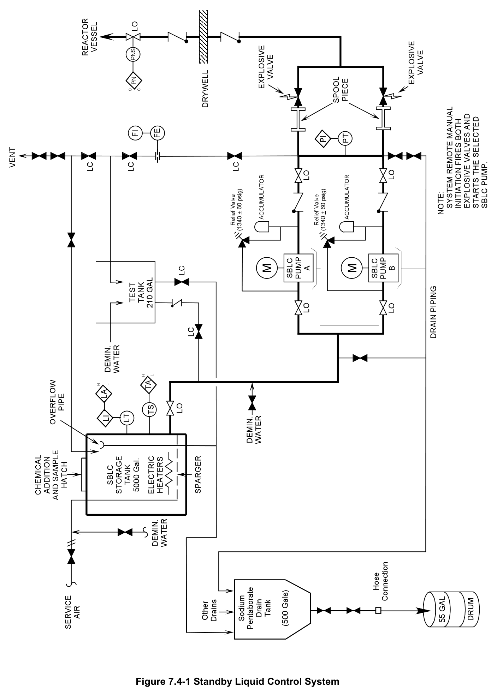
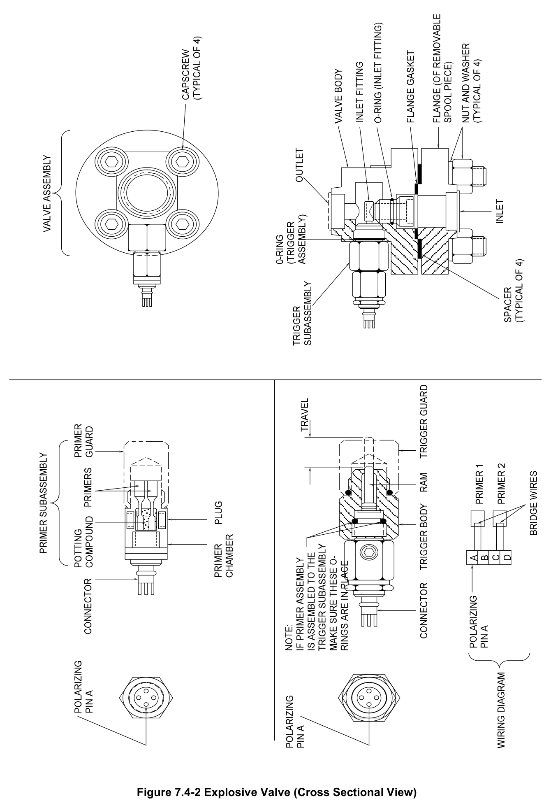
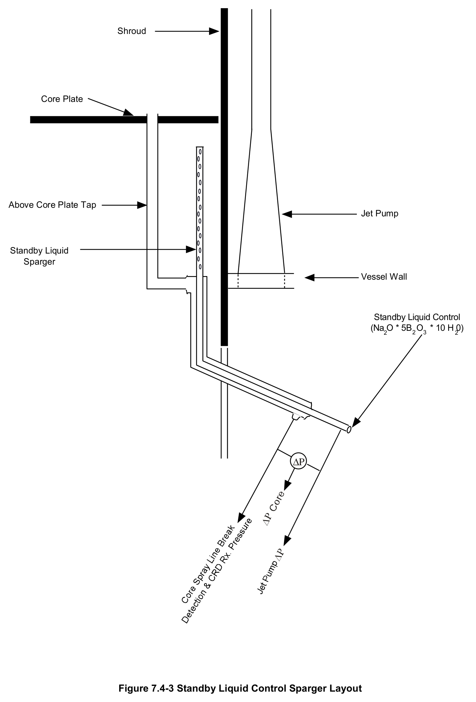
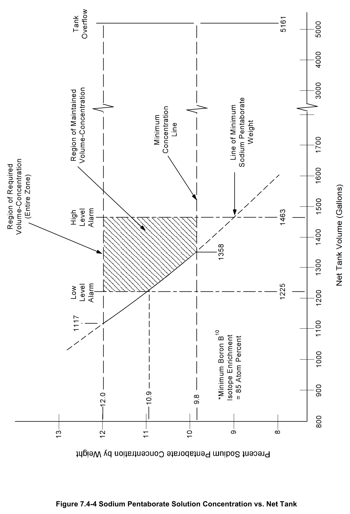

# 7.4 SLC

> Source: `7.4_SLC.pdf` (21 pages)
> GE (BWR) Systems Technology Manual — USNRC HRTD, Rev 09/11

---
<!-- p.1 -->
#### General Electric Systems Technology Manual
#### Chapter 7.4
#### Standby Liquid Control System
<!-- p.3 -->
TABLE OF CONTENTS

7.4 STANDBY LIQUID CONTROL SYSTEM ................................................................. 1

7.4.1 Introduction .................................................................................................... 1

7.4.2 Component Description ................................................................................. 3

7.4.2.1 Storage Tank ................................................................................... 3

7.4.2.2 Standby Liquid Control Pumps ........................................................ 4

7.4.2.3 Explosive Valves ............................................................................. 5

7.4.2.4 Test Tank ........................................................................................ 5

7.4.2.5 Vessel Injection Line ....................................................................... 5

7.4.2.6 Drain Tank and Piping ..................................................................... 6

7.4.2.7 Neutron Absorbing Solution ............................................................. 7

7.4.3 System Features and Interfaces .................................................................... 7

7.4.3.1 Controls and Indications .................................................................. 7

7.4.3.2 Normal Standby Mode ..................................................................... 8

7.4.3.3 Injection Mode ................................................................................. 8

7.4.3.4 Pump Flow Rate Test ...................................................................... 8

7.4.3.5 System Actuation Testing ................................................................ 9

7.4.4 System Interfaces .......................................................................................... 9

7.4.5 Summary ..................................................................................................... 10

Rev 09/11 7.4-i USNRC HRTD

<!-- p.4 -->
#### LIST OF FIGURES
7.4-1 Standby Liquid Control System 7.4-2 Explosive Valve 7.4-3 Standby Liquid Control Sparger Layout 7.4-4 Sodium Pentaborate Solution Concentration vs. Net Tank Volume

Rev 09/11 7.4-ii USNRC HRTD

<!-- p.5 -->
### 7.4 STANDBY LIQUID CONTROL SYSTEM
Learning Objectives

1. Recognize the purposes of the Standby Liquid Control (SLC) System.

2. Recognize the purpose, function and operation of the following major components:
a. Storage Tank b. SLC Pumps c. Explosive (Squib) Valves d. Test Tank e. Vessel Injection Line f. Neutron Absorbing Solution

3. Recognize the following flowpaths:
a. System flow test b. Injection into the Reactor Pressure Vessel (RPV)

4. Recognize what plant conditions would require initiation of the Standby Liquid Control System.

5. Recognize why some of the system lines are heat traced.

6. Recognize the indications that Standby Liquid Control system is injecting boron.

7. Recognize the sources of positive reactivity that must be overcome by the negative reactivity of SLC injection, to achieve the desired Shutdown Margin.

8. Recognize how the Standby Liquid Control (SLC) system interfaces with the following system / components:
a. Reactor Vessel System (Section 2.1)
b. Reactor Water Cleanup System (Section 2.8)
c. Reactor Vessel Instrumentation System (Section 3.1)
d. Reactor Core Isolation Cooling System (Section 2.7)

#### 7.4.1 Introduction
The purposes of the Standby Liquid Control (SLC) System are to inject enough neutron absorbing poison solution into the reactor vessel to:
• shut down the reactor from full power with no control rod motion
• maintain the reactor in a subcritical condition as the plant operators cool the plant down to 70ºF.

SLC is a back-up system designed to shut down the reactor under the most reactive conditions. SLC provides a means of shutting down the reactor without control rod insertion in the event of an Anticipated Transient Without Scram (ATWS). An ATWS is

Rev 09/11 7.4-1 USNRC HRTD

<!-- p.6 -->
an operational condition whereby control rods do not fully insert after a scram signal has been processed. ATWS is one of the "worst case" accidents, consideration of which frequently motivates the NRC to take regulatory action.

The SLC System provides the operator with a relatively slow method of achieving reactor shutdown conditions. A successful reactor scram shuts the reactor down in seconds; whereas SLC takes up to 10 minutes to inject the amount of boron required to keep the reactor shutdown under all conditions. The poison is injected just below the core plate and is carried into the core by natural circulation.

In addition to its shutdown capabilities, the SLC system may be used as a high pressure injection (albeit small, i.e. 41.2 gpm) source during low water level conditions in the emergency operating procedures.

The functional classification of the SLC System is that of a safety related system.

The Standby Liquid Control system, Figure 7.4-1, consists of:
• a heated storage tank
• two 100% capacity positive displacement pumps
• two 100% capacity explosively actuated (squib) injection valves
• the piping necessary to inject the neutron absorber solution into the reactor vessel
• a test tank with necessary valves and piping to adequately test the system without injecting poison into the reactor vessel.

The neutron poison used by SLC is the B10 boron isotope as contained in a sodium pentaborate decahydrate solution. The B10 isotope, which occurs as less than 20% of natural boron has a very high neutron microscopic absorption cross-section of 3.84 x 103 barns. B11 which occurs as over 80% of natural boron has no significant crosssection for neutron absorption. Enriching the sodium pentaborate decahydrate solution to 85-90% B10 concentration in the storage tank dramatically reduces the time to shutdown the reactor and increases the shutdown margin maintained with control rods stuck in a withdrawn position.

When a neutron is absorbed by a B10 nucleus, an excited B11 compound nucleus is formed. The neutron absorption imparts a high energy to the compound nucleus. The excited compound B11 nucleus is more likely to result in alpha decay than to form a stable B11 nucleus. The B11 alpha decay forms a helium and lithium nucleus as represented below.

10 1 7 4 B n Li He + → + 5 0 3 2

As a poison, B10 absorbs a neutron which provides enough energy to cause the compound nucleus to separate into Lithium and Helium atoms.

Rev 09/11 7.4-2 USNRC HRTD

<!-- p.7 -->
The NRC ATWS guidelines established in 10CFR50.62 (commonly referred to as the “ATWS Rule”) established a more rapidly achieved shutdown margin by either increasing poison injection rates or enhancing the B10 concentration of the poison. Each BWR is required to have a SLC system with a minimum injection capacity and boron content equivalent to an 86 gpm at 13% by weight of natural sodium pentaborate solution. Many licensees chose the B10 enrichment option, in large measure because it did not require upgrading SLC equipment. Per NUREG-1780, the NRC has concluded that the licensee actions per the ATWS Rule have been effective in mitigating the potential effects of an ATWS. BWRs that have upgraded in allowable power have also had to commensurately increase the minimum SLC injection capacity.

The SLC system capacity is required to supply sufficient poison to provide a negative reactivity worth greater than the combined positive reactivity effects of:
• All control rods fully withdrawn
• Complete collapse of all voids
• Doppler (fuel cooling)
• Complete Xenon decay
• Temperature (cooldown to 70ºF)

If the volume in which the sodium pentaborate decahydrate is distributed becomes larger, then the poison concentration will correspondingly lower. Therefore the conservative volume estimate assumes the following:
• The reactor water level is at Level 8 (56.5 inches)
• The RHR system is actively in the Shutdown Cooling (SDC) mode
• The recirculation system loops are communicating with the reactor pressure vessel

In addition to the above considerations, a -0.05% ΔK/K is included as additional shutdown margin.

In the event of SLC failure, the Reactor Core Isolation Cooling (RCIC) system can be configured as an alternate poison injection system.

#### 7.4.2 Component Description
The major components of this system are discussed in the paragraphs which follow and are illustrated in Figure 7.4-1.

##### 7.4.2.1 Storage Tank
The standby liquid control storage tank is a covered stainless steel tank with a working capacity of 4,850 gallons. The tank size was based on the old volume requirements prior to the use of enriched B10 solutions. The tank provides the means for storage and mixing of the sodium pentaborate decahydrate solution. Makeup water is supplied to the tank from the Demineralized Water System. A removable hatch is located on the top of the tank to provide access for chemical addition and sampling. A vent and overflow line from the tank is directed to a collection tank.

Rev 09/11 7.4-3 USNRC HRTD

<!-- p.8 -->
The storage tank provides the means for storage and mixing of the neutron absorber solution. A granulated Boric Acid and Borax mixture is added to the storage tank to form a sodium pentaborate decahydrate solution. The poison readily stratifies and/or precipitates out of solution at low temperatures. During addition of poison to the storage tank, the powder solubility is raised using a large manually operated mixing heater that increases the solution temperature to 150ºF. The heater also compensates for the potential temperature loss due to the endothermic reaction as the sodium pentaborate decahydrate is formed. Agitation to promote more uniform mixing is applied by a sparger with six branch lines that are pressurized by the Service Air system.

Two immersion heaters are installed near the bottom of the tank to prevent the sodium pentaborate from precipitating out of solution during normal conditions. The thermostatically controlled heaters automatically cycle on and off to regulate the solution temperature at 80 ±10ºF. Both heaters are powered from the Emergency AC Power System. The pipe from the storage tank to the SLC pump suction is heat traced. The tank heaters and pipe heat trace minimizes poison precipitation on internal equipment surfaces. Boron precipitation can become significant at temperatures below 62°F.
Precipitated boron dilutes the poison available for injection and in severe cases may significantly clog the pipe and pump suction reducing the pumping capacity. The suction point is raised above the tank bottom to help prevent any clogging by precipitate.

##### 7.4.2.2 Standby Liquid Control Pumps
The sodium pentaborate solution is pumped into the reactor pressure vessel by either one of the two 100% capacity, triplex piston (plunger) positive displacement pumps
(Figure 7.4-1). Each pump is designed to deliver the neutron absorbing solution to the reactor vessel at a flow rate of 41.2 gpm against a back pressure of 0-1250 psi. Normal control of the pumps is from the control room via a single selector switch. Local switches are also provided for testing purposes. The local switches bypass the explosive valve ignition circuitry and allow the running of both pumps for testing and maintenance.

There are accumulators and relief valves (Figure 7.4-1) at the discharge of each of the SLC pumps. The relief valves open at very high pressure (about 1400 psig) to prevent pump casing or seal damage. They relieve back to the SLC pump suction. The accumulators use pressurized nitrogen (360 psig) and a synthetic bladder to absorb the pressure pulsation that occurs when the piston style positive displacement pumps are in operation. The accumulators act as pulsation dampers to:
• protect the relief and check valves from transient pressure pulses during pump operation
• reduce the pump suction pressure oscillation
• extend the service life of the discharge line, relief valves and check valves.

Rev 09/11 7.4-4 USNRC HRTD

<!-- p.9 -->
##### 7.4.2.3 Explosive Valves
The two 100% capacity explosive squib actuated valves (Figures 7.4-1 and 7.4-2) are located between the discharge of the SLC pumps and the reactor vessel. The dual valve arrangement ensures that the failure of a single squib actuated explosive valve will not prevent the SLC system from injecting. Both explosive valves will fire whenever the SLC pump start switch in the main control room is selected to either the “Start Sys A” or “Start Sys B” position. Hence when the system is actuated from the main control room, one pump will start and both explosive valves will open. The explosive valves have a grooved hollow shear plug that is threaded into the valve body. When actuated the explosive charge drives a ram that cuts the shear plug at the groove. This zero leakage arrangement prevents boron from migrating to the reactor vessel.

A squib is a small explosive device that consists of a small tube filled with an explosive substance and a detonator connected to a remote electrical / electronic trigger. The SLC squibs are fired with an electrical current of 2 amperes or greater. Each explosive valve is a double squib actuated shear plug, zero leakage valve. When either explosive squib is fired, it drives a ram forward to shear off the hollow shear plug of the inlet fitting.
The extended ram prevents the shear plug from obstructing flow through the valve by forcing it into a recess in the valve body. The products of the explosion are completely retained in the primer chamber and will not contaminate the boron solution passing through the valve. Removable spool pieces in the piping immediately upstream of each valve facilitate replacement of the shear plug.

When the SLC system is in its normal standby condition, a continuous no fire current of approximately 3 milliampere is passed through the trigger assembly of each explosive valve. This trickle current illuminates electrical continuity lights at the 603 panel of the main control room, indicating that there is electrical continuity to the associated squib firing circuits. If continuity is lost, an alarm is annunciated and the circuit continuity light(s) will extinguish. The firing current for the squibs is no less than 2 amperes.

##### 7.4.2.4 Test Tank
The test tank (Figure 7.4-1) provides a means for system testing and flushing with demineralized water. The stainless steel cylindrical tank has a nominal capacity of 210 gallons. Makeup water to the tank is provided from the demineralized water system.

The tank can only be drained to a drain tank via the test tank drain valve. This arrangement helps to prevent boron from contaminating treated water.

##### 7.4.2.5 Vessel Injection Line
The vessel injection line (Figures 7.4-1 and 7.4-3) serves a dual function within the reactor vessel. It provides an injection path for the sodium pentaborate solution and a tap for vessel instrumentation. The injection line contains two check valves in series, located on either side of the drywell penetration and a normally open manual isolation

Rev 09/11 7.4-5 USNRC HRTD

<!-- p.10 -->
valve. The manually operated isolation valve is locked in the open position and contains position indication switches that indicate open/close position in the control room. The injection line enters the reactor vessel at a point below the core shroud as two concentric pipes (Figure 7.4-3). The use of two pipes reduces the thermal shock to the reactor vessel when SLC is actuated.

The two pipes separate in the reactor vessel lower plenum. The inner pipe has a perforated length which terminates just below the core plate. The outer pipe terminates at the top of the core plate.

The inner pipe is used to:
• inject sodium pentaborate decahydrate poison solution as required
• sense below core plate pressure for core plate ΔP determination
• sense below core plate pressure for jet pump ΔP determination

The outer pipe is used to sense:
• sense above core plate pressure for core plate ΔP determination
• reactor pressure determination for CRD ΔP determination
• core spray line break

During poison injection, the sodium pentaborate decahydrate is carried inside the core and core shroud by natural circulation. During ATWS conditions, the recirculation pumps will be tripped to assist in a power reduction. EOPs may direct that reactor water level be lowered to reduce preheating and natural circulation which will also help to minimize reactor power. The reduced water level and the ensuing reduction of natural circulation will diminish the poison injection rate into the core. However, if saturated conditions continue in the core, some natural circulation will be present as low quality steam exits the core and condensed water returns to the reactor pressure vessel annulus. When reactor water level is restored to the normal band, the increased natural circulation will improve the poison distribution in the core region.

##### 7.4.2.6 Drain Tank and Piping
Various drain piping goes to a common 500 gallon drain tank and then via a flexible hose connection to either a 55 gallon drum or to the salt water drain tank (Figure 7.4-1)
The drain tank is used to collect potentially borated water from:
• pump suction cross connect line
• pump base plate
• pump discharge cross connect pipe
• test tank
• main tank overflow

SLC drainage directly to radwaste would have required heat tracing of the drain lines to prevent plugging due to precipitated poison. By draining all of the potentially borated water to a drain tank and subsequent 55 gallon drum the radwaste system does not have to process borated waste or use heat traced piping. Processed water containing

Rev 09/11 7.4-6 USNRC HRTD

<!-- p.11 -->
boron returning to the reactor could lead to an unanalyzed effect on reactor power.
Demineralization is not effective in removing boron from water. Any collected SLC wastewater is likely to be discharged to Long Island Sound.

##### 7.4.2.7 Neutron Absorbing Solution
The neutron poison is added to the storage tank as a white granular powder consisting primarily of Borax and Boric Acid. In solution with demineralized water, the poison forms sodium pentaborate decahydrate (Na2 . 5B2O3 . 10H2O) which is more soluble than Borax or Boric Acid alone. The B10 isotope of boron is a very effective neutron poison whereas the B11 isotope is not. The B10 isotope occurs naturally at about 20% with the remaining 80% occurring as the B11 isotope. The poison powder has a shelf life of 40 years.

For the Shoreham model, the sodium pentaborate poison mix has been enriched to 85- 90% of B10 per 10CFR50.62. The increase in B10 concentration reduced the required storage tank poison volume to about 25% of the original requirement. At the rate of 41.2 gpm the enriched poison delivers the required shutdown margin far faster than originally designed and the calculated core melt frequency is considerably reduced.

Boron compounds are very toxic, affecting the central nervous system. Boron poisoning causes depression of the circulation, with persistent vomiting and diarrhea. Severe poisoning causes profound shock and low body temperature which may result in a coma or death. A severe rash may cover the entire body. Protective clothing such as a face shield, apron and gloves, is required when handling the powdered poison.

#### 7.4.3 System Features and Interfaces
A short discussion of system features and interrelations between this system and other plant system is given in the paragraphs which follow.

##### 7.4.3.1 Controls and Indications
The primary controls and indications for the SLC system are located in the control room 603 Panel. The SLC system is initiated by a single key lock switch with three positions:
• “Start Sys A”
• “Start Sys B”
• “Stop”.

The key lock switch may only be selected to start one of the SLC pumps. Selection of either the “Start Sys A” or “Start Sys B” position will start the associated pump and fire the squibs of both explosive valves. Local control of the SLC pumps is provided for testing; the explosive valve squibs will not automatically fire when the SLC pumps are started locally.

Rev 09/11 7.4-7 USNRC HRTD

<!-- p.12 -->
##### 7.4.3.2 Normal Standby Mode
The SLC system must be maintained in an operational standby status when there is fuel in the reactor vessel and the reactor is operating, as required by Technical Specifications. In the standby mode of operation the SLC system is lined up as indicated in Figure 7.4-1.

The storage tank volume and poison concentration are regularly monitored. The SLC storage tank is maintained between the high and low level alarm points in accordance with Technical Specifications (Figure 7.4-4). The sodium pentaborate decahydrate concentration in the stored poison solution must also be high enough to comply with Technical Specifications. In addition the storage tank and piping are maintained at their required temperatures to minimize poison precipitation.

A small current is directed through the Squib firing circuits. The approximately 3 milliampere current is well below the current required to fire the Squibs; however it is high enough to light two continuity lights on the 603 Panel. The lights extinguish upon a loss of circuit continuity and the loss of current is annunciated at the 603 Panel.

##### 7.4.3.3 Injection Mode
The Emergency Operating Procedures (EOPs) may require SLC actuation during ATWS or Loss of Coolant Accident (LOCA) conditions. SLC is actuated by inserting the key and turning the switch to the either the “Start Sys A” or “Start Sys B” position.
Turning the switch to “Start Sys A” starts the “A” SLC pump, fires both explosive valves and isolates the Reactor Water Cleanup (RWCU) System. Similarly turning the switch to “Start Sys B” starts the “B” SLC pump, fires both explosive valves and isolates the Reactor Water Cleanup (RWCU) System.

Redundant explosive valve firing circuits allow either system to fire both valves. Positive indication of system injection is provided by all of the following:
• Pump on light for the system started
• Loss of continuity lights and alarm
• Pump discharge pressure greater than reactor pressure
• Storage tank level decreasing
• Reactor power decreasing

##### 7.4.3.4 Pump Flow Rate Test
The pump flow rate testing is performed locally at the pumps. The local pump start and stop switches will not fire the squibs on the explosive valves. The pump suction is aligned to the test tank after the tank has been filled with demineralized water and the pump’s suction piping has been flushed. The pump suction is aligned to the test tank.
One of the SLC pumps is started and the discharge flow is routed back to the test tank.
The discharge pressure is then adjusted using one of the test tank return valves to simulate a reactor pressure of 1150 psig. The pump’s flow indication is provided locally.

Rev 09/11 7.4-8 USNRC HRTD

<!-- p.13 -->
##### 7.4.3.5 System Actuation Testing
System actuation testing is performed once a cycle with the reactor shutdown. During this test, demineralized water from the test tank is pumped into the reactor vessel to verify pump discharge capacity and the performance of the explosive valves. Prior to initiation the test tank is filled with demineralized water and aligned to the SLC pump suction. The system is then flushed using the demineralized water. One explosive valve is then electrically disarmed. The test is then initiated from the control room, to check actuation of the armed explosive valve and the ability to pump water into the reactor vessel. Following the test, the system is realigned for standby conditions, including replacement of the fired squib and shear plug assembly.

#### 7.4.4 System Interfaces
A short discussion of interfaces this system has with other plant systems is given in the paragraphs which follow.

Reactor Pressure Vessel System (Section 2.1)

The SLC System injects the neutron absorbing solution into the reactor vessel through a penetration in the bottom section of the vessel. There are two concentric pipes, referred to as the inner and outer pipes (Figure 7.4-3) that penetrate the reactor pressure vessel terminating under the core plate. The inner pipe is used to deliver the poison to the core region.

Reactor Water Cleanup System (Section 2.8)

The initiation of the SLC system automatically isolates the RWCU System to prevent poison dilution and removal.

Reactor Vessel Instrumentation System (Section 3.1)

There are two concentric pipes, referred to as the inner and outer pipes (Figure 7.4-3)
that penetrate the reactor pressure vessel terminating under the core plate and above the core plate respectively. The pipe-within-a-pipe configuration provides sensing points for:
• core plate ΔP
• jet pump ΔP
• core spray line break conditions
• reactor pressure determination for CRD ΔP determination

Emergency AC Power (Section 9.2)

SLC pump motors are powered from the Emergency AC Power system.

Rev 09/11 7.4-9 USNRC HRTD

<!-- p.14 -->
Demineralized Water System (Section 2.6)

The make-up water for the storage tank and the test tank is supplied by the Demineralized Water System.

Service Air System (No Section)

Sparging air for agitation during poison addition to the storage tank is supplied by the Service Air system.

Core Spray System (Section 10.3)

There are two concentric pipes, referred to as the inner and outer pipes (Figure 7.4-3)
that penetrate the reactor pressure vessel terminating under the core plate and above the core plate respectively. The outer pipe is used to provide core spray line break detection.

Reactor Core Isolation Cooling (RCIC) system (Section 2.7)

In the event of SLC failure, the Reactor Core Isolation Cooling (RCIC) system can be configured as an alternate poison injection system.

#### 7.4.5 Summary
Classification - Safety related system

Purpose - To shutdown the reactor by chemical poisoning in the event of failure of the control rod drive system.

Components - Storage tank; 2-100% capacity pumps; 2-100% capacity explosive valves; injection pipe; test tank.

System Interfaces:
• Reactor Pressure Vessel
• RWCU System
• Reactor Vessel Instrumentation System
• Emergency AC Power
• Demineralized Water System
• Service Air System
• Core Spray
• RCIC System

Rev 09/11 7.4-10 USNRC HRTD

<!-- p.15 -->
#### Figure 7.4-1

*Standby Liquid Control System*

[Vector original (SVG, lossless): fig_7.4-1.svg](../figures/fig_7.4-1.svg)

<!-- p.17 -->
#### Figure 7.4-2

*Explosive Valve (Cross Sectional View)*

[Vector original (SVG, lossless): fig_7.4-2.svg](../figures/fig_7.4-2.svg)

<!-- p.19 -->
#### Figure 7.4-3

*Standby Liquid Control Sparger Layout*

[Vector original (SVG, lossless): fig_7.4-3.svg](../figures/fig_7.4-3.svg)

<!-- labels/text on this figure page -->
Shroud
Core Plate
Above Core Plate Tap Jet Pump
Standby Liquid Sparger
Vessel Wall
Standby Liquid Control
(Na O * 5B O * 10 H 0)
2 2 3 2
ΔΡ
Figure 7.4-3 Standby Liquid Control Sparger Layout

<!-- p.21 -->
#### Figure 7.4-4

*Sodium Pentaborate Solution Concentration vs. Net Tank*

[Vector original (SVG, lossless): fig_7.4-4.svg](../figures/fig_7.4-4.svg)

