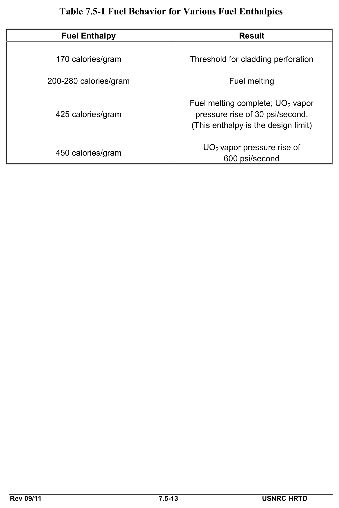
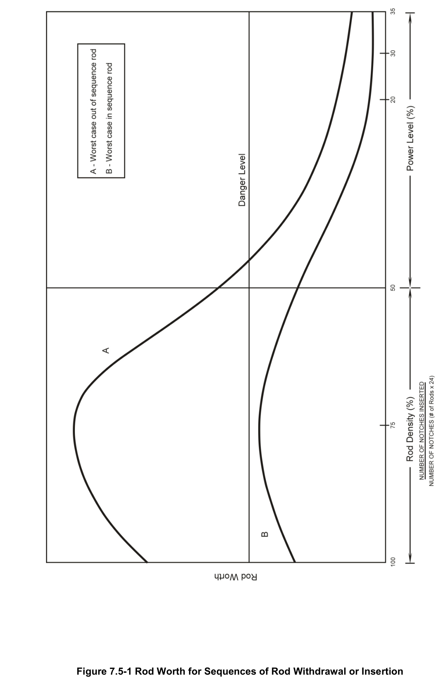
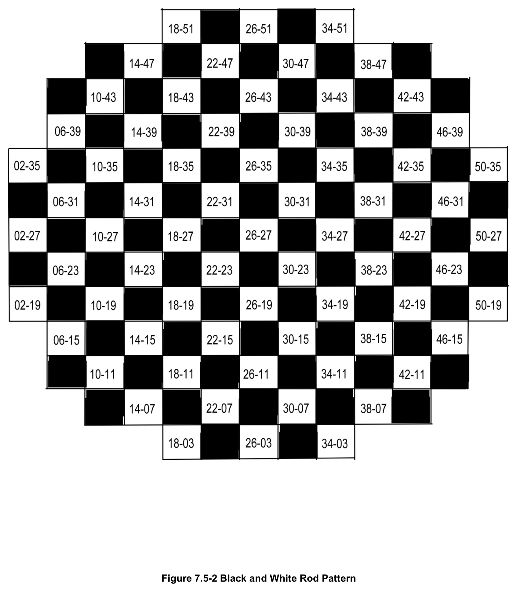
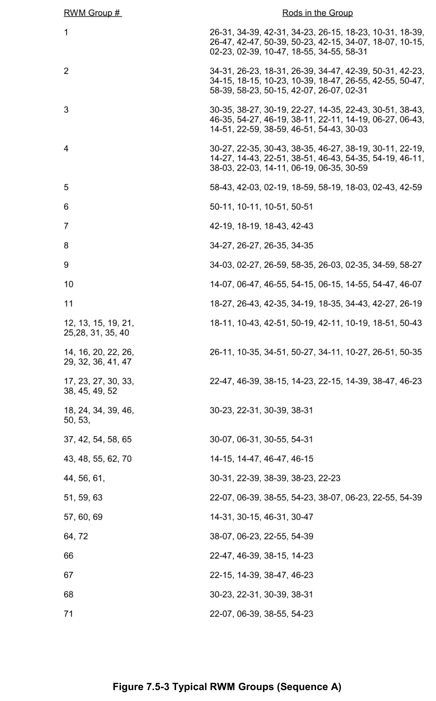
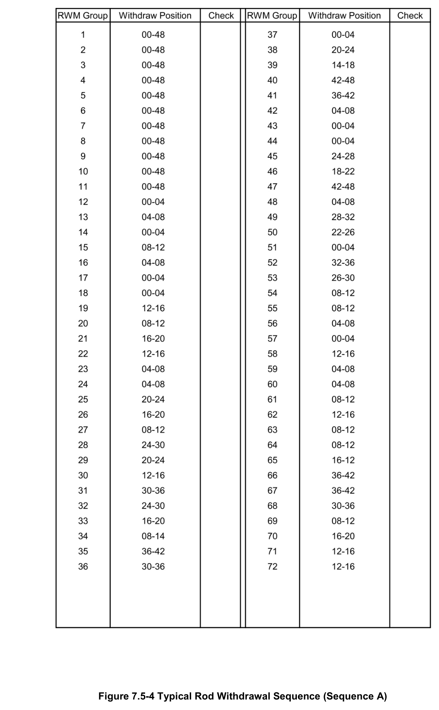
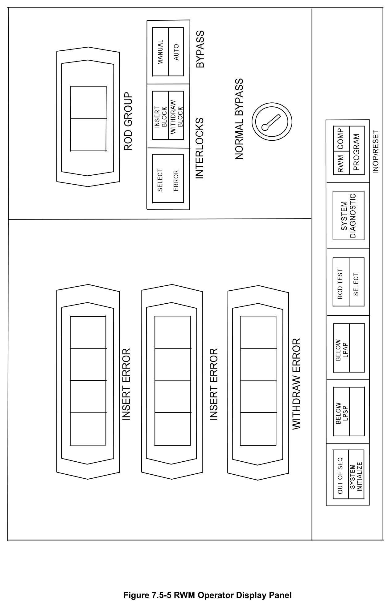

# 7.5 RWM

> Source: `7.5_RWM.pdf` (22 pages)
> GE (BWR) Systems Technology Manual — USNRC HRTD, Rev 09/11

---
<!-- p.1 -->
#### General Electric Systems Technology Manual
#### Chapter 7.5
#### Rod Worth Minimizer System
<!-- p.3 -->
TABLE OF CONTENTS

7.5 ROD WORTH MINIMIZER SYSTEM ....................................................................... 1

7.5.1 Introduction .................................................................................................... 1

7.5.2 Component Description ................................................................................. 2

7.5.2.1 RWM Program ................................................................................. 2

7.5.2.2 RWM Operator's Panel .................................................................... 5

7.5.3 System Features and Interfaces .................................................................... 8

7.5.3.1 Rod Drop Accident .......................................................................... 8

7.5.3.2 Normal Operation ............................................................................ 9

7.5.3.3 Operation with Errors ...................................................................... 9

7.5.3.4 System Interfaces .......................................................................... 10

7.5.4 Summary ..................................................................................................... 11

LIST OF TABLES

7.5-1 Fuel Behavior For Various Fuel Enthalpies ...................................................... 13

Rev 09/11 7.5-i USNRC HRTD

<!-- p.4 -->
#### LIST OF FIGURES
7.5-1 Rod Worth for Sequences of Rod Withdrawal or Insertion 7.5-2 Black and White Pattern for "A" Sequence 7.5-3 Typical RWM Groups (Sequence A)
7.5-4 Typical Control Rod Withdrawal Sequence (Sequence A)
7.5-5 RWM P603 Operator Panel

Rev 09/11 7.5-ii USNRC HRTD

<!-- p.5 -->
### 7.5 ROD WORTH MINIMIZER SYSTEM
Learning Objectives

1. Recognize the purpose of the Rod Worth Minimizer (RWM) System.

2. Recognize the purpose, function and operation of the following RWM signals/indications:
a. insert block b. insert error c. withdraw block d. withdraw error e. select error f. latched group

3. Recognize the conditions necessary to result in a Control Rod Drop Accident and the potential consequences.

4. Recognize the plant conditions that determine the Low Power Set Point and Low Power Alarm Point.

5. Recognize how RWM operation differs when reactor power is;
a. above the Low Power Alarm Point b. in the Transition zone c. below the Low Power Set Point

6. Recognize how the Rod Worth Minimizer system interfaces with the following systems:
a. Feedwater Control System (Section 3.3)
b. Reactor Manual Control System (Section 7.1)
c. Process Computer System (Thermal Limits, Section 1.8)

#### 7.5.1 Introduction
The purpose of the Rod Worth Minimizer (RWM) is to reinforce procedural controls and limit control rod worth during low power operation. The RWM prevents the operator from establishing control rod patterns that could create high rod worth values. This minimizes the impact of a control rod drop accident, during startup, shutdown, and low power level operation.

The RWM prevents the operator from establishing control rod patterns that are not consistent with the designated rod patterns. The RWM uses error lights, rod insert and withdraw blocks to enforce rod pattern restrictions. The RWM sequences are based on controlling rod worth at acceptable levels, as determined by the design basis rod drop accident. Control rod positions, from the control rod position information probes, are

Rev 09/11 7.5-1 USNRC HRTD

<!-- p.6 -->
obtained for comparison to the sequence. The RWM function may be bypassed and its rod block function disabled by specific procedural controls.

The functional classification of the Rod Worth Minimizer is that of a safety related system.

#### 7.5.2 Component Description
The major components of this system are discussed in the following paragraphs.

##### 7.5.2.1 RWM Program
To help understand the RWM program, definitions of the terms used in the program will be given. This will be followed by a description of the sequence enforcement by the RWM.

###### 7.5.2.1.1 Operating Sequence
An operating sequence is a specifically defined series of rod groups which are controlled by the RWM. Groups of rods are ordered within the sequence; i.e., Group 1, Group 2 . . . , Group n. Rod withdrawals, corresponding to the series of groups, are preformed by normal operating procedures. Two sequences, Sequence A or B, are used when starting up or shutting down the reactor. One of these sequences is input into the process computer memory for use by the RWM program.

Each sequence step identifies the group (i.e., the control rods to be moved). The step also designates the group's insert and withdrawal limit positions (even numbers between 00 and 48). There are sequence variations specific to each reactor. In general each sequence begins by withdrawing half of the control rods to the fully withdrawn position.
The control rods fully withdrawn are distributed in a checkerboard pattern (black/white)
across the reactor core. Every other rod along either an X or Y coordinate is fully withdrawn as shown in Figure 7.5-2. This pattern is also referred to as 50% rod density, where rod density is the percent of notches fully inserted. The remaining rods are then withdrawn in steps to intermediate positions to adjust reactor power and/or flux shape.
Sequences differ in that the rods which were fully withdrawn in an A Sequence remain inserted in the B. The rods that were inserted in the A Sequence are fully withdrawn at 50% rod density in the B Sequence. The two sequences are changed at intervals during a fuel cycle to optimize core power distribution and uniform fuel consumption. Figures 7.5-3 and 7.5-4 illustrate a typical Ssequence A and will aid in the understanding of various terms.

Rev 09/11 7.5-2 USNRC HRTD

<!-- p.7 -->
###### 7.5.2.1.2 Rod Groups
Rod groups are the sequential subdivisions of each operating sequence. A group consists of one or more control rods symmetrically positioned in the core. Each group has a set of specific insert and withdrawal position limits. The groups are numbered sequentially from the all rods in condition to the 100% power rod configuration. For example, Group 1 contains rods that are withdrawn first during a startup and inserted last during a shutdown. The insert limit for Group 1 is therefore position 00 and the withdraw limit is position 48. When all the rods in Group 1 are at the withdrawal limit the operator proceeds to Group 2. Thus at any point in the sequence, all the rods in Group 1 through Group n-1 are at there withdrawal limit.
All the rods in Group n+1 through the highest numbered group are at their insert limits.
The rods in Group n may be at any position between their insert and withdrawal limits.

Control rods may appear in more than one rod group. An example will be discussed, using control rod 30-07 and Figure 7.5.3. Control rod 30-07 is in Groups 37, 42, 54, 58 and 65. The withdraw limit for control rod 30-07 in Group 37 is the same as the insert limit for 30-07 in group 42.

###### 7.5.2.1.3 Latched Group
When operating below the Low Power Set Point (LPSP) latching to the next higher or lower rod group is done internally by the RWM program.

When raising power latching occurs when the following conditions are met.
• all rods in the previous group are at their withdraw limit
• a rod in the next group is selected.

Conversely, when power is being lowered, the program will latch the next lower group if all the rods in latched group are at their insert limit • a rod in the next group is selected. •

###### 7.5.2.1.4 Low Power Set Point
The LPSP utilizes total main steam flow as a measurement of reactor power.
When main steam flow is less than 20% of rated steam flow all rod pattern restrictions are enforced by the RWM. This steam flow signal is generated in the Feedwater Level Control System (FWLCS). When the steam flow signal is greater than the LPSP, the RWM program does not impose rod blocks.

###### 7.5.2.1.5 Low Power Alarm Point
The Low Power Alarm Point (LPAP) is the power level above which all RWM alarms and error displays are discontinued. The LPAP setpoint is > 30% of rated steam line flow, as sensed by steam flow in the FWLCS.

Rev 09/11 7.5-3 USNRC HRTD

<!-- p.8 -->
###### 7.5.2.1.6 Transition Zone
The Transition Zone is the range of power levels above the LPSP but below the LPAP.
The RWM displays are active between 20 and 30% power as sensed by main steam line flow. In the Transition Zone, the RWM displays alarms and errors, but does not enforce the operating sequence. This allows identification and correction of sequence errors before the RWM begins enforcing restraints.

###### 7.5.2.1.7 Withdraw Error
The following conditions will cause a Withdraw Error;
1. The current group is withdrawn past the withdraw limit
2. A higher group is withdrawn past its insert limit

###### 7.5.2.1.8 Insert Error
The following conditions will cause an Insert Error;
1. The current group is inserted past the insert limit
2. A lower group is inserted past its withdraw limit

###### 7.5.2.1.9 Select Error
A select error occurs when a control rod is selected in other than the currently latched group. The select error provides a warning that moving the selected rod will result in an insert/withdraw error. A select error will illuminate an alarm light on the RWM operator's panel.

###### 7.5.2.1.10 Withdraw Block
The RWM withdraw blocks are imposed to enforce correction of existing errors before allowing further control rod movement. A control rod withdraw block is imposed by the RWM program whenever:
1. A single withdraw error has been made.
2. An insert block has been imposed by the RWM. This withdraw block applies to any control rod movement except those with existing insert errors.

Rev 09/11 7.5-4 USNRC HRTD

<!-- p.9 -->
###### 7.5.2.1.11 Insert Block
The RWM insert blocks are imposed to enforce correction of existing errors before allowing further rod movement. A control rod insert block is imposed by the RWM program whenever:
1. A third insert error is made.
2. A withdraw block has been imposed by the RWM. This insert block applies to any control rod movement except the existing withdraw error.

###### 7.5.2.1.12 Nominal and Alternate Group Limits
In addition to the nominal insert and withdraw limits for each control rod group, the RWM allows alternate insert and withdraw limits. To illustrate, assume that the nominal withdraw limit for a rod group is specified as position 26. The alternate withdraw limit for this group will then be position 24. Any rod left at position 24 would not be treated as an insert error during the withdraw sequence. The same holds true for alternate insert limits, with the exception of groups having an insert limit of 00. For these groups, the alternate insert limit is position 02.

These alternate limits are within the RWM design specifications which allows for a tolerance of ±2 notch positions. The RWM program considers a rod to be at the group limit for either the nominal or alternate limit position. The alternate limits reduce the RWM rod blocks due to failures of rod position sensors at the group limit positions.

As a further safeguard against rod position sensor failure, the RWM program will automatically accept substitute rod positions. This substitute position data is input from the Reactor Manual Control system when there is bad data from the RPIS.

##### 7.5.2.2 RWM Operator's Panel
All of the operating controls and indicators for the RWM are located on the RWM operator's panel. The RWM controls and indications are illustrated in Figure 7.5-5.
Discussions of the various controls and indications are in the following paragraphs.

###### 7.5.2.2.1 Insert Error Digital Display Window
There are two four-digit displays used to identify control rods responsible for causing insert errors. The XX-YY coordinates of the error rod(s) are displayed in the two windows. The rod which causes the first insert error is in the upper most left window.
An additional insert error will be shown in the next lower window. Both windows are blank if no insert errors exist or if the RWM is bypassed manually or automatically.

Rev 09/11 7.5-5 USNRC HRTD

<!-- p.10 -->
###### 7.5.2.2.2 Withdraw Error Digital Display Window
There is one four-digit XX-YY display used to identify a control rod responsible for a withdraw error. The withdraw window is blank if no withdrawal errors exist or if the RWM is bypassed manually or automatically.

###### 7.5.2.2.3 Rod Group Digital Display Window Rod
The rod group two-digit display window identifies the group number of the rod that is currently latched. The window is blank when the RWM is bypassed.

###### 7.5.2.2.4 Select Error Light
The select error indicating light illuminates amber when a control rod is selected that is not in the currently latched group. It also illuminates if the selected rod is not the error rod responsible for an existing rod block.

###### 7.5.2.2.5 Insert Block Light
The insert block display light illuminates red whenever an insert block is applied by the RWM program.

###### 7.5.2.2.6 Withdraw Block Light
The withdraw block display light illuminates red whenever a withdraw block is applied by the RWM program.

###### 7.5.2.2.7 Manual Bypass Light
The manual bypass display light illuminates amber when the RWM Normal/Bypass Keylock switch is in Bypass.

###### 7.5.2.2.8 Auto Bypass Light
The automatic bypass display light illuminates amber when the RWM is automatically bypassed at > 30% rated steam flow (power).

###### 7.5.2.2.9 Normal / Bypass Keylock Switch
The Normal / Bypass switch is used to manually bypass the RWM function. The switch is usually maintained in the Normal position with the key removed. To bypass the RWM, the key is inserted and turned to the Bypass position. The manual Bypass indicator light will illuminate and all RWM displays will go blank.

Rev 09/11 7.5-6 USNRC HRTD

<!-- p.11 -->
###### 7.5.2.2.10 Out of Sequence-System Initialize Pushbutton Switch/Indicator
The system initialize switch is used to initialize the RWM program. Initialization is performed whenever the RWM has been removed from service or the program has aborted. The system initialize portion of the window illuminates while the switch is held down. The amber OUT of SEQ light energizes when the LPAP is reached and a withdraw error or greater than two insert errors exist. This allows the operator to correct rod pattern discrepancies before reaching the LPSP.

###### 7.5.2.2.11 Rod Test-Select Pushbutton Switch/Indicator
The rod test switch places the RWM program in the rod test mode. To enable the switch, all control rods must be fully inserted. If this condition exists, the select indicator illuminates white when the rod test switch is depressed. In this mode any one control rod may be selected and moved if all other control rods are fully inserted. The rod test mode can be terminated by depressing the rod test switch again. The rod test mode is used to verify control rod operability in the SHUTDOWN or REFUEL mode of operation.

###### 7.5.2.2.12 System Diagnostic Switch/Indicator
The diagnostic switch can be depressed at any time after the system initialization to run the RWM diagnostic routine. The diagnostic routine of the RWM program will apply and remove insert and withdraw blocks. The rod block circuits operability is verified by observing the sequence of insert and withdraw block alarm lights. The diagnostic routine continues until the switch is depressed again. After the diagnostic routine is terminated the RWM is re-initialized with the system initialize pushbutton.

###### 7.5.2.2.13 RWM - COMP - PROG Pushbutton Switch/Indicator
The three segments of this indicator are used to alarm various hardware and software failures within the RWM. This switch also verifies indicator lights are operative and resets the lamp drive circuits.

The PROG indicator is lit whenever the RWM program is inoperative (not initialized, manually bypassed, or program aborted). The COMP indicator illuminates whenever a computer stall or bit parity check error occurs. The RWM section lights when ever the COMP or PROG are in the alarm state. With the pushbutton depressed, all three of the indicators will back light, until it is released. If the previous hardware or software failure has cleared the light(s) will extinguish.

Rev 09/11 7.5-7 USNRC HRTD

<!-- p.12 -->
#### 7.5.3 System Features and Interfaces
A discussion of system features and interrelations between the RWM and other plant systems is given in the following paragraphs.

##### 7.5.3.1 Rod Drop Accident
During low power and startup operation, unrestrained rod patterns can create high worth rods. If these rods dropped they would exceed the fuel thermal design limits for a Rod Drop Accident. The design bases rod drop accident results in a rapid, very high power spike in the fuel. This causes fuel temperature near the dropped rod to increase very rapidly. The Doppler coefficient will turn reactor power initially, followed by an IRM or APRM high flux reactor scram. The power spike duration is very short compared to the fuel time constant, so all the energy generated stays in the fuel pellets. As the fuel enthalpy increases, the fuel melts and vaporizes. Table 7.5-1 lists the results of experiments and analysis of fuel behavior for various fuel enthalpies.
A value of 280 calories per gram is considered the design limit for a rod drop accident.
Beyond 280 calories per gram rapid fuel rod failure is expected.

The following six conditions must all be met for a design bases rod drop accident to occur;
1. The control rod blade must be uncoupled from its drive mechanism.
2. The control rod blade must stick in the fully inserted location (00).
3. The control rod mechanism must be fully withdrawn (48).
4. The operator does not perform the technical specification required coupling check at position 48.
5. The operator does not notice the lack of nuclear instrument response to the withdrawal of the control rod.
6. The control rod blade must be dislodged from the 00 position and fall to the 48 position.

Each of the required events has a small probability of occurrence, giving the accident itself has a very low probability. However the negative consequence, if the accident were to occur, requires action to reduce its probability. Some fuel damage could occur as a result of the worst case rod drop accident. The consequences of a control rod drop depend upon the following;
• initial reactor power level
• control rod reactivity worth
• moderator temperature
• moderator voids
• core age
• the distance the control blade drops
• the rate the control rod blade falls (determined by the control rod velocity limiter)

Rev 09/11 7.5-8 USNRC HRTD

<!-- p.13 -->
Rod movement sequences are developed to limit rod worth. Rods are withdrawn symmetrically to distribute power generation evenly throughout the core. Limiting rod worth maintains the fuel enthalpy from the transient <280 cal/gm. Figure 7.5.1 shows the differences in the control rod worth, in terms of In Sequence Vs Out of Sequence control rod patterns.

Below 20% power, selecting and withdrawing an in sequence control rod is permitted. If the highest worth in sequence control rod blade dropped from 00 to 48, fuel enthalpy will be <280 cal/gm. As power is increased above 20%, increased voiding occurs in the core. This increased voiding flattens the flux profile surrounding a control rod. If a control rod drop occurs above 20% power, the reactivity change will be significantly less than if below 20% power. Thus the RWM is not needed to enforce rod patterns above 20% power.

##### 7.5.3.2 Normal Operation
Prior to withdrawing any control rods, the RWM program is loaded and the correct rod withdraw sequence is selected. The Normal / Bypass Keylock Switch is verified in the normal position and the system is initialized.

When initialized, the rod group window on the operator's panel will display 01, indicating that rod Group 1 is latched. The rod withdraw procedure is followed to withdraw all of the group 1 rods to the full out position (48). When the last group 1 rod is moved to position 48, the rod group indication automatically updates to 02. After each rod group is moved to it's withdraw limit and the next higher group is latched the rod group window updates.

The RWM sequence restraints do not specify the order of rod withdrawal. The order of rod withdrawal is controlled administratively with the rod sequence sheets.

##### 7.5.3.3 Operation with Errors
Although the RWM will allow operation with up to two insert errors, this is not an acceptable practice. Errors (insert or withdraw) should be corrected promptly upon discovery by the plant operators.

Rev 09/11 7.5-9 USNRC HRTD

<!-- p.14 -->
##### 7.5.3.4 System Interfaces
A short discussion of interrelations between this system and other plant systems is given in the following paragraphs.

Reactor Manual Control System (Section 7.1)

The reactor manual control system provides rod selected data and receives rod block signals. It also allows the operator to substitute rod position information for the RWM, if a CRDM reed switch fails.
Control Rod Drive System (Section 2.3)

The CRD system provides control rod position information to the RWM.

Feedwater Level Control System (Section 3.3)

The feedwater level control system provides the main steam line flow signal to the RWM that is used to initiate/bypass the LPSP and LPAP.

Process Computer (Section 6.1)

The process computer is the central component of the RWM containing the control rod sequences.

Rev 09/11 7.5-10 USNRC HRTD

<!-- p.15 -->
#### 7.5.4 Summary
The purpose of the Rod Worth Minimizer (RWM) is to reinforce procedural controls and limit control rod worth during low power operation. The RWM prevents the operator from establishing control rod patterns that could create high rod worth values. This minimizes the impact of a control rod drop accident, during startup, shutdown, and low power operation.

The RWM provides the operator with indications and control rod block signals to ensure compliance with the required control rod patterns. The RWM control rod blocks are automatically bypassed when above the LPSP. RWM indications are automatically bypassed when above the LPAP. These power levels are sensed by a steam flow signal from the FWLC system. The area between the LPSP and LPAP is the Transition zone. The error indication displayed by the RWM in the transition zone aids establishing the correct rod pattern during reactor shutdowns.

Rev 09/11 7.5-11 USNRC HRTD

<!-- p.16 -->
Rev 09/11 7.5-12 USNRC HRTD

<!-- p.17 -->

*figure on PDF page 17*

[Vector original (SVG, lossless): fig_page-17_2.svg](../figures/fig_page-17_2.svg)

<!-- labels/text on this figure page -->
Table 7.5-1 Fuel Behavior for Various Fuel Enthalpies
Fuel Enthalpy Result
170 calories/gram Threshold for cladding perforation
200-280 calories/gram Fuel melting
Fuel melting complete; UO2 vapor 425 calories/gram pressure rise of 30 psi/second.
(This enthalpy is the design limit)
UO2 vapor pressure rise of 450 calories/gram 600 psi/second
Rev 09/11 7.5-13 USNRC HRTD

<!-- p.18 -->
#### Figure 7.5-1

*Rod Worth for Sequences of Rod Withdrawal or Insertion*

<!-- p.19 -->
#### Figure 7.5-2

*Black and White Rod Pattern*

<!-- p.20 -->
#### Figure 7.5-3

*Typical RWM Groups (Sequence A)*

<!-- p.21 -->
#### Figure 7.5-4

*Typical Rod Withdrawal Sequence (Sequence A)*

<!-- p.22 -->
#### Figure 7.5-5

*RWM Operator Display Panel*

[Vector original (SVG, lossless): fig_7.5-5.svg](../figures/fig_7.5-5.svg)

