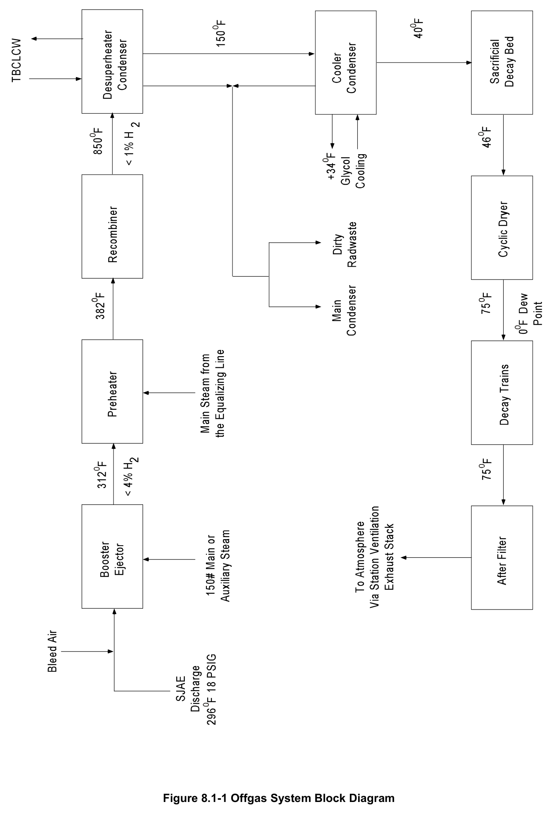
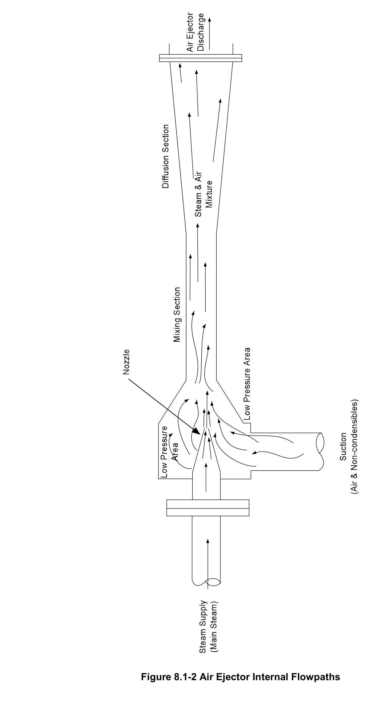
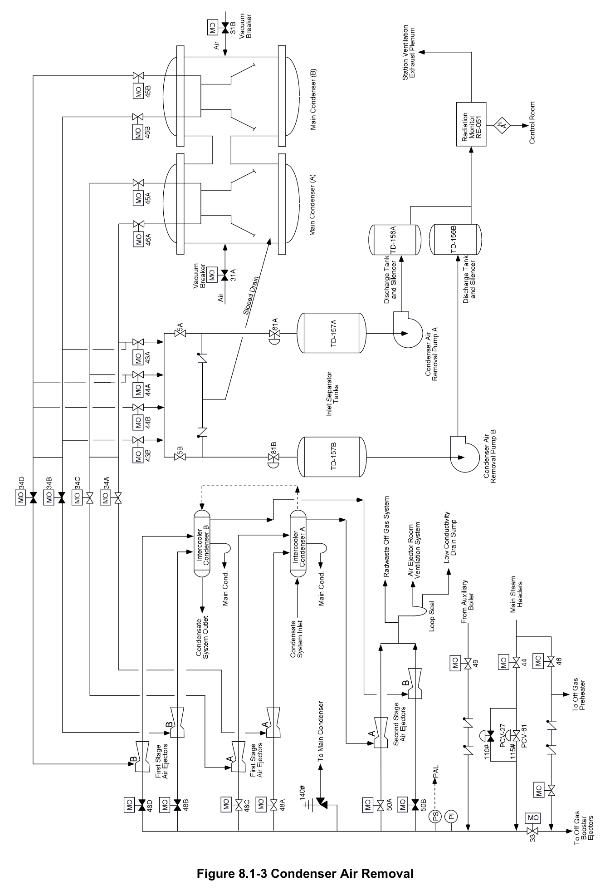
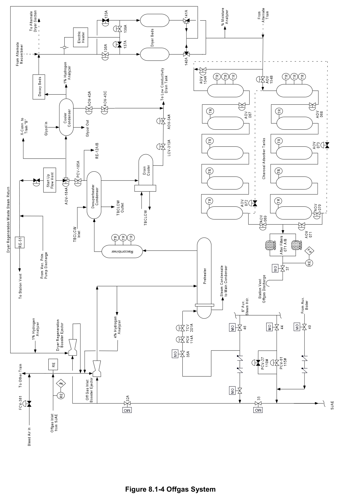
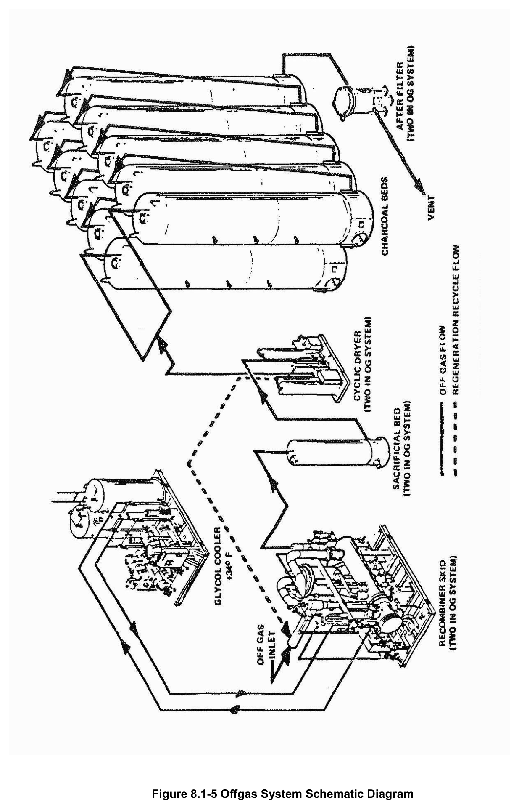
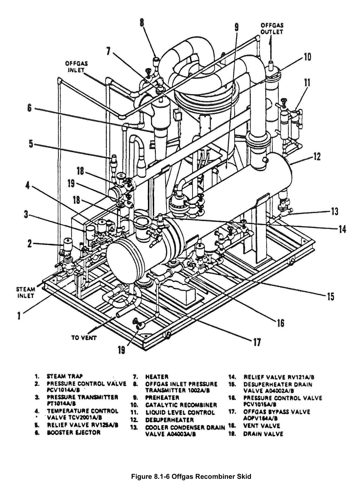
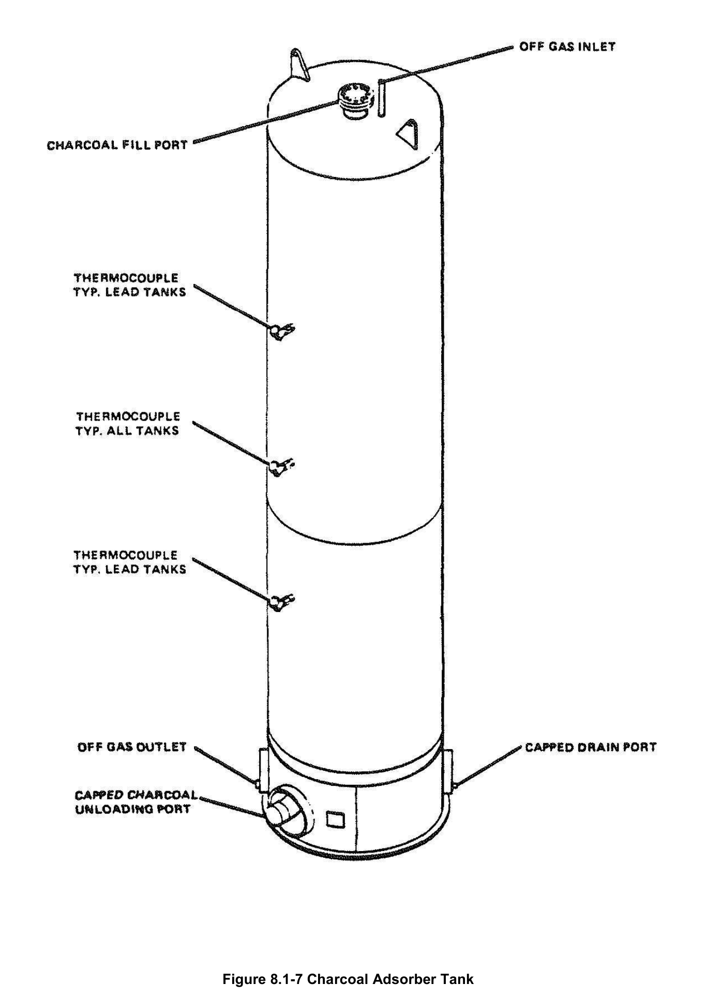
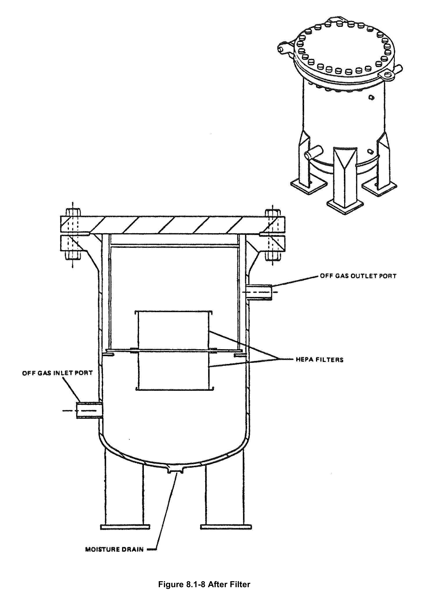

# 8.1 Offgas

> Source: `8.1_Offgas.pdf` (25 pages)
> GE (BWR) Systems Technology Manual — USNRC HRTD, Rev 09/11

---
<!-- p.1 -->
#### General Electric Systems Technology Manual
#### Chapter 8.1
#### Offgas System
<!-- p.3 -->
TABLE OF CONTENTS

8.1 OFFGAS SYSTEM ................................................................................................. 1

8.1.1 Introduction ................................................................................................ 1

8.1.2 System Description .................................................................................... 2

8.1.3 Component Descriptions ............................................................................ 3

8.1.3.1 Condenser Air Removal Pumps ................................................. 4

8.1.3.2 Steam Jet Air Ejectors ................................................................ 4

8.1.3.3 Bleed Air Valve (FCV-301) ......................................................... 5

8.1.3.4 Booster Ejectors ......................................................................... 5

8.1.3.5 Preheater ................................................................................... 6

8.1.3.6 Catalytic Recombiner ................................................................. 6

8.1.3.7 Desuperheater Condenser and Drain Cooler ............................. 7

8.1.3.8 Startup Flow Vent ...................................................................... 7

8.1.3.9 Cooler Condenser ...................................................................... 7

8.1.3.10 Sacrificial Decay Beds ............................................................... 7

8.1.3.11 Cyclic Dryer Beds ...................................................................... 8

8.1.3.12 Charcoal Adsorber Tanks .......................................................... 8

8.1.3.13 After Filters ................................................................................. 9

8.1.3.14 Discharge Isolation Valve ........................................................... 9

8.1.4 System Features and Interfaces .............................................................. 10

8.1.4.1 System Operation .................................................................... 10

8.1.4.2 Component Trips and Interlocks .............................................. 10

8.1.4.3 System Interfaces .................................................................... 11

8.1.5 Summary .................................................................................................. 12

LIST OF TABLES

8.1-1 Typical Isotopes in the Offgas Flow ................................................................... 12

Rev 09/11 8.1-i USNRC HRTD

<!-- p.4 -->
#### LIST OF FIGURES
8.1-1 Offgas System Block Diagram 8.1-2 Air Ejector Internal Flow Paths 8.1-3 Condenser Air Removal 8.1-4 Offgas System 8.1-5 Offgas System Schematic Diagram 8.1-6 Offgas Recombiner Skid 8.1-7 Charcoal Adsorber Tank 8.1-8 After Filter

Rev 09/11 8.1-ii USNRC HRTD

<!-- p.5 -->
### 8.1 OFFGAS SYSTEM
Learning Objectives:

1. Recognize the purposes of the Offgas System.

2. Recognize the purpose, function and operation of the following offgas system major components:
a. Condenser air removal (CAR) pumps b. Steam jet air ejector (SJAE) and coolers c. Bleed air valve d. Preheater e. Catalytic recombiner f. Sacrificial decay beds g. Charcoal adsorber tanks h. After filters i. Discharge isolation valve

3. Recognize the normal flow path of the offgas system.

4. Recognize how the Offgas system interfaces with the following systems:
a. Main Steam System (Section 2.5)
b. Condensate and Feedwater System (Section 2.6)
c. Turbine Building Closed Loop Cooling Water System (Section 11.5)
d. Turbine Building Ventilation System e. Service and Instrument Air System (Section 11.6)
f. Auxiliary Boiler Steam System

#### 8.1.1 Introduction
The purposes of the offgas system are to:

• establish and maintain a vacuum in the main condenser to improve cycle efficiency, and
• process non-condensible gases to limit the release of radioactive gases to the atmosphere.

The offgas system processes and controls the release of gaseous radioactive effluents from the condenser to the site environs so that the total radiation exposure to persons outside the protected area do not exceed the limits of 10 CFR 20 and the dose objectives of 10 CFR 50 Appendix I, ALARA.

The offgas system is functionally classified as a power generation system.

Rev 09/11 8.1-1 USNRC HRTD

<!-- p.6 -->
#### 8.1.2 System Description
During power operation steam spins the main turbine and exhausts into the main condenser where the majority of it is condensed by the circulating water system. Air leaking into the system and other non-condensible gases formed during operation also collect in the condenser. These non-condensibles increase condenser pressure, impair turbine performance, and could eventually trip the turbine on low condenser vacuum.

The non-condensible gases primarily consist of air, fission product gases, water activation products and radiolytic gases. The fission product gases are primarily the noble gases xenon and krypton and a halogen gas, iodine. The water activation products and radiolytic gases consist of isotopes of nitrogen, oxygen, hydrogen and fluorine. Table 8.1-1 lists these products and shows their formation mechanisms and half lives.

Radiolytic gases are produced as a result of the disassociation of water flowing through the reactor core region by neutron flux forming free hydrogen and oxygen. The hydrogen poses a separate problem because when present in concentrations above 4% by volume, it may ignite.

Air leaks into systems from various places; fittings in the condensate system, pump shafts, tube leaks, SJAE fittings, boot seals, etc.

The non-condensibles are removed from the condenser by condenser air removal
(CAR) pumps and/or steam jet air ejectors (SJAEs) as shown in Figure 8.1-3. The CAR pumps are also called the mechanical vacuum pumps. The CAR pumps are used to initially evacuate the condenser down to at least 20" of mercury vacuum in about an hour. The CAR pumps can pull the condenser vacuum down to approximately 25" Hg.
The SJAEs then evacuate the condenser down to approximately 28-30.” The operation of the SJAEs is shown in Figure 8.1-2.

The CAR pumps are motor driven and the SJAEs are steam driven. The steam can be supplied from the auxiliary boiler or the main steam system allowing condenser vacuum to be established before the reactor is taken critical and/or the production of steam by the nuclear boiler.

Before condenser vacuum is established the main turbine is placed on turning gear and sealing steam is supplied. Next the CAR pumps are placed in service and the condenser vacuum breakers are closed and sealed with water. Air removed from the condenser is discharged to the turbine building ventilation system. The CAR pumps are used only for initial evacuation for two reasons: (1) they can only pull 25" of vacuum, and (2) their discharge to the environment is not processed. The second reason has

Rev 09/11 8.1-2 USNRC HRTD

<!-- p.7 -->
two potential adverse consequences. First, any radioactivity in the flow pulled from the condenser by the CAR pumps is not filtered or delayed prior to release. And second, the hydrogen gas – which increases in volume nearly linearly with reactor power level – is not processed and poses an explosion hazard.

Two gaseous radwaste trains are provided to process the main condenser offgas stream from the SJAE prior to atmospheric release. One train is normally in service while the other is in standby. Each offgas train processes the flow to reduce the risk of hydrogen ignitions and to lengthen the time before the effluent is released to the atmosphere to allow decay of radioactive isotopes. A block diagram of the offgas system showing the process temperatures and hydrogen control limits is provided in Figure 8.1-1 while a system schematic is provided in Figure 8.1-4.

#### 8.1.3 Component Descriptions
The offgas system contains the following major components (Figures 8.1-3, 8.1-4 and 8.1-5):

a. CAR pumps b. SJAEs c. Bleed air valve (FCV-301)
d. Booster ejectors e. Preheater f. Catalytic recombiner g. Desuperheater condenser and drain cooler h. Startup flow vent i. Cooler condenser j. Sacrificial decay beds k. Cyclic dryer beds l. Charcoal adsorber tanks (Figure 8.1-7)
m. After filters (Figure 8.1-8)
n. Discharge isolation valve (MOV-037)

Two parallel trains of booster ejectors, preheater, catalytic recombiner, desuperheater, drain cooler, and cooler condenser are located on the two offgas recombiner skids
(Figure 8.1-6).

The major components of the condenser air removal and offgas systems are discussed in the following sections.

Rev 09/11 8.1-3 USNRC HRTD

<!-- p.8 -->
##### 8.1.3.1 Condenser Air Removal Pumps
There are two 50 percent capacity CAR pumps (Figure 8.1-3) used to remove air and non-condensibles from the main condenser during startup. Four motor operated 12inch gate valves (MOV-043A/B, MOV-044A/B) connect the two CAR pumps to the two main condensers through four other motor operated 12-inch gate valves (MOV-045A/B, MOV-046A/B) which isolate the condensers from the system. Each pump has an air operated 12-inch suction butterfly valve which fails closed on loss of air. Two air operated CAR pump suction valves (AOV-081A/B) are remotely operated from the control room when placing the CAR pumps in service. The pumps are axial flow compressors each with 2,100 standard cubic feet per minute capacity. The CAR pumps are equipped with a shaft driven oil pump, cooled by TBCLCW and operated from the control room. The pumps trip at 25 inches of vacuum. A radiation monitor on the common discharge piping gives indication and annunciation of high radiation conditions.
The CAR pumps discharge into the station ventilation exhaust plenum.

Inlet separator tanks remove water from the suction to the CAR pumps and discharge silencer drain tanks reduce noise and remove water from the pumps’ outlet.

##### 8.1.3.2 Steam Jet Air Ejectors
There are two sets of steam jet air ejectors each rated for 100% capacity. Each SJAE set consists of two stages (Figure 8.1-2). Each first stage has two steam nozzles in parallel followed by an intercooler condenser (sometimes called the inter-condenser)
while the second stage has one steam nozzle.

Each SJAE set first stage uses high velocity jets of steam to create a low pressure that pulls air and other non-condensible gases from the main condenser shells. Either the main steam system or the auxiliary boiler can supply the driving steam to the SJAEs
(Figure 8.1-3). Main steam, reduced by a pressure control valve (PCV-61) to 115 psig, can be supplied to each SJAE nozzle. A second pressure control valve (PCV-27) set at 110 psig is used as a backup. Operation of these valves is erratic until reactor pressure reaches 300 to 350 psig. Alternatively, the auxiliary boiler can be used to supply steam to the SJAE nozzles.

The steam nozzles accelerate the steam to a high velocity as it passes through the diffuser throat and begins to expand (Figure 8.1-2). The high velocity steam exiting the nozzle develops low pressure in the surrounding space as gas molecules present in the suction chamber become entrained in the steam and are carried away with it. The lowered pressure is below that in the condenser hotwell with the effect that air, noncondensibles, and some steam is pulled from the hotwell and exhausted from the SJAE nozzle.

Rev 09/11 8.1-4 USNRC HRTD

<!-- p.9 -->
The exhaust from the two first stage steam nozzles enters the shell of an intercooler condenser where the majority of the steam is cooled back to water by 10,000 gallons per minute of condensate system water flowing through its tubes. This condensed water drains back to the condenser through a loop seal that prevents non-condensibles from returning to the condenser.

The second stage jet takes suction from the intercooler condenser shell and discharges to the booster ejectors (Section 8.1.3.4) at a pressure of about 3 psi. The second stage air ejectors are non-condensing. This allows the driving steam to dilute the radiolytic hydrogen, which is a significant portion of the non-condensible gases, to maintain the hydrogen concentration less than 4% by volume. The SJAE outlet has a radiation monitor which indicates in the control room with one of its alarm points set to meet the Technical Specification limit for release.

The original design featured an aftercooler condenser to collect the exhaust from the second stage SJAE similar to the role performed by the intercooler condenser for the first stage SJAEs. The design was modified to remove the aftercooler condenser so steam in the second stage steam ejector would help dilute the hydrogen concentration of the process flow entering the rest of the offgas system. Without the aftercooler condenser, the temperature of the process flow from the second stage SJAEs is nominally 296°F (Figure 8.1-1).

##### 8.1.3.3 Bleed Air Valve (FCV-301)
In the event that there are few or no packing and gasket leaks such that air in-leakage is negligible and the reactor is operating at low power such that there’s little radiolytic decomposition of water into hydrogen and oxygen gases, there may not be a large volume of air and other non-condensibles for the offgas system to process. This sunny condition is clouded by the fact that hydrogen gas – with its risk of detonation at concentrations above 4 percent – constitutes a larger fraction of the smaller flow.

The bleed air valve, FCV-301, (Figure 8.1-4) can be used to admit air from the plant air system to the offgas process flow at the inlet to the booster ejectors to dilute the hydrogen concentration during low flow conditions. The controller (FIC-301) can be operated in manual or automatic mode to provide bleed air to the offgas system.

##### 8.1.3.4 Booster Ejectors
There are two types of booster ejectors, the offgas inlet booster ejector and the dryer regeneration booster ejector (Figure 8.1-4). The offgas inlet booster ejector provides the motive force for the offgas through the remaining portion of the system, dilutes the hydrogen and adds heat to the gas stream. The dryer regeneration booster ejector provides the motive force to remove moisture from the dryer bed being regenerated and

Rev 09/11 8.1-5 USNRC HRTD

<!-- p.10 -->
discharges into the suction of the offgas inlet booster ejector. The driving steam for both boosters is supplied from either the main steam system or the auxiliary boiler from the common header that also supplies steam to the SJAEs.

The driving steam for the offgas inlet booster ejector mixes with the gases from the SJAEs and the dryer regeneration booster ejector to ensure the hydrogen concentration is less than 4% by volume. The 4% hydrogen monitor is located on the discharge of the booster. The driving steam adds heat to the gas stream which warms the gas to nominally 312°F to support recombiner operation.

##### 8.1.3.5 Preheater
The preheater warms the offgas stream temperature entering the recombiner greater to 382ºF (Figures 8.1-1 and 8.1-4). This temperature supports the recombination of H2 and O2 and prevents wetting of the catalyst because moisture reduces the efficiency of the recombiner.

Steam from the main steam system is the normal source of heat; however, steam from the auxiliary boiler may be used. The steam flows through the heat exchanger tubes and condenses to water that drains back to the main condenser. The offgas stream flows through the shell side of the preheater.

The outlet temperature of the preheater is maintained at the desired setting by using a temperature sensor to control a temperature control valve (TCV-201A/B) in the steam supply.

##### 8.1.3.6 Catalytic Recombiner
The catalytic recombiner contains a platinum palladium catalyst which promotes the recombination of radiolytic hydrogen and oxygen (Figure 8.1-4). The amount of hydrogen and oxygen in the process stream resulting from radiolytic decomposition varies directly with reactor power. Approximately 0.03 to 0.055 scfm of hydrogen and oxygen are produced for each thermal megawatt of reactor power (73 to 134 scfm at rated power).

Offgas enters the recombiner at 382ºF. The recombination process is exothermic, warming the process gas to 850ºF (Figure 8.1-1). The purpose of the recombiner is to reduce the hydrogen concentration below the explosive limit of 4% and to reduce the flow rate in the system to increase the efficiency of the charcoal adsorber beds. During normal operation, the process stream leaving the catalyst contains less than 0.1% H2 by volume.

Rev 09/11 8.1-6 USNRC HRTD

<!-- p.11 -->
##### 8.1.3.7 Desuperheater Condenser and Drain Cooler
The desuperheater condenser is designed to reduce the offgas temperature from 850ºF to less than 150ºF (Figures 8.1-1 and 8.1-4). The superheated steam leaving the recombiner is subcooled by a desuperheater condenser which is a shell and tube heat exchanger with the offgas stream on the shell side and turbine building closed loop cooling water (TBCLCW) on the tube side. This condenser cools and removes moisture from the superheated process stream. An integral separator, in the form of a stainless steel wire mesh screen near the outlet of the condenser, removes entrained moisture.
The condensate and separated moisture collect in a drain cooler which is also cooled by TBCLCW. The drain cooler drains to the low conductivity drain tank which can be routed to either the main condenser or liquid radwaste.

##### 8.1.3.8 Startup Flow Vent
The startup flow vent (AOV-164A/B) is an air-operated three-way valve located downstream of the desuperheater condenser (Figure 8.1-4). During normal operation of the reactor at power, the startup flow vent is placed in Position 1-3 which routes flow to the cooler condenser.

During system startup as the steam jet air ejectors are being used to establish 27 inches of mercury vacuum in the main condenser, the startup flow vent is placed in Position 1-2 which routes from to the turbine building ventilation system and the station vent. There is a radiation monitor in the line downstream of the startup flow vent that checks for radiation levels of the flow. When 27 inches of mercury vacuum in the main condenser is established, the startup flow vent is repositioned to Position 1-3 to route flow through the cooler condenser and remainder of the offgas system.

##### 8.1.3.9 Cooler Condenser
The cooler condenser provides a second stage of moisture removal from the process stream by lowering its dewpoint to 40ºF (Figures 8.1-1 and 8.1-4). The condenser is a shell and tube heat exchanger with the offgas flow on the shell side and a chilled (35ºF)
glycol solution on the tube side.

An integral moisture separator removes entrained moisture from the offgas flow and along with the condensate is routed to the low conductivity drain tank. A 1% hydrogen analyzer is installed on the outlet of the cooler condenser.

##### 8.1.3.10 Sacrificial Decay Beds
There are two 100% capacity sacrificial decay beds each containing 1,135 pounds of charcoal (Figures 8.1-4 and 8.1-5). One bed is normally in operation with the other in

Rev 09/11 8.1-7 USNRC HRTD

<!-- p.12 -->
standby. The beds provide the first stage of adsorptive delay for the decay of radioactive gases. The short lived isotopes of xenon and krypton decay into particulate daughter products that are retained in the bed. At design flows and inlet conditions, the residence time in the sacrificial decay bed is two hours for xenon isotopes and six minutes for krypton isotopes. The sacrificial decay beds minimize the contamination of downstream components and extend the life of the charcoal in the charcoal adsorber tanks.

##### 8.1.3.11 Cyclic Dryer Beds
The cyclic dryer beds provide the final stage of moisture removal from the offgas stream by lowering its dewpoint to 0ºF (Figures 8.1-1, 8.1-4 and 8.1-5). Lowering the moisture level is in the process stream increases the efficiency of the charcoal adsorber beds.

There are two 100% capacity desiccant dryer beds. One dryer bed is in service and one in regeneration. Each dryer bed alternates between being in service for 24 hours and undergoing regeneration for 24 hours. Six pneumatically operated valves control this sequence.

A small portion (about 20 percent) of the offgas flow is routed through an electric heater
(3.5 kilowatts) which heats the flow to 500ºF. This warmed flow passes through the dryer bed being regenerated and then through the dryer regeneration booster ejector.
The heater is energized for the first 16 hours of the regeneration cycle to remove moisture from the desiccant in the dryer bed being regenerated. The heater is deenergized for the final 8 hours of the regeneration cycle to allow the dryer bed to cool before the beds are swapped.

The majority of the offgas flow bypasses the electric heater and enters the in-service dryer bed. Desiccant in the dryer bed removes moisture from the flow.

A moisture analyzer is located in the common header between the dryer beds and the charcoal adsorber tanks.

The recombination of hydrogen and oxygen and the steps to remove steam and moisture are designed to reduce the volume of non-condensibles in the offgas flow by a factor of seven.

##### 8.1.3.12 Charcoal Adsorber Tanks
The charcoal adsorber tanks provide the final stage of hold-up for the decay of radioactive gases (Figures 8.1-4, 8.1-5, and 8.1-7). As the offgas flow passes through the charcoal bed, the air, which is present from air inleakage, acts as a carrier gas for the xenon and other fission product gases. The short term isotopes of xenon and

Rev 09/11 8.1-8 USNRC HRTD

<!-- p.13 -->
krypton are delayed sufficiently to allow them to decay into their particulate daughter products. These solid particulates are retained in the bed. Radioactive decay produces some heat in the beds. The higher the temperature of the gas or charcoal the shorter the holdup time. The higher the offgas flow rate, the shorter the holdup time. The dynamic adsorption coefficient for xenon is much greater than that for krypton thus xenon has a holdup time in the order of days versus hours for krypton. At design flows and inlet conditions, the residence time in the charcoal adsorber tanks is 34.1 days for xenon isotopes and 46.6 hours for krypton isotopes.

There are ten charcoal adsorber tanks arranged in two parallel trains of five tanks each.
The flow path can be arranged to pass through both trains in parallel or place the two trains in series. The first tank in each train may also be bypassed. The flow path is controlled by air operated valves from the offgas control panel.

Each charcoal adsorber tank is 26 feet high and contains 17,400 pounds of charcoal
(Figure 8.1-7).

##### 8.1.3.13 After Filters
The after filters are installed downstream of the charcoal adsorber beds to prevent the release of carbon dust into the plant ventilation system. The after filters are High Efficiency Particulate Air (HEPA) filters designed to remove 99.97% of all particles 0.3 microns or larger (Figures 8.1-4, 8.1-5 and 8.1-8).

There are two 100% capacity filters. Normally one filter is in service and the other in standby. A radiation monitor is located in the common discharge header from the after filters to determine system efficiency and alarms based on Technical Specification limits.

##### 8.1.3.14 Discharge Isolation Valve
The discharge isolation valve (MOV-037) can be manually closed to isolate offgas system discharge to the turbine building ventilation system and ultimately the atmosphere (Figure 8.1-4).

Rev 09/11 8.1-9 USNRC HRTD

<!-- p.14 -->
#### 8.1.4 System Features and Interfaces
A short discussion of system features and interfaces this system has with other plant systems is given in the following sections.

##### 8.1.4.1 System Operation
During startup, initial condenser vacuum is normally established using both CAR pumps. When condenser vacuum exceeds 20" Hg, both SJAE sets are typically placed in service. If nuclear steam is not available, then auxiliary boiler steam can be used to operate the SJAEs and preheaters.

When condenser vacuum reaches 25" Hg both CAR pumps are stopped and their suction valves are closed and both SJAE sets are used to establish normal condenser vacuum (27” Hg). The charcoal adsorber tanks are initially bypassed with offgas system flow after the desuperheater condenser routed through the startup flow vent to the turbine building ventilation system.

When condenser vacuum reaches 27" Hg, one SJAE set is shutdown and flow is established through the charcoal adsorber tanks. When reactor pressure reaches 300 to 350 psig, the supply steam to the SJAEs, booster ejector, and preheater is shifted to the main steam system.

##### 8.1.4.2 Component Trips and Interlocks
The CAR pumps automatically trip when condenser vacuum reaches 25 inches of mercury. There are no other significant automatic system or component trips and isolations.

Administrative controls guide the operators to switch from the operating offgas train to the standby train on any of the following conditions:

1. 4% hydrogen analyzer high (inlet to preheater)
2. 1% hydrogen analyzer high (outlet from cooler condenser)
3. Booster ejector steam pressure low 4. Booster ejector pressure high 5. Preheater outlet temperature low 6. Desuperheater condenser level high high 7. Desuperheater TBCLCW flow low 8. Cooler condenser level high high 9. Recombiner temperature high 10. Charcoal decay tank flow low

Rev 09/11 8.1-10 USNRC HRTD

<!-- p.15 -->
Administrative controls prevent aligning offgas system flow through the charcoal adsorber tanks when condenser vacuum is less than 27 inches of mercury. Lower condenser vacuums cause process flow rates through the offgas system that exceed the design flow rate of the charcoal beds. At lower condenser vacuums, flow from the desuperheater condenser is sent through the startup flow vent (AOV-184A/B) to the turbine ventilation system for discharge.

##### 8.1.4.3 System Interfaces
The interfaces between this system and other plant systems are discussed in the paragraphs that follow.

Main Steam System (Section 2.5)

The main steam system is the normal supply of reduced pressure steam to the steam jet air ejectors, booster ejectors and preheaters.

The CAR pumps and/or the SJAEs of the offgas system remove air and noncondensibles from the main steam systems’ main condenser.

Auxiliary Boiler Steam System

The auxiliary boiler steam system supplies steam to operate the SJAEs, booster ejectors and preheaters if main steam is not available.

Administrative controls also cautions that using the auxiliary boiler to supply steam to the offgas system when the reactor pressure exceeds 125 psig may result in contamination of the boiler and equipment it supplies.

Service and Instrument Air System (Section 11.6)

The service and instrument air systems supply air to operate pneumatic valves in the offgas system and provide purge/dilution air to the offgas system.

Condensate and Feedwater System (Section 2.6)

The condensate and feedwater systems supply cooling water to SJAE intercondensers.

Turbine Building Closed Loop Cooling Water System (Section 11.5)

The TBCLCW system supplies cooling water for the de-superheater condenser and drain cooler. The TBCLCW system also provides cooling water to the CAR pumps.

Rev 09/11 8.1-11 USNRC HRTD

<!-- p.16 -->
Turbine Building Ventilation System

The turbine building ventilation system routes the flow from the CAR pumps and offgas system to the station vent for release to the atmosphere.

#### 8.1.5 Summary
Classification - Power generation system

Purpose - To process and control the release of gaseous radioactive effluents from the condenser to the site environs so that the total radiation exposure to personnel outside the controlled area does not exceed the limits of 10 CFR 20 and as low as reasonably achievable (ALARA) criteria.

Components - CAR pumps, SJAEs and coolers, bleed air valve, booster ejectors, preheater, recombiner, desuperheater condenser and drain cooler, cooler condenser, sacrificial decay beds, cyclic dryer beds, charcoal adsorber tanks, after filters, and discharge isolation valve.

System Interfaces - Main steam system, auxiliary boiler steam system, service and instrument air system, condensate and feedwater system, turbine building closed loop cooling water system, and turbine building ventilation system.

Rev 09/11 8.1-12 USNRC HRTD

<!-- p.17 -->
#### TABLE 8.1-1 Typical Isotopes in the Offgas Flow
Activation Products of Water

Nuclide Half-life Formation Mechanism

N-16 7.1 seconds O-16(n,p)N-16

O-19 29 seconds O-18(n)O-19

N-13 10 minutes O-16(p,a)N-13

F-18 110 minutes O-18(p,n)F-18

H-3 (tritium)
12.33 years H-2(n)H-3 &Tertiary fission

Halogen Gases

Nuclide Half-life % fission yield

I-134 52.3 minutes 7.176

I-132
2.28 hours 4.127

I-135 6.7 hours 6.386

I-133 20.8 hours 6.762

I-131 8.06 days
2.774

Noble Gases

Nuclide Half-life % fission yield

Xe-138 14.2 minutes 6.235

Kr-87 76 minutes
2.367

Kr-88
2.79 hours
3.642

Kr-85m 4.4 hours
1.332

Xe-135 9.16 hours 6.732

Xe-133 5.26 days 6.776

Rev 09/11 8.1-13 USNRC HRTD

<!-- p.18 -->
#### Figure 8.1-1

*Offgas System Block Diagram*

[Vector original (SVG, lossless): fig_8.1-1.svg](../figures/fig_8.1-1.svg)

<!-- p.19 -->
#### Figure 8.1-2

*Air Ejector Internal Flowpaths*

[Vector original (SVG, lossless): fig_8.1-2.svg](../figures/fig_8.1-2.svg)

<!-- p.20 -->
#### Figure 8.1-3

*Condenser Air Removal*

[Vector original (SVG, lossless): fig_8.1-3.svg](../figures/fig_8.1-3.svg)

<!-- p.21 -->
#### Figure 8.1-4

*Offgas System*

[Vector original (SVG, lossless): fig_8.1-4.svg](../figures/fig_8.1-4.svg)

<!-- p.22 -->
#### Figure 8.1-5

*Offgas System Schematic Diagram*

<!-- p.23 -->
#### Figure 8.1-6

*Offgas Recombiner Skid*

<!-- p.24 -->
#### Figure 8.1-7

*Charcoal Adsorber Tank*

<!-- p.25 -->
#### Figure 8.1-8

*After Filter*

