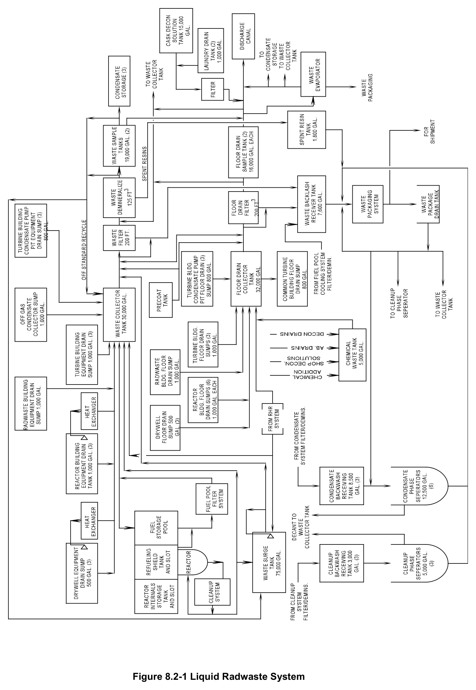
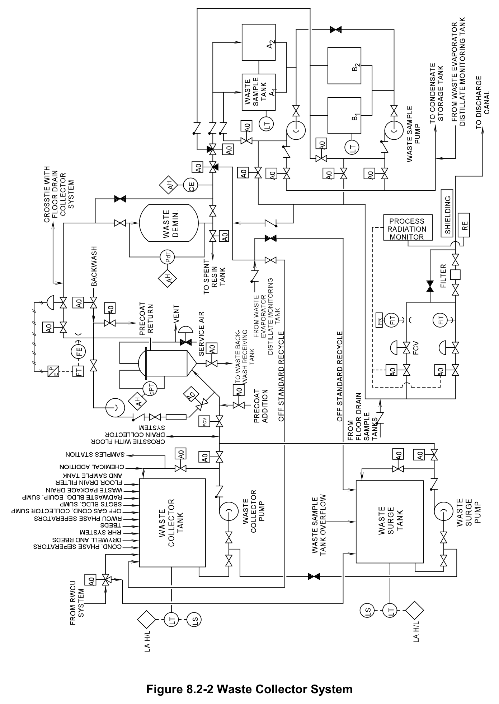
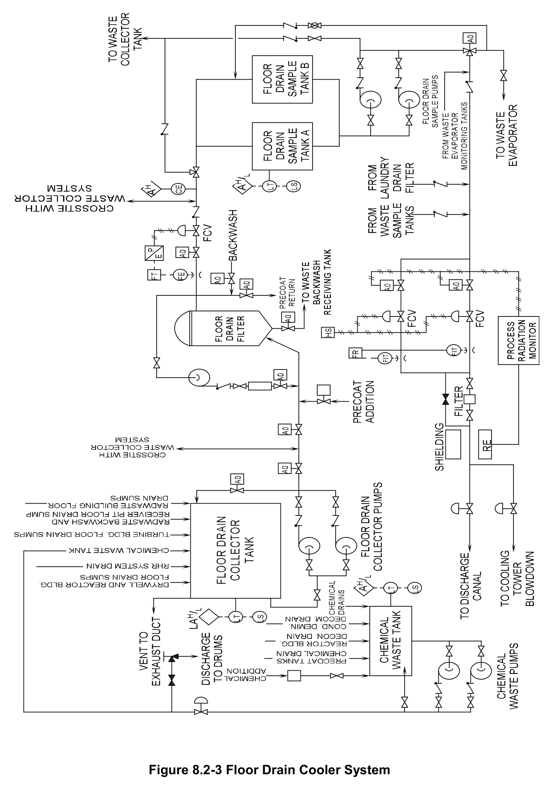
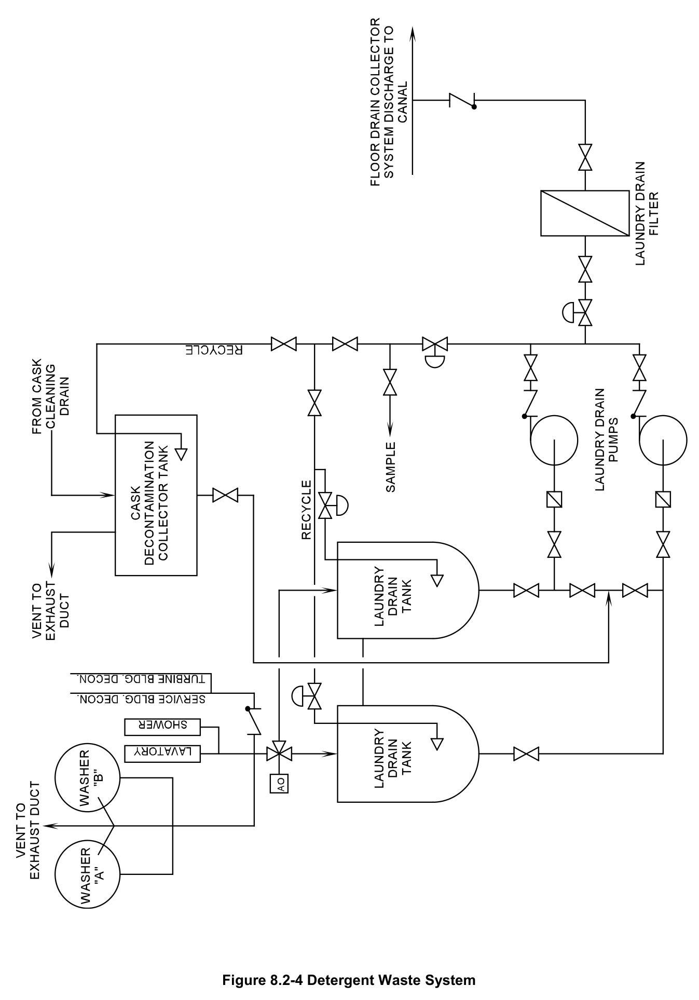

# 8.2 Liquid Radwaste

> Source: `8.2_Liquid_Radwaste.pdf` (22 pages)
> GE (BWR) Systems Technology Manual — USNRC HRTD, Rev 09/11

---
<!-- p.1 -->
#### General Electric Systems Technology Manual
#### Chapter 8.2
#### Liquid Radwaste System
<!-- p.3 -->
TABLE OF CONTENTS

8.2 LIQUID RADWASTE SYSTEM ................................................................................ 1

8.2.1 Introduction .................................................................................................... 1

8.2.2 System Description ........................................................................................ 1

8.2.2.1 Waste Collector System Description ............................................... 2

8.2.2.2 Floor Drain Collector System Description ........................................ 3

8.2.2.3 Chemical Waste System Description .............................................. 3

8.2.2.4 Detergent Waste System Description .............................................. 4

8.2.3 Component Description ................................................................................. 4

8.2.3.1 Waste Collector System .................................................................. 4

8.2.3.2 Floor Drain Collector System ........................................................... 7

8.2.3.3 Chemical Waste System ................................................................. 9

8.2.3.4 Detergent Waste System............................................................... 10

8.2.4 System Features and Interfaces .................................................................. 11

8.2.4.1 Normal Operation .......................................................................... 11

8.2.4.2 Liquid Radwaste Discharges ......................................................... 12

8.2.4.3 System Interfaces .......................................................................... 12

8.2.5 Summary ..................................................................................................... 13

Rev 09/11 8.2-i USNRC HRTD

<!-- p.4 -->
#### LIST OF FIGURES
8.2-1 Liquid Radwaste System 8.2-2 Waste Collector System 8.2-3 Floor Drain Collector System 8.2-4 Detergent Waste System

Rev 09/11 8.2-ii USNRC HRTD

<!-- p.5 -->
### 8.2 LIQUID RADWASTE SYSTEM
#### 8.2.1 Introduction
The purposes of the liquid radwaste system are:

1. To collect, process, and return radioactive liquid waste to the plant for reuse.

2. To process liquids for batch discharge of liquid radwaste to the environment. These wastes are processed such that they do not exceed the following:
a. the 10 CFR 20 radionuclide concentration standards b. the dose commitments of 40 CFR 142 c. the limits for liquid effluents in technical specifications

The system collects, processes, and returns radioactive liquid waste to the plant. The liquid waste is then reused or discharged from the plant. The system batch discharges of liquid radwaste are released to the circulating water discharge canal.

The functional classification of the Liquid Radwaste System is that of a power generation system.

#### 8.2.2 System Description
The liquid radioactive wastes are classified, collected, and treated as high purity, low purity, chemical, or detergent wastes. The terms high purity and low purity refer to the waste's conductivity and not radioactivity. The high purity wastes are referred to as clean radwaste (CRW) and the low purity wastes as dirty radwaste (DRW).

All liquid streams passing through a BWR have the potential of being contaminated.
The disposal method is determined by both the type and the level of contamination.

The Liquid Radwaste System is divided into several subsystems. This allows the liquid wastes from various sources to be kept segregated and processed separately. Cross connections between the subsystems provide additional flexibility for processing of the wastes. Included in the Liquid Radwaste System are the following subsystems:
• Waste Collector System
• Floor Drain System
• Chemical Waste System
• Detergent Waste System

The first point in the collection of liquid waste is in collection tanks or sumps located in the plant buildings. The drain sumps are arranged and piped to various radwaste subsystems for processing according to their classification.

Rev 09/11 8.2-1 USNRC HRTD

<!-- p.6 -->
The Liquid Radwaste System is designed so that the liquid wastes discharged from the plant are within the following:
• radionuclide concentration limits of 10 CFR 20, Appendix B, Table II, Column 2,
• radiation exposure limits of 40 CFR 141
• the calendar dose commitment limits of the effluent technical specifications.

The system design also ensures that the Liquid Radwaste system does not impact the operation or availability of the plant.

##### 8.2.2.1 Waste Collector System Description
High purity (low conductivity) liquid wastes are collected and processed in the Waste Collector System from the following sources:

• Drywell equipment drain sump
• Containment equipment drain sump
• Auxiliary building equipment drain sump
• Fuel building equipment drain sump
• Radwaste building equipment drain sump
• Turbine building equipment drain sump
• Reactor Water Cleanup System
• Residual Heat Removal System
• Decant from cleanup phase separators
• Decant from condensate phase separators
• Waste package drain tank
• Offgas condensate collector sump
• Turbine building condensate pump pit equipment drain sumps
• Standby Gas Treatment System sumps

The high purity wastes are processed by filtration and ion exchange through the waste filter and waste demineralizer (Figure 8.2-2). After processing, the waste is pumped to waste sample tanks. In the wastes sample tanks it is sampled and if within specifications then transferred to the condensate storage tank. If the sample reveals water of high conductivity or radionuclide concentration it is returned to the system for additional processing. These wastes may also be released to the circulating water discharge canal.

Rev 09/11 8.2-2 USNRC HRTD

<!-- p.7 -->
##### 8.2.2.2 Floor Drain Collector System Description
Low purity (high conductivity) liquid wastes are collected and processed, as shown in Figure 8.2-3 in the Floor Drain Collector System from the following sources:

• Drywell floor drain sump
• Containment floor drain sump
• Auxiliary building floor drain sump
• Fuel building floor drain sump
• Radwaste building floor drain sump
• Turbine building floor drain sump
• Chemical waste tank
• Turbine building condensate pump pit floor drain sump
• Residual Heat Removal System
• Radwaste backwash and receiver pit floor drain sump

These wastes generally have low concentrations of radioactive impurities. The processing consists of filtration and subsequent transfer to the floor drain sample tank for sampling and analysis. From the floor drain sample tanks, the liquid waste can be released to the circulating water discharge canal or to the Waste Evaporator System. In the Waste Evaporator System, the liquid waste is distilled. The concentrates from the waste evaporator are packaged in containers for disposal as solid radwaste. The distillate is routed to the condensate storage tank or back to the Waste Collector System for further processing.

##### 8.2.2.3 Chemical Waste System Description
The Chemical Wastes (Figure 8.2-3) are collected in the chemical waste tank from the following sources:
• Shop decontamination solutions
• Laboratory drains
• Reactor building and turbine building decontamination drains
• Chemical waste from waste cleanup and
• Condensate precoat tanks

These chemical wastes are of such high conductivity as to preclude treatment by ion exchange. The radioactivity concentrations are variable and can be affected by the use of decontamination solutions. Normally, the radioactivity concentrations are low enough to meet circulating water discharge canal concentration limits. These wastes may be processed by filtration and dilution with the same equipment as the low purity wastes.

If the activity of these wastes is too high for canal discharge, the wastes are put in drums and solidified for disposal as Solid Radwaste.

Rev 09/11 8.2-3 USNRC HRTD

<!-- p.8 -->
##### 8.2.2.4 Detergent Waste System Description
Detergent wastes, shown in Figure 8.2-4, are collected in the laundry drain tanks.
These wastes are primarily from radioactive laundry and decontamination solutions which contain detergents. Detergent wastes normally have a low radioactivity concentration. These wastes are kept separated because they will foul ion exchange resins. Detergent wastes are sampled and then filtered through the laundry drain filter.
At that point they are released into the circulating water discharge canal.

Cask decontamination liquid is collected in the 15,000 gallon cask decontamination tank. This liquid is essentially high conductivity water of low radioactivity concentration.
The liquid is sampled, filtered through the laundry drain filter, and discharged into the circulating water canal.

#### 8.2.3 Component Description
The major components of the Liquid Radwaste System are discussed in the following paragraphs.

##### 8.2.3.1 Waste Collector System
The Waste Collector System includes the following components:

• 38,000 gallon waste collector tank
• 440 gpm waste collector pump
• 75,000 gallon waste surge tank
• 440 gpm waste surge pump
• 200 ft2 waste collector filter and holding pump
• 125 ft3 waste demineralizer
• 19,000 gallon waste sample tanks (4)
• 440 gpm waste sample pumps (2)

The waste collector tank receives effluent from the sources shown in Figure 8.2-1. The waste surge tank can receive effluent from the following:
• Reactor Water Clean Up (RWCU) System
• Residual Heat Removal (RHR) System
• the standard recycle from the waste demineralizer.

The waste collector and waste surge pumps are identical, each drawing suction from there respective tank. A suction line cross connection valve allows either pump to draw suction from the opposite tank. Each tank has a level indicator with high/low level alarms. The tanks also have a low level pump shut off switch that will trip its respective pump. If a pump is aligned to draw suction from the opposite tank, the low level trip for

Rev 09/11 8.2-4 USNRC HRTD

<!-- p.9 -->
that tank will protect the pump that is in use. The waste collector filter receives effluent from either the waste collector or waste surge pump. It removes suspended solids and passes the effluents to the waste demineralizer. The waste collector filter has a precoat holding pump to hold the precoat on the filter tubes when the filter is not in use.

The waste demineralizer is a mixed bed type demineralizer. It further removes impurities from the waste stream. The waste demineralizer effluent conductivity is monitored and is automatically routed to the following:
• the waste sample tanks (if <1.0 μmho)
• the waste collector or waste surge tank (if >1.0 μmho)

The waste sample tanks collect and monitor the processed wastes before they are returned to the condensate storage tank. An alternate flow path is available to route the water to the discharge canal.

###### 8.2.3.1.1 Waste Collector Tank
The waste collector tank is a stainless steel, cylindrical vessel with a capacity of 38,000 gallons and a working volume of 34,000 gallons. The bottom of the tank is flat with a 6" diameter outlet connected to the waste collector pump. The top of the tank is covered and has a 6" diameter vent outlet connected to the radwaste building exhaust. The tank is equipped with drain inlets, overflow lines and drain lines, and mixing eductors. A manhole is provided for cleaning and inspection.

###### 8.2.3.1.2 Waste Collector Pump
The waste collector pump is a 440 gpm centrifugal unit. Pump and valve controls are located in the radwaste control room. The pump takes suction from the waste collector tank.

###### 8.2.3.1.3 Waste Surge Tank
The waste surge tank is a stainless steel, cylindrical vessel with a capacity of 75,000 gallons and a working volume of 65,000 gallons. The bottom of the tank is flat with a 6 inch diameter outlet connected to the waste surge pump. The top of the tank is covered and has a 6" diameter vent outlet connected to the radwaste building exhaust. The tank is equipped with drain inlets, overflow lines and drain lines, and mixing eductors. A manhole is provided for cleaning and inspection.

###### 8.2.3.1.4 Waste Surge Pump
The waste surge pump is a 440 gpm centrifugal unit taking suction from the waste surge tank. Pump control and valve controls are located in the radwaste control room.

Rev 09/11 8.2-5 USNRC HRTD

<!-- p.10 -->
###### 8.2.3.1.5 Waste Collector Filter
The waste collector filter has a design operating pressure of 150 psi and 200 ft2 of filter area. The collector filter is a pressure precoat filter with a dished head pressure vessel and a removable top section. Perforated tubes (called septa), covered with a fine stainless steel screen, are rigidly suspended from a tube plate. The tube plate is supported at the vessel flange. The screened tubes serve to collect and support the filter precoat. The filter is provided with a holding pump that keeps the filter cake in place when there is no waste pump flow. The holding pump recirculation flow passes through an air cooler to maintain its water temperature less than 140ºF.

The filter tubes are precoated by depositing a layer of powdered resin on the perforated tubes. A fixed amount of resin in a slurry is recirculated from the precoat system through the filter to form a cake on the filter tubes. The resin particles bridge the openings in the filter tube screen and form a microscopically fine sieve. This sieve is much finer than the filter tube screen itself could provide.

The powdered resin continues recirculation until the filter tubes are completely coated.
This is indicated by clear water in the recirculation stream as seen in a flow sight glass.
Used powdered resin is removed from the tubes by dislodging it from the tubes using plant service air. The tubes are then backwashed using condensate water to rinse the loose precoat out the bottom of the filter vessel. Water from the backwash process is sent to the waste backwash receiving tank. Filters are removed from service if they have either of the following:
• a high differential pressure (D/P) across the filter
• high conductivity at the discharge of the filter

###### 8.2.3.1.6 Waste Demineralizer
The waste demineralizer is a vertical cylindrical dished head pressure vessel with a conical bottom. It contains 125 ft3 of mixed cation and anion resins. The waste demineralizer is sized to provide adequate head space for mixing and settling replacement resin. Filtered water enters through the top of the demineralizer and is distributed across the surface of the resin bed by an inlet header. The demineralized water is collected by an under drain and discharged through the bottom of the demineralizer. New resins can be added via a resin fill line. Expended resins are discharged to the spent resin tank as a water slurry. This slurry is discharged by pressurizing the uppermost portion with air. The demineralizer and resin condition are monitored by a differential pressure indicator and an effluent conductivity monitor.

Rev 09/11 8.2-6 USNRC HRTD

<!-- p.11 -->
###### 8.2.3.1.7 Waste Sample Tanks
There are a total of four waste sample tanks. There piping is arranged so that two waste sample tanks are connected in parallel. Each tank is a stainless steel vessel with a capacity of 19,000 gallons and a working volume of 17,000 gallons. The bottom of the tank is equipped with a 6" diameter waste sample pump suction. The top of the tank is covered and has a 6" diameter vent outlet connected to the radwaste building exhaust.
Flanged connections are provided for overflow, outlet, level sensor lines, and mixing eductors. Tank levels are monitored in the radwaste control room. High and low level alarms are provided for the tanks. In addition a low level waste sample pump cutoff is provided.

###### 8.2.3.1.8 Waste Sample Pumps
There are two waste sample pumps, each taking a suction from one set of parallel connected waste sample tanks. A cross connect valve between the waste sample tank outlet lines allows either pump to draw from any tank. Both pumps are 440 gpm centrifugal units with pump control in the radwaste control room. The pumps normally discharge (after sampling) to the condensate storage tank. Alternate discharge paths for the waste sample pumps include:
• the waste collector
• the waste surge tanks (off standard recycle)
• the discharge canal via the floor drain collector system

##### 8.2.3.2 Floor Drain Collector System
The Floor Drain Collector System includes the following components:

• 32,000 gallon floor drain collector tank
• 84 gpm floor drain collector pumps (2)
• 200 ft2 floor drain filter and precoat holding pump
• 16,000 gallon floor drain sample tanks (2)
• 84 gpm floor drain sample pumps (2)
• discharge control station

The floor drain collector tank receives effluent from the sources shown in Figure 8.2-2.
The floor drain collector pump draws a suction from the floor drain collector tank. The floor drain collector pumps normally discharge through the floor drain filter to the floor drain sample tanks. The floor drain collector tank has a level sensor and low level cutoff for the floor drain collector pumps. The floor drain filter normally receives effluent from the floor drain collector tank. It can be cross connected to the suction side of the waste collector filter. The cross connection allows either filter to be used as needed for processing. The floor drain filter is equipped with a precoat holding pump. This holds the precoat on the filter tubes when the filter is not in use.

Rev 09/11 8.2-7 USNRC HRTD

<!-- p.12 -->
Filtered waste from the floor drain filter normally passes to the floor drain sample tanks.
The tanks are connected in parallel through an air operated, three-way valve. An alternate path exists to the waste collector tank which is interlocked with a conductivity element. Waste water is allowed to pass to the waste collector tank if conductivity is less than 1 μmho. The floor drain sample tanks provide suction for two floor drain sample pumps piped in parallel.

The cross connected tanks have a level indicator with a high/low level alarm and a low pump cutout switch which trips the in service pump. Effluent from the floor drain sample tanks can be routed to the following:
• the circulating water discharge canal
• the waste collector tank
• the radwaste evaporator.

The preferred flow path is to the radwaste evaporator. The liquid waste is distilled with the distillate going to the CST and the concentrate to the solid radwaste system. Water in the waste collector tank is processed through the waste filter and demineralizer and then returned to the CST. If the CST is full the water is released to the circulating water discharge canal.

###### 8.2.3.2.1 Floor Drain Collector Tank
The floor drain collector tank is a stainless steel, cylindrical vessel with a capacity of 32,000 gallons and a working volume of 29,000 gallons. The bottom of the tank is flat with a 6" diameter outlet connected to the floor drain collector pumps. The tank is vented to the radwaste building exhaust and overflows to the chemical waste tank.
Tank level is monitored in the radwaste control room. A manhole is provided for cleaning and inspection.

###### 8.2.3.2.2 Floor Drain Collector Pumps
The floor drain collector pumps are 84 gpm centrifugal units each drawing a suction from the floor drain collector tank. The pumps normally discharge through the floor drain filter to the floor drain collector tanks. Pump and valve controls are located in the radwaste control room.

###### 8.2.3.2.3 Floor Drain Filter
The floor drain filter is similar to the waste collector filter and with an identical holding pump and air cooler system. Filter precoat is supplied by a common precoat system.
The floor drain filter effluent flows to the two floor drain sample tanks via an air operated, three-way valve.

Rev 09/11 8.2-8 USNRC HRTD

<!-- p.13 -->
###### 8.2.3.2.4 Floor Drain Sample Tanks
The floor drain sample tanks are piped in parallel to receive effluent from the floor drain filters. The tanks are similar to the waste sample tanks. Each tank has a capacity of 16,000 gallons and a working volume of 14,500 gallons. The tanks are cross connected with an equalizer line. A suction line cross connect valve allows either sample pump to draw from either sample tank.

###### 8.2.3.2.5 Floor Drain Sample Pumps
There are two floor drain sample pumps. Each pump is capable of taking suction from either floor drain sample tank. Both pumps are 84 gpm centrifugal units. Pump and valve control is from the radwaste control room. The pumps have the capability of discharging to the following:
• to the circulating water discharge canal via a radiation monitor
• to the radwaste evaporator for further processing
• to the waste collector tank before the water is returned to the condensate storage tank.

###### 8.2.3.2.6 Discharge Control Station
The discharge control station consists of two flow control valves. One valve is used for high flow rates (0 - 100 gpm) and the other is used for low flow rates (0 - 10 gpm). The discharge flow rate and the flow control valve used are determined by the water's activity.

##### 8.2.3.3 Chemical Waste System
The Chemical Waste System includes the following components:

• 5000 gallon chemical waste tank
• Chemical reagent additive tank
• 26 gpm chemical waste pumps (2)

The chemical waste tank receives effluent from the sources shown in Figure 8.2-3. The chemical waste pumps draw a suction from the chemical waste tank and discharge to the floor drain collector tank.

The pumps can also recirculate the tank contents while chemical additives or coagulating agents are added. The chemical additives are used to neutralize the water and the coagulating agents to precipitate any solids. Once in the floor drain collector tank, the waste is processed through the floor drain collector system. If samples indicate that the tank contents cannot be safely transferred, an alternate drum filling connection is used for disposal. The waste in the drums is then solidified by use of an absorbent material and processed as solid radwaste.

Rev 09/11 8.2-9 USNRC HRTD

<!-- p.14 -->
###### 8.2.3.3.1 Chemical Waste Tank
The chemical waste tank is a stainless steel vessel with a capacity of 5000 gallons and a working volume of 4500 gallons. The bottom of the tank is equipped with a 2" diameter outlet connected to the chemical waste pumps. The tank is vented to the radwaste building exhaust duct and overflows to the floor drain sump. The tank level is monitored in the radwaste control room. Mixing eductors are used in recirculating the tanks contents.

###### 8.2.3.3.2 Chemical Reagent Additive Tank
The chemical reagent additive tank is used to add acid or caustic to the chemical waste tank. It has a 10 gallon capacity with a connection from the de-mineralized water system. Chemicals are mixed with de-mineralized water and are gravity fed to the chemical waste tank.

###### 8.2.3.3.3 Chemical Waste Pumps
There are two chemical waste pumps, each drawing a suction from the chemical waste tank. Each pump is a 26 gpm centrifugal unit. Pump and tank level controls are interlocked with a low level cutoff of the operating pump. Normally, the pumps discharge to the floor drain collector tank. There are alternate discharge paths to the drum filling station or the circulating water discharge canal.

##### 8.2.3.4 Detergent Waste System
The Detergent Waste System includes the following components:

• 15,000 gallon cask decontamination collector tank
• 1100 gallon laundry drain tanks (2)
• 26 gpm laundry drain pumps (2)
• laundry drain filter

The cask decontamination solution tank and laundry drain tanks receive effluents from the sources shown in Figure 8.2-4. The laundry drain pumps are connected in parallel to take suction from laundry drain tank or the cask decontamination collector tank. The laundry drain pumps discharge to the laundry drain filter. This filters the waste before it is transferred to the floor drain collector system. From the floor drain collector system it is processed for release to the circulating water discharge canal via a radiation monitor.

Rev 09/11 8.2-10 USNRC HRTD

<!-- p.15 -->
###### 8.2.3.4.1 Cask Decontamination Collector Tank
The cask decontamination collector tank is a cylindrical steel vessel with a capacity of 15,000 gallons. The bottom of the tank is flat with a 3" diameter outlet connected to the laundry drain pumps. The tank is vented to the radwaste building exhaust duct and overflows to the laundry drain tanks.

###### 8.2.3.4.2 Laundry Drain Tanks
The two identical laundry drain tanks are cylindrical 1100 gallon stainless steel vessels.
Each tank is vented to the radwaste building exhaust duct and overflows to the floor drain sump. Tank level is monitored and initiates high and low level alarms along with a low level pump cutout. The recirculation return line for each tank connects through air operated valves to a common pump discharge header recirculation line.

###### 8.2.3.4.3 Laundry Drain Pumps
The two laundry drain pumps are 26 gpm centrifugal units drawing suction from the laundry drain tanks and cask decontamination collector tank. A pump suction cross connection allows either pump to draw suction from any tank.

###### 8.2.3.4.4 Laundry Drain Filter
The laundry drain filter is a pressure vessel containing removable disposable cartridges.
These cartridges are available with different pore sizes and can be changed to suit different filtering requirements. They are removed and discarded when the differential pressure indicates their end of life has been reached. Differential pressure is indicated on the radwaste panel with a high alarm. The filter effluent is directed to the floor drain collector system for monitoring and release to the circulating water discharge canal.

#### 8.2.4 System Features and Interfaces
A short discussion of system features and interrelations between this system other plant systems is given in the paragraphs that follow.

##### 8.2.4.1 Normal Operation
The Liquid Radwaste System is designed to be operated on a continual batch treatment basis, under manual control. This is to permit the operator flexibility in scheduling and processing the varying types and quantities of wastes. Automatic and semi-automatic control features are provided to assist the operator in certain processing operations.
Monitoring, recording, and control of almost all the radwaste components is accomplished from the radwaste control room. The radwaste control room is located in the radwaste building. Additional control stations for selected systems are located near the associated equipment.

Rev 09/11 8.2-11 USNRC HRTD

<!-- p.16 -->
##### 8.2.4.2 Liquid Radwaste Discharges
Under optimum conditions, waste water is processed and then returned to the CST.
Scheduled and unscheduled outages are sources of waste water which can easily exceed the design output of the liquid radwaste system. Under these conditions, batch releases of treated waste water are made to the circulating water discharge canal. This allows the operator to correct the water inventory balance.

Liquid radwaste discharges cannot exceed the following limits:
• radionuclide concentration specified in 10 CFR 20, Appendix B, Table II, Column 2
• the dose contributions cannot exceed the effluent technical specifications limits for whole body and organ dose in a calendar quarter
• the dose contributions cannot exceed the effluent technical specifications limits for whole body and organ dose in a calendar year
• the dose contributions cannot exceed the 40 CFR 14 limits

Before discharge, the waste sample tanks or floor drain sample tanks are sampled and analyzed by gamma-ray spectroscopy. If the analysis results do not exceed the above limits the discharge is made. There is a scintillation Process Radiation Monitor (PRM)
on the discharge line to the canal which indicates count rate. The PRM will alarm at a setpoint determined from the Offsite Dose Calculation Program. It will also isolate the discharge line before the count-rate exceeds the above discharge limits. All records of all liquid radwaste discharges are kept for the life of the plant. These records include radionuclide analysis results, the Offsite Dose Calculation, tank volume, pump-out rate, and PRM readings.

##### 8.2.4.3 System Interfaces
A short discussion of interfaces this system and has with other plant systems is given in the following paragraphs.

Solid Radwaste System (Section 8.3)

The Solid Radwaste System accepts filter sludge and spent resins from the Liquid Radwaste System.

Closed Cooling Water System (Section 11.1)

The Closed Cooling Water (CCW) System provides cooling water to equipment sumps and components.

Rev 09/11 8.2-12 USNRC HRTD

<!-- p.17 -->
Circulating Water System (Section 11.3)

The Circulating Water System supplies dilution flow for liquid waste discharges.

Station Service Water System (Section 11.4)

The Station Service Water System supplies cooling water to the surface condenser and after condenser of the radwaste evaporator.

#### 8.2.5 Summary
The Liquid Radwaste System collects, processes, and returns radioactive liquid waste to the plant for reuse or disposal. Liquid radioactive wastes are classified, collected, and treated as high purity, low purity, chemical, or detergent wastes. The terms high purity or low purity refer to the waste conductivity and not radioactivity. These liquids are referred to as clean radwaste (CRW) or dirty radwaste (DRW). All liquid streams passing through a BWR have the potential of being contaminated. The disposal method is determined based on the type and level of contamination.

Rev 09/11 8.2-13 USNRC HRTD

<!-- p.18 -->
Rev 09/11 8.2-14 USNRC HRTD

<!-- p.19 -->
#### Figure 8.2-1

*Liquid Radwaste System*

[Vector original (SVG, lossless): fig_8.2-1.svg](../figures/fig_8.2-1.svg)

<!-- p.20 -->
#### Figure 8.2-2

*Waste Collector System*

[Vector original (SVG, lossless): fig_8.2-2.svg](../figures/fig_8.2-2.svg)

<!-- p.21 -->
#### Figure 8.2-3

*Floor Drain Cooler System*

[Vector original (SVG, lossless): fig_8.2-3.svg](../figures/fig_8.2-3.svg)

<!-- p.22 -->
#### Figure 8.2-4

*Detergent Waste System*

[Vector original (SVG, lossless): fig_8.2-4.svg](../figures/fig_8.2-4.svg)

