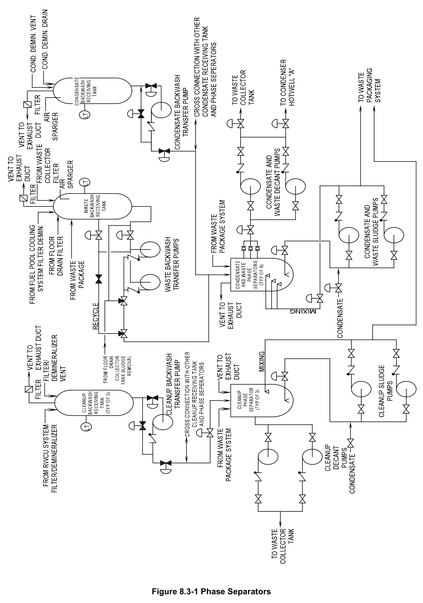

# 8.3 Solid Radwaste

> Source: `8.3_Solid_Radwaste.pdf` (11 pages)
> GE (BWR) Systems Technology Manual — USNRC HRTD, Rev 09/11

---
<!-- p.1 -->
#### General Electric Systems Technology Manual
#### Chapter 8.3
#### Solid Radwaste System
<!-- p.3 -->
TABLE OF CONTENTS

8.3 SOLID RADWASTE SYSTEM .................................................................................. 1

8.3.1 Introduction .................................................................................................... 1

8.3.2 System Description ........................................................................................ 1

8.3.2.1 Phase Separator System Description .............................................. 2

8.3.2.2 Resin Dewatering Skid System ....................................................... 5

8.3.3 System Interfaces .......................................................................................... 5

8.3.4 Summary ....................................................................................................... 6

LIST OF FIGURES

8.3-1 Phase Separators

Rev 09/11 8.3-i USNRC HRTD

<!-- p.5 -->
### 8.3 SOLID RADWASTE SYSTEM
#### 8.3.1 Introduction
The purposes of the Solid Radwaste System are:

1. To collect, process, store, package, and prepare for shipment solid radwaste material produced through plant operations.

2. Solid Radwaste must comply with the following regulations:
• 10 CFR 71
• 10 CFR 61
• U.S. Department Of Transportation (DOT) regulations
• 49 CFR 170 through 189.

The functional classification of the Solid Radwaste System is that of a power generation system.

#### 8.3.2 System Description
The Solid Radwaste System processes all solid radioactive waste products. The solid wastes are collected and processed according to the following classifications:
• wet solid wastes
• dry solid wastes
• irradiated reactor components.

Wet solid wastes consist of:
• spent powdered ion exchange resins
• filter media sludge
• bead type ion exchange resins
• evaporator bottom sludge.

These wastes are stored, packaged, and prepared for shipment in the radwaste building.

Items of dry solid waste are collected in suitable containers located throughout the plant. The containers are lined with plastic bags and brought to the bailer room in the radwaste building for temporary storage before bailing.

Spent control rods and incore instrument stringers are stored in the spent fuel pool.
They are loaded under water into shielded containers for shipment off site.

Rev 09/11 8.3-1 USNRC HRTD

<!-- p.6 -->
The Liquid Radwaste System provides many inputs into the Solid Radwaste System including:
• spent resin
• powdered resin
• bead resin
• filter media.

The Solid Radwaste System includes the Phase Separator System, the Resin Dewatering Skid, and the Solidification Unit.

##### 8.3.2.1 Phase Separator System Description
The Phase Separator System is shown in Figure 8.3-1. Spent powdered ion exchange resin and filter aid sludge are accumulated and stored in the phase separator tanks.
Batches of slurried materials are pumped into the tanks, where the solids settle out.
The supernatant liquid is decanted off to make room for more slurry. Successive batches are accumulated until the desired settled slurry volume has been reached.
After an appropriate radioactive decay period, the sludge is re-slurried and pumped to the packaging area. In the packaging area it is either dewatered in a high integrity container or solidified in concrete. The sludge is then transported for subsequent burial.

High activity sludge from the reactor water cleanup filter demineralizers is stored in three cleanup phase separator tanks. Normal operating requirements can be met with two tanks with a 60 day decay period. The third tank provides operating flexibility and additional decay time.

Six condensate phase separator tanks are provided for storage of sludge from the following:
• condensate filters/demineralizers
• fuel pool filter demineralizers
• waste filters
• floor drain filters.

Sludge from the various sources may be mixed in the six phase separator tanks or segregated.

The major components of the Phase Separator System are discussed in the following paragraphs.

###### 8.3.2.1.1 Cleanup Backwash Receiving Tank
The cleanup backwash receiving tank is a stainless steel cylindrical vessel with a conical bottom. It has a capacity of 3000 gallons and is equipped with a mixing air

Rev 09/11 8.3-2 USNRC HRTD

<!-- p.7 -->
sparger and an overflow to the floor drain sump. The tank also has a vent to the radwaste building exhaust duct. The Reactor Water Cleanup (RWCU) System filter/demineralizer is backwashed to this tank through a 4 inch diameter inlet line. The accumulation of filter/demineralizer backwash is then removed by the cleanup backwash transfer pump.

###### 8.3.2.1.2 Cleanup Backwash Transfer Pump
The cleanup backwash transfer pump is a 50 gpm centrifugal unit. The pump takes a suction on the cleanup backwash receiving tank. The tank discharges to the cleanup phase separator tank. The pump is equipped with a low backwash receiving tank level trip.

###### 8.3.2.1.3 Cleanup Phase Separator Tank
The cleanup phase separators are closed top stainless steel cylinders with conical bottoms. The phase separator has a capacity of 5000 gallons which is sufficient to hold two backwashes. Decant outlets are located three levels above the maximum settled sludge level. A bottom outlet leads to the cleanup sludge pump.

###### 8.3.2.1.4 Cleanup Decant Pump
The cleanup decant pump is a 56 gpm centrifugal unit drawing a suction from the three different levels on the phase separator. After settling for at least 4 hours, the phase separator decant is pumped to the waste collector tank (Section 8.2) for further processing. Sludge batches are accumulated in the phase separator for a period of several weeks or until a predetermined tank? radiation? level is reached.

###### 8.3.2.1.5 Cleanup Sludge Pumps
Each of the two centrifugal cleanup sludge pumps has an output of 200 gpm. The suctions are cross connected and draw from the bottom of the phase separator. The discharge of the pumps is directed to the solid waste packaging systems. This discharge is in the form of a slurry concentrate. To ensure a complete pumping, part of the sludge discharge flow is directed through a set of eductors in the phase separator settling region. A flow through the eductors is maintained throughout the slurry transfer period.

Rev 09/11 8.3-3 USNRC HRTD

<!-- p.8 -->
###### 8.3.2.1.6 Waste Backwash Receiving Tank
The waste backwash receiving tank is similar to the cleanup backwash receiving tank, with a larger capacity of 7600 gallons. It receives filter and filter/demineralizer backwash from the following:
• the waste collector filter
• the floor drain collector filter
• the fuel pool cooling and cleanup filter/demineralizer.

###### 8.3.2.1.7 Waste Backwash Transfer Pumps
The waste backwash transfer pumps are similar in design to the cleanup backwash transfer pump; they have a capacity of 450 gpm. The discharge of the two pumps is directed to the condensate and waste phase separators.

###### 8.3.2.1.8 Condensate Backwash Receiving Tank
The condensate backwash receiving tank is similar to the cleanup backwash receiving tank, with a larger capacity of 8500 gallons. It receives filter/demineralizer backwash from the condensate system filter/demineralizers.

###### 8.3.2.1.9 Condensate Backwash Transfer Pump
The condensate backwash transfer pump is similar in design to the cleanup backwash transfer pump; it has a capacity of 450 gpm. The condensate backwash pump discharges to the condensate and waste phase separators.

###### 8.3.2.1.10 Condensate and Waste Phase Separators
The design and construction of the condensate and waste phase separators is similar to the cleanup phase separators. The phase separator capacity has been increased to 12,500 gallons. The six phase separators are connected in parallel to accept the larger flow rates from the waste backwash and condensate backwash receiving tanks.

###### 8.3.2.1.11 Condensate and Waste Decant Pumps
Two condensate and waste decant pumps are connected to take a suction on any of the six condensate and waste phase separators. The pumps are 480 gpm centrifugal units discharging to the waste collector tank (Section 8.2). Suction points from three different levels are provided. Decant operation is similar to that described for the cleanup decant pump.

Rev 09/11 8.3-4 USNRC HRTD

<!-- p.9 -->
###### 8.3.2.1.12 Condensate and Waste Sludge Pumps
The waste backwash transfer pumps are similar in design to the cleanup backwash transfer pump; they have a capacity of 450 gpm. The discharge of the two pumps is directed to the condensate and waste phase separators.

##### 8.3.2.2 Resin Dewatering Skid System
Dewatering is the process in which residual water is pumped out of a high integrity or regular liner containing spent resin. This process is required if solidification is not performed such that the waste media will comply with burial site criteria and 10 CFR 61.
The dewatering process uses an air-driven, double-diaphragm, positive displacement pump. For precoat media, there is a 1½" manifold with four ¾" valved inlet connections and a 1½" outlet connection. Dewatering occurs when the pump provides a continuous suction on a vessel. This suction removes liquid to a predetermined quantity or percentage of the waste form. The suction time will vary according to the resin,or precoat and vessel used. The vessel contains a matrix of piping with small perforations to allow for pumping of residual water. The water removed from a vessel is returned to the plants liquid waste treatment system.

#### 8.3.3 System Interfaces
A short discussion of interrelations between this system and other plant systems is given in the paragraphs that follow.

Liquid Radwaste System (Section 8.2)

The Liquid Radwaste System provides most inputs to the Solid Radwaste System in the form of sludge and resins.

Condensate Transfer and Demineralized Water System (Section 2.6)

The Condensate Transfer and Demineralized Water System supplies water for slurry pumping and flushing.

Service and Instrument Air System (Section 11.6)

The Service and Instrument Air System supplies air for sparging to the receiving tanks and separators.

Rev 09/11 8.3-5 USNRC HRTD

<!-- p.10 -->
#### 8.3.4 Summary
The purposes of the Solid Radwaste System are:

1. To collect, process, store, package, and prepare for shipment solid radwaste material produced through plant operations.

2. Solid Radwaste must comply with the following regulations:
• 10 CFR 71
• 10 CFR 61
• U.S. Department Of Transportation (DOT) regulations
• 49 CFR 170 through 189.

The Solid Radwaste System processes all solid radioactive waste products. The solid wastes are collected and processed according to the following classifications:
• wet solid wastes
• dry solid wastes
• irradiated reactor components.

Wet solid wastes consist of:
• spent powdered ion exchange resins
• filter media sludge
• bead type ion exchange resins
• evaporator bottom sludge.

These wastes are stored, packaged, and prepared for shipment in the radwaste building.

.

Rev 09/11 8.3-6 USNRC HRTD

<!-- p.11 -->
#### Figure 8.3-1

*Phase Separators*

[Vector original (SVG, lossless): fig_8.3-1.svg](../figures/fig_8.3-1.svg)

