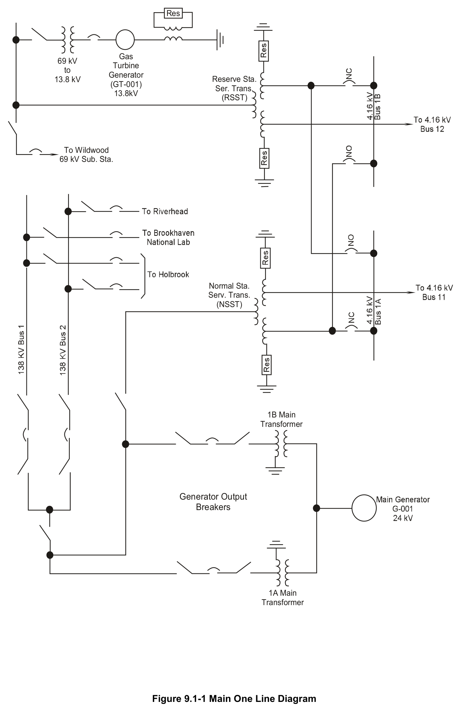
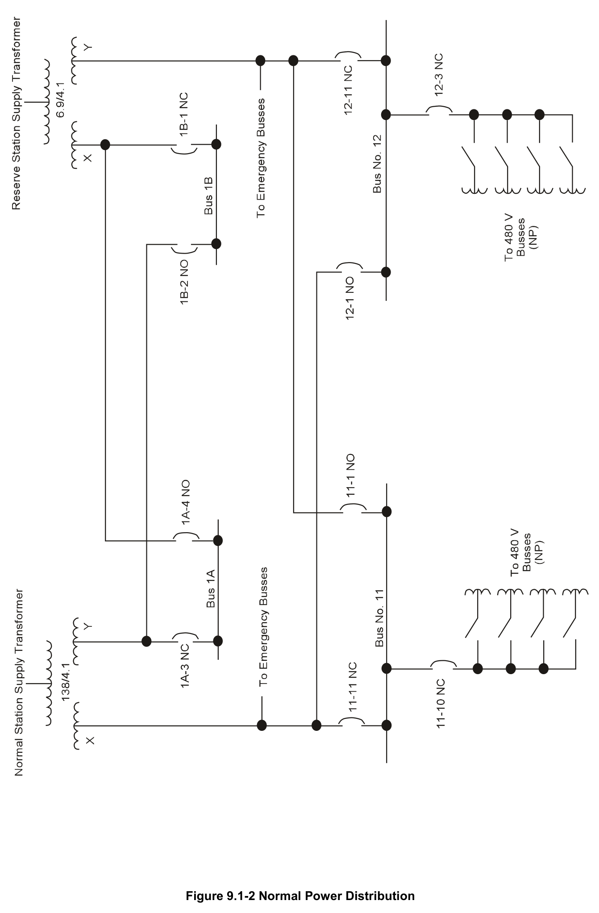
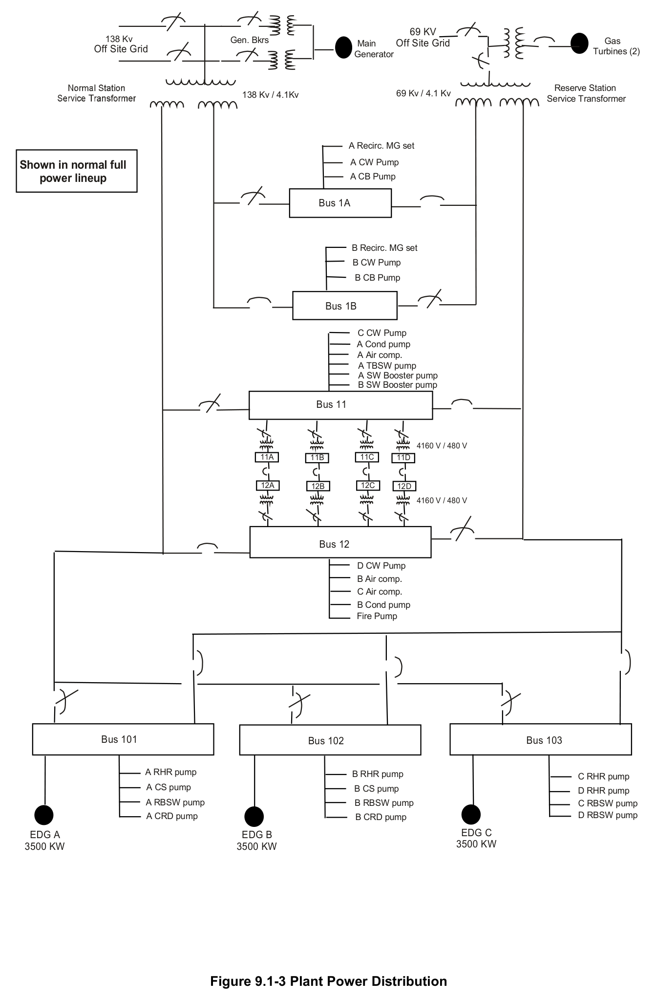

# 9.1 Normal AC Power

> Source: `9.1_Normal_AC_Power.pdf` (19 pages)
> GE (BWR) Systems Technology Manual — USNRC HRTD, Rev 09/11

---
<!-- p.1 -->
#### General Electric Systems Technology Manual
#### Chapter 9.1
#### Normal AC Power Systems
<!-- p.3 -->
TABLE OF CONTENTS

9.1 NORMAL AC POWER SYSTEMS ........................................................................... 1

9.1.1 System Introduction ........................................................................................... 1

9.1.2 System Description ............................................................................................ 1

9.1.3 Component Description ...................................................................................... 2

9.1.3.1 Unit Generator and Auxiliaries ..................................................................... 2

9.1.3.2 Generator Output Breakers ......................................................................... 3

9.1.3.3 Main Transformers ...................................................................................... 4

9.1.3.4 Normal Station Service Transformers.......................................................... 4

9.1.3.5 Reserve Station Service Transformers ........................................................ 5

9.1.3.6 Station Gas Turbine..................................................................................... 5

9.1.3.7 4160V Normal Power AC Busses ................................................................ 5

9.1.3.8 Normal 480V Distribution ............................................................................. 5

9.1.3.9 Generator Bus Duct Cooling System ........................................................... 6

9.1.4 System Features and Interfaces ........................................................................ 7

9.1.4.1 Normal Operation ........................................................................................ 7

9.1.4.2 System Interfaces ........................................................................................ 7

9.1.5 Summary ............................................................................................................ 7

LIST OF TABLES

9.1-1 Normal 4160VAC Bus Loads ............................................................................... 9

Rev 09/11 9.1-i USNRC HRTD

<!-- p.4 -->
#### LIST OF FIGURES
9.1-1 Main One Line Diagram 9.1-2 Normal Power Distribution 9.1-3 Plant Power Distribution

Rev 09/11 9.1-ii USNRC HRTD

<!-- p.5 -->
### 9.1 Normal AC Power Systems
Learning objectives:

1. Recognize the purposes of the Normal AC Power system.

2. Recognize the purpose of the following Normal AC Power system major components:
a. Unit Generator and Auxiliaries b. Generator Output breakers c. Main Transformers (MT)
d. Normal Station Supply Transformer (NSST)
e. Reserve Station Supply Transformer (RSST)
f. Gas Turbine g. 4160v Buses h. 480v Distribution system i. Generator Bus Duct Cooling System

3. Recognize how power is distributed to the Normal buses from the:
a. Normal Station Supply Transformer (NSST)
b. Reserve Station Supply Transformer (RSST)
c. Gas Turbine

4. Recognize how the Normal AC Power system interfaces with the following systems:
a. DC Power System (Section 9.4)
b. Emergency AC Power System (Section 9.2)

#### 9.1.1 System Introduction
The purpose of the Normal AC Power (NP) system is to provide adequate power to unit auxiliary loads for normal operation of the plant. Two physically independent off site power supplies are provided to safety related loads supplied from the emergency buses.
These two physically independent power supplies are from the 138KV and the 69KV offsite transmission systems.

#### 9.1.2 System Description
The Normal AC Power system includes the following;
• a Normal Station Service Transformer (NSST)
• a Reserve Station Service Transformer (RSST)
• a Main Transformer (MT)
• 4160V buses
• a 480V distribution system

Both of the station service transformers are step-down transformers. The NSST steps 138KV down to 4160V and the RSST steps 69KV down to 4160V. Each of the stepdown transformers has two secondary windings.

Rev 09/11 9.1-1 USNRC HRTD

<!-- p.6 -->
The NSST normally supplies buses 1A and 11. The RSST normally supplies buses 1B and 12. Each of the transformers serves as a backup supply for the other. Loads associated with the four 4160V buses are listed in Table 9.1-1.

The Main Transformer (MT) is a step-up (24KV to 138KV) transformer. The main transformer takes the output of the station turbine generator and supplies it to the NSST and the grid.

Each of the 4160V buses supplies a 4160V to 480V step-down transformers for the 480V distribution system.

#### 9.1.3 Component Description
The major components of the Normal AC Power System are shown in Figure 9.1-1 and 9.1-2 are discussed in the following paragraphs.

##### 9.1.3.1 Unit Generator and Auxiliaries
The purpose of the unit generator is to transfer the mechanical energy from the main turbine into electrical energy. The rotating shaft of the main turbine is coupled to the unit generator's rotor. The rotor supplies the rotating magnetic field necessary to produce electricity from the generator.

The unit generator design ratings are as follows;
• 1800 rpm
• 820 MWe,
• 978MVA
• 60 Hz
• 24KV.

The output from generator is three phase AC power supplied to the grid and station loads. Each phase output is routed through a specially constructed conductor which in turn is encased in a cooling duct. The generator bus duct cooling system discussed in section 9.1.3.9.

The unit generator has auxiliary support systems which are required for its operation.
These support systems are discussed in the following paragraphs.

###### 9.1.3.1.1 Generator Gas System
The generator rotor windings and casing are cooled by the circulation of hydrogen gas within the generator. This gas is maintained at approximately 60 psig and greater than 90% purity. Hydrogen is used because it provides relatively low windage losses and good thermal conductivity. Hydrogen removes heat at approximately seven times the

Rev 09/11 9.1-2 USNRC HRTD

<!-- p.7 -->
rate of air while using less power to circulate the hydrogen gas. Pressurizing the hydrogen gas to 60 psig increases its heat removal capacity. The high purity requirements minimize the possibility of a hydrogen gas fire or explosion. The gas is cooled by four hydrogen coolers . These in turn are cooled by the turbine building closed loop cooling water system.

###### 9.1.3.1.2 Generator Hydrogen Seal Oil System
A hydrogen seal oil system is used to prevent the hydrogen gas from escaping the generator. Cool, clean oil from the turbine lubricating oil system is supplied to the hydrogen seal oil system storage tank. The hydrogen seal oil system pumps then supply oil to the generator seals at 8 psig above generator gas pressure. The oil from the seals flows back to the turbine lube oil system for cooling and cleaning.

###### 9.1.3.1.3 Generator Stator Cooling System
High purity, low conductivity water is used to cool the generator stator bars and the exciter rectifiers. Water is used because it has a high heat capacity and low viscosity.
The electrical conductivity of water is kept to a minimum. The water is continually filtered to reduce particles which could cause electrical shorting in the stator. By maintaining conductivity less than 0.5 μmho/cm the stator bars are not shorted out by the water. The stator cooling system heat exchangers are cooled by the turbine building closed loop cooling water system.

###### 9.1.3.1.4 Generator Alterex Exciter System
The main generator excitation system is a GE Alterex system. This system uses an auxiliary AC generator (alternator-exciter) as its power source. This is required as the unit generator excitation power requirements are relatively large (1860KW and 500V).
The alternator-exciter is driven by a direct coupling to the main generator rotor. It is a three phase, 60 Hz, 4 pole, air cooled machine with it's output connected to a group of static rectifiers. The static rectifies change the AC from the exciter to DC for application to generator rotor. The rectified DC output is applied to the generator rotor field windings via collector slip rings and brushes.

##### 9.1.3.2 Generator Output Breakers
The main generator is supplied with two parallel generator output breakers. The generator output circuit breakers are installed between the main turbine and the grid. In the open position, the generator output breakers isolate the main transformer and generator from the grid. Off site power from the grid is provided to the normal AC power system via the NSST.

Rev 09/11 9.1-3 USNRC HRTD

<!-- p.8 -->
In the closed position, the generator is connected to the main transformer and provides power to the grid and normal AC power system. The generator output breakers are high volume, double throw, oil filled circuit breakers. The oil provides a high resistance medium between high voltage terminal points in the open position. The purpose of the generator output breakers is to protect the unit generator and main transformer from electrical faults. A list of the protective trips provided by the generator output breakers is listed in Table 9.1-2.

The generator output breakers are used to synchronize the generator to the 138KV AC grid. They are controlled from the generator section (MCB01-R) of the main control board in the control room. Either generator output breaker may be used to synchronize the generator to the grid. The generator output breaker to be used is selected by the synchronizing selector switch. This switch connects the generator and the grid to a synchroscope and voltmeters. When the first generator output breaker is synchronized
(voltages and frequency matched) the operator closes the breaker. The second breaker may then be closed after selecting it with the synchroscope. The generator and grid are already in synchronization because the first generator output breakers is closed.

##### 9.1.3.3 Main Transformers
There are two Main Transformers each consisting of three single phase, forced oil and air cooled transformers. Leads from the unit generator are connected to the primary windings of the Main Transformers. The high voltage grid leads are connected to the secondary windings. The Main Transformers serve as step-up (24KV/138KV)
transformers when the generator output breakers are closed.

##### 9.1.3.4 Normal Station Service Transformers
The Normal Station Service Transformers (NSSTs) are step-down (138KV/4160V) three phase transformers. The NSST supplies the following:
• preferred power to nonsafety related 4160V system buses 1A and 11
• preferred power to 4160V emergency AC system buses 101, 102, and 103
• backup power to the 4160V AC system buses 1B and 12

The primary winding is supplied by a 138KV connection to either the unit generator or the grid. The NSST has two secondary windings. Two windings are used for voltage transient separation while starting the Reactor Recirculation MG Set Drive Motors. The NSST is the normal preferred power source for two of the four 4160V normal AC power buses and all of the 4160V emergency power system buses.

The NSST is a nitrogen blanketed, oil/air cooled transformer. The NSST is supplied with redundant protective relaying schemes. This relaying isolates the transformer electrical connections in the event of an electrical fault condition.

Rev 09/11 9.1-4 USNRC HRTD

<!-- p.9 -->
If the supply breakers from the RSST to the 4160V buses trip an automatic transfer to the NSST will occur. This auto transfer will not occur if there is a bus fault

##### 9.1.3.5 Reserve Station Service Transformers
The Reserve Station Service Transformers (RSSTs) are step-down (69KV/4160V) three phase transformers. The primary winding is supplied by a 69KV connection to the grid.
The RSST normally supplies the following;
• preferred power to nonsafety related 4160V system buses 1B and 12
• back up preferred power to 4160V emergency AC power system buses 101, 102, and 103
• backup power to the 4160V system buses 1A and 11

If the supply breakers from the RSST to the 4160V buses trip an automatic transfer to the NSST will occur. This auto transfer will not occur if there is a bus fault

The RSST is also a nitrogen blanketed, oil/air cooled transformer. The RSST has redundant protective relaying schemes to isolate the transformer in the event of an electrical fault condition.

##### 9.1.3.6 Station Gas Turbine
The gas turbine acts as a reserve power supply for the 69KV distribution network and can be aligned directly to the RSST. The gas turbine is not located on site. It is not designed to be switched into the 69KV distribution network in the loaded condition. The gas turbine is controlled by a grid load dispatcher, not by the station operators.

The gas turbine was designed as a safeguard against a total loss of site power (station blackout). The addition of a third source of power to the normal AC power system makes a station blackout a very low probability.

9.1.3.7 4160V Normal Power AC Busses

There are four 4160V normal power system buses (1A, 1B, 11, and 12). The normal power supply to buses 1A and 11 is the NSST. The normal supply to buses 1B and 12 is the RSST. Buses 1A and 1B normally supply large motors only. Buses 11 and 12 normally supply smaller loads. Typical loads supplied by the 4160V system buses are listed in Table 9.1-1. The normal supply breakers to the 4160V buses are 2000 amp fast acting breakers. The backup supply breakers have a 1200 amp capability.

##### 9.1.3.8 Normal 480V Distribution
The 480V normal AC power system consists of eight metal clad switchgear buses.
These are combined through a bus tie breaker into four double ended buses. The 480V

Rev 09/11 9.1-5 USNRC HRTD

<!-- p.10 -->
system buses are fed by 4160V normal AC power system buses 11 and 12. Control power for the 480V switchgear is supplied by 125VDC. A one line drawing is presented in figure 9.1-2.

Power to the 480V loads is provided by Secondary Unit Substations (SUS). A SUS consists of
• a primary section for the connection to the 4160V circuit
• a three phase transformer section from 4160V to 480V
• a secondary section for the connection for 480V motors, power panels, and Motor Control Centers (MCCs).

The transformers have a primary winding voltage of 4160V and a secondary winding voltage at 480V. The transformers have automatically controlled forced oil and air cooling systems. The SUS circuit breakers are normally electrically opened and closed.
Manual operation is possible with control switches mounted on each SUS section.
Each 480V normal bus and MCC can be energized from the opposite divisions 480V bus. A bus tie breaker is closed if the normal power supply is or will become unavailable.

The 480V motor control centers supply power to the following
• small motors
• motor operated valves
• 120V lighting distribution panels
• 120V power panels
• battery chargers for the non safety 125V DC batteries

Each MCC has various sized motor starters contained in cubicles on the motor control center. The starter contacts open and close electrically to start or stop loads. The MCC provides instantaneous protection for motors and time delay over current protection for feeds to power panels.

##### 9.1.3.9 Generator Bus Duct Cooling System
The generator bus duct cooling system consists of one fan and its supporting equipment. Air is discharged from the fan and passes through the generator bus ducts to remove heat. The air is then passed through an air/water heat exchanger and then returned to the fan. Cooling water is supplied by the turbine building closed loop cooling water system. The bus duct cooling system must be in operation to support generator outputs of greater than 45% load.

Rev 09/11 9.1-6 USNRC HRTD

<!-- p.11 -->
#### 9.1.4 System Features and Interfaces
A short discussion of system operation and interfaces between this system and other plant systems is given in the following paragraphs.

##### 9.1.4.1 Normal Operation
Under normal operating conditions, the normal power system supplies AC power to the equipment required for normal plant operation. The turbine generator supplies power to the 138KV grid through the main transformer. The NSST receives power from the 138KV grid. The RSST receives power from the 69KV grid and could receive power from an assigned gas turbine. The RSST and NSST step the voltage down for use on the normal and emergency AC power system 4160V buses. The voltage on the normal and emergency system 4160V buses is stepped down by the 4160V switch gear to 480V. This 480V power is supplied to eight normal AC system and three emergency power system 480V buses.

##### 9.1.4.2 System Interfaces
The normal AC power system interfaces with virtually every plant system. Table 9.1-1 provides a listing of some of the more important loads supplied by the system. Other important interfaces are discussed in the following paragraphs.

DC Power System (Section 9.4)

The DC Power System supplies control power to the high and medium voltage AC switchgears and circuit breakers.

Emergency AC Power System (Section 9.2)

The Emergency AC Power System is normally energized by the normal AC power System.

#### 9.1.5 Summary
The normal AC power system provides power to unit auxiliary loads needed for normal operation of the plant. Two physically independent off site power supplies are provided from the grid to the emergency bus safety related loads. The two physically independent power supplies are from the 138KV and the 69KV grid. The NSST and RSST both serve normal and backup preferred power functions. The gas turbine provides an additional source of offsite power to the system.

The normal AC power system has a quick transfer function which transfers loads from normal preferred power to backup preferred power.

Rev 09/11 9.1-7 USNRC HRTD

<!-- p.12 -->
Rev 09/11 9.1-8 USNRC HRTD

<!-- p.13 -->
#### Table 9.1-1
#### Normal 4160VAC Bus Loads
Bus 1A

"A" Reactor Recirculation MG Set Drive Motor "A" Circulating Water Pump "A" Condensate Booster Pump

Bus 11

"A" Turbine Building Service Water Pump "A" and "B" Screen Wash Pumps "A" Air Compressor "C" Circulating Water Pump 4160/480 Transformers

Bus 1B

"B" Reactor Recirculation MG Set "B" Circulating Water Pump "B" Condensate Booster Pump

Bus 12

Motor driven Fire Pump "B" Condensate Pump "B" and "C" Air Compressors "D" Circulating Water Pump 4160/480 Transformers

Rev 09/11 9.1-9 USNRC HRTD

<!-- p.14 -->
Rev 09/11 9.1-10 USNRC HRTD

<!-- p.15 -->
#### Table 9.1-2
#### Main Generator Trips
• Generator Volts per Hertz High, 110% of rated for 45 seconds.
• Generator Stator Cooling Runbacktrip if reduction of load due to loss of stator cooling does not occur within the required time.
• Generator Loss of Excitation, Loss of 58% (Instantaneous) and Loss of 33%
(60 cycles).
• Generator Neutral Ground
• Generator Potential Ground
• Generator Negative Sequence (Phase Differential Current 12% for 4.1 minutes)
• Main Transformer Primary Phase Differential
• Main Transformer Secondary Phase Differential
• Main Transformer Overcurrent
• Main Transformer High Side Neutral Ground
• Main Transformer Fault Pressure
• Auxiliary Transformer Primary Differential
• Auxiliary Transformer Secondary Differential
• Auxiliary Transformer Overcurrent
• Auxiliary Transformer Neutral Ground
• Generator Under Frequency

Rev 09/11 9.1-11 USNRC HRTD

<!-- p.16 -->
Rev 09/11 9.1-12 USNRC HRTD

<!-- p.17 -->
#### Figure 9.1-1

*Main One Line Diagram*

[Vector original (SVG, lossless): fig_9.1-1.svg](../figures/fig_9.1-1.svg)

<!-- labels/text on this figure page -->
Res
Gas 69 kV Turbine to Generator Reserve Sta.
13.8 kV
(GT-001)
Ser. Trans.
13.8kV
(RSST)
To Wildwood 69 kV Sub. Sta.
Normal Sta.
Serv. Trans.
(NSST)
1B Main Transformer
Generator Output Breakers
1A Main Transformer
Figure 9.1-1 Main One Line Diagram

<!-- p.18 -->
#### Figure 9.1-2

*Normal Power Distribution*

[Vector original (SVG, lossless): fig_9.1-2.svg](../figures/fig_9.1-2.svg)

<!-- p.19 -->
#### Figure 9.1-3

*Plant Power Distribution*

[Vector original (SVG, lossless): fig_9.1-3.svg](../figures/fig_9.1-3.svg)

<!-- labels/text on this figure page -->
69 KV 138 Kv Gen. Bkrs Gas Main Off Site Grid Off Site Grid Turbines (2) Generator
Reserve Station
69 Kv / 4.1 Kv 138 Kv / 4.1Kv
Service Transformer
A Recirc. MG set
A CW Pump Shown in normal full power lineup A CB Pump
Bus 1A
B Recirc. MG set B CW Pump
B CB Pump
Bus 1B
C CW Pump A Cond pump A Air comp.
A TBSW pump A SW Booster pump B SW Booster pump
Bus 11
4160 V / 480 V 11A 11C 11B 11D
12A 12B 12C 12D
4160 V / 480 V
Bus 12
D CW Pump B Air comp.
C Air comp.
B Cond pump Fire Pump
Bus 101 Bus 103 Bus 102
A RHR pump B RHR pump C RHR pump A CS pump B CS pump D RHR pump A RBSW pump B RBSW pump C RBSW pump D RBSW pump B CRD pump A CRD pump
EDG C EDG A EDG B 3500 KW 3500 KW 3500 KW
Figure 9.1-3 Plant Power Distribution

