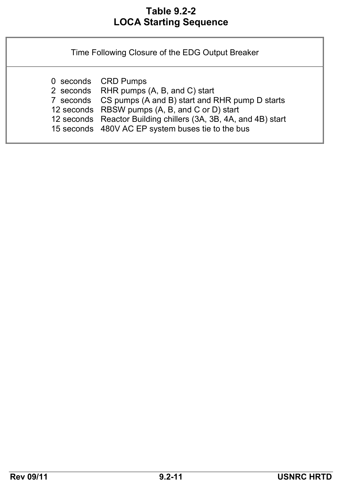
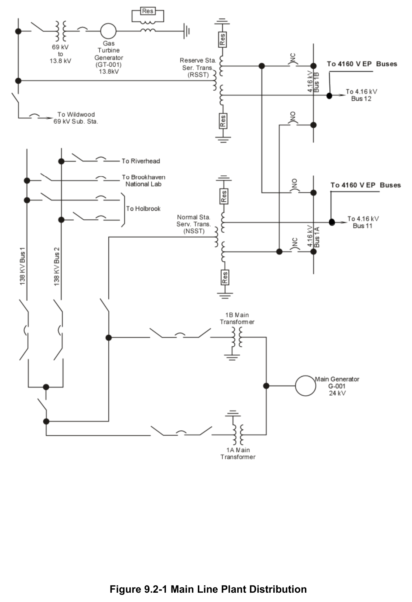
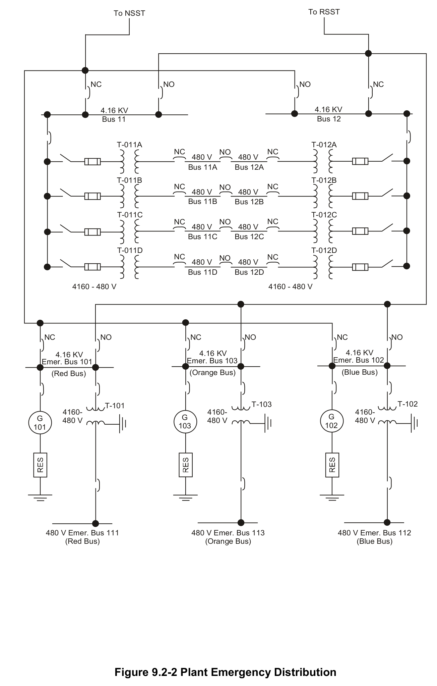
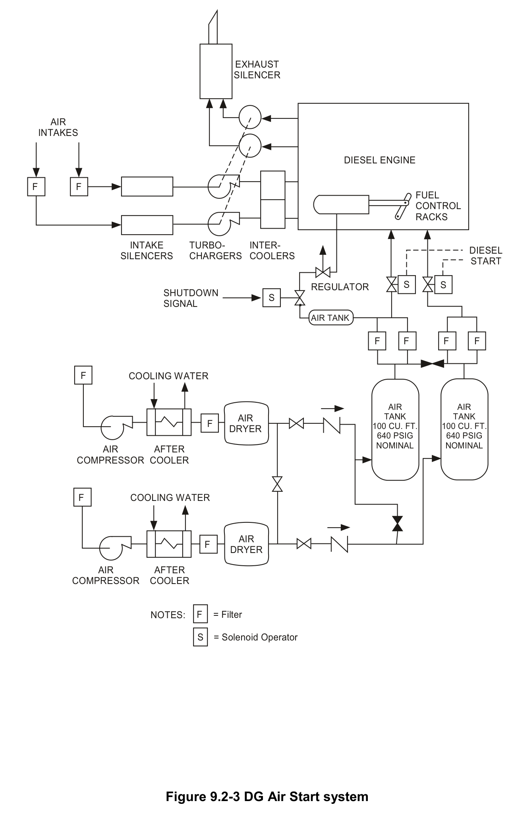
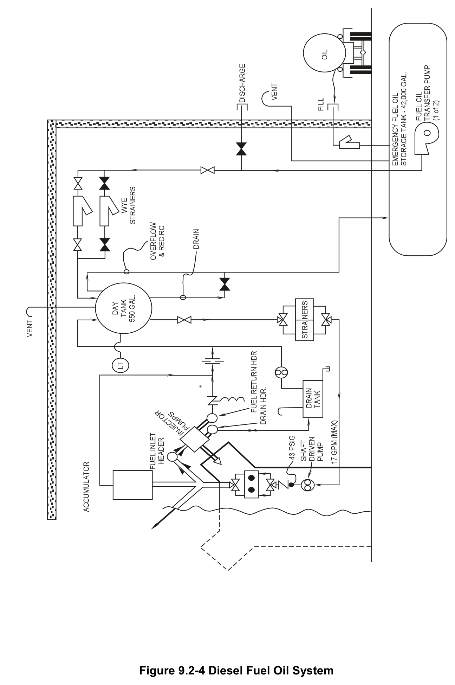
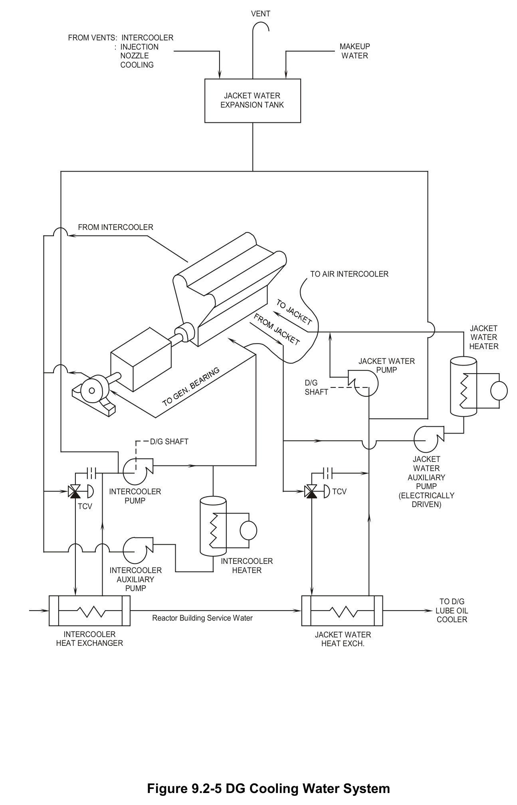
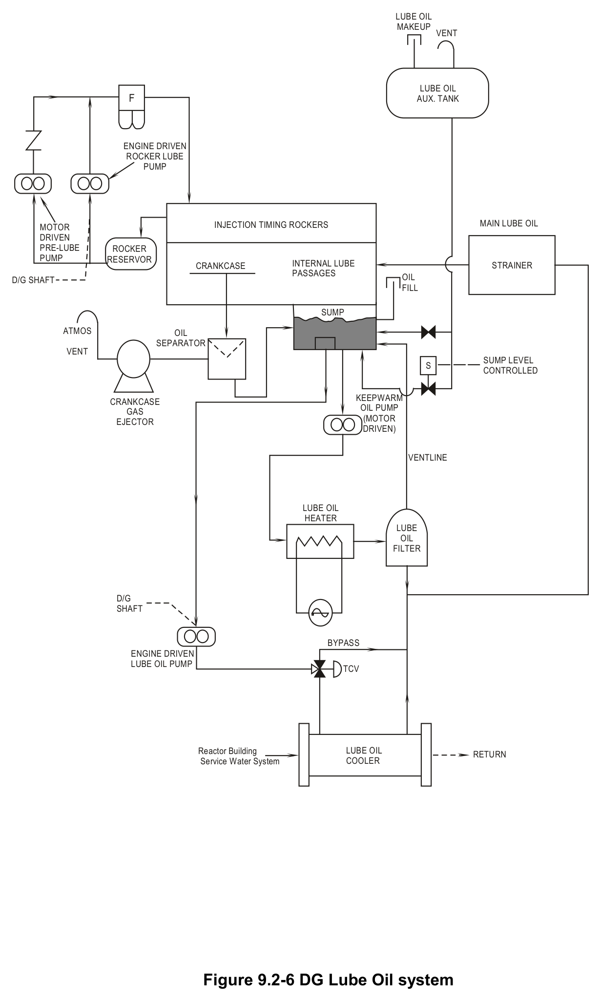

# 9.2 Emergency AC Power

> Source: `9.2_Emergency_AC_Power.pdf` (21 pages)
> GE (BWR) Systems Technology Manual — USNRC HRTD, Rev 09/11

---
<!-- p.1 -->
#### General Electric Systems Technology Manual
#### Chapter 9.2
#### Emergency AC Power Systems
<!-- p.3 -->
TABLE OF CONTENTS

9.2 EMERGENCY AC POWER SYSTEMS .................................................................. 1

9.2.1 Introduction ................................................................................................ 1

9.2.2 System Descriptions .................................................................................. 1

9.2.3 Component Description .............................................................................. 2

9.2.3.1 4160V EP System Switchgear ............................................................... 2

9.2.3.2 Emergency Diesel Generators (EDGs) ............................................... 3

9.2.3.3 480V EP System Switchgear ................................................................. 4

9.2.4 System Features and Interfaces ................................................................ 5

9.2.4.1 Normal Operation ...................................................................................... 5

9.2.4.2 Loss of Offsite Power (LOOP) ............................................................... 5

9.2.4.3 Loss of Coolant Accident (LOCA) without a (LOOP) ...................... 6

9.2.4.4 LOCA with a LOOP ................................................................................... 6

9.2.4.5 Testing........................................................................................................... 6

9.2.4.6 EDG Automatic Initiation Logic .............................................................. 7

9.2.4.7 System Interfaces ...................................................................................... 7

9.2.5 Summary .................................................................................................... 7

LIST OF TABLES

9.2-1 4160V EP System Loads ................................................................................... 9

9.2-2 LOCA Starting Sequence ................................................................................. 10

Rev 09/11 9.2-i USNRC HRTD

<!-- p.4 -->
#### LIST OF FIGURES
9.2-1 Main Line Plant Distribution

#### 9.2.2 Emergency AC Power System
9.2-3 Diesel Starting Air 9.2-4 Diesel Fuel Oil System 9.2-5 Generator Cooling Water 9.2-6 Diesel Generator Lube Oil System

Rev 09/11 9.2-ii USNRC HRTD

<!-- p.5 -->
### 9.2 EMERGENCY AC POWER SYSTEMS
1. Recognize the purposes of the Emergency AC Power system.

2. Recognize the purpose of the following Emergency Power system major components:
a. Emergency Diesel Generators (EDG)
b. Normal Station Supply Transformer (NSST)
c. Reserve Station Supply Transformer (RSST)

3. Recognize how power is distributed to the Emergency buses from the:
a. Emergency Diesel Generators (EDG)
b. Normal Station Supply Transformer (NSST)
c. Reserve Station Supply Transformer (RSST)

4. Recognize the plant conditions that would result in the following:
a. EDG automatic start b. Automatic bus transfer from the NSST to the RSST c. EDG automatic loading

5. Recognize how the Emergency Power system interfaces with the following systems/components:
a. Normal AC Power System (Section 9.1)
b. 120 VAC Power System (Section 9.3)
c. DC Power System (Section 9.4)
d. Reactor Building Service Water System (Section 11.2)

#### 9.2.1 Introduction
The purpose of the Emergency AC Power (EP) system is to provide a reliable source of AC power to the loads required for safe shutdown and cooldown of the plant.

The preferred sources of power to the EP system are the Normal Station Supply Transformer (NSST) and the Reserve Station Supply Transformer (RSST). Onsite Emergency Diesel Generators (EDGs) provide emergency power in the event that offsite power has been lost.

The EP system is one of the engineered safety features (ESF) of the facility, and as such is safety related (IEEE class 1E). The ESF equipment is divided into three electrical divisions. Any two of these divisions are capable of bringing the reactor to a safe, cold shutdown, condition in the event of a Loss of Coolant Accident (LOCA). A one line drawing of the EP system is presented in Figure 9.2-2.

#### 9.2.2 System Descriptions
The EP system has three electrically and physically independent 4160V divisional buses referred to as the orange, red, and blue buses. Each division is provided with

Rev 09/11 9.2-1 USNRC HRTD

<!-- p.6 -->
separate onsite emergency sources, electrical buses, distribution cables, controls, and relays. Each division has three power supplies:
• The normal power supply to each of the EP system 4160V divisional buses is the NSST.
• The RSST provides a backup source of normal power to the three divisional buses.
• The EDG provides an emergency power source in the event of a Loss of Off-site Power (LOOP).

The primary distribution voltage is 4160V. The secondary distribution voltage level is 480V, with lighting and other small loads at 120V. The primary distribution voltage supplies large pump motors and the ESF 480V transformers and distribution centers.
Typical loads connected to the 4160V EP buses are listed in Table 9.2-1.

The three independent buses of the system are electrically and physically independent.
This ensures that no single electrical or mechanical failure will cause a loss of power to more than one divisional bus. In the event of a LOOP, the EP switchgears are automatically connected to the EDGs in time for a safe reactor shutdown. In the event of a LOCA the EDGs start, but do not tie to the buses unless the off site power supplies are subsequently lost.

#### 9.2.3 Component Description
The major components of the EP system are shown in Figure 9.2-2 and are discussed in the paragraphs that follow.

9.2.3.1 4160V EP System Switchgear

The EP system consists of three separate and independent 4160V divisional buses designated as follows:
• Red - 101 bus
• Blue - 102 bus
• Orange - 103 bus

There are no bus ties between the three divisions at any voltage level. They are physically and electrically independent so a failure of one bus will not effect the remaining two buses.

Each EP division can receive power from one of three power sources:
• the normal preferred source supplied through the NSST
• the normal reserve source supplied through the RSST
• the emergency source supplied from an EDG.

Each of the three EP divisions has the capability to automatically switch from its normal preferred source to either the reserve or emergency source.

Rev 09/11 9.2-2 USNRC HRTD

<!-- p.7 -->
Each of the 4160V EP system switchgear contains the following components:
• switching and interrupting devices
• the breaker enclosures
• a bus bar and interconnecting wiring
• instruments and protective relays

The protective relaying functions of the switchgear include overcurrent and bus ground fault functions. The exterior of the switchgear has local control switches and indications.
All of the 4160V EP system switchgear buses are located in the safety related auxiliary building.

##### 9.2.3.2 Emergency Diesel Generators (EDGs)
The EDGs supply emergency power to the 4160V EP system buses. Each diesel engine has the following characteristics:
• four stroke
• eight cylinder
• turbocharged
• water cooled
• fuel injected

Each engine is directly coupled to an air cooled generator with the following ratings:
• 4160 VAC
• 3 phase
• 60 Hz
• 3500 KW

The time required for the EDGs to reach rated voltage and frequency is less than 10 seconds. Each EDG requires the following auxiliary support systems to ensure reliable operation:
• air start system
• fuel oil system
• cooling water system
• lubricating oil system

Each EDG is provided with two full capacity air starting systems to furnish starting air for the EDG, Figure 9.2-3. The air starting systems include two air storage tanks, each capable of storing air for five normal starts of the engine. Each system includes an air compressor capable of recharging either air storage tank. The starting air systems are fully redundant, a failure of one will not impact the other.

Each EDG has a fuel oil system which includes components for the storage, transfer, and supply of fuel oil to the diesel, Figure 9.2-4. A fuel oil storage tank supplies sufficient capacity to operate the EDG for 7 days at maximum load demand.

Rev 09/11 9.2-3 USNRC HRTD

<!-- p.8 -->
Each EDG has a cooling water system that dissipates heat generated by the diesel engine and lube oil cooler, Figure 9.2-5. Engine heat is absorbed by cooling water and transferred to the Reactor Building Service Water System (RBSWS) in the jacket water heat exchanger. The cooling system is heated when the EDG is not in use. Heating this system maintains the diesel engine temperature elevated minimizing mechanical wear from rapid EDG starts.

Each EDG has a lubrication system to supply lube oil to the diesel engine and generator bearing surfaces, Figure 9.2-6. The lubrication system is heated when the EDG is not in use. Heating this system maintains the diesel engine internal temperature elevated minimizing mechanical wear from rapidly starting the EDG.

The EDGs have trips to protect the diesel engine and generator against the following conditions during normal operations:
• generator reverse power
• loss of excitation
• overcurrent
• generator differential overcurrent
• lube oil pressure low
• lube oil temperature high
• turbo oil pressure low
• jacket water temperature high
• crankcase pressure high
• overspeed

The EDGs bypass most trips during Emergency operation. The following conditions cause an EDG trip during Emergency operations:
• overcurrent
• generator differential overcurrent
• overspeed

The maximum protection is provided during routine EDG operation. There are fewer active trip signals in emergency operation to maximize EDG availability. This added availability supports a safe shutdown and cooldown of the reactor during accident conditions. The trips that are retained during emergency operation are major faults that will cause immediate damage to the EDG.

9.2.3.3 480V EP System Switchgear

The 4160V/480V step-down arrangement discussed in the NP system is nearly identical to the arrangement used in the EP system.

A 4160V to 480V three phase transformer supplies a 480V metal-enclosed switchgear on a common bus. The loads served consist of motors between 100 and 250 hp

Rev 09/11 9.2-4 USNRC HRTD

<!-- p.9 -->
connected to the 480Vswitchgear and distribution centers. The 480V breakers function as both protective and switching devices for the safety related loads. The protective functions for the 480V EP system include bus ground fault and overcurrent protection.

The 480V EP system buses supply three battery chargers which charge 125VDC battery buses A1, B1, and C1. Battery bus operation is covered in chapter 9.4.

#### 9.2.4 System Features and Interfaces
A short discussion of this systems features and interfaces with other plant systems is given in the following paragraphs.

##### 9.2.4.1 Normal Operation
During normal plant operation the preferred source of power to the EP system is offsite power supplied through the NSST, Figure 9.2.2. Backup off site power is supplied by the RSST. Each of the transformers is capable of supplying the EP system by itself.
Off site power is supplied from 138KV or 69KV substations through the NSST or RSST to the three 4160V EP divisions, Figure 9.2.1. Power from the 4160V EP system buses is stepped down to the 480V EP system.

The 480V EP system buses supply motor control centers, secondary unit substations, and battery chargers.

##### 9.2.4.2 Loss of Offsite Power (LOOP)
This logic discussion assumes a loss of all off site power to the station.

Upon a loss of the normal source of power to the emergency buses, the undervoltage logic first checks the RSST source. If the RSST is available, a fast transfer to that source is made within 5 cycles of the bus undervoltage. This does not interrupt power to the bus and no loads are shed. This function is only available from the NSST to the RSST and does not work in reverse.

If any of the 4160V EP bus undervoltage conditions exists for greater than 2 seconds all the EDGs start. Also at 2 seconds signal a slow transfer to the RSST is initiated. This slow transfer causes the following actions:
• loads on the 4160V EP buses are shed except for the CRD pump
• all of the 480V EP buses are shed
• the NSST supply breaker to the 4160V EP system bus is tripped.
• the RSST supply breaker is connected to the bus

Rev 09/11 9.2-5 USNRC HRTD

<!-- p.10 -->
If the RSST does not restore bus voltage within 5 seconds of the original undervoltage signal the following actions occur:
• the NSST and RSST supply breakers to the 4160V EP system bus are tripped.
• when the EDG reaches rated speed and voltage it's supply breaker connects to the bus
• after seven seconds the RBSWS pump associated with that bus will start

The 4160V EP system buses must be manually realigned following an automatic transfer of power sources. This is accomplished by electrically paralleling the two power sources. The EP buses have an automatic synchronization protection logic. The EDG must be within 20 degrees of synchronization to the normal source before it's supply breaker will close. When both power sources are synchronized, the breaker of the incoming power source is closed by the operator.

##### 9.2.4.3 Loss of Coolant Accident (LOCA) without a Loss of Offsite Power (LOOP)
A LOCA uses the same basic bus shedding sequence as the bus undervoltage (LOOP).
The loads required to support LOCA conditions are different, Table 9.2-2, shows the loads and the connection timing sequence. Along with the major loads, essential lighting and instrumentation are automatically reconnected to their buses.

All three EDGs start immediately upon receiving the LOCA signal. The EDGs will continue to run unloaded when a LOCA signal is present. The NSST or RSST will continue to supply the buses unless there is a LOOP. Loads that have not been sequenced to the EP system buses can not be reconnected. To reconnect these loads the LOCA signal must be cleared or bypassed by the station Emergency Operating Procedures (EOPs).

##### 9.2.4.4 LOCA with a LOOP
For a LOCA simultaneously with a LOOP, the EP system buses shed loads in the same manner describe in the LOOP. All three EDGs immediately start and are connected to their respective 4160V EP buses. The emergency loads are automatically connected to the EP buses in the sequence shown in Table 9.2-2. When the LOCA signal has been cleared or bypassed by the EOP's, other loads can be manually reconnected to the buses.

##### 9.2.4.5 Testing
Periodic operability tests are performed on each of the EDGs. The test EDG is started and brought to rated speed and voltage. The EDG is then synchronized with a preferred source and loaded for test purposes.

Rev 09/11 9.2-6 USNRC HRTD

<!-- p.11 -->
##### 9.2.4.6 EDG Automatic Initiation Logic
The EDG automatic initiation logic actuates under the following conditions:
• undervoltage on any one of the 4160V EP system bus
• reactor vessel water level low (Level 1)
• drywell pressure high (1.69 psig)
• divisional Core Spray or Residual Heat Removal manual initiation

The EDG will idle unloaded or if there is an undervoltage signal present it will automatically connects to its 4160V bus. The EDG will continue to operate until the automatic start signal has been removed and it is manually shutdown. The EDG can also be tripped by actuation of any of the active protective devices.

##### 9.2.4.7 System Interfaces
The emergency buses supply normal and emergency power to many plant systems.
Table 9.2-1 lists the major 4160v loads supplied by the system.

Normal AC Power System (Section 9.1)

The NP system energizes the emergency buses during normal operation and is the preferred source of power. Power is normally supplied through the NSST but can be supplied from the RSST.

120V Power System (Section 9.3)

The emergency power system provides emergency power to the 120V power system for lighting and small safety related loads.

DC Power System (Section 9.4)

Control power for EP system circuit breakers, diesel generator field flash and other components is provided by the DC Power system. The DC Power system batteries are charged by battery chargers powered from the 480V EP system buses.

Reactor Building Service Water System (Section 11.2)

The RBSWS supplies divisional cooling water to the diesel generators when they are operating.

#### 9.2.5 Summary
The Emergency AC Power (EP) system provides a reliable source of AC power to loads required for the safe shutdown and cooldown of the plant. The preferred source of power to the EP system is the NSST. The backup source of power is the RSST. Onsite

Rev 09/11 9.2-7 USNRC HRTD

<!-- p.12 -->
EDGs provide emergency power in the event of a LOOP. EP system distribution equipment is divided into three physically and electrically independent electrical divisions. Any two of these divisions are capable of bringing the reactor to a safe, cold shutdown, condition in the event of a LOCA or LOOP. The EDGs will start on a LOCA or a LOOP signal, but only tie to the bus in an undervoltage condition. The EP system is an engineered safety feature at the facility, as such is safety related (IEEE class 1E).

Rev 09/11 9.2-8 USNRC HRTD

<!-- p.13 -->
#### Table 9.2-1
#### 4160V EP System Loads
Bus 101 - Red Division

Residual Heat Removal (RHR) pump "A" Core Spray (CS) pump "A" Reactor Building Service Water (RBSW) pump "A" Control Rod Drive (CRD) pump "A" 480V Emergency Bus Transformer and loads

Bus 102 - Blue Division

RHR pump "B" CS pump "B" RBSW pump "B" CRD pump "B" 480V Emergency Bus Transformer and loads

Bus 103 - Orange Division

RHR pumps "C" and "D" RBSW pumps "C" and "D" 480V Emergency Bus Transformer and loads

Rev 09/11 9.2-9 USNRC HRTD

<!-- p.14 -->
Rev 09/11 9.2-10 USNRC HRTD

<!-- p.15 -->

*figure on PDF page 15*

[Vector original (SVG, lossless): fig_page-15_2.svg](../figures/fig_page-15_2.svg)

<!-- labels/text on this figure page -->
Table 9.2-2
LOCA Starting Sequence
Time Following Closure of the EDG Output Breaker
0 seconds CRD Pumps 2 seconds RHR pumps (A, B, and C) start 7 seconds CS pumps (A and B) start and RHR pump D starts 12 seconds RBSW pumps (A, B, and C or D) start 12 seconds Reactor Building chillers (3A, 3B, 4A, and 4B) start 15 seconds 480V AC EP system buses tie to the bus
Rev 09/11 9.2-11 USNRC HRTD

<!-- p.16 -->
#### Figure 9.2-1

*Main Line Plant Distribution*

<!-- p.17 -->
#### Figure 9.2-2

*Plant Emergency Distribution*

[Vector original (SVG, lossless): fig_9.2-2.svg](../figures/fig_9.2-2.svg)

<!-- labels/text on this figure page -->
To RSST To NSST
NC NO NO NC
4.16 KV 4.16 KV
Bus 12 Bus 11
T-012A T-011A NC NO NC 480 V 480 V Bus 11A Bus 12A
T-011B T-012B NC NO NC 480 V 480 V Bus 11B Bus 12B
T-011C T-012C NC NC NO 480 V 480 V Bus 11C Bus 12C
T-011D T-012D NC NO NC 480 V 480 V Bus 11D Bus 12D
4160 - 480 V 4160 - 480 V
NC NO NC NO NC NO
4.16 KV 4.16 KV
4.16 KV Emer. Bus 102 Emer. Bus 101 Emer. Bus 103
(Blue Bus) (Red Bus)
(Orange Bus)
T-102 T-101 T-103 4160- 4160- 4160- G G G 480 V 480 V 480 V 102 101 103
480 V Emer. Bus 111 480 V Emer. Bus 113 480 V Emer. Bus 112
(Red Bus)
(Orange Bus)
(Blue Bus)
Figure 9.2-2 Plant Emergency Distribution

<!-- p.18 -->
#### Figure 9.2-3

*DG Air Start system*

[Vector original (SVG, lossless): fig_9.2-3.svg](../figures/fig_9.2-3.svg)

<!-- labels/text on this figure page -->
EXHAUST SILENCER
AIR INTAKES
DIESEL ENGINE
F F FUEL CONTROL RACKS
INTAKE TURBO- INTER- DIESEL SILENCERS CHARGERS COOLERS START
S S REGULATOR SHUTDOWN S SIGNAL AIR TANK
F F F F
F COOLING WATER
AIR AIR TANK TANK AIR F 100 CU. FT. 100 CU. FT. DRYER 640 PSIG 640 PSIG NOMINAL NOMINAL AIR AFTER COMPRESSOR COOLER
F COOLING WATER
AIR F DRYER
AIR AFTER COMPRESSOR COOLER
NOTES: F = Filter
S = Solenoid Operator
Figure 9.2-3 DG Air Start system

<!-- p.19 -->
#### Figure 9.2-4

*Diesel Fuel Oil System*

[Vector original (SVG, lossless): fig_9.2-4.svg](../figures/fig_9.2-4.svg)

<!-- p.20 -->
#### Figure 9.2-5

*DG Cooling Water System*

[Vector original (SVG, lossless): fig_9.2-5.svg](../figures/fig_9.2-5.svg)

<!-- labels/text on this figure page -->
VENT
FROM VENTS: INTERCOOLER MAKEUP : INJECTION WATER NOZZLE COOLING
JACKET WATER EXPANSION TANK
FROM INTERCOOLER
TO AIR INTERCOOLER
JACKET WATER HEATER
JACKET WATER PUMP D/G SHAFT
D/G SHAFT
JACKET WATER AUXILIARY PUMP TCV INTERCOOLER
(ELECTRICALLY PUMP DRIVEN)
TCV
INTERCOOLER HEATER INTERCOOLER AUXILIARY PUMP
TO D/G LUBE OIL Reactor Building Service Water COOLER
INTERCOOLER JACKET WATER HEAT EXCHANGER HEAT EXCH.
Figure 9.2-5 DG Cooling Water System

<!-- p.21 -->
#### Figure 9.2-6

*DG Lube Oil system*

[Vector original (SVG, lossless): fig_9.2-6.svg](../figures/fig_9.2-6.svg)

<!-- labels/text on this figure page -->
LUBE OIL MAKEUP VENT
LUBE OIL F AUX. TANK
ENGINE DRIVEN ROCKER LUBE PUMP
MAIN LUBE OIL INJECTION TIMING ROCKERS MOTOR DRIVEN PRE-LUBE ROCKER PUMP RESERVOR INTERNAL LUBE CRANKCASE STRAINER PASSAGES OIL D/G SHAFT FILL
SUMP
ATMOS OIL SEPARATOR VENT SUMP LEVEL S CONTROLLED
KEEPWARM CRANKCASE OIL PUMP GAS
(MOTOR EJECTOR DRIVEN)
VENTLINE
LUBE OIL HEATER LUBE OIL FILTER
D/G SHAFT
BYPASS ENGINE DRIVEN LUBE OIL PUMP TCV
LUBE OIL Reactor Building RETURN Service Water System COOLER
Figure 9.2-6 DG Lube Oil system

