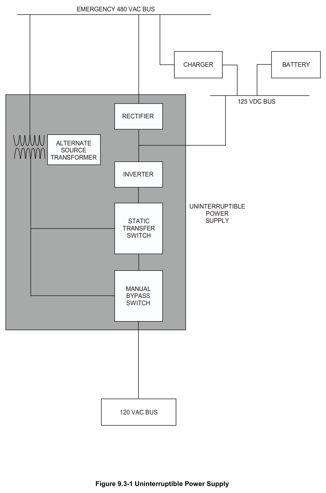
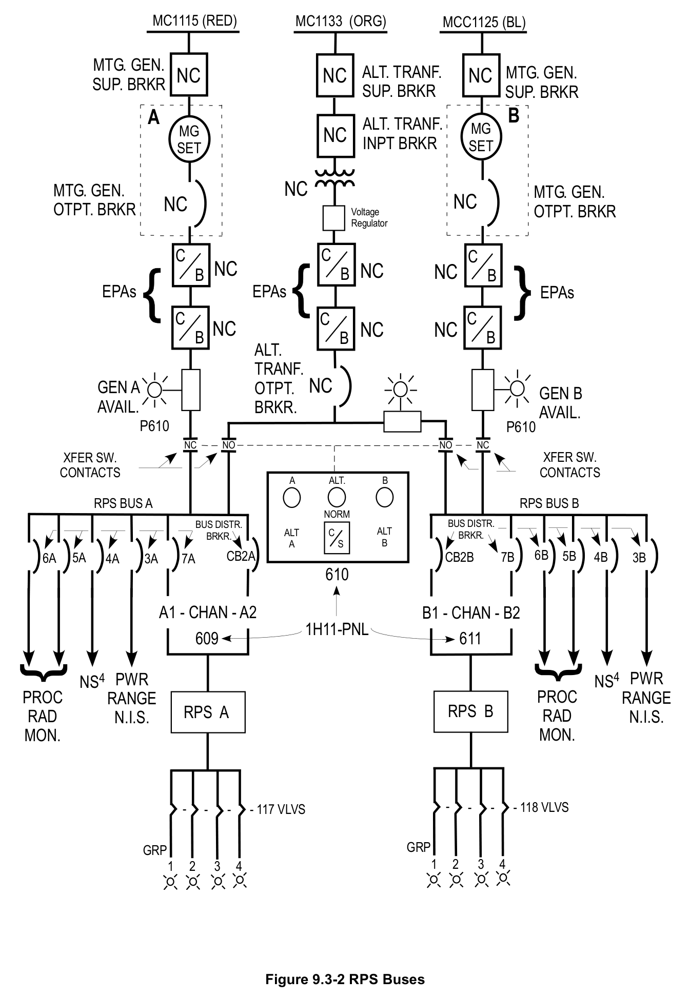

# 9.3 120VAC Power

> Source: `9.3_120VAC_Power.pdf` (12 pages)
> GE (BWR) Systems Technology Manual — USNRC HRTD, Rev 09/11

---
<!-- p.1 -->
#### General Electric Systems Technology Manual
#### Chapter 9.3
## 120 VAC Power Systems
<!-- p.3 -->
TABLE OF CONTENTS

9.3 120 VAC POWER SYSTEMS .................................................................................. 1

9.3.1 System Introduction ..................................................................................... 1

9.3.1.1 Safety Related Control and Instrument Power System .................. 1

9.3.1.2 Normal Control and Instrument Power System .............................. 1

9.3.1.3 Uninterruptible Power System ....................................................... 1

9.3.1.4 Reactor Protection Power System ................................................. 3

9.3.2 System Features and Interfaces .................................................................. 4

9.3.2.1 UPS Operation .............................................................................. 4

9.3.2.2 RPS Operation .............................................................................. 4

9.3.2.3 Interfaces ....................................................................................... 6

9.3.3 Summary ..................................................................................................... 6

Rev 09/11 9.3-i USNRC HRTD

<!-- p.4 -->
#### LIST OF FIGURES
9.3-1 Uninterruptible Power Supply 9.3-2 RPS Buses

Rev 09/11 9.3-ii USNRC HRTD

<!-- p.5 -->
9.3 120 VAC POWER SYSTEMS

Learning Objectives:

1. Recognize the purposes of the 120 VAC Power system.

2. Recognize how the 120 VAC Power system interfaces with the following systems:
a. Reactor Protection System (Section 7.3)
b. Emergency AC Power System (Section 9.2)

#### 9.3.1 System Introduction
The purposes of the 120 VAC Power System are to provide 120 VAC power to safety related loads and non safety related loads and to provide uninterruptible 120 VAC power to systems that are not safety related.

The 120 VAC Power Systems are divided into four systems; safety related control and instrument power system, normal control and instrument power system, reactor protection power system, and the uninterruptible power system.

##### 9.3.1.1 Safety Related Control and Instrument Power System
The safety related control and instrumentation system consists of three independent subsystems to supply power to safety related instruments, monitors and controls. Each subsystem has a minimum of two power sources and associated distribution panels.
Each power source has a single phase transformer with its primary connected to an emergency 480 VAC bus and its secondary connected to a distribution panel. The panels contain manually operated circuit breakers for protection of safety related circuits and devices.

##### 9.3.1.2 Normal Control and Instrument Power System
The normal control and instrument power system consists of independent power sources and distribution panels to supply power to conventional instruments and noncritical monitors and controls. Each power source is a single phase transformer with its primary connected to a normal 480 VAC bus and its secondary connected to a distribution panel. The panels contain manually operated circuit breakers for protection of the circuits that supply instruments and monitors. Certain buses have automatic transfer from one power source to another where high reliability is desired during normal operations.

##### 9.3.1.3 Uninterruptible Power System
The purpose of the Uninterruptible Power Systems (UPS) is to supply 120 VAC power to non-safety related controls and instrumentation used for orderly operation of the plant. Since the UPS has the 125 VDC system (with batteries) as its alternate supply,

Rev 09/11 9.3-1 USNRC HRTD

<!-- p.6 -->
its output should not be lost during the interval between a loss of offsite power and restoration of emergency AC by the diesel generators. The UPS will continue for a minimum of two hours in the event of a total loss of AC power (station blackout).

Each of the two systems consists of a rectifier, an inverter, static transfer switch, manual transfer switch, and a distribution panel. One subsystem is shown in Figure 9.3-1.

One system supplies power to the plant computer and the other supplies vital instruments and controls and part of the control room lighting. There is a third unrelated system that supplies power to the station security system which will not be discussed.

Each inverter produces a 120 VAC output which is then supplied to a distribution panel.

###### 9.3.1.3.1 Internal Rectifier
The input of the internal rectifier is supplied from an emergency 480 VAC bus. The three phase AC is converted to DC by a full wave array that uses diodes and Silicone Controlled Rectifiers (SCRs). The output voltage is maintained constant during varying input conditions by adjusting the amount of time in each half cycle that the SCRs conduct. This is called phase angle control. The output of the rectifier is connected to the inverter through a filter which is designed to reduce the ripple of the rectifier output.

###### 9.3.1.3.2 Inverter
An inverter is a solid state device to transform DC power to AC power. The fundamental principle of operation of an inverter is the periodic switching of SCRs to change the direction of the current. The frequency of the resultant output sine wave is a function of the switching rate. The UPS synchronizes the frequency and phase of its output with the reference signal (from the AC supply) as long as the frequency is within ±1% of 60 Hz. The UPS will maintain its phase within ±5 degrees of the reference signal during steady state conditions. This feature allows a "make before break" load transfer. The UPS can supply 125% of full rated load for an unlimited time while maintaining output voltage.

###### 9.3.1.3.3 Static Transfer Switch
The static transfer switch associated with the inverter makes transfers between the preferred source (inverter) to the alternate source (transformer) without interruption on a "make before break" basis, ensuring that there will be no transient or power interruption.
The purpose of the transfer from the inverter to the alternate source is to continue to supply 120 VAC in the event of an inverter failure. This transfer is made automatically.
The transfer back to the inverter is by manual action only. The transfer from inverter to alternate supply can be accomplished manually.

Rev 09/11 9.3-2 USNRC HRTD

<!-- p.7 -->
###### 9.3.1.3.4 Manual Bypass Switch
The manual bypass switch allows for maintenance on the inverter or the static transfer switch by providing for "make before break" transfers between the inverter and the alternate source. The switch is interlocked with the static transfer switch so that a transfer can not occur unless the static switch is supplying power from the alternate source or the output voltage of the static switch is zero.

##### 9.3.1.4 Reactor Protection Power System
Each of the two RPS buses, Figure 9.3-2, is energized by a flywheel MG set. A flywheel is provided to supply sufficient stored energy to maintain the voltage and frequency within ±5% of rated values so that momentary electrical system transients will not cause a reactor scram. Each MG set is supplied from a separate Motor Control Center (MCC) source (MCC-1115 and MCC-1125). An alternate source of power is supplied by a transformer from a different power source, i.e., MCC-1133, than those that supply the MG sets. The alternate source enables operators to shutdown either MG set for maintenance during reactor operation. Electrical interlocks controlled by the "Power Source Select Switch" prevent the transformer from energizing both RPS Bus A and B simultaneously or from paralleling the transformer with any MG set.

###### 9.3.1.4.1 RPS MG Set
9.3.1.4.1.1 Generator

The generator is a GE synchronous generator. The generator is a 18.75 Kva, 15Kw, 0.8pf, 120vac, 1ø, 60Hz, 156 full load amps drip proof enclosure. There is a local
(backup) molded case circuit breaker with adjustable magnetic trip at the generator output. It senses abnormal currents and is tripped by its own under-voltage, overvoltage and under-frequency relays.

9.3.1.4.1.2 Motor

The motor is a GE induction motor. The motor is rated at 25 Hp, 460V, 60 Hz, 3ø, 1790 full load RPM equipped with thermostats and 115V 40W heaters in a drip proof enclosure. There is a local magnetic starter which supplies power to the MG set motor upon its sensing full line input voltage. It contains a three-leg block overload relay which provides motor protection against running and stalled overloads.

9.3.1.4.1.3 MG Set

Each motor generator set is mounted on a common base with flexible couplings for mounting and connecting the generator, motor and flywheel. The flywheel assembly has a calculated net weight of 880 pounds and a calculated moment of inertia of 700 lbft2.

Rev 09/11 9.3-3 USNRC HRTD

<!-- p.8 -->
###### 9.3.1.4.2 Electrical Protection Assemblies
Three sets of two in-series Electrical Protection Assemblies (EPAs) provide redundant protection to the Reactor Protection System and other circuits against over-voltage, under-voltage, under-frequency, overload, and short circuits. Each EPS consists of trip components which disconnect circuitry from input power whenever voltage or frequency exceeds tolerance for beyond a preset time delay. Each EPA's ON-OFF thermal magnetic trip circuit breaker also provides main circuit breaker overload/short circuit protection to the RPS buses, branch circuits and their circuit breakers. Each EPA consists of a GE molded case circuit breaker with companion under-voltage release and an electrical protection logic circuit card.

#### 9.3.2 System Features and Interfaces
##### 9.3.2.1 UPS Operation
Each UPS normally operates on power from an emergency 480 VAC bus, Figure 9.3-1.
This 480 VAC power is stepped down in voltage, rectified, filtered, and sent to the input of an inverter. The inverter produces 120 VAC which is sent to a distribution bus.
During this normal mode of operation, the 125 VDC power, which is used as a backup supply, is in standby. The static transfer switch and the manual bypass switch are both selected to the inverter output, so there is no input from the alternate AC supply.

The abnormal modes of operation for UPS occur when the 480 VAC is unable to supply power, or when either the inverter or the static transfer switch is unable to function properly. In the first case, a loss of 480 VAC, the 125 VDC input will supply the inverter with no interruption in output. In the case of malfunction or maintenance of the inverter, the static transfer switch automatically selects the alternate AC supply when the inverter output falls below 106 VAC. There is no interruption in power output because the static transfer switch does a "make before break" transfer. If the malfunction or maintenance includes the static transfer switch, it would be necessary to transfer to the alternate AC supply with the manual bypass switch. It is also a "make before break" transfer.

During emergency operations, the UPS should continue to supply 120 VAC to its loads as previously explained for normal and abnormal operations as long as either 480 VAC or 125 VDC is available. If offsite power is lost, UPS will use 125 VDC until the diesel generators supply the 480 VAC. For a sustained loss of all AC (station blackout), the batteries will supply 125 VDC for at least two hours.

##### 9.3.2.2 RPS Operation
###### 9.3.2.2.1 Normal Operation
In this mode of operation, the RPS is energized from the 120Vac RPS MG Sets A and B which are powered from their respective MCCs, Figure 9.3-2. MG Set A energizes RPS bus A and MG Set B energizes RPS bus B. If one of the MG Sets is out of service for

Rev 09/11 9.3-4 USNRC HRTD

<!-- p.9 -->
some reason, the RPS Alternate Feed Transformer can be used to energize the inoperative MG Set's respective bus.

###### 9.3.2.2.2 Abnormal Operation
Upon a loss of normal (offsite) power with both RPS MG Sets operating normally as described above, the following will occur:

• RPS MG Sets A and B both trip on a sustained (4 seconds) low supply voltage. The MG Set flywheel will keep the generator within acceptable voltage and frequency limits for approximately two seconds. Approximately two seconds after loss of power to the MG Set Drive Motor, the EPA circuit breakers will automatically trip at

## 57 Hz on under-frequency (i.e., before each RPS MG Set backup generator output
breaker is tripped by its separate under-frequency relay which is set at approximately 54 Hz), RPS buses will lose voltage and de-energize. This will result in a full scram of the RPS and a full isolation of the NSSSS.

• If one of the RPS buses was energized from the Alternate Feed Transformer and a loss of offsite power occurred, that bus would de-energize instantaneously. This would result in a half scram of the RPS and a half isolation of the NSSSS.
Approximately two seconds later, the other RPS bus would de-energize when its EPA circuit breaker tripped open. This would result in a full scram of the RPS and a full isolation of the NSSSS.

###### 9.3.2.2.3 Emergency Operation
This mode of operation is defined as a Loss Of Coolant Accident (LOCA) coincident with a loss of offsite power. The loss of offsite power will de-energize the RPS buses as described above. The LOCA signal will cause certain non-safety related loads normally powered from the emergency buses to be shed. One such load is the Alternate Feed Transformer. The feeder breaker for the Alternate Feed Transformer can be manually reclosed once the LOCA signal has cleared, or after a local accident override switch is placed in the OVERRIDE position.

###### 9.3.2.2.4 Special Modes
When the reactor is operating, both MG Sets will be in operation as described above. It is possible to have reactor operation with one MG Set out of service and not use the Alternate Feed Transformer. However, this is not a desired configuration since the out of service MG Set's RPS bus would be de-energized. This would result in a half scram of the RPS and a half isolation of the NSSSS, and a start of the RBSVS. A trip of the other RPS MG Set would then result in a full scram of the RPS and a full isolation of the NSSSS. When the reactor is shutdown, the MG Sets will normally be left in operation.

Rev 09/11 9.3-5 USNRC HRTD

<!-- p.10 -->
##### 9.3.2.3 Interfaces
The 120 VAC power system interfaces with many other plant systems. Loads include normal and emergency instrumentation and control systems and the plant computer.
Other important interfaces are discussed in the paragraphs that follow.

Normal AC Power System (Section 9.1)

The normal AC power system supplies power to the normal control and instrument power system.

Emergency AC Power System (Section 9.2)

The emergency AC power system supplies power to the safety related control and instrument power system and the reactor protection system motor generator sets.

125 VDC Power System (Section 9.4)

The 125 VDC power system supplies backup power to the uninterruptible power system through inverters.

#### 9.3.3 Summary
The purpose of the 120 VAC system is to provide 120 VAC to safety and non safety related control and instrument buses, the plant computer, and to the reactor protection system. 120 VAC buses are supplied by 480 VAC buses through transformers, motor generator sets, or uninterruptible power supplies.

Rev 09/11 9.3-6 USNRC HRTD

<!-- p.11 -->
#### Figure 9.3-1

*Uninterruptible Power Supply*

[Vector original (SVG, lossless): fig_9.3-1.svg](../figures/fig_9.3-1.svg)

<!-- labels/text on this figure page -->
EMERGENCY 480 VAC BUS
CHARGER BATTERY
125 VDC BUS
RECTIFIER
ALTERNATE SOURCE TRANSFORMER
INVERTER
UNINTERRUPTIBLE POWER SUPPLY STATIC TRANSFER SWITCH
MANUAL BYPASS SWITCH
120 VAC BUS
Figure 9.3-1 Uninterruptible Power Supply

<!-- p.12 -->
#### Figure 9.3-2

*RPS Buses*

[Vector original (SVG, lossless): fig_9.3-2.svg](../figures/fig_9.3-2.svg)

<!-- labels/text on this figure page -->
MC1115 (RED) MC1133 (ORG) MCC1125 (BL)
MTG. GEN.
ALT. TRANF. MTG. GEN. NC NC NC SUP. BRKR SUP. BRKR SUP. BRKR
B A
ALT. TRANF.
MG MG NC INPT BRKR SET SET
NC NC MTG. GEN.
MTG. GEN.
NC NC OTPT. BRKR OTPT. BRKR Voltage Regulator
C C C NC NC NC B B B EPAs EPAs EPAs C C C NC NC NC B B B ALT.
TRANF.
NC GEN A OTPT.
GEN B AVAIL.
BRKR.
AVAIL.
P610 P610 NC NO NO NC XFER SW.
XFER SW.
CONTACTS CONTACTS A ALT. B
RPS BUS A RPS BUS B NORM BUS DISTR.
BUS DISTR.
ALT C ALT BRKR.
BRKR.
A S B 6B 6A 5A CB2A CB2B 7B 5B 4B 3B 4A 3A 7A 610
A1 - CHAN - A2 B1 - CHAN - B2 1H11-PNL 609 611
NS4 PWR NS4 PWR PROC PROC RANGE RANGE RPS B RPS A RAD N.I.S. N.I.S.
RAD MON.
MON.
- - - - 118 VLVS - - - 117 VLVS
-
GRP GRP 1 2 3 4 1 2 3 4
Figure 9.3-2 RPS Buses

