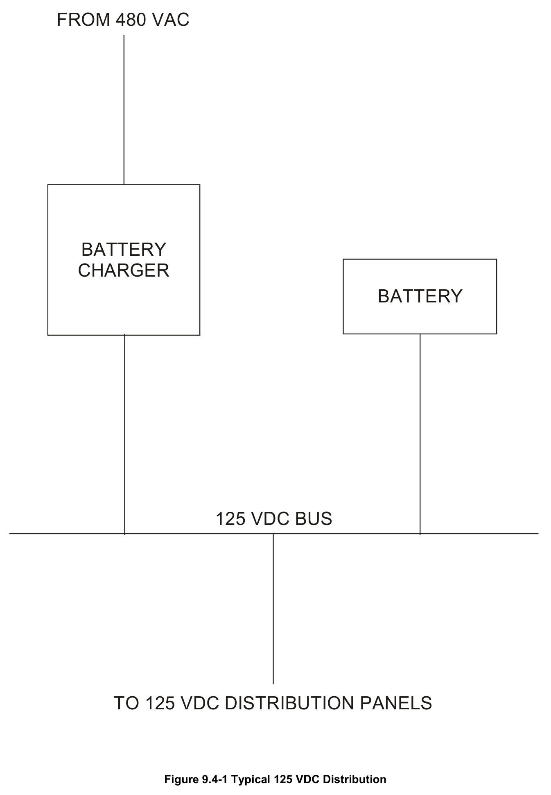
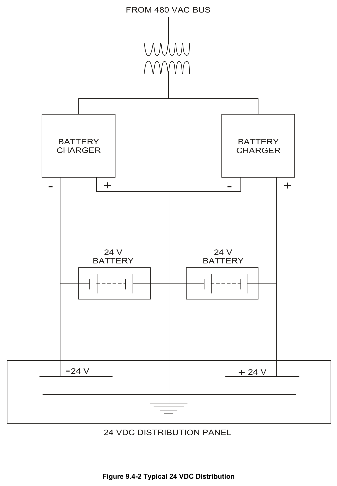

# 9.4 DC Power

> Source: `9.4_DC_Power.pdf` (17 pages)
> GE (BWR) Systems Technology Manual — USNRC HRTD, Rev 09/11

---
<!-- p.1 -->
#### General Electric Systems Technology Manual
#### Chapter 9.4
#### DC Power Systems
<!-- p.3 -->
TABLE OF CONTENTS

9.4 DC POWER SYSTEMS............................................................................................ 1

9.4.1 System Introduction ....................................................................................... 1

9.4.2 Component Descriptions ............................................................................... 2

9.4.2.1 Batteries .......................................................................................... 2

9.4.2.2 Battery Chargers ............................................................................. 3

9.4.3 System Features and Interfaces .................................................................... 3

9.4.3.1 Normal Operation ............................................................................ 3

9.4.3.2 Infrequent Operation ....................................................................... 3

9.4.3.3 Abnormal and Emergency Operation .............................................. 3

9.4.3.4 Interfaces ......................................................................................... 4

9.4.4 Summary ....................................................................................................... 5

LIST OF TABLES

9.4-1 Bus 1A 125VDC Loads ......................................................................................... 7

9.4-2 Bus 1B 125VDC Loads ......................................................................................... 9

9.4-3 Bus 1C 125VDC Loads ....................................................................................... 11

Rev 09/11 9.4-i USNRC HRTD

<!-- p.4 -->
#### LIST OF FIGURES
9.4-1 Typical 125 VDC Distribution 9.4-2 Typical 24 VDC Distribution

Rev 09/11 9.4-ii USNRC HRTD

<!-- p.5 -->
### 9.4 DC POWER SYSTEMS
Learning Objectives

1. Recognize the purposes of the DC Power system.

2. Recognize the purpose, function and operation of the following:
a. Batteries b. Battery Chargers

3. Recognize how the DC Power systems interface with the following systems:
a. Normal AC Power System (Section 9.1)
b. Emergency AC Power System (Section 9.2)
c. 120 VAC Power System (Section 9.3)
d. Reactor Core Isolation Cooling System (Section 2.7)
e. High Pressure Coolant Injection System (Section 10.1)
f. Automatic Depressurization System (Section 10.2)
g. Residual Heat Removal System (Section 10.4)
h. Core Spray System (Section 10.3)
i. Reactor Protection System (Section 7.3)
j. Neutron Monitoring System (Section 5)

#### 9.4.1 System Introduction
The purpose of the DC Power System is to provide highly reliable 125 VDC and 24 VDC to selected equipment required for safe shutdown of the plant and to loads that are essential for normal plant operation.

The 125 VDC system is divided into four separate divisions. Divisions I, II & III are for Engineered Safety Feature (ESF) equipment (Tables 9.4-1, 2 & 3). This equipment includes:
• ESF control systems
• ESF equipment required to restore emergency AC supplies
• ESF equipment that must operate at all times

The ESF control systems are powered from DC power so that their operation does not become sporadic due to the loss of AC power. Equipment required to operate at all times is powered from DC power such that their operation is not affected by transfer from one AC source to another.

Division IV of 125 VDC consists of four independent systems to provide power for nonsafety related systems such as:
• Control and protective power for equipment
• Auxiliary equipment required to achieve safe shutdown when offsite power is lost
• Power for the emergency response facility

Rev 09/11 9.4-1 USNRC HRTD

<!-- p.6 -->
• Power for security systems.

Each 125 VDC distribution bus (Figure 9.4-1) has two power sources:
• A solid state battery charger powered from a 480 VAC bus
• A 125 VDC battery.

The 24 VDC power system provides electrical power to the source and intermediate ranges neutron monitoring systems. The source and intermediate range instruments are not required to shutdown the reactor or place the reactor in a safe shutdown condition per safety analysis. Therefore the 24 VDC power system is not safety related.
There is a separate and unrelated 24 VDC system that supplies radwaste and process radiation monitoring systems that will not be discussed in this section.

Each 24 VDC distribution bus (Figure 9.4-2) has two power sources:
• A solid state battery charger powered from a 480 VAC bus
• A 24 VDC battery.

There are two separate 24 VDC distribution buses. Each bus consists of three battery taps:
• Positive (+24 VDC)
• Negative (-24 VDC)
• Ground (0 VDC)

These taps are supplied by two batteries and two battery chargers. Both battery chargers associated with a distribution bus are supplied by an Emergency 480 VAC bus through a step down transformer.

#### 9.4.2 Component Descriptions
##### 9.4.2.1 Batteries
The 125 VDC batteries are pasted-plate lead acid type, made up of 60 cells, and sealed in clear plastic containers. Each cell has:
• high and low electrolyte level marks
• a built-in hydrometer reading tube
• a vent hole
• thermometer
• specific gravity correction scale on the pilot cell of each battery.

The float voltage of each cell is from 2.17 to 2.25 volts. The recommended equalizing and charging voltage is 2.33 volts per cell. There are ground alarm relays provided for each safety related bus.

Rev 09/11 9.4-2 USNRC HRTD

<!-- p.7 -->
The 24 VDC batteries are pasted-plate lead acid type, made up of 12 cells in clear plastic containers. Each cell has:
• electrolyte level marks
• specific gravity monitoring
• temperature monitoring

##### 9.4.2.2 Battery Chargers
The 125 VDC battery chargers are the normal source of power to the 125 VDC buses.
The chargers are transformer rectifier units cooled by natural convection. They are rated at 300 amps of continuous output. The rectifiers are silicon diodes and Silicon Controlled Rectifiers (SCRs). The output is controlled by varying the phase angle of the SCRs. The output of the rectifier is smoothed by a smoothing circuit to reduce DC ripple. A current limiter will bias the output voltage if the current exceeds 360 amps.
Alarms are provided for voltages greater than 145 and less than 105.

The 24 VDC battery chargers are convection cooled, single phase, rectifier units. The rectifiers also use SCRs connected in a full wave bridge configuration. The output voltage is controlled by adjusting the firing angle of the SCRs. The output "float" voltage is set for 26 to 27 volts, and the equalizing setpoint is 28 to 29 volts. A current limiter circuit will limit the output current to 30 amps. The rectifier output is filtered by a choke circuit to reduce DC ripple. There are alarms for low voltage, low current, and loss of AC input power.

#### 9.4.3 System Features and Interfaces
##### 9.4.3.1 Normal Operation
During normal operations, the battery chargers will supply the normal steady state DC loads, and also provide a "float" charge for the batteries. The chargers have enough capacity to carry the steady state loads while recharging the batteries from minimum voltage to charged state within 24 hours. While the batteries are "floating", they are acting as filters suppressing voltage transients.

##### 9.4.3.2 Infrequent Operation
At specific time intervals as specified by the battery manufacturer, an equalizing charge is placed on the battery banks to bring weak cells back to within specific cell voltage limits and to extend battery life.

##### 9.4.3.3 Abnormal and Emergency Operation
Loss of a battery charger causes annunciation of the appropriate alarms locally and in the control room. The associated battery will carry the loads of that bus until the battery

Rev 09/11 9.4-3 USNRC HRTD

<!-- p.8 -->
charger is again available. If there is a loss of 480 VAC supply, the batteries will carry the loads until AC power has been restored. A loss of offsite power will cause a loss of AC until the diesel generators restore emergency AC power in 10-12 seconds.

The worst case scenario for DC power systems occurs when there is a Loss Of Coolant Accident (LOCA) coincident with a loss of offsite power. If the diesel generators do not restore emergency AC power (station blackout), the batteries will carry the load until emergency AC is restored. The 125 VDC batteries will be loaded heavily during the first minute due to initiation of engineered safeguard equipment. After this initial period, loads will be reduced to steady state conditions. The 125 VDC batteries can meet worst case loads for two hours in the event of a blackout. The 24 VDC batteries can supply its loads for four hours with no output from the battery chargers. Securing unnecessary DC loads after a loss of AC power will extend the battery capacity until AC power is restored.

##### 9.4.3.4 Interfaces
The DC power system interfaces with many systems. A full listing can be found in Tables 9.4-1, 2 & 3. Some major system interfaces are listed below.

Normal AC Power System (Section 9.1)

The normal AC power system supplies power to the non safety related battery chargers.

Emergency AC Power System (Section 9.2)

The emergency AC power system supplies power to the safety related battery chargers.
The DC power systems supply control, field flashing and fuel pump power to the emergency diesel generators (EDGs).

120 VAC Power System (Section 9.3)

The 125 VDC power systems supply backup power to the uninterruptible power system inverters.

Reactor Core Isolation Cooling (RCIC) System (Section 2.7)

The DC power system provides pump, motor-operated-valve (MOV) and control power to the RCIC System.

High Pressure Coolant Injection (HPCI) System (Section 10.1)

The DC power systems provide pump, motor-operated-valve (MOV) and control power to the HPCI System.

Rev 09/11 9.4-4 USNRC HRTD

<!-- p.9 -->
Automatic Depressurization System (ADS) (Section 10.2)

The DC power systems provide control power to ADS.

Residual Heat Removal (RHR) System (Section 10.4)

The DC power systems provide control and motor-operated-valve (MOV) power to RHR for the low pressure coolant injection (LPCI) mode of operation.

Core Spray (CS) System (Section 10.3)

The DC power systems provide control power to CS.

Reactor Protection System (RPS) (Section 7.3)

The DC power systems provide control power to the Backup Scram trip systems.

#### 9.4.4 Summary
The purpose of the DC power system is to provide highly reliable 125 VDC to safety and non safety related loads and 24 VDC power to the neutron monitoring system. All DC buses are supplied by a battery charger that will carry the normal loads and maintain a charge on the battery. Each bus has a battery that will supply the bus in the event of a loss of power to the charger or a failure of the charger.

Rev 09/11 9.4-5 USNRC HRTD

<!-- p.10 -->
Rev 09/11 9.4-6 USNRC HRTD

<!-- p.11 -->
#### Table 9.4-1 Division I 125 VDC Loads
Safety related loads (division I):

Motor operated valves for:
Reactor core isolation cooling (RCIC)

Pump motors for:
RCIC condenser vacuum pump RCIC condenser condensate pump Diesel generator 101 fuel oil pump

Control power for:
Backup scram trip system A Reactor high level trip system C High pressure coolant injection (HPCI) system (backup isolation controls)
RCIC system Nuclear steam supply shutoff system (NSSSS), division I Automatic depressurization system (ADS), division I Residual heat removal (RHR) system Core spray (CS) system, division I Steam leak detection system, division I Recirculation pump trip system, division I 4160V and 480V emergency switchgear, division I Diesel generator 101 Safety related ventilation systems, division I Auxiliary relay panel, division I CO2 detection panel, relay room, division I

Field flashing for diesel generator 101

Non-safety related loads:

Plant process computer (via uninterruptible power supply)

Rev 09/11 9.4-7 USNRC HRTD

<!-- p.12 -->
Rev 09/11 9.4-8 USNRC HRTD

<!-- p.13 -->
#### Table 9.4-2 Division II 125 VDC Loads
Safety related loads (division II):

Motor operated valves for:
HPCI system Main steam line drain system RHR system Reactor water cleanup system (RWCU)

Pump motors for:
HPCI turbine bearing oil pump HPCI condenser vacuum pump HPCI condenser condensate pump Diesel generator 102 fuel oil pump

Control power for:
Backup scram trip system B Reactor high level trip system B HPCI system RCIC system (backup isolation controls)
NSSSS, division II ADS, division II RHR system, division II CS system, division II Steam leak detection system, division II Recirculation pump trip system, division II 4160V and 480V emergency switchgear, division II Diesel generator 102 Safety related ventilation systems, division II CO2 detection panel, relay room, division II

Field flashing for diesel generator 102

Non-safety related loads:

None

Rev 09/11 9.4-9 USNRC HRTD

<!-- p.14 -->
Rev 09/11 9.4-10 USNRC HRTD

<!-- p.15 -->
#### Table 9.4-3 Division III 125 VDC Loads
Safety related loads (division III):

Pump motor for:
Diesel generator 103 fuel oil pump

Control power for:
Diesel generator 103 4160V and 480V emergency switchgear, division III Safety related ventilation systems, division III CO2 detection panel, relay room, division III

Field flashing for diesel generator 103

Non-safety related loads:

Uninterruptible power supply

Rev 09/11 9.4-11 USNRC HRTD

<!-- p.16 -->
#### Figure 9.4-1

*Typical 125 VDC Distribution*

<!-- labels/text on this figure page -->
FROM 480 VAC
BATTERY CHARGER BATTERY
125 VDC BUS
TO 125 VDC DISTRIBUTION PANELS
Figure 9.4-1 Typical 125 VDC Distribution

<!-- p.17 -->
#### Figure 9.4-2

*Typical 24 VDC Distribution*

<!-- labels/text on this figure page -->
FROM 480 VAC BUS
BATTERY BATTERY CHARGER CHARGER
+
- +
-
24 V 24 V BATTERY BATTERY
- + 24 V 24 V
24 VDC DISTRIBUTION PANEL
Figure 9.4-2 Typical 24 VDC Distribution

