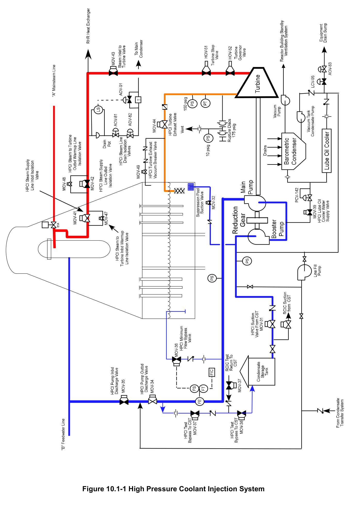
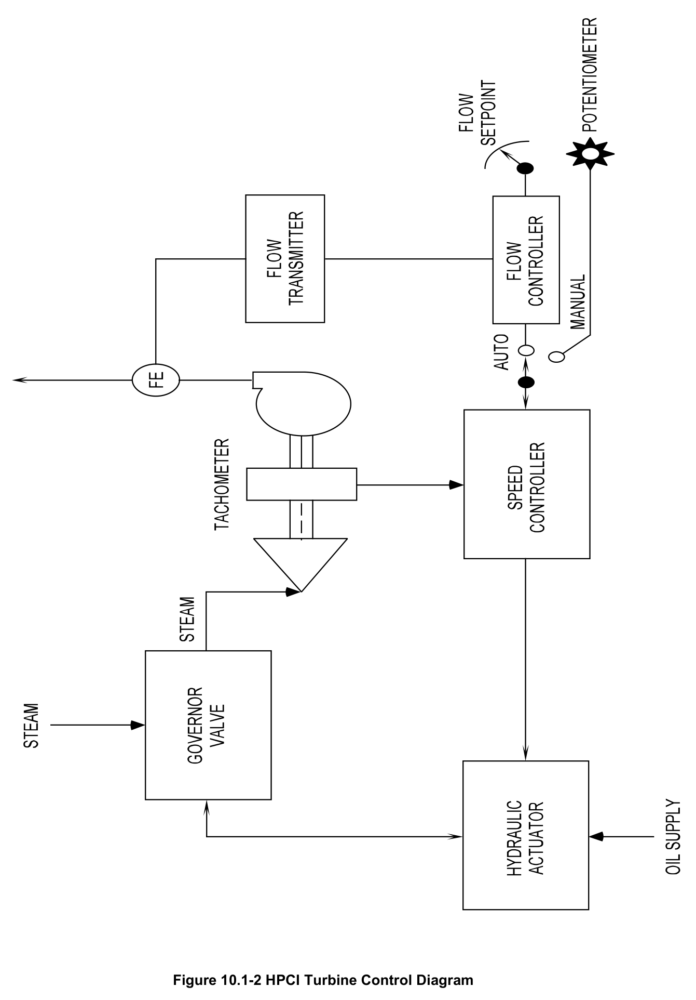
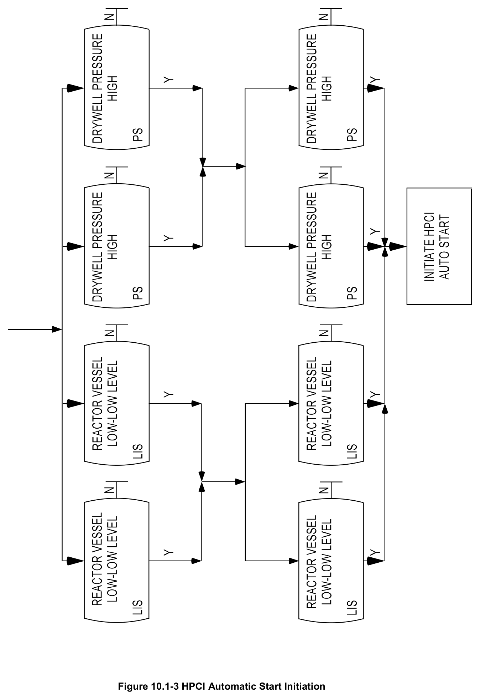
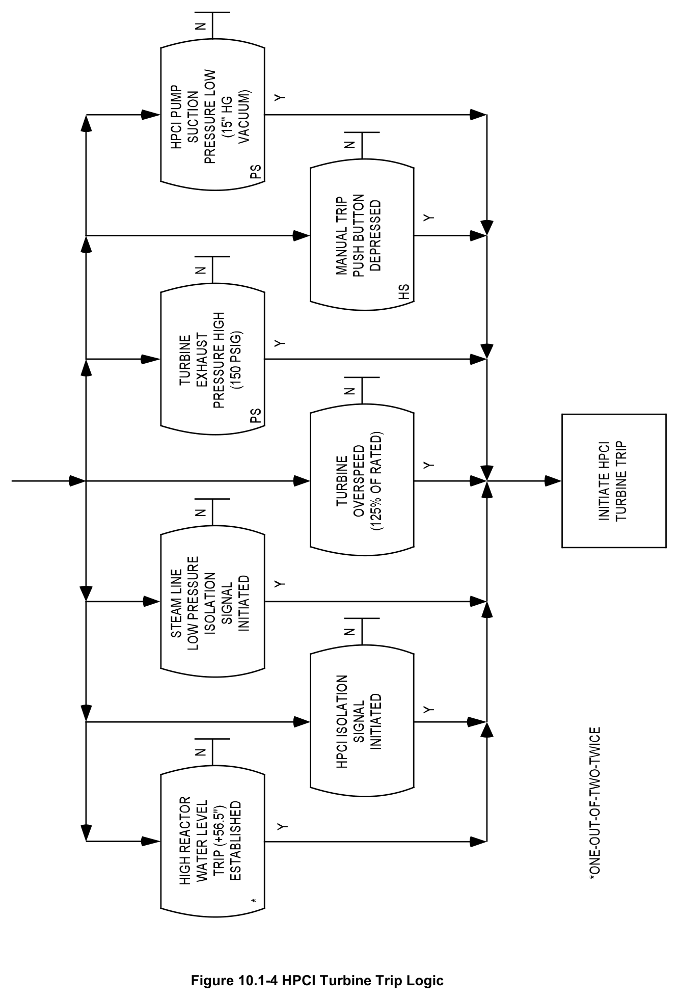
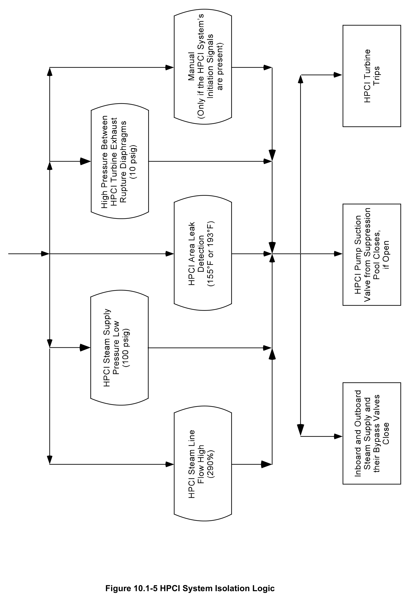

# 10.1 HPCI

> Source: `10.1_HPCI.pdf` (21 pages)
> GE (BWR) Systems Technology Manual — USNRC HRTD, Rev 09/11

---
<!-- p.1 -->
#### General Electric Systems Technology Manual
#### Chapter 10.1
#### High Pressure Coolant Injection System
<!-- p.3 -->
TABLE OF CONTENTS

10.1 HIGH PRESSURE COOLANT INJECTION SYSTEM ............................................ 1

10.1.1 Introduction ................................................................................................... 2

10.1.2 Component Description ................................................................................ 3

10.1.2.1 Steam Supply Isolation Valves (Inboard and Outboard) ....................... 3

10.1.2.2 Steam Supply Warming Isolation Valves (Inboard, Outboard) .............. 3

10.1.2.3 Steam Inlet to Turbine Valve................................................................. 4

10.1.2.4 Turbine Stop Valve ............................................................................... 4

10.1.2.5 Turbine Governor Valve ........................................................................ 4

10.1.2.6 HPCI Turbine ........................................................................................ 4

10.1.2.7 HPCI Turbine Exhaust Path .................................................................. 4

10.1.2.8 Auxiliary Oil Pump ................................................................................ 5

10.1.2.9 Barometric Condenser .......................................................................... 5

10.1.2.10 HPCI Pump Assembly .......................................................................... 6

10.1.2.11 HPCI Pump Suction Path ..................................................................... 6

10.1.2.12 HPCI Pump Discharge Path ................................................................. 7

10.1.3 System Features and Interfaces ................................................................... 8

10.1.3.1 HPCI Flow Controller ............................................................................ 8

10.1.3.2 HPCI Automatic Initiation ...................................................................... 8

10.1.3.3 Suction Path Transfer ........................................................................... 9

10.1.3.4 Manual Initiation .................................................................................... 9

10.1.3.5 Test Features ...................................................................................... 10

10.1.3.6 Automatic Isolation ............................................................................. 10

10.1.3.7 Automatic Turbine Trips ...................................................................... 11

10.1.3.8 System Interfaces ............................................................................... 11

10.1.4 Summary .................................................................................................... 12

Rev 09/11 10.1-i USNRC HRTD

<!-- p.4 -->
#### LIST OF FIGURES
10.1-1 High Pressure Coolant Injection System 10.1-2 HPCI Turbine Control Diagram 10.1-3 HPCI Automatic Start Initiation 10.1-4 HPCI Turbine Trip Logic 10.1-5 HPCI System Isolation Logic

Rev 09/11 10.1-ii USNRC HRTD

<!-- p.5 -->
### 10.1 HIGH PRESSURE COOLANT INJECTION SYSTEM
Learning Objectives:

1. Recognize the purposes of the High Pressure Coolant Injection (HPCI) system.

2. Recognize the purpose, function and operation of the following HPCI system major components:
a. Steam Supply Isolation Valves (Inboard, Outboard)
b. Steam Supply Warming Isolation Valves (Inboard, Outboard)
c. Steam Inlet To Turbine Valve d. Turbine Stop Valve e. Turbine Governor Valve f. Turbine g. Auxiliary Oil Pump h. Main and Booster Pump i. Flow Controller j. Suppression Pool Suction Valve k. Condensate Storage Tank Suction Valve l. Pump Discharge Valves m. Test Bypass to CST Valves n. Line Fill Pump o. Barometric Condenser and Receiver p. Turbine exhaust line vacuum breakers q. Minimum flow valve r. Cooling isolation valve s. Lube oil cooler

3. Recognize the following flowpaths of the HPCI system:
a. Steam Supply and Exhaust b. Injection Flow c. Test Flow d. Line Fill e. Pressure Control mode of operation f. Minimum flow g. Cooling flow

4. Recognize the plant parameters which will cause the following:
a. Automatic Initiation b. Automatic Isolation c. Automatic Turbine Trip d. Suction Path Transfer

Rev 09/11 10.1-1 USNRC HRTD

<!-- p.6 -->
5. Recognize the system’s normal standby alignment and how the system will respond to the following:
a. HPCI Initiation b. HPCI Isolation c. High reactor vessel level (Level 8)
d. Loss of all AC power

6. Recognize how the High Pressure Coolant Injection system interfaces with the following systems:
a. Automatic Depressurization System (Section 10.1)
b. Primary Containment System (Section 4.1)
c. Condensate and Feedwater System (Section 2.6)
d. Reactor Core Isolation Cooling System (Section 2.7)
e. Main Steam System (Section 2.5)
f. Nuclear Steam Supply Shutoff System (Section 4.4)
g. Reactor Building Standby Ventilation System (Section 4.3)

#### 10.1.1 Introduction
The purposes of the High Pressure Coolant Injection (HPCI) System are to maintain adequate reactor vessel water inventory, for core cooling, on small break LOCAs, depressurize the reactor vessel to allow low pressure Emergency Core Cooling Systems (ECCSs) to inject on intermediate break LOCAs, and to backup the Reactor Core Isolation Cooling (RCIC) System under reactor vessel isolation conditions.

The functional classification of the HPCI System is that of a safety related system. Its regulatory classification is an engineered safety feature system.

The HPCI System, shown in Figure 10.1-1, is an independent emergency core cooling system requiring no auxiliary AC power, plant service and instrument air, or external cooling water systems to perform its design function. The HPCI system consists of a turbine, turbine driven pumps, and the support systems required for turbine operation, and associated piping and instrumentation.

The HPCI System is normally aligned to remove water from the condensate storage tank and pump the water at high pressure to the reactor vessel via the "B" feedwater line. The alternate source of water to the HPCI pump is provided by the suppression pool. Both manual and automatic transfer of the suction path is provided. A test line permits functional testing of the system during normal plant operation. In the event the pump is operated with a closed discharge path a minimum flow path to the suppression pool is provided for HPCI pump cooling.

Rev 09/11 10.1-2 USNRC HRTD

<!-- p.7 -->
The HPCI system can supply makeup water to the reactor from above rated reactor pressure to a reactor pressure below that at which the low pressure ECCSs can inject.
By supplying cool water and using decay heat steam as a motive force for the HPCI turbine, the reactor will depressurize and allow the low pressure ECCSs to inject.

System initiation can be accomplished by automatic signals or manually by the control room operator. Receipt of either a reactor water level 2 or high drywell pressure will automatically start the HPCI system. To prevent component damage from water hammer effect on system initiation, the HPCI system is kept pressurized by the line fill pump.

#### 10.1.2 Component Description
The components of this system are discussed in the paragraphs that follow, and are illustrated on Figure 10.1-1.

##### 10.1.2.1 Steam Supply Isolation Valves (Inboard and Outboard)
The steam supply line to the HPCI turbine comes from the "A" main steam line on the reactor side of the inboard main steam isolation valve, upstream of the flow restrictor.
The HPCI steam line contains an inboard and outboard isolation valve (MOV-41, 42), along with warming valves, that will automatically close upon receipt of an isolation signal. The isolation valves are aligned with the inboard valve normally open and the outboard valve closed. The outboard isolation valve is closed, with its companion warming valve open, to limit contamination levels in the secondary containment due to a steam line failure when in the standby condition. The outboard isolation valve will not open unless its companion warming valve is open. Power supplied to the isolation valves is from different emergency distribution systems to ensure isolation of the system upon failure of one of the emergency power supplies. Power for the inboard isolation valve is from the emergency AC power system while the outboard is from DC power.

##### 10.1.2.2 Steam Supply Warming Isolation Valves (Inboard, Outboard)
A motor operated warming valve (MOV-47, 48) is provided around each of the steam supply isolation valves to pressurize and warm up the steam line from an isolated condition. The outboard warming valve is normally open to ensure the HPCI steam supply line is kept warm when the system is in the standby state. Both warming valves automatically close on HPCI system isolation. If the outboard warming valve is closed the outboard isolation valve will not open.

Rev 09/11 10.1-3 USNRC HRTD

<!-- p.8 -->
##### 10.1.2.3 Steam Inlet to Turbine Valve
The steam inlet to turbine valve (MOV-43) is used for normal turbine isolation to maintain it in standby readiness. The valve is normally closed and receives an open signal on HPCI automatic initiation.

##### 10.1.2.4 Turbine Stop Valve
Located in the HPCI steam line ahead of the governor valve is the hydraulic operated turbine stop valve (HOV-51). The stop valve provides turbine protection by rapidly shutting off steam flow to the turbine, upon receipt of any turbine trip signal.

##### 10.1.2.5 Turbine Governor Valve
The HPCI turbine governor valve is a spring to close hydraulic to open multi-poppet valve (HOV-52) that provides the means to vary steam flow to the turbine. By throttling the steam supply to the turbine, turbine speed and therefore pump flow can be controlled. Positioning of the governor valve is accomplished by adjusting the hydraulic operating oil supply via the HPCI flow controller.

##### 10.1.2.6 HPCI Turbine
The HPCI turbine is designed to accelerate rapidly from a cold standby condition to full load conditions within 25 seconds. The HPCI turbine is a two stage, horizontally mounted, radial reentry, non-condensing turbine designed to operate with a steam supply pressure ranging from 1120 psig to 150 psig. Turbine exhaust is routed to the suppression pool to condense the unused steam energy. Prolonged operation below 2200 RPM is avoided to guard against cycling the turbine exhaust check valve, supplying inadequate control fluid for valve operation, and inability to maintain adequate lube oil temperature and pressure.

##### 10.1.2.7 HPCI Turbine Exhaust Path
The HPCI turbine exhaust line routes steam from the exhaust of the HPCI turbine to the suppression pool below water level. The exhaust line is normally kept free of water during shutdown conditions by a drain system that removes condensation to the barometric condenser. The exhaust line may be manually isolated by a motor operated shutoff valve. Check valves serve as a vacuum breaker. The valves are installed between the suppression pool free air volume and the exhaust line to prevent drawing suppression pool water into the line when a vacuum is created by condensation of steam in the exhaust line following a HPCI operation. The vacuum breaker line will automatically isolate by closing a motor operated valve on high drywell pressure with low HPCI steam supply pressure.

Rev 09/11 10.1-4 USNRC HRTD

<!-- p.9 -->
The exhaust line is protected from overpressure by a HPCI turbine trip at 150 psig high turbine exhaust pressure. The high exhaust pressure trip is backed up by a set of mechanical rupture diaphragms (nominal rupture point is 175 psig) which will relieve pressure to the HPCI room. The rupture diaphragms are arranged in a manner such that the inboard rupture diaphragm is constantly exposed to HPCI turbine exhaust pressure while the outboard rupture diaphragm is only exposed to exhaust pressure if the inboard diaphragm fails. A space between the exhaust rupture diaphragms is provided with an orifice leak off to the HPCI room and a series of pressure switches which will initiate a HPCI isolation at 10 psig.

##### 10.1.2.8 Auxiliary Oil Pump
Lubrication and control oil for the HPCI System is provided by auxiliary D.C. motor driven pump and a turbine shaft drive pump (P-127). Cooling for the lubricating oil is supplied by the HPCI booster pump.

During startup and shutdown the motor driven auxiliary oil pump provides control oil for the HPCI turbine stop and governor valves, and lubricating oil for the turbine and pump bearings. The auxiliary oil pump is required to operate during turbine startup and shutdown since the turbine shaft-driven oil pump does not develop adequate discharge pressure at low speeds.

The auxiliary oil pump starts automatically on HPCI initiation and operates until deenergized by a signal from a pressure switch in the turbine shaft-driven oil pump line.
This occurs at a turbine speed of approximately 1500 rpm. The auxiliary pump will again operate on HPCI shutdown when the turbine decreases below approximately 1500 rpm. The pump may also be manually started.

##### 10.1.2.9 Barometric Condenser
The barometric condenser system is supplied with the turbine. The system prevents out leakage from the turbine shaft seals and turbine exhaust casing drain. The system includes a barometric condenser, vacuum tank pump (P-74), a hotwell, and a vacuum tank condensate pump (P-75). The vacuum pump starts automatically on a HPCI initiation signal, although it may be started manually.

Steam leakage from the gland seals, turbine governor and stop valve stems, and turbine exhaust drainage is collected in the barometric condenser. The condensate flows by gravity into the hotwell where it is retained until the barometric condenser vacuum tank condensate pump is started by a high level signal in the hotwell.
Condensate is pumped from the hotwell to the suction side of the booster pump if the

Rev 09/11 10.1-5 USNRC HRTD

<!-- p.10 -->
steam supply valve to the turbine is open or to Equipment Drain Sump if the HPCI system is in "standby".

Exhaust gases from the barometric condenser are discharged by the vacuum pump to the Reactor Building Standby Ventilation System (Section 4.3). The vacuum pump is operated for 15 minutes after turbine shutdown to void all steam and condensate from the turbine casing. The cooling water is pumped to the barometric condenser and the lube oil cooler by the HPCI booster pump and then returns to the HPCI booster pump suction. The motor operated HPCI Lube Oil Cooler Water Supply valve automatically opens on a HPCI initiation to align HPCI booster pump to the barometric condenser and lube oil cooler.

##### 10.1.2.10 HPCI Pump Assembly
The HPCI pump assembly (P-16) is turbine driven and consists of a single stage centrifugal booster pump, a reduction gear, and a multistage centrifugal main pump.
The booster pump takes water from one of the two water sources and discharges the water, at higher pressure, to the suction of the main pump. The main pump further increases the water pressure for injection into the reactor vessel via the "B" feedwater line.

The booster pump has a capacity of 4320 gpm (70 gpm for cooling) at a discharge pressure range of 60 to 265 psig. The main pump can provide the 4250 gpm to the reactor over a pressure range of 150 to 1120 psig. The HPCI pumps are located in the reactor building at an elevation that ensures that the HPCI booster pump suction is lower than either the CST or suppression pool minimum levels to ensure the pump NPSH requirements are met.

##### 10.1.2.11 HPCI Pump Suction Path
The HPCI System can take suction from the Condensate Storage Tank (CST) or the suppression pool. Normal suction is from the CST on a line common with the RCIC System suction line. The HPCI/RCIC suction line from the CST is located lower than all other system suction lines. This ensures a reserved volume of water in the CST exclusively for the HPCI and RCIC Systems.

The suppression pool suction is from a 16 inch pipe that includes a stainless steel suction strainer. The strainer is located above the suppression pool bottom to minimize plugging.

Automatic transfer of the suction path from the CST to the suppression pool occurs on low CST level or high suppression pool level. The HPCI CST suction valve (MOV-31) is normally open and will automatically open when HPCI is manually or automatically

Rev 09/11 10.1-6 USNRC HRTD

<!-- p.11 -->
initiated if the HPCI Suppression Pool suction (MOV-32) is not fully open. The HPCI CST suction valve will close automatically when MOV-32 is fully open. The HPCI suppression pool suction valve (MOV-32) automatically opens when the CST level is low or when the suppression pool level is high. MOV-32 will automatically close on a HPCI isolation signal.

##### 10.1.2.12 HPCI Pump Discharge Path
The HPCI pump discharges through the system flow element, outboard and inboard discharge valves (MOV-34, 35), and into the "B" feedwater line where the flow is distributed inside the reactor vessel by the feedwater spargers. A pump minimum flow line to the suppression pool taps off just before the flow element. The minimum flow valve (MOV-36) will open when system flow is <575 gpm and pump discharge pressure is >125 psig with the turbine stop valve and steam inlet to turbine valve open. In addition, a full flow test line (shared by the RCIC System) to the CST taps off just upstream of the outboard discharge valve.

The HPCI inboard and outboard discharge valves open automatically when a HPCI system automatic or manual initiation signal is present. Additionally, the inboard discharge valve (MOV-35) will not open if either steam inlet to turbine valve (MOV-43)
or turbine stop valve (HOV-51) is fully closed. This interlock prevents relying upon the HPCI injection check valve to prevent back leakage from the feedwater system.

• The HPCI Test Bypass valves MOV-37 and MOV-38 open and close based on control switch position and system control signals.
• Test bypass valve MOV-37 can only be opened if MOV-35, HPCI inboard discharge valve is fully closed preventing feedwater system back leakage to the Condensate Storage Tank.
• MOV-37 and 38 will close automatically when suppression pool suction valve MOV- 32 is fully open to prevent pumping the suppression pool to the Condensate Storage Tank.
• MOV-37 and 38 will close if the HPCI system is automatically or manually initiated.

To prevent component or pipe damage due to a water hammer effect on system initiation, the HPCI system is kept pressurized by the line fill pump (P-50) up to the inboard discharge valve. In the event that the line fill pump fails a connection is provided from the condensate transfer system that can supply line fill capabilities.

Rev 09/11 10.1-7 USNRC HRTD

<!-- p.12 -->
#### 10.1.3 System Features and Interfaces
A short discussion of system features and interfaces this system has with other plant systems is given in the paragraphs which follow.

##### 10.1.3.1 HPCI Flow Controller
The HPCI System utilizes a flow controller to automatically or manually control system flow upon initiation. Selection of either automatic or manual mode is performed by the control room operator. In the automatic mode (normal position), the controller compares actual HPCI System flow (sensed by a flow element on the discharge of the pump) with the desired flow setpoint (adjusted by the operator at the controller). Any deviation between actual and desired flow is then converted into a hydraulic signal which positions the governor valve as required to balance the flow signals. In manual mode the operator has direct control of turbine speed. The operator simply adjusts a manual potentiometer, at the flow controller, to create a signal used for positioning the governor valve to obtain the desired turbine speed/flow. The HPCI turbine controls are shown in Figure 10.1-2.

##### 10.1.3.2 HPCI Automatic Initiation
The HPCI System is automatically started by either of two initiating signals, high drywell pressure or reactor vessel low-low level. The logic (Figure 10.1-3) is arranged such that one-out-of-two-twice from the drywell pressure sensors or from the vessel level sensors will result in a system initiation.

When the initiation signal is received, several actions occur automatically:
• The turbine auxiliary oil pump and vacuum tank pump will start.
• The pump's minimum flow valve will open and then close as its setpoint is reached.
• The turbine stop valve and governor valve open when auxiliary oil pump discharge pressure is sufficient.
• The outboard steam isolation valve and steam inlet to turbine valve will open.
• The HPCI inboard discharge valve will open and stay open until the steam inlet to turbine valve closes or the turbine trips.
• The barometric condenser's vacuum tank condensate pump will start when hotwell level reaches high level.
• The HPCI test valves will receive a close signal.
• The outboard discharge valve and inboard steam supply isolation valve receive an open signal even though they are normally open.
• The CST suction valve receives an open signal and, if closed, will open if the suppression pool suction valve is closed.

Rev 09/11 10.1-8 USNRC HRTD

<!-- p.13 -->
• When the steam inlet to turbine valve is fully open, the steam line drain valves to the main condenser, and the barometric drain pump discharge valves to equipment drain sump close.
• The reactor building standby ventilation system also starts on high drywell pressure or reactor vessel low-low level to process barometric condenser vacuum pump discharge.

After the auxiliary oil pump starts, the oil pressure increases, and the turbine stop and governor valves begin to open. The stop valve opens fully, while the governor valve throttles the steam flow to the turbine to regulate the turbine speed hence pump flow.
As the turbine speed continues to increase, pump flow and discharge pressure increase until a flow of 4250 gpm is achieved (flow controller setting). The HPCI System will then run until an automatic isolation or turbine trip shuts down the system. At any time, the operator can take control. However, an initiation signal will not override manual control.

##### 10.1.3.3 Suction Path Transfer
Automatic transfer from the normal CST suction to the suppression pool occurs when the CST level is low or the suppression pool level is high. The automatic transfer of the suction path on low CST level ensures a sufficient water source is available to the HPCI pump. Requiring the suction path to transfer on suppression pool high level ensures a sufficient free air space above the suppression pool water level exists to allow the accumulation of non-condensible gases, following a LOCA. Automatic suction transfer on low CST level or high suppression pool level takes place by first opening the suppression pool suction valve and then the CST suction valve closes on interlock.

##### 10.1.3.4 Manual Initiation
If the operator detects a condition that should have resulted in the automatic initiation, or determines that the HPCI system is needed, manual system initiation is executed.
Manual initiation can be performed by depressing the armed Manual Initiation push button, or by manually aligning the system.

The Manual Initiation push button is activated by "arming" the switch (turning the arming collar through 90º) and then depressing the push button. System initiation is the same as that described above with the exception of the starting the Reactor Building Standby Ventilation System which must be done by the operator.

Manual alignment of the system is accomplished in the following order:
1. Start the vacuum pump.
2. Open outboard steam isolation valve.
3. Open the lube oil cooling water valve.
4. Open the steam inlet to turbine valve.

Rev 09/11 10.1-9 USNRC HRTD

<!-- p.14 -->
5. Start the auxiliary oil pump.
6. Open the inboard pump discharge valve.
7. With the controller in automatic mode the controller will increase turbine speed until a flow rate of 4250 gpm is reached.

##### 10.1.3.5 Test Features
Pump operability and flow tests are done by manually (without an initiation signal)
starting the system as outlined above with the exception of opening the inboard pump discharge valve. The test throttle valve is opened and pump speed is increased until the desired test conditions are achieved. During pump operability and flow test the water is circulated back to the CST via the two test return isolation valves.

##### 10.1.3.6 Automatic Isolation
Because the steam supply line to the HPCI turbine is part of the nuclear system process barrier, automatic isolation signals are employed to isolate the HPCI System. By isolating the HPCI System upon detection of a leak, the release of radioactive material is minimized. The HPCI System will automatically isolate from any one of the following signals:
• HPCI steam supply pressure low (100 psig).
• HPCI steam line flow high (290%).
• HPCI area leak detection, 155ºF or 193ºF depending on elevation of line.
• High pressure between turbine exhaust rupture diaphragms (10 psig).
• Manual (only if the system initiation signals are present).

Once an isolation signal is generated, from both the A and B isolation logic, the following automatic actions occur:
• The inboard and outboard steam supply and their bypass valves close.
• The HPCI pump suction valve from the suppression pool closes, if open.
• The HPCI turbine trips.

If only one isolation logic signal is actuated either the inboard or outboard isolation valves will close. For example if the ‘A’ isolation logic is actuated the inboard steam isolation valve and its bypass will close.

Rev 09/11 10.1-10 USNRC HRTD

<!-- p.15 -->
##### 10.1.3.7 Automatic Turbine Trips
The HPCI turbine is automatically shutdown, by closing the turbine stop and governor valves, to protect the physical integrity of the HPCI System. If any of the following conditions are detected the HPCI System will automatically trip:
• Turbine exhaust pressure high (150 psig).
• Turbine overspeed (125% rated).
• Pump suction pressure low (15" Hg vacuum).
• High reactor water level (+56.5").
• Any isolation signal.
• Manual

In addition to closing the turbine stop valve and governor valve, the minimum flow valve to the suppression pool and the HPCI inboard discharge valve also receive a close signal when the turbine trips. The isolation trips must be manually reset. The High Reactor Water Level Trip (Level 8) will automatically reset if level falls to the low-low level (Level 2) setpoint and can be manually reset above that point if needed. The other trip signals will automatically reset. The turbine trip logic is shown in Figure 10.1-4.

##### 10.1.3.8 System Interfaces
A short discussion of interrelations this system has with other plant systems is given in the paragraphs which follow:

Automatic Depressurization System (Section 10.2)

The HPCI System has a functional interface with the ADS since the ADS backs up the ECCS function of the HPCI system in the event it failed to perform as expected.

Condensate Storage Tank

The CST is the normal suction source for the HPCI System. Additionally the CST can be used for testing of the HPCI System.

Condensate and Feedwater System (Section 2.6)

The HPCI System uses the "B" feedwater line to inject water into the reactor vessel.

Emergency AC and DC Power Systems (Section 9.2, 9.4)

The inboard steam line isolation valve is powered from the division 1 emergency power bus. Division 2 provides power to the line fill pump. The 125 VDC division 2 power

Rev 09/11 10.1-11 USNRC HRTD

<!-- p.16 -->
supply provides motive force for motor operated valves, auxiliary oil pump, and the mechanical vacuum pump.

Main Steam System (Section 2.5)

The Main Steam System provides the HPCI System with steam through a penetration from the "A" main steam line.

Nuclear Steam Supply Shutoff System (Section 4.4)

The Nuclear Steam Supply Shutoff System provides the signals that execute HPCI system isolation. In addition NSSSS provides the signal that closes the HPCI Turbine Exhaust Vacuum Breaker Valve (MOV-49) on high drywell pressure concurrent with low HPCI steam line pressure.

Reactor Building Standby Ventilation System (Section 4.3)

The Reactor Building Standby Ventilation System removes and processes the noncondensible gases from the HPCI turbine barometric condenser.

Reactor Core Isolation Cooling System (Section 2.7)

The HPCI System has a functional interface with the RCIC System in that it backs up the function of the RCIC System by supplying high quality high pressure makeup to the reactor under isolation conditions. Additionally, the RCIC and HPCI systems share a suction line from the CST and a test line to the CST.

Suppression Pool (Section 4.1)

The suppression pool is the alternate source of water for the HPCI pump. It also condenses the HPCI turbine exhaust steam and the HPCI pump minimum flow water is routed to the suppression pool.

#### 10.1.4 Summary
The HPCI System is an independent ECCS requiring no auxiliary AC power, plant service and instrument air, or external cooling water systems to perform its design function. The HPCI system can supply makeup water to the reactor from above rated reactor pressure to a reactor pressure below that at which the low pressure ECCSs can inject. By supplying cool water and using decay heat steam as a motive force for the HPCI turbine, the reactor will depressurize and allow the low pressure ECCSs to inject.
System initiation can be accomplished by automatic signals or manually by the control room operator. Receipt of either a reactor water level 2 or high drywell pressure will automatically start the HPCI system.

Rev 09/11 10.1-12 USNRC HRTD

<!-- p.17 -->
#### Figure 10.1-1

*High Pressure Coolant Injection System*

[Vector original (SVG, lossless): fig_10.1-1.svg](../figures/fig_10.1-1.svg)

<!-- p.18 -->
#### Figure 10.1-2

*HPCI Turbine Control Diagram*

[Vector original (SVG, lossless): fig_10.1-2.svg](../figures/fig_10.1-2.svg)

<!-- p.19 -->
#### Figure 10.1-3

*HPCI Automatic Start Initiation*

[Vector original (SVG, lossless): fig_10.1-3.svg](../figures/fig_10.1-3.svg)

<!-- p.20 -->
#### Figure 10.1-4

*HPCI Turbine Trip Logic*

[Vector original (SVG, lossless): fig_10.1-4.svg](../figures/fig_10.1-4.svg)

<!-- p.21 -->
#### Figure 10.1-5

*HPCI System Isolation Logic*

[Vector original (SVG, lossless): fig_10.1-5.svg](../figures/fig_10.1-5.svg)

