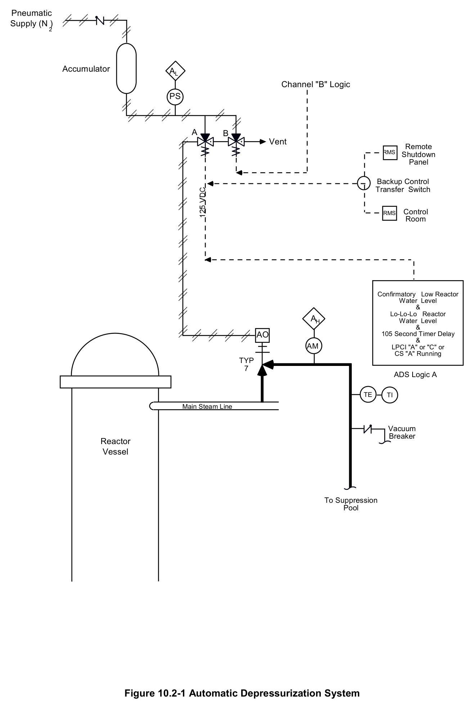
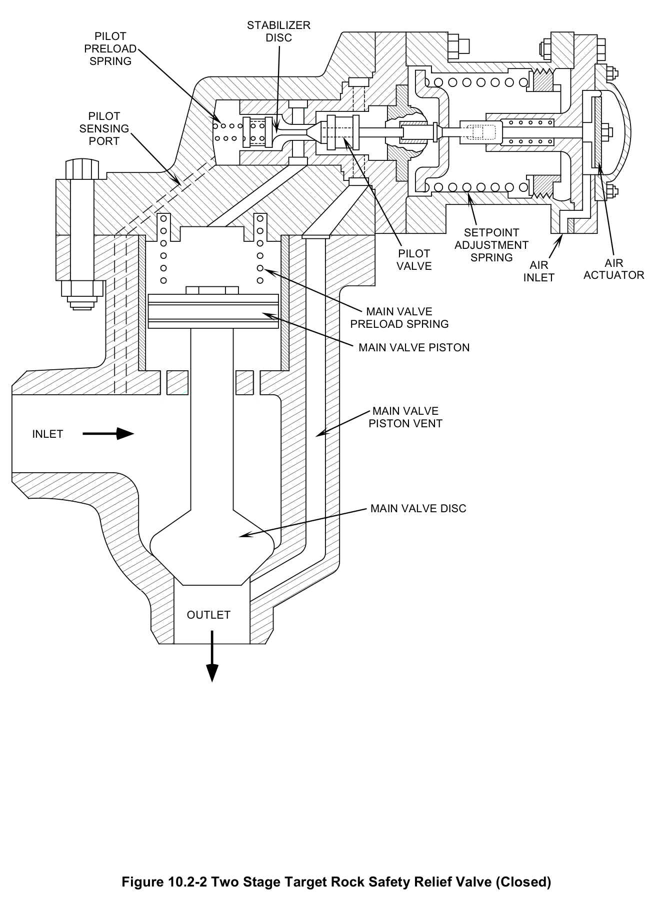
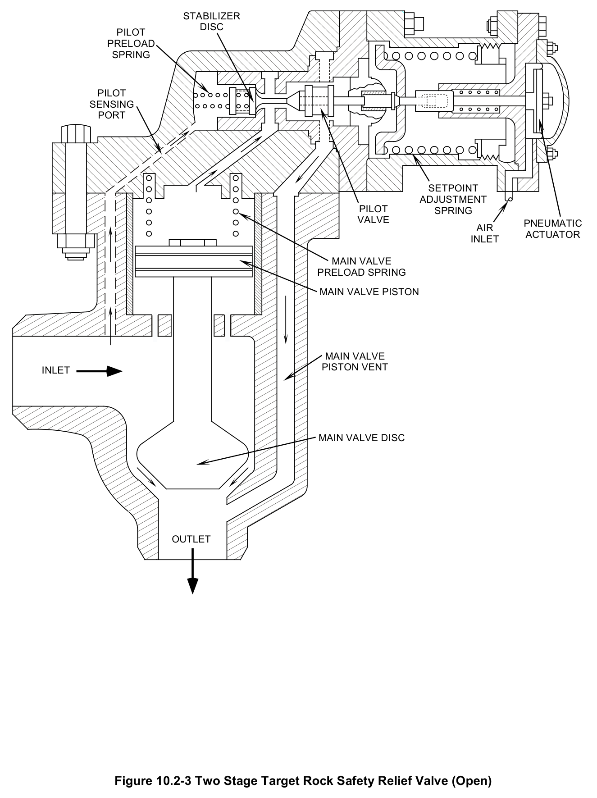
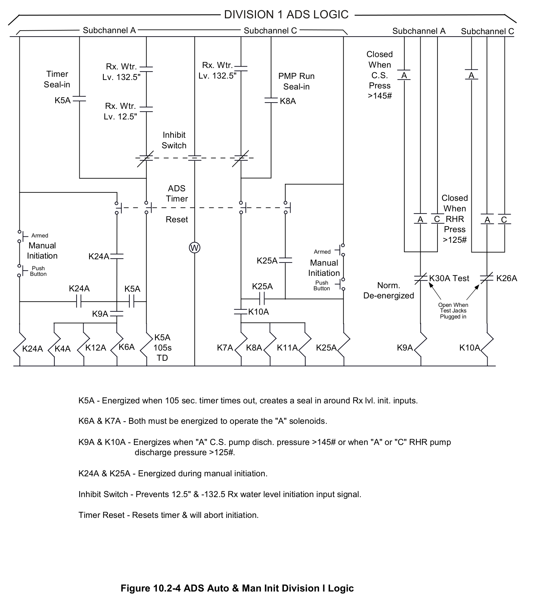

# 10.2 ADS

> Source: `10.2_ADS.pdf` (17 pages)
> GE (BWR) Systems Technology Manual — USNRC HRTD, Rev 09/11

---
<!-- p.1 -->
#### General Electric Systems Technology Manual
#### Chapter 10.2
#### Automatic Depressurization System
<!-- p.3 -->
TABLE OF CONTENTS

10.2 AUTOMATIC DEPRESSURIZATION SYSTEM ..................................................... 1

10.2.1 Introduction .................................................................................................... 1

10.2.2 Component Description .................................................................................. 2

10.2.2.1 Safety Relief Valves .............................................................................. 2

10.2.2.2 ADS Accumulators ................................................................................ 2

10.2.3 System Features and Interfaces .................................................................... 3

10.2.3.1 Automatic Initiation ............................................................................... 3

10.2.3.2 Resetting and Inhibiting ADS ................................................................ 3

10.2.3.3 Manual ADS Initiation ........................................................................... 4

10.2.3.4 System Interrelations ............................................................................ 4

10.2.4 Summary ........................................................................................................ 5

Rev 09/11 10.2-i USNRC HRTD

<!-- p.4 -->
#### LIST OF FIGURES
10.2-1 Automatic Depressurization System 10.2-2 Two Stage Target Rock Safety Relief Valve (Closed)
10.2-3 Two Stage Target Rock Safety Relief Valve (Open)
10.2-4 ADS Auto & Man. Init. Division 1 Logic

Rev 09/11 10.2-ii USNRC HRTD

<!-- p.5 -->
### 10.2 AUTOMATIC DEPRESSURIZATION SYSTEM
Learning Objectives:

1. Recognize the purpose of the Automatic Depressurization System (ADS).

2. Recognize the purpose, function and operation of the following ADS components:
a. ADS Safety Relief Valves b. ADS Safety Relief Valve Solenoid Pilot Valves c. ADS Accumulators

3. Recognize the plant conditions necessary to automatically initiate ADS and the reason for each signal input.

4. Recognize the methods available to manually override or inhibit ADS automatic initiation.

5. Recognize how the Automatic Depressurization System interfaces with the following systems:
a. Main Steam System (Section 2.5)
b. Primary Containment System (Section 4.1)
c. ECCS Systems (Section 10)
d. DC Power System (Section 9.4)
e. Service and Instrument Air System (Section 11.6)

#### 10.2.1 Introduction
The purpose of the Automatic Depressurization System (ADS) is to rapidly lower reactor pressure to allow low pressure injection sources to maintain reactor water level above the Top of Active Fuel (TAF). ADS is an Emergency Core Cooling System (ECCS) and is the backup system to the High Pressure Coolant Injection (HPCI) system. The functional classification of ADS is a safety related system. Its regulatory classification is an engineered safeguards system.

Two types of events that could satisfy the ADS logic include:
• Small to intermediate Loss of Coolant Accidents (LOCAs) beyond the capacity of the HPCI system
• Failure of high pressure injection systems when the reactor is pressurized

The low pressure ECCS systems include Core Spray (CS) and the Low Pressure Coolant Injection (LPCI) mode of the Residual Heat Removal (RHR) system.
If reactor water level is lowering toward the TAF, then depressurization may be required to allow use of the high volume CS and LPCI pumps to recover water level.

Rev 09/11 10.2-1 USNRC HRTD

<!-- p.6 -->
ADS is an energize-to-function system consisting of two redundant logic channels
(Division I and Division II). Each ADS SRV (Figure 10.2-1) has two solenoid air pilot valves. One solenoid air pilot valve is energized by ADS “Division I” and the second is energized by “Division II”. Only one energized solenoid pilot valve (from either “Division I” or “Division II”) is required to open an ADS SRV.

If the ADS initiation logic is satisfied, the solenoid operated SRV pilot valves open to apply pneumatic pressure to the SRV operators which then open the SRVs. The pneumatic pressure is applied from the Instrument Nitrogen system. Nitrogen is used such that any leakage from the ADS SRV supply will not jeopardize containment inertness. Each ADS valve has an accumulator to store pressurized nitrogen to provide the SRV operating pressure when the Instrument Nitrogen system pressure is low.

The safety-related station batteries supply DC power to the ADS logic divisions. The power supplies to each ADS division are separated to minimize the effect of a single electrical failure.

#### 10.2.2 Component Description
The major components of the Automatic Depressurization System are discussed in the paragraphs that follow.

##### 10.2.2.1 Safety Relief Valves
The ADS uses seven of the eleven SRVs mounted on the main steam lines to carry out its function. ADS SRVs electro-pneumatically actuate by either the ADS automatic logic or remote manual control from the main control room. Figure 10.2-1 shows the solenoid control arrangement for the ADS associated SRVs. In the electro-pneumatic mode of operation (Figures 10.2-2 & 10.2-3) pressurized nitrogen is applied to a pneumatic actuator whenever a solenoid air pilot valve opens. The air actuator positions the pilot assembly to depressurize the top of the main valve piston opening the main valve.

##### 10.2.2.2 ADS Accumulators
Each of the ADS SRVs is equipped with an accumulator and check valve (Figure 10.2- 1). The accumulators assure that the ADS valves can be opened and held open when Instrument Nitrogen system pressure is too low. Each accumulator check valve will isolate its accumulator from the Instrument Nitrogen system under low system pressure.
This will ensure that the accumulator pressure can be preserved for ADS operation.
The accumulators are sized to contain sufficient air for a minimum of five valve operations.

Rev 09/11 10.2-2 USNRC HRTD

<!-- p.7 -->
#### 10.2.3 System Features and Interfaces
A short discussion of the system features and interface this system has with other plant systems is given in the paragraphs which follow.

##### 10.2.3.1 Automatic Initiation
The ADS logic has two divisions. Figure 10.2-4 shows the ADS “Division I”. ADS “Division II” is similar. Either one of the ADS divisions can initiate ADS. Each ADS division has two sub-channels. ADS “Division I” includes sub-channels “A” & “C” and ADS “Division II” includes sub-channels “B” & “D”.

When all of the following conditions are met, the ADS logic circuits will energize the ADS solenoid pilot valves to open the ADS SRVs:

• Reactor Water Level 1
• Reactor Water Level 3 (Confirmation of low level condition)
• Discharge pressure sensed at one LPCI pump or at one CS pump
• 105 second time delay as determined by an ADS timer

Reactor Water Level 1 indicates that reactor water may be lowering to the point that reactor fuel integrity will be challenged. Reactor Water Level 3 is used as a confirmatory signal, to prevent a spurious initiation if there is a level instrument failure.
If the Level 1 signal is valid, it is highly probable that HPCI has insufficient capacity for the leak size or has failed.

The pump discharge condition is required to ensure that there is low pressure injection available before depressurization. The ADS Channels will not initiate depressurization until at least one CS or one LPCI pump is running.

The 105 second time delay is to allow HPCI to restore water level and to allow the operator to determine if ADS initiation is required. Some Emergency Operating Procedures (EOPs) direct that ADS initiation be prevented. A rapid depressurization places a tremendous thermal cycle on the Reactor Pressure Vessel (RPV).
Depressurization also complicates reactor power control during an Anticipated Transient Without Scram (ATWS) due to the large positive reactivity addition as the core cools down.

##### 10.2.3.2 Resetting and Inhibiting ADS
The operator can prevent automatic depressurization using two methods (Figure 10.2- 4):
• Resetting the ADS Timers
• Inhibiting ADS

Rev 09/11 10.2-3 USNRC HRTD

<!-- p.8 -->
Each of the ADS divisions has an ADS timer. Resetting the ADS timers only delays the initiation by 105 seconds. When the ADS timers are manually or automatically reset, they revert to “0” seconds and begin a new 105 second time delay.

Each ADS division has its own manual reset pushbutton on the 602 panel. To manually reset both ADS timers the “ADS Reset Division I” and the “ADS Division Reset II” pushbuttons must be depressed.

The ADS timer will automatically reset in the event that either the Level 1 or Level 3 conditions clear during the time delay.

ADS initiation is “inhibited” by placing both the “ADS Auto Inhibit Division I” switch and the “ADS Auto Inhibit Division II” switches in the “inhibit” position. In the inhibited condition, ADS is disabled and can only be restored by operator action. If ADS is inhibited the operator can depressurize the RPV using;
• the ADS manual initiation pushbuttons if a low pressure ECCS pump is operating
• the individual control switches in the control room.

##### 10.2.3.3 Manual ADS Initiation
The ADS logic includes a manual initiation feature. Arming and then depressing the manual initiation pushbuttons, with a low pressure ECCS pump running, will initiate ADS with no time delay. The manual initiation feature reset is identical to the automatic initiation reset described above.

Each of the seven ADS SRVs can be opened using individual control switches
(close/auto and open) located in the control room on panel 602 panel. The control room operator can individually open any or all of the ADS valves to manually lower reactor pressure.

##### 10.2.3.4 System Interrelations
The interfaces this system has with other plant systems are discussed in the paragraphs which follow:

Main Steam System (Section 2.5)

The ADS uses seven of the eleven SRVs mounted on the Main Steam Lines lower reactor pressure.

Primary Containment System (Section 4.1)

The SRVs use the suppression pool as a heat sink for the steam from the reactor vessel.

Rev 09/11 10.2-4 USNRC HRTD

<!-- p.9 -->
DC Power System (Section 9.4)

The DC Power System provides power to both the ADS logic and to the ADS solenoid valves.

High Pressure Coolant Injection System (Section 10.1)

ADS is the backup for the HPCI system. In the event of a HPCI system failure, ADS will rapidly depressurize the RPV. This allows the low pressure ECCS systems to mitigate a small or intermediate LOCA.

Core Spray System (Section 10.3)

The CS pump discharge pressure is one of the signals that is used to meet the low pressure ECCS signal criteria for an ADS initiation. In addition CS pumps provide water injection to the depressurized reactor vessel.

Residual Heat Removal (Section 10.4)

The RHR pump discharge pressure is one of the signals that is used to meet the low pressure ECCS signal criteria for an ADS initiation. In addition the LPCI mode of the RHR system provides water injection to the depressurized reactor vessel.

Instrument Nitrogen (No Section)

Instrument Nitrogen is an ancillary pneumatic operating loop of the Instrument Air system. Instrument Nitrogen provides the pneumatic pressure required to open the ADS SRVs.

#### 10.2.4 Summary
The Automatic Depressurization System uses seven safety relief valves to depressurize the reactor vessel. Reactor depressurization allows the low pressure sources to reflood the reactor. ADS is a backup to the HPCI system for small or intermediate LOCAs. To initiate, ADS must sense;
• a low reactor vessel water level (Level 3)
• a low reactor vessel water level (level 1)
• a low pressure ECCS pump running
• completion of a 105 second timer.

The 105 second time delay allows HPCI to restore water level. It also allows the operator to determine if ADS initiation is required. The operator has the ability to inhibit ADS as required by the plant EOP's

Rev 09/11 10.2-5 USNRC HRTD

<!-- p.11 -->
#### Figure 10.2-1

*Automatic Depressurization System*

[Vector original (SVG, lossless): fig_10.2-1.svg](../figures/fig_10.2-1.svg)

<!-- labels/text on this figure page -->
Pneumatic Supply (N )
2
Accumulator AL Channel "B" Logic PS
A B Vent Remote RMS Shutdown Panel
Backup Control Transfer Switch
Control RMS Room
Confirmatory Low Reactor Water Level & Lo-Lo-Lo Reactor AH Water Level & AO 105 Second Timer Delay & AM LPCI "A" or "C" or CS "A" Running TYP 7 ADS Logic A
TE TI
Main Steam Line
Vacuum Breaker Reactor Vessel
To Suppression Pool
Figure 10.2-1 Automatic Depressurization System

<!-- p.13 -->
#### Figure 10.2-2

*Two Stage Target Rock Safety Relief Valve (Closed)*

[Vector original (SVG, lossless): fig_10.2-2.svg](../figures/fig_10.2-2.svg)

<!-- labels/text on this figure page -->
STABILIZER PILOT DISC PRELOAD SPRING
PILOT SENSING PORT
SETPOINT ADJUSTMENT PILOT SPRING AIR VALVE AIR ACTUATOR INLET
MAIN VALVE PRELOAD SPRING
MAIN VALVE PISTON
MAIN VALVE PISTON VENT INLET
MAIN VALVE DISC
OUTLET
Figure 10.2-2 Two Stage Target Rock Safety Relief Valve (Closed)

<!-- p.15 -->
#### Figure 10.2-3

*Two Stage Target Rock Safety Relief Valve (Open)*

[Vector original (SVG, lossless): fig_10.2-3.svg](../figures/fig_10.2-3.svg)

<!-- labels/text on this figure page -->
STABILIZER DISC PILOT PRELOAD SPRING
PILOT SENSING PORT
SETPOINT ADJUSTMENT PILOT SPRING VALVE PNEUMATIC AIR ACTUATOR INLET
MAIN VALVE PRELOAD SPRING
MAIN VALVE PISTON
MAIN VALVE PISTON VENT INLET
MAIN VALVE DISC
OUTLET
Figure 10.2-3 Two Stage Target Rock Safety Relief Valve (Open)

<!-- p.17 -->
#### Figure 10.2-4

*ADS Auto & Man Init Division I Logic*

[Vector original (SVG, lossless): fig_10.2-4.svg](../figures/fig_10.2-4.svg)

<!-- labels/text on this figure page -->
DIVISION 1 ADS LOGIC
Subchannel A Subchannel C Subchannel A Subchannel C
Closed When Rx. Wtr. Rx. Wtr.
Timer A Lv. 132.5" Lv. 132.5" PMP Run C.S. A Seal-in Press Seal-in >145# K5A K8A Rx. Wtr.
Lv. 12.5"
Inhibit Switch
ADS Closed Timer When A C RHR A C Reset Press Armed >125# Manual W Armed Initiation K24A K25A Manual Push Initiation Button K26A K30A Test Push Norm. K25A K24A K5A Button De-energized Open When K10A Test Jacks K9A Plugged in
K5A K9A K10A K24A K4A K12A K6A 105s K7A K8A K11A K25A TD
K5A - Energized when 105 sec. timer times out, creates a seal in around Rx lvl. init. inputs.
K6A & K7A - Both must be energized to operate the "A" solenoids.
K9A & K10A - Energizes when "A" C.S. pump disch. pressure >145# or when "A" or "C" RHR pump discharge pressure >125#.
K24A & K25A - Energized during manual initiation.
Inhibit Switch - Prevents 12.5" & -132.5 Rx water level initiation input signal.
Timer Reset - Resets timer & will abort initiation.
Figure 10.2-4 ADS Auto & Man Init Division I Logic

